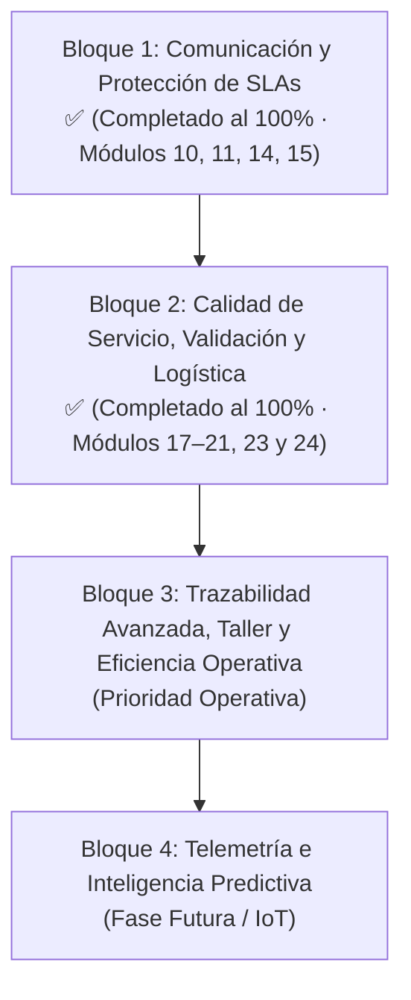

# VendGuard · Catálogo de Funcionalidades Pendientes y Roadmap Futuro**Documento:** `docs/features_pendientes.md`  
**Fecha de Actualización:** Noviembre 2026
  
**Estado del Proyecto:** batería global: 400 suites · 14.981 aserciones, al 100 % en verde. Documento NO versionado (.gitignore:21); la guarda de cifras solo audita markdown versionados. PR #11 consolidada (rama `reassignment-custody`) con cerrojo idiomático de custodia real y el resumen de custodia (`custody_summary`) y línea temporal interactiva en el modal de detalle; dos pruebas críticas preservadas con `DocMetricsGuard`.
**Conformidad Arquitectural:** [Constitución de VendGuard](../constitution.md) (Artículos I al VII), [AGENTS.md](../AGENTS.md), Dogma Vanilla (PHP 8.2+ OOP nativo, Vue 3 ES Modules sin bundlers en runtime).

---

## 📌 Resumen de Filtrado y Depuración de Features

Tras auditar el código fuente, la base de datos relacional y las suites de pruebas de VendGuard, **se han eliminado del catálogo de pendientes las siguientes funcionalidades que ya están 100% implementadas y operativas**:

| Feature Original | Módulo de VendGuard | Estado Actual en el Código |
| :--- | :--- | :--- |
| **🏷️ Generador de Códigos QR para Máquinas** | **Módulo 02:** `02-qr-codes` | **Implementado.** Generador vectorial SVG puro (ISO 18004 Reed-Solomon), impresión de etiquetas industriales A4, escaneo público sin login y reporte ciudadano directo. |
| **📊 Métricas y BI (MTTR y Auditoría)** | **Módulo 03:** `03-metrics-audit` | **Implementado.** MTTR global y personal por técnico, monitor de SLA < 4h para alimentos perecederos, tabla append-only `audit_log`, exportación CSV con UTF-8 BOM e informe ejecutivo A4. |
| **🏢 Panel CRUD de Administración Integral** | **Módulo 04:** `04-admin-crud` | **Implementado.** CRUD completo de Sedes con geocodificación, CRUD de Máquinas con transferencias auditadas y CRUD de Personal Interno con reseteo de credenciales. |
| **🧼 Mantenimiento Preventivo y Checklists Sanitarios** | **Módulo M1:** `05-preventive-maintenance` | **Implementado.** Frecuencias normativas por tipología, órdenes preventivas, checklist de inspección, cuarentena sanitaria automática y certificados higiénicos oficiales. |
| **📦 Catálogo y Control de Repuestos (*Spare Parts*)** | **Módulo M2:** `06-spare-parts` | **Implementado.** Catálogo maestro por modelo de máquina, pausa técnica estructurada, declaración de piezas sustituidas con *snapshot* inmutable de coste, destino `DESGUACE`/`TALLER` y analítica de fallos. |
| **🗺️ Mapa Interactivo de Rutas y Georreferenciación** | **Módulo M4:** `07-route-map` | **Implementado.** Proyección Web Mercator nativa sin librerías de terceros, optimización de ruta en 4 fases (Haversine esférico), modal móvil para técnico con enlaces GPS de Google Maps y mapa territorial de coordinación. |
| **💰 Reintegros e Importe Retenido (Dinero Tragado)** | **Módulo M5:** `08-refunds` | **Implementado.** Captura de reclamación en reporte QR, generación de PIN secreto de 4 dígitos, validación nativa de IBAN (Módulo 97 ISO 7064) y Bizum, custodia en recepción vs. caja central (> 10 €), validación en conserjería y panel de liquidación. |
| **🔍 Modal de Detalle Integral de Incidencia** | **Módulo 09:** `09-incident-detail-modal` | **Implementado.** Expediente unificado para Coordinador y Técnico, línea temporal inmutable, visor de evidencias fotográficas, repuestos declarados, checklist sanitario y costes asociados. |
| **💬 Hilo de Comentarios con Notas Internas** | **Módulo 10:** `10-incident-comments` | **Implementado.** Conversación bidireccional Sede-Técnico-Coordinación, segregación estricta de notas internas (`is_internal`), enmascaramiento de identidad técnica ante sede (Art. V.4), subida de fotos ($\le 5\text{ MB}$), paginación por cursor y sellado a 48h. |
| **⏸️ Pausa de SLA por Falta de Acceso (`PENDING_INFO`)** | **Módulo 11:** `11-pending-info-sla-pause` | **Implementado.** Estado operativo `PENDING_INFO` con causa tipificada y motivo $\ge 20$ chars, congelación y desplazamiento de SLA en horario hábil, doble reloj biológico (Art. II) con cuarentena automática a las 4h en perecederos vía barrido desatendido, reanudación manual e inactividad de 72h con máquina fuera de servicio (Art. V.1). |
| **☁️ Persistencia Cloud y Motor Único** | **Módulos 12 y 13:** `12-hybrid-supabase-migration`, `13-single-engine-supabase` | **Implementado.** Migración homogénea a PostgreSQL 16+ administrado en Supabase (pooler transaccional Supavisor en puerto 6543 con TLS verify-full) y motor único en local sin dependencias residuales de MariaDB/MySQL. |
| **🔔 Centro de Notificaciones y Outbox Transaccional** | **Módulo 14:** `14-notification-center-outbox` | **Implementado.** Cola transaccional `notification_outbox` con 6 estados canónicos, prioridades normativas, worker CLI (`bin/send_notifications.php`) y endpoint HTTP, reintentos exponenciales, rescate de lote, alertas sanitarias automáticas (2h/3h), canal corporativo webhook con validación anti-SSRF y modal interactivo para Coordinación. |
| **📱 Alertas de Asignación por Telegram** | **Módulo 15:** `15-telegram-technician-alerts` | **Implementado.** Aviso personal directo al técnico de guardia/ruta vía Bot API de Telegram (`api.telegram.org`) con botón interactivo de enlace profundo (*deep linking*) a la avería, vinculación de `telegram_chat_id` validada y auditada en usuarios, y relé edge Cloudflare Workers opcional. |
| **⚡ Avería Oportunista In Situ (Alta y Asunción en Ruta)** | **Módulo 16:** `16-opportunistic-incident` | **Implementado.** Alta in situ (`NEW`), asunción de ticket abierto (`ASSUMED`), traspaso con nota interna confidencial (`is_internal = TRUE`), reapertura en garantía in situ, sustitución atómica de 3.ª reincidencia (avería crónica), salvaguarda sanitaria de frío (Art. II), ventana de gracia de 30 min (+5 min), coexistencia en Parada #1, recordatorio QR para pagos/monedas sin capturar datos bancarios (Art. V.4) y métricas de desplazamientos evitados. |
| **🗺️ Zonificación Operativa y Asignación Asistida por Territorio** | **Módulo 17:** `17-operational-zones` | **Implementado.** Zonas operativas por código postal con herencia automática de sede y excepción manual auditada, cuadrante de titulares y suplentes con titularidad única por técnico, motor de sugerencia explicado (afinidad, presencia in situ, carga viva, pausas y guardia sanitaria), descarte del sugerido con justificación $\ge 20$ caracteres reales (Art. V.1), despacho en dos toques, filtro territorial coloreado en el mapa de coordinación y privacidad total de la zona frente a la sede (Art. V.4). |
| **🚐 Inventario de Repuestos en Furgoneta (Alcance Mínimo)** | **Módulo 18:** `18-van-stock` | **Implementado (Fase 1).** Stock por pareja `(técnico, pieza)` con cantidad y umbral mínimo, alta y ajuste absoluto desde Coordinación con auditoría del delta, descuento automático al declarar piezas en resoluciones correctivas y preventivas, soporte de saldo negativo (descuadre), alertas de bajo umbral por severidad y vista de solo lectura para el técnico. |
| **⭐ Encuesta de Satisfacción Post-Resolución (CSAT de Sede)** | **Módulo 20:** `20-csat-satisfaction-survey` | **Implementado.** Tabla 28 `incident_satisfaction_surveys` con una encuesta por episodio `(incident_id, resolution_at)`, inmutable y sin rectificación, nota entera 1–5 y comentario opcional ≤ 500; modal accesible en el Portal de Sede con aviso de pendientes y total real (tope de 20) y refresco tras cada envío; bloque CSAT en el Cuadro de Mandos con media, distribución por estrellas, tabla por sede, tabla por técnico con nombre congelado y tendencia mensual, siempre bajo el filtro temporal vigente. |
| **📶 Modo Offline PWA para Técnicos de Campo** | **Módulo 24:** `24-offline-pwa` | **Implementado.** Manifest instalable e iconos SVG, Service Worker con App Shell completo y `Network-Only` estricto para `/api/*`, copia local en `IndexedDB` aislada por técnico con vigencia 4 h/12 h, cola FIFO de las 9 operaciones de parada con idempotencia `client_mutation_id`, preservación exacta de Δt con reloj desajustado, precinto sanitario in situ (Art. II), cuota de 5 fotos / 25 MB con firma PNG exenta, volcado de conflictos en un toque (incluidas canceladas/cerradas y preventivas), retención de cuarentena, bloqueo de logout, re-autenticación del titular y volcado por baja de cuenta. |

---

## 📋 Catálogo de Funcionalidades Restantes (Ordenadas por Prioridad Operativa)

Las funcionalidades restantes se han estructurado en **4 bloques ordenados por valor de negocio, impacto operativo y urgencia de implementación**:



---

### 🔴 Bloque 1: Comunicación, Notificaciones y Protección de SLAs (Prioridad Alta · ✅ Concluido al 100%)

Funcionalidades críticas para garantizar la respuesta inmediata ante emergencias de frío (Art. II) y evitar penalizaciones injustas de SLA por causas atribuibles a la sede cliente. **Todas las funcionalidades de este bloque están 100% implementadas y operativas en producción.**

#### 1. 🔔 Centro de Notificaciones Multicanal y Patrón Transaccional Outbox
* **Estado:** ✅ **100% IMPLEMENTADO (Módulos 14 y 15: `14-notification-center-outbox` y `15-telegram-technician-alerts`)** — Cola transaccional `notification_outbox` con 6 estados canónicos, worker CLI (`bin/send_notifications.php`) y endpoint HTTP, reintentos progresivos con backoff, alertas de inminencia sanitaria (2h sin asignar / 3h sin iniciar), webhook corporativo con validación anti-SSRF, bot API de Telegram con alertas directas y deep linking al móvil del técnico, y panel reactivo en Coordinación al 100% en verde.
* **Propósito:** Alertas proactivas inmediatas sin bloquear peticiones HTTP de usuario ni sufrir pérdidas de mensajes por caídas de red o proveedores de correo.
* **Componentes Técnicos:**
  * Tabla transaccional `notification_outbox` (`id`, `channel`, `recipient`, `template`, `payload_json`, `status`, `attempts`, `created_at`, `processed_at`).
  * Worker CLI en segundo plano (`bin/send_notifications.php`) ejecutable vía cron/demonio.
  * Canal Email (SMTP/PHPMailer nativo) y Webhooks configurables (Slack, Discord o Telegram).
* **Casos de Uso de Negocio:**
  * **Alerta Inmediata de Frío (Art. II):** Notificación prioritaria a coordinador y técnico de guardia ante averías de máquinas con perecederos.
  * **Aviso de Asignación:** El técnico recibe un mensaje inmediato con los datos del nuevo ticket asignado.
  * **Alerta de Inminencia de SLA:** Aviso urgente al coordinador si un ticket perecedero lleva $> 2$ horas sin asignación o $> 3$ horas sin inicio.
  * **Confirmación Ciudadana/Sede:** Notificación con enlace de seguimiento al reportador.
* **Complejidad:** Implementado.

#### 2. ⏸️ Estado Operativo "Pendiente de Información" (`PENDING_INFO`) con Pausa de SLA
* **Estado:** ✅ **100% IMPLEMENTADO (Módulo 11: `11-pending-info-sla-pause`)** — Batería de pruebas unitarias, integración HTTP (`PendingInfoApiTest`, `PendingInfoConstitutionalTest`), frontend Vue 3 ESM, barrido sanitario automatizado (`SanitaryClockSweepService`) y certificación de extremo a extremo al 100% en verde.
* **Propósito:** Evitar penalizaciones indebidas en el cálculo de MTTR y cumplimiento de SLA cuando la intervención está bloqueada por factores del cliente (p. ej., edificio cerrado, falta de acceso, corte eléctrico del inmueble).
* **Componentes Técnicos:**
  * Nuevo estado `PENDING_INFO` en el enum `IncidentStatus` con motivo obligatorio ($\ge 20$ caracteres).
  * Lógica de reloj en `IncidentPauseService` y `MetricsCalculationService`: desconectar del cómputo de SLA la duración acumulada en intervalos `PENDING_INFO` en horario hábil comercial.
  * Doble reloj (Art. II): reloj comercial congelado vs. reloj biológico 24/7 continuo con cuarentena sanitaria a las 4 horas naturales en perecederos.
  * Transición automática a reactivación cuando la sede responde o el técnico reanuda in situ.
* **Valor para el Cliente:** Mayor equidad y rigor contractual en reuniones de seguimiento de SLA con grandes cuentas.
* **Complejidad:** Implementado.

#### 3. 💬 Hilo de Comentarios Bidireccional con Notas Internas Confidenciales
* **Estado:** ✅ **100% IMPLEMENTADO (Módulo 10: `10-incident-comments`)** — Batería de pruebas unitarias, integración HTTP, componentes front Vue 3 ESM y blindaje constitucional (Art. V.4) en verde.
* **Propósito:** Permitir un canal de comunicación directo entre la sede y el equipo técnico protegiendo la confidencialidad de datos internos (Art. V.4).
* **Componentes Técnicos:**
  * Aprovechar la columna existente `is_internal` en `incident_comments`.
  * Interfaz de conversación en el Portal de Sede: solo visualiza y crea comentarios públicos (`is_internal = 0`).
  * Interfaz en panel de Coordinación y vista móvil de Técnico: selector reactivo entre **"Mensaje para Sede"** (público) y **"Nota Interna de Taller"** (confidencial, `is_internal = 1`).
* **Valor para el Cliente:** Agiliza aclaraciones sobre el terreno ("la máquina está en el ala norte") sin exponer notas de taller a los clientes.
* **Complejidad:** Implementado.

---

### 🟡 Bloque 2: Calidad de Servicio, Validación y Logística Móvil (Prioridad Media · ✅ Concluido al 100%)

Herramientas para formalizar la entrega de trabajos en sede, evaluar la percepción del cliente, conectar el catálogo de repuestos con el vehículo del técnico y asegurar la continuidad de ruta ante ausencias. **Todas las funcionalidades de este bloque están 100% implementadas.**

#### 4. ✍️ Firma Digital en Móvil del Responsable de Sede y Albarán de Servicio
* **Estado:** ✅ **IMPLEMENTADO (Módulo 19: `19-digital-signature`)** — Bloque táctil de conformidad en el modal de resolución del técnico con dos vías excluyentes: firma manuscrita digitalizada (nombre, documento normalizado y trazo sobre `<canvas>` con seguimiento por `pointer` y captura) o atestación de ausencia con motivo ≥ 10 caracteres. La tinta se decide solo en el cliente (150 píxeles con luminancia < 200) y el servidor valida el PNG real con techo de 300 KiB y 2 Mpx. La hoja se escribe en la misma transacción que piezas, stock, transición y notificación, no admite `UPDATE` ni `DELETE` y congela un documento con ticket, fecha, sede, máquina, técnico, diagnóstico, acción y piezas por nombre y cantidad. El albarán A4 se imprime desde el navegador (`window.print()`), sirve la hoja histórica tras una reapertura y nunca incluye importes, notas internas ni SLA. Cada lectura deja un evento `VIEW_SERVICE_SHEET`. **Quedaron fuera del alcance:** firma en preventivas, contrafirma, envío por correo o Telegram, portal de sede, PDF generado en servidor y firma electrónica cualificada.
* **Propósito:** Certificar formalmente la asistencia presencial y conformidad del cliente antes de que el técnico abandone las instalaciones.
* **Componentes Técnicos:**
  * Componente táctil en Vue 3 sobre `<canvas>` HTML5 en el modal de resolución móvil para capturar trazo de firma, nombre y DNI del recepcionista/conserje.
  * Generación y descarga/impresión de Albarán de Intervención en formato A4 limpio (`service-sheet.css`), incluyendo diagnóstico, piezas sustituidas (sin importes económicos, Art. V.4) y firma digitalizada.
* **Valor para el Cliente:** Respaldo legal y justificante físico/digital ante administraciones públicas y hospitales.
* **Complejidad:** Media (2 días).

#### 5. 🚐 Inventario de Repuestos en Furgoneta (*Van Stock*)
* **Estado:** ✅ **IMPLEMENTADO CON ALCANCE MÍNIMO (Módulo 18: `18-van-stock`)** — Tabla `technician_van_stocks` por pareja única `(técnico, pieza)` con cantidad y umbral, alta y ajuste absoluto desde Coordinación con auditoría del delta, descuento automático al declarar una pieza del catálogo desde los dos caminos de resolución (correctivo y preventivo), saldo negativo admitido y marcado como descuadre, alerta de bajo umbral ordenada por severidad, y consulta de solo lectura para el técnico. La pieza fuera de catálogo no descuenta y el inventario nunca bloquea el cierre de una avería. **El albarán de reposición automática, los pedidos, el picking y la valoración monetaria NO se implementaron**: quedaron fuera del alcance mínimo que autorizó el Product Owner al cerrar la Fase 1. Se conserva a continuación el diseño original de la propuesta para trazabilidad SDD.
* **Propósito:** Conectar el Catálogo de Repuestos (Módulo M2) con el stock físico transportado por cada técnico.
* **Componentes Técnicos:**
  * Tabla `technician_van_stocks` (`technician_id`, `spare_part_id`, `quantity_available`, `min_threshold`).
  * Descuento automático de inventario al resolver una avería declarando piezas sustituidas.
  * Alerta de stock bajo y generación automática de propuesta de albarán de reposición desde Base Central hacia la furgoneta.
* **Valor para el Cliente:** Evita desplazamientos innecesarios por falta de piezas y reduce el tiempo de resolución en primera visita.
* **Complejidad:** Media-Alta (3 días).

#### 6. ⭐ Encuesta de Satisfacción Post-Resolución (CSAT de Sede)
* **Estado:** ✅ **IMPLEMENTADO (Módulo 20: `20-csat-satisfaction-survey`)** — Tabla 28 `incident_satisfaction_surveys` con clave de episodio `(incident_id, resolution_at)`, disparadores de inmutabilidad y auditoría en la misma transacción; modal accesible en el Portal de Sede (estrellas 1–5, comentario ≤ 500, `409` que retira el episodio, error de red que conserva lo escrito) con aviso `Tiene N servicios por valorar` sobre `pending_total` real y refresco tras cada envío; bloque «⭐ Satisfacción del Cliente (CSAT)» en el Cuadro de Mandos con media, respuestas, distribución 5→1, tabla por sede, tabla por técnico con nombre congelado y tendencia mensual, siempre bajo el filtro temporal vigente y sin filtro territorial ni exportación. **El comentario cualitativo llegó con el alcance mínimo acordado (≤ 500 caracteres, sin datos personales solicitados)**; la rectificación de la nota quedó explícitamente fuera (R4); la superficie del técnico se entregó sola y de solo lectura en el incremento 20.1 (R6 revisada). Se conserva a continuación el diseño original de la propuesta para trazabilidad SDD.
* **Propósito:** Medir objetivamente la satisfacción del cliente una vez resuelto o cerrado formalmente el ticket.
* **Componentes Técnicos:**
  * Modal reactivo de valoración (1 a 5 estrellas + comentario cualitativo breve) visible en el Portal de Sede tras el cierre de la avería.
  * Tabla `incident_satisfaction_surveys`.
  * Métrica agregada en el Panel de Coordinación: Índice CSAT promedio por Sede, por Técnico y tendencia mensual.
* **Valor para el Cliente:** Demuestra compromiso formal de calidad y permite detectar fricciones antes de renovaciones de contrato.
* **Complejidad:** Baja (1–2 días).

#### 7. 📶 Modo Offline PWA para Técnicos de Campo
* **Estado:** ✅ **100% IMPLEMENTADO (Módulo 24: `24-offline-pwa`)** — Manifest e iconos SVG instalables, Service Worker con precache del App Shell completo y estrategia `Network-Only` para `/api/*` (nunca se cachean respuestas de API), copia local en `IndexedDB` aislada por `technician_id` con vigencia de 4 h (aviso ámbar) y 12 h (solo lectura), cola FIFO de las 9 operaciones de parada con `client_mutation_id` idempotente y doble sello temporal, preservación exacta de Δt incluso con el reloj del móvil desajustado, precinto físico obligatorio in situ ante riesgo sanitario (Art. II), cuota de 5 fotografías / 25 MB con la firma PNG exenta, volcado de conflictos en un toque como Nota Interna de Taller (incluidas averías canceladas o cerradas > 48 h y órdenes preventivas), retención innegociable de `SANITARY_QUARANTINE` a las 4 h, bloqueo de cierre de sesión con cola viva, re-autenticación del mismo técnico y volcado automático por baja de cuenta con limpieza del dispositivo. Certificado por las suites del Módulo 24 y por la matriz de trazabilidad `specs/24-offline-pwa/traceability-matrix.md`.
* **Propósito:** Permitir al técnico consultar su ruta, iniciar intervenciones, registrar inspecciones y documentar piezas en sótanos, aparcamientos subterráneos o zonas industriales sin cobertura 4G/5G.
* **Componentes Técnicos:**
  * Service Worker con estrategia de caché *Stale-While-Revalidate* para assets estáticos.
  * Almacenamiento local mediante `IndexedDB` nativo para guardar en cola las acciones pendientes (inicio, checklist, repuestos, resolución).
  * Sincronización automática en segundo plano (*Background Sync*) al recuperar la conexión a internet.
* **Valor para el Cliente:** Erradica bloqueos en la operativa técnica en ubicaciones con apantallamiento de señal móvil.
* **Complejidad:** Alta (3–4 días).

#### 8. 🗺️ Zonificación Operativa y Asignación Asistida de Técnicos por Territorio
* **Estado:** ✅ **100% IMPLEMENTADO (Módulo 17: `17-operational-zones`)** — Zonas por código postal con herencia automática y excepción manual, cuadrantes de cobertura con titularidad única, motor `TechnicianAssignmentSuggester` con ranking explicado y fallback Haversine, salvaguarda sanitaria de guardia (Art. II) con justificación obligatoria de 20 caracteres reales (Art. V.1), despacho del sugerido en dos toques, consola territorial de administración y filtro por zona en el mapa de coordinación, todo en verde y con la zona oculta al portal de sede (Art. V.4). Se conserva a continuación el diseño original de la propuesta para trazabilidad SDD.
* **Propósito:** Organizar el parque de sedes en áreas territoriales/zonas operativas (ej. *Zona Norte*, *Distrito Centro*, *Parque Tecnológico / Sur*), vincular técnicos habituales o titulares a cada demarcación, y sugerir de forma automática y prioritaria al técnico de la zona al asignar o triar una avería, reduciendo tiempos de desplazamiento y optimizando la logística de ruta.
* **Componentes Técnicos:**
  * **Base de Datos:**
    * Tabla `operational_zones` (`id`, `name`, `code`, `description`, `color_hex`, `is_active`, `created_at`, `updated_at`).
    * Columna `zone_id` en `locations` (FK a `operational_zones`, nullable para migración suave).
    * Tabla asociativa `technician_zone_assignments` (`id`, `technician_id`, `zone_id`, `is_primary`, `assigned_at`) con restricción de unicidad `(technician_id, zone_id)`.
  * **Servicios de Backend (Clean Architecture):**
    * Endpoints de gestión de zonas (`GET/POST/PUT/DELETE /api/coordinator/zones`) y asignación masiva de sedes.
    * Endpoint de recomendación `GET /api/coordinator/incidents/{id}/suggested-technicians`: analiza la zona de la sede, prioriza técnicos titulares (`is_primary = true`) frente a suplentes, evalúa su carga activa actual de tickets y estado de guardia 24/7 (`is_on_call`) para averías de frío (Art. II).
  * **Interfaz Frontend (Vue 3 ESM):**
    * Sección en Panel de Coordinación para configurar zonas, polígonos/códigos postales y cuadrantes de técnicos.
    * Modal de Asignación/Triaje con badge destacado: *"⭐ Sugerido por Zona (Titular Norte · 2 averías en cola)"* permitiendo asignar en 1 solo clic sin restringir la potestad del coordinador de elegir a otro operario (fail-safe no bloqueante).
    * Filtro reactivo por zona operativa en la pestaña *"Mapa Territorial"* (Módulo M4) para visualizar averías y paradas por demarcación geográfica.
* **Casos de Uso de Negocio:**
  * **Despacho Inmediato con Menor Desplazamiento:** Al recibir una avería en una sede, el coordinador ve sugerido al técnico que ya opera habitualmente en ese distrito y conoce los protocolos de acceso de la conserjería.
  * **Balanceo por Carga y Guardias:** Si el técnico titular de la zona tiene alta saturación (> 4 averías activas) o se trata de una emergencia de perecederos (Art. II), el recomendador destaca al técnico de guardia o al respaldo de zona adyacente.
* **Valor para el Negocio / Cliente:** Disminuye drásticamente los kilómetros recorridos por la flota, baja el MTTR global, reduce emisiones de CO2 y agiliza el triaje de averías a menos de 5 segundos por ticket.
* **Complejidad:** Media (2–3 días).

#### 9. 📦 Órdenes de Carga de Furgoneta y Cruce de Stock en Triaje (*Van Restock & Stock-Aware Dispatch*)
* **Estado:** ✅ **100% IMPLEMENTADO (Módulo 23: `23-van-restock-stock-aware-triage`)** — Órdenes de carga con ciclo `PENDING_PICKING` → `DISPATCHED` → `CONFIRMED_BY_TECH` / `CANCELLED`, orden abierta única por técnico, baja lógica de líneas (Art. III.1), cancelación con justificación de 20 caracteres reales (Art. V.1), propuesta de reposición por umbral y averías activas, generación en lote excluyendo ausentes y órdenes abiertas, Albarán de Picking A4 sin importes (Art. V.4), recepción móvil en un toque y cruce informativo de stock en el triaje en dos niveles sin alterar la puntuación territorial ni la prioridad sanitaria (Art. II). Certificado por la batería global y por el canal `new_engine`. Se conserva a continuación el diseño original de la propuesta para trazabilidad SDD.
* **Propósito:** Completar la Fase 2 del Módulo 18 (`18-van-stock`) automatizando las órdenes matutinas de reposición desde Almacén Central hacia cada furgoneta y conectando la disponibilidad real de piezas compatibles con el motor de sugerencia de técnicos del Módulo 17 (`17-operational-zones`).
* **Componentes Técnicos:**
  * Tablas `van_restock_orders` (`id`, `technician_id`, `status` [`DRAFT`, `PENDING_PICKING`, `DISPATCHED`, `CONFIRMED_BY_TECH`], `created_by`, `created_at`, `confirmed_at`) y `van_restock_order_items` (`order_id`, `spare_part_id`, `requested_qty`, `dispatched_qty`).
  * Generador en un clic desde Coordinación de **Hoja de Carga Matutina (Picking A4)** agrupando todas las referencias donde `quantity_available < min_threshold` o con saldo negativo (descuadre) para restaurar el stock objetivo de la furgoneta.
  * Confirmación de recepción desde la vista móvil del técnico (`TechnicianRouteView.js`), incrementando de forma transaccional `technician_van_stocks` y registrando el evento en `audit_log` (Art. III).
  * Enriquecimiento informativo en `TechnicianAssignmentSuggester`: mostrar en la tarjeta del candidato si dispone en su furgoneta de stock de piezas críticas compatibles con el `machine.model` y `breakdown_type` reportado (ej. *"✅ Stock compatible en furgoneta"* vs *"⚠️ Sin repuestos de pago para este modelo"*), reduciendo las pausas por `WAITING_PARTS`.
* **Valor para el Cliente:** Incrementa la tasa de resolución en primera visita (*First-Time Fix Rate*) y elimina el cálculo manual de reposición en almacén cada mañana.
* **Complejidad:** Media (2 días).

#### 10. 🗓️ Gestión de Ausencias Temporales y Relevo de Fin de Turno (*Shift Handover & Absence Coverage*)
* **Estado:** ✅ **IMPLEMENTADO (Módulo 21: `21-absence-shift-handover`)** — Tablas 29 (`technician_absences`) y 30 (`technician_shifts`) con índice parcial `WHERE closed_at IS NULL` para soportar turno partido y múltiples sesiones diarias (R3); control de jornada móvil (`ON_SHIFT`, `MEAL_BREAK`, `OFF_SHIFT`) con permisión de cierre directo desde comida (R10); bloqueo estricto *fail-fast* ante averías en curso (`IN_PROGRESS`); traspaso atómico de tickets (`ASSIGNED`, `PENDING_PARTS`, `PENDING_INFO`) con cerrojo `SELECT ... FOR UPDATE`, detección de colisión concurrente (`409 CONFLICT`) y nota interna obligatoria confidencial (`is_internal = TRUE`, Art. V.4); Protocolo Sanitario Fail-Safe en 2 niveles (Art. II) para máquinas perecederas sin relevo manual (traspaso a guardia 24/7 o desasignación a `REGISTERED` con alarma crítica); integración en `TechnicianAssignmentSuggester` con promoción del suplente (`BACKUP`) a `RECOMENDADO ⭐`, insignia `NO_DISPONIBLE` y persistencia de guardia para emergencias de frío. **El cómputo de horas trabajadas y fichaje laboral quedó expresamente segregado a la Feature 20**. Se conserva a continuación el diseño original de la propuesta para trazabilidad SDD.
* **Propósito:** Permitir gestionar vacaciones, bajas médicas, permisos o fin de turno de los técnicos sin tener que desactivar su cuenta (`is_active = false`), logrando que el recomendador territorial (Módulo 17) promueva automáticamente al técnico `BACKUP` de la zona y facilitando el traspaso ordenado de la cola pendiente al cerrar la jornada.
* **Componentes Técnicos:**
  * Tabla `technician_absences` (`id`, `technician_id`, `reason` [`VACATION`, `SICK_LEAVE`, `TRAINING`, `OFF_SHIFT`], `starts_at`, `ends_at`, `notes`, `created_by`, `created_at`).
  * Integración en `TechnicianAssignmentSuggester`: excluir o marcar como *"No disponible (Ausencia activa)"* a los técnicos con ventana vigente en `technician_absences`, elevando automáticamente al suplente (`BACKUP`) de la zona operativa al puesto `#1` del ranking sin requerir edición manual de los cuadrantes.
  * Acción **"Cerrar Turno / Relevo de Ruta"** en Coordinación y vista móvil: permite reasignar en bloque o individualmente las averías en estado `ASSIGNED` (aún no iniciadas) al técnico de guardia o suplente de zona, exigiendo una nota interna de contexto (`is_internal = TRUE`, oculta a la sede según Art. V.4).
* **Valor para el Cliente:** Evita que queden tickets asignados a técnicos que ya han finalizado su jornada o están de baja y automatiza las suplencias territoriales.
* **Complejidad:** Baja-Media (1.5–2 días).

---


### 🔵 Bloque 3: Trazabilidad Avanzada, Taller y Eficiencia Operativa (Prioridad Operativa)

Refinamiento del análisis de averías, economía circular de taller, asistencia técnica sobre el terreno, trazabilidad documental APPCC y contratos diferenciados de SLA.

#### 11. 🔍 Taxonomía de Causas Raíz y Soluciones Estandarizadas
* **Estado:** ✅ **100% IMPLEMENTADA (Módulo 25: `25-root-cause-taxonomy`)** — Catálogo maestro de 16 causas raíz y 34 soluciones estandarizadas con alta atómica de causa + solución predeterminada inicial, inmutabilidad de código/categoría/causa padre, guardas `409`/`422`, baja lógica y auditoría antes/después bajo `ROOT_CAUSE_TAXONOMY` (Art. III.1 y III.3). Selector obligatorio en toda resolución correctiva de técnico y coordinador, con priorización por categoría, conmutador «Mostrar todas» y preselección 1-Tap de la solución predeterminada, sin autorrellenar el diagnóstico ni la acción de 20 caracteres reales (Art. V.1). Copia local en el paquete offline, tolerancia a causas desactivadas durante la sincronización diferida y preservación en `conflict_dump`. Diagrama de Pareto 80/20 con fabricante normalizado, MTTR y coste de repuestos, gráfico combinado Chart.js local precacheado en `sw.js`, cierre exacto en `100.00%`, CSV UTF-8 BOM en dos secciones y aislamiento total frente a Sede/QR/Albarán A4 (Art. V.4). Certificado por la matriz `specs/25-root-cause-taxonomy/traceability-matrix.md` y la batería global al 100 % en verde. Se conserva a continuación el diseño original de la propuesta para trazabilidad SDD.
* **Propósito:** Normalizar el diagnóstico técnico más allá del texto libre de $\ge 20$ caracteres para permitir análisis estadístico de fallos.
* **Componentes Técnicos:**
  * Catálogo maestro de causas raíz (ej. *Moneda doblada en selector*, *Sonda NTC descalibrada*, *Fuga de gas refrigerante*, *Atasco de espiral*).
  * Selector obligatorio en el modal de resolución técnica.
  * Métrica en el cuadro de mando de Coordinación: diagrama de Pareto de causas de avería agrupadas por modelo de máquina y fabricante.
* **Valor para el Cliente:** Permite reclamaciones fundamentadas en garantía a fabricantes de máquinas y monederos.
* **Complejidad:** Baja-Media (1–2 días).

#### 12. 🔄 Historial Completo de Reasignaciones y Cadena de Custodia
* **Propósito:** Visualizar de forma transparente la secuencia de traspasos de un ticket entre diferentes técnicos de ruta.
* **Componentes Técnicos:**
  * Tabla `incident_assignments` (`incident_id`, `technician_id`, `assigned_by`, `assigned_at`, `unassigned_at`, `reassignment_reason`).
  * Línea de tiempo interactiva en la ficha de detalle de la incidencia mostrando quién asignó a quién, tiempo de retención y motivo del cambio (ej. fin de jornada, falta de herramienta).
* **Valor para el Cliente:** Control de responsabilidades y detección de cuellos de botella en la asignación técnica.
* **Complejidad:** Baja (1–2 días).
* **Estado:** ✅ **100% IMPLEMENTADO Y CERTIFICADO (Módulo 26: `26-reassignment-custody-chain`)** — Tabla `incident_assignments` con snapshots inmutables y audit intacta, guardas `trg_no_delete_incident_assignments` / `trg_immutable_incident_assignments`, índice único de custodio activo por incidencia, proyección `custody_chain` exclusiva de Coordinación, cerramiento idiomático de custodia real (`intercept`) y el resumen `custody_summary` (código técnico, fechas efectivas de apertura, retención, cierre, cerrojo de ordinales de región y unnamedable-cancel). Línea temporal «🔄 Cadena de Custodia y Reasignaciones» permanente con tabla filtrada de hechos operativos (`CUSTODIA_RESERVADA` oculta a Sede/QR bajo Art. V.4), casillas de ciudadano con causa raíz, albarán A4 sin importes, verificación de reapertura por técnico asignado < 48 h (Art. V.6) y congelamiento de aperitivo, Ping de Guardia con bandera `is_evidence` no borrable, exportación CSV UTF-8 BOM, integración con `TechnicianAssignmentSuggester` (que clasifica ahora «Desvía de tejado por cadena de custodia completa»), reconciliación offline Mexánica en `26-offline-sync` y 4 pruebas críticas de edad (`CustodyClosureTest`, `CustodyChainValidityTest`, `CustodyMaterialUnattractivenessTest`, `CustodyChainEdgeCasesTest`) con el `DocMetricsGuard`. **Quedaron fuera del alcance:** métricas del fugitivo. **Se conserva a continuación el diseño original de la propuesta para trazabilidad SDD.**

#### 13. 🔀 Unificación y Fusión de Tickets Duplicados (`MERGED_DUPLICATE`)
* **Estado:** ✅ **CUBIERTA EN ORIGEN POR DISEÑO ARQUITECTÓNICO (Módulos 01 y 02 · Descartada por YAGNI / Art. IV)** — El problema de avisos concurrentes o duplicados por distintos canales ya está resuelto de raíz en dos niveles sin necesidad de ensuciar `IncidentStatus` con un estado terminal extra: (1) a nivel de motor PostgreSQL, el índice único parcial `uq_machine_active_ticket` (`ON incidents (machine_id) WHERE status NOT IN ('CLOSED', 'CANCELLED')`) serializa en el árbol B-Tree cualquier `INSERT` concurrente al microsegundo, haciendo físicamente imposible que nazcan dos filas activas para la misma máquina; y (2) a nivel de aplicación, `QrReportService::mergeIntoExistingIncident()` absorbe en caliente cualquier reporte ciudadano concurrente (`merged: true`), trasladando de forma transaccional sus observaciones, fotografía (`photo_path`), acuse por correo y reclamación de reintegro al expediente activo preexistente, mientras que el Portal de Sede bloquea el alta repetida (`409 Conflict`, Art. V.2) y el flujo oportunista in situ reconduce al técnico mediante asunción (`ASSUMED`, Módulo 16). Se conserva a continuación el diseño original de la propuesta para trazabilidad SDD.
* **Propósito:** Gestionar avisos concurrentes generados por diferentes usuarios antes de que entre el bloqueo atómico o reportados por distintos canales.
* **Componentes Técnicos:**
  * Acción de Coordinación: *"Fusionar en expediente matriz"*.
  * Traslado automático de comentarios y evidencias fotográficas del ticket secundario al principal.
  * Transición del ticket secundario al estado terminal `MERGED_DUPLICATE` con enlace permanente al ticket matriz para mantener la integridad histórica.
* **Valor para el Cliente:** Mantiene limpio el panel de control y evita que dos técnicos acudan a reparar el mismo problema.
* **Complejidad:** Media (2 días).

#### 14. 🛠️ Bandeja de Taller Central para Piezas Recuperadas (*Workshop Refurbishment Loop*)
* **Estado:** ✅ **100% COMPLETADO (Módulo 27: `27-workshop-refurbishment-loop`)** — Tabla `workshop_repair_items` con desglose unitario `1..N` y snapshots inmutables, máquina de estados de cinco etapas con bloqueo pesimista, dictamen terminal inmutable (`409 WORKSHOP_ITEM_ALREADY_RESOLVED`), reintegro atómico `+1` a furgoneta con guardas de catálogo/actividad/tope 9999, ahorro neto con suelo cero y aviso `zero_net_savings_warning`, baja por extravío sin recepción, bandeja de Coordinación con KPIs y filtros, exportación CSV de dos secciones y bloque de solo lectura de entregas pendientes en la furgoneta del técnico.
* **Propósito:** Cerrar el ciclo de economía circular iniciado en el Módulo M2 (`06-spare-parts`) cuando un técnico retira un componente averiado de alto valor (selectores MDB, lectores de billetes, placas electrónicas, grupos de café) y declara `OldPartDestination::WORKSHOP` (`TALLER`), evitando que dichas piezas queden en un limbo sin seguimiento tras cerrar la avería.
* **Componentes Técnicos:**
  * Tabla `workshop_repair_items` generada automáticamente al registrar un consumo en `incident_spare_parts` con `old_part_destination = 'WORKSHOP'`, con máquina de estados (`PENDING_DELIVERY`, `RECEIVED_IN_WORKSHOP`, `IN_BENCH_TEST`, `REFURBISHED_RESTORED`, `SCRAPPED_IRREPARABLE`).
  * Sub-pestaña **"Bandeja de Taller"** en el módulo de Repuestos de Coordinación para recepcionar piezas entregadas por los técnicos, anotar el diagnóstico de banco (`bench_diagnosis`, mín. 20 caracteres reales) y decidir su reacondicionamiento o desguace definitivo.
  * Al marcar `REFURBISHED_RESTORED`, opción de reincorporar la unidad reacondicionada al stock general o a una furgoneta (`technician_van_stocks`), calculando el **Ahorro por Reacondicionamiento** frente al `unit_cost` de reposición a nuevo (métrica financiera estrictamente interna, oculta al Portal de Sede según Art. V.4).
* **Valor para el Cliente:** Reduce entre un 20% y un 35% el gasto anual en compra de repuestos electrónicos y auditabiliza todas las piezas enviadas a taller.
* **Complejidad:** Media (2 días).

#### 15. 📖 Guías Rápidas de Diagnóstico por Modelo (*In-Situ Troubleshooting Playbooks*)
* **Estado:** ✅ **100% IMPLEMENTADA (Módulo 28: `28-troubleshooting-guides`)** — Catálogo de guías por pareja única `(modelo normalizado, categoría)` con 8 semillas reales del parque, migración `024`, entidad y validador con cotas `C1`–`C3`, servicio de emparejamiento y cobertura `QA 1`–`QA 3`, CRUD auditado antes/después, rutas REST con RBAC, bootstrap offline enriquecido, acordeón de ruta y detalle con alerta sanitaria, stock de furgoneta sin importes, causa raíz en un toque y panel de Coordinación con KPIs, filtros y baja/reactivación lógica. Certificado por la batería global y la matriz `specs/28-troubleshooting-guides/traceability-matrix.md`. Se conserva a continuación el diseño original de la propuesta para trazabilidad SDD.
* **Propósito:** Asistir a los técnicos (especialmente a los suplentes `BACKUP` asignados fuera de su ruta habitual o técnicos de nueva incorporación) con fichas operativas de verificación rápida específicas para la combinación `(machine.model, breakdown_type)`, reduciendo errores de diagnóstico y reaperturas en garantía dentro de las 48h (Art. V.6).
* **Componentes Técnicos:**
  * Tabla `machine_troubleshooting_guides` (`id`, `machine_model`, `breakdown_type`, `title`, `error_codes_json`, `steps_markdown`, `recommended_spare_part_ids`, `updated_by`, `updated_at`).
  * Acordeón interactivo ligero **"📖 Guía Rápida de Modelo"** dentro de la tarjeta de parada activa en `TechnicianRouteView.js`, que muestra los códigos de error habituales del display, los 3–4 pasos de comprobación en orden de probabilidad y las referencias del catálogo recomendadas.
  * CRUD de guías en el panel de Coordinación/Administración alimentado con semillas reales para los modelos del parque (*Necta Korinto*, *Fas Fast 900*, *Jofemar Vision*, *Saeco Cristallo*).
* **Valor para el Cliente:** Disminuye el MTTR en intervenciones realizadas por técnicos suplentes y reduce la tasa de reincidencia por diagnósticos incompletos.
* **Complejidad:** Baja (1–1.5 días).

#### 16. ☣️ Acta de Merma y Destrucción de Lotes por Cuarentena Sanitaria (*HACCP Spoilage Log*)
* **Estado:** ✅ **100% IMPLEMENTADO (Módulo 29: `29-haccp-spoilage-log`)** — Tabla 40 `sanitary_spoilage_records` con inmutabilidad por disparador y `ON DELETE RESTRICT`, validador puro (techos térmicos de 4,0 / 8,0 °C por tipología, lotes con bloque alfanumérico real, coherencia `0 unidades ⇔ 0,00 €`), levantamiento atómico con acta numerada `ACTA-MERMA-AAAA-NNNN`, certificado higiénico, restitución a `OK` y desbloqueo del QR, Acta Oficial A4 sin importes, panel de Coordinación con 4 KPIs inmunes al filtro y exportación CSV neutralizada frente a fórmulas. Suite `SanitarySpoilage*`, guardas de esquema PostgreSQL y guardas de diseño en verde.
* **Propósito:** Dotar de trazabilidad documental y sanitaria completa (normativa APPCC / HACCP) al levantamiento de cuarentenas en máquinas `FOOD_PERISHABLE` que hayan superado el umbral crítico de 4 horas sin frío (Art. II de la Constitución y Módulo 11), registrando los lotes retirados y destruidos antes de reabrir la máquina al consumo público.
* **Componentes Técnicos:**
  * Tabla `sanitary_spoilage_records` vinculada al ticket o inspección preventiva (`id`, `incident_id`, `maintenance_order_id`, `machine_id`, `technician_id`, `discarded_units_count`, `affected_batch_codes`, `cabin_temp_at_removal`, `disposal_method`, `evidence_photo_url`, `estimated_merchandise_loss_eur`, `created_at`).
  * Paso obligatorio al levantar una `SANITARY_QUARANTINE` motivada por pérdida de cadena de frío $> 4\text{ h}$: declaración de unidades desechadas (o confirmación explícita de máquina vacía), números de lote afectados y fotografía de retirada ($\le 5\text{ MB}$, validada por magic bytes según Art. V.5).
  * Generación de **Acta Oficial de Destrucción de Género Perecedero (A4 imprimible)** para auditorías de Sanidad, segregando el coste económico de la merma (`estimated_merchandise_loss_eur`) exclusivamente para Coordinación (Art. V.4).
* **Valor para el Cliente:** Blindaje jurídico-sanitario ante inspecciones de Salud Pública en hospitales, universidades y centros corporativos.
* **Complejidad:** Media (2 días).

#### 17. ⚖️ Perfiles de SLA Diferenciados por Tipo de Sede (*Tiered SLA Contracts*)
* **Propósito:** Adaptar los objetivos de respuesta y resolución de máquinas no perecederas según el nivel de servicio contratado por cada sede (ej. Hospitales 24/7 vs. Oficinas estándar), manteniendo siempre innegociable el techo constitucional de **4.0 horas naturales** para alimentos perecederos (Art. II).
* **Componentes Técnicos:**
  * Enum `SlaTier` y columna `sla_tier` en `locations` (`STANDARD`, `PRIORITY_CORPORATE`, `CRITICAL_INFRASTRUCTURE_24_7`).
  * Matriz de umbrales objetivos de SLA por nivel contractual y prioridad (ej. en `CRITICAL_INFRASTRUCTURE_24_7`, las averías `HIGH` reducen su objetivo de resolución de 8h a 4h y operan en calendario continuo 24/7, mientras que `FOOD_PERISHABLE` conserva en todos los niveles el límite estricto de 4.0h del Art. II).
  * Integración en `MetricsCalculationService` (Módulo 03), `RouteOptimizationService` (Módulo M4) y `TechnicianAssignmentSuggester` (Módulo 17) para priorizar las paradas con vencimiento contractual más próximo.
* **Valor para el Cliente:** Permite comercializar contratos de mantenimiento *Gold / 24x7* con acuerdos de nivel de servicio diferenciados y medibles en el cuadro de mando.
* **Complejidad:** Baja-Media (1.5–2 días).

#### 20. ⏱️ Registro de Jornada y Cómputo de Horas Efectivas (*Technician Time Tracking & Work Hours*)
* **Estado:** ✅ **IMPLEMENTADO AL 100 % (Módulo 22: `22-technician-time-tracking`)** — Tabla 31 `technician_shift_logs` inmutable (sin `UPDATE` ni `DELETE`, Art. III.1 y III.3) con eventos `START_SHIFT`, `PAUSE_MEAL`, `RESUME_SHIFT`, `CLOSE_SHIFT`, `FORCE_CLOSE_SHIFT` y `ADJUST_SHIFT`, pausas múltiples acumuladas al segundo, cierre directo desde comida y preservación de `original_started_at`, `original_closed_at` y `original_meal_break_seconds`; informe por periodo con Horas Brutas, Comida, Horas Efectivas Netas, Intervención In Situ, Tiempo en Ruta con suelo cero, intervenciones resueltas, turnos `> 12h` y turnos abiertos huérfanos; rectificación auditada con validación cuádruple, anulación a `0s` sin borrado físico y motivo de 20 caracteres reales (Art. V.1); cierre forzado con `effective_closed_at` opcional que fecha el protocolo sanitario del Art. II con el instante real; CSV con UTF-8 BOM, separador `;` y dos secciones en `Europe/Madrid`; sub-pestaña «⏱️ Registro de Jornada y Horas» en Métricas y contador diario más «⏱️ Mis Horas» en el móvil, ambos aislados estrictamente por el `user_id` del token (Art. V.4). Se conserva a continuación el diseño original de la propuesta para trazabilidad SDD.
* **Propósito:** Aprovechar los eventos de inicio de turno, pausas (comida/descanso) y cierre de jornada registrados desde la vista móvil del técnico para calcular las horas de trabajo efectivas de la plantilla técnica, generando informes de presencia y cumplimiento laboral sin interferir con el flujo operativo del despacho de averías.
* **Componentes Técnicos:**
  * Tabla `technician_shift_logs` con marcas temporales auditadas de eventos (`START_SHIFT`, `PAUSE_MEAL`, `RESUME_SHIFT`, `CLOSE_SHIFT`).
  * Servicio de cálculo de intervalos de jornada descontando pausas de comida en `src/Application/Service/TechnicianWorkHoursService.php`.
  * Vista analítica en el Cuadro de Mandos de Coordinación con resumen mensual de horas por técnico y exportación CSV con UTF-8 BOM.
* **Valor para el Cliente:** Cumplimiento normativo de registro obligatorio de jornada laboral y medición de horas productivas vs. tiempos de pausa.
* **Complejidad:** Baja-Media (1.5–2 días).

---

### 🟣 Bloque 4: Telemetría e Inteligencia Predictiva (Fase Futura / IoT)

Ampliación a largo plazo para transformar el gestor de incidencias reactivo en una plataforma telemática autónoma.

#### 18. 📡 Ingesta Telemática IoT (Alarmas Térmicas MDB/DEX en Tiempo Real)
* **Propósito:** Detección de averías de forma desatendida mediante telemetría conectada a la máquina.
* **Componentes Técnicos:**
  * Endpoint seguro de ingesta (`POST /api/telemetry/events`) autenticado por token de gateway o máquina.
  * Detección de rotura de cadena de frío ($T > 8^\circ\text{C}$ durante $> 30\text{ min}$) con creación automática de ticket prioritario `CRITICAL` sin intervención humana.
  * Detección de eventos MDB: atasco de motor de entrega, error de monedero o falta de agua en caldera de café.
* **Complejidad:** Alta (4–5 días).

#### 19. 📈 Mantenimiento Predictivo por Ciclos de Venta y Dispensaciones
* **Propósito:** Anticipar averías por desgaste mecánico antes de que provoquen una parada del servicio.
* **Componentes Técnicos:**
  * Contadores telemáticos o manuales de servicios acumulados (ej. cafés servidos, ciclos de motor de espiral).
  * Algoritmo de predicción de vida útil: al alcanzar el 90% del límite normativo del componente (ej. 10.000 erogaciones para grupo de café), el sistema programa de forma proactiva una orden preventiva de sustitución.
* **Complejidad:** Media-Alta (3–4 días).

---

## 🧭 Resumen de la Hoja de Ruta Sugerida

```
====================================================================================
FASE DE COMUNICACIÓN Y PROTECCIÓN DE SLAs (CONCLUIDA AL 100%):
  1. Centro de Notificaciones Multicanal (Outbox + Worker CLI + Telegram) [✅ IMPLEMENTADO - Módulos 14 y 15]
  2. Estado "Pendiente de Información" (PENDING_INFO con Pausa de SLA) [✅ IMPLEMENTADO - Módulo 11]
  3. Hilo de Comentarios con Notas Internas Confidenciales (Art. V.4) [✅ IMPLEMENTADO - Módulo 10]
  *. Avería Oportunista In Situ y Reingreso en Ruta (Art. II, V.4) [✅ IMPLEMENTADO - Módulo 16]
------------------------------------------------------------------------------------
FASE DE CALIDAD, VALIDACIÓN Y LOGÍSTICA MÓVIL:
  4. Firma Digital en Móvil y Albarán de Servicio A4 [✅ IMPLEMENTADO - Módulo 19]
  5. Stock en Furgoneta del Técnico (Van Stock conectado a M2) [✅ IMPLEMENTADO ALCANCE MÍNIMO - Módulo 18]
  6. Encuesta CSAT de Sede [✅ IMPLEMENTADO - Módulo 20]
  7. Modo Offline PWA para Sótanos y Parkings [✅ IMPLEMENTADO - Módulo 24]
  8. Zonificación Operativa y Asignación Sugerida de Técnicos por Territorio [✅ IMPLEMENTADO - Módulo 17]
  9. Órdenes de Carga de Furgoneta y Cruce de Stock en Triaje (Fase 2 de Módulo 18 + Módulo 17) [✅ IMPLEMENTADO - Módulo 23]
 10. Gestión de Ausencias Temporales y Relevo de Fin de Turno (Suplencia Automática en Zona) [✅ IMPLEMENTADO - Módulo 21]
------------------------------------------------------------------------------------
FASE DE TRAZABILIDAD AVANZADA, TALLER Y EFICIENCIA OPERATIVA:
 11. Taxonomía de Causas Raíz y Análisis de Pareto [✅ IMPLEMENTADO - Módulo 25]
 12. Historial Detallado de Reasignaciones de Técnicos [✅ IMPLEMENTADO - Módulo 26]
 13. Fusión de Tickets Duplicados (Expediente Matriz)
 14. Bandeja de Taller Central para Piezas Recuperadas (Economía Circular M2 -> Taller -> Stock) [✅ IMPLEMENTADO - Módulo 27]
 15. Guías Rápidas de Diagnóstico por Modelo (Playbooks In Situ para Reducir Reaperturas 48h)
 16. Acta de Merma y Destrucción de Lotes por Cuarentena Sanitaria (Trazabilidad APPCC Art. II) [✅ IMPLEMENTADO - Módulo 29]
 17. Perfiles de SLA Diferenciados por Tipo de Sede (Contratos Standard / Priority / 24x7)
 20. Registro de Jornada y Cómputo de Horas Efectivas (Time Tracking derivado de turnos) [✅ IMPLEMENTADO - Módulo 22]
------------------------------------------------------------------------------------
FASE FUTURA (Industria 4.0):
 18. Ingesta Telemática IoT (MDB/DEX y Alarmas de Frío)
 19. Mantenimiento Predictivo por Ciclos de Dispensación
====================================================================================
```
