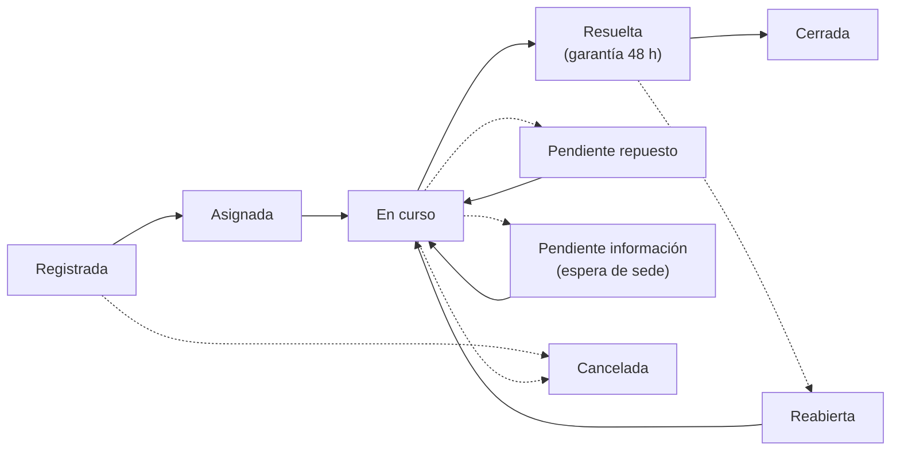

# VendGuard · Guía de uso por perfil

**Producto:** Gestor de Incidencias de Vending (*VendGuard*)  
**Documento:** `docs/guia_uso_por_rol.md`  
**Dirigido a:** Responsables de Sede, Coordinación de Operaciones y Técnicos de Campo  
**Versión:** MVP Fase 1  
**Última actualización:** Octubre 2026

**Versión imprimible (A4, una página por perfil):** [HTML](../public/docs/guia_rapida_por_rol_a4.html) · [PDF](../public/docs/guia_rapida_por_rol_a4.pdf)

---

## 1. Qué es VendGuard

VendGuard es la aplicación web donde se centraliza todo lo que ocurre con las máquinas de vending de un centro: quién avisa de una avería, quién la atiende, qué se ha hecho para repararla y cuánto se tarda en resolverla.

Sustituye a las llamadas, los correos sueltos y los avisos verbales por un **expediente único por avería**. Cada expediente tiene un código de ticket, un estado, un responsable y un historial que no se puede borrar.

La aplicación tiene **tres accesos distintos**, y cada perfil ve solo lo que necesita:

| Perfil | Para qué entra | Qué ve |
| :--- | :--- | :--- |
| **🏢 Responsable de Sede** | Avisar de averías de su edificio y seguir su resolución | Solo las máquinas y averías de su sede |
| **📊 Coordinación** | Organizar el servicio: triar, asignar, supervisar y auditar | Todo el parque, todas las sedes y todo el personal |
| **📱 Técnico de Campo** | Atender las averías de su ruta desde el móvil | Solo sus paradas asignadas y sus métricas |

> **Regla común:** una máquina nunca puede tener dos averías activas a la vez. Si ya hay un ticket abierto, la aplicación impide crear otro y ofrece la vía para aportar información al existente.

---

## 2. Cómo entrar en la aplicación

La dirección de acceso la facilita la empresa operadora (por ejemplo, `https://tu-dominio.com/`). En la barra superior existe un selector de perfil para cambiar entre las tres vistas, pero **cada vista pide sus propias credenciales**. Cambiar de pestaña no da acceso a los datos de otro perfil.

| Perfil | Credencial de acceso |
| :--- | :--- |
| **Responsable de Sede** | **Código de sede** (por ejemplo `SEDE-BCN-01`) + **Clave de Centro** entregada en mano |
| **Coordinación** | Correo electrónico y contraseña personales |
| **Técnico de Campo** | Correo electrónico y contraseña personales |

### Credenciales de demostración

Estas credenciales solo existen en entornos de prueba o demostración. En producción cada persona recibe las suyas.

| Perfil | Usuario | Contraseña / clave |
| :--- | :--- | :--- |
| Responsable de Sede | `SEDE-BCN-01` o `SEDE-BCN-02` | `DEV-SEDE-BCN-01` / `DEV-SEDE-BCN-02` |
| Coordinación | `coordinacion@vendguard.internal` | `Password123!` |
| Técnico | `jordi.ruta@vendguard.internal` o `marta.ruta@vendguard.internal` | `Password123!` |

### Recomendaciones de uso

- Usa **Chrome, Edge, Firefox o Safari** actualizados.
- El técnico debe trabajar desde el **móvil**, en vertical y con la pantalla completa; la vista está diseñada para usarse con una sola mano.
- La sesión de sede se mantiene activa **24 horas** de actividad continuada. La sesión interna se restaura al recargar, salvo que se pulse **Salir**.
- No compartas la clave de centro ni la contraseña. La clave de centro es un secreto del edificio, no una contraseña personal.

---

## 3. El ciclo de vida de una avería

Todos los perfiles ven el mismo expediente en distintas fases. Entender los estados evita malentendidos.

| Estado | Significado para el usuario |
| :--- | :--- |
| **Registrada** | La avería existe y espera asignación de un técnico. |
| **Asignada** | Coordinación ya ha designado un técnico; aún no ha empezado. |
| **En curso** | El técnico está trabajando en la máquina. |
| **Pendiente repuesto** | La reparación no puede terminar porque falta una pieza. |
| **Pendiente información** | El técnico o coordinación necesitan acceso o datos de la sede. El reloj de SLA se congela. |
| **Resuelta (Garantía)** | Reparada y documentada. Quedan **48 horas** para reabrir si el fallo reaparece. |
| **Cerrada** | Pasadas 48 horas sin reclamación, el expediente queda archivado definitivamente. |
| **Reabierta** | La sede ha reclamado dentro de la garantía de 48 h. |
| **Cancelada** | El aviso se descartó de forma justificada (soft delete). No se borra: queda en auditoría. |

### Reglas de oro que afectan a todos

| Regla | Qué significa en la práctica |
| :--- | :--- |
| **Un solo parte activo por máquina** | No se puede abrir un ticket nuevo si la máquina ya tiene uno vivo. |
| **Garantía de 48 horas** | Solo se puede reabrir un ticket resuelto dentro de las 48 h siguientes. Después, hay que crear uno nuevo. |
| **Cierre documentado** | El técnico no puede resolver sin diagnóstico y solución de **20 caracteres reales como mínimo** cada uno. |
| **Fotos de hasta 5 MB** | Solo se aceptan imágenes reales; un archivo que no sea imagen se rechaza y no se guarda. |
| **Privacidad de la sede** | La sede nunca ve el nombre del técnico (solo su código de operador), ni piezas, ni costes, ni notas internas. |
| **Todo queda auditado** | Asignaciones, pausas, reaperturas, resoluciones y descartes dejan un registro inmutable con autor y fecha. |

---

# PARTE I · GUÍA DEL RESPONSABLE DE SEDE

**Perfil:** conserjería, recepción, encargado de planta o persona designada por el centro.  
**Objetivo:** avisar de una avería en menos de dos minutos y seguir su resolución sin llamadas.

---

## 4. Acceso al portal

1. Abre la dirección de VendGuard y elige el perfil **🏢 1. Responsable Sede**.
2. Escribe el **Código de Sede** (aparece en la etiqueta frontal de cualquier máquina del centro).
3. Escribe la **Clave de Centro** que le entregaron en mano al dar de alta la sede.
4. Pulsa **Acceder a mi sede**.

**Si el acceso falla**, el mensaje siempre es el mismo: *«Código o clave no reconocidos. Contacte con el servicio técnico.»* No indica si el error está en el código o en la clave, por seguridad.

- Comprueba mayúsculas y guiones del código.
- Si la clave se ha perdido o cambia el responsable, pide a coordinación una **nueva clave**. La anterior deja de funcionar en el acto.
- La clave nunca se envía por correo ni se imprime en las etiquetas QR.

---

## 5. La pantalla principal

Al entrar verás la cabecera con el código y nombre de tu sede, la dirección y el contacto, y un botón **Actualizar estado**.

Debajo hay tres pestañas:

| Pestaña | Para qué sirve |
| :--- | :--- |
| **📋 Máquinas e Incidencias** | Ver el parque, reportar averías, conversar y reabrir |
| **🛡️ Control Higiénico y Certificados** | Consultar el estado sanitario y descargar certificados |
| **💶 Reintegros** | Entregar sobres de efectivo con el PIN del afectado |

### 5.1. Filtros del parque

- **Todas (n)**: todas las máquinas del centro.
- **Con Avería (n)**: solo las que tienen un ticket activo.
- **Operativas (n)**: solo las que funcionan sin incidencias.

Cada tarjeta de máquina muestra el código, modelo, tipo de máquina y planta/ala. El borde de la tarjeta cambia de color:

| Color del borde | Significado |
| :--- | :--- |
| Gris | Máquina operativa, sin averías |
| Rojo | Avería activa en curso |
| Verde | Reparada recientemente; garantía de 48 h activa |
| Ámbar | Intervención en pausa: el técnico necesita acceso o información |
| Rojo intenso con aviso sanitario | Máquina en cuarentena por riesgo térmico |

---

## 6. Reportar una avería (paso a paso)

1. Localiza la máquina en la pestaña **Máquinas e Incidencias**.
2. Pulsa **Reportar avería**.
3. Elige la **categoría del fallo**:
   - Temperatura / Pérdida de frío
   - Fallo en medios de pago
   - Atasco de producto en espiral
   - Máquina apagada / Sin suministro
   - Otro motivo
4. Si la máquina es de **comida perecedera**, aparecerá un aviso rojo: el aviso se clasificará como **CRÍTICO** y tendrá prioridad sanitaria. No es un error: es la protección de la cadena de frío.
5. Escribe la **descripción del fallo**. Sé concreto: qué ocurre, desde cuándo y qué se observa (por ejemplo, «no enfría y los sándwiches están templados desde ayer»).
6. Si la máquina se tragó dinero, indica el importe. Puedes:
   - **Solicitar reintegro** al afectado (se genera un PIN de 4 dígitos), o
   - dejar solo el importe como dato informativo.
7. Adjunta una **foto** si ayuda (opcional, máximo 5 MB).
8. Indica tu **nombre** y **teléfono de contacto**. Son obligatorios para el seguimiento.
9. Añade un **correo electrónico** si quieres recibir copia de la confirmación, la resolución y la cancelación. La sede conserva siempre su copia oficial en la dirección del centro.
10. Si la máquina viene de una cancelación por falta de acceso, marca la casilla de **confirmación formal de acceso**. Sin esa confirmación no se puede abrir el nuevo aviso.
11. Pulsa **Enviar aviso**.

Al terminar verás el **código de ticket** (por ejemplo `INC-2026-000123`). Anótalo: es la referencia para cualquier consulta.

> **Si la máquina ya tiene una avería activa**, el formulario no permite crear otra. Muestra el ticket existente y te ofrece **Anexar comentarios o fotos adicionales**. Esa es la vía correcta para añadir información sin duplicar visitas.

### Qué ocurre después

1. El aviso entra en la bandeja de **Coordinación** como *Registrada*.
2. Coordinación lo asigna a un técnico: pasa a *Asignada*.
3. El técnico llega, pulsa **Iniciar intervención** y pasa a *En curso*.
4. Al repararlo, pasa a *Resuelta (Garantía)*.
5. A las 48 horas sin reclamación se archiva como *Cerrada*.

Puedes seguir todo desde la tarjeta de la máquina y desde la conversación del ticket.

---

## 7. Conversación del expediente

Cada avería tiene un **hilo de conversación** único entre sede, técnico y coordinación. Sirve para resolver dudas sin llamadas y deja constancia escrita.

- Pulsa **Conversación** en la tarjeta de la máquina (el número indica los mensajes públicos).
- Puedes **escribir comentarios** y **adjuntar una foto** de hasta 5 MB.
- La sede solo ve y publica **comentarios públicos**. No recibe las notas internas de taller ni la identidad del técnico.
- El hilo de un expediente cerrado queda sellado; no admite mensajes nuevos.

**Cuándo usarlo:** para responder a una pausa, concretar el acceso al edificio, avisar de un cambio de ubicación de la máquina o aportar una foto del fallo.

---

## 8. El aviso «Intervención en Pausa»

Si el técnico no puede continuar porque el edificio está cerrado, la máquina no aparece o falta una autorización, el expediente pasa a **Pendiente información**. El reloj de SLA se congela y la sede ve un aviso ámbar:

> ⏸️ **Intervención en Pausa: El servicio técnico requiere acceso o información**

La tarjeta indica la **causa** y ofrece el botón **💬 Aportar información / Responder al técnico**.

**Qué hacer:**

1. Pulsa el botón del aviso o abre la conversación de la máquina.
2. Explica lo que necesite el técnico: horario de apertura, persona que puede abrir, ubicación exacta, autorización concedida, etc.
3. Adjunta una foto si ayuda a localizar la máquina.

La pausa **no se reanuda sola** al escribir. El técnico (o coordinación) debe reanudarla expresamente cuando ya tenga lo que necesitaba. Es intencionado: el sistema no declara una reparación en marcha si nadie la ha retomado.

> Si pasan **72 horas hábiles** sin respuesta ni acceso, coordinación puede cancelar el expediente de forma justificada. La máquina quedará marcada como **fuera de servicio por falta de acceso** hasta que la sede confirme el acceso al pedir un aviso nuevo.

---

## 9. Reabrir una avería (garantía de 48 h)

Si la máquina vuelve a fallar **por la misma causa** poco después de la reparación:

1. En la tarjeta verde de la máquina, pulsa **Reabrir incidencia**.
2. La aplicación comprueba cuánto tiempo ha pasado desde la resolución.
3. **Dentro de las 48 h:** escribe el **motivo de la reapertura** (qué síntoma persiste) y confirma. El expediente vuelve a *Reabierta* y se retira la asignación anterior para que coordinación lo reasigne.
4. **Pasadas las 48 h:** la garantía ha expirado. La aplicación te ofrecerá **crear un nuevo ticket**. No se puede reutilizar el anterior.

No reabras por una avería distinta: para un fallo nuevo, crea un aviso nuevo.

---

## 10. Control higiénico y certificados

Pestaña **🛡️ Control Higiénico y Certificados**.

- Muestra el **estado sanitario** de las máquinas del centro y las que están en cuarentena.
- Puedes consultar el **certificado sanitario individual** de una máquina y el **certificado global de la sede**.
- Ambos se pueden **imprimir en A4** o guardar como PDF desde el diálogo de impresión del navegador.
- Una máquina en cuarentena aparece como fuera de servicio hasta que se acredite el control higiénico-sanitario. No se levanta sola: requiere un certificado conforme.

Este apartado no muestra piezas, costes ni datos internos del taller.

---

## 11. Reintegros: entrega de efectivo con PIN

Pestaña **💶 Reintegros**.

La sede actúa como punto de entrega cuando el técnico deposita un sobre de efectivo en conserjería.

1. La pantalla muestra los **sobres en conserjería** y el listado de expedientes.
2. El afectado acude con su **PIN de 4 dígitos**.
3. Pulsa **Entregar efectivo** en la fila correspondiente.
4. Introduce el PIN con el teclado en pantalla y confirma.
5. La entrega queda registrada y el expediente cambia de estado.

**Importante:**

- El nombre del afectado aparece **anonimizado** (por ejemplo, «Laura S.»).
- Tras **cinco intentos fallidos** de PIN, el expediente se bloquea **15 minutos** por seguridad. No insistas: espera o avisa a coordinación.
- Nunca entregues efectivo sin validar el PIN en la aplicación.
- Si no hay sobre físico, la fila lo indica y no se puede entregar.

---

## 12. Valorar el servicio (encuesta CSAT)

Cuando hay servicios resueltos sin valorar, el portal muestra un aviso:

> ⭐ **Tiene n servicios por valorar** · **Valorar servicio**

1. Pulsa **Valorar servicio**.
2. Asigna de **1 a 5 estrellas**.
3. Añade un **comentario** si quieres (opcional).
4. Envía la valoración.

La encuesta se ofrece una vez por carga de página y no bloquea el portal. Las valoraciones alimentan el indicador de satisfacción de coordinación, sin datos personales del informante.

---

## 13. Lo que la sede no puede ver (y por qué)

Por protección de datos y separación de responsabilidades, el portal de sede **nunca** muestra:

- El **nombre real del técnico**; cuando se muestra identidad técnica, aparece bajo el código de operador oficial.
- **Piezas sustituidas, referencias, destinos de taller o costes.**
- **Notas internas** de taller.
- **Rutas, mapas o posiciones** del personal técnico.
- Datos de otras sedes.

Si necesitas esa información, contacta con coordinación por los canales habituales.

---

## 14. Problemas frecuentes de la sede

| Mensaje o situación | Qué hacer |
| :--- | :--- |
| «Código o clave no reconocidos» | Revisa el código y la clave. Si persiste, pide una clave nueva a coordinación. |
| «Esta máquina ya cuenta con un parte en avería» | No se puede duplicar. Abre la conversación y aporta la información nueva. |
| «Ventana de garantía expirada» | Han pasado más de 48 h. Crea un ticket nuevo. |
| «La foto supera los 5 MB» | Reduce la imagen o haz otra con menos resolución. |
| No aparece una máquina | Puede estar dada de baja o transferida. Consulta con coordinación. |
| El aviso de pausa sigue activo tras responder | Es correcto: la reanudación la hace el técnico o coordinación. |
| La máquina está en cuarentena | No se puede usar hasta que se acredite el control sanitario. |

---

# PARTE II · GUÍA DE COORDINACIÓN

**Perfil:** coordinador del servicio / responsable de operaciones.  
**Objetivo:** convertir avisos dispersos en trabajo asignado, supervisado y auditable.

---

## 15. Acceso y navegación

1. Elige el perfil **📊 2. Coordinador**.
2. Introduce tu **correo** y **contraseña**.
3. Pulsa **Entrar al panel de triaje**.

La barra de pestañas superior es el mapa de la aplicación:

| Pestaña | Contenido |
| :--- | :--- |
| **🚨 Triaje y Avisos (SLA)** | Bandeja global de averías, filtros y acciones rápidas |
| **🏢 Parque de Sedes y Máquinas** | Catálogo de sedes y parque, etiquetas QR |
| **🗺️ Mapa Territorial** | Vista geográfica, zonas y asignación masiva |
| **🛡️ Mantenimiento Preventivo** | Semáforos, órdenes, barrido sanitario |
| **📦 Repuestos** | Catálogo maestro y homologación |
| **📈 Analítica Repuestos** | Ranking, costes y fallos crónicos |
| **🧰 Stock Furgonetas** | Inventario de las furgonetas |
| **💶 Reintegros** | Aprobación, pago y regularización |
| **🏢 Administración** | Sedes, zonas, máquinas y personal |
| **📊 Métricas y Auditoría** | KPIs, desglose, auditoría y CSAT |
| **🔔 Notificaciones** | Bandeja de salida y webhook de emergencias (siempre visible) |

Los distintivos rojos sobre una pestaña indican alertas pendientes: SLA roto, fallos definitivos de notificación o escalado del barrido sanitario.

---

## 16. Rutina diaria de triaje

### 16.1. Revisar la bandeja

La pestaña **Triaje y Avisos** se actualiza sola cada **60 segundos**. Arriba verás cuatro indicadores:

- **Avisos Activos**
- **Críticas de Frío (Comida)**
- **Sin Asignar**
- **Pendientes Repuesto**

### 16.2. Atender las alertas

| Alerta | Significado | Acción |
| :--- | :--- | :--- |
| **¡ALERTA CRÍTICA DE SLA!** | Hay averías críticas de frío sin técnico superando 60 min | Pulsa **Ver incidencias en riesgo SLA** y asigna de inmediato |
| **ESPERA PROLONGADA DE CLIENTE** | Expedientes pausados más de 72 h hábiles sin respuesta de sede | Revisa cada caso antes de cancelar |
| **Fila con borde rojo** | Espera prolongada | Considera la cancelación supervisada |
| **Fila con borde ámbar** | SLA congelado por espera de sede | Revisa la pausa y su causa |

### 16.3. Filtrar

Puedes combinar:

- Búsqueda por **ticket, máquina, sede o nombre de sede**.
- **Estado** (Registrada, Asignada, En curso, Pend. Repuesto, Pend. Información, Resuelta, Reabierta, Cerrada, Cancelada).
- **Urgencia** (Crítica, Alta, Media, Baja).
- **Solo alerta SLA (>60 m)**.
- **⏸️ En espera de sede**.
- **Limpiar filtros** cuando termines.

### 16.4. Leer una fila

La tabla muestra: ticket y SLA, sede y ubicación, máquina, urgencia, estado, técnico asignado y acciones.

- **SLA ROTO (n m)**: se ha superado el objetivo.
- **SLA Pausado (+n min desc.)**: minutos descontados por espera de sede.
- **Sin asignar**: nadie es responsable todavía.
- **Insignia de modalidad oportunista**: la avería nació o se asumió in situ por un técnico.

### 16.5. Acciones rápidas de la fila

| Botón | Cuándo aparece | Qué hace |
| :--- | :--- | :--- |
| **💬 n** | Siempre | Abre el hilo de conversación |
| **🔍 Ver detalle** | Siempre | Abre la ficha integral de solo lectura |
| **🏷️ Imprimir QR** | Siempre | Previsualiza e imprime la etiqueta de la máquina |
| **Asignar** | Solo en *Registrada* o *Reabierta* | Abre el asistente de asignación |
| **▶️ Reanudar** | Expediente pausado | Descongela el SLA y devuelve la avería a trabajo |
| **🚫 Cancelar por inactividad de sede** | Espera > 72 h hábiles | Cancela de forma justificada y bloquea la máquina por falta de acceso |
| **Descartar** | Cualquier estado activo | Baja lógica con motivo (no borra el historial) |

Para **reasignar** una avería que ya tiene técnico, entra en **Ver detalle**: la reasignación vive en la ficha integral y exige un motivo de al menos 10 caracteres.

---

## 17. Asignar un técnico

Al pulsar **Asignar** se abre **Asignar Técnico de Ruta**:

1. **Sugerencia territorial.** Si la zona tiene cuadrante, la aplicación muestra un ranking explicado. El primer puesto lleva la insignia **Sugerido por Zona** y el botón **⚡ Asignar Sugerido** permite resolverlo en dos toques.
2. **Selector manual.** También puedes elegir cualquier técnico activo de la lista.
3. **Reclasificar urgencia (opcional).** Si cambias la urgencia, el **motivo es obligatorio** y queda auditado.
4. **Descarte sanitario.** Si la avería es de frío y descartas al técnico de guardia sugerido, deberás escribir una **justificación de al menos 20 caracteres**. El sistema lo registra como decisión consciente.
5. **Confirmar Asignación**.

> El ranking tiene en cuenta la zona, la presencia in situ, las paradas en la misma zona, la carga viva, las pausas por falta de acceso y la guardia sanitaria. No es una decisión automática: la última palabra es del coordinador.

**Qué recibe el técnico:** la avería aparece en su ruta y, si tiene Telegram vinculado, recibe un aviso con enlace directo al ticket.

---

## 18. Ficha integral del expediente

**🔍 Ver detalle** abre una ficha de solo lectura con:

- Sede y máquina (dirección, planta, contacto).
- Descripción y categoría del aviso.
- Cronología y SLA, incluida la pausa y el tiempo descontado.
- Intervención técnica: diagnóstico, solución, piezas y firma.
- Hilo de conversación completo (incluidas notas internas, visibles para coordinación).
- Reintegro asociado, si existe.
- **Matriz de permisos** calculada por el servidor: indica qué acciones puede hacer cada perfil en ese estado.

Desde la ficha se puede **reasignar técnico** con motivo justificado. Es la vía para cambiar de responsable sin perder trazabilidad.

---

## 19. Pausas por espera de sede y cancelación supervisada

### 19.1. Reanudar

Cuando la sede responde o el acceso queda resuelto, pulsa **▶️ Reanudar** en la fila (o en la ficha). El reloj contractual se descongela y la avería vuelve a *En curso*.

- Si el ticket no tiene técnico asignado, vuelve a la cola de asignación (**Registrada**), nunca a *Asignada*.
- Reanudar no borra el tiempo pausado: queda como minutos descontados.

### 19.2. Cancelar por inactividad

Solo para expedientes con **más de 72 horas hábiles** sin respuesta ni acceso:

1. Pulsa **🚫 Cancelar por inactividad de sede**.
2. Escribe un motivo de **20 caracteres reales como mínimo**.
3. Confirma.

Efectos:

- El expediente pasa a **Cancelada**.
- La máquina queda **bloqueada por falta de acceso**; no vuelve sola a «Operativa».
- El reintegro pendiente se desvincula para liquidación central.
- Todo queda auditado.

Cuando la sede vuelva a pedir asistencia, el formulario le exigirá confirmar formalmente que la máquina ya es accesible.

---

## 20. Parque de sedes y etiquetas QR

Pestaña **🏢 Parque de Sedes y Máquinas**.

- Consulta las sedes con su número de máquinas y averías activas.
- Abre el parque de una sede para ver el estado operativo de cada máquina.
- **🏷️ Imprimir QR** abre la previsualización de la etiqueta (formatos compacto, estándar y grande).
- **📄 Etiquetas de Sede (A4)** genera la cuadrícula completa de una sede para imprimir y pegar en ruta.
- La etiqueta incluye el código de la máquina y el enlace de reporte ciudadano; **nunca** incluye la clave de centro.

---

## 21. Mapa territorial y asignación masiva

Pestaña **🗺️ Mapa Territorial**.

- Visión panorámica de los centros en ruta, teñidos por zona operativa.
- Matriz de averías activas por severidad.
- Detección de sedes atendidas por varios técnicos.
- Filtros por zona y reencuadre interactivo.

Al seleccionar una sede puedes **asignar en lote** todas sus averías activas a un técnico:

1. Elige la sede y pulsa la acción de asignación territorial.
2. Selecciona el técnico (la sugerencia se calcula sobre la incidencia más prioritaria del lote).
3. Si el lote incluye averías ya asignadas, escribe el **motivo de reasignación** (≥ 10 caracteres).
4. Si descartas una sugerencia sanitaria, añade la **justificación de descarte** (≥ 20 caracteres).
5. Confirma el lote.

Esta vista **no es accesible para la sede**, y no permite rastrear al técnico en segundo plano.

---

## 22. Mantenimiento preventivo

Pestaña **🛡️ Mantenimiento Preventivo**, con tres subpestañas.

### 22.1. 📊 Semáforos e Indicadores

- Estado de cumplimiento por sede y tipología.
- Máquinas próximas a vencer.
- **⚡ Generar Preventivos Inminentes**: crea órdenes para las máquinas próximas a vencer.
- **⚙️ Frecuencias Normativas**: periodicidad por tipo de máquina. La comida perecedera tiene una cadencia reforzada.

### 22.2. 📋 Listado de Órdenes

- Filtros por estado, sede y búsqueda.
- **➕ Nueva Orden Manual** para una inspección concreta, y **⚡ Generar Preventivos (5d)** para las que vencen en cinco días.
- **Asignar / Reasignar** con fecha de programación.
- **Cancelar** con justificación histórica (no se borra).
- **Ver detalle** de la orden: checklist, dictamen, técnico y certificado.

### 22.3. 🩺 Barrido Sanitario

Superficie de control del proceso automático que activa cuarentenas cuando una máquina de frío lleva demasiado tiempo sin frío confirmado.

- **Latido**: última pasada y minutos transcurridos.
- **Tendencia de 24 h**.
- **Aplazamientos por contención**: pasadas que no pudieron completarse.
- **Escalado**: aviso cuando el aplazamiento persiste tres pasadas seguidas.

Si el latido envejece, el barrido no está corriendo: hay que revisar la programación del proceso.

---

## 23. Repuestos y analítica

### 23.1. 📦 Repuestos

- **Catálogo maestro por modelo de máquina**: código único, categoría, fabricante, coste de referencia y compatibilidades.
- Altas, ediciones y bajas lógicas (nunca borrado físico).
- **Bandeja de homologación**: piezas fuera de catálogo declaradas por los técnicos, pendientes de revisión.
- El coste se congela en cada intervención: cambiar el precio del catálogo después no altera lo ya registrado.

### 23.2. 📈 Analítica Repuestos

- Ranking de piezas más sustituidas.
- Costes acumulados por modelo y sede.
- **Alertas de fallo crónico**: más de tres sustituciones de la misma pieza en 90 días en la misma máquina.
- Exportación CSV para análisis externo.

> La sede no tiene acceso a esta información (Art. V.4).

---

## 24. Stock de furgonetas

Pestaña **🧰 Stock Furgonetas**.

- Inventario por técnico y por referencia.
- Unidades disponibles, mínimos y **por reponer**.
- Permite planificar la carga antes de la ruta y detectar faltas recurrentes.

El técnico ve su propio stock en un bloque plegable dentro de **Mi Ruta**.

---

## 25. Reintegros: aprobación, pago y regularización

Pestaña **💶 Reintegros** (bandeja global).

### 25.1. Bandeja

- **Expedientes**, **Pendientes de visto bueno**, **Pendiente de pago** y **Atascados en inspección**.
- Filtros por estado, solo pendientes de visto bueno, solo atascados y búsqueda por ticket, máquina, sede o afectado.

### 25.2. Cuándo hace falta doble aprobación

Requieren doble autorización:

- Importes **superiores a 10,00 €**.
- **Discrepancias** entre lo reclamado y lo recuperado.
- Casos **sin evidencia** de efectivo recuperado.

La pantalla avisa con un banner ámbar.

### 25.3. Acciones

| Acción | Cuándo | Qué hace |
| :--- | :--- | :--- |
| **Aprobar** | Pendiente de visto bueno | Autoriza el importe; puede ajustarse con notas |
| **Pagar** | Aprobado y pendiente de pago | Registra la liquidación con referencia bancaria |
| **Rechazar** | En revisión | Exige motivo; queda auditado |
| **Regularizar** | Atascado en inspección | Registra hallazgo, importe, custodia y justificación |

La liquidación digital deja justificante. El dictamen económico es independiente de la resolución técnica: una avería puede resolverse aunque el reintegro siga en tramitación.

---

## 26. Administración

Pestaña **🏢 Administración**, con cuatro submódulos.

### 26.1. 🏢 Sedes

- **Nueva sede**: código, nombre, dirección, contacto, coordenadas, zona y correo oficial.
- **Editar** datos descriptivos.
- **Dar de baja** (lógica) y **Reactivar**.
- **🔑 Clave**: reemite la clave de centro. La anterior deja de valer al instante y la nueva **solo se muestra una vez**. Debe entregarse en mano.
- La tabla marca las sedes **pendientes de entrega** (sin clave emitida).
- **Geocodificación asistida**: sugiere latitud/longitud a partir de la dirección.

### 26.2. 🗺️ Zonas Operativas

- Zonas por **código postal** con nombre, código y color.
- La sede hereda la zona de su CP; la excepción manual se marca y se audita.
- **Cuadrante**: un técnico titular por zona y suplencias.
- **Vista inversa por técnico**: qué zonas cubre cada uno y quién no cubre ninguna.
- **Transferencia de CP** entre zonas: atómica, con reasignación de sedes y auditoría.

### 26.3. 🎰 Parque de Máquinas

- Alta, edición y baja lógica de máquinas.
- Tipología normativa, modelo, planta/ala y número de serie.
- **Transferencia entre sedes** auditada.
- Acceso a la etiqueta QR de cada máquina.

### 26.4. 🧑‍🔧 Personal Interno

- Altas de coordinadores y técnicos.
- Reseteo de contraseñas.
- Bajas lógicas con salvaguardas: no se puede dar de baja a alguien con averías pendientes de trabajo.
- **Telegram**: campo `chat_id` solo para técnicos, para recibir el aviso de asignación. Se muestra enmascarado en auditoría.
- La carga del directorio señala las averías en garantía de 48 h como dato informativo.

---

## 27. Métricas, auditoría y satisfacción

Pestaña **📊 Métricas y Auditoría**.

### 27.1. Filtros de periodo

Selecciona el rango de fechas y pulsa **Aplicar**. Todo el cuadro de mandos y la exportación usan ese periodo.

### 27.2. Cuatro subpestañas

| Subpestaña | Contenido |
| :--- | :--- |
| **📊 Cuadro de Mandos (KPIs)** | MTTR, cumplimiento del SLA de perecederos, tasa de resolución, backlog y reintervenciones por garantía |
| **🗂️ Desglose Multidimensional** | Cruce por sede, técnico, tipología de máquina y categoría de avería; incluye reintervenciones por técnico |
| **🛡️ Pistas de Auditoría** | Registro inmutable filtrable por entidad, acción, usuario y fechas, con inspección del payload |
| **⭐ Satisfacción del Cliente (CSAT)** | Valoración media de las sedes y comentarios, en el mismo periodo |

### 27.3. Exportar y presentar

- **📥 Exportar CSV**: descarga con UTF-8 BOM (hasta 10.000 filas).
- **📄 Generar Informe Ejecutivo**: vista imprimible en A4, sin menús ni barras laterales. Sirve para imprimir o guardar como PDF.

### 27.4. Qué significa cada KPI

- **MTTR**: tiempo medio de resolución. Más bajo es mejor.
- **Cumplimiento de perecederos**: porcentaje de averías de frío resueltas dentro del objetivo de 4 h.
- **Tasa de resolución formal**: resueltas frente a creadas, con control del backlog activo.
- **Reintervenciones por garantía**: averías reabiertas dentro de las 48 h, atribuidas al técnico que firmó la resolución. Es una señal de calidad, no carga pendiente.

---

## 28. Centro de notificaciones

Botón **🔔 Notificaciones**, visible desde cualquier pestaña.

### 28.1. Bandeja de salida

- Estados: `PENDING`, `PROCESSING`, `PENDING_RETRY`, `SENT`, `FAILED_PERMANENT`, `CANCELLED_OBSOLETE`.
- Prioridades: `CRITICAL_SANITARY`, `HIGH`, `STANDARD`.
- Filtros por estado, canal y prioridad.
- **↻ Reintentar envío** y **✕ Cancelar envío** por fila.
- **Reintentar todas las fallidas** para el lote completo.
- La insignia roja del botón **🔔 Notificaciones** indica fallos definitivos: es una alerta de supervisión visible desde cualquier pestaña.

### 28.2. Webhook de emergencias

- Dirección **https://** obligatoria.
- Validación anti-SSRF: no se permiten IPs privadas, loopback ni link-local.
- **Probar** lanza una petición de prueba con timeout de 5 s.
- **Guardar** deja el canal configurado.
- Se usa para avisar de averías críticas de frío a Slack, Discord o Telegram.

---

## 29. Checklist de coordinación

**Cada mañana**

- [ ] Revisar la bandeja de triaje y las alertas de SLA.
- [ ] Asignar las averías *Registradas* y *Reabiertas*.
- [ ] Revisar las pausas de sede y las esperas prolongadas.
- [ ] Comprobar el latido del barrido sanitario.
- [ ] Revisar fallos definitivos de notificación.

**Cada semana**

- [ ] Revisar preventivos próximos a vencer y generar órdenes.
- [ ] Revisar la bandeja de homologación de repuestos.
- [ ] Revisar el cuadrante de zonas y suplencias.
- [ ] Revisar KPIs y reintervenciones por técnico.
- [ ] Revisar reintegros atascados.

**Cada mes**

- [ ] Exportar CSV y preparar el informe ejecutivo.
- [ ] Revisar la satisfacción de las sedes (CSAT).
- [ ] Auditar una muestra de expedientes cerrados.
- [ ] Revisar el stock de furgonetas y las piezas de fallo crónico.

---

## 30. Problemas frecuentes de coordinación

| Situación | Qué hacer |
| :--- | :--- |
| No aparece un técnico en el selector | Está dado de baja o no tiene rol `TECHNICIAN`. Revisa **Administración → Personal Interno**. |
| No se puede reasignar desde la fila | La reasignación vive en **Ver detalle** y exige motivo ≥ 10 caracteres. |
| El botón **Asignar** no aparece | El ticket ya tiene técnico o está en un estado que no admite asignación inicial. |
| El lote del mapa pide un motivo | Incluye averías ya asignadas: es una reasignación consolidada. |
| El webhook no guarda | Debe ser `https://` y una URL pública; revisa el error de validación. |
| El barrido sanitario no tiene latido reciente | El proceso programado no está corriendo. Revisa el cron o el planificador externo. |
| Un envío está en `FAILED_PERMANENT` | Revisa el canal y reintenta; si persiste, corrige la configuración antes de reintentar en masa. |
| «Sin Zona Asignada» en una sede | El CP no pertenece a ninguna zona. Asígnalo en **Zonas Operativas**. |

---

# PARTE III · GUÍA DEL TÉCNICO DE CAMPO

**Perfil:** técnico de ruta.  
**Objetivo:** atender la ruta del día, documentar cada intervención y cerrar con trazabilidad.

---

## 31. Acceso y primeros pasos

1. Abre VendGuard en el móvil y elige **📱 3. Técnico Móvil**.
2. Introduce tu **correo técnico** y **contraseña**.
3. Pulsa **Acceder a Mi Ruta**.

En la cabecera verás tu nombre, el número de averías de la ruta y tres accesos:

- **🧰** Guía rápida de repuestos (A4 imprimible).
- **🔄** Actualizar ruta.
- **Salir**.

Debajo, tres secciones:

| Sección | Contenido |
| :--- | :--- |
| **📍 Averías (n)** | Ruta operativa del día |
| **🛡️ Preventivo** | Inspecciones asignadas y visitas oportunistas |
| **📈 Mis Métricas** | Tu rendimiento individual |

> Si abres un enlace de asignación de Telegram (`?tech=…&ticket=…`), la vista del técnico se abre directamente y el ticket queda destacado. El enlace **no autentica**: si no hay sesión, se pide el acceso.

---

## 32. Cómo se ordena la ruta

La ruta no es una lista alfabética. El orden es determinista:

1. **Parada en curso** (`En curso`) siempre primera: es el trabajo que ya tienes abierto y manda sobre el resto.
2. **Paradas críticas de perecederos** ordenadas por proximidad al vencimiento del SLA.
3. **Paradas ordinarias** por cercanía geométrica (vecino más cercano).
4. **Espera de repuestos** excluida del orden de visita, pero visible con el filtro **Repuestos**.

Los filtros de la ruta son: **Todas**, **En curso**, **Por iniciar**, **Repuestos** y **En espera**.

---

## 33. Leer una tarjeta de parada

Cada tarjeta muestra:

- **Ticket** y chapas de **urgencia**, **estado** y, si aplica, modalidad oportunista.
- **Máquina** y modelo, **planta/ala**.
- **Sede** y dirección.
- **📞 Llamar conserjería** si hay teléfono de contacto.
- **🧭 Navegar con GPS** si la sede tiene coordenadas.
- **🕘 Historial de la máquina** (solo lectura).
- **💬 n mensajes**: hilo del expediente.
- **Avería reportada**: descripción original.
- Avisos de contexto: intervención en curso, espera de repuesto, espera de sede, sede recién visitada.

Cuando hay varias intervenciones en la misma sede, la primera tarjeta lo indica: *«n intervenciones en curso en esta sede, ordenadas por urgencia y SLA»*.

---

## 34. Iniciar una intervención

1. En una parada **Asignada**, pulsa **▶ Iniciar intervención**.
2. El estado pasa a **En curso** y se registra la hora de inicio.
3. Si la parada estaba **Pendiente repuesto**, el botón es **▶ Reanudar intervención**.

Puedes tener varias paradas abiertas, pero solo una se muestra como la intervención en curso prioritaria. Ese orden evita que pierdas de vista el trabajo que ya has empezado.

---

## 35. Pausar por repuesto

Cuando falta una pieza:

1. Pulsa **⏸ Pausar repuesto**.
2. Selecciona la pieza del **catálogo compatible** con el modelo de la máquina, o elige **pieza fuera de catálogo**.
3. Si es fuera de catálogo, escribe una **denominación técnica** y una **justificación de al menos 20 caracteres**.
4. Indica la cantidad y confirma la pausa.

El expediente pasa a **Pendiente repuesto**. La parada sale del orden de visita, pero sigue visible con el filtro **Repuestos**. Cuando llegue la pieza, pulsa **Reanudar intervención**.

> La pausa por repuesto no congela el SLA como la espera de sede; es una parada técnica documentada.

---

## 36. Pausar por falta de acceso o información de la sede

Cuando no puedes acceder a la máquina o necesitas algo del centro:

1. Pulsa **⏸️ Pausar por falta de acceso**.
2. Elige una de las cuatro causas:
   - Edificio cerrado / Sin acceso a instalaciones
   - Máquina no localizada en la planta indicada
   - Corte eléctrico o de suministro ajeno a la máquina
   - Pendiente de autorización o contacto de sede
3. Escribe un **motivo de al menos 20 caracteres**.
4. Confirma.

Efectos:

- El expediente pasa a **Pendiente información**.
- El **SLA se congela** y se descuentan los minutos de pausa.
- La parada queda despriorizada: puedes seguir con las demás visitas del día.
- La sede recibe el aviso ámbar y puede responder en el hilo.

Cuando la sede responda, verás **✉️ La sede ha respondido · pendiente de tu reanudación**. Pulsa **▶ Reanudar intervención in situ**. La pausa **no se reanuda sola**.

---

## 37. Resolver una avería (paso a paso)

Pulsa **✓ Resolver avería** en una parada **En curso**. Se abre **Documentar Resolución Técnica**.

### 37.1. Diagnóstico y acción

1. **Diagnóstico real del fallo** (mínimo 20 caracteres). Explica la causa, no el síntoma: «bobina del relé térmico quemada por pico de tensión».
2. **Acción técnica correctiva aplicada** (mínimo 20 caracteres). Explica qué hiciste: «sustituido relé térmico y comprobado ciclo de frío a 4 °C».
3. El contador te avisa de cuántos caracteres faltan.

### 37.2. Veredicto de reintegro (si hay reclamación)

Si el expediente tiene una reclamación de saldo pendiente, el bloque de reintegro te pide el dictamen técnico antes de cerrar. No puedes resolver sin pronunciarte.

> **Prohibido recoger IBAN o Bizum en la ficha técnica.** Los datos bancarios se solicitan por el canal seguro del QR público. Si lo intentas, el servidor rechaza la operación por privacidad.

### 37.3. Declaración sanitaria (máquinas de perecederos)

Si la máquina es de comida perecedera y hay riesgo térmico, el bloque sanitario exige:

- Temperatura real declarada.
- Retirada y destrucción del stock afectado.
- Checklist de higienización.

Sin estas declaraciones no se puede cerrar. Es la salvaguarda de la cadena de frío.

### 37.4. Sustitución de componentes

Responde obligatoriamente **✅ Sí, hubo sustitución** o **❎ No se cambiaron piezas**. Sin respuesta no se puede confirmar el cierre.

Si es **Sí**:

1. Selecciona la pieza del catálogo compatible con el modelo.
2. Indica la **cantidad** (1–50).
3. Elige el **destino del material retirado**: **Desguace / Reciclaje** o **Taller / Reacondicionamiento**.
4. Añade más piezas si hace falta.

Si la pieza no está en catálogo, usa **pieza fuera de catálogo** con justificación ≥ 20 caracteres. Quedará en la bandeja de homologación de coordinación.

El coste de la pieza se congela en ese instante: es un snapshot inmutable.

### 37.5. Firma del responsable de sede

El cierre exige la conformidad del centro. Dos vías excluyentes:

**A. Firma manuscrita digitalizada**

- **Nombre del firmante**.
- **Documento del firmante**.
- **Trazo de la firma** con el dedo sobre el lienzo. Puedes salir del recuadro sin cortar el trazo.
- Si borras el trazo, se descarta el PNG pero se conservan nombre y documento.

**B. No había responsable disponible**

- Marca **🚫 No había responsable disponible en la sede**.
- Escribe un **motivo de al menos 10 caracteres**.

Activar una vía vacía los datos de la otra. Un bloque incompleto impide el envío y señala el campo que falta.

### 37.6. Confirmar

Pulsa **Confirmar Resolución (48h Garantía)**.

Al confirmar:

- El expediente pasa a **Resuelta (Garantía)**.
- Se guardan diagnóstico, acción, piezas, declaraciones, firma y notificaciones **en una sola transacción**: si algo falla, no queda nada a medias.
- Se abre la garantía de **48 horas**.
- Aparece el botón **🧾 Ver albarán**.

---

## 38. Albarán de intervención

Tras resolver, pulsa **🧾 Ver albarán**.

- Es un documento A4 imprimible con: ubicación, máquina, técnico, diagnóstico, solución, componentes sustituidos y firma (o «Sin firma del responsable»).
- No incluye costes, notas internas, SLA ni saldos.
- Se compone en el navegador con la impresión del sistema; sirve para imprimir o guardar como PDF.
- Tras una reapertura, el albarán vigente es el del último cierre; las visitas anteriores se consultan como históricas.
- Si una avería se cerró sin firma, el albarán lo dice expresamente y no reutiliza una firma anterior.

---

## 39. Intervención oportunista in situ

Sirve para atender una avería no programada mientras estás en una sede.

### 39.1. Cuándo está disponible

- Mientras tienes una parada activa en esa sede, o
- durante una **ventana de gracia de 30 minutos** (+5 min con formulario abierto) tras resolver o pausar la última intervención. La ruta muestra la tarjeta **🏢 Sede recién visitada (30 min)**.

### 39.2. Cómo entrar

- Desde una parada activa: **➕ Otra máquina en esta sede**.
- Desde la tarjeta de sede recién visitada: **➕ Otra máquina en esta sede**.
- Desde **Preventivo**: catálogo de la sede habilitada.

No puedes abrir una intervención oportunista si mantienes una intervención abierta en **otra sede**: el sistema responde con un conflicto y evita que dejes trabajo a medias en dos edificios a la vez.

### 39.3. Dos flujos

**Flujo A · Nueva avería in situ**

- La detectas tú o te la comunica el personal del centro.
- Indica el origen: **detección técnica** o **aviso verbal de sede**.
- Escribe una **descripción de al menos 10 caracteres**.
- Adjunta foto si quieres (≤ 5 MB).
- El expediente nace **En curso** y asignado a ti.

**Flujo B · Asumir una avería existente**

- La máquina ya tiene un aviso en estado *Registrada*, *Reabierta*, *Asignada*, *Pendiente repuesto* o *Pendiente información*.
- Puedes **asumirla e iniciar** el trabajo.
- Si procede, deja una **nota interna de taller** (confidencial, no visible para la sede).
- También puedes **reabrir in situ** una avería en garantía (< 48 h) si la sede reclama en el momento.

### 39.4. Salvaguarda de cadena de frío

Si tienes paradas críticas o de perecederos pendientes en **otra sede**, el sistema te avisa y exige una **confirmación expresa** para quedarte donde estás. Si confirmas, se envía una alerta sanitaria prioritaria a coordinación.

### 39.5. Tercera reincidencia

Si reabres por tercera vez consecutiva una avería en garantía, el sistema cierra el expediente anterior como **avería crónica**, avisa a coordinación y abre un expediente sucesor limpio **En curso**. Todo ocurre en una sola transacción.

---

## 40. Mantenimiento preventivo en ruta

Sección **🛡️ Preventivo**.

### 40.1. Mis inspecciones

- Lista de órdenes asignadas con estado y fecha.
- **▶️ Iniciar Inspección** en órdenes programadas o vencidas.
- **📝 Completar Checklist Sanitario** si ya está en inspección.
- **Reclamar** una orden disponible de una sede habilitada.

### 40.2. Checklist

- Puntos de control normativos con resultado **✅ Conforme** o **❌ No conforme**.
- Si un punto es no conforme, puedes añadir una observación.
- **⚡ Marcar Todos Conformes** acelera la inspección cuando todo está correcto.
- Al terminar:
  - **Todo conforme** → inspección completada y orden cerrada.
  - **Algún no conforme** → **cuarentena sanitaria** de la máquina y orden pendiente de reinspección.

### 40.3. Reinspección

Cuando la máquina se corrige, se realiza una **reinspección**. La cuarentena **no se levanta automáticamente**: exige el certificado conforme.

---

## 41. Stock de mi furgoneta

En **Averías**, despliega **🧰 Stock de mi furgoneta**.

- Referencias, unidades y avisos **por reponer**.
- Se actualiza con las piezas consumidas en las resoluciones.
- Úsalo antes de salir de ruta para evitar una segunda visita.

---

## 42. Mis métricas

Sección **📈 Mis Métricas**. Solo tú puedes verlas.

- MTTR personal.
- Averías resueltas en el periodo.
- Incidencias en curso.
- Tiempo medio de primera respuesta técnica.

No hay acceso a métricas globales ni de otros compañeros.

---

## 43. Mapa de ruta y navegación

- **🗺️ Ver Mapa de Ruta** abre el mapa interactivo con marcadores numerados en orden de visita.
- Colores: crítico, ordinario, en curso y preventivo.
- Toca un marcador o la lista para ver la ficha contextual y recentrar.
- **🧭 Navegar con GPS** abre Google Maps con la parada seleccionada.
- **🚗 Navegación GPS del día** abre la ruta completa.

La sede no tiene acceso a este mapa ni a tu posición.

---

## 44. Problemas frecuentes del técnico

| Situación | Qué hacer |
| :--- | :--- |
| «No puedes iniciar una intervención en otra sede» | Tienes una parada en curso. Termínala o pausa la que corresponda. |
| «La avería no está en tu ruta» | Puede haberse reasignado. Actualiza la ruta; si el enlace venía de Telegram, el aviso lo explica. |
| El cierre no se habilita | Faltan diagnóstico/acción (≥ 20), declaración de piezas, bloque sanitario, dictamen de reintegro o firma/ausencia. |
| «Faltan n caracteres» | El contador marca el mínimo; es una regla constitucional, no un aviso orientativo. |
| La sede respondió pero la pausa sigue | La reanudación es humana: pulsa **Reanudar intervención in situ**. |
| El sistema pide confirmar la cadena de frío | Tienes paradas críticas en otra sede. Decide conscientemente y confirma o cancela. |
| «Esta sede ya no está habilitada» | La ventana de 30 min ha expirado o no hay parada activa. Vuelve a la ruta. |
| La firma no se guarda | Comprueba nombre, documento y trazo; o marca la ausencia con motivo ≥ 10. |

---

# PARTE IV · FLUJO COMPLETO Y ANEXOS

---

## 45. Un caso de principio a fin

1. **Sede** detecta que la máquina de sándwiches no enfría. Abre el portal, elige la máquina y reporta con categoría *Temperatura / Pérdida de frío*, descripción y foto. El sistema la marca **CRÍTICA** por ser perecedera.
2. **Coordinación** ve la alerta de SLA, comprueba la sugerencia territorial y asigna a un técnico de la zona con **⚡ Asignar Sugerido**.
3. **Técnico** recibe el aviso, abre **Mi Ruta**, llama a conserjería y pulsa **Iniciar intervención**.
4. Al llegar, el técnico detecta que falta el relé. Pulsa **Pausar repuesto**, lo elige del catálogo y documenta la espera.
5. **Coordinación** ve la parada *Pendiente repuesto* y coordina el suministro.
6. El técnico recibe la pieza, pulsa **Reanudar intervención**, sustituye el relé y comprueba el ciclo de frío.
7. Pulsa **Resolver avería**: diagnóstico ≥ 20, acción ≥ 20, declara la pieza sustituida con destino *Desguace*, firma el responsable de sede en el móvil y confirma.
8. El expediente queda **Resuelto (Garantía)**. El técnico imprime el **albarán** si la sede lo pide.
9. **Sede** recibe la resolución, valora el servicio con estrellas y, si el fallo reaparece en 48 h, pulsa **Reabrir incidencia** con el motivo. Si no, el ticket se **Cierra** automáticamente.

---

## 46. Preguntas frecuentes

**¿Puedo abrir dos avisos para la misma máquina?**  
No. El sistema lo bloquea. Aporta la información al ticket existente.

**¿Qué pasa si la sede no responde?**  
El SLA se congela. Tras 72 horas hábiles, coordinación puede cancelar de forma justificada y la máquina queda bloqueada por falta de acceso hasta que la sede confirme el acceso.

**¿Quién puede cerrar una avería?**  
Solo el técnico asignado, con diagnóstico y solución documentados, declaración de piezas, cumplimiento sanitario si aplica y firma o ausencia justificada.

**¿Se puede cambiar el técnico asignado?**  
Sí. Coordinación lo reasigna desde la ficha integral con un motivo de al menos 10 caracteres.

**¿Se borran las averías?**  
No. Las bajas son lógicas y todo el historial queda en auditoría. La base de datos impide el borrado físico.

**¿La sede ve el nombre del técnico?**  
No. Ve un código de operador oficial. Es una medida de privacidad.

**¿La sede ve las piezas y los costes?**  
No. Es información interna de taller.

**¿Cuánto dura la garantía?**  
48 horas desde la resolución. Después hay que crear un ticket nuevo.

**¿Qué hago si se pierde la clave de centro?**  
Coordinación emite una nueva desde **Administración → Sedes → 🔑 Clave**. La anterior deja de valer al instante.

**¿El técnico puede rastrearse en el mapa?**  
No. El mapa muestra la ruta planificada, no la posición en tiempo real, y la sede no tiene acceso.

**¿Qué pasa con las fotos?**  
Máximo 5 MB, solo imágenes reales. Un archivo inválido se rechaza y no deja residuo.

**¿Cómo se avisa de una emergencia sanitaria?**  
El aviso de perecederos nace crítico y coordinación recibe alertas de SLA. El canal de emergencias configurable es el **webhook** del Centro de Notificaciones.

---

## 47. Buenas prácticas

### Para la sede

- Reporta en cuanto se detecte el fallo; no esperes a que empeore.
- Describe el síntoma con detalle y adjunta foto.
- Responde a las pausas en el hilo, no por teléfono a otra persona.
- No reabras por un fallo distinto: crea un ticket nuevo.
- Entrega el efectivo solo con el PIN validado.

### Para coordinación

- Asigna primero las críticas de frío; el SLA es la prioridad.
- No descartes al técnico de guardia sin justificar; queda auditado.
- Revisa las pausas cada mañana: una pausa olvidada es una máquina parada.
- Cierra los reintegros atascados antes de que caduquen.
- Usa el desglose por técnico para detectar reincidencias, no para sancionar sin contexto.

### Para el técnico

- Inicia la intervención al llegar, no al salir.
- Documenta el diagnóstico real, no «avería reparada».
- Declara siempre las piezas, aunque no sustituyas ninguna.
- Recoge la firma en el momento; si no hay responsable, justifica la ausencia.
- Revisa el stock de la furgoneta antes de salir.

---

## 48. Anexo · Reporte ciudadano por QR

Cualquier persona puede reportar una avería escaneando la etiqueta QR de la máquina, sin registro:

- El enlace abre el formulario con la máquina ya identificada (`?qr=…` o `?code=…`).
- Si la máquina ya tiene un aviso activo, se muestra el estado y no se duplica.
- El reporte puede incluir descripción, foto y solicitud de reintegro.
- Si se solicita reintegro por fallo de pago o dinero tragado, se genera un **PIN de 4 dígitos** y un **token de seguimiento** para consultar el expediente.
- La consulta pública muestra un estado neutro: nunca revela motivos internos de pausa, piezas ni identidad del técnico.
- El seguimiento se hace en `/?track=<token>`.

Este canal no sustituye al Responsable de Sede: es la vía rápida para el usuario final de la máquina.

---

## 49. Glosario rápido

| Término | Significado |
| :--- | :--- |
| **Ticket / Expediente** | Registro único de una avería, con código `INC-…` |
| **SLA** | Tiempo objetivo de atención o resolución |
| **SLA congelado** | Reloj detenido mientras se espera a la sede |
| **Soft delete** | Baja lógica: el registro se oculta pero no se borra |
| **Garantía 48 h** | Ventana para reabrir una avería resuelta |
| **Crítica / Perecedera** | Avería de frío en máquina con comida fresca; prioridad sanitaria |
| **Cuarentena sanitaria** | Máquina bloqueada hasta acreditar el control higiénico |
| **Oportunista in situ** | Avería atendida sin cita previa durante una visita a la sede |
| **Albarán** | Documento A4 de la intervención con la firma del responsable |
| **CSAT** | Satisfacción del cliente medida con estrellas |
| **Outbox** | Cola persistente de notificaciones pendientes de envío |
| **Zona operativa** | Demarcación por código postal con un técnico titular |

---

> **Soporte:** para incidencias de acceso, claves de centro o dudas de funcionamiento, contacta con Coordinación de Operaciones por los canales habituales de la empresa operadora.
