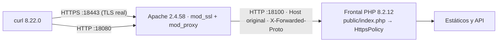

# Verificación del transporte seguro del frontal · Módulo 24 (`R2`, `RNF-06`)

**Fecha:** 29 de octubre de 2026
**Objeto:** medir, contra un **proxy TLS real**, que `HttpsPolicy` corrige el transporte en el frontal
(`308` a HTTPS), que **no** redirige cuando el proxy anuncia el esquema real (`X-Forwarded-Proto: https`),
que emite `Strict-Transport-Security` solo bajo TLS y que las exenciones (bucle local y sonda de salud)
no abren un agujero.

No es una prueba unitaria: el certificado, el saludo TLS, la cabecera del proxy y el salto de red son
reales. La suite `HttpsPolicyTest` (23/23) ya cubre la lógica de la clase; este acta comprueba el
comportamiento de la cadena completa —navegador → proxy → frontal— que ninguna aserción en proceso puede
demostrar.

---

## 1. Cadena medida



- **Escucha TLS (`:18443`):** termina la conexión con el certificado y fija `X-Forwarded-Proto: https`.
- **Escucha plana (`:18080`):** fija `X-Forwarded-Proto: http`, de modo que un cliente que intente
  falsear la cabecera no consigue saltarse la redirección.
- **`ProxyPreserveHost On`** en ambas: el frontal ve el `Host` que pidió el cliente, no el del proxy.

## 2. Entorno y certificado

| Elemento | Valor |
|---|---|
| Servidor | Windows 11 · `DESKTOP-BKBFMP4` |
| Proxy | Apache 2.4.58 (Win64) · OpenSSL 3.1.3 · módulos `ssl`, `proxy`, `proxy_http`, `headers` |
| Aplicación | PHP 8.2.12 (CLI, ZTS) con `php -S 127.0.0.1:18100 -t public public/index.php` |
| Cliente | curl 8.22.0 (mingw, Schannel) |
| Autoridad del certificado | Autofirmado con OpenSSL 3.5.9; `CN=vendguard.example.test`, SAN `DNS:vendguard.example.test`, `DNS:localhost`, `IP:127.0.0.1`; SHA-256 `E9:6D:AC:…:67:F1:C3`; validez de 3 días |
| Confianza del cliente | `curl -k`: el certificado es de laboratorio y **no** se valida la cadena de confianza (no es el objeto de esta acta) |

## 3. Configuración del proxy (extracto)

```apache
<VirtualHost *:18443>
    SSLEngine on
    SSLCertificateFile    "<temp>/cert.pem"
    SSLCertificateKeyFile "<temp>/key.pem"
    ProxyPreserveHost On
    RequestHeader set X-Forwarded-Proto "https"      # fija, no añade
    ProxyPass        "/" "http://127.0.0.1:18100/"
    ProxyPassReverse "/" "http://127.0.0.1:18100/"
</VirtualHost>

<VirtualHost *:18080>
    ProxyPreserveHost On
    RequestHeader set X-Forwarded-Proto "http"       # neutraliza un XFP falseado por el cliente
    ProxyPass        "/" "http://127.0.0.1:18100/"
    ProxyPassReverse "/" "http://127.0.0.1:18100/"
</VirtualHost>
```

La diferencia entre `set` y `setifempty` es deliberada: el frontal **confía** en la cabecera, así que el
proxy debe ser su única fuente. Con `set`, lo que envíe el cliente se descarta.

## 4. Matriz de resultados

| # | Escenario | Petición | Resultado observado | Veredicto |
|---|---|---|---|---|
| A | TLS con `X-Forwarded-Proto: https` | `GET https://…:18443/assets/css/design-tokens.css` | `200` + `Strict-Transport-Security: max-age=31536000; includeSubDomains`, sin `Location` | ✅ No redirige y fija HSTS |
| B | HTTP plano con `Host` público **y `X-Forwarded-Proto: https` falseado** | `GET http://…:18080/assets/css/design-tokens.css` | `308`, `Location: https://vendguard.example.test:18443/assets/css/design-tokens.css`, **sin** HSTS | ✅ La cabecera del cliente no salta la redirección |
| C | POST con cuerpo que sigue el 308 | `POST http://…:18080/assets/css/…` con `-L` | `num_redirects=1`, método final `POST`, `200` (58.764 bytes) | ✅ Método y cuerpo conservados |
| D | Bucle local directo | `GET http://127.0.0.1:18100/…` | `200`, sin HSTS | ✅ Exento por contexto seguro |
| E | Sonda `/api/health` por HTTP plano con `Host` público | `GET http://…:18080/api/health` | `200`, sin `Location` | ✅ Exenta para el orquestador |
| F | `Host` con barra (`evil.example/evil`) | directo al frontal por socket | `200`, sin `Location` ni HSTS | ✅ Falla en cerrado: no construye destino |
| G | `Host` con puerto fuera de rango (`:70000`) | a través de Apache | `400` del proxy antes del frontal | ✅ Rechazo en la primera capa |
| H | POST bajo TLS | `POST https://…:18443/…` | `200` + HSTS | ✅ HSTS también fuera de GET |
| I | Cliente que fuerza `X-Forwarded-Proto: http` sobre TLS | `GET https://…:18443/…` con cabecera falsa | `200` + HSTS, sin redirección | ✅ El proxy sobrescribe |
| J | `VENDGUARD_ALLOW_INSECURE_HTTP=1` | `GET http://…:18080/…` con `Host` público | `200`, sin `Location` | ✅ Excepción explícita y acotada |
| K | Ruta y query en el destino | `GET http://…:18080/assets/…?v=2&lang=es` | `Location: https://…:18443/assets/css/design-tokens.css?v=2&lang=es` | ✅ Sin pérdida |
| L | Raíz de la SPA | `GET http://…:18080/` con `Accept: text/html` | `308`, `Location: https://vendguard.example.test:18443/` | ✅ También la navegación |

## 5. Evidencia textual

**A · TLS con el esquema anunciado por el proxy**

```http
HTTP/1.1 200 OK
Host: vendguard.example.test:18443
Strict-Transport-Security: max-age=31536000; includeSubDomains
Content-Type: text/css; charset=UTF-8
Content-Length: 58764
Cache-Control: no-cache, must-revalidate
```

**B · HTTP plano con `X-Forwarded-Proto: https` inyectado por el cliente**

```http
HTTP/1.1 308 Permanent Redirect
Location: https://vendguard.example.test:18443/assets/css/design-tokens.css
Content-type: text/html; charset=UTF-8
```

**C · El 308 conserva POST y cuerpo (registro del proxy, dos saltos)**

```text
"POST /assets/css/design-tokens.css HTTP/1.1" 308 - "vendguard.example.test:18443" xfp=http
"POST /assets/css/design-tokens.css HTTP/1.1" 200 58764 "vendguard.example.test:18443" xfp=https
```

`curl -w` sobre la misma petición: `final_status=200 method_after_redirect=POST redirects=1 content_length=58764`.
El frontal no consume el cuerpo del primer salto: responde la redirección antes de encaminar y es el
cliente quien repite la petición, que es lo que el `308` garantiza.

**E · La sonda de salud no se redirige (registro del proxy)**

```text
"GET /api/health HTTP/1.1" 200 3047 "vendguard.example.test:18443" xfp=http
```

**F · `Host` no saneable, directo al frontal**

```http
HTTP/1.1 200 OK
Host: evil.example/evil
Content-Type: text/css; charset=UTF-8
```

Sin `Location` y sin HSTS: el frontal prefiere servir que redirigir a un destino construido con datos
del cliente. Cuando el `Host` llega por Apache, ni siquiera se alcanza el frontal (`400`).

**J · La excepción explícita rebaja la política**

```http
HTTP/1.1 200 OK
Host: vendguard.example.test:18443
Content-Type: text/css; charset=UTF-8
```

## 6. Lectura de los resultados

1. **El 308 es correcto para una API.** `308` conserva método y cuerpo por definición, y la medición lo
   confirma en el cliente real: un `POST` con cuerpo sigue siendo `POST` con el mismo cuerpo en el
   segundo salto. Un `301`/`302` habría degradado el `POST` a `GET`.
2. **HSTS aparece solo donde debe.** Se emite en toda respuesta servida bajo TLS —incluidos activos y
   métodos no seguros— y nunca sobre HTTP plano, donde la cabecera es ignorada por el navegador.
3. **La cabecera del proxy es la frontera de confianza.** El escenario B demuestra que un cliente no
   puede falsear `X-Forwarded-Proto` si el proxy la fija; el I, que tampoco puede rebajarla desde TLS.
4. **Las exenciones son estrechas.** Solo el bucle local y `/api/health`; cualquier otro `Host` público
   sobre HTTP plano se corrige, incluida la raíz de la SPA.
5. **Fallo en cerrado en el saneado.** Un `Host` no saneable no produce redirección; el peor caso es
   servir la respuesta pedida, nunca construir una `Location` con datos del atacante.

## 7. Lo que esta acta no cubre

- **El borde de producción.** Se midió un Apache local, no el terminador TLS del despliegue (Cloudflare
  u otro). Las versiones de TLS negociadas, la cadena de confianza y la política del proveedor no se
  auditan aquí.
- **Certificado real.** Autofirmado y aceptado con `-k`; no se valida la cadena, ni revocación, ni OCSP.
- **`preload` y `includeSubDomains`.** La cabecera los declara, pero su efecto real depende del dominio
  y de que se solicite la preload list; no se comprueba.
- **Navegador con HSTS previo.** El comportamiento de un cliente que ya tiene la política cacheada
  (que ni siquiera llega a emitir la petición HTTP) no se puede reproducir en una máquina limpia.
- **Multihost y subdominios.** Solo se ejercitó un nombre; no se probaron comodines ni redirecciones
  entre subdominios.
- **Carga y concurrencia del proxy.** No se mide latencia añadida, ni límites de conexión, ni el
  comportamiento bajo presión; el objeto era la corrección del transporte, no su rendimiento.

## 8. Riesgo residual declarado

`HttpsPolicy` **confía** en `X-Forwarded-Proto`. Es la decisión correcta tras un terminador TLS y es la
que permite desplegar sin tocar el frontal, pero obliga a una condición de despliegue que debe respetarse:

- el frontal **no** debe quedar accesible desde la red pública sin pasar por el proxy que sobrescribe la
  cabecera; en este acta el frontal escucha en bucle local y el proxy la fija con `set` en ambas escuchas;
- si un operador expone el frontal directamente y alguien envía `X-Forwarded-Proto: https`, el frontal
  servirá la petición sin redirigir y sin HSTS. La defensa no es la cabecera: es que ese camino no exista.

Queda anotado en el contrato (§3.3) junto al resto de decisiones de `R2`.

## 9. Reproducción

```bash
# 1. Certificado de laboratorio
MSYS_NO_PATHCONV=1 openssl req -x509 -newkey rsa:2048 -nodes -keyout key.pem -out cert.pem \
  -days 3 -subj "/CN=vendguard.example.test" \
  -addext "subjectAltName=DNS:vendguard.example.test,DNS:localhost,IP:127.0.0.1"

# 2. Frontal
php -S 127.0.0.1:18100 -t public public/index.php

# 3. Proxy con la configuración del §3
"C:/xampp/apache/bin/httpd.exe" -t -f <temp>/httpd.conf
"C:/xampp/apache/bin/httpd.exe" -f <temp>/httpd.conf

# 4. Medición
curl -k -sS --resolve vendguard.example.test:18443:127.0.0.1 -D - -o /dev/null \
  https://vendguard.example.test:18443/assets/css/design-tokens.css

curl -sS -D - -o /dev/null -H "Host: vendguard.example.test:18443" \
  -H "X-Forwarded-Proto: https" http://127.0.0.1:18080/assets/css/design-tokens.css
```

## 10. Referencias

- Política: [`src/Presentation/Http/HttpsPolicy.php`](../src/Presentation/Http/HttpsPolicy.php)
- Punto de aplicación: [`public/index.php`](../public/index.php) (paso 0, antes de servir nada)
- Pruebas de la lógica: [`tests/unit/HttpsPolicyTest.php`](../tests/unit/HttpsPolicyTest.php) — 23/23
- Contrato: [`specs/technical/offline_pwa_contracts.md`](../specs/technical/offline_pwa_contracts.md) §3.3
  (coordinación entre pestañas y contexto seguro)
