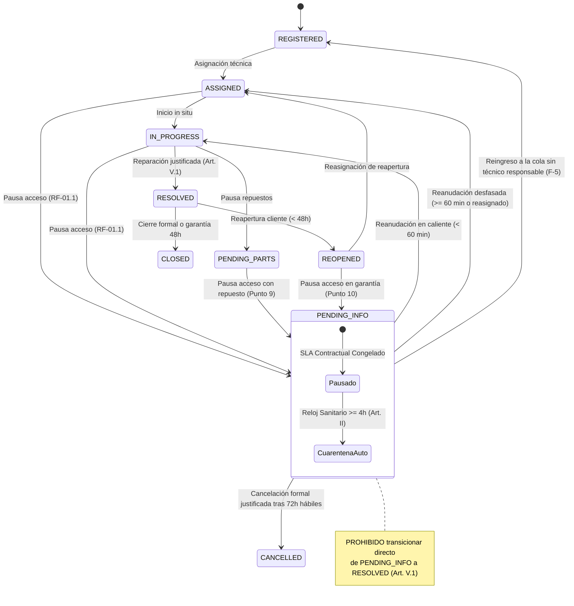

# PLAN TÉCNICO DE IMPLEMENTACIÓN · MÓDULO 11: ESTADO OPERATIVO "PENDIENTE DE INFORMACIÓN" (PENDING_INFO) CON PAUSA DE SLA (PLAN.MD)

**Proyecto:** Gestor de Incidencias de Vending (*VendGuard*)  
**Módulo:** `11-pending-info-sla-pause`  
**Documento:** `specs/11-pending-info-sla-pause/plan.md`  
**Referencia Funcional:** [`specs/11-pending-info-sla-pause/spec.md`](spec.md) (y [`specs/functional/pending_info_sla_pause_spec.md`](../functional/pending_info_sla_pause_spec.md))  
**Normativa Suprema:** [`constitution.md`](../../constitution.md) (Artículos I al VII)  
**Directrices Operativas:** [`AGENTS.md`](../../AGENTS.md) (SDD, Dogma Vanilla, Dualismo Lingüístico)  
**Sistema de Diseño Visual:** [`docs/design.md`](../../docs/design.md) (Tokens Docker: Ámbar técnico `#fef9c3` con texto `#854d0e`, azul corporativo `#2560ff`, radio binario 4px/8px, canvas `#f9fafb`)  

---

## 1. Estructura de Módulos y Ficheros

El diseño arquitectónico preserva rigurosamente el **Dogma Vanilla** (PHP 8.2+ OOP nativo con PDO sin ORMs ni dependencias Composer adicionales; Vue.js 3 estándar en módulos ES nativos sin bundlers ni dependencias npm en runtime).

```text
gestor-incidencias-vending/
├── specs/
│   ├── functional/
│   │   └── pending_info_sla_pause_spec.md       # Especificación funcional formal aprobada tras QA
│   └── 11-pending-info-sla-pause/
│       ├── spec.md                              # Especificación funcional del módulo
│       ├── plan.md                              # Este documento técnico de arquitectura
│       └── tasks.md                             # Plan de tareas atómicas secuenciales (siguiente fase)
├── src/
│   ├── Application/
│   │   ├── DTO/
│   │   │   ├── IncidentPauseRequestDto.php      # DTO inmutable para la solicitud de pausa con causa y motivo
│   │   │   └── IncidentPauseResponseDto.php     # Proyección inmutable del estado de pausa y recálculo de SLA
│   │   └── Service/
│   │       ├── IncidentPauseService.php         # Orquestación de pausas, reanudaciones condicionales y doble reloj
│   │       ├── MetricsCalculationService.php    # Ajuste de MTTR y recuento de brechas con pausas descontadas
│   │       └── CoordinatorIncidentDetailService.php # Desplazamiento comercial de SLA y detección de cuarentena
│   ├── Core/
│   │   └── Domain/
│   │       ├── Model/
│   │       │   ├── Incident.php                 # Entidad de dominio con campos y métodos para PENDING_INFO
│   │       │   └── Machine.php                  # Soporte para estado "Fuera de servicio / Bloqueada por acceso"
│   │       ├── Repository/
│   │       │   └── IncidentRepositoryInterface.php # Métodos extendidos para pausas, reanudaciones y alertas 72h
│   │       └── ValueObject/
│   │           ├── IncidentPauseReasonCategory.php # Enum de causas tipificadas de acceso/información
│   │           └── IncidentStatus.php           # Ampliación del enum con case PENDING_INFO y matriz de transición
│   ├── Infrastructure/
│   │   └── Repository/
│   │       ├── PdoIncidentRepository.php        # Persistencia atómica de transiciones, cálculo de intervalos y 72h
│   │       ├── PdoMachineRepository.php         # Marcado de bloqueo de acceso y verificación de reapertura
│   │       └── PdoMetricsRepository.php         # Queries analíticas SQL descontando total_pending_info_seconds
│   └── Presentation/
│       ├── Controller/
│       │   ├── LocationPortalController.php     # Comentario de sede: anota la respuesta, sin transición (E-1)
│       │   ├── TechnicianController.php         # Endpoints POST pause y resume para el técnico móvil
│       │   └── CoordinatorController.php        # Endpoints POST pause, resume y cancel-inactivity para coordinación
│       └── Routing/
│           └── AppRouter.php                    # Rutas REST registradas con middlewares RBAC
├── public/
│   └── assets/
│       └── js/
│           ├── api.js                           # Métodos HTTP tipados para pause/resume de PENDING_INFO
│           ├── components/
│           │   ├── MachineCard.js               # Banner prominente de sede con botón de llamada a la acción
│           │   ├── PendingInfoPauseModal.js     # Componente modal de pausa con causas tipificadas y >= 20 chars
│           │   └── CoordinatorIncidentDetailModal.js # Visualización de SLA congelado y alerta sanitaria
│           └── views/
│               ├── LocationPortalView.js        # Integración del banner reactivador y apertura de chat
│               ├── TechnicianRouteView.js       # Modal de pausa, botón reanudar y desacoplamiento de parada
│               └── CoordinatorDashboardView.js # Insignia PENDING_INFO, filtro de pausa y alertas de 72h
└── tests/
    ├── unit/
    │   ├── IncidentStatusPendingInfoTest.php    # Pruebas unitarias de la máquina de estados ampliada
    │   ├── IncidentPauseServiceTest.php         # Pruebas unitarias de reactivación condicional y doble reloj
    │   └── PendingInfoPauseModalTest.mjs        # Pruebas reactivas frontend ESM (Node.js sin red)
    └── integration/
        ├── PendingInfoApiTest.php               # Integración HTTP de endpoints contra MariaDB real
        ├── PendingInfoSlaCalculationTest.php    # Verificación de desplazamiento comercial de SLA y MTTR
        └── PendingInfoConstitutionalTest.php    # Blindaje constitucional (Art. II, Art. III, Art. V.1, Art. V.4)
```

---

## 2. Modelo de Datos JSON y Contratos de API REST

Para cumplir con la precisión temporal requerida (RNF-01) y la respuesta ágil en $< 200\text{ ms}$ (RNF-02), los contratos de API se diseñan desacoplados, atómicos y estrictamente validados.

### 2.1. Endpoints de Declaración de Pausa (`POST .../pause-pending-info`)

#### A. Técnico de Campo (`POST /api/technician/incidents/{id}/pause-pending-info`)
* **Seguridad:** Middleware `InternalAuthMiddleware(UserRole::TECHNICIAN)`. Valida que el técnico sea el asignado.
* **Estados de origen válidos:** `ASSIGNED`, `IN_PROGRESS` o directamente `PENDING_PARTS` (Punto 9 QA).
* **Payload de Entrada (`application/json`):**
  ```json
  {
    "reason_category": "BUILDING_CLOSED_NO_ACCESS",
    "reason_text": "El edificio de consultas externas está cerrado por festivo local; conserjería sin personal hasta mañana."
  }
  ```
  * `reason_category`: string enum requerido (`BUILDING_CLOSED_NO_ACCESS`, `MACHINE_LOCATION_NOT_FOUND`, `EXTERNAL_POWER_CUT`, `PENDING_SITE_AUTHORIZATION`).
  * `reason_text`: string requerido con **al menos 20 caracteres descriptivos reales** (Art. V.1).
* **Códigos HTTP:**
  * `200 OK`: Incidencia pausada exitosamente.
  * `400 Bad Request`: Falta categoría o campos obligatorios.
  * `403 Forbidden`: Técnico no asignado o incidencia en estado terminal (`CLOSED`/`CANCELLED`).
  * `422 Unprocessable Content`: `reason_text` con menos de 20 caracteres o categoría no válida.
* **Payload de Salida (`200 OK` JSON):**
  ```json
  {
    "success": true,
    "data": {
      "incident_id": 142,
      "ticket_code": "TICK-2026-00142",
      "status": "PENDING_INFO",
      "status_label": "Pendiente de Información",
      "paused_at": "2026-10-08 10:15:00",
      "reason_category": "BUILDING_CLOSED_NO_ACCESS",
      "reason_category_label": "Edificio cerrado / Sin acceso a instalaciones",
      "reason_text": "El edificio de consultas externas está cerrado por festivo local; conserjería sin personal hasta mañana.",
      "is_sla_paused": true,
      "accumulated_pause_minutes": 0,
      "sla_target_at_original": "2026-10-08 12:15:00"
    },
    "message": "Incidencia pausada correctamente. Reloj contractual de SLA congelado."
  }
  ```

#### B. Coordinador de Operaciones (`POST /api/coordinator/incidents/{id}/pause-pending-info`)
* **Seguridad:** Middleware `InternalAuthMiddleware(UserRole::COORDINATOR)`. Mismo contrato que el técnico, pero autoriza pausar cualquier ticket activo (`ASSIGNED`, `IN_PROGRESS`, `PENDING_PARTS`, `REOPENED`).

---

### 2.2. Endpoints de Reanudación Manual (`POST .../resume-pending-info`)

#### A. Técnico de Campo (`POST /api/technician/incidents/{id}/resume-pending-info`)
* **Seguridad:** `InternalAuthMiddleware(UserRole::TECHNICIAN)`.
* **Comportamiento:** Si lo ejecuta el técnico in situ, la avería transiciona forzosamente a `IN_PROGRESS` (comienza a trabajar en la máquina).
* **Payload de Salida (`200 OK` JSON):**
  ```json
  {
    "success": true,
    "data": {
      "incident_id": 142,
      "ticket_code": "TICK-2026-00142",
      "status": "IN_PROGRESS",
      "status_label": "En curso",
      "resumed_at": "2026-10-08 11:45:00",
      "duration_this_pause_minutes": 90,
      "total_accumulated_pause_minutes": 90,
      "new_sla_target_at": "2026-10-08 13:45:00",
      "sanitary_quarantine_triggered": false
    },
    "message": "Intervención reanudada en curso. Reloj contractual de SLA reactivado con desplazamiento aplicado."
  }
  ```

#### B. Coordinador de Operaciones (`POST /api/coordinator/incidents/{id}/resume-pending-info`)
* **Seguridad:** `InternalAuthMiddleware(UserRole::COORDINATOR)`.
* **Payload de Entrada Opcional (`application/json`):**
  ```json
  {
    "target_status": "ASSIGNED",
    "resume_note": "Recepción confirma por teléfono que ya entregaron la llave al técnico de guardia."
  }
  ```
  * `target_status`: `"ASSIGNED"` (por defecto si el técnico debe desplazarse), `"IN_PROGRESS"` (si ya está en la máquina) o `"REGISTERED"` (sólo cuando el expediente no tiene técnico responsable: la avería reingresa a la cola de asignación; cierre de F-5, §6.4). La coherencia entre destino y responsabilidad la impone el agregado: sin técnico, `ASSIGNED`/`IN_PROGRESS` responden `422 INVALID_STATUS_FOR_RESUME`; con técnico, `REGISTERED` hace lo propio.

---

### 2.3. Respuesta de Sede en Comentarios (sin reactivación automática)

* **Ruta Existente:** `POST /api/location/incidents/{id}/comments` (Módulo 10).
* **Comportamiento Integrado (enmienda del Product Owner, 2026-10-11):**
  * Al procesar un comentario público válido ($\ge 5$ caracteres) de la Sede, el sistema **anexa el mensaje al hilo y NO transiciona nada**: ni el estado, ni el reloj contractual, ni el acumulador. La pausa sigue viva y el SLA continúa congelado (RF-02.1 enmendado).
  * La única huella derivada es la marca `site_response_since_pause` de la ruta técnica (§5.1 del contrato de API), que pinta el aviso de RF-05.6 en la tarjeta pausada del técnico.
  * Las ráfagas se anexan sin más: ya no hay transición que proteger ni idempotencia de estado que garantizar (RF-05.3 enmendado).
  * La pausa se cierra únicamente con la reanudación manual del técnico (`POST .../resume-pending-info`) o del coordinador (con destino elegido, RF-02.3), o con la cancelación justificada por inactividad (RF-04.3).
* **Payload de Respuesta:** el hilo canónico del módulo 10 sin bloques añadidos; el par `auto_resumed`/`pause` de la versión anterior **desaparece** del contrato.

---

### 2.4. Endpoint de Cancelación por Inactividad de 72h Hábiles (`POST .../cancel-inactivity`)

* **Ruta:** `POST /api/coordinator/incidents/{id}/cancel-inactivity`
* **Seguridad:** Middleware `InternalAuthMiddleware(UserRole::COORDINATOR)`.
* **Payload Entrada (`application/json`):**
  ```json
  {
    "cancellation_reason": "Cierre formal tras 72 horas hábiles de inactividad de sede sin respuesta ni acceso facilitado."
  }
  ```
  * `cancellation_reason`: string obligatorio $\ge 20$ caracteres descriptivos.
* **Comportamiento en Base de Datos (Art. V.1 y Módulo 08):**
  * `incidents.status` pasa a `'CANCELLED'`.
  * `machines.status` pasa a `'BLOCKED_NO_ACCESS'` (la máquina NO vuelve a `'Operativa'`).
  * Reintegros económicos vinculados: se desvinculan del ticket (`refund_requests.incident_id = NULL`), manteniéndose en estado `'PENDING_COORDINATOR'` para liquidación central sin perjudicar al usuario.
* **Precondición del umbral (2026-10-10, cierre de F-1):** la operación sólo se admite con **más de 72 h hábiles** acumuladas en `PENDING_INFO`, medidas en horario comercial de la sede (08:00-18:00, lunes a viernes) con la misma regla que enciende la insignia de RF-04.2 (`IncidentPauseService::isProlongedInactivity()`). Fuera de la ventana, el servicio rechaza la operación **dentro de su transacción** y no escribe nada.
* **Respuesta HTTP:** `200 OK` confirmando la cancelación, el bloqueo de máquina y la preservación del reintegro; `422 INACTIVITY_THRESHOLD_NOT_REACHED` cuando la espera no supera el umbral (con la espera medida y el umbral en `details`); `422 MISSING_CANCELLATION_REASON` / `422 INVALID_CANCELLATION_REASON` por el motivo obligatorio de $\ge 20$ caracteres reales; `422 INVALID_STATUS_FOR_INACTIVITY_CANCELLATION` si el expediente no está en pausa; `400 INVALID_INCIDENT_ID` y `404 INCIDENT_NOT_FOUND`.
* **Rastro de auditoría:** el evento `INCIDENT_CANCELLED` sella el canal `INACTIVITY_72_BUSINESS_HOURS` **con la espera realmente medida** (`inactivity_wait_business_hours`) y el umbral aplicado, en lugar de afirmar el canal con un literal.

---

### 2.5. Endpoint de Barrido del Reloj Sanitario (`POST /api/cron/sanitary-clock-sweep`)

Consumidor de fondo del Algoritmo 4 (T-PAUSE-38, RF-03.5.1). Protegido por `CronAuthMiddleware` —mismo contrato que `/api/cron/auto-close`: cabecera `X-Cron-Secret`, `Bearer <CRON_SECRET>` o sesión de `COORDINATOR`— y **fail-closed**: el controlador sin la marca `cron_authenticated` responde `401` aunque el secreto sea válido. No estrena códigos de error: reutiliza el `UNAUTHORIZED` ya documentado en `api_contracts.md` §1.3.

```json
{
  "success": true,
  "data": {
    "candidates": 3,
    "evaluated": 1,
    "quarantined": [{ "incident_id": 41, "ticket_code": "INC-2026-000041", "machine_id": 7 }],
    "skipped": 0,
    "failures": [{ "incident_id": 44, "ticket_code": "INC-2026-000044", "reason": "..." }],
    "failures_count": 1,
    "contended": [{ "incident_id": 46, "ticket_code": "INC-2026-000046", "reason": "SQLSTATE[HY000]: General error: 1205 Lock wait timeout exceeded; try restarting transaction" }],
    "contended_count": 1,
    "threshold_seconds": 14400,
    "duration_ms": 12.4
  }
}
```

* `candidates`: expedientes devueltos por el prefiltro del repositorio (capacidad y economía de consulta, **no** decisión: la decisión la toma el reloj).
* `evaluated`: candidatos evaluados de verdad por el reloj.
* `quarantined`: máquinas que el reloj reporta en cuarentena tras la evaluación. El disparo de **esta** corrida queda sellado, además, como evento `SANITARY_QUARANTINE_AUTO_TRIGGERED` en la bitácora inmutable (Art. III).
* `skipped`: evaluados que no requieren cuarentena (umbral no alcanzado en la relectura del reloj o expediente liquidado en carrera con otro consumidor).
* `failures` / `failures_count`: candidatos cuya evaluación no pudo decidirse (tipología o apertura ilegibles) o cuya escritura no se pudo persistir; **nunca** se silencian, viajan en la respuesta y el CLI termina con `exit 1` si hay alguno.
* `contended` / `contended_count`: candidatos **aplazados por contención de fila** —la transición murió esperando el bloqueo exclusivo que otro consumidor sostiene sobre esa misma máquina (`1205 Lock wait timeout`, `1213 Deadlock`, `SQLSTATE 40001`)—. Se separan de `failures` porque la contención no es un error del barrido sino la prueba de que otro escritor está actuando sobre la máquina ahora mismo: no alerta al planificador y se resuelve en la pasada siguiente. La clasificación es **estricta y fail-safe** (sólo códigos de bloqueo; cualquier otro error de persistencia es `failures`), y la identidad contable `candidates = evaluated + failures_count + contended_count` la verifica el propio DTO, que rechaza un resumen que no cuadre.
* **Una sola regla de alerta:** `SanitaryClockSweepResultDto::requiresOperatorAttention()` es la única autoridad sobre qué enciende el planificador (`true` sólo con fallos reales) y el CLI deriva de ahí su código de salida.

#### 2.5.1. Contención de fila del barrido y política de reintento (propuesta)

El barrido comparte la fila de la máquina con el cierre técnico (§5.4.1 del contrato de API) y con cualquier otro escritor del parque, así que **la contención es un estado normal de operación, no un fallo**: el reloj arbitra la carrera con su transición idempotente y el rastro inmutable sigue siendo **uno por máquina** (certificado con dos conexiones PDO reales en `SanitaryClockConsumerRaceTest`). Lo que faltaba no era la exclusión mutua sino su **lectura operativa**: hasta T-PAUSE-39 un candidato que perdía el bloqueo se contaba como `failures` y teñía de rojo la pasada, con lo que el planificador alertaba en cada solape legítimo y el aviso perdía valor.

* **Decisión implementada (T-PAUSE-39):** la contención tiene su propia clave (`contended`/`contended_count`), **no** enciende la alerta y no toca el estado de la máquina; la identidad contable del resumen se verifica en el DTO (Fail-Fast).
* **Política de reintento propuesta (pendiente de ratificación):** reintento acotado dentro de la pasada (1 + 2 intentos con espera creciente y jitter), red de seguridad por cadencia (el prefiltro vuelve a publicar al candidato aplazado mientras siga vencido y sin cuarentena, así que la pérdida máxima es de una cadencia) y regla de escalado para el planificador (aviso con contención; escalada si persiste en 3 pasadas consecutivas o supera 5 aplazamientos en una pasada). El razonamiento, los valores recomendados, el coste medido y las decisiones que quedan en manos del Product Owner están en `docs/propuesta_politica_reintento_barrido_sanitario.md`.

La cadencia operativa (**15 minutos**, ratificada por el Product Owner) y el comando de programación se documentan en `README.md`. **Límite declarado:** la activación automática depende de que el planificador esté configurado fuera del repositorio; hasta entonces el mecanismo queda entregado y probado, pero no activo.

---

## 3. Algoritmos Clave en Pseudocódigo y Máquinas de Estado

### 3.1. Algoritmo 1: Máquina de Estados Ampliada con `PENDING_INFO`

Regula las transiciones legales garantizando la prohibición terminante de cierres directos sin intervención (Art. V.1).



#### Matriz de Transiciones Legales (`IncidentStatus::canTransitionTo`):
```text
Desde PENDING_INFO SE PERMITE:
  -> IN_PROGRESS (Reanudación in situ o en caliente)
  -> ASSIGNED    (Reanudación desfasada, por coordinador o tras reasignación)
  -> REGISTERED  (Reingreso a la cola de asignación: sólo sin técnico responsable; cierre de F-5)
  -> CANCELLED   (Cancelación formal por inactividad de 72h hábiles)

Hacia PENDING_INFO SE PERMITE DESDE:
  <- ASSIGNED
  <- IN_PROGRESS
  <- PENDING_PARTS
  <- REOPENED
```

---

### 3.2. Algoritmo 2 (derogado): Reactivación Condicional Inteligente tras Respuesta de Sede

Determina con precisión matemática y física a qué estado debe volver la avería al recibir información del cliente, eliminando ficciones operativas (Puntos 2, 6 y 7 de QA).

> **Derogado por enmienda del Product Owner (2026-10-11, RF-02.1).** El pseudocódigo se conserva como historia del diseño, pero ya no rige: un comentario público de la sede **no** transiciona el estado. Lo que rige es el Algoritmo 2 bis: el mensaje solo se anexa y la pausa queda marcada como respondida para la tarjeta del técnico (RF-05.6).

```text
ALGORITMO MarcarRespuestaDeSede(incidencia, comentario, ahora)
    SI incidencia.status != "PENDING_INFO" ENTONCES:
        RETORNAR // comentario normal de seguimiento
    FIN SI
    // Sin transición, sin tocar el reloj contractual ni el acumulador.
    // site_response_since_pause es DERIVADA en lectura: el actor de sede publicó un
    // mensaje con posterioridad al paused_at del intervalo vigente. La autoría se lee
    // del rastro inmutable (INCIDENT_COMMENT_ADDED con rol SITE_MANAGER), porque
    // incident_comments.author_type no distingue a la sede de un aviso ciudadano por QR.
FIN ALGORITMO
```

```text
ALGORITMO ReactivarCondicionalmente(incidencia, comentarioSede, ahora)
    // 1. Validar que la incidencia esté en pausa
    SI incidencia.status != "PENDING_INFO" ENTONCES:
        RETORNAR // Comentario normal de seguimiento, nada que despausar
    FIN SI

    // 2. Calcular tiempo transcurrido en la pausa actual
    minutosEnPausa = DiferenciaEnMinutos(ahora, incidencia.pending_info_started_at)
    
    // 3. Evaluar contexto del técnico asignado
    tecnicoAsignado = incidencia.assigned_technician_id
    haIniciadoOtraIntervencion = ComprobarSiTecnicoTieneOtraParadaEnCurso(tecnicoAsignado, ahora)
    fueReasignadoEnPausa = incidencia.tecnico_cambiado_durante_pausa // Booleano auditado

    // 4. Regla de Reactivación Inteligente (Puntos 2 y 6 de QA; enmendada en el cierre de F-5)
    SI tecnicoAsignado ES NULO ENTONCES:
        // Sin responsable ningún estado puede afirmar que alguien va a trabajar (§6.4)
        nuevoEstado = "REGISTERED"
        notaAuditoria = "La avería vuelve a registrada sin técnico responsable: requiere una asignación formal antes de poder iniciar trabajos."
    SINO SI minutosEnPausa < 60 Y NO haIniciadoOtraIntervencion Y NO fueReasignadoEnPausa ENTONCES:
        nuevoEstado = "IN_PROGRESS"
        notaAuditoria = "Reactivación automática en caliente tras respuesta de sede (< 60 min)."
    SINO:
        nuevoEstado = "ASSIGNED"
        notaAuditoria = "Reactivación automática a estado Asignada (demora >= 60 min, técnico en otra parada o reasignado). Requiere inicio presencial."
    FIN SI

    // 5. Aplicar desplazamiento comercial de SLA
    nuevoSlaTargetAt = DesplazarSlaHorarioComercial(incidencia.sla_target_at, minutosEnPausa, incidencia.location_id)

    // 6. Persistir atómicamente la transición y auditoría
    incidencia.status = nuevoEstado
    incidencia.total_pending_info_seconds += (minutosEnPausa * 60)
    incidencia.last_pending_info_resumed_at = ahora
    incidencia.pending_info_started_at = NULO
    incidencia.sla_target_at = nuevoSlaTargetAt

    GuardarEnBaseDeDatos(incidencia)
    RegistrarHistorialAuditoria(incidencia.id, "PENDING_INFO", nuevoEstado, notaAuditoria)
    NotificarTecnico(tecnicoAsignado, "Sede ha facilitado información. Avería reactivada.")
FIN ALGORITMO
```

---

### 3.3. Algoritmo 3: Recálculo de SLA en Ventana de Horario Hábil Comercial

Aplica el aplazamiento de la fecha límite respetando los horarios reales de apertura del cliente, impidiendo vencimientos de madrugada (Punto 3 de QA).

> **Qué se le entrega como `minutosPausa` (2026-10-10, cierre de F-3).** El parámetro no es la duración de pared de la pausa sino el **tiempo hábil realmente perdido** durante ella: la pausa congela el reloj contractual (RF-03.2) y la reanudación sólo devuelve a la cuenta atrás lo que la jornada de la sede dejó de correr. El pseudocódigo recorre la jornada comercial hacia adelante, de modo que reinterpretar los segundos de pared como horas comerciales dilataba el compromiso hasta 4× en el caso más habitual (la parada de viernes a lunes de RF-01.1). La cifra la mide `IncidentPauseService::pauseBusinessSecondsSince()` —el gemelo inverso de este algoritmo— tanto al persistir el nuevo vencimiento como al publicar la fecha recalculada de la ficha, para que lectura y escritura no puedan discrepar. La duración de pared sigue siendo la que se audita en el intervalo y descuenta el MTTR (RF-03.1).

```text
ALGORITMO DesplazarSlaHorarioComercial(fechaObjetivoOriginal, minutosPausa, locationId)
    // Parámetros comerciales de sede (por defecto 08:00 a 18:00, lunes a viernes)
    HORA_APERTURA = 8
    HORA_CIERRE = 18
    MINUTOS_JORNADA = (HORA_CIERRE - HORA_APERTURA) * 60 // 600 minutos/día

    fechaCursor = fechaObjetivoOriginal
    minutosPendientesPorSumar = minutosPausa

    MIENTRAS minutosPendientesPorSumar > 0 HACER:
        // Si el cursor cae en fin de semana (sábado/domingo), saltar al lunes a las 08:00
        SI EsFinDeSemana(fechaCursor) ENTONCES:
            fechaCursor = SiguienteLunesHora(fechaCursor, HORA_APERTURA)
        FIN SI

        // Si la hora es anterior a la apertura, situar a las 08:00
        SI fechaCursor.hora < HORA_APERTURA ENTONCES:
            fechaCursor.hora = HORA_APERTURA
            fechaCursor.minuto = 0
        FIN SI

        // Si la hora es posterior al cierre, saltar al día siguiente a las 08:00
        SI fechaCursor.hora >= HORA_CIERRE ENTONCES:
            fechaCursor = SiguienteDiaHabilHora(fechaCursor, HORA_APERTURA)
            CONTINUAR
        FIN SI

        // Minutos disponibles en la jornada actual
        minutosHastaCierreHoy = ((HORA_CIERRE - fechaCursor.hora) * 60) - fechaCursor.minuto

        SI minutosPendientesPorSumar <= minutosHastaCierreHoy ENTONCES:
            fechaCursor = fechaCursor.SumarMinutos(minutosPendientesPorSumar)
            minutosPendientesPorSumar = 0
        SINO:
            minutosPendientesPorSumar -= minutosHastaCierreHoy
            fechaCursor = SiguienteDiaHabilHora(fechaCursor, HORA_APERTURA)
        FIN SI
    FIN MIENTRAS

    RETORNAR fechaCursor
FIN ALGORITMO
```

---

### 3.4. Algoritmo 4: Doble Reloj con Cuarentena Sanitaria Automática (Art. II)

Garantiza la supremacía de la seguridad alimentaria en máquinas de frío independientemente del congelamiento de facturación contractual.

```text
ALGORITMO EvaluarDobleRelojSanitario(incidencia, maquina, ahora)
    // 1. Evaluar si la máquina queda bajo vigilancia sanitaria (RF-03.4, ratificado en
    //    T-PAUSE-26): perecederas PERISHABLE_FOOD y mixtas COMBO con módulo refrigerado.
    //    Las bebidas frías y las tipologías sin producto fresco solo computan reloj contractual.
    SI NOT requiresSanitaryWatch(maquina.machine_type) ENTONCES:
        RETORNAR // Máquina fuera de la vigilancia sanitaria: solo aplica reloj contractual
    FIN SI

    // 2. Reloj Biológico Sanitario: tiempo natural 24/7 continuo desde el reporte inicial de frío
    horasNaturalesSinFrio = DiferenciaHorasNaturales24_7(ahora, incidencia.created_at)

    // 3. Regla Suprema del Artículo II: Límite crítico de 4 horas
    SI horasNaturalesSinFrio >= 4.0 Y maquina.sanitary_status != "QUARANTINE" ENTONCES:
        // Activar Cuarentena Sanitaria Automática
        maquina.sanitary_status = "QUARANTINE"
        ActualizarEstadoSanitarioMaquina(maquina.id, "QUARANTINE")

        // Marcar la incidencia con flag de cuarentena requerida en resolución
        incidencia.sanitary_quarantine_triggered = VERDADERO
        ActualizarIncidencia(incidencia)

        // Registrar en auditoría inmutable
        RegistrarEventoAuditoria("SANITARY_QUARANTINE_AUTO_TRIGGERED", {
            "incident_id": incidencia.id,
            "machine_id": maquina.id,
            "elapsed_natural_hours": horasNaturalesSinFrio,
            "reason": "Ruptura térmica prolongada: superadas 4 horas naturales en PENDING_INFO sin intervención."
        })

        EmitirAlertaCriticaCoordinacion("ALERTA SANITARIA ART. II: Máquina " + maquina.code + " en cuarentena automática.")
    FIN SI
FIN ALGORITMO
```

> **Consumidor de fondo (T-PAUSE-38, 2026-10-12).** El Algoritmo 4 se consume hoy desde dos caminos: la puerta sanitaria del cierre técnico (T-PAUSE-22, RF-03.5.2) y el **barrido periódico** de §2.5, que es el que materializa la activación automática de RF-03.5.1 **sin interacción humana**. El barrido no decide nada por su cuenta: selecciona candidatos (expediente vivo, máquina bajo vigilancia, sin cuarentena previa y con más de 4 h naturales desde la apertura) y llama al mismo `IncidentPauseService::evaluateSanitaryBiologicalClock()`, dentro de una transacción por expediente para que el estado y su rastro inmutable sean una sola unidad de trabajo (Art. III). La escritura del estado es una **transición idempotente (compare-and-set)**: de dos consumidores simultáneos sobre la misma máquina, sólo uno escribe y sólo uno deja el evento, de modo que la cuarentena no puede duplicar su rastro. La marca `incidencia.sanitary_quarantine_triggered` del pseudocódigo no se persiste como columna: el bloqueo del formulario se deriva en lectura (`IncidentPauseService::sanitaryResolutionRequirement()`), tal y como certifica T-PAUSE-25.

---

### 3.5. Algoritmo 5: Detección de Inactividad de 72h Hábiles y Cancelación Segura (Art. V.1 y V.2)

```text
ALGORITMO EvaluarInactividad72HorasHabiles(incidencia, ahora)
    SI incidencia.status != "PENDING_INFO" ENTONCES:
        RETORNAR
    FIN SI

    horasHabilesTranscurridas = CalcularHorasHabilesComerciales(incidencia.pending_info_started_at, ahora)

    SI horasHabilesTranscurridas >= 72.0 ENTONCES:
        incidencia.is_prolonged_wait = VERDADERO
        ActualizarBadgeIncidencia(incidencia.id, "En espera prolongada de cliente (> 72h hábiles)")
        NotificarAlertaPrioritariaTriaje(incidencia.id)
    FIN SI
FIN ALGORITMO

ALGORITMO CancelarPorInactividadCoordinador(incidenciaId, motivoCancelacion, coordinadorId)
    // 1. Validar justificación >= 20 caracteres (Art. V.1)
    SI LongitudReal(motivoCancelacion.trim()) < 20 ENTONCES:
        LANZAR ErrorValidacion("El motivo de cancelación debe contener al menos 20 caracteres reales.")
    FIN SI

    incidencia = ObtenerIncidencia(incidenciaId)
    maquina = ObtenerMaquina(incidencia.machine_id)

    INICIAR_TRANSACCION()

    // 2. Cancelar el ticket formalmente
    incidencia.status = "CANCELLED"
    incidencia.cancelled_at = Ahora()
    incidencia.cancellation_reason = motivoCancelacion
    GuardarIncidencia(incidencia)

    // 3. Proteger la máquina: NO vuelve a "Operativa" (Art. V.1)
    maquina.is_active = FALSO
    maquina.operational_status = "BLOCKED_NO_ACCESS"
    maquina.notes = Concatenar(maquina.notes, " [Bloqueada por falta de acceso tras ticket " + incidencia.ticket_code + "]")
    GuardarMaquina(maquina)

    // 4. Proteger reintegros económicos vinculados (Módulo 08)
    reintegro = BuscarReintegroPorIncidencia(incidencia.id)
    SI reintegro != NULO ENTONCES:
        reintegro.incident_id = NULO // Desvincular de la avería técnica
        reintegro.status = "PENDING_COORDINATOR" // Mantener para pago central Bizum/IBAN
        GuardarReintegro(reintegro)
        RegistrarAuditoriaReintegro(reintegro.id, "Reintegro desvinculado de avería cancelada por inactividad; mantenido para custodia central.")
    FIN SI

    RegistrarHistorialAuditoria(incidencia.id, "PENDING_INFO", "CANCELLED", motivoCancelacion)
    CONFIRMAR_TRANSACCION()
FIN ALGORITMO
```

---

## 4. Arquitectura de Eventos y Componentes Frontend Vanilla / Vue 3

### 4.1. Componente Modal Reutilizable: `PendingInfoPauseModal.js`

* **Ubicación:** `public/assets/js/components/PendingInfoPauseModal.js`.
* **Props:** `isOpen` (boolean), `incident` (Object), `role` (string: `'TECHNICIAN'` o `'COORDINATOR'`).
* **Emits:** `close`, `paused`.
* **Diseño y Maquetación (Tokens Docker de `docs/design.md`):**
  * Fondo sombreado `rgba(15, 23, 42, 0.6)`.
  * Contenedor con borde de 8px (`--radius-card`), cabecera ámbar suave con icono `⏸️`.
  * **Selector de Causas Tipificadas (Botones táctiles $\ge 44\text{ px}$):**
    * `BUILDING_CLOSED_NO_ACCESS`: *"Edificio cerrado / Sin acceso a instalaciones"*
    * `MACHINE_LOCATION_NOT_FOUND`: *"Máquina no localizada en la planta indicada"*
    * `EXTERNAL_POWER_CUT`: *"Corte eléctrico ajeno a la máquina"*
    * `PENDING_SITE_AUTHORIZATION`: *"Falta de autorización de seguridad / Llave"*
  * **Área de Texto de Justificación:** `textarea` con `minlength="20"`, `maxlength="500"`.
  * **Contador Reactivo Dinámico:** Muestra *"Faltan X caracteres"* en rojo suave si $< 20$, y se tiñe de verde una vez alcanzado el mínimo legal (Art. V.1).
  * **Botón de Confirmar Pausa:** Deshabilitado hasta que haya causa seleccionada y el texto alcance $\ge 20$ caracteres.
  * **Guardián de Borrador Sucio (RNF-06):** Intercepta tecla `Escape` y clics en el backdrop, solicitando confirmación si hay texto escrito antes de cerrar.

---

### 4.2. Integración en el Portal del Responsable de Sede (`LocationPortalView.js` y `MachineCard.js`)

* En `MachineCard.js`:
  * Si `activeIncident.status === 'PENDING_INFO'`:
    * La tarjeta de la máquina se enmarca con borde ámbar `#fde047`.
    * Renderiza un **Banner Prominente de Llamada a la Acción**:
      ```html
      <div class="vg-pending-info-banner" style="background: #fef9c3; border: 1px solid #fde047; padding: 10px; border-radius: 4px;">
        <div style="font-weight: 700; color: #854d0e; font-size: 13px;">⏸️ Intervención en Pausa: El técnico necesita tu ayuda</div>
        <div style="font-size: 12px; color: #713f12; margin: 4px 0;">Causa: {{ activeIncident.pending_info_reason_category_label }}</div>
        <p style="font-size: 11px; color: #713f12; margin: 0 0 8px 0;">"{{ activeIncident.pending_info_reason_text }}"</p>
        <button class="vg-btn vg-btn-primary" style="width: 100%; font-size: 12px;" @click="$emit('open-comments', machine)">
          💬 Aportar información / Responder al técnico
        </button>
      </div>
      ```
* Al pulsar el botón, abre el modal de conversación del Módulo 10 (`IncidentCommentThreadModal.js`); publicar un comentario de $\ge 5$ caracteres anota la respuesta y **no** reanuda: la tarjeta del técnico muestra el aviso de respuesta pendiente (RF-05.6) y la pausa la cierra él o el coordinador (RF-02.1 enmendado).

---

### 4.3. Integración en la Vista Móvil del Técnico "Mi Ruta" (`TechnicianRouteView.js`)

* **Parada en `PENDING_INFO`:**
  * La tarjeta de parada muestra la insignia destacada `⏸️ En espera de sede (Pausada hace X min)`.
  * **Desacoplamiento de Ruta (RF-05.5):** La parada no bloquea el flujo; el botón *"Iniciar intervención"* de la siguiente parada programada permanece completamente operativo.
  * **Acción *"Reanudar intervención"*:** Botón visible en la tarjeta que abre un diálogo de confirmación y llama a `POST .../resume-pending-info`, volviendo a `IN_PROGRESS` si el técnico vuelve a estar in situ.
  * **Aviso de respuesta de la sede (RF-05.6):** cuando existe un comentario público de la sede posterior al inicio de la pausa vigente, la tarjeta añade *"✉️ La sede ha respondido · pendiente de tu reanudación"* (`site_response_since_pause` en la ruta técnica), sin ninguna transición automática.
  * **Acción dentro del aviso (RF-05.6, enmienda del 2026-10-11):** el aviso no es un cartel inerte: lleva incorporada la reanudación in situ de RF-02.2, para que el técnico cierre la pausa desde el mismo punto donde lee la respuesta. Con el aviso visible la barra de acciones **no repite** el botón (un solo control por tarjeta); sin el aviso, la acción vuelve a ser el botón primario de la tarjeta. Ambas ramas comparten el mismo manejador `resumePendingInfoIntervention()` y el mismo destino `IN_PROGRESS`.

---

### 4.4. Integración en la Bandeja de Triaje del Coordinador (`CoordinatorDashboardView.js`)

* **Insignia y Filtro:** Filtro rápido por estado `PENDING_INFO` con badge `#fef9c3`.
* **Reloj Congelado:** En la columna de SLA, se muestra el icono `⏸️` con el texto *"Pausado (+X min desc.)"*.
* **Alerta de 72h:** Si acumula $> 72\text{ h}$ hábiles, la fila destaca con borde rojo y botón de acción directa *"Cancelar por inactividad de sede"*.

---

## 5. Decisiones Técnicas Justificadas y Alternativas Descartadas

| Decisión Adoptada | Alternativa Descartada | Justificación Técnica y Constitucional |
| :--- | :--- | :--- |
| **Doble Reloj (Contractual congelado vs. Biológico 24/7 continuo).** | Reloj único pausado para todo o prohibición de pausar en frío. | Armoniza la equidad contractual con la **Supremacía Sanitaria del Artículo II**. Congelar la facturación protege a la empresa operadora de multas injustas por puertas cerradas; mantener el reloj biológico garantiza que a las 4 horas la máquina entre en cuarentena y los alimentos se desechen antes de abrir al público. |
| **Desplazamiento de SLA en horario hábil de la sede (08:00 a 18:00).** | Desplazamiento ciego en minutos naturales 24/7. | Un cliente que reporta un viernes y cierra a las 18:00 no puede recibir un SLA aplazado que venza un sábado a las 03:00 AM. Computar en horario hábil refleja la realidad contractual y comercial de los contratos de vending con empresas y centros oficiales. |
| **Reanudación siempre explícita (enmienda del Product Owner, 2026-10-11).** | Reactivación automática por respuesta de sede (< 60 min a `IN_PROGRESS` vs. $\ge 60$ min a `ASSIGNED`), derogada. | Evita ficciones operativas por la vía fuerte: el mensaje de la sede es información, no una orden. El sistema no puede afirmar que un profesional está delante de una máquina porque un tercero haya escrito; solo el técnico sabe si puede retomar el trabajo y el coordinador decide desde central con destino elegido (RF-02.3). |
| **Máquina en "Fuera de servicio / Bloqueada por acceso" tras cancelación de 72h.** | Restablecer la máquina a "Operativa" en verde. | Violación flagrante del **Artículo V.1 (Cierre obligatoriamente justificado)**. Si la máquina tenía un fallo mecánico o eléctrico reportado y nunca se pudo acceder a repararla, ponerla en verde engañaría a los usuarios del edificio. Debe quedar inoperativa hasta que confirmen acceso. |
| **Desvinculación protectora de reintegros económicos (Módulo 08).** | Cancelar la devolución de dinero si se cancela la avería técnica. | El consumidor que perdió su dinero en la máquina no tiene la culpa de que el conserje no haya abierto la puerta al técnico. Cancelar su dinero violaría el principio de equidad del Módulo 08. El reintegro debe pasar a liquidación central por transferencia Bizum/IBAN. |

---

## 6. Estrategia de Pruebas Integrales (100% Verde sin Red)

### 6.1. Pruebas Unitarias PHP (Backend)

* **`IncidentStatusPendingInfoTest.php`:**
  * Verifica transiciones válidas hacia `PENDING_INFO` desde `ASSIGNED`, `IN_PROGRESS`, `PENDING_PARTS` y `REOPENED`.
  * Verifica transiciones de salida permitidas (`IN_PROGRESS`, `ASSIGNED`, `CANCELLED`).
  * Verifica que esté terminantemente prohibida la transición directa `PENDING_INFO` $\rightarrow$ `RESOLVED`.
  * Comprueba que `isActive()` devuelva `true` y `isTerminal()` devuelva `false`.
* **`IncidentPauseServiceTest.php`:**
  * Prueba de justificación: rechaza causas vacías o textos $< 20$ caracteres reales.
  * Prueba de la respuesta de sede (RF-02.1 enmendado): un comentario público a los 20 min y a los 90 min de la pausa deja el expediente intacto en `PENDING_INFO` —estado, reloj y acumulador— y marca la respuesta; la reanudación manual posterior sí cierra la pausa con su desplazamiento.
  * Prueba de desplazamiento de SLA comercial: verifica que los minutos de pausa aplacen `sla_target_at` saltando fines de semana y noches.
* **`MetricsCalculationServiceTest.php`:**
  * Verifica que el cálculo de MTTR reste exactamente `total_pending_info_seconds` del tiempo transcurrido entre creación y resolución.
* **`SanitaryClockSweepServiceTest.php`:**
  * Barrido con candidatos elegibles: una máquina entra en cuarentena una sola vez y su rastro inmutable se emite una sola vez.
  * Idempotencia: un segundo barrido sobre el mismo parque no vuelve a escribir ni a auditar.
  * Aislamiento: un candidato indecidible viaja a `failures` sin abortar el resto del lote, y el lote respeta su cota.
  * **Contención de fila (T-PAUSE-39):** el candidato cuya transición muere esperando el bloqueo ajeno (`1205`, `1213`/`40001`) viaja a `contended` —no a `failures`— y no enciende la alerta; un error de persistencia sin código de bloqueo sigue siendo fallo real (fail-safe), y la identidad contable `candidates = evaluated + failures_count + contended_count` la verifica el propio DTO.
* **`IncidentPauseSanitaryClockTest.php` (ampliación):**
  * Exclusión mutua: con dos consumidores simultáneos sobre la misma máquina, un solo evento inmutable y ninguna segunda escritura.
  * Fallo real de escritura: sigue lanzando excepción y no deja rastro de cuarentena.

### 6.2. Pruebas Unitarias Reactivas Frontend (Node.js ESM)

* **`PendingInfoPauseModalTest.mjs`:**
  * Renderizado de las 4 causas tipificadas.
  * Contador reactivo de caracteres: botón deshabilitado con 19 caracteres y habilitado con 20.
  * Detección de formulario sucio (*dirty state guard*) ante pulsación de `Escape`.
* **`LocationPortalViewTest.mjs`:**
  * Renderizado del banner ámbar informativo con causa y texto del técnico.
  * Verificación del evento de llamada a la acción para abrir la conversación.
* **`TechnicianRouteViewTest.mjs`:**
  * Insignia `⏸️ En espera de sede` en parada pausada.
  * Verificación de que la siguiente parada no queda bloqueada y puede iniciarse.

### 6.3. Pruebas de Integración HTTP contra MariaDB Real

* **`PendingInfoApiTest.php`:**
  * `POST /api/technician/incidents/{id}/pause-pending-info` persiste estado, timestamps y causa en base de datos real.
  * `POST /api/location/incidents/{id}/comments` con texto $\ge 5$ caracteres anota la respuesta de la sede sin transicionar el estado ni tocar el reloj, e idéntico ante mensajes en ráfaga.
  * `POST /api/coordinator/incidents/{id}/cancel-inactivity` cancela tras 72h hábiles, transiciona la máquina a `BLOCKED_NO_ACCESS` y desvincula el reintegro económico.
* **`PendingInfoConstitutionalTest.php`:**
  * **Blindaje Art. II:** En máquina de perecederos, simula 4 horas naturales de reloj biológico y verifica que `updateSanitaryStatus` active `QUARANTINE` y el formulario de resolución bloquee el cierre sin declaración sanitaria.
  * **Blindaje Art. III:** Historial inmutable en `incident_history` sin sobreescrituras ni sentencias `DELETE FROM`.
  * **Blindaje Art. V.4:** Petición pública `GET /api/qr/scan/{code}` verifica que el ciudadano solo recibe *"En proceso de atención técnica"*, sin causas internas de bloqueo de puerta ni etiquetas de pausa.
* **`SanitaryClockSweepEndpointTest.php`:**
  * `POST /api/cron/sanitary-clock-sweep` sin credencial ⇒ `401`; con `X-Cron-Secret` y con sesión de coordinador ⇒ `200`; el controlador sin la marca del middleware ⇒ `401` (fail-closed).
  * **Prueba decisiva (la desviación que se cierra):** expediente vivo de máquina perecedera abierto hace más de 4 h naturales, máquina en `OK` y **ningún intento de cierre**: el barrido deja la máquina en `QUARANTINE` con **un** evento `SANITARY_QUARANTINE_AUTO_TRIGGERED`, y la publicación de sede y el escaneo ciudadano ya muestran el bloqueo.
  * Controles negativos: bebidas frías, snacks, expedientes liquidados y umbrales no alcanzados no despiertan; el segundo barrido no añade rastro.
  * **Contrato del resumen (T-PAUSE-39):** las diez claves documentadas en orden —incluidas `contended`/`contended_count`—, la identidad contable sobre datos reales y un CLI cuyo código de salida se deriva de `requiresOperatorAttention()` (la contención no alerta).
* **`SanitaryClockConsumerRaceTest.php`:**
  * **Exclusión mutua con dos conexiones PDO reales:** el barrido (por su ruta real) y el cierre técnico (sobre una segunda conexión) compiten por la misma máquina y sólo uno escribe y sólo uno deja el evento; el perdedor confirma la cuarentena ajena sin excepción, sin segundo rastro y sin abrir la puerta del cierre (RF-03.5.2).
  * **Contención real por fila:** con el ganador sin confirmar, la transición del perdedor muere en `1205 Lock wait timeout` y se publica como **aplazamiento** (`contended`, `failures_count = 0`, sin alerta al planificador — T-PAUSE-39) sin cuarentenar la máquina, mientras la misma pasada cuarentena a la máquina libre (el aislamiento es por fila, no un bloqueo global); el resumen cuadra sobre la respuesta HTTP real (`candidates = evaluated + fallos + aplazados`).
  * El rastro total es uno por máquina en los dos sentidos de la carrera y la pasada siguiente no añade cuarentenas ni eventos.

---

## 7. Mapeo de Trazabilidad de Requisitos

| Requisito | Descripción | Componente Técnico / Artefacto | Verificación Objetiva |
| :--- | :--- | :--- | :--- |
| **RF-01.1** | Pausa permitida desde `ASSIGNED`, `IN_PROGRESS`, `PENDING_PARTS`, `REOPENED`. | `IncidentStatus.php`, `IncidentPauseService.php` | Test unitario evaluando la matriz de transiciones legales. |
| **RF-01.2** | Exigencia obligatoria de causas tipificadas (4 opciones). | `IncidentPauseReasonCategory.php`, DTO de pausa | Test validando rechazo ante categorías ausentes o inválidas. |
| **RF-01.3** | Justificación obligatoria $\ge 20$ caracteres reales (Art. V.1). | Validador en `IncidentPauseService.php` y modal | Test PHP y JS verificando bloqueo con 19 caracteres. |
| **RF-01.4** | Auditoría inmutable de pausa en `incident_history` (Art. III). | `PdoIncidentRepository::recordPauseEvent()` | Test de integración verificando inserción en tabla de historial. |
| **RF-02.1** | Respuesta de sede sin reactivación automática (enmienda 2026-10-11): marca la respuesta y conserva la pausa. | `LocationPortalController` (sin gancho de transición) y `site_response_since_pause` derivado en la ruta técnica | Test de que un comentario a los 20 min y a los 90 min deja el expediente en `PENDING_INFO` con el reloj intacto y la marca activa. |
| **RF-02.2** | Reanudación manual para técnico y coordinador. | Controladores de Técnico y Coordinador | Test HTTP ejecutando `POST .../resume-pending-info`. |
| **RF-02.3** | Reanudación in situ transiciona a `IN_PROGRESS`. | `TechnicianController::resumePendingInfo()` | Test verificando estado resultante `IN_PROGRESS`. |
| **RF-03.1** | Descuento exacto de intervalos de pausa en MTTR. | `PdoMetricsRepository.php` | Test evaluando MTTR restando `total_pending_info_seconds`. |
| **RF-03.2** | Reloj contractual visualmente congelado (`⏸️ SLA pausado`). | `CoordinatorIncidentDetailModal.js` | Test JS comprobando renderizado de insignia de pausa. |
| **RF-03.3** | Desplazamiento de `sla_target_at` en horario comercial de sede por el **tiempo hábil realmente perdido** (nota de cierre de F-3 en §3.3). | `IncidentPauseService::shiftSlaTargetInBusinessHours()` + `pauseBusinessSecondsSince()` | Test calculando salto de fin de semana y noches, y pausa de fin de semana que no mueve el vencimiento. |
| **RF-03.4** | Reloj Sanitario Biológico continuo 24/7 en las máquinas bajo vigilancia sanitaria —perecederas `PERISHABLE_FOOD` y mixtas `COMBO` (Art. II, ratificado en T-PAUSE-26). | `IncidentPauseService::evaluateSanitaryBiologicalClock()` | Test simulando 4 horas naturales continuas. |
| **RF-03.5** | Cuarentena automática a las 4h (activada por el barrido de fondo de §2.5, sin intento de cierre) y bloqueo en resolución (Art. II). | `SanitaryClockSweepService`, `CronController`, `PdoPreventiveSettingsRepository` (transición idempotente), validador de resolución | Test verificando modo `QUARANTINE` y rechazo de resolución sin checklist; `SanitaryClockSweepEndpointTest` certifica la activación **sin intento de cierre** y el rastro único. |
| **RF-04.1** | Pausas múltiples acumulativas en un mismo ticket. | `PdoIncidentRepository.php` | Test acumulando dos pausas sucesivas en `total_pending_info_seconds`. |
| **RF-04.2** | Detección de inactividad de 72 horas hábiles comerciales. | `IncidentPauseService::isProlongedInactivity()` | Test calculando 72h hábiles de 08:00 a 18:00. |
| **RF-04.3** | Cancelación justificada supervisada por Coordinador ($\ge 20$ chars). | `CoordinatorController::cancelInactivity()` | Test validando cancelación formal con motivo obligatorio. |
| **RF-04.4** | Máquina pasa a "Fuera de servicio / Bloqueada" (Art. V.1). | `PdoMachineRepository::markAsBlockedNoAccess()` | Test verificando que la máquina NO vuelve a "Operativa". |
| **RF-04.5** | Reintegros económicos desvinculados y protegidos (Módulo 08). | `PdoRefundRepository.php` | Test verificando preservación de reintegro en custodia central. |
| **RF-04.6** | Prevención de duplicados con confirmación de acceso (Art. V.2). | Validador de creación de incidencias | Test bloqueando reporte sin marcar confirmación de acceso. |
| **RF-05.1** | Banner ámbar destacado en tarjeta de máquina de sede. | `MachineCard.js` | Test JS evaluando renderizado del banner y causa del bloqueo. |
| **RF-05.2** | Llamada a la acción hacia el modal de comentarios en 1 clic. | `MachineCard.js`, `LocationPortalView.js` | Test JS comprobando emisión de evento `open-comments`. |
| **RF-05.3** | Idempotencia ante ráfagas de comentarios de sede. | `IncidentPauseService.php` | Test enviando 3 comentarios en 2 segundos sin fallos de estado. |
| **RF-05.4** | Sellado en solo lectura tras cancelación de 72h (Art. III). | `LocationPortalController.php` | Test verificando rechazo de comentarios en tickets cancelados. |
| **RF-05.5** | Despriorización de parada en ruta técnica sin bloqueos. | `TechnicianRouteView.js` | Test verificando avance a la siguiente parada de la ruta. |
| **RF-05.6** | Aviso de respuesta de la sede en la tarjeta pausada del técnico, con la acción de reanudación incorporada (enmienda 2026-10-11). | `TechnicianRouteView.js` (con `site_response_since_pause`) | Test JS verificando el aviso con un comentario público posterior a la pausa y la reanudación disparada desde el propio aviso, con un solo control por tarjeta. |
| **RF-06.1** | Estado neutral en QR ciudadano sin causas internas (Art. V.4). | `QrScanController.php` | Test verificando respuesta *"En proceso de atención técnica"*. |
| **RF-06.2** | Prohibición absoluta de resolver directo desde `PENDING_INFO`. | `IncidentStatus::canTransitionTo()` | Test intentando `PENDING_INFO` $\rightarrow$ `RESOLVED` esperando excepción. |
| **RF-06.3** | Reasignación técnica conserva el estado `PENDING_INFO`. | `CoordinatorController::assignTechnician()` | Test reasignando técnico verificando que la pausa se mantiene. |
| **RNF-01** | Precisión de segundos en base de datos y minutos en UI. | Tipos enteros y formateadores | Test evaluando marcas temporales exactas. |
| **RNF-02** | Transición de pausa en $< 200\text{ ms}$. | Queries optimizadas con índices | Test de rendimiento en suite de integración. |
| **RNF-03** | Ergonomía móvil con una mano ($\ge 44\text{ px}$). | CSS y layout de `PendingInfoPauseModal.js` | Verificación de estilos y dimensiones táctiles. |
| **RNF-04** | Tokens visuales consolidados (`#fef9c3` / `#854d0e`). | Clases `.vg-*` y variables CSS | Verificación de contraste accesible WCAG AA. |
| **RNF-05** | Inviolabilidad histórica *append-only* (Art. III). | Repositorios PDO | Auditoría certificando ausencia de borrado de historial. |
| **RNF-06** | Guardián de borrador sucio ante `Escape` o clic exterior. | `PendingInfoPauseModal.js` | Test JS simulando pulsación de `Escape` con texto. |

---

## 8. Garantía de Dogma Vanilla y Dualismo Lingüístico

* **Dogma Vanilla:**
  * Backend: 100% PHP 8.2+ con tipos estrictos (`declare(strict_types=1)`), DTOs inmutables (`final readonly class`), consultas preparadas PDO nativas y cero librerías externas agregadas.
  * Frontend: 100% Vanilla JavaScript en módulos ES nativos (`import`/`export`), templates HTML en línea de Vue 3 cargado en runtime sin npm, sin bundlers ni compiladores intermedios.
* **Dualismo Lingüístico:**
  * Todo el código técnico (nombres de clases, métodos, atributos, variables, enums, endpoints REST y claves JSON) está escrito estrictamente en **inglés técnico camelCase / PascalCase** (ej. `IncidentPauseService`, `pausePendingInfo`, `reasonCategory`, `slaTargetAt`).
  * Toda la documentación, comentarios explicativos en código, especificaciones funcionales, textos de interfaz para el usuario y mensajes de error HTTP se redactan íntegramente en **castellano formal**.
