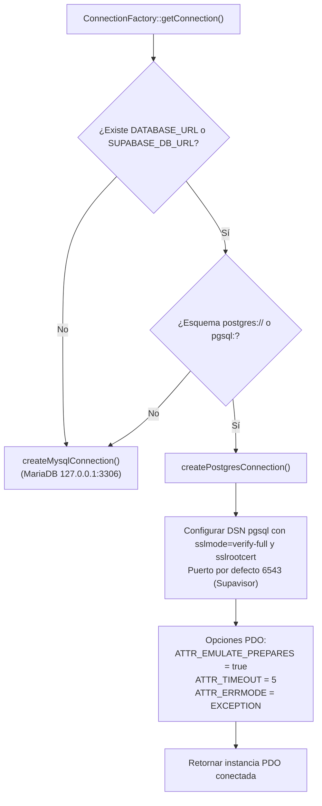
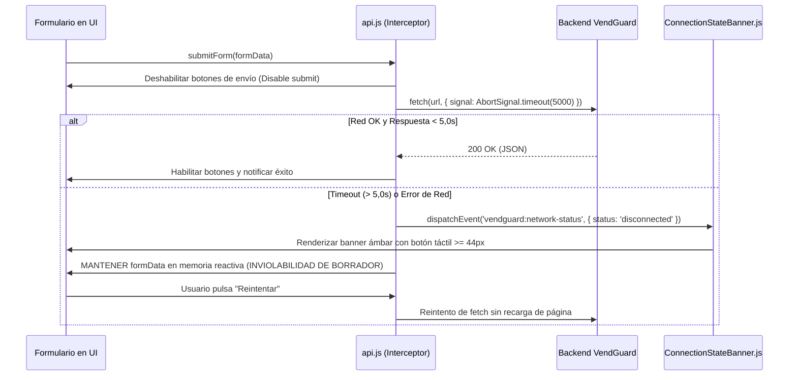
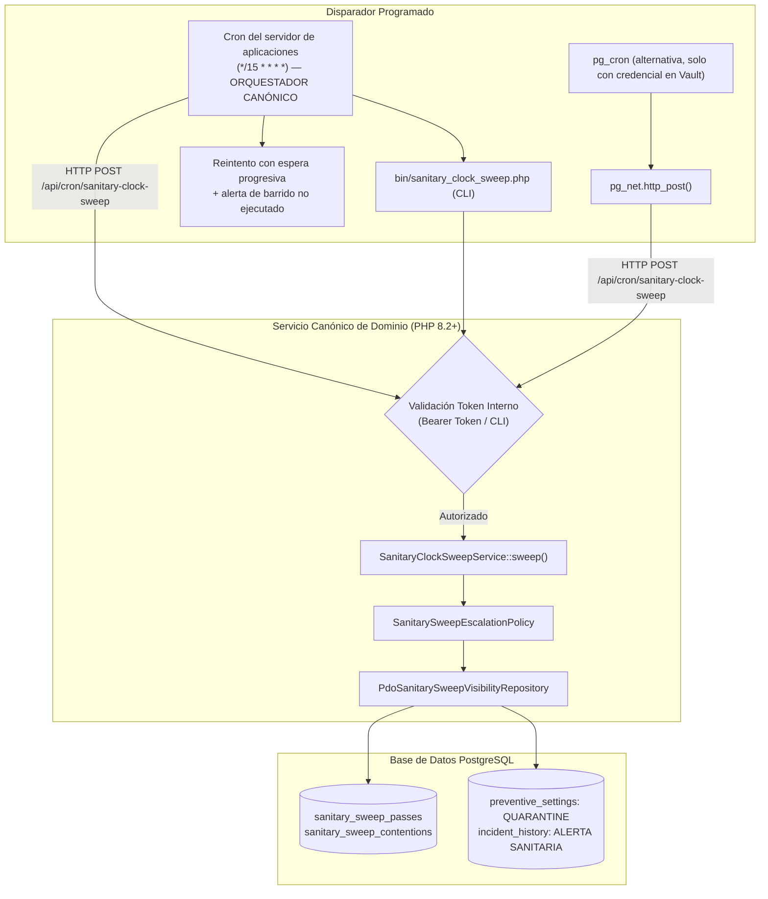

# PLAN TÉCNICO DE IMPLEMENTACIÓN · MÓDULO 12: MIGRACIÓN DE PERSISTENCIA A BASE DE DATOS EN LA NUBE (ENFOQUE HÍBRIDO)

**Proyecto:** Gestor de Incidencias de Vending (*VendGuard*)  
**Módulo:** `12-hybrid-supabase-migration`  
**Documento:** `specs/12-hybrid-supabase-migration/plan.md`  
**Referencia Funcional:** [`specs/12-hybrid-supabase-migration/spec.md`](spec.md) (y [`specs/functional/hybrid_supabase_migration_spec.md`](../functional/hybrid_supabase_migration_spec.md))  
**Documento de Análisis y Auditoría:** [`docs/migracion_supabase_hibrido.md`](../../docs/migracion_supabase_hibrido.md) y [`docs/auditoria_plan_migracion_supabase_hibrida.md`](../../docs/auditoria_plan_migracion_supabase_hibrida.md)  
**Normativa Suprema:** [`constitution.md`](../../constitution.md) (Artículos I al VII)  
**Directrices Operativas:** [`AGENTS.md`](../../AGENTS.md) (SDD, Dogma Vanilla, Dualismo Lingüístico)  
**Tokens de Diseño:** [`docs/design.md`](../../docs/design.md) (Azul corporativo `#2560ff`, ámbar técnico `#fef9c3` con texto `#854d0e`, radio 4px/8px, canvas `#f9fafb`)  

---

## 1. Estructura de Módulos y Ficheros

El diseño arquitectónico respeta de forma estricta el **Dogma Vanilla** (PHP 8.2+ OOP nativo con PDO sin ORMs ni librerías Composer adicionales; Vue.js 3 en módulos ES nativos sin empaquetadores ni npm en runtime).

```text
gestor-incidencias-vending/
├── .github/
│   └── workflows/
│       ├── supabase-keepalive.yml           # Flujo diario (06:00 UTC): latido, estado del proyecto por API de gestión, restauración y re-inicialización
│       └── sanitary-clock.yml               # Despertador y vigilante del reloj (cada 15 min): ventana perdida, intervención y alerta
├── deploy/
│   └── cron/
│       ├── README.md                        # Decisión, instalación y verificación del reloj del barrido
│       └── vendguard-sanitary-sweep         # Reloj canónico versionado (crontab de busybox crond, cada 15 min)
├── Dockerfile                               # Instalación de postgresql-dev y pdo_pgsql junto a pdo_mysql
├── bin/
│   ├── init_cloud_db.php                    # Inicializador cloud agnóstico: DDL base + migraciones del motor, con reintento y verificación
│   └── sanitary_clock_sweep.php             # CLI canónico del barrido (programador del servidor de aplicaciones)
├── database/
│   ├── supabase_init.sql                    # DDL base PostgreSQL 15+: 20 tablas, claves canónicas, trigger 45000, índices
│   ├── supabase_seeds.sql                   # Semillas maestras para arranque en limpio (dialecto traducido por el adaptador)
│   └── supabase_migrations/                 # Migraciones incrementales de PostgreSQL: el esquema converge, no se congela
│       └── 001_initial_baseline.sql
├── specs/
│   ├── functional/
│   │   └── hybrid_supabase_migration_spec.md # Referencia cruzada funcional
│   └── 12-hybrid-supabase-migration/
│       ├── spec.md                          # Especificación funcional blindada tras auditoría adversarial
│       ├── plan.md                          # Este plan técnico de arquitectura
│       └── tasks.md                         # Plan de 27 tareas atómicas secuenciales
├── src/
│   ├── Application/
│   │   ├── DTO/
│   │   │   └── HealthCheckResponseDto.php   # DTO inmutable con proyección pública segura y telemetría interna
│   │   └── Service/
│   │       ├── HealthCheckService.php       # Conectividad activa (consulta a tabla real) y latencia
│   │       └── SanitaryClockSweepService.php # ÚNICA fuente de verdad para barrido de frío (Art. II y Art. I.3)
│   ├── Infrastructure/
│   │   ├── Database/
│   │   │   ├── ConnectionFactory.php        # Autodetección pdo_pgsql puerto 6543 (emulate_prepares=true, SSL) vs pdo_mysql
│   │   │   ├── PdoLockWaitBudget.php        # Soporte dual: lock_timeout (PostgreSQL) vs innodb_lock_wait_timeout (MySQL)
│   │   │   ├── PdoTransactionManager.php    # Manejador transaccional compatible con pooler
│   │   │   ├── PostgresMigrationRunner.php  # Ejecutor de migraciones PostgreSQL (convergencia del esquema desplegado)
│   │   │   └── SeedRunner.php               # Sembrador con dialecto traducido por el adaptador (no depende de un upsert «común»)
│   │   └── Dialect/
│   │       └── SqlDialectAdapter.php       # Único punto de traducción por operación: upsert, JSON e intervalos de fecha
│   │   ├── Repository/                      # Los 18 repositorios PDO con su dialecto resuelto por el adaptador (sin SQL privativo fuera de él):
│   │   │   ├── PdoAuditLogRepository.php
│   │   │   ├── PdoIncidentReplacedPartRepository.php
│   │   │   ├── PdoIncidentRepository.php
│   │   │   ├── PdoLocationRepository.php
│   │   │   ├── PdoMachineRepository.php
│   │   │   ├── PdoMetricsRepository.php
│   │   │   ├── PdoPreventiveItemRepository.php
│   │   │   ├── PdoPreventiveOrderRepository.php
│   │   │   ├── PdoPreventiveSettingsRepository.php
│   │   │   ├── PdoRefundRequestRepository.php
│   │   │   ├── PdoRouteSettingsRepository.php
│   │   │   ├── PdoSanitaryCertificateRepository.php
│   │   │   ├── PdoSanitarySweepVisibilityRepository.php
│   │   │   ├── PdoSiteAccessCodeRepository.php
│   │   │   ├── PdoSparePartRepository.php
│   │   │   ├── PdoSparePartRequestRepository.php
│   │   │   ├── PdoUnclaimedCashFindingRepository.php
│   │   │   └── PdoUserRepository.php
│   │   └── Storage/
│   │       └── FileStorageCompensator.php   # Transaccionalidad compensatoria: purgado atómico de fotos huérfanas
│   └── Presentation/
│       ├── Controller/
│       │   ├── HealthController.php         # GET /api/status (consulta real, telemetría autenticada) sin alterar /api/health
│       │   └── TechnicianController.php     # Salvaguarda 422 ante cuarentena sobrevenida en cierre
│       └── Routing/
│           └── AppRouter.php                # Registro de /api/status y conservación del contrato de /api/health
├── public/
│   └── assets/
│       └── js/
│           ├── api.js                       # Cliente nativo con timeout (5s), CustomEvents y retención de formularios
│           └── components/
│               └── ConnectionStateBanner.js # Banner flotante global reactivo no invasivo (altura táctil >= 44 px)
└── tests/
    ├── Support/
    │   └── TestDataCleaner.php              # Limpieza con bypass de sesión en la forma del motor (vendguard.purge / @vendguard_purge)
    ├── unit/
    │   ├── HealthCheckServiceTest.php       # Prueba unitaria de diagnóstico y ofuscación en vista pública
    │   ├── PdoLockWaitBudgetTest.php        # Prueba de presupuestos de espera en ambos motores
    │   ├── SqlDialectPortabilityTest.php    # Prueba de compatibilidad ANSI en los 18 repositorios PDO
    │   ├── ConnectionStateBannerTest.mjs    # Prueba unitaria de componentes frontend ESM (Node.js sin red)
    │   └── ApiClientTimeoutTest.mjs         # Prueba del interceptor de timeout ordinario (5s) y retención
    └── integration/
        ├── ConnectionFactoryTest.php        # Suite existente (T-03) que se amplía: drivers, DSN, timeout, TLS y política de credenciales
        ├── HealthEndpointTest.php           # Integración HTTP de GET /api/status y no regresión del contrato de /api/health
        ├── SchemaConvergenceParityTest.php  # Convergencia tras migrar + correspondencia declarada PostgreSQL ↔ MariaDB
        ├── PostgresSchemaTest.php           # Operaciones CRUD sobre las 20 tablas de PostgreSQL
        ├── PoolerLatencyMeasurementTest.php # Medición de RNF-01 por el camino real y contra el motor remoto (20 muestras)
        └── PostgresConstitutionalTest.php   # Blindaje constitucional: trigger 45000, uq_machine, check >= 20, claves canónicas
```

---

## 2. Modelo de Datos JSON y Contratos de API REST

### 2.1. Endpoint Técnico con Verificación de Base de Datos (`GET /api/status`) y conservación de `GET /api/health`
* **Propósito:** Monitorización operativa del enlace con la base de datos y destino del latido desatendido (*keep-alive*) de GitHub Actions (RF-03 y RF-07). Se sirve en una ruta **nueva** precisamente para no alterar el contrato del endpoint ligero preexistente del que dependen consumidores vivos.
* **Contrato preservado:** `GET /api/health` mantiene **exactamente** su comportamiento actual —envoltura JSON de identificación del servicio y servicio del documento de la aplicación ante `Accept: text/html`— y sigue siendo la sonda de arranque de las suites que ya la usan. Ninguna tarea de este módulo modifica su carga útil.
* **Seguridad y Privacidad:** Cumplimiento estricto del Art. V.4 y Art. VI.1: la llamada pública proyecta únicamente estado de servicio sin filtrar arquitectura interna; la telemetría detallada exige la credencial de proceso batch ya existente (`X-Cron-Secret` o `Authorization: Bearer`) o perfil autenticado de Coordinador. La comprobación es **no fatal** —su ausencia no rechaza la petición, solo reduce la respuesta— y se apoya en un predicado **público y reutilizable** del middleware de proceso batch ya existente (`hasBatchCredential(Request): bool`), que ese mismo middleware usa para su rechazo, de modo que la comparación del secreto sigue viviendo en un único sitio. **No se crea ningún mecanismo de credencial paralelo ni una segunda comparación del secreto.**
* **Cabeceras de Respuesta:** `Content-Type: application/json; charset=UTF-8`, `Cache-Control: no-cache, no-store, must-revalidate`.

#### A. Respuesta Pública Exitosa (`200 OK`)
```json
{
  "success": true,
  "data": {
    "status": "HEALTHY",
    "timestamp_utc": "2026-10-13T12:00:00Z"
  }
}
```

#### B. Respuesta Autenticada con Telemetría Detallada (`200 OK`)
Disponible cuando se suministra la credencial interna de proceso batch (`X-Cron-Secret` o `Authorization: Bearer`) o sesión activa de Coordinador:
```json
{
  "success": true,
  "data": {
    "status": "HEALTHY",
    "database_driver": "pgsql",
    "connection_pooler": "supavisor_6543",
    "response_time_ms": 14.85,
    "sanitary_clock": {
      "last_pass_at": "2026-10-13T11:45:02Z",
      "last_result": "OK"
    },
    "timestamp_utc": "2026-10-13T12:00:00Z"
  }
}
```

#### C. Respuesta de Servicio No Disponible (`503 Service Unavailable`)
Se emite si la base de datos remota está suspendida (el proveedor no procesa peticiones hasta que un operador o el flujo desatendido restaure el proyecto) o falla la consulta de verificación sobre la tabla real:
```json
{
  "success": false,
  "error": {
    "code": "DATABASE_UNAVAILABLE",
    "message": "Servicio de persistencia de datos temporalmente no disponible.",
    "details": {
      "status": "UNHEALTHY",
      "timestamp_utc": "2026-10-13T12:00:00Z"
    }
  }
}
```

---

## 3. Algoritmos Clave en Pseudocódigo y Diagramas Mermaid

### Algoritmo 1: Conmutación Transparente y Pooler Transaccional (`ConnectionFactory.php`)
Supavisor en puerto 6543 (Transaction Pooling) requiere obligatoriamente `PDO::ATTR_EMULATE_PREPARES => true` para evitar el error `prepared statement does not exist`.



```text
ALGORITMO getConnection(customConfig, fresh):
    IF instance != null AND NOT fresh AND customConfig IS EMPTY:
        RETURN instance
    
    dbUrl = GET_ENV('DATABASE_URL') OR GET_ENV('SUPABASE_DB_URL')
    IF dbUrl NOT EMPTY:
        parsed = PARSE_URL(dbUrl)
        scheme = parsed['scheme']
        IF scheme IN ['postgres', 'pgsql']:
            host = parsed['host']
            port = parsed['port'] ?: 6543
            dbname = LTRIM(parsed['path'], '/') ?: 'postgres'
            user = parsed['user'] ?: 'postgres'
            pass = parsed['pass']            // sin contraseña no hay valor por defecto: decide la política S-5
            
            dsn = "pgsql:host=" + host + ";port=" + port + ";dbname=" + dbname
                  + ";sslmode=verify-full;sslrootcert=" + CA_BUNDLE   // identidad del servidor verificada (RNF-05)
            options = [
                ATTR_ERRMODE => ERRMODE_EXCEPTION,
                ATTR_DEFAULT_FETCH_MODE => FETCH_ASSOC,
                ATTR_EMULATE_PREPARES => true,   // OBLIGATORIO para Supavisor en puerto 6543
                ATTR_TIMEOUT => 5                // 5 segundos timeout de conexión
            ]
            // Política de credenciales IDÉNTICA a la rama MySQL (hallazgo S-5, EARS-01.6).
            // Se evalúa ANTES de conectar y sin valores por defecto silenciosos:
            // un `postgres://` de producción sin contraseña falla en cerrado, no se conecta con cadena vacía.
            IF IS_PRODUCTION():
                IF NOT HAS_EXPLICIT_CREDENTIAL_SOURCE(dbUrl, customConfig):
                    THROW "Configuración de base de datos insegura en producción (hallazgo S-5): no hay credenciales explícitas."
                IF user == 'postgres' AND (pass IS NULL OR pass == ''):
                    THROW "Configuración de base de datos insegura en producción (hallazgo S-5): el usuario administrativo sin contraseña no está permitido."

            pdo = NEW PDO(dsn, user, pass, options)
            IF NOT fresh:
                instance = pdo
            RETURN pdo
            
    RETURN createMysqlConnection(customConfig, fresh)
```

---

### Algoritmo 2: Resiliencia de Red, Timeout Ordinario (5s) y Retención de Formularios (`api.js`)



---

### Algoritmo 3: Transaccionalidad Compensatoria en Subida de Archivos (`FileStorageCompensator.php`)

```text
ALGORITMO executeWithCompensatingFile(filePath, dbOperation):
    TRY:
        // Ejecutar la inserción o actualización en base de datos remota
        result = dbOperation()
        RETURN result
    CATCH Throwable ex:
        // Si la base de datos remota falla o entra en timeout: PURGADO ATÓMICO
        IF FILE_EXISTS(filePath):
            UNLINK(filePath)
            LOG_WARNING("Compensación ejecutada: archivo huérfano eliminado en " + filePath)
        THROW ex
```

---

### Algoritmo 4: Orquestación Canónica del Barrido Sanitario (Art. II y Art. I.3)



> [!IMPORTANT]
> **Cero duplicación de lógica de negocio (Art. I.3):** No existe ningún procedimiento almacenado SQL que implemente de forma paralela las reglas del barrido sanitario: el único cálculo vive en el servicio de dominio.
>
> **El orquestador canónico es el cron del servidor de aplicaciones**, porque el programador interno del motor **corre dentro de la base de datos que se suspende** y porque `pg_net` llama a la aplicación con 2 s de timeout por defecto y de forma asíncrona, de modo que un contenedor dormido convierte el barrido en un no-ejecutado silencioso. La alternativa `pg_cron` + `pg_net` queda admitida **solo** si la credencial se lee de un almacén de secretos del proveedor; queda prohibido embeberla en el DDL versionado.
>
> **Art. II no admite fallo silencioso:** toda invocación reintenta con espera progresiva y toda ventana sin barrido ejecutado genera alerta. Un reloj biológico que no corre sin avisar es peor que uno que falla en voz alta.

---

### Algoritmo 5: Salvaguarda del Parte Técnico ante Cuarentena Sobrevenida (`TechnicianController.php`)

```text
ALGORITMO resolveIncident(incidentId, technicianReportDto):
    incident = incidentRepository.findById(incidentId)
    machine = machineRepository.findById(incident.machineId)
    preventive = preventiveRepository.findByMachineId(machine.id)
    
    // Verificación de blindaje sanitario: si la máquina entró en cuarentena en la central
    IF preventive.sanitaryStatus == 'QUARANTINE':
        // 1. Guardar informe en borrador técnico seguro
        technicianDraftRepository.saveDraft(incidentId, technicianReportDto)
        
        // 2. Suspender cierre y emitir HTTP 422 con instrucciones obligatorias
        RETURN Response::json([
            'success' => false,
            'error' => [
                'code' => 'SANITARY_QUARANTINE_OVERTAKEN',
                'message' => 'La máquina ha entrado en CUARENTENA sanitaria automática a las 4h (Art. II). El informe redactado ha sido salvaguardado. Debe completar el checklist de higienización antes del cierre definitivo.'
            ]
        ], 422)
        
    // Cierre ordinario si no hay cuarentena sobrevenida
    RETURN processStandardResolution(incident, technicianReportDto)
```

---

## 4. Blindaje Constitucional en el Esquema DDL (`database/supabase_init.sql`)

> **Contrato que rige este DDL:** la correspondencia con el esquema MariaDB —qué debe coincidir uno a uno y qué diferencias se aceptan por diseño— está declarada en [`schema_correspondence_contract.md`](../technical/schema_correspondence_contract.md), verificada contra el esquema desplegado (spec §8, criterio 7). El DDL se escribe conforme a ella, y **no** al revés: toda divergencia inevitable se declara primero en el contrato.

1. **Extensiones necesarias:**
   ```sql
   CREATE EXTENSION IF NOT EXISTS "uuid-ossp";
   CREATE EXTENSION IF NOT EXISTS "pgcrypto";
   CREATE EXTENSION IF NOT EXISTS "pg_cron";
   CREATE EXTENSION IF NOT EXISTS "pg_net";   -- solo si se usa el orquestador interno con credencial en Vault
   ```
2. **Unicidad con la misma semántica en ambos motores:**
   - Columnas canónicas calculadas en la aplicación —`email_key` en `users`, `site_code_key` en `locations`, `ticket_code` ya normalizado en `incidents`— con `UNIQUE` sobre la clave.
   - Se descarta `CITEXT` como mecanismo único: `citext` y `lower()` solo cubren mayúsculas, mientras el cotejamiento actual del motor local también ignora acentos, de modo que el motor nuevo quedaría con una regla **más débil** que la que las pruebas certifican.
3. **Disparador ruidoso anti-delete con bypass de arnés (Art. III.1 y H-3):**
   ```sql
   CREATE OR REPLACE FUNCTION prevent_hard_delete()
   RETURNS TRIGGER AS $$
   BEGIN
     IF current_setting('vendguard.purge', true) = 'on' THEN
       RETURN OLD;
     END IF;
     RAISE EXCEPTION 'ART_III_1_VIOLATION: Hard delete prohibido por la Constitución de VendGuard (Art. III.1).'
       USING ERRCODE = '45000';
   END;
   $$ LANGUAGE plpgsql;

   -- Aplicado mediante BEFORE DELETE en todas las tablas maestras y operativas
   CREATE TRIGGER trg_no_delete_locations BEFORE DELETE ON locations
     FOR EACH ROW EXECUTE FUNCTION prevent_hard_delete();
   -- (Idéntico para las 20 tablas)
   ```
   **Ámbito de la señal de purga:** se declara a nivel de **sesión**, no solo de transacción, porque parte de las suites retiran sus propias filas maestras con sentencias sueltas sin transacción explícita.
   **Forma por motor (R3-1):** la misma regla tiene **dos formas técnicas** y ninguna es universal: parámetro de sesión `vendguard.purge` en PostgreSQL (`set_config('vendguard.purge', 'on', false)` / `current_setting('vendguard.purge', true)`) y variable de usuario `@vendguard_purge` en MariaDB, que es la que el guardián vivo [`010_refund_hard_delete_guard.sql`](../../database/migrations/010_refund_hard_delete_guard.sql) lee hoy. `set_config()` **no existe** en MariaDB: escribir solo la forma de PostgreSQL deja la limpieza inejecutable en el motor donde corre el arnés.
   **Punto único:** el arnés declara y revoca la señal a través de **un único ayudante consciente del driver** del limpiador compartido, nunca en cada suite.
   **Compromiso ya certificado:** `RefundsModuleClosureTest` §4.4 certifica que el marcador de MySQL aparece exactamente dos veces y que la aplicación jamás lo activa, y `SiteManagerRefundDataSegregationTest` certifica que vive en un solo fichero. La revisión de las estructuras de limpieza —el limpiador compartido y las seis suites que borran `locations`, `machines`, `users` o `audit_log` con SQL directo— **extiende** esas aserciones para que certifiquen las dos formas; no las borra ni las debilita.
4. **Índice único parcial condicional (Art. V.2 y V.6):**
   ```sql
   CREATE UNIQUE INDEX uq_machine_active_ticket ON incidents (machine_id)
     WHERE status NOT IN ('CLOSED', 'CANCELLED');
   ```
5. **Restricciones CHECK $\ge 20$ caracteres (Art. V.1):**
   ```sql
   ALTER TABLE incidents ADD CONSTRAINT chk_resolution_diagnosis_len 
     CHECK (resolution_diagnosis IS NULL OR char_length(trim(resolution_diagnosis)) >= 20);
   ```

---

## 5. Estrategia Integral de Pruebas y Certificación

1. **Pruebas Unitarias PHP:**
   - [`ConnectionFactoryTest.php`](../../tests/integration/ConnectionFactoryTest.php): suite ya existente (T-03) que se **amplía** —no se duplica en `tests/unit/`— con la instanciación de drivers, los timeouts, `ATTR_EMULATE_PREPARES => true`, el TLS con verificación de identidad y la política de credenciales S-5 aplicada a los **dos** drivers (EARS-01.6), que debe lanzar **antes** de conectar y se certifica sin red.
   - [`HealthCheckServiceTest.php`](../../tests/unit/HealthCheckServiceTest.php) *(nuevo)*: consulta sobre tabla real, medición de latencia y ofuscación de telemetría en vista pública.
   - [`PdoLockWaitBudgetTest.php`](../../tests/unit/PdoLockWaitBudgetTest.php) *(nuevo)*: Adaptación de presupuestos `lock_timeout` y `innodb_lock_wait_timeout`.
   - [`SqlDialectPortabilityTest.php`](../../tests/unit/SqlDialectPortabilityTest.php) *(nuevo)*: Ausencia de sintaxis privativa fuera del **adaptador de dialecto** en los 18 repositorios PDO (certifica el punto único de traducción, no una portabilidad literal).
   - [`RefundsModuleClosureTest.php`](../../tests/unit/RefundsModuleClosureTest.php) *(existente, se extiende)*: certifica **las dos** formas de la puerta de purga —la de MariaDB que ya fija y la de PostgreSQL— y que la aplicación no activa ninguna de ellas.
2. **Pruebas Unitarias Frontend ESM (Node.js):**
   - [`ConnectionStateBannerTest.mjs`](../../tests/unit/ConnectionStateBannerTest.mjs) *(nuevo)*: Estados del banner y altura táctil $\ge 44\text{ px}$.
   - [`ApiClientTimeoutTest.mjs`](../../tests/unit/ApiClientTimeoutTest.mjs) *(nuevo)*: Timeout a 5,0s, CustomEvents y preservación de borradores.
3. **Batería hermética — Integración y blindaje constitucional (motor local, sin red):**
   - [`HealthEndpointTest.php`](../../tests/integration/HealthEndpointTest.php) *(nuevo)*: `/api/status` público y autenticado, más la **no regresión** de `/api/health` (envoltura JSON y servicio del documento de la aplicación).
4. **Certificación de contrato del motor nuevo (categoría propia, jamás dentro de la batería hermética):** estas suites exigen un PostgreSQL disponible —local para lo ordinario, remoto para la medición— y se ejecutan en su propio canal y con su propio informe. Se declaran **con su marca de categoría**, de modo que `run_all.php` no las confunda con suites herméticas y ninguna se omita en silencio (RNF-04 y spec §8.1). El motor local lo declara y lo aprovisiona [`deploy/local/postgres/`](../../deploy/local/postgres/README.md) (plan §8), y su sonda de disponibilidad es la puerta de la categoría: sin ella en verde, ninguna suite de esta categoría se ejecuta y ninguna se omite en silencio.
   - [`SchemaConvergenceParityTest.php`](../../tests/integration/SchemaConvergenceParityTest.php) *(nuevo)*: **convergencia** (una base creada solo con el DDL base recibe la migración posterior y converge) y **correspondencia declarada** entre esquemas —qué debe coincidir uno a uno y qué diferencias se aceptan por diseño—, nunca igualdad literal de inventarios. El contrato que consume es [`schema_correspondence_contract.md`](../technical/schema_correspondence_contract.md): declara las 20 tablas, las 32 claves únicas, las 35 foráneas con sus reglas `ON DELETE`/`ON UPDATE`, los 24 conjuntos `ENUM`, el mapeo de tipos y las diferencias aceptadas `D-1` a `D-10` frente a las adiciones `A-1` a `A-5`.
   - [`PostgresSchemaTest.php`](../../tests/integration/PostgresSchemaTest.php) *(nuevo)*: Operaciones CRUD sobre las 20 tablas reales del motor nuevo.
   - [`PoolerLatencyMeasurementTest.php`](../../tests/integration/PoolerLatencyMeasurementTest.php) *(nuevo)*: medición de RNF-01 contra el motor remoto por el camino real, con 20 muestras por operación y publicación de mediana y percentil 95.
   - [`PostgresConstitutionalTest.php`](../../tests/integration/PostgresConstitutionalTest.php) *(nuevo)*: Trigger 45000 ante borrado, **las dos formas de la puerta de purga**, rechazo de tickets duplicados con `RESOLVED`, CHECK $\ge 20$ chars y unicidad por clave canónica.
5. **Actualización de Cifras Documentadas y Certificación Global (`DocMetricsGuard.php`):**
   - Actualización de las cifras documentadas en [`README.md`](../../README.md) conforme se incorporen las nuevas suites.
   - Ejecución final de `php tests/run_all.php` al **100% en verde** para la batería hermética, y de la categoría del motor nuevo con su propio informe: las dos deben estar en verde antes de cerrar el módulo (spec §8.1).

---

## 6. Decisiones Técnicas Ratificadas y Alternativas Descartadas

Estas decisiones cierran los hallazgos de la segunda y de la tercera pasada de la auditoría y son **vinculantes** para las tareas: sin ellas, T-HYBRID-01 abriría el DDL de un sistema que no sabe cómo se migra, cómo se autentica, en qué categoría se certifica ni cómo se comporta igual en los dos motores.

| Decisión | Alternativa descartada | Motivo del descarte |
| :--- | :--- | :--- |
| **Ejecutor de migraciones para PostgreSQL (`PostgresMigrationRunner`) + `database/supabase_migrations/`.** | DDL base único de creación (`supabase_init.sql` como foto fija). | Es la asimetría «esquema local migrado frente a esquema de producción creado» que provocó el incidente del 2026-10-03. Un esquema que solo se crea no recibe ninguna columna posterior, y la batería no puede verlo por construcción. |
| **Orquestador del barrido en el servidor de aplicaciones (cron del host) con `CRON_SECRET`.** | `pg_cron` + `pg_net` como orquestador canónico. | El programador interno corre dentro del motor que se suspende y `pg_net` llama con 2 s de timeout a un contenedor que también se duerme: un barrido sanitario no ejecutado en silencio es el peor fallo posible para el Art. II. |
| **Credencial única de proceso batch (`CRON_SECRET` por `CronAuthMiddleware`).** | Nueva cabecera `X-Internal-Token` para el endpoint de diagnóstico. | El proyecto ya tiene credencial interna, con 401 y fallo cerrado en producción. Un segundo mecanismo añade un secreto más que provisionar y dos formas de equivocarse. |
| **Unicidad por clave canónica en la aplicación (`email_key`, `site_code_key`).** | `CITEXT` o índice sobre `lower(...)` en el motor. | Ninguno de los dos reproduce la semántica actual completa (mayúsculas **y** acentos) y solo uno de los motores la tendría: las pruebas certificarían una regla distinta de la desplegada. |
| **Adaptador de dialecto explícito por operación (`SqlDialectAdapter`).** | «Una consulta ANSI, cero código duplicado». | No existe forma estándar de `ON CONFLICT`/`ON DUPLICATE KEY UPDATE`, de `EXCLUDED`/`VALUES()`, de `->>`/`JSON_EXTRACT` ni de `+ INTERVAL`/`DATE_ADD`. Sostener esa premisa obliga a afirmar una portabilidad que el propio código desmiente. El adaptador rige **también** en el sembrado (EARS-02.1) y en los tres grupos de normalización: ninguna tarea puede ordenar «sintaxis ANSI portable» para esos constructos. |
| **Dos categorías de certificación declaradas.** | Ejecutar en la misma categoría las suites que necesitan PostgreSQL o el motor remoto. | `run_all.php` descubre por `glob` y no tiene canal de omisión, y RNF-04 exige la batería completa offline: mezclarlas hace que el verde hermético sea imposible o que se cumpla saltando suites en silencio. La categoría del motor nuevo tiene su canal y su informe. |
| **Motor local de la categoría aprovisionado por artefacto versionado, con contrato de entorno sin valores por defecto y sonda que falla en cerrado.** | Confiar en el motor que cada equipo tenga instalado, o en credenciales improvisadas por quien ejecuta. | Una categoría que exige un motor que nadie declara se convierte, en la práctica, en una categoría que no se ejecuta nunca o que se salta en silencio; y una credencial con valor por defecto en el código contradice la política S-5 que el proyecto ya certifica. La provisión vive en el repositorio y su puerta se comprueba antes de ejecutar nada. |
| **La política de credenciales (S-5) rige también en la rama PostgreSQL.** | Aceptar los valores por defecto del DSN (`postgres` con contraseña vacía). | La política ya está certificada por una guarda en verde para MySQL; una rama nueva que la esquivase dejaría el fallo cerrado únicamente en el motor que se abandona, y la guarda no lo detectaría. |
| **TLS con verificación de identidad del servidor (`sslmode=verify-full`).** | `sslmode=require`. | `require` cifra y **no** verifica la identidad salvo que exista una CA raíz, y la documentación de libpq desaconseja confiar en esa excepción: el criterio «con verificación de certificado» se certificaría en falso. |
| **Puerta de purga con una forma por motor y un único ayudante en el arnés.** | Una sola forma escrita (solo `vendguard.purge` / `set_config`) para los dos motores. | `set_config()` no existe en MariaDB y el arnés limpia en MariaDB: la orden es inejecutable donde corre, y hay tres suites verdes que fijan la forma de MySQL. |

**Consecuencia sobre el alcance:** se mantiene la operación dual y se abandona la ilusión de una consulta única universal. Lo que se exige es una **sola definición de la regla** y dos traducciones de su sintaxis en un punto único y auditado, no cero duplicación de texto SQL.

---

## 7. Dónde Vive el Reloj del Barrido Sanitario (cierre de la duda 1 de spec §9)

**Decisión:** el reloj canónico vive **dentro** del contenedor de aplicaciones, declarado en un artefacto versionado, y su **despertador y vigilante** vive **fuera**, en un flujo programado del repositorio. Ni el reloj ni la lógica viven en el motor de datos: `pg_cron` + `pg_net` queda como alternativa admitida solo con la credencial en un almacén del proveedor (EARS-06.6), porque su programador corre dentro del motor que se suspende.

| Pieza | Artefacto versionado | Responsabilidad |
| :--- | :--- | :--- |
| **Reloj canónico** | [`deploy/cron/vendguard-sanitary-sweep`](../../deploy/cron/vendguard-sanitary-sweep), instalado en `/etc/crontabs/root` (busybox `crond` de Alpine, ya presente en la imagen: sin dependencias nuevas) | Ejecutar cada 15 minutos el CLI canónico `bin/sanitary_clock_sweep.php` sin red y sin credenciales expuestas. Inyecta el entorno desde `/etc/vendguard/cron.env` porque los trabajos de `crond` no heredan el entorno de PID 1. |
| **Despertador y vigilante** | [`.github/workflows/sanitary-clock.yml`](../../.github/workflows/sanitary-clock.yml) | Despertar el contenedor si el proveedor lo ha suspendido, comprobar `sanitary_clock.last_pass_at` en la telemetría autenticada, y **solo si la ventana se perdió** invocar el mismo servicio canónico por `POST /api/cron/sanitary-clock-sweep` y alertar. En operación normal **no duplica** la pasada: la deja en manos del reloj interno. |
| **Canal de alerta** | Ejecución en rojo del flujo (GitHub notifica a los responsables) más `VENDGUARD_ALERT_WEBHOOK` opcional para un canal real | Que un barrido no ejecutado no muera en un registro que nadie lee (EARS-06.5). |
| **Instrucciones e inspección** | [`deploy/cron/README.md`](../../deploy/cron/README.md) | Instalación en la imagen (T-HYBRID-12) y las cuatro comprobaciones observables de que el reloj existe y late. |

**Regla de color del vigilante:** verde = el reloj del contenedor cumplió su ventana. Rojo = hubo que intervenir desde fuera o el barrido no pudo ejecutarse. La intervención se marca como anomalía a propósito: si el vigilante trabaja, el reloj interno ha fallado y eso debe verse.

**Ventana de tolerancia:** `STALE_MINUTES = 35` (una ventana de 15 minutos más el margen de arranque en frío del contenedor).

### 7.1 Modos de fallo cubiertos

| Modo de fallo | Qué lo cubre |
| :--- | :--- |
| El proveedor suspende el contenedor por inactividad (plan gratuito) | El flujo externo lo despierta con `GET /api/status` (espera hasta 120 s) y, si la ventana se perdió mientras dormía, ejecuta el barrido y alerta |
| El demonio `crond` del contenedor se detiene o el crontab no se instaló | La siguiente ejecución externa detecta `last_pass_at` obsoleto, interviene y deja la anomalía registrada en la ejecución y en el canal de alerta |
| GitHub desactiva los flujos programados tras 60 días sin actividad en el repositorio | El reloj del contenedor sigue latiendo mientras haya tráfico; al reactivarse el flujo, la primera comprobación detecta la ventana perdida y alerta |
| El fichero de entorno del crontab falta o está incompleto | El CLI canónico falla **en cerrado** (la política de secretos del proyecto no admite credenciales implícitas) y el vigilante lo ve como ventana perdida |
| La aplicación entera está caída | Ningún reloj puede ejecutar lo que la aplicación no puede atender: el diseño garantiza que el fallo sea **visible** (ejecución en rojo y telemetría obsoleta) y que la recuperación sea **idempotente** (el barrido pone en cuarentena las máquinas vencidas en la primera pasada tras el retorno) |

### 7.2 Verificación realizada sobre los artefactos

Antes de darlos por buenos se ejecutaron los cinco bloques `run:` reales del flujo, con las mismas variables que usa el runner, contra un servidor HTTP simulado (`jq` se sustituyó por un equivalente local, porque no está instalado en este equipo y sí en los runners):

| Escenario | Resultado observado |
| :--- | :--- |
| Sin `VENDGUARD_APP_URL` ni `CRON_SECRET` | Falla en cerrado en el primer paso, **sin emitir ninguna llamada de red** |
| Ventana cubierta (`last_pass_at` de hace 5 min) | Ejecución **verde** y **cero** peticiones de barrido: no duplica la pasada del reloj interno |
| Ventana perdida (`last_pass_at` de hace 3 h) | Invoca el barrido autenticado, emite alerta y deja la ejecución **en rojo** |
| Sin registro de pasada (telemetría sin `sanitary_clock`) | Invoca el barrido, alerta y ejecución en rojo |

Además se validaron el YAML (parser) y la sintaxis de los cinco scripts (`bash -n`), y se comprobó que la entrada de crontab tiene los cinco campos estándar, termina en salto de línea (requisito de `crond`), invoca el CLI canónico e inyecta el entorno del contenedor.

**Lo que queda fuera de esta decisión:** el flujo programado debe estar en la rama por defecto del repositorio para que GitHub lo ejecute, y su conversión en suite automatizada del proyecto corresponde al plan de pruebas del módulo (T-HYBRID-19 a T-HYBRID-21).

---

## 8. Dónde Vive el Motor Local de la Categoría del Motor Nuevo (cierre de la parte local de la duda 1 de spec §9)

**Decisión:** el motor que exige la categoría de contrato del motor nuevo **se declara y se aprovisiona con un artefacto versionado**, y su disponibilidad se comprueba con una sonda que falla en cerrado antes de que ninguna suite intente ejecutarse. El motor vive en el equipo y en el entorno de ejecución, **no** dentro de la batería hermética: RNF-04 exige seguir corriendo sin red contra MariaDB.

| Pieza | Artefacto | Responsabilidad |
| :--- | :--- | :--- |
| Aprovisionamiento | [`deploy/local/postgres/provision.sh`](../../deploy/local/postgres/provision.sh) | Instalar el motor si falta (con la orden exacta y elevada), esperar a que acepte conexiones, crear el rol de aplicación no superusuario y su base, rotar sus credenciales y escribir el contrato de entorno. Sin credencial de superusuario **no improvisa ninguna** |
| Sonda de disponibilidad | [`deploy/local/postgres/verify.php`](../../deploy/local/postgres/verify.php) | Certificar conexión real por `pdo_pgsql`, versión del motor, ausencia de privilegios administrativos y capacidad de DDL y DML con reversión sin residuo. **Falla en cerrado** |
| Contrato de entorno | `PG_TEST_DSN` en `deploy/local/postgres/.env.local` (no versionado) | Un único valor con host, puerto, base, rol y credencial. Sin valor por defecto en el código, y **jamás** leído por la batería hermética |
| Instrucciones y límites | [`deploy/local/postgres/README.md`](../../deploy/local/postgres/README.md) | Qué queda aprovisionado, cómo se reproduce y qué **no** ofrece este motor |

**Regla de categoría:** ninguna suite de la categoría del motor nuevo se omite en silencio. Si la sonda no pasa, la categoría se declara **no ejecutable** (código de salida 1) y la batería hermética sigue siendo la única que puede estar verde sin red.

**Verificación realizada:** motor PostgreSQL 16.15 como servicio nativo (`postgresql-x64-16`, puerto 5432, autenticación sólo loopback con `scram-sha-256`); `pdo_pgsql` activo en el PHP local, confirmado con `PDO::getAvailableDrivers()`; rol `vendguard_pg` sin `SUPERUSER`, `CREATEDB`, `CREATEROLE` ni `INHERIT`, propietario de `vendguard_pg_test`; aprovisionamiento reejecutado sobre el mismo motor (idempotente, con rotación de credenciales); sonda en verde en una sesión nueva; sonda en **rojo con código 1** sin `PG_TEST_DSN`; y base sin residuo tras la prueba (**0** tablas de usuario).

**Hallazgo que condiciona una tarea:** en este motor **no existen `pg_cron` ni `pg_net`**, y T-HYBRID-01 las enumera entre las extensiones del DDL base. Instalarlas de forma incondicional no compilaría donde se certifica: sólo tienen sentido en la variante de orquestador interno admitida en §7, que es precisamente la que el proyecto descartó como reloj canónico.

**Lo que esta decisión no cubre:** el motor **remoto** de la medición de RNF-01 sigue exigiendo un proyecto Supabase con credenciales custodiadas (T-HYBRID-27); el pooler Supavisor no se puede certificar localmente; y el `pdo_pgsql` de la imagen es T-HYBRID-12.
