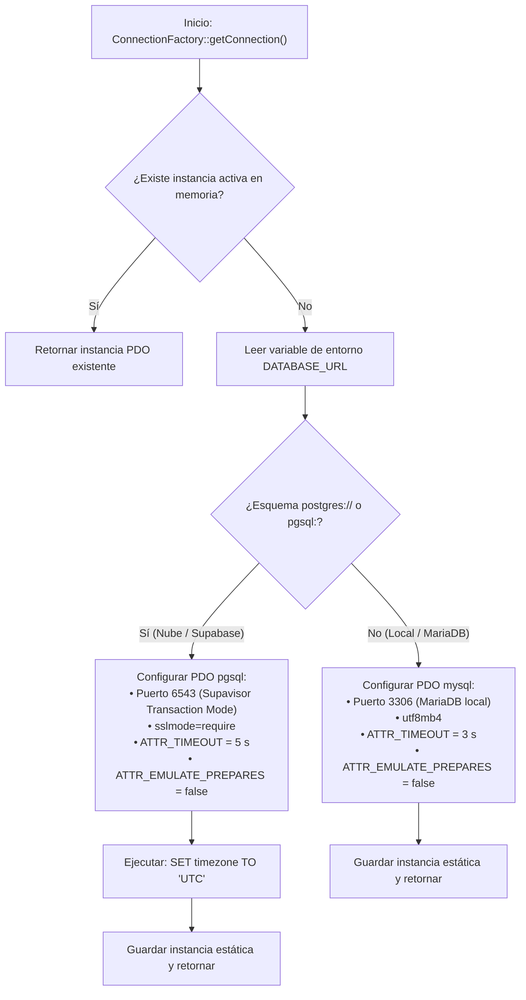
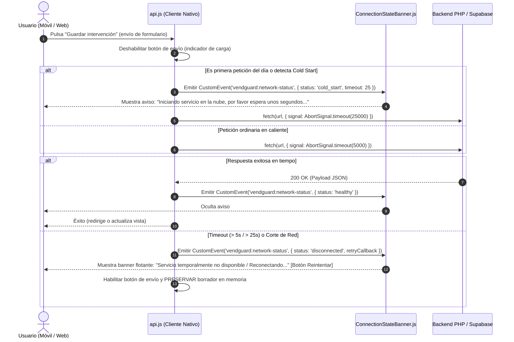

# PLAN TÉCNICO DE IMPLEMENTACIÓN · MÓDULO 12: MIGRACIÓN DE PERSISTENCIA A BASE DE DATOS EN LA NUBE (ENFOQUE HÍBRIDO)

**Proyecto:** Gestor de Incidencias de Vending (*VendGuard*)  
**Módulo:** `12-hybrid-supabase-migration`  
**Documento:** `specs/12-hybrid-supabase-migration/plan.md`  
**Referencia Funcional:** [`specs/12-hybrid-supabase-migration/spec.md`](spec.md) (y [`specs/functional/hybrid_supabase_migration_spec.md`](../functional/hybrid_supabase_migration_spec.md))  
**Documento de Análisis Previo:** [`docs/migracion_supabase_hibrido.md`](../../docs/migracion_supabase_hibrido.md)  
**Normativa Suprema:** [`constitution.md`](../../constitution.md) (Artículos I al VII)  
**Directrices Operativas:** [`AGENTS.md`](../../AGENTS.md) (SDD, Dogma Vanilla, Dualismo Lingüístico)  
**Tokens de Diseño:** [`docs/design.md`](../../docs/design.md) (Azul corporativo `#2560ff`, ámbar técnico `#fef9c3` con texto `#854d0e`, radio 4px/8px, canvas `#f9fafb`)  

---

## 1. Estructura de Módulos y Ficheros

El diseño arquitectónico respeta de forma estricta el **Dogma Vanilla** (PHP 8.2+ OOP nativo con PDO sin ORMs ni librerías Composer adicionales; Vue.js 3 en módulos ES nativos sin empaquetadores ni npm en runtime).

```text
gestor-incidencias-vending/
├── .github/
│   └── workflows/
│       └── supabase-keepalive.yml           # Flujo desatendido diario (06:00 UTC) para evitar suspensión por 7 días
├── database/
│   ├── supabase_init.sql                    # Script DDL canónico de PostgreSQL 15+ con 20 tablas, enums, índices y anti-delete
│   └── supabase_seeds.sql                   # Carga inicial de catálogo maestro en limpio (sedes, máquinas, usuarios, repuestos)
├── specs/
│   ├── functional/
│   │   └── hybrid_supabase_migration_spec.md # Referencia cruzada funcional
│   └── 12-hybrid-supabase-migration/
│       ├── spec.md                          # Especificación funcional ratificada tras QA
│       ├── plan.md                          # Este documento técnico de arquitectura
│       └── tasks.md                         # Plan de tareas atómicas secuenciales (siguiente fase)
├── src/
│   ├── Application/
│   │   ├── DTO/
│   │   │   └── HealthCheckResponseDto.php   # DTO inmutable para diagnóstico de salud sin fuga de credenciales
│   │   └── Service/
│   │       ├── HealthCheckService.php       # Evaluación de conectividad activa, latencia y motor relacional en uso
│   │       └── SanitaryClockSweepService.php # Servicio canónico de barrido de frío (fuente única de verdad Art. II y I.3)
│   ├── Infrastructure/
│   │   ├── Database/
│   │   │   ├── ConnectionFactory.php        # Factoría conmutada transparente (pdo_pgsql en puerto 6543 vs pdo_mysql)
│   │   │   └── PostgresMigrationRunner.php  # Ejecutor de DDL para bases de datos PostgreSQL
│   │   ├── Repository/                      # Repositorios PDO existentes normalizados a SQL ANSI portable:
│   │   │   ├── PdoIncidentRepository.php    # Normalización sin backticks y fechas ANSI (CURRENT_TIMESTAMP)
│   │   │   ├── PdoMachineRepository.php     # Compatibilidad con tipos BOOLEAN y enums nativos
│   │   │   ├── PdoLocationRepository.php    # Normalización de búsquedas y cotejamiento UTF-8
│   │   │   ├── PdoUserRepository.php        # Normalización de login y perfiles
│   │   │   ├── PdoRefundRepository.php      # Normalización de reintegros y numeración de PIN
│   │   │   ├── PdoSparePartRepository.php   # Normalización de catálogo y sustituciones
│   │   │   ├── PdoPreventiveSettingsRepository.php # Normalización de estados de cuarentena y órdenes
│   │   │   └── PdoRouteSettingsRepository.php # Normalización de coordenadas y preferencias de ruta
│   │   └── Storage/
│   │       └── FileStorageCompensator.php   # Transaccionalidad compensatoria: purgado atómico de fotos huérfanas
│   └── Presentation/
│       ├── Controller/
│       │   └── HealthController.php         # Endpoint público ligero GET /api/health (< 1,0 s, HTTP 200/503)
│       └── Routing/
│           └── AppRouter.php                # Registro de la ruta /api/health
├── public/
│   └── assets/
│       └── js/
│           ├── api.js                       # Cliente nativo con ventana Cold Start (25s), timeout (5s) y CustomEvents
│           └── components/
│               └── ConnectionStateBanner.js # Banner flotante global reactivo no invasivo (altura táctil >= 44 px)
└── tests/
    ├── unit/
    │   ├── ConnectionFactoryTest.php        # Prueba unitaria de conmutación de drivers, DSN y timeouts
    │   ├── HealthCheckServiceTest.php       # Prueba unitaria del evaluador de salud y ofuscación de secretos
    │   ├── SqlDialectPortabilityTest.php    # Prueba de ausencia de sintaxis privativa de MySQL (cero backticks)
    │   ├── ConnectionStateBannerTest.mjs    # Prueba unitaria de componentes frontend ESM (Node.js sin red)
    │   └── ApiClientTimeoutTest.mjs         # Prueba del interceptor de Cold Start (25s) y Timeout ordinario (5s)
    └── integration/
        ├── HealthEndpointTest.php           # Integración HTTP de GET /api/health (200 OK y 503 Service Unavailable)
        ├── PostgresParityTest.php           # Verificación de ejecución de las 20 tablas sobre PostgreSQL real
        └── PostgresConstitutionalTest.php   # Blindaje constitucional en motor (Art. II, III.1, V.1, V.2/V.6, V.4)
```

---

## 2. Modelo de Datos JSON y Contratos de API REST

Para cumplir con la latencia estricta en $< 1,0\text{ s}$ (RF-07) y evitar fugas de secretos (Art. V.4), se formalizan los contratos técnicos de diagnóstico y errores de red.

### 2.1. Endpoint Técnico de Salud (`GET /api/health`)
* **Propósito:** Monitorización operativa del estado de conexión con la base de datos y destino del latido desatendido (*keep-alive*) de GitHub Actions (RF-03 y RF-07).
* **Seguridad:** Endpoint público ligero sin autenticación. Prohibición estricta de exponer credenciales, contraseñas, nombres de host o volcados de excepciones.
* **Cabeceras de Respuesta:** `Content-Type: application/json; charset=UTF-8`, `Cache-Control: no-cache, no-store, must-revalidate`.

#### A. Respuesta Exitosa (`200 OK`)
Se emite cuando la base de datos responde dentro de los umbrales operativos normales ($< 1.000\text{ ms}$).

```json
{
  "success": true,
  "data": {
    "status": "HEALTHY",
    "database_driver": "pgsql",
    "connection_pooler": "supavisor",
    "response_time_ms": 14.85,
    "timestamp_utc": "2026-10-13T12:00:00Z"
  }
}
```

#### B. Respuesta de Servicio No Disponible (`503 Service Unavailable`)
Se emite si la base de datos remota está suspendida, agota el tiempo de espera de conexión o no responde a la consulta de comprobación.

```json
{
  "success": false,
  "error": {
    "code": "DATABASE_UNAVAILABLE",
    "message": "Servicio de persistencia de datos temporalmente no disponible.",
    "details": {
      "status": "UNHEALTHY",
      "database_driver": "pgsql",
      "timestamp_utc": "2026-10-13T12:00:00Z"
    }
  }
}
```

---

### 2.2. Contratos de Error HTTP Normalizados ante Incidencias de Red y Persistencia

| Código HTTP | Error Code | Causa Desencadenante | Payload de Error JSON |
| :--- | :--- | :--- | :--- |
| **`503 Service Unavailable`** | `DATABASE_CONNECTION_TIMEOUT` | Agotamiento de la ventana de conexión tras 25 s (Cold Start) o 5 s ordinarios. | `{"success": false, "error": {"code": "DATABASE_CONNECTION_TIMEOUT", "message": "La base de datos remota no responde. Por favor, reintente en unos instantes."}}` |
| **`503 Service Unavailable`** | `CONNECTION_POOL_EXHAUSTED` | Saturación del agrupador transaccional Supavisor (más de 15 transacciones concurrentes). | `{"success": false, "error": {"code": "CONNECTION_POOL_EXHAUSTED", "message": "Servicio saturado momentáneamente. Reintentando automáticamente."}}` *(Incluye cabecera `Retry-After: 3`)* |
| **`409 Conflict`** | `MACHINE_HAS_ACTIVE_INCIDENT` | Rechazo atómico por violación del índice único parcial de máquina (Art. V.2 y V.6). | `{"success": false, "error": {"code": "MACHINE_HAS_ACTIVE_INCIDENT", "message": "Esta máquina ya cuenta con un aviso activo o en periodo de garantía.", "details": {"ticket_code": "TICK-2026-00142"}}}` |
| **`422 Unprocessable`** | `INVALID_JUSTIFICATION_LENGTH` | Violación de la restricción `CHECK` de justificación $\ge 20$ caracteres (Art. V.1). | `{"success": false, "error": {"code": "INVALID_JUSTIFICATION_LENGTH", "message": "La justificación o diagnóstico técnico debe contener al menos 20 caracteres reales."}}` |

---

## 3. Algoritmos Clave en Pseudocódigo y Diagramas Mermaid

### 3.1. Algoritmo 1: Conmutación Transparente y Pool de Conexiones en `ConnectionFactory`

Gobierna la autodetección del motor relacional según la variable `DATABASE_URL` (RF-01), aplicando la configuración estricta para el pooler Supavisor de Supabase en el puerto 6543.



```text
ALGORITMO ConnectionFactory.getConnection():
1. SI self::$instance NO ES NULO Y NO se solicita conexión fresca:
     RETORNAR self::$instance
2. Obtener dbUrl desde getenv('DATABASE_URL') o getenv('SUPABASE_DB_URL')
3. Parsear componentes de la URL (scheme, host, port, path, user, pass)
4. SI scheme == 'postgres' O scheme == 'pgsql':
     a. Fijar host = urlParts.host
     b. Fijar port = urlParts.port O 6543 (puerto por defecto del pooler Supavisor)
     c. Fijar dbname = urlParts.path (sin barra inicial) O 'postgres'
     d. Construir DSN: "pgsql:host={host};port={port};dbname={dbname};sslmode=require"
     e. Opciones PDO:
          - ATTR_ERRMODE => ERRMODE_EXCEPTION
          - ATTR_DEFAULT_FETCH_MODE => FETCH_ASSOC
          - ATTR_EMULATE_PREPARES => FALSE
          - ATTR_TIMEOUT => 5 segundos
     f. Instanciar $pdo = new PDO(dsn, user, pass, opciones)
     g. Ejecutar: $pdo->exec("SET timezone TO 'UTC'")
     h. self::$instance = $pdo
     i. RETORNAR $pdo
5. SI NO:
     a. Ejecutar rama nativa MySQL/MariaDB existente con charset utf8mb4
     b. self::$instance = $pdo
     c. RETORNAR $pdo
```

---

### 3.2. Algoritmo 2: Manejo de Cold Start (25s) vs Timeout Ordinario (5s) en `api.js`

Gestiona las peticiones desde el cliente web tolerando el despertar de la base de datos en la nube sin abortar prematuramente (RF-04).



```text
ALGORITMO api.request(endpoint, options):
1. Deshabilitar botón de envío en el DOM y marcar estado 'submitting'
2. Determinar si existe sospecha de Cold Start (primera petición tras 12h de inactividad o reintento de 503)
3. SI isColdStartSuspected:
     timeoutMs = 25000 (25 segundos)
     window.dispatchEvent(new CustomEvent('vendguard:network-status', {
       detail: { status: 'cold_start', message: 'Iniciando servicio en la nube, por favor espera unos segundos...' }
     }))
   SI NO:
     timeoutMs = 5000 (5 segundos ordinarios)
4. Configurar controller = new AbortController()
5. Configurar timer = setTimeout(() => controller.abort(), timeoutMs)
6. INTENTAR:
     response = AWAIT fetch(endpoint, { ...options, signal: controller.signal })
     clearTimeout(timer)
     window.dispatchEvent(new CustomEvent('vendguard:network-status', { detail: { status: 'healthy' } }))
     Retornar response.json()
   CAPTURAR Error (AbortError | TypeError):
     clearTimeout(timer)
     Rehabilitar botón de envío en el DOM
     NO limpiar los campos del formulario (conservar estado sucio en Vue reactive data)
     window.dispatchEvent(new CustomEvent('vendguard:network-status', {
       detail: { status: 'disconnected', retryAction: () => api.request(endpoint, options) }
     }))
     LANZAR ApiError('NETWORK_OR_TIMEOUT_ERROR', 'Conexión interrumpida con el servicio remoto.')
```

---

### 3.3. Algoritmo 3: Transaccionalidad Compensatoria en Subida de Archivos (`FileStorageCompensator`)

Garantiza la erradicación absoluta de archivos huérfanos en el disco del servidor si la inserción en base de datos remota fracasa por timeout o red (RF-05).

```text
ALGORITMO FileStorageCompensator.executeWithCompensatingFile(fileObject, dbOperationClosure):
1. Guardar archivo físico en disco local temporal:
     $filePath = LocalFileUploader::upload($fileObject, 'uploads/evidence')
2. INTENTAR:
     // Ejecutar la operación relacional en la base de datos remota
     $dbResult = $dbOperationClosure($filePath)
     RETORNAR $dbResult
   CAPTURAR Throwable $e:
     // Reversión compensatoria inmediata: eliminar archivo físico
     SI file_exists($filePath):
         unlink($filePath)
     
     // Registrar alerta de reversión en log local
     Logger::warning("Archivo huérfano purgado tras fallo de persistencia: {$filePath}. Error: " . $e->getMessage())
     
     // Relanzar la excepción para que el controlador emita el error HTTP formal
     LANZAR $e
```

---

### 3.4. Algoritmo 4: Detección Canónica de Frío (Art. II) e Invocación Idéntica en Nube y Local

Garantiza la paridad 1:1 absoluta y el cumplimiento del Artículo I.3 y II de la Constitución: una sola fuente de verdad para el barrido sanitario.

```text
ALGORITMO SanitaryClockSweepService.sweep():
1. Iniciar pase en sanitary_sweep_passes (hora de inicio UTC, fuente de ejecución)
2. Consultar candidatos elegibles:
     SELECT m.id, i.id, i.created_at
     FROM machines m
     JOIN incidents i ON i.machine_id = m.id
     JOIN preventive_settings ps ON ps.machine_id = m.id
     WHERE m.machine_type = 'PERISHABLE_FOOD'
       AND i.status NOT IN ('CLOSED', 'CANCELLED', 'RESOLVED')
       AND ps.sanitary_status != 'QUARANTINE'
3. PARA CADA candidato (m, i):
     $elapsedSeconds = EXTRACT(EPOCH FROM (now_utc - i.created_at))
     SI $elapsedSeconds >= 14400 (4 horas naturales continuas):
         // Compare-And-Set atómico
         $updated = psRepository->updateSanitaryStatus(m.id, 'QUARANTINE', 'Activación automática de cuarentena...')
         SI $updated:
             incidentHistoryRepository->recordEvent(i.id, 'IN_PROGRESS', 'IN_PROGRESS', '[ALERTA SANITARIA] Máquina puesta en CUARENTENA automática a las 4h (Art. II)')
             quarantinedCount++
4. Consolidar pase en sanitary_sweep_passes con totales y hora fin
5. RETORNAR SanitarySweepResultDto

ORQUESTACIÓN EN LA NUBE:
  pg_cron ejecuta cada 15 min: SELECT cron.schedule('sanitary-sweep-15m', '*/15 * * * *', 'SELECT net.http_post(...)') o invoca el runner binario nativo.

ORQUESTACIÓN EN LOCAL:
  Comando CLI bin/sanitary_clock_sweep.php invoca directamente SanitaryClockSweepService.sweep()
```

---

### 3.5. Algoritmo 5: Salvaguarda del Informe Técnico ante Cuarentena Sobrevenida (Art. II)

Resuelve la contingencia de intervenciones sin cobertura móvil donde la máquina entra en cuarentena biológica antes de que el técnico envíe la resolución.

```text
ALGORITMO TechnicianController.resolveIncident(Request $request):
1. $incident = incidentRepository->findById($request->getParam('id'))
2. $machine = machineRepository->findById($incident->getMachineId())
3. $preventive = preventiveRepository->findByMachineId($machine->getId())

4. SI $machine->isPerishable() Y $preventive->getSanitaryStatus() === 'QUARANTINE':
     // Verificar si la petición contiene la declaración sanitaria obligatoria completa
     $declarations = $request->getBodyParam('sanitary_declarations')
     
     SI $declarations ES NULO O NO CONTIENE checklist térmico y confirmación de destrucción de comida:
         // NO BORRAR EL TEXTO: Almacenar diagnóstico y piezas como borrador pendiente
         incidentRepository->saveResolutionDraft($incident->getId(), [
             'diagnosis' => $request->getBodyParam('resolution_diagnosis'),
             'action'    => $request->getBodyParam('resolution_action'),
             'parts'     => $request->getBodyParam('replaced_parts')
         ])
         
         // Responder con 422 informando de la exigencia sanitaria suprema
         RETORNAR Response::json([
             'success' => false,
             'error' => [
                 'code' => 'SANITARY_QUARANTINE_OVERTAKEN',
                 'message' => 'Por normativa sanitaria (Art. II), la máquina ha entrado en CUARENTENA biológica tras 4h sin frío. Su informe técnico ha sido guardado, pero debe completar la confirmación térmica y retirada de producto antes de cerrar la avería.',
                 'requires_sanitary_checklist' => true
             ]
         ], 422)

5. Proceder a la resolución técnica estándar registrando diagnóstico >= 20 chars y certificado sanitario.
```

---

## 4. Arquitectura de Eventos y Componentes Frontend Vanilla

Para no alterar ninguna pantalla existente ni violar el diseño visual (Sección 7 de la spec), la degradación visual se encapsula en un único **componente flotante global no invasivo**:

### 4.1. Componente `ConnectionStateBanner.js`
* **Naturaleza:** Módulo ES nativo (`export default { ... }`) montado en la raíz de la aplicación en [`public/assets/js/app.js`](file:///C:/Users/Friki/.gemini/antigravity/scratch/gestor-incidencias-vending/public/assets/js/app.js).
* **Posicionamiento:** Barra flotante fija en la parte superior (`z-index: 9999; top: 0; left: 0; right: 0;`).
* **Estados Visuales:**
  * `idle`: Oculto completamente (`display: none`).
  * `cold_start`: Fondo azul informativo `#eff6ff`, borde azul `#93c5fd`, texto azul oscuro `#1e40af`, icono giratorio de espera: *"Iniciando servicio en la nube, por favor espera unos segundos..."*.
  * `disconnected`: Fondo ámbar de advertencia `#fef9c3`, borde amarillo `#fde047`, texto ámbar oscuro `#854d0e`, icono de advertencia y botón interactivo $\ge 44\text{ px}$: *"Servicio temporalmente no disponible · Reconectando... [Reintentar]"*.
  * `reconnected`: Fondo verde de éxito `#ecfdf5`, borde `#6ee7b7`, texto verde oscuro `#065f46`: *"Conexión restablecida con éxito"*, desapareciendo automáticamente a los 3 segundos.

### 4.2. Flujo de Eventos Desacoplados (`CustomEvent`)
1. [`api.js`](file:///C:/Users/Friki/.gemini/antigravity/scratch/gestor-incidencias-vending/public/assets/js/api.js) no manipula el DOM de las vistas; emite eventos estándar `window.dispatchEvent(new CustomEvent('vendguard:network-status', { detail: { ... } }))`.
2. `ConnectionStateBanner.js` escucha el evento en su gancho `mounted()` y actualiza reactivamente su estado Vue.
3. Al pulsar el botón *"Reintentar"* en el banner, se ejecuta la acción `retryAction` almacenada en el evento sin necesidad de recargar la página completa (`location.reload()` prohibido), preservando los valores de los inputs en las vistas activas.

---

## 5. Decisiones Técnicas Justificadas y Alternativas Descartadas

| Decisión Técnica Adoptada | Alternativa Descartada | Justificación Técnica y Normativa |
| :--- | :--- | :--- |
| **Enfoque Híbrido (PHP + Supabase PostgreSQL en Free Tier).** | Serverless BaaS Total (reescritura a Deno Edge Functions). | Preserva el 100% de la lógica de negocio de los 11 módulos previos, mantiene la suite de 249 pruebas operativas y reduce el tiempo de migración de semanas a días, logrando coste 0 €/mes. |
| **Pooler Supavisor en Puerto 6543 (Transaction Mode).** | Conexión directa a PostgreSQL en puerto 5432. | El plan gratuito limita a 60 conexiones directas. Supavisor multiplexa miles de peticiones HTTP de PHP sobre un pool transaccional de 15 conexiones reales, impidiendo saturaciones. |
| **Índice Único Parcial nativo de PostgreSQL (`status NOT IN ('CLOSED', 'CANCELLED')`).** | Columna virtual `is_active_ticket` de MariaDB/TiDB. | PostgreSQL soporta índices únicos condicionales nativos (`WHERE`). Elimina artificios de columnas generadas virtuales que causaban fallos de migración en motores como TiDB (Caso S-4). Abarca `RESOLVED` protegiendo las 48h de garantía (Art. V.6). |
| **Reglas anti-delete a nivel de motor en las 20 tablas maestras y operativas.** | Validación de borrado exclusivamente en PHP. | Cumplimiento blindado del **Artículo III.1**. Si un usuario o script ejecuta un `DELETE FROM` por error o vulnerabilidad, el motor lo neutraliza con `ON DELETE DO INSTEAD NOTHING`. |
| **Almacenamiento de fotos en servidor con compensación atómica.** | Almacenamiento en Supabase Storage (S3). | Protege la cuota mensual de transferencia saliente (*egress* de 2 GB del Free Tier). Las imágenes se sirven localmente y, si la BD remota falla, se eliminan del disco para evitar archivos huérfanos. |
| **Normalización SQL ANSI en repositorios (cero backticks).** | Consultas duplicadas condicionales `if ($isPostgres)`. | Una consulta ANSI estándar sin comillas privativas (ej. `SELECT id, name FROM machines`) es válida al 100% en MySQL, MariaDB y PostgreSQL. Permite conmutar motores con cero código duplicado. |

---

## 6. Estrategia Integral de Pruebas (100% Verde sin Red y con Red)

La migración debe certificar paridad estricta y blindaje constitucional sin romper ninguna de las pruebas existentes.

### 6.1. Pruebas Unitarias PHP
* **`tests/unit/ConnectionFactoryTest.php`:** Verifica la instanciación de `pdo_pgsql` con URLs `postgres://`, `sslmode=require`, puerto 6543, fijación de zona horaria `UTC`, y el fallback transparente a MariaDB local ante URLs `mysql://`.
* **`tests/unit/HealthCheckServiceTest.php`:** Evalúa que `GET /api/health` responda con el formato estructurado y que, ante fallos de conexión intencionados, emita el estado `UNHEALTHY` sin filtrar contraseñas ni cadenas de conexión en el campo `details`.
* **`tests/unit/SqlDialectPortabilityTest.php`:** Escanea el código fuente de todos los repositorios PDO para certificar la ausencia total de backticks (\`) y verificar el uso de funciones portables (`CURRENT_TIMESTAMP`).

### 6.2. Pruebas Unitarias Frontend ESM (Node.js sin dependencias de red)
* **`tests/unit/ConnectionStateBannerTest.mjs`:** Evalúa el renderizado del banner ante eventos `cold_start`, `disconnected` y `reconnected`, verificando que el botón táctil posea altura $\ge 44\text{ px}$ (RNF-06).
* **`tests/unit/ApiClientTimeoutTest.mjs`:** Simula el comportamiento del interceptor de `api.js` verificando que un arranque en frío espere hasta 25 segundos y que una petición ordinaria corte a los 5 segundos, preservando el callback de reintento.

### 6.3. Pruebas de Integración HTTP y Paridad Real
* **`tests/integration/HealthEndpointTest.php`:** Realiza peticiones reales contra el endpoint `/api/health` a través del router nativo y evalúa respuestas 200 OK y 503 Service Unavailable.
* **`tests/integration/PostgresParityTest.php`:** Ejecuta operaciones CRUD reales sobre las 20 tablas de PostgreSQL certificando integridad referencial, tipos `TIMESTAMPTZ`, columnas de identidad y secuencias.

### 6.4. Pruebas de Blindaje Constitucional (`tests/integration/PostgresConstitutionalTest.php`)
* **Blindaje Art. II:** Certifica que el barrido sanitario ponga máquinas de perecederos en `QUARANTINE` a las 4h naturales continuas y que el cierre técnico bloquee la resolución sin checklist térmico.
* **Blindaje Art. III.1:** Ejecuta sentencias `DELETE FROM` sobre `machines`, `users`, `incidents`, `audit_log`, etc., certificando que ninguna fila sea borrada físicamente.
* **Blindaje Art. V.1:** Intenta actualizar una incidencia a `RESOLVED` con 19 caracteres en `resolution_diagnosis`, verificando que la base de datos rechace la actualización con error de restricción de columna.
* **Blindaje Art. V.2 y V.6:** Intenta insertar dos incidencias simultáneas para la misma máquina en estados activos o `RESOLVED`, certificando el rechazo por colisión de índice único parcial.
* **Blindaje Art. V.4:** Ejecuta una consulta ciudadana anónima por código QR y certifica que la vista devuelva exclusivamente el estado neutral sin campos internos de taller.

### 6.5. Certificación Global del Repositorio
* Ejecución de `php tests/run_all.php` certificando que las **249 suites y 9.425 aserciones** pasen al 100% en verde tanto en entorno local como en el entorno remoto.

---

## 7. Mapeo de Trazabilidad de Requisitos

| Requisito | Descripción | Componente Técnico / Artefacto | Verificación Objetiva |
| :--- | :--- | :--- | :--- |
| **RF-01** | Persistencia dual transparente y agnosticismo de motor. | `ConnectionFactory.php`, repositorios ANSI | Conmutación por `DATABASE_URL` y paso verde en MariaDB y Postgres. |
| **RF-02** | Inicialización en limpio (*Fresh Start*) y fixtures de tests. | `database/supabase_init.sql`, seeds de test | Ejecución limpia de DDL y pase completo de pruebas de integración. |
| **RF-03** | Prevención activa de suspensión (*Keep-Alive* diario). | `.github/workflows/supabase-keepalive.yml` | Ejecución diaria de ping contra `/api/health` sin suspensión tras 7 días. |
| **RF-04** | Degradación visual, Cold Start (25s) y preservación de borradores. | `ConnectionStateBanner.js`, `api.js` | Test JS simulando corte de red y verificación de inputs retenidos. |
| **RF-05** | Transaccionalidad compensatoria en archivos multimedia. | `FileStorageCompensator.php` | Test simulando fallo de BD tras upload y verificación de archivo borrado. |
| **RF-06** | Automatización de barrido sanitario con fuente única (Art. II). | `SanitaryClockSweepService.php`, `pg_cron` | Ejecución idéntica cada 15 min en nube y mediante CLI en local. |
| **RF-07** | Endpoint técnico de salud del enlace (`GET /api/health`). | `HealthController.php`, `AppRouter.php` | Test HTTP verificando respuesta estructurada en $< 1,0\text{ s}$. |
| **RF-08.1** | Prohibición absoluta de borrado físico en 20 tablas (Art. III.1). | Reglas `ON DELETE DO INSTEAD NOTHING` en DDL | Test intentando `DELETE FROM` sobre cada tabla con 0 filas borradas. |
| **RF-08.2** | Unicidad atómica de máquina abarcando `RESOLVED` (Art. V.2/V.6). | `CREATE UNIQUE INDEX uq_machine_active_ticket` | Test intentando crear dos incidencias en la misma máquina física. |
| **RF-08.3** | Justificación obligatoria $\ge 20$ caracteres (Art. V.1). | Restricciones `CHECK (char_length(...) >= 20)` | Test intentando resolver o pausar con 19 caracteres rechazado por BD. |
| **RF-08.4** | Anonimización ciudadana en escaneo QR (Art. V.4). | Filtro de proyección en controlador QR | Verificación de respuesta pública sin motivos ni datos de operarios. |
| **RF-09** | Normalización en UTC y conversión a `Europe/Madrid`. | `SET timezone TO 'UTC'`, lógica de fechas | Test calculando horario comercial de 08:00 a 18:00 con salto UTC/CEST. |
| **RF-10** | Salvaguarda de parte técnico ante cuarentena sobrevenida. | `TechnicianController.php`, borrador seguro | Test enviando resolución sobre máquina en cuarentena reteniendo texto. |
| **RNF-01** | Mediana de latencia transaccional $< 250\text{ ms}$. | Supavisor pooler puerto 6543 | Muestreo de 10 peticiones transaccionales en suite de integración. |
| **RNF-02** | Consumo de base de datos $< 100\text{ MB}$ (20% de cuota). | Tipos optimizados e índices selectivos | Auditoría de catálogo tras carga de 10.000 expedientes de prueba. |
| **RNF-03** | Consumo de transferencia saliente $< 1\text{ GB/mes}$. | Solo payloads JSON, fotos servidas en local | Verificación de tamaño de respuestas de API en gzip. |
| **RNF-04** | Independencia total de red en pruebas locales. | Entorno local desconectado intacto | Ejecución de `php tests/run_all.php` con adaptador de red desactivado. |
| **RNF-05** | Seguridad en tránsito TLS/SSL estricta. | Parámetro `sslmode=require` en DSN | Rechazo de conexiones que no utilicen cifrado seguro en tránsito. |
| **RNF-06** | Ergonomía accesible del banner ($\ge 44\text{ px}$). | CSS de `ConnectionStateBanner.js` | Verificación de dimensiones táctiles y contraste accesible WCAG AA. |

---

## 8. Garantía de Dogma Vanilla y Dualismo Lingüístico

* **Dogma Vanilla (Art. IV):**
  * Backend: 100% PHP 8.2+ con tipos estrictos obligatorios (`declare(strict_types=1);`), PDO nativo (`pdo_pgsql` y `pdo_mysql`), arquitectura desacoplada en capas y **cero dependencias externas agregadas**.
  * Frontend: 100% Vanilla JavaScript en módulos ES nativos (`import`/`export`), templates HTML en línea de Vue 3 cargado en runtime sin npm, sin bundlers ni compiladores intermedios.
* **Dualismo Lingüístico:**
  * Todo el código técnico (nombres de clases, métodos, variables, atributos, DTOs, endpoints REST y claves de payloads JSON) está escrito estrictamente en **inglés técnico camelCase / PascalCase** (ej. `ConnectionFactory`, `HealthCheckService`, `responseTimeMs`, `databaseDriver`).
  * Toda la documentación técnica, especificaciones funcionales, comentarios explicativos en código, textos de interfaz para el usuario y mensajes de error HTTP se redactan íntegramente en **castellano formal**.
