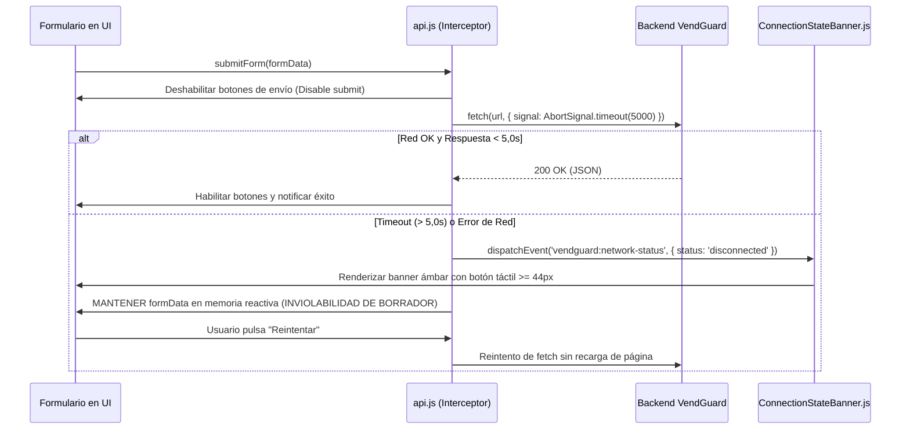
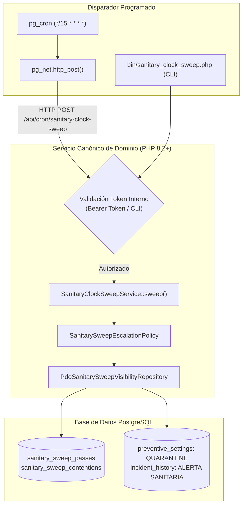

# PLAN TÉCNICO DE IMPLEMENTACIÓN · MÓDULO 12: MIGRACIÓN DE PERSISTENCIA A BASE DE DATOS EN LA NUBE (ENFOQUE HÍBRIDO)

**Proyecto:** Gestor de Incidencias de Vending (*VendGuard*)  
**Módulo:** `12-hybrid-supabase-migration`  
**Documento:** `specs/12-hybrid-supabase-migration/plan.md`  
**Referencia Funcional:** [`specs/12-hybrid-supabase-migration/spec.md`](spec.md) (y [`specs/functional/hybrid_supabase_migration_spec.md`](../functional/hybrid_supabase_migration_spec.md))  
**Documento de Análisis y Auditoría:** [`docs/migracion_supabase_hibrido.md`](../../docs/migracion_supabase_hibrido.md) y [`docs/auditoria_plan_migracion_supabase_hibrida.md`](../../docs/auditoria_plan_migracion_supabase_hibrida.md)  
**Normativa Suprema:** [`constitution.md`](../../constitution.md) (Artículos I al VII)  
**Directrices Operativas:** [`AGENTS.md`](../../AGENTS.md) (SDD, Dogma Vanilla, Dualismo Lingüístico)  
**Tokens de Diseño:** [`docs/design.md`](../../docs/design.md) (Azul corporativo `#2560ff`, ámbar técnico `#fef9c3` con texto `#854d0e`, radio 4px/8px, canvas `#f9fafb`)  

---

## 1. Estructura de Módulos y Ficheros

El diseño arquitectónico respeta de forma estricta el **Dogma Vanilla** (PHP 8.2+ OOP nativo con PDO sin ORMs ni librerías Composer adicionales; Vue.js 3 en módulos ES nativos sin empaquetadores ni npm en runtime).

```text
gestor-incidencias-vending/
├── .github/
│   └── workflows/
│       └── supabase-keepalive.yml           # Flujo diario (06:00 UTC) anti-pausa y auto-restauración API
├── Dockerfile                               # Instalación de postgresql-dev y pdo_pgsql junto a pdo_mysql
├── bin/
│   └── init_cloud_db.php                    # Inicializador cloud agnóstico de motor (soporte MySQL y PostgreSQL)
├── database/
│   ├── supabase_init.sql                    # DDL canónico PostgreSQL 15+: citext, 20 tablas, trigger 45000, índices
│   └── supabase_seeds.sql                   # Semillas maestras para arranque en limpio (ON CONFLICT DO UPDATE)
├── specs/
│   ├── functional/
│   │   └── hybrid_supabase_migration_spec.md # Referencia cruzada funcional
│   └── 12-hybrid-supabase-migration/
│       ├── spec.md                          # Especificación funcional blindada tras auditoría adversarial
│       ├── plan.md                          # Este plan técnico de arquitectura
│       └── tasks.md                         # Plan de 22 tareas atómicas secuenciales
├── src/
│   ├── Application/
│   │   ├── DTO/
│   │   │   └── HealthCheckResponseDto.php   # DTO inmutable con proyección pública segura y telemetría interna
│   │   └── Service/
│   │       ├── HealthCheckService.php       # Verificación de conectividad activa (SELECT 1) y latencia
│   │       └── SanitaryClockSweepService.php # ÚNICA fuente de verdad para barrido de frío (Art. II y Art. I.3)
│   ├── Infrastructure/
│   │   ├── Database/
│   │   │   ├── ConnectionFactory.php        # Autodetección pdo_pgsql puerto 6543 (emulate_prepares=true, SSL) vs pdo_mysql
│   │   │   ├── PdoLockWaitBudget.php        # Soporte dual: lock_timeout (PostgreSQL) vs innodb_lock_wait_timeout (MySQL)
│   │   │   ├── PdoTransactionManager.php    # Manejador transaccional compatible con pooler
│   │   │   └── SeedRunner.php               # Sembrador agnóstico de motor (ANSI SQL)
│   │   ├── Repository/                      # Los 18 repositorios PDO normalizados a dialecto ANSI estándar:
│   │   │   ├── PdoAuditLogRepository.php
│   │   │   ├── PdoIncidentReplacedPartRepository.php
│   │   │   ├── PdoIncidentRepository.php
│   │   │   ├── PdoLocationRepository.php
│   │   │   ├── PdoMachineRepository.php
│   │   │   ├── PdoMetricsRepository.php
│   │   │   ├── PdoPreventiveItemRepository.php
│   │   │   ├── PdoPreventiveOrderRepository.php
│   │   │   ├── PdoPreventiveSettingsRepository.php
│   │   │   ├── PdoRefundRequestRepository.php
│   │   │   ├── PdoRouteSettingsRepository.php
│   │   │   ├── PdoSanitaryCertificateRepository.php
│   │   │   ├── PdoSanitarySweepVisibilityRepository.php
│   │   │   ├── PdoSiteAccessCodeRepository.php
│   │   │   ├── PdoSparePartRepository.php
│   │   │   ├── PdoSparePartRequestRepository.php
│   │   │   ├── PdoUnclaimedCashFindingRepository.php
│   │   │   └── PdoUserRepository.php
│   │   └── Storage/
│   │       └── FileStorageCompensator.php   # Transaccionalidad compensatoria: purgado atómico de fotos huérfanas
│   └── Presentation/
│       ├── Controller/
│       │   ├── HealthController.php         # Endpoint GET /api/health (respuesta < 1,0 s, HTTP 200/503)
│       │   └── TechnicianController.php     # Salvaguarda 422 ante cuarentena sobrevenida en cierre
│       └── Routing/
│           └── AppRouter.php                # Registro de la ruta técnica /api/health
├── public/
│   └── assets/
│       └── js/
│           ├── api.js                       # Cliente nativo con timeout (5s), CustomEvents y retención de formularios
│           └── components/
│               └── ConnectionStateBanner.js # Banner flotante global reactivo no invasivo (altura táctil >= 44 px)
└── tests/
    ├── Support/
    │   └── TestDataCleaner.php              # Limpieza con bypass transaccional vendguard.purge = on en PostgreSQL
    ├── unit/
    │   ├── ConnectionFactoryTest.php        # Prueba unitaria de drivers, DSN, timeout y emulate_prepares
    │   ├── HealthCheckServiceTest.php       # Prueba unitaria de diagnóstico y ofuscación en vista pública
    │   ├── PdoLockWaitBudgetTest.php        # Prueba de presupuestos de espera en ambos motores
    │   ├── SqlDialectPortabilityTest.php    # Prueba de compatibilidad ANSI en los 18 repositorios PDO
    │   ├── ConnectionStateBannerTest.mjs    # Prueba unitaria de componentes frontend ESM (Node.js sin red)
    │   └── ApiClientTimeoutTest.mjs         # Prueba del interceptor de timeout ordinario (5s) y retención
    └── integration/
        ├── HealthEndpointTest.php           # Integración HTTP de GET /api/health (público vs autenticado, 200/503)
        ├── PostgresParityTest.php           # Verificación de operaciones CRUD sobre las 20 tablas de PostgreSQL
        └── PostgresConstitutionalTest.php   # Blindaje constitucional: trigger 45000, uq_machine, check >= 20, citext
```

---

## 2. Modelo de Datos JSON y Contratos de API REST

### 2.1. Endpoint Técnico de Salud (`GET /api/health`)
* **Propósito:** Monitorización operativa del enlace con la base de datos y destino del latido desatendido (*keep-alive*) de GitHub Actions (RF-03 y RF-07).
* **Seguridad y Privacidad:** Cumplimiento estricto del Art. V.4 y Art. VI.1: la llamada pública proyecta únicamente estado de servicio sin filtrar arquitectura interna; la telemetría detallada exige cabecera `X-Internal-Token` o perfil autenticado de Coordinador.
* **Cabeceras de Respuesta:** `Content-Type: application/json; charset=UTF-8`, `Cache-Control: no-cache, no-store, must-revalidate`.

#### A. Respuesta Pública Exitosa (`200 OK`)
```json
{
  "success": true,
  "data": {
    "status": "HEALTHY",
    "timestamp_utc": "2026-10-13T12:00:00Z"
  }
}
```

#### B. Respuesta Autenticada con Telemetría Detallada (`200 OK`)
Disponible cuando se suministra cabecera `X-Internal-Token` o sesión activa de Coordinador:
```json
{
  "success": true,
  "data": {
    "status": "HEALTHY",
    "database_driver": "pgsql",
    "connection_pooler": "supavisor_6543",
    "response_time_ms": 14.85,
    "timestamp_utc": "2026-10-13T12:00:00Z"
  }
}
```

#### C. Respuesta de Servicio No Disponible (`503 Service Unavailable`)
Se emite si la base de datos remota está suspendida, agota el tiempo de conexión (5s) o falla la consulta `SELECT 1`:
```json
{
  "success": false,
  "error": {
    "code": "DATABASE_UNAVAILABLE",
    "message": "Servicio de persistencia de datos temporalmente no disponible.",
    "details": {
      "status": "UNHEALTHY",
      "timestamp_utc": "2026-10-13T12:00:00Z"
    }
  }
}
```

---

## 3. Algoritmos Clave en Pseudocódigo y Diagramas Mermaid

### Algoritmo 1: Conmutación Transparente y Pooler Transaccional (`ConnectionFactory.php`)
Supavisor en puerto 6543 (Transaction Pooling) requiere obligatoriamente `PDO::ATTR_EMULATE_PREPARES => true` para evitar el error `prepared statement does not exist`.


```text
ALGORITMO getConnection(customConfig, fresh):
    IF instance != null AND NOT fresh AND customConfig IS EMPTY:
        RETURN instance
    
    dbUrl = GET_ENV('DATABASE_URL') OR GET_ENV('SUPABASE_DB_URL')
    IF dbUrl NOT EMPTY:
        parsed = PARSE_URL(dbUrl)
        scheme = parsed['scheme']
        IF scheme IN ['postgres', 'pgsql']:
            host = parsed['host']
            port = parsed['port'] ?: 6543
            dbname = LTRIM(parsed['path'], '/') ?: 'postgres'
            user = parsed['user'] ?: 'postgres'
            pass = parsed['pass'] ?: ''
            
            dsn = "pgsql:host=" + host + ";port=" + port + ";dbname=" + dbname + ";sslmode=require"
            options = [
                ATTR_ERRMODE => ERRMODE_EXCEPTION,
                ATTR_DEFAULT_FETCH_MODE => FETCH_ASSOC,
                ATTR_EMULATE_PREPARES => true,   // OBLIGATORIO para Supavisor en puerto 6543
                ATTR_TIMEOUT => 5                // 5 segundos timeout de conexión
            ]
            pdo = NEW PDO(dsn, user, pass, options)
            IF NOT fresh:
                instance = pdo
            RETURN pdo
            
    RETURN createMysqlConnection(customConfig, fresh)
```

---

### Algoritmo 2: Resiliencia de Red, Timeout Ordinario (5s) y Retención de Formularios (`api.js`)



---

### Algoritmo 3: Transaccionalidad Compensatoria en Subida de Archivos (`FileStorageCompensator.php`)

```text
ALGORITMO executeWithCompensatingFile(filePath, dbOperation):
    TRY:
        // Ejecutar la inserción o actualización en base de datos remota
        result = dbOperation()
        RETURN result
    CATCH Throwable ex:
        // Si la base de datos remota falla o entra en timeout: PURGADO ATÓMICO
        IF FILE_EXISTS(filePath):
            UNLINK(filePath)
            LOG_WARNING("Compensación ejecutada: archivo huérfano eliminado en " + filePath)
        THROW ex
```

---

### Algoritmo 4: Orquestación Canónica del Barrido Sanitario (Art. II y Art. I.3)



> [!IMPORTANT]
> **Cero duplicación de lógica de negocio (Art. I.3):** No existe ningún procedimiento almacenado SQL que implemente de forma paralela las reglas del barrido sanitario. `pg_cron` actúa exclusivamente como disparador externo vía `pg_net` contra el endpoint interno de la aplicación.

---

### Algoritmo 5: Salvaguarda del Parte Técnico ante Cuarentena Sobrevenida (`TechnicianController.php`)

```text
ALGORITMO resolveIncident(incidentId, technicianReportDto):
    incident = incidentRepository.findById(incidentId)
    machine = machineRepository.findById(incident.machineId)
    preventive = preventiveRepository.findByMachineId(machine.id)
    
    // Verificación de blindaje sanitario: si la máquina entró en cuarentena en la central
    IF preventive.sanitaryStatus == 'QUARANTINE':
        // 1. Guardar informe en borrador técnico seguro
        technicianDraftRepository.saveDraft(incidentId, technicianReportDto)
        
        // 2. Suspender cierre y emitir HTTP 422 con instrucciones obligatorias
        RETURN Response::json([
            'success' => false,
            'error' => [
                'code' => 'SANITARY_QUARANTINE_OVERTAKEN',
                'message' => 'La máquina ha entrado en CUARENTENA sanitaria automática a las 4h (Art. II). El informe redactado ha sido salvaguardado. Debe completar el checklist de higienización antes del cierre definitivo.'
            ]
        ], 422)
        
    // Cierre ordinario si no hay cuarentena sobrevenida
    RETURN processStandardResolution(incident, technicianReportDto)
```

---

## 4. Blindaje Constitucional en el Esquema DDL (`database/supabase_init.sql`)

1. **Extensiones necesarias:**
   ```sql
   CREATE EXTENSION IF NOT EXISTS "uuid-ossp";
   CREATE EXTENSION IF NOT EXISTS "pgcrypto";
   CREATE EXTENSION IF NOT EXISTS "citext";
   CREATE EXTENSION IF NOT EXISTS "pg_cron";
   CREATE EXTENSION IF NOT EXISTS "pg_net";
   ```
2. **Cotejamiento e insensibilidad a mayúsculas (H-7):**
   - Columnas `site_code` en `locations` y `email` en `users` definidas como tipo `CITEXT` con restricción `UNIQUE`.
3. **Disparador ruidoso anti-delete con bypass de arnés (Art. III.1 y H-3):**
   ```sql
   CREATE OR REPLACE FUNCTION prevent_hard_delete()
   RETURNS TRIGGER AS $$
   BEGIN
     IF current_setting('vendguard.purge', true) = 'on' THEN
       RETURN OLD;
     END IF;
     RAISE EXCEPTION 'ART_III_1_VIOLATION: Hard delete prohibido por la Constitución de VendGuard (Art. III.1).'
       USING ERRCODE = '45000';
   END;
   $$ LANGUAGE plpgsql;

   -- Aplicado mediante BEFORE DELETE en todas las tablas maestras y operativas
   CREATE TRIGGER trg_no_delete_locations BEFORE DELETE ON locations
     FOR EACH ROW EXECUTE FUNCTION prevent_hard_delete();
   -- (Idéntico para las 20 tablas)
   ```
4. **Índice único parcial condicional (Art. V.2 y V.6):**
   ```sql
   CREATE UNIQUE INDEX uq_machine_active_ticket ON incidents (machine_id)
     WHERE status NOT IN ('CLOSED', 'CANCELLED');
   ```
5. **Restricciones CHECK $\ge 20$ caracteres (Art. V.1):**
   ```sql
   ALTER TABLE incidents ADD CONSTRAINT chk_resolution_diagnosis_len 
     CHECK (resolution_diagnosis IS NULL OR char_length(trim(resolution_diagnosis)) >= 20);
   ```

---

## 5. Estrategia Integral de Pruebas y Certificación

1. **Pruebas Unitarias PHP:**
   - [`ConnectionFactoryTest.php`](../../tests/unit/ConnectionFactoryTest.php): Instanciación de drivers, timeouts y `ATTR_EMULATE_PREPARES => true`.
   - [`HealthCheckServiceTest.php`](../../tests/unit/HealthCheckServiceTest.php): Verificación de `SELECT 1` y ofuscación de telemetría en vista pública.
   - [`PdoLockWaitBudgetTest.php`](../../tests/unit/PdoLockWaitBudgetTest.php): Adaptación de presupuestos `lock_timeout` y `innodb_lock_wait_timeout`.
   - [`SqlDialectPortabilityTest.php`](../../tests/unit/SqlDialectPortabilityTest.php): Ausencia de sintaxis privativa en los **18 repositorios PDO**.
2. **Pruebas Unitarias Frontend ESM (Node.js):**
   - [`ConnectionStateBannerTest.mjs`](../../tests/unit/ConnectionStateBannerTest.mjs): Estados del banner y altura táctil $\ge 44\text{ px}$.
   - [`ApiClientTimeoutTest.mjs`](../../tests/unit/ApiClientTimeoutTest.mjs): Timeout a 5,0s, CustomEvents y preservación de borradores.
3. **Pruebas de Integración y Blindaje Constitucional:**
   - [`HealthEndpointTest.php`](../../tests/integration/HealthEndpointTest.php): Endpoint `/api/health` público vs autenticado.
   - [`PostgresParityTest.php`](../../tests/integration/PostgresParityTest.php): Operaciones CRUD sobre las 20 tablas reales.
   - [`PostgresConstitutionalTest.php`](../../tests/integration/PostgresConstitutionalTest.php): Trigger 45000 ante borrado, bypass `vendguard.purge`, rechazo de tickets duplicados con `RESOLVED`, CHECK $\ge 20$ chars, insensibilidad `CITEXT`.
4. **Actualización de Cifras Documentadas y Certificación Global (`DocMetricsGuard.php`):**
   - Actualización de las cifras documentadas en [`README.md`](../../README.md) conforme se incorporen las nuevas suites.
   - Ejecución final de `php tests/run_all.php` al **100% en verde**.
