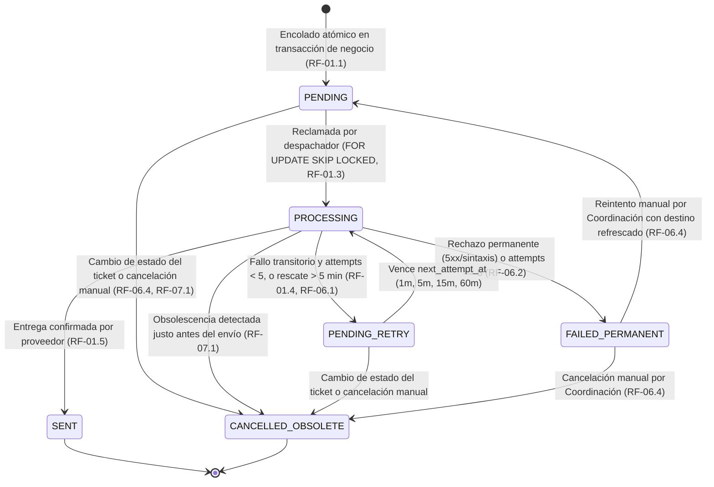

# PLAN TÉCNICO DE IMPLEMENTACIÓN · MÓDULO 14: CENTRO DE NOTIFICACIONES MULTICANAL Y PATRÓN TRANSACCIONAL OUTBOX (PLAN.MD)

**Proyecto:** Gestor de Incidencias de Vending (*VendGuard*)  
**Módulo:** `14-notification-center-outbox`  
**Documento:** `specs/14-notification-center-outbox/plan.md`  
**Referencia Funcional:** [`specs/14-notification-center-outbox/spec.md`](spec.md) y [`specs/functional/notification_center_outbox_spec.md`](../functional/notification_center_outbox_spec.md)  
**Contratos Técnicos:** [`specs/technical/notification_center_outbox_contracts.md`](../technical/notification_center_outbox_contracts.md)  
**Normativa Suprema:** [`constitution.md`](../../constitution.md) (Artículos I al VII)  
**Directrices Operativas:** [`AGENTS.md`](../../AGENTS.md) (SDD, Dogma Vanilla, Dualismo Lingüístico)  
**Sistema de Diseño Visual:** [`docs/design.md`](../../docs/design.md) (Tokens Docker: Azul `#2560ff`, ámbar `#fef9c3`/`#854d0e`, rojo crítico `#dc2626`, radio 4px/8px, canvas `#f9fafb`)  

---

## 1. Estructura de Módulos y Ficheros

El diseño arquitectónico respeta rigurosamente el **Dogma Vanilla** (Backend en PHP 8.2+ OOP nativo con tipado estricto `declare(strict_types=1);` y persistencia única PostgreSQL vía PDO sin ORMs ni librerías de terceros; Frontend en Vue.js 3 estándar con ES Modules nativos sin bundlers ni dependencias npm en runtime).

```text
gestor-incidencias-vending/
├── specs/
│   ├── functional/
│   │   └── notification_center_outbox_spec.md         # Especificación funcional aprobada tras QA
│   ├── technical/
│   │   └── notification_center_outbox_contracts.md    # Contratos de esquema PostgreSQL y API REST
│   └── 14-notification-center-outbox/
│       ├── spec.md                                    # Especificación funcional del módulo
│       ├── plan.md                                    # Este plan técnico de arquitectura
│       └── tasks.md                                   # Desglose de tareas atómicas secuenciales (siguiente fase)
├── database/
│   ├── supabase_init.sql                              # Convergencia canónica con Tablas 21-22 y 4 ENUMs nuevos
│   ├── supabase_seeds.sql                             # Semillas actualizadas con contact_email, is_on_call y canal
│   └── supabase_migrations/
│       └── 002_notification_center_outbox.sql         # Migración incremental idempotente PostgreSQL
├── bin/
│   └── send_notifications.php                         # Worker CLI en segundo plano para despacho y vigilancia 2h/3h
├── src/
│   ├── Core/
│   │   ├── Domain/
│   │   │   ├── Model/
│   │   │   │   ├── NotificationOutboxItem.php         # Entidad inmutable de notificación en bandeja de salida
│   │   │   │   ├── NotificationChannelSettings.php    # Entidad de configuración del Webhook de emergencias
│   │   │   │   ├── Location.php                       # Ampliada con contactEmail obligatorio
│   │   │   │   ├── User.php                           # Ampliada con isOnCall booleano
│   │   │   │   └── Incident.php                       # Ampliada con reporterEmail y marcas de ciclo sanitario
│   │   │   ├── ValueObject/
│   │   │   │   ├── NotificationChannel.php            # Enum: EMAIL, WEBHOOK
│   │   │   │   ├── NotificationPriority.php           # Enum: CRITICAL_SANITARY, STANDARD
│   │   │   │   ├── NotificationStatus.php             # Enum de 6 estados canónicos + reglas de transición
│   │   │   │   └── NotificationTemplate.php           # Enum de las 19 plantillas tipificadas
│   │   │   └── Repository/
│   │   │       ├── NotificationOutboxRepositoryInterface.php
│   │   │       └── NotificationSettingsRepositoryInterface.php
│   │   └── Service/
│   │       ├── NotificationPayloadSanitizer.php       # Blindaje en origen de privacidad Art. V.4 (Sede vs QR)
│   │       ├── NotificationObsolescencePolicy.php     # Evaluación pura de obsolescencia antes del envío (RF-07.1)
│   │       ├── NotificationRetryPolicy.php            # Cálculo de backoff progresivo (1m, 5m, 15m, 60m) vs fallo permanente
│   │       └── WebhookUrlSecurityValidator.php        # Validación estricta HTTPS y bloqueo anti-SSRF de redes privadas
│   ├── Application/
│   │   ├── DTO/
│   │   │   ├── NotificationOutboxItemDto.php          # Proyección inmutable de fila de la bandeja de salida
│   │   │   ├── NotificationDispatchResultDto.php      # Resumen de pasada del despachador y barrido 2h/3h
│   │   │   └── NotificationSettingsDto.php            # Proyección de configuración del Webhook y técnicos de guardia
│   │   └── Service/
│   │       ├── NotificationOutboxEnqueuerService.php  # Encolado transaccional para los 19 eventos del ciclo de vida
│   │       ├── NotificationDispatcherService.php      # Orquestador de rescate (>5m), vigilancia SLA 2h/3h y despacho
│   │       └── CoordinatorNotificationService.php     # Supervisión de cola, reintentos con destino actualizado y test Webhook
│   ├── Infrastructure/
│   │   ├── Notification/
│   │   │   ├── Transport/
│   │   │   │   ├── NotificationTransportInterface.php # Contrato de transporte con resultado tipado (transitorio/permanente)
│   │   │   │   ├── TransportDeliveryResult.php        # Value Object del resultado de entrega (éxito, transitorio, permanente)
│   │   │   │   ├── NativeSmtpEmailTransport.php       # Cliente SMTP/Mail nativo en PHP puro con timeout de 5s
│   │   │   │   └── NativeHttpsWebhookTransport.php    # Cliente HTTPS nativo (stream_context) con validación SSRF y timeout 5s
│   │   │   └── Template/
│   │   │       └── NotificationMessageRenderer.php    # Renderizado limpio HTML/Texto para Email y JSON para Webhook
│   │   └── Repository/
│   │       ├── PdoNotificationOutboxRepository.php    # Queries PostgreSQL con FOR UPDATE SKIP LOCKED y prioridad Art. II
│   │       └── PdoNotificationSettingsRepository.php  # Persistencia de configuración del canal corporativo
│   └── Presentation/
│       ├── Controller/
│       │   ├── CoordinatorNotificationController.php  # Endpoints de supervisión Outbox, reintentos y Webhook settings
│       │   ├── CoordinatorAdminController.php         # Ampliado con contact_email en sedes y PATCH /users/{id}/on-call
│       │   ├── LocationPortalController.php           # Ampliado con reporter_email opcional y encolado transaccional
│       │   ├── QrScanController.php                   # Ampliado con reporter_email opcional y acuse a 2.º ciudadano
│       │   └── CronController.php                     # Nuevo método dispatchNotifications (POST /api/cron/notifications-dispatch)
│       └── Routing/
│           └── AppRouter.php                          # Registro de rutas REST protegidas por RBAC y CronAuthMiddleware
├── public/
│   └── assets/
│       └── js/
│           ├── api.js                                 # Métodos cliente para Outbox, Webhook y toggle on-call
│           ├── components/
│           │   └── CoordinatorNotificationCenterModal.js # Panel/Modal de supervisión Outbox y configuración Webhook
│           └── views/
│               ├── CoordinatorDashboardView.js        # Alerta de Fallo Definitivo, acceso al Centro de Notificaciones y guardia
│               ├── LocationPortalView.js              # Campo opcional reporter_email en modal de reporte de sede
│               └── QrReportView.js                    # Campo opcional reporter_email en reporte ciudadano QR
└── tests/
    ├── unit/
    │   ├── NotificationStatusStateMachineTest.php     # Pruebas unitarias de los 6 estados canónicos y transiciones
    │   ├── NotificationRetryPolicyTest.php            # Pruebas de backoff (1m, 5m, 15m, 60m) y rechazo permanente
    │   ├── NotificationPayloadSanitizerTest.php       # Certificación unitaria del blindaje Art. V.4 (Sede vs QR)
    │   ├── NotificationObsolescencePolicyTest.php     # Reglas de cancelación automática por obsolescencia (RF-07.1)
    │   ├── WebhookUrlSecurityValidatorTest.php        # Pruebas anti-SSRF (bloqueo http, localhost, IPs privadas)
    │   └── CoordinatorNotificationCenterModalTest.mjs # Pruebas reactivas frontend ESM (Node.js sin red)
    └── integration/
        ├── NotificationOutboxEnqueueIntegrationTest.php # Encolado atómico en creación, frío, asignación, pausa, resolución y cancelación
        ├── NotificationDispatcherAndSlaSweepTest.php  # Despacho por prioridad Art. II, rescate >5m, SLA 2h/3h y ráfagas
        ├── CoordinatorNotificationApiTest.php         # Supervisión, reintento con destino corregido, cancelación y test Webhook
        └── NotificationConstitutionalTest.php         # Prohibición DELETE (Art. III.1), doble destinatario sede y segregación Art. V.4
```

---

## 2. Modelo de Datos JSON y Contratos de API REST

*(El detalle exhaustivo del DDL PostgreSQL y las especificaciones de campos se complementa en [`specs/technical/notification_center_outbox_contracts.md`](../technical/notification_center_outbox_contracts.md)).*

### 2.1. Supervisión de Bandeja Outbox (`GET /api/coordinator/notifications/outbox`)
* **Seguridad:** `InternalAuthMiddleware(UserRole::COORDINATOR)`.
* **Query Params:** `status` (`ALL` | `PENDING` | `PROCESSING` | `PENDING_RETRY` | `SENT` | `FAILED_PERMANENT` | `CANCELLED_OBSOLETE`), `channel` (`ALL` | `EMAIL` | `WEBHOOK`), `priority` (`ALL` | `CRITICAL_SANITARY` | `STANDARD`), `ticket_code`, `limit` (`1..200`, def. `50`), `offset` (`>= 0`, def. `0`).
* **Códigos HTTP:** `200 OK`, `401 Unauthorized`, `403 Forbidden`, `422 Unprocessable Content`.
* **Payload de Salida (`200 OK`):**
  ```json
  {
    "success": true,
    "data": {
      "summary": {
        "in_queue_count": 3,
        "pending_count": 2,
        "processing_count": 0,
        "pending_retry_count": 1,
        "sent_last_24h_count": 48,
        "failed_permanent_count": 1,
        "cancelled_obsolete_count": 4,
        "has_permanent_failures_alert": true,
        "active_on_call_technicians_count": 2
      },
      "items": [
        {
          "id": 901,
          "incident_id": 142,
          "ticket_code": "TICK-2026-00142",
          "channel": "EMAIL",
          "priority": "CRITICAL_SANITARY",
          "priority_label": "Crítica Sanitaria (Art. II)",
          "template": "COLD_CHAIN_IMMEDIATE_ALERT",
          "template_label": "Alerta Inmediata de Frío",
          "recipient": "contacto.sede-bcn-01@sede.vendguard.es",
          "recipient_role": "LOCATION",
          "subject": "[URGENTE FRÍO] Avería registrada TICK-2026-00142 · Máquina VEN-BCN-001",
          "status": "FAILED_PERMANENT",
          "status_label": "Fallo definitivo",
          "attempts": 5,
          "max_attempts": 5,
          "next_attempt_at": null,
          "processing_started_at": null,
          "processed_at": "2026-10-16T19:40:00+02:00",
          "last_error": "SMTP 550 5.1.1: Recipient address rejected",
          "obsolete_reason": null,
          "can_retry": true,
          "can_cancel": true,
          "created_at": "2026-10-16T18:10:00+02:00",
          "updated_at": "2026-10-16T19:40:00+02:00"
        }
      ],
      "pagination": {
        "total": 56,
        "limit": 50,
        "offset": 0
      }
    }
  }
  ```

### 2.2. Reintento Manual Individual y Masivo (`POST /api/coordinator/notifications/outbox/{id}/retry` y `/retry-all-failed`)
* **Seguridad:** `InternalAuthMiddleware(UserRole::COORDINATOR)`.
* **Comportamiento:** Refresca `recipient` tomando el `locations.contact_email` o `notification_channel_settings.webhook_url` vigente en base de datos, resetea `status = 'PENDING'`, `attempts = 0`, `next_attempt_at = CURRENT_TIMESTAMP`, `last_error = NULL` y audita en `audit_log`.
* **Códigos HTTP:** `200 OK`, `404 Not Found` (`OUTBOX_ITEM_NOT_FOUND`), `409 Conflict` (`INVALID_OUTBOX_STATUS_FOR_RETRY`), `422 Unprocessable Content` (`WEBHOOK_URL_NOT_CONFIGURED`).

### 2.3. Cancelación Manual de Envío (`POST /api/coordinator/notifications/outbox/{id}/cancel`)
* **Seguridad:** `InternalAuthMiddleware(UserRole::COORDINATOR)`.
* **Payload de Entrada:** `{"reason": "Cancelada manualmente por Coordinación."}` (opcional, con motivo por defecto si se omite).
* **Códigos HTTP:** `200 OK`, `404 Not Found`, `409 Conflict` (`INVALID_OUTBOX_STATUS_FOR_CANCEL` si ya está `SENT`, `CANCELLED_OBSOLETE` o `PROCESSING`).

### 2.4. Configuración y Prueba Directa del Canal de Emergencias (`/api/coordinator/notifications/settings` y `/test-webhook`)
* **`GET /api/coordinator/notifications/settings`:** Devuelve `webhook_name`, `webhook_url`, `is_webhook_enabled`, `last_tested_at`, `last_test_status`, `last_test_error` y el array `on_call_technicians`.
* **`PUT /api/coordinator/notifications/settings`:**
  * Entrada: `{"webhook_name": "Slack #emergencias-frio", "webhook_url": "https://hooks.slack.com/...", "is_webhook_enabled": true}`.
  * Códigos HTTP: `200 OK`, `422 Unprocessable Content` (`WEBHOOK_URL_REQUIRED`, `INVALID_WEBHOOK_URL_SCHEME`, `FORBIDDEN_WEBHOOK_INTERNAL_HOST`).
* **`POST /api/coordinator/notifications/settings/test-webhook`:**
  * Ejecuta petición HTTPS directa con timeout máximo de **5 segundos** (RF-01.2, RF-06.5.2), registra el resultado y devuelve `200 OK` con `{"test_passed": true|false, "status": "SUCCESS"|"FAILED", "http_code": 200, "duration_ms": 142, "error": null}`.

### 2.5. Gestión de Técnico de Guardia (`PATCH /api/coordinator/users/{id}/on-call`)
* **Entrada:** `{"is_on_call": true}`.
* **Códigos HTTP:** `200 OK`, `404 Not Found` (`USER_NOT_FOUND`), `409 Conflict` (`CANNOT_SET_ON_CALL_INACTIVE_USER`), `422 Unprocessable Content` (`ON_CALL_ONLY_FOR_TECHNICIANS`).

### 2.6. Proceso Batch de Despacho y Vigilancia (`POST /api/cron/notifications-dispatch`)
* **Seguridad:** `CronAuthMiddleware` (`X-Cron-Secret` o Bearer token).
* **Códigos HTTP:** `200 OK` con resumen `NotificationDispatchResultDto`, `401 Unauthorized`.

---

## 3. Algoritmos Clave en Pseudocódigo y Máquinas de Estado

### 3.1. Máquina de Estados Canónica de la Notificación (`NotificationStatus`)



### 3.2. Algoritmo del Despachador y Vigilante en Segundo Plano (`NotificationDispatcherService::runPass`)

```text
FUNCTION runPass(batchSize = 50, now = currentUtcTimestamp()):
    // FASE 1: Rescate automático de envíos atrapados en PROCESSING > 5 minutos (RF-01.4)
    rescuedCount = outboxRepo.rescueStuckProcessingItems(olderThan: now - 5 MINUTES, now: now)

    // FASE 2: Vigilancia 24/7 de Inminencia de SLA (2h y 3h) en máquinas bajo vigilancia sanitaria (RF-04)
    sla2hCount = 0
    sla3hCount = 0
    sanitaryIncidents = incidentRepo.findActiveSanitaryWatchIncidentsForSlaWatch()
    FOR EACH inc IN sanitaryIncidents:
        elapsedSeconds = now - inc.cycleStartedAt // Medido en tiempo natural continuo 24/7 (RF-04.3)
        
        // Umbral 2h sin asignar (RF-04.1)
        IF inc.status IN ('REGISTERED', 'REOPENED') AND inc.assignedTechnicianId IS NULL
           AND inc.sla2hAlertSentAt IS NULL AND elapsedSeconds >= 7200:
            transactionManager.transactional(FUNCTION():
                IF incidentRepo.markSla2hAlertSentIfNull(inc.id, now):
                    enqueuer.enqueueSla2hUnassignedAlert(inc, now)
                    sla2hCount++
            )

        // Umbral 3h sin haber entrado en IN_PROGRESS (RF-04.2)
        IF inc.startedAt IS NULL AND inc.sla3hAlertSentAt IS NULL AND elapsedSeconds >= 10800:
            transactionManager.transactional(FUNCTION():
                IF incidentRepo.markSla3hAlertSentIfNull(inc.id, now):
                    enqueuer.enqueueSla3hUnstartedAlert(inc, now)
                    sla3hCount++
            )

    // FASE 3: Reclamo de lote con prioridad estricta Art. II y bloqueo concurrente (RF-01.3, RNF-06)
    claimedItems = outboxRepo.claimReadyBatch(
        limit: batchSize,
        now: now,
        orderBy: "CASE WHEN priority = 'CRITICAL_SANITARY' THEN 0 ELSE 1 END ASC, next_attempt_at ASC, id ASC"
    )

    // FASE 4: Evaluación de obsolescencia, despacho y backoff progresivo (RF-06.1, RF-06.2, RF-07.1)
    FOR EACH item IN claimedItems:
        obsoleteCheck = obsolescencePolicy.evaluate(item)
        IF obsoleteCheck.isObsolete:
            outboxRepo.markCancelledObsolete(item.id, obsoleteCheck.reason, now)
            cancelledObsoleteCount++
            CONTINUE

        result = transportSelector.forChannel(item.channel).send(item, timeoutSeconds: 5)
        IF result.isSuccess:
            outboxRepo.markSent(item.id, now)
            sentCount++
        ELSE IF result.isPermanentFailure OR (item.attempts + 1) >= item.maxAttempts:
            outboxRepo.markFailedPermanent(item.id, item.attempts + 1, result.errorMessage, now)
            auditRepo.logPermanentNotificationFailure(item, result.errorMessage)
            failedPermanentCount++
        ELSE:
            newAttempts = item.attempts + 1
            delaySeconds = retryPolicy.calculateBackoffSeconds(newAttempts) // 1->60, 2->300, 3->900, 4->3600
            outboxRepo.scheduleRetry(item.id, newAttempts, now + delaySeconds, result.errorMessage)
            retryScheduledCount++

    RETURN NotificationDispatchResultDto(...)
```

### 3.3. Algoritmo de Encolado con Agrupación de Ráfagas y Doble Destinatario (`NotificationOutboxEnqueuerService`)

```text
// 1. Resolución de destinatarios de Sede (RF-02.3 / Resolución QA 2 - Art. III.3)
FUNCTION resolveLocationRecipients(location, incident, isReportedFromLocationPortal):
    recipients = [ normalizeEmail(location.contactEmail) ]
    IF isReportedFromLocationPortal AND incident.reporterEmail IS NOT NULL:
        reporterNormalized = normalizeEmail(incident.reporterEmail)
        IF reporterNormalized != normalizeEmail(location.contactEmail):
            recipients.append(reporterNormalized)
    RETURN recipients

// 2. Agrupación determinista de ráfagas de respuestas de Sede en PENDING_INFO (RF-05.4 / Resolución QA 5)
FUNCTION enqueueSiteReplyInPendingInfo(incident, publicComment):
    existingPending = outboxRepo.findPendingByIncidentAndTemplate(
        incidentId: incident.id,
        template: 'PENDING_INFO_SITE_REPLY'
    )
    sanitizedPayload = payloadSanitizer.buildSiteReplyPayload(incident, publicComment)
    IF existingPending IS NOT NULL:
        // Actualiza la fila PENDING existente con el último mensaje sin duplicar correos
        outboxRepo.updatePendingPayload(existingPending.id, sanitizedPayload)
    ELSE:
        outboxRepo.insertPending(template: 'PENDING_INFO_SITE_REPLY', payload: sanitizedPayload, ...)
```

---

## 4. Arquitectura de Eventos y Componentes Frontend Vanilla (Vue 3 ESM)

Siguiendo el **Dogma Vanilla** y los tokens de [`docs/design.md`](../../docs/design.md):
1. **`CoordinatorNotificationCenterModal.js` (Nuevo componente modal en Vue 3 Composition API ESM):**
   * **Pestaña 1 · Bandeja de Salida y Supervisión (`Outbox`):**
     * Tarjetas de resumen KPI en la cabecera: *En cola*, *Enviadas (24h)*, *Fallos definitivos* (resaltada en rojo `#dc2626` si `> 0`) y *Técnicos de guardia activos*.
     * Barra de filtros reactivos por los **6 estados canónicos**, canal (`EMAIL`, `WEBHOOK`), prioridad (`CRITICAL_SANITARY`, `STANDARD`) y buscador por código de ticket.
     * Tabla de notificaciones con insignias semánticas de estado (bordes de `4px`), detalle del último error y botones de acción directa **"Reintentar envío"** y **"Cancelar envío"**, además del botón global **"Reintentar todas las fallidas"**.
   * **Pestaña 2 · Canal Corporativo de Emergencias (`Webhook`):**
     * Formulario con `webhook_name`, `webhook_url` (`https://...`), interruptor `is_webhook_enabled` y estado de la última prueba realizada.
     * Botón interactivo **"🔌 Probar conexión"** con indicador de carga y mensaje inmediato de éxito o diagnóstico de error en menos de 5 segundos.
2. **Integración en `CoordinatorDashboardView.js`:**
   * Botón de acceso **"🔔 Notificaciones"** en la barra de herramientas de Coordinación con insignia roja de alerta (`failed_permanent_count > 0`) si existen envíos en *"Fallo definitivo"*.
   * En el directorio de **Personal Interno (Usuarios)**, interruptor/botón rápido **"🛡️ En guardia"** (`is_on_call`) visible en las filas de técnicos activos para activar/desactivar la guardia con un clic.
3. **Integración en `LocationPortalView.js` y `QrReportView.js`:**
   * En el formulario de reporte de avería (tanto en el Portal de Sede como en el escaneo público QR) y en el modal de aportación de observaciones sobre ticket abierto, incorporación del campo opcional **"Correo electrónico para notificaciones (opcional)"** con validación reactiva de formato.
   * En el CRUD de **Sedes** del panel de Coordinación, incorporación del campo obligatorio **"Correo electrónico oficial de la sede"** (`contact_email`).

---

## 5. Decisiones Técnicas Justificadas y Alternativas Descartadas

| Decisión Técnica Adoptada | Justificación (Alineación con Constitución y SDD) | Alternativa Descartada y Motivo de Rechazo |
| :--- | :--- | :--- |
| **1. Patrón Transaccional Outbox en PostgreSQL con `FOR UPDATE SKIP LOCKED`** | Garantiza que jamás se pierda una notificación si la transacción de negocio se confirma, que jamás se envíe un aviso de una transacción revertida y que dos workers concurrentes nunca dupliquen un envío (RF-01.1, RNF-06). | *Envío síncrono en el controlador HTTP o colas en memoria (Redis/RabbitMQ):* El envío síncrono bloquea al usuario y pierde mensajes ante caídas; Redis/RabbitMQ añade infraestructura y dependencias prohibidas por el Art. IV.3. |
| **2. Transporte SMTP y HTTPS nativo en PHP 8.2+ puro sin librerías externas** | Cumple de forma incondicional el Artículo IV.3 de la Constitución (*Aversión a Dependencias Externas*) y permite controlar al milímetro el *timeout* de 5 segundos (`RNF-03`) y la clasificación entre errores 4xx transitorios y 5xx permanentes. | *Instalar librerías de terceros vía Composer (SwiftMailer, Symfony Mailer, Guzzle):* Viola el Artículo IV.3 de la Constitución y añade peso innecesario al contenedor. |
| **3. Sanitización de `payload_json` en el momento de encolar (`NotificationPayloadSanitizer`)** | Garantiza el blindaje del Artículo V.4 desde el origen: la fila guardada en `notification_outbox` para una Sede o Ciudadano QR nunca contiene diagnósticos internos, costes ni nombres de técnicos, ni siquiera en la base de datos de la cola. | *Guardar el objeto `Incident` completo en `payload_json` y filtrar en la plantilla de correo:* Un descuido en una plantilla o una consulta de la tabla expondría datos confidenciales internos. |
| **4. Validación Anti-SSRF estricta en `WebhookUrlSecurityValidator`** | Dado que el Coordinador introduce una URL hacia la que el servidor realiza peticiones HTTP salientes, exigir `https://` y bloquear `localhost` y rangos privados (`10/8`, `172.16/12`, `192.168/16`, `169.254/16`) impide ataques de Server-Side Request Forgery contra la infraestructura interna. | *Aceptar cualquier `filter_var($url, FILTER_VALIDATE_URL)`:* Permitiría apuntar el Webhook a `http://127.0.0.1` o metadatos de nube internos. |

---

## 6. Estrategia de Pruebas (Unitarias, Integración y Manuales)

1. **Pruebas Unitarias Puras (`tests/unit/`, sin red ni base de datos):**
   * `NotificationStatusStateMachineTest.php`: Verifica los 6 estados canónicos y que ninguna transición ilegal sea admitida.
   * `NotificationRetryPolicyTest.php`: Certifica la curva exacta de espera progresiva ($60\text{ s}, 300\text{ s}, 900\text{ s}, 3600\text{ s}$), el paso a `FAILED_PERMANENT` en el 5.º intento y el paso directo a `FAILED_PERMANENT` ante rechazos permanentes.
   * `NotificationPayloadSanitizerTest.php`: Certifica que para `LOCATION` y `CITIZEN_QR` jamás aparecen `resolution_diagnosis`, `resolution_action`, `cost_snapshot`, notas internas ni nombres/teléfonos de técnicos, y que para `CITIZEN_QR` jamás aparecen causas de pausa ni descripciones de terceros (Art. V.4).
   * `NotificationObsolescencePolicyTest.php`: Verifica todas las ramas de cancelación por obsolescencia de RF-07.1.
   * `WebhookUrlSecurityValidatorTest.php`: Certifica el rechazo de `http://`, `localhost`, `127.0.0.1`, `10.x`, `192.168.x`, `169.254.x` y la aceptación de dominios `https://` públicos.
   * `CoordinatorNotificationCenterModalTest.mjs`: Prueba en Node.js los componentes frontend ESM, filtros de los 6 estados, botones de reintento/cancelación y formulario de Webhook.
2. **Pruebas de Integración contra PostgreSQL Local Hermético (`tests/integration/`):**
   * `NotificationOutboxEnqueueIntegrationTest.php`: Verifica el encolado transaccional atómico en los 19 escenarios del ciclo de vida (apertura, frío, reclasificación crítica, asignación/desasignación, pausa, ráfaga de respuestas de sede, resolución, reapertura, avería crónica, cancelación 72h y segundo ciudadano QR).
   * `NotificationDispatcherAndSlaSweepTest.php`: Certifica el orden de despacho por prioridad sanitaria estricta (`CRITICAL_SANITARY` antes que `STANDARD`), el rescate de envíos atrapados en `PROCESSING` $> 5\text{ min}$, la evaluación 24/7 de los umbrales de 2h y 3h con deduplicación anti-spam y su reinicio al reabrir en garantía.
   * `CoordinatorNotificationApiTest.php`: Prueba los endpoints REST de supervisión, el reintento manual comprobando que actualiza `recipient` con el nuevo `contact_email` de la sede o `webhook_url`, la cancelación manual, el selector `PATCH /users/{id}/on-call` y el botón `test-webhook`.
   * `NotificationConstitutionalTest.php`: Certifica que `DELETE FROM notification_outbox` y `DELETE FROM notification_channel_settings` son bloqueados con `SQLSTATE 45000` (`ART_III_1_VIOLATION`), el doble destinatario de sede (Art. III.3) y el blindaje de privacidad (Art. V.4).
3. **Verificación Manual / End-to-End:**
   * Marcar un técnico como *"De guardia"*, reportar una avería de frío en máquina perecedera, verificar en el Centro de Notificaciones de Coordinación el encolado `CRITICAL_SANITARY`, probar el botón *"Probar conexión"* del Webhook y verificar el reintento manual tras simular un fallo definitivo.

---

## 7. Mapeo Estricto de Trazabilidad (RF-x y RNF-x)

| Requisito | Descripción Funcional / No Funcional | Componentes de Implementación | Suite de Pruebas que lo Certifica |
| :--- | :--- | :--- | :--- |
| **RF-01.1** | 6 estados canónicos de la bandeja de salida | `NotificationStatus`, `002_notification_center_outbox.sql` | `NotificationStatusStateMachineTest` |
| **RF-01.2** | Registro atómico en transacción y cero llamadas externas síncronas (salvo test Webhook) | `NotificationOutboxEnqueuerService`, servicios de aplicación | `NotificationOutboxEnqueueIntegrationTest` |
| **RF-01.3** | Despacho con prioridad estricta Art. II (`CRITICAL_SANITARY` primero) y bloqueo `SKIP LOCKED` | `PdoNotificationOutboxRepository::claimReadyBatch()`, `NotificationDispatcherService` | `NotificationDispatcherAndSlaSweepTest` |
| **RF-01.4** | Rescate automático de envíos atrapados en `PROCESSING` > 5 minutos | `PdoNotificationOutboxRepository::rescueStuckProcessingItems()` | `NotificationDispatcherAndSlaSweepTest` |
| **RF-01.5** | Confirmación de entrega y paso a `SENT` con `processed_at` | `NotificationDispatcherService`, `PdoNotificationOutboxRepository` | `NotificationDispatcherAndSlaSweepTest` |
| **RF-02.1** | Correo oficial obligatorio/editable en Sede y backfill institucional en sedes preexistentes | `Location`, `PdoLocationRepository`, `CoordinatorAdminController`, `002_...sql` | `CoordinatorNotificationApiTest` |
| **RF-02.2** | Campo opcional `reporter_email` validado en reporte de Sede y QR | `LocationPortalController`, `QrScanController`, `LocationPortalView.js`, `QrReportView.js` | `NotificationOutboxEnqueueIntegrationTest` |
| **RF-02.3** | Doble destinatario en Sede si `reporter_email` difiere de `contact_email` (Art. III.3) | `NotificationOutboxEnqueuerService` | `NotificationConstitutionalTest` |
| **RF-02.4** | Reporte QR sin correo se registra sin error omitiendo correo al ciudadano | `QrScanController`, `NotificationOutboxEnqueuerService` | `NotificationOutboxEnqueueIntegrationTest` |
| **RF-02.5** | Activación/desactivación de `is_on_call` sobre técnicos activos | `CoordinatorAdminController::updateUserOnCall()`, `PdoUserRepository` | `CoordinatorNotificationApiTest` |
| **RF-02.6** | Retirada automática de `is_on_call` al desactivar un técnico | `PdoUserRepository::deactivate()` | `CoordinatorNotificationApiTest` |
| **RF-03.1** | Alerta Inmediata de Frío en apertura, reapertura o reclasificación a `CRITICAL` (Art. II) | `NotificationOutboxEnqueuerService`, `LocationPortalController`, `QrScanController`, `CoordinatorController` | `NotificationOutboxEnqueueIntegrationTest` |
| **RF-03.2** | Advertencia destacada si no existe ningún técnico con `is_on_call = true` | `NotificationOutboxEnqueuerService`, `NotificationMessageRenderer` | `NotificationOutboxEnqueueIntegrationTest` |
| **RF-03.3** | Alertas críticas internas y aviso preventivo a Sede al activarse Cuarentena Sanitaria 4h | `SanitaryClockSweepService`, `IncidentPauseService`, `NotificationOutboxEnqueuerService` | `NotificationDispatcherAndSlaSweepTest` |
| **RF-03.4** | Alerta de escalado cuando el barrido sanitario entra en contención persistente (`ESCALATED`) | `SanitaryClockSweepService`, `NotificationOutboxEnqueuerService` | `NotificationDispatcherAndSlaSweepTest` |
| **RF-04.1 - 04.5** | Vigilancia 24/7 de umbrales SLA 2h sin asignar y 3h sin iniciar, anti-spam y reinicio al reabrir | `NotificationDispatcherService`, `PdoIncidentRepository` | `NotificationDispatcherAndSlaSweepTest` |
| **RF-05.1 - 05.9** | Notificaciones del ciclo de vida completo, ráfagas en pausa, avería crónica, cancelación 72h y 2.º QR | `NotificationOutboxEnqueuerService`, `NotificationPayloadSanitizer` | `NotificationOutboxEnqueueIntegrationTest` |
| **RF-05.6 / RNF-04** | Blindaje estricto de privacidad Art. V.4 en origen (Sede vs. Ciudadano QR) | `NotificationPayloadSanitizer` | `NotificationPayloadSanitizerTest`, `NotificationConstitutionalTest` |
| **RF-06.1 - 06.2** | 5 reintentos con espera progresiva (1m, 5m, 15m, 60m) vs. paso directo a `FAILED_PERMANENT` | `NotificationRetryPolicy`, `NotificationDispatcherService` | `NotificationRetryPolicyTest`, `NotificationDispatcherAndSlaSweepTest` |
| **RF-06.3 - 06.5** | Panel de supervisión, reintento con destino corregido, cancelación manual y Webhook HTTPS con test 5s | `CoordinatorNotificationController`, `CoordinatorNotificationService`, `WebhookUrlSecurityValidator`, `CoordinatorNotificationCenterModal.js` | `WebhookUrlSecurityValidatorTest`, `CoordinatorNotificationApiTest`, `CoordinatorNotificationCenterModalTest.mjs` |
| **RF-07.1** | Cancelación automática a `CANCELLED_OBSOLETE` antes de enviar si el ticket o destino cambió | `NotificationObsolescencePolicy`, `NotificationDispatcherService` | `NotificationObsolescencePolicyTest`, `NotificationDispatcherAndSlaSweepTest` |
| **RF-07.2 - 07.3** | Prohibición de `DELETE FROM` (Art. III.1) y registro completo en `audit_log` (Art. III.3) | Disparadores `trg_no_delete_*`, `PdoAuditLogRepository` | `NotificationConstitutionalTest` |
| **RNF-01 - 06** | Latencia < 30 ms en encolado, timeout 5 s, tokens de diseño y concurrencia `SKIP LOCKED` | `PdoNotificationOutboxRepository`, transportes nativos y componentes Vue 3 ESM | Batería global unitaria e integración |

---

## 8. Garantía de Dogma Vanilla y Dualidad Lingüística

1. **Dogma Vanilla Innegociable (Artículo IV de la Constitución):**
   * **Backend:** PHP 8.2+ puro orientado a objetos con `declare(strict_types=1);` en todos los archivos, acceso a datos exclusivamente mediante `PDO` contra PostgreSQL (`pdo_pgsql`), y transporte de red mediante streams nativos de PHP (`stream_socket_client` / `stream_context_create`) con timeout estricto de 5 segundos. **Cero paquetes de terceros añadidos.**
   * **Frontend:** Módulos ES6 nativos (`.js`) sobre Vue.js 3 estándar y peticiones `fetch()` nativas. **Cero bundlers, cero transpiladores y cero dependencias npm de ejecución.**
2. **Dualidad Lingüística Estricta (`AGENTS.md` §3):**
   * **Inglés (`camelCase` / `PascalCase` / `snake_case` SQL):** Todos los identificadores de código fuente, clases (`NotificationOutboxEnqueuerService`, `WebhookUrlSecurityValidator`), métodos (`claimReadyBatch()`, `rescueStuckProcessingItems()`), variables, tablas, columnas y nombres de tests (`describe` / métodos `test...`).
   * **Español:** Todos los bloques de documentación `PHPDoc`, comentarios explicativos del código, mensajes de negocio orientados al usuario en la interfaz y en las plantillas de notificación, especificaciones (`specs/`) y comunicación del proyecto.
