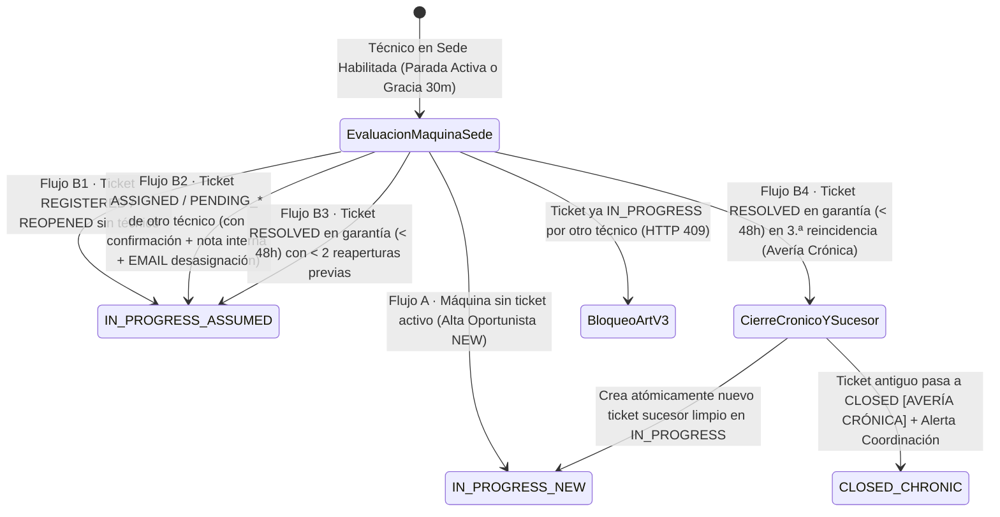
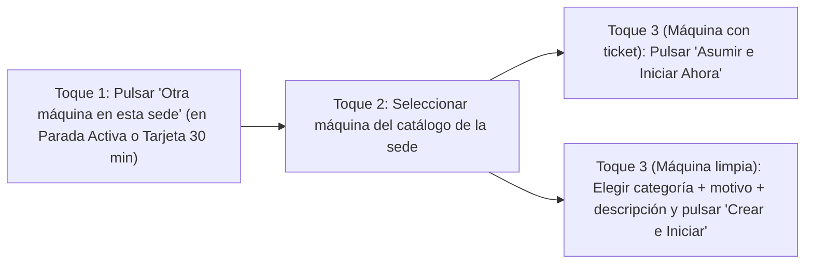

# PLAN TÉCNICO DE IMPLEMENTACIÓN · MÓDULO 16: AVERÍA OPORTUNISTA IN SITU (ALTA Y ASUNCIÓN EN RUTA)

**Proyecto:** Gestor de Incidencias de Vending (*VendGuard*)  
**Módulo:** `16-opportunistic-incident`  
**Documento:** `specs/16-opportunistic-incident/plan.md`  
**Referencia Funcional:** [`specs/16-opportunistic-incident/spec.md`](spec.md) y [`specs/functional/opportunistic_incident_spec.md`](../functional/opportunistic_incident_spec.md) (`RF-01` a `RF-06`, `RNF-01` a `RNF-04`, Resoluciones QA 1 a 5)  
**Contratos Técnicos:** [`specs/technical/opportunistic_incident_contracts.md`](../technical/opportunistic_incident_contracts.md)  
**Normativa Suprema:** [`constitution.md`](../../constitution.md) (Artículos I al VII)  
**Directrices Operativas:** [`AGENTS.md`](../../AGENTS.md) (SDD, Dogma Vanilla, Dualismo Lingüístico)  
**Sistema de Diseño Visual:** [`docs/design.md`](../../docs/design.md) (Tokens Docker: Azul `#2560ff`, ámbar `#fef9c3`/`#854d0e`, rojo crítico `#dc2626`, radio `4px`/`8px`, canvas `#f9fafb`)  

---

## 1. Estructura de Módulos y Ficheros

El diseño arquitectónico respeta rigurosamente el **Dogma Vanilla** (**Artículo IV de la Constitución**):
* **Backend:** PHP 8.2+ OOP puro (`declare(strict_types=1);`), arquitectura limpia desacoplada y persistencia única en PostgreSQL 16+ (Supabase / Motor Local de Certificación) mediante PDO nativo, sin ORMs ni paquetes externos.
* **Frontend:** Vue.js 3 estándar con módulos ES nativos (`public/assets/js/`), sin bundlers, sin transpilers y sin dependencias de terceros.

```text
gestor-incidencias-vending/
├── specs/
│   ├── functional/
│   │   └── opportunistic_incident_spec.md              # Especificación funcional aprobada tras QA (espejo)
│   ├── technical/
│   │   └── opportunistic_incident_contracts.md         # Contratos de esquema PostgreSQL y API REST
│   └── 16-opportunistic-incident/
│       ├── spec.md                                     # Especificación funcional del módulo
│       ├── plan.md                                     # Este plan técnico de arquitectura e implementación
│       └── tasks.md                                    # Desglose de tareas atómicas secuenciales (siguiente fase)
├── database/
│   ├── supabase_init.sql                               # Convergencia canónica con ENUMs y columnas de incidents
│   ├── supabase_seeds.sql                              # Semillas de demostración con ejemplos oportunistas NEW y ASSUMED
│   └── supabase_migrations/
│       └── 005_opportunistic_incident.sql              # Migración incremental idempotente PostgreSQL
├── src/
│   ├── Core/
│   │   ├── Domain/
│   │   │   ├── Model/
│   │   │   │   └── Incident.php                        # Ampliada con opportunisticMode, opportunisticOriginReason, opportunisticInformantName y chronicPredecessorIncidentId
│   │   │   ├── ValueObject/
│   │   │   │   ├── OpportunisticMode.php               # Enum: NEW, ASSUMED + etiquetas canónicas en español
│   │   │   │   ├── OpportunisticOriginReason.php       # Enum: SITE_VERBAL_NOTICE, TECHNICIAN_DETECTION, EXISTING_TICKET_CLAIM, WARRANTY_REOPEN_IN_SITU
│   │   │   │   ├── OpportunisticActionType.php         # Enum: CREATE_NEW, ASSUME_DIRECT, ASSUME_WITH_CONFIRMATION, REOPEN_IN_SITU, CURRENT_TECHNICIAN_IN_PROGRESS, BLOCKED_OTHER_TECH_IN_PROGRESS
│   │   │   │   └── NotificationTemplate.php            # Ampliado con OPPORTUNISTIC_COLD_ROUTE_POSTPONED_ALERT e INCIDENT_REOPENED_IN_SITU_SITE
│   │   │   ├── Exception/
│   │   │   │   ├── LocationNotEnabledForOpportunisticException.php # HTTP 403 LOCATION_NOT_ENABLED_FOR_OPPORTUNISTIC
│   │   │   │   ├── ActiveInterventionConflictException.php         # HTTP 409 ACTIVE_INTERVENTION_AT_DIFFERENT_LOCATION
│   │   │   │   ├── ColdChainRouteWarningConfirmationException.php  # HTTP 409 COLD_CHAIN_ROUTE_WARNING_CONFIRMATION_REQUIRED
│   │   │   │   └── TakeoverConfirmationRequiredException.php       # HTTP 409 TAKEOVER_CONFIRMATION_REQUIRED
│   │   │   └── Repository/
│   │   │       └── OpportunisticIncidentRepositoryInterface.php    # Contrato de consultas de habilitación de sede, catálogo y operaciones atómicas
│   │   └── Service/
│   │       ├── OpportunisticLocationEligibilityPolicy.php # Regla pura RF-01.1..01.3 (parada activa vs ventana 30m + 5m tolerancia)
│   │       ├── OpportunisticCoexistencePolicy.php         # Regla pura RF-02.1..02.2 (misma sede permitida vs bloqueo en otra sede)
│   │       └── OpportunisticColdChainGuardPolicy.php      # Regla pura RF-03.1..03.2 (detección de paradas CRITICAL / vigilancia sanitaria en otra sede)
│   ├── Application/
│   │   ├── DTO/
│   │   │   ├── OpportunisticMachineCatalogDto.php      # Proyección del catálogo de máquinas de la sede + advertencia frío + conflicto
│   │   │   ├── CreateOpportunisticIncidentDto.php      # DTO de entrada validado para Flujo A (Alta Oportunista NEW)
│   │   │   └── AssumeOpportunisticIncidentDto.php      # DTO de entrada validado para Flujo B (Asunción / Reapertura ASSUMED)
│   │   └── Service/
│   │       ├── OpportunisticIncidentService.php        # Caso de uso orquestador de catálogo, Flujo A, Flujo B y 3.ª reincidencia crónica
│   │       └── NotificationOutboxEnqueuerService.php   # Ampliado con enqueueOpportunisticColdRoutePostponed() y enqueueReopenedInSituSite()
│   ├── Infrastructure/
│   │   ├── Notification/
│   │   │   ├── Template/
│   │   │   │   └── NotificationMessageRenderer.php     # Plantillas HTML/Texto y JSON Webhook para los 2 nuevos tipos de aviso
│   │   │   └── NotificationObsolescencePolicy.php      # Coherencia de cancelación de TECHNICIAN_ASSIGNED al asumir in situ
│   │   └── Repository/
│   │       ├── PdoIncidentRepository.php               # Implementación de OpportunisticIncidentRepositoryInterface y ordenación Parada #1
│   │       └── PdoMetricsRepository.php                # Ampliado con contadores opportunistic_interventions (RF-06.4)
│   └── Presentation/
│       ├── Controller/
│       │   ├── TechnicianOpportunisticController.php   # Endpoints GET catálogo sede, POST alta oportunista y POST asunción/reapertura
│       │   ├── TechnicianController.php                # Ampliado en getMyRoute (?include_opportunistic_context=1) y resolveIncident (levanta bloqueo 72h)
│       │   ├── CoordinatorController.php               # Expone campos oportunistas en listado y detalle de incidencia
│       │   └── LocationPortalController.php            # Expone etiqueta oportunista e informante en sede respetando Art. V.4
│       └── Routing/
│           └── AppRouter.php                           # Registro de rutas /api/technician/locations/{location_id}/opportunistic-machines y /api/technician/opportunistic/...
├── public/
│   └── assets/
│       └── js/
│           ├── api.js                                  # Clientes fetch para getOpportunisticMachines, createOpportunisticIncident y assumeOpportunisticIncident
│           ├── components/
│           │   ├── TechnicianOpportunisticModal.js     # Modal en <= 3 toques: catálogo de máquinas de la sede + Flujo A (Alta) + Flujo B (Asunción/Reapertura) + Advertencia Frío Art. II
│           │   ├── IncidentDetailModal.js              # Insignias "Oportunista In Situ · Nueva / Asumida", informante y enlace a predecesor crónico
│           │   └── IncidentBadge.js                    # Soporte visual para chips oportunistas con tokens Docker
│           └── views/
│               ├── TechnicianRouteView.js              # Botón "Otra máquina en esta sede", tarjeta temporal "Sede recién visitada (30 min)" y agrupación Parada #1
│               ├── TechnicianPreventiveRouteTab.js     # Botón "Reportar/Asumir avería en esta sede" desde orden preventiva activa o recién completada
│               ├── CoordinatorDashboardView.js         # Filtro/insignia oportunista y KPI "Desplazamientos Evitados (Oportunistas)"
│               └── LocationPortalView.js               # Visualización transparente de atención oportunista in situ con técnico anonimizado (Art. V.4)
└── tests/
    ├── unit/
    │   ├── OpportunisticLocationEligibilityPolicyTest.php # Ventana de 30m, tolerancia +5m, exclusión de PENDING_INFO antiguo
    │   ├── OpportunisticCoexistenceAndColdGuardTest.php   # Coexistencia misma sede vs otra sede y disparo de advertencia Art. II
    │   ├── OpportunisticStateTransitionsTest.php          # Flujo A (NEW), Flujo B (ASSUMED), bloqueo IN_PROGRESS ajeno y 3.ª reincidencia Crónica
    │   └── TechnicianOpportunisticModalTest.mjs           # Test unitario ESM del flujo móvil en <= 3 interacciones y recordatorio QR monedas
    └── integration/
        ├── OpportunisticIncidentApiIntegrationTest.php    # Contratos HTTP completos: catálogo, alta multipart, asunción, traspaso y 3.ª reapertura
        ├── OpportunisticNotificationAndPrivacyTest.php    # Correo vs Telegram (RF-TG-06), obsolescencia en cola, alerta frío Coordinación y Art. V.4
        └── OpportunisticSchemaCorrespondenceTest.php      # Verificación de ENUMs, columnas, CHECK e índice parcial en PostgreSQL
```

---

## 2. Modelo de Datos Relacional y Contratos de API REST

*(La definición normativa completa de DDL y JSON se encuentra en [`specs/technical/opportunistic_incident_contracts.md`](../technical/opportunistic_incident_contracts.md)).*

### 2.1. Resumen del Modelo Relacional (`005_opportunistic_incident.sql`)

| Objeto en PostgreSQL | Tipo | Valores / Restricciones | Requisito Cubierto |
| :--- | :--- | :--- | :--- |
| `opportunistic_mode` | `ENUM` | `('NEW', 'ASSUMED')` | `RF-04.2`, `RF-05.2`, `RF-06.4` (Resolución QA 4) |
| `opportunistic_origin_reason` | `ENUM` | `('SITE_VERBAL_NOTICE', 'TECHNICIAN_DETECTION', 'EXISTING_TICKET_CLAIM', 'WARRANTY_REOPEN_IN_SITU')` | `RF-04.1.2`, `RF-05.2`, `RF-05.4` |
| `notification_template` | `ENUM` *(extensión)* | `+ 'OPPORTUNISTIC_COLD_ROUTE_POSTPONED_ALERT'`, `+ 'INCIDENT_REOPENED_IN_SITU_SITE'` | `RF-03.2.2`, `RF-06.3.1` (Resoluciones QA 1 y QA 2) |
| `incidents.opportunistic_mode` | Columna `ENUM NULL` | `NULL` en tickets ordinarios; `'NEW'` o `'ASSUMED'` en oportunistas | `RF-06.4` |
| `incidents.opportunistic_origin_reason` | Columna `ENUM NULL` | Submotivo validado por `chk_incidents_opportunistic_coherence` | `RF-04.1.2`, `RF-05.2`, `RF-05.4` |
| `incidents.opportunistic_informant_name` | `VARCHAR(100) NULL` | Nombre/cargo opcional de quien avisó en pasillo (oculto en QR público, Art. V.4) | `RF-04.1.2` (Resolución QA 5) |
| `incidents.chronic_predecessor_incident_id` | `BIGINT NULL` (`FK`) | Apunta a `incidents(id)` cuando la 3.ª reincidencia in situ cierra el ticket crónico y abre su sucesor limpio | `RF-05.4.2` (Resolución QA 4) |

### 2.2. Resumen de Contratos de Endpoints REST

1. **`GET /api/technician/my-route[?include_opportunistic_context=1]` (`200 OK`):**
   * Sin query param: devuelve la lista plana de paradas `[...]` 100% compatible con las suites de regresión de los Módulos 01–15, añadiendo en cada parada `opportunistic_mode`, `opportunistic_mode_label`, `opportunistic_origin_reason`, `opportunistic_origin_label`, `opportunistic_informant_name` y `chronic_predecessor_incident_id`.
   * Con `?include_opportunistic_context=1`: devuelve `{ stops, enabled_locations, pending_critical_stops_other_locations }`, permitiendo pintar la tarjeta temporal **"Sede recién visitada (disponible durante X min)"** (`RF-01.2`) y pre-evaluar la advertencia sanitaria en ruta (`RF-03.1`).
2. **`GET /api/technician/locations/{location_id}/opportunistic-machines` (`200 OK` | `403` | `404`):**
   * Valida que `location_id` esté habilitada para el técnico (`ACTIVE_STOP` o `GRACE_WINDOW_30M`).
   * Devuelve todas las máquinas no dadas de baja definitiva (`is_active = TRUE OR is_blocked_no_access = TRUE`), clasificadas con su `opportunistic_action` exacta.
3. **`POST /api/technician/opportunistic/incidents` (`201 Created` | `403` | `409` | `413` | `422`):**
   * Ejecuta el **Flujo A (Alta Oportunista `NEW`)**. Rechaza cualquier campo bancario (`iban`, `bizum_phone`, `refund_requested`) con `422 CASH_REFUND_PRIVACY_VIOLATION` (`RF-04.3`). Si la máquina acaba de recibir un ticket concurrente (`uq_machine_active_ticket`), devuelve `409 ACTIVE_INCIDENT_ALREADY_EXISTS_ASSUME_INSTEAD` con los datos del ticket existente para asumirlo con un toque (Caso Límite #4).
4. **`POST /api/technician/opportunistic/incidents/{id}/assume` (`200 OK` | `201 Created` | `403` | `404` | `409` | `422`):**
   * Ejecuta el **Flujo B (Asunción / Reapertura `ASSUMED`)**, gestionando asunción directa, traspaso confirmado con nota interna (`is_internal = TRUE`), cancelación por obsolescencia en `notification_outbox`, aviso `TECHNICIAN_UNASSIGNED` solo por `EMAIL` (`RF-TG-06`) y sustitución atómica ante 3.ª reincidencia (*Avería Crónica*, `RF-05.4.2`).

---

## 3. Algoritmos Clave en Pseudocódigo y Máquinas de Estado

### 3.1. Máquina de Estados de la Intervención Oportunista In Situ



### 3.2. Algoritmo 1: Evaluador de Sede Habilitada y Ventana de Gracia (`RF-01.1` a `RF-01.3`)

```text
FUNCTION evaluateLocationEligibility(technicianId, locationId, now, formOpenedWithinGrace = false):
    // 1. ¿Tiene parada correctiva activa (ASSIGNED o IN_PROGRESS) en esta sede?
    IF existsActiveCorrectiveStop(technicianId, locationId, statuses = ['ASSIGNED', 'IN_PROGRESS']) THEN
        RETURN { eligible: true, type: 'ACTIVE_STOP', graceExpiresAt: null }
    END IF

    // 2. ¿Tiene orden de mantenimiento preventivo activa (SCHEDULED o IN_INSPECTION) en esta sede?
    IF existsActivePreventiveStop(technicianId, locationId, statuses = ['SCHEDULED', 'IN_INSPECTION']) THEN
        RETURN { eligible: true, type: 'ACTIVE_STOP', graceExpiresAt: null }
    END IF

    // 3. Evaluar última transición de cierre o pausa realizada por este técnico en esta sede
    //    (RESOLVED, PENDING_PARTS, PENDING_INFO en incident_history, o COMPLETED en preventive_orders)
    //    Nota QA #3: un ticket en PENDING_INFO antiguo (> 30m) NO habilita la sede.
    lastTransitionAt = findLastStopExitTimestampByTechnicianInLocation(technicianId, locationId)
    IF lastTransitionAt IS NULL THEN
        THROW LocationNotEnabledForOpportunisticException (HTTP 403)
    END IF

    maxWindowSeconds = IF formOpenedWithinGrace == true THEN 2100 (35 min) ELSE 1800 (30 min)
    elapsedSeconds = now.timestamp - lastTransitionAt.timestamp

    IF elapsedSeconds >= 0 AND elapsedSeconds <= maxWindowSeconds THEN
        graceExpiresAt = lastTransitionAt + 1800 seconds
        RETURN {
            eligible: true,
            type: 'GRACE_WINDOW_30M',
            graceExpiresAt: graceExpiresAt,
            graceRemainingSeconds: MAX(0, 1800 - elapsedSeconds)
        }
    END IF

    THROW LocationNotEnabledForOpportunisticException (HTTP 403)
END FUNCTION
```

### 3.3. Algoritmo 2: Validador de Coexistencia `IN_PROGRESS` y Salvaguarda Sanitaria Art. II (`RF-02` y `RF-03`)

```text
FUNCTION assertCoexistenceAndColdChainSafeguard(technicianId, targetLocationId, confirmColdChainOverride):
    // 1. Regla RF-02.2: Bloquear si el técnico dejó abierta una intervención EN CURSO en OTRA sede distinta
    conflictIncident = findInProgressIncidentInOtherLocation(technicianId, targetLocationId)
    IF conflictIncident IS NOT NULL THEN
        THROW ActiveInterventionConflictException(conflictIncident) // HTTP 409 ACTIVE_INTERVENTION_AT_DIFFERENT_LOCATION
    END IF

    conflictPreventive = findInInspectionPreventiveInOtherLocation(technicianId, targetLocationId)
    IF conflictPreventive IS NOT NULL THEN
        THROW ActiveInterventionConflictException(conflictPreventive) // HTTP 409 ACTIVE_INTERVENTION_AT_DIFFERENT_LOCATION
    END IF

    // 2. Regla RF-03.1 (Art. II): Detectar paradas pendientes (ASSIGNED o PENDING_INFO) en OTRA sede
    //    que sean CRITICAL o tengan vigilancia sanitaria / riesgo térmico activo
    pendingCriticalStops = findPendingCriticalOrSanitaryStopsInOtherLocations(technicianId, targetLocationId)

    IF count(pendingCriticalStops) > 0 AND confirmColdChainOverride == false THEN
        THROW ColdChainRouteWarningConfirmationException(pendingCriticalStops) // HTTP 409 COLD_CHAIN_ROUTE_WARNING_CONFIRMATION_REQUIRED
    END IF

    RETURN pendingCriticalStops
END FUNCTION
```

### 3.4. Algoritmo 3: Asunción Oportunista, Obsolescencia Outbox y Sustitución Atómica en 3.ª Reincidencia Crónica (`RF-05`, `RF-06.3`)

```text
FUNCTION assumeOpportunisticIncident(technician, incidentId, dto, now):
    BEGIN DATABASE TRANSACTION
        // Bloqueo pesimista sobre la fila de la incidencia para evitar condiciones de carrera (RNF-01)
        incident = findIncidentByIdForUpdate(incidentId)
        machine = findMachineById(incident.machineId)
        location = findLocationById(incident.locationId)

        IF NOT machine.isActive AND NOT machine.isBlockedNoAccess THEN
            THROW MachineInactiveException (HTTP 422)
        END IF

        // 1. Verificar habilitación de sede (RF-01) y coexistencia / cadena de frío (RF-02, RF-03)
        evaluateLocationEligibility(technician.id, location.id, now, dto.formOpenedWithinGrace)
        pendingCriticalStops = assertCoexistenceAndColdChainSafeguard(
            technician.id, location.id, dto.confirmColdChainOverride
        )

        // 2. Regla RF-05.5 (Art. V.3): Bloqueo inviolable si otro técnico ya la tiene IN_PROGRESS
        IF incident.status == 'IN_PROGRESS' AND incident.assignedTechnicianId != technician.id THEN
            THROW IncidentAlreadyInProgressByOtherTechnicianException (HTTP 409)
        END IF

        // 3. Bifurcación según el estado actual del expediente
        IF incident.status IN ('REGISTERED', 'REOPENED') THEN
            // Caso 1: Sin técnico previo -> Asunción directa
            updateIncidentToInProgressOpportunistic(incident.id, technician.id, mode = 'ASSUMED', reason = 'EXISTING_TICKET_CLAIM')
            insertHistory(incident.id, technician.id, incident.status, 'IN_PROGRESS',
                'Asunción Oportunista In Situ (Oportunista In Situ · Asumida). Intervención iniciada en el acto.')

        ELSE IF incident.status IN ('ASSIGNED', 'PENDING_PARTS', 'PENDING_INFO') THEN
            IF incident.assignedTechnicianId == technician.id THEN
                // Caso 2: Ya era del propio técnico -> Inicio / reanudación in situ
                resumeOrStartOwnIncidentInSitu(incident, technician.id, now)
            ELSE
                // Caso 3: Asignada o pausada a nombre de OTRO técnico (RF-05.3)
                IF dto.confirmTakeoverFromOtherTech == false THEN
                    THROW TakeoverConfirmationRequiredException(incident.assignedTechnicianName) // HTTP 409
                END IF
                previousTechId = incident.assignedTechnicianId
                updateIncidentTakeoverInProgress(incident, technician.id, now)
                insertHistory(incident.id, technician.id, incident.status, 'IN_PROGRESS',
                    'Asunción Oportunista In Situ por presencia física en sede (traspaso desde técnico ID ' + previousTechId + ').')

                // Guardar nota de traspaso como estrictamente INTERNA (Art. V.4 / Resolución QA 5)
                IF dto.takeoverInternalNote IS NOT EMPTY THEN
                    insertInternalComment(incident.id, technician, '[Traspaso Oportunista In Situ] ' + dto.takeoverInternalNote)
                END IF

                // Cancelar por obsolescencia avisos pendientes del técnico saliente y enviar EMAIL de desasignación (sin Telegram, RF-TG-06)
                cancelPendingAssignmentNotificationsForTechnician(incident.id, previousTechId,
                    'Reemplazado por Asunción Oportunista In Situ del técnico presente en la sede.')
                enqueueTechnicianUnassignedEmailOnly(incident, previousTechId)
            END IF

        ELSE IF incident.status == 'RESOLVED' THEN
            // Caso 4: En ventana de garantía de 48h (Art. V.6 / RF-05.4)
            IF NOT incident.isInWarranty(48, now) THEN
                THROW WarrantyExpiredException (HTTP 422 REOPEN_WINDOW_EXPIRED)
            END IF
            IF length(trim(dto.reopenReason)) < 10 THEN
                THROW ReopenReasonTooShortException (HTTP 422 REOPEN_REASON_TOO_SHORT)
            END IF

            reopenCount = countReopenEvents(incident.id)
            IF reopenCount < 2 THEN
                // Caso 4A: 1.ª o 2.ª reapertura -> Reabre el mismo ticket y pasa a IN_PROGRESS
                reopenAndStartInSitu(incident.id, technician.id, dto.reopenReason)
                insertHistory(incident.id, technician.id, 'RESOLVED', 'REOPENED',
                    'Reapertura Oportunista In Situ (' + (reopenCount + 1) + '.ª reincidencia): ' + dto.reopenReason)
                insertHistory(incident.id, technician.id, 'REOPENED', 'IN_PROGRESS',
                    'Asunción inmediata tras Reapertura Oportunista In Situ.')
                enqueueReopenedInSituNotifications(incident, machine, location)
            ELSE
                // Caso 4B: 3.ª reincidencia -> Avería Crónica (Resolución QA 4 / RF-05.4.2)
                // 1) Cerrar el ticket antiguo a CLOSED con marca [AVERÍA CRÓNICA] para liberar uq_machine_active_ticket
                closeAsChronicBreakdown(incident.id, technician.id, dto.reopenReason)
                enqueueChronicBreakdownAlert(incident, machine, location)

                // 2) Crear atómicamente el nuevo expediente limpio sucesor en estado IN_PROGRESS
                successor = createSuccessorOpportunisticIncident(
                    predecessor = incident,
                    technician = technician,
                    description = dto.reopenReason
                )
                enqueueIncidentOpenedSite(successor, machine, location)
                incident = successor
            END IF
        ELSE
            THROW InvalidStatusForAssumeException (HTTP 422)
        END IF

        // 4. Si el técnico confirmó posponer una parada crítica/sanitaria en otra sede (RF-03.2.2)
        IF count(pendingCriticalStops) > 0 AND dto.confirmColdChainOverride == true THEN
            enqueueOpportunisticColdRoutePostponedAlert(technician, incident, location, pendingCriticalStops)
            logAuditColdChainOverride(technician, incident, pendingCriticalStops)
        END IF

        logAuditOpportunisticAction(technician, incident)
    COMMIT DATABASE TRANSACTION
    RETURN incident
END FUNCTION
```

---

## 4. Arquitectura de Eventos y Componentes Frontend Vanilla

Para satisfacer el requisito **`RNF-02` (máximo 3 interacciones desde la parada actual o desde la tarjeta temporal de sede recién visitada)**, la experiencia móvil en `TechnicianRouteView.js` y `TechnicianOpportunisticModal.js` se estructura así:



### Componentes Frontend a Crear / Extender:
1. **`TechnicianOpportunisticModal.js` *(Nuevo componente en `public/assets/js/components/`)*:**
   * Recibe `:location-id`, `:location-name` y `:is-open`.
   * Al abrirse, registra `formOpenedAt` (para enviar `form_opened_within_grace = true` si aplica el margen de +5 minutos de `RF-01.3`) y consulta `GET /api/technician/locations/{location_id}/opportunistic-machines`.
   * Si `cold_chain_route_warning.requires_confirmation === true`, muestra en la cabecera un **banner/paso de confirmación sanitaria destacada (Art. II)** con el código de máquina crítica, sede y SLA restante (`RF-03.1`).
   * Muestra las máquinas de la sede con insignias claras de estado y al seleccionar una máquina presenta automáticamente la vista correspondiente:
     * **Vista `CREATE_NEW` (Flujo A):** Selector de categoría, selector de origen (*"Aviso verbal en sede"* con campo opcional de nombre/cargo del informante o *"Detección propia del técnico"*), descripción ($\ge 10$ caracteres), adjunto de foto opcional ($\le 5\text{ MB}$) y, si la categoría es `PAYMENT_SYSTEM`, un **aviso destacado de privacidad Art. V.4** recordando al técnico no recoger datos bancarios e invitar al usuario a escanear el código QR exterior (`RF-04.3`).
     * **Vista `ASSUME_DIRECT` / `ASSUME_WITH_CONFIRMATION` / `REOPEN_IN_SITU` (Flujo B):** Resumen del ticket existente; si estaba asignado a otro técnico, muestra el nombre del compañero y el campo opcional de **nota interna de traspaso** (`RF-05.3`); si estaba en garantía (`RESOLVED` < 48h), solicita el motivo de reincidencia ($\ge 10$ caracteres, advirtiendo si es la 3.ª reincidencia que generará un expediente sucesor limpio por *Avería Crónica*, `RF-05.4.2`).
2. **`TechnicianRouteView.js` y `TechnicianPreventiveRouteTab.js` *(Extensión)*:**
   * En cada tarjeta de parada activa (`ASSIGNED` o `IN_PROGRESS`), añade el botón secundario de acción rápida `"➕ Otra máquina en esta sede"`.
   * Cuando `enabled_locations` incluye una sede con `enablement_type === 'GRACE_WINDOW_30M'`, renderiza en la parte superior de la ruta la tarjeta temporal **"🏢 Sede recién visitada (disponible durante X min por si surge otra avería in situ)"** (`RF-01.2`).
   * Agrupa visualmente las intervenciones `IN_PROGRESS` de la misma sede en la Parada #1 ordenadas por urgencia/SLA (`RF-02.1`).
3. **`CoordinatorDashboardView.js`, `IncidentDetailModal.js` y `LocationPortalView.js` *(Extensión)*:**
   * Insignias diferenciadas `"Oportunista In Situ · Nueva"` y `"Oportunista In Situ · Asumida"` (`RF-06.4`).
   * Tarjeta de métrica de **"Desplazamientos Evitados (Oportunistas)"** con desglose *Nuevas / Asumidas* en el resumen de Coordinación.
   * En `LocationPortalView.js`, visualización del origen oportunista y del informante en sede manteniendo al técnico bajo el alias *"Servicio Técnico Oficial · Operador #[Código]"* (**Art. V.4**).

---

## 5. Decisiones Técnicas Justificadas y Alternativas Descartadas

| Decisión Técnica | Justificación | Alternativa Descartada y Por Qué |
| :--- | :--- | :--- |
| **1. Cierre atómico del ticket crónico a `CLOSED` al crear el sucesor in situ en la 3.ª reincidencia (`RF-05.4.2`)** | La tabla `incidents` tiene el índice único parcial `uq_machine_active_ticket ON incidents (machine_id) WHERE status NOT IN ('CLOSED', 'CANCELLED')`. Al pasar el ticket antiguo de `RESOLVED` a `CLOSED` con la marca `[AVERÍA CRÓNICA]` dentro de la misma transacción antes de insertar el nuevo ticket sucesor en `IN_PROGRESS`, se respeta el índice único en PostgreSQL sin excepción `23505`, se conserva íntegra la trazabilidad histórica (Art. III) y se enlaza mediante `chronic_predecessor_incident_id`. | *Dejar el ticket antiguo en `RESOLVED` e intentar insertar otro ticket `IN_PROGRESS`:* Descartado porque violaría inmediatamente el índice único constitucional `uq_machine_active_ticket` (Art. V.2). |
| **2. Cálculo de la ventana de gracia de 30 min (+5 min) sobre el historial real de salidas (`incident_history` y `preventive_orders`)** | Consultar la marca temporal real de la última transición a `RESOLVED`, `PENDING_PARTS`, `PENDING_INFO` o `COMPLETED` ejecutada por ese técnico en esa sede es 100% determinista, auditable y no requiere crear tablas efímeras de sesiones de visita ni geolocalización invasiva. | *Habilitar sedes con cualquier ticket en `PENDING_INFO` sin límite de tiempo:* Descartado en la auditoría QA (Hallazgo #10) porque dejaría habilitada una sede durante 72h aunque el técnico estuviera en la otra punta de la ciudad. |
| **3. Retrocompatibilidad estricta en `GET /api/technician/my-route` mediante query flag `?include_opportunistic_context=1`** | Las suites de integración existentes esperan que `GET /api/technician/my-route` sin parámetros devuelva un array indexado JSON de paradas `[...]`. Exponer el envoltorio `{ stops, enabled_locations, pending_critical_stops_other_locations }` bajo `?include_opportunistic_context=1` (y enriquecer cada ítem de parada en ambos modos) garantiza cero regresiones en toda la batería de tests previa. | *Cambiar la raíz de `GET /api/technician/my-route` de array `[...]` a objeto `{...}` incondicionalmente:* Descartado porque rompería los contratos de los Módulos 03, 07, 11 y 15. |
| **4. Desasignación al técnico saliente exclusivamente por `EMAIL` + cancelación de obsolescencia en `notification_outbox`** | Cumple sin fisuras `RF-TG-06` del Módulo 15 (no se envían avisos `TECHNICIAN_UNASSIGNED` por Telegram) y `RF-07.1` del Módulo 14 (si el aviso de asignación al técnico reemplazado aún estaba `PENDING` en cola, se cancela por obsolescencia en la misma transacción). | *Enviar mensaje de Telegram al técnico desasignado:* Descartado por contradecir `RF-TG-06` del Módulo 15. |

---

## 6. Estrategia de Pruebas (Unitarias, Integración y Manuales)

1. **Pruebas Unitarias (`tests/unit/`):**
   * `OpportunisticLocationEligibilityPolicyTest.php`: Verifica habilitación por parada `ASSIGNED`/`IN_PROGRESS` (correctiva y preventiva), ventana de gracia exacta de 30 minutos (`1800 s`) tras resolver o pausar (`PENDING_PARTS` / `PENDING_INFO`), margen de tolerancia de 35 minutos (`2100 s`) con formulario abierto (`RF-01.3`) y rechazo `403` cuando un `PENDING_INFO` supera los 30 minutos.
   * `OpportunisticCoexistenceAndColdGuardTest.php`: Verifica que múltiples intervenciones `IN_PROGRESS` en la **misma sede** se permiten y ordenan por urgencia/SLA (`RF-02.1`), que una intervención `IN_PROGRESS` en **otra sede** bloquea con `409` (`RF-02.2`), y que una parada `CRITICAL` o de vigilancia sanitaria en otra sede exige confirmación expresa (`RF-03.1`).
   * `OpportunisticStateTransitionsTest.php`: Verifica los modelos `OpportunisticMode`, `OpportunisticOriginReason`, bloqueo de datos bancarios (`CASH_REFUND_PRIVACY_VIOLATION`) y reglas de transición de Flujo A y Flujo B.
   * `TechnicianOpportunisticModalTest.mjs`: Prueba unitaria frontend ESM ejecutada con `node` que valida el flujo en $\le 3$ interacciones (`RNF-02`), el banner de cadena de frío y el recordatorio de privacidad QR para monedas retenidas.
2. **Pruebas de Integración de API y Base de Datos (`tests/integration/`):**
   * `OpportunisticSchemaCorrespondenceTest.php`: Verifica en PostgreSQL la existencia de los tipos `opportunistic_mode`, `opportunistic_origin_reason`, las nuevas plantillas en `notification_template`, las 4 columnas en `incidents`, la restricción `chk_incidents_opportunistic_coherence` y el índice `idx_incidents_opportunistic_mode`.
   * `OpportunisticIncidentApiIntegrationTest.php`: Prueba de extremo a extremo `GET /opportunistic-machines`, `POST /opportunistic/incidents` (incluyendo validación de imagen Art. V.5 y colisión concurrente `409 ACTIVE_INCIDENT_ALREADY_EXISTS_ASSUME_INSTEAD`), `POST /opportunistic/incidents/{id}/assume` (desde `REGISTERED`, desde `ASSIGNED` de otro técnico, desde `RESOLVED` < 48h en 1.ª/2.ª reapertura y en **3.ª reincidencia Crónica** creando el sucesor limpio), y el levantamiento del bloqueo de acceso de 72h al resolver (`RF-06.1.1`) frente a la preservación de la Cuarentena Sanitaria (`RF-06.1.2`).
   * `OpportunisticTicketCodeRaceTest.php`: Carrera **real** entre dos procesos y dos conexiones PDO sobre el índice único `uq_incidents_ticket_code`, en las dos superficies que crean expediente: el alta oportunista in situ y la sustitución por Avería Crónica. Certifica que el reintento reabre la unidad de trabajo entera (sin historial ni auditoría duplicados), que la sustitución sigue siendo atómica y que la cota agotada devuelve `409 TICKET_CODE_COLLISION` dejando al predecesor en `RESOLVED` (`EARS 2.4/2.6`).
   * `OpportunisticNotificationAndPrivacyTest.php`: Certifica el encolado en `notification_outbox` (`OPPORTUNISTIC_COLD_ROUTE_POSTPONED_ALERT`, `TECHNICIAN_UNASSIGNED` solo por `EMAIL` sin `TELEGRAM`, cancelación por obsolescencia de asignaciones pendientes, ausencia de correo redundante a Sede al asumir tickets abiertos) y la anonimización estricta del técnico e invisibilidad de notas internas de traspaso (`Art. V.4`).
3. **Verificación Manual y Regresión Global:**
   * Ejecución íntegra de la batería unitaria y de integración de todos los módulos (`01` a `16`) para certificar cero regresiones.

---

## 7. Mapeo Estricto de Trazabilidad (`RF-x`, `RNF-x` y Resoluciones QA)

| Requisito / Resolución QA | Componentes de Dominio / Aplicación | Persistencia / API REST | Interfaz de Usuario (`public/assets/js/`) | Suite de Pruebas |
| :--- | :--- | :--- | :--- | :--- |
| **`RF-01.1`, `RF-01.2`, `RF-01.3`** y **Resolución QA 3** (Parada activa, ventana 30m, tarjeta temporal y +5m tolerancia) | `OpportunisticLocationEligibilityPolicy`, `OpportunisticIncidentService` | `GET /api/technician/my-route?include_opportunistic_context=1`, `GET /api/technician/locations/{id}/opportunistic-machines` | `TechnicianRouteView.js` (tarjeta temporal 30m), `TechnicianPreventiveRouteTab.js`, `TechnicianOpportunisticModal.js` | `OpportunisticLocationEligibilityPolicyTest.php`, `OpportunisticIncidentApiIntegrationTest.php` |
| **`RF-01.4`, `RF-01.5`** (Catálogo de sede y prohibición en máquinas inactivas) | `OpportunisticActionType`, `OpportunisticMachineCatalogDto` | `PdoIncidentRepository::findLocationMachinesWithOpportunisticState()` | `TechnicianOpportunisticModal.js` | `OpportunisticIncidentApiIntegrationTest.php` |
| **`RF-02.1`, `RF-02.2`** y **Resolución QA 4** (Coexistencia y orden en Parada #1 vs bloqueo en otra sede) | `OpportunisticCoexistencePolicy`, `ActiveInterventionConflictException` | `PdoIncidentRepository::findRouteBoard()` (ordenación en sede activa) | `TechnicianRouteView.js` | `OpportunisticCoexistenceAndColdGuardTest.php`, `OpportunisticIncidentApiIntegrationTest.php` |
| **`RF-03.1`, `RF-03.2`** y **Resolución QA 1** (Advertencia cadena de frío Art. II + alerta inmediata a Coordinación) | `OpportunisticColdChainGuardPolicy`, `ColdChainRouteWarningConfirmationException`, `NotificationOutboxEnqueuerService` | Plantilla `OPPORTUNISTIC_COLD_ROUTE_POSTPONED_ALERT` en `notification_outbox` | `TechnicianOpportunisticModal.js` (modal de confirmación Art. II) | `OpportunisticCoexistenceAndColdGuardTest.php`, `OpportunisticNotificationAndPrivacyTest.php` |
| **`RF-04.1`, `RF-04.2`, `RF-04.3`** y **Resolución QA 5** (Alta Oportunista `NEW`, foto Art. V.5, bloqueo IBAN Art. V.4) | `OpportunisticMode::NEW`, `OpportunisticOriginReason`, `CreateOpportunisticIncidentDto` | `POST /api/technician/opportunistic/incidents`, `LocalFileUploader` | `TechnicianOpportunisticModal.js` (formulario Flujo A + aviso QR monedas) | `OpportunisticStateTransitionsTest.php`, `OpportunisticIncidentApiIntegrationTest.php` |
| **`RF-05.1` a `RF-05.5`** y **Resolución QA 4** (Asunción `ASSUMED`, traspaso con nota interna, reapertura < 48h y 3.ª reincidencia Crónica) | `OpportunisticMode::ASSUMED`, `AssumeOpportunisticIncidentDto`, `TakeoverConfirmationRequiredException` | `POST /api/technician/opportunistic/incidents/{id}/assume`, `chronic_predecessor_incident_id` | `TechnicianOpportunisticModal.js` (formulario Flujo B y alerta de sucesor crónico) | `OpportunisticStateTransitionsTest.php`, `OpportunisticIncidentApiIntegrationTest.php` |
| **`RF-06.1`, `RF-06.2`, `RF-06.3`, `RF-06.4`** y **Resoluciones QA 1, 2, 4, 5** (Desbloqueo 72h, Cuarentena Módulo 11, EMAIL vs Telegram RF-TG-06, KPI) | `NotificationOutboxEnqueuerService`, `NotificationPayloadSanitizer` | `TechnicianController::resolveIncident`, `GET /api/coordinator/metrics/summary` | `CoordinatorDashboardView.js`, `IncidentDetailModal.js`, `LocationPortalView.js` | `OpportunisticNotificationAndPrivacyTest.php`, `OpportunisticIncidentApiIntegrationTest.php` |
| **`RNF-01` a `RNF-04`** (Atomicidad `FOR UPDATE`, $\le 3$ toques en móvil, desacoplamiento Outbox y auditoría Art. III) | Transacciones PDO + `AuditLogger` | `uq_machine_active_ticket`, `trg_no_delete_incidents`, `audit_log` | `TechnicianOpportunisticModal.js` | Todas las suites unitarias y de integración del Módulo 16 |

---

## 8. Garantía de Dogma Vanilla y Dualidad Lingüística (`AGENTS.md` §3 y §4)

1. **Dogma Vanilla y Cero Bloatware (Constitución Art. IV):**
   * Ninguna librería externa de PHP (`composer.json` permanece sin dependencias de producción ajenas) ni paquetes npm en el cliente.
   * Validación binaria de imágenes mediante `LocalFileUploader` nativo (`finfo_file` / `getimagesize`), transacciones y bloqueos de fila con `PDO` sobre PostgreSQL, y componentes reactivos en ES Modules estándar.
2. **Dualidad Lingüística Estricta (`AGENTS.md` §3):**
   * **Código en Inglés (`camelCase` / `PascalCase` / `UPPER_SNAKE_CASE`):** Nombres de clases (`OpportunisticIncidentService`, `TechnicianOpportunisticController`), métodos (`evaluateLocationEligibility`, `assumeOpportunisticIncident`), columnas SQL (`opportunistic_mode`, `opportunistic_origin_reason`, `opportunistic_informant_name`, `chronic_predecessor_incident_id`) y claves JSON.
   * **Documentación, Comentarios y Mensajes de Usuario en Español:** Todos los bloques PHPDoc/JSDoc explicando el *porqué* de las decisiones, los mensajes de error devueltos por la API, las etiquetas de interfaz (*"Oportunista In Situ · Nueva"*, *"Oportunista In Situ · Asumida"*) y las trazas de `incident_history` están íntegramente redactados en español.
