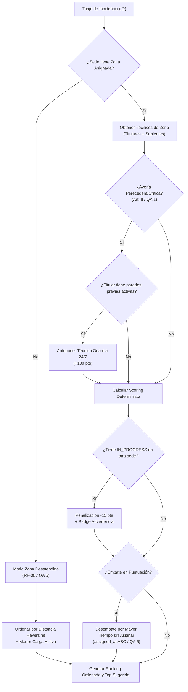
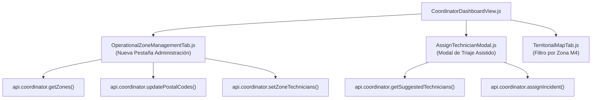

# PLAN TÉCNICO DE IMPLEMENTACIÓN · MÓDULO 17: ZONIFICACIÓN OPERATIVA Y ASIGNACIÓN ASISTIDA

**Proyecto:** Gestor de Incidencias de Vending (*VendGuard*)  
**Módulo:** `17-operational-zones`  
**Documento:** `specs/17-operational-zones/plan.md`  
**Referencia Funcional:** [`specs/17-operational-zones/spec.md`](spec.md) y [`specs/functional/operational_zones_spec.md`](../functional/operational_zones_spec.md) (`RF-01` a `RF-07`, `RNF-01` a `RNF-04`, Resoluciones QA 1 a 6)  
**Contratos Técnicos:** [`specs/technical/operational_zones_contracts.md`](../technical/operational_zones_contracts.md)  
**Normativa Suprema:** [`constitution.md`](../../constitution.md) (Artículos I al VII)  
**Directrices Operativas:** [`AGENTS.md`](../../AGENTS.md) (SDD, Dogma Vanilla, Dualismo Lingüístico)  
**Sistema de Diseño Visual:** [`docs/design.md`](../../docs/design.md) (Tokens Docker: Azul `#2560ff`, ámbar `#fef9c3`/`#854d0e`, rojo crítico `#dc2626`, radio `4px`/`8px`, canvas `#f9fafb`)  

---

## 1. Estructura de Módulos y Ficheros

El diseño arquitectónico respeta rigurosamente el **Dogma Vanilla** (**Artículo IV de la Constitución**):
* **Backend:** PHP 8.2+ OOP puro (`declare(strict_types=1);`), arquitectura limpia desacoplada (*Clean Architecture*), tipado estricto, persistencia única en PostgreSQL 16+ (Supabase / Motor Local de Certificación) mediante PDO nativo, sin ORMs ni dependencias de terceros.
* **Frontend:** Vue.js 3 estándar con módulos ES nativos (`public/assets/js/`), sin empaquetadores ni dependencias pesadas en tiempo de ejecución.

```text
gestor-incidencias-vending/
├── specs/
│   ├── functional/
│   │   └── operational_zones_spec.md               # Especificación funcional aprobada tras QA (espejo)
│   ├── technical/
│   │   └── operational_zones_contracts.md          # Contratos de esquema PostgreSQL y API REST
│   └── 17-operational-zones/
│       ├── spec.md                                 # Especificación funcional del módulo
│       ├── plan.md                                 # Este plan técnico de arquitectura e implementación
│       └── tasks.md                                # Desglose de tareas atómicas secuenciales (siguiente fase)
├── database/
│   ├── supabase_init.sql                           # Convergencia canónica DDL de operational_zones y cuadrantes
│   ├── supabase_seeds.sql                          # Semillas canónicas con zonas BCN Norte/Sur/Centro y cuadrantes
│   └── supabase_migrations/
│       └── 007_operational_zones.sql               # Migración incremental idempotente PostgreSQL
├── src/
│   ├── Core/
│   │   ├── Domain/
│   │   │   ├── Model/
│   │   │   │   └── OperationalZone.php             # Entidad inmutable de zona operativa (código, nombre, color, estado)
│   │   │   ├── ValueObject/
│   │   │   │   ├── ZoneAffinityType.php            # Enum: PRIMARY (titular), BACKUP (suplente), NONE (sin zona)
│   │   │   │   └── PostalCode.php                  # Value Object con validación y normalización estricta (^\d{5}$)
│   │   │   ├── Exception/
│   │   │   │   ├── ZoneNotFoundException.php       # HTTP 404 ZONE_NOT_FOUND
│   │   │   │   ├── ZoneValidationException.php     # HTTP 400 BAD_REQUEST / 422 UNPROCESSABLE_ENTITY
│   │   │   │   ├── PostalCodeConflictException.php # HTTP 409 POSTAL_CODES_REQUIRE_CONFIRMATION
│   │   │   │   ├── PrimaryTechnicianConflictException.php # HTTP 409 TECHNICIAN_ALREADY_PRIMARY_IN_OTHER_ZONE
│   │   │   │   └── ColdChainOverrideJustificationRequiredException.php # HTTP 422 COLD_CHAIN_OVERRIDE_JUSTIFICATION_REQUIRED (Art. V.1)
│   │   │   └── Repository/
│   │   │       └── OperationalZoneRepositoryInterface.php # Contrato de lectura/escritura de zonas, códigos postales y cuadrantes
│   │   └── Service/
│   │       └── TechnicianWorkloadScorer.php        # Política de dominio pura: cálculo determinista de idoneidad y penalizaciones
│   ├── Application/
│   │   ├── DTO/
│   │   │   ├── OperationalZoneDto.php              # Proyección de zona con contadores de sedes, técnicos y CPs
│   │   │   ├── SuggestedTechnicianDto.php          # DTO de resultado de sugerencia con scoring y badges explicativos
│   │   │   └── PostalCodeTransferResultDto.php     # Balance de migración atómica de códigos postales
│   │   └── Service/
│   │       ├── OperationalZoneService.php          # Caso de uso: gestión de zonas, CPs en bloque y asignación de técnicos
│   │       └── TechnicianAssignmentSuggester.php   # Caso de uso: evaluación de idoneidad, desempates y salvaguarda Art. II
│   ├── Infrastructure/
│   │   └── Repository/
│   │       ├── PdoOperationalZoneRepository.php    # Implementación PDO de OperationalZoneRepositoryInterface
│   │       └── PdoLocationRepository.php           # Ampliado para gestionar zone_id e is_manual_override en sedes
│   └── Presentation/
│       ├── Controller/
│       │   ├── CoordinatorZoneController.php       # Endpoints /api/coordinator/zones y submódulos (CPs, técnicos)
│       │   ├── CoordinatorController.php           # Ampliado con getSuggestedTechnicians y validación Art. V.1 en asignación
│       │   └── LocationPortalController.php        # Blindaje Art. V.4: sanitización de datos de zona ante la sede
│       └── Routing/
│           └── AppRouter.php                       # Registro de rutas de zonas y sugerencias
├── public/
│   └── assets/
│       └── js/
│           ├── api.js                              # Métodos de cliente HTTP para zonas, cuadrantes y sugerencias
│           ├── components/
│           │   ├── OperationalZoneManagementTab.js # Pestaña de administración territorial de zonas y códigos postales
│           │   ├── AssignTechnicianModal.js        # Modal interactivo de asignación asistida en 1 clic con badges y justificación
│           │   └── TerritorialMapTab.js            # Filtro reactivo por zona operativa en el mapa territorial (Módulo M4)
│           └── views/
│               └── CoordinatorDashboardView.js     # Integración de la pestaña territorial y el modal asistido
└── tests/
    ├── unit/
    │   ├── TechnicianWorkloadScorerTest.php        # Test unitario puro del algoritmo de puntuación
    │   ├── PostalCodeValidationTest.php            # Test unitario del Value Object PostalCode (formato ^\d{5}$)
    │   └── TechnicianAssignmentSuggesterTest.php   # Test unitario del caso de uso de recomendación y desempates
    ├── integration/
    │   ├── PostgresZoneSchemaTest.php              # Test de esquema contra PostgreSQL (tablas, índices únicos parciales)
    │   ├── CoordinatorZoneApiTest.php              # Integración HTTP de endpoints CRUD de zonas y migración de CPs
    │   ├── SuggestedTechniciansApiTest.php         # Integración HTTP del recomendador y cálculo de proximidad Haversine
    │   └── ColdChainOverrideJustificationTest.php  # Verificación constitucional de justificación obligatoria (Art. V.1 y Art. II)
    └── unit/
        └── OperationalZoneManagementTabTest.mjs    # Test unitario ESM de la interfaz frontend de zonas
```

---

## 2. Modelo de Datos JSON y Contratos de API REST

### 2.1. Endpoints de Administración de Zonas

#### `GET /api/coordinator/zones`
* **Rol:** `COORDINATOR`
* **Respuesta (`200 OK`):**
  ```json
  {
    "success": true,
    "data": {
      "zones": [
        {
          "id": 1,
          "code": "ZONA-BCN-NORTE",
          "name": "Barcelona Litoral y Norte",
          "color_hex": "#2560ff",
          "description": "Distritos de Sant Martí, Poblenou y área costera",
          "is_active": true,
          "locations_count": 14,
          "primary_technicians_count": 2,
          "backup_technicians_count": 1,
          "postal_codes_count": 5,
          "postal_codes": ["08005", "08018", "08019", "08020", "08030"],
          "created_at": "2026-10-20T08:00:00Z",
          "updated_at": "2026-10-20T08:00:00Z"
        }
      ],
      "unassigned_locations_count": 3
    }
  }
  ```

#### `POST /api/coordinator/zones`
* **Payload Entrada:**
  ```json
  {
    "code": "ZONA-BCN-SUR",
    "name": "Barcelona Sur y Sants",
    "color_hex": "#10b981",
    "description": "Distrito de Sants-Montjuïc y Les Corts"
  }
  ```
* **Respuesta (`201 Created`):** Objeto `zone` creado. Códigos de error: `400 BAD_REQUEST`, `409 ZONE_CODE_ALREADY_EXISTS`, `409 ZONE_NAME_ALREADY_EXISTS`.

#### `POST /api/coordinator/zones/{id}/postal-codes`
* **Payload Entrada:**
  ```json
  {
    "postal_codes": ["08001", "08002", "08003"],
    "confirm_transfers": true
  }
  ```
* **Respuesta Exitosa (`200 OK`):** Retorna `assigned_postal_codes`, `transferred_postal_codes` y `affected_locations_count`.
* **Conflicto Previo (`409 POSTAL_CODES_REQUIRE_CONFIRMATION`):** Si `confirm_transfers = false`, devuelve el array `conflicts` con la zona actual y sedes afectadas para solicitar confirmación en el modal.

#### `POST /api/coordinator/zones/{id}/technicians`
* **Payload Entrada:**
  ```json
  {
    "technician_id": 5,
    "is_primary": true,
    "confirm_primary_override": true
  }
  ```
* **Respuesta Exitosa (`200 OK`):** Detalle de la vinculación técnica.
* **Conflicto (`409 TECHNICIAN_ALREADY_PRIMARY_IN_OTHER_ZONE`):** Si el técnico ya es titular en otra zona y no se confirmó la sustitución.

#### `POST /api/coordinator/locations/{id}/override-zone`
* **Payload Entrada:**
  ```json
  {
    "zone_id": 2,
    "is_manual_override": true
  }
  ```
* **Respuesta Exitosa (`200 OK`):** Devuelve la sede actualizada indicando `resolution_mode: "MANUAL_OVERRIDE"` o `"INHERITED_BY_POSTAL_CODE"`.

---

### 2.2. Endpoints de Triaje Asistido y Asignación Constitucional

#### `GET /api/coordinator/incidents/{id}/suggested-technicians`
* **Rol:** `COORDINATOR`
* **Respuesta (`200 OK`):**
  ```json
  {
    "success": true,
    "data": {
      "incident": {
        "id": 1042,
        "ticket_code": "INC-20261020-0012",
        "priority": "CRITICAL",
        "is_cold_chain_risk": true,
        "location": {
          "id": 4,
          "site_code": "SEDE-BCN-01",
          "name": "Hospital del Mar",
          "postal_code": "08005",
          "zone_id": 1,
          "zone_name": "Barcelona Litoral y Norte"
        }
      },
      "recommendation": {
        "top_technician_id": 7,
        "is_cold_chain_escalation": true,
        "unattended_zone": false,
        "explanation": "🚨 Prioridad Sanitaria Art. II: Titular con paradas previas; técnico de guardia 24/7 antepuesto para asegurar SLA < 4h."
      },
      "ranked_technicians": [
        {
          "technician_id": 7,
          "name": "Marta Guardia",
          "operator_code": "OP-774",
          "is_on_call": true,
          "affinity_type": "PRIMARY",
          "zone_affinity_label": "Titular Zona Norte",
          "total_score": 140,
          "score_breakdown": {
            "territorial_affinity": 50,
            "onsite_presence": 0,
            "same_zone_stops": 0,
            "active_workload_penalty": -10,
            "inter_location_penalty": 0,
            "cold_chain_on_call_bonus": 100
          },
          "active_workload": {
            "active_tickets_count": 2,
            "pending_info_count": 0,
            "preventive_orders_count": 0
          },
          "current_status": {
            "has_in_progress_stop": false,
            "in_progress_location_name": null,
            "distance_km": 1.4
          },
          "is_top_suggestion": true,
          "badges": ["RECOMENDADO", "GUARDIA_24_7", "TITULAR_ZONA"]
        }
      ]
    }
  }
  ```

#### `POST /api/coordinator/incidents/{id}/assign` *(Extensión Art. V.1)*
* **Payload Entrada:**
  ```json
  {
    "technician_id": 5,
    "override_justification": "Técnico Jordi finaliza en 10 min en Torre Glòries y se desplaza de inmediato al Hospital del Mar (distancia 5 min)."
  }
  ```
* **Validación Constitucional:** Si `is_cold_chain_risk = true` y se descarta al técnico de guardia sugerido sin justificación de al menos 20 caracteres, responde `422 COLD_CHAIN_OVERRIDE_JUSTIFICATION_REQUIRED`.

---

## 3. Algoritmos Clave y Máquinas de Estado



### 3.1. Algoritmo 1: Motor de Scoring Determinista de Idoneidad (`TechnicianWorkloadScorer`)

```python
def compute_technician_score(technician, incident, location, active_stops):
    score = 0
    breakdown = {}
    
    # 1. Afinidad Territorial (RF-04.1.1)
    if technician.is_primary_for_zone(location.zone_id):
        s_territorial = 50
    elif technician.is_backup_for_zone(location.zone_id):
        s_territorial = 25
    else:
        s_territorial = 0
    score += s_territorial
    breakdown['territorial_affinity'] = s_territorial

    # 2. Presencia In Situ en la misma sede (RF-04.1.2)
    has_stop_at_site = any(s.location_id == location.id for s in active_stops[technician.id])
    s_in_situ = 40 if has_stop_at_site else 0
    score += s_in_situ
    breakdown['onsite_presence'] = s_in_situ

    # 3. Paradas en la misma zona (RF-04.1.2)
    has_stop_in_zone = any(s.zone_id == location.zone_id and s.location_id != location.id for s in active_stops[technician.id])
    s_zone = 20 if has_stop_in_zone else 0
    score += s_zone
    breakdown['same_zone_stops'] = s_zone

    # 4. Incompatibilidad entre sedes distintas (RF-04.1.3 / QA 2 / Art. V.3)
    has_in_progress_other_site = any(s.status == 'IN_PROGRESS' and s.location_id != location.id for s in active_stops[technician.id])
    s_inter_sede = -15 if has_in_progress_other_site else 0
    score += s_inter_sede
    breakdown['inter_location_penalty'] = s_inter_sede

    # 5. Carga de paradas vivas (RF-04.1.4 / QA 3)
    standard_active_stops = count_stops(technician.id, ['ASSIGNED', 'IN_PROGRESS', 'PENDING_PARTS', 'PREVENTIVE_TODAY'])
    pending_info_stops = count_stops(technician.id, ['PENDING_INFO'])
    s_carga = (standard_active_stops * -5) + (pending_info_stops * -2)
    score += s_carga
    breakdown['active_workload_penalty'] = s_carga

    # 6. Salvaguarda Sanitaria de Frío (RF-05.1 / QA 1 / Art. II)
    s_frio = 0
    if incident.is_perishable or incident.priority == 'CRITICAL':
        if technician.is_on_call and (standard_active_stops > 0 or has_in_progress_other_site):
            s_frio = 100
    score += s_frio
    breakdown['cold_chain_on_call_bonus'] = s_frio

    return score, breakdown
```

### 3.2. Algoritmo 2: Desempate Determinista y Fallback Haversine (`TechnicianAssignmentSuggester`)

```python
def rank_technicians(technicians, incident, location):
    # Paso 1: Puntuación base
    scored = []
    for tech in technicians:
        score, breakdown = compute_technician_score(tech, incident, location)
        scored.append({'tech': tech, 'score': score, 'breakdown': breakdown})
        
    # Paso 2: Ordenación multinivel (QA 5)
    # Criterio 1: Puntuación total (DESC)
    # Criterio 2: En caso de zona desatendida, proximidad Haversine (ASC)
    # Criterio 3: Desempate por mayor tiempo desde última asignación formal (assigned_at ASC)
    # Criterio 4: Estabilidad determinista por ID de técnico (ASC)
    def sort_key(item):
        t = item['tech']
        dist = calculate_haversine_reference_distance(t, location) # 999.0 si nulo
        last_assign = t.last_assigned_at or '1970-01-01T00:00:00Z'
        return (-item['score'], dist, last_assign, t.id)
        
    return sorted(scored, key=sort_key)
```

### 3.3. Algoritmo 3: Migración Transaccional Atómica de Códigos Postales (Art. III / QA 6)

```sql
-- Ejecutado dentro de una transacción PDO aislada
BEGIN;

-- 1. Identificar sedes afectadas que heredan los CPs a trasladar
CREATE TEMPORARY TABLE tmp_affected_locations AS
SELECT id, site_code, postal_code, zone_id AS prev_zone_id
FROM locations
WHERE postal_code = ANY(:postal_codes)
  AND is_manual_override = FALSE;

-- 2. Eliminar asignaciones previas de los CPs y vincularlos a la nueva zona
DELETE FROM operational_zone_postal_codes WHERE postal_code = ANY(:postal_codes);
INSERT INTO operational_zone_postal_codes (postal_code, zone_id)
SELECT unnest(:postal_codes), :new_zone_id;

-- 3. Actualizar zone_id en las sedes heredadas (preservando is_manual_override = true)
UPDATE locations
SET zone_id = :new_zone_id, updated_at = CURRENT_TIMESTAMP
WHERE id IN (SELECT id FROM tmp_affected_locations);

-- 4. Registrar evento matriz en audit_log (Art. III / QA 6)
INSERT INTO audit_log (entity_type, entity_id, action, user_id, payload)
VALUES ('OPERATIONAL_ZONE', :new_zone_id, 'ZONE_POSTAL_CODE_TRANSFERRED', :user_id, :matrix_payload_json);

-- 5. Registrar eventos granulares por cada sede afectada
INSERT INTO audit_log (entity_type, entity_id, action, user_id, payload)
SELECT 'LOCATION', id, 'LOCATION_ZONE_REASSIGNED', :user_id,
       json_build_object('prev_zone_id', prev_zone_id, 'new_zone_id', :new_zone_id, 'postal_code', postal_code)
FROM tmp_affected_locations;

COMMIT;
```

---

## 4. Arquitectura de Eventos y Componentes Frontend Vanilla

Siguiendo las directrices de `docs/design.md` (tokens Docker, color principal `#2560ff`, radio `4px`/`8px`, sin bordes píldora):



### 4.1. Componente: `AssignTechnicianModal.js`
* Se abre al pulsar *"Asignar"* en la bandeja de triaje.
* Realiza `GET /api/coordinator/incidents/{id}/suggested-technicians`.
* Si la avería es crítica o perecedera y se sugiere al técnico de guardia, muestra un banner sanitario rojo/ámbar:
  `🚨 Prioridad Sanitaria Art. II: Atención requerida en < 4 horas. Se sugiere técnico de guardia.`
* El primer elemento de la lista aparece destacado con un contenedor de borde azul (`#2560ff`) y botón principal directo:
  `[⚡ Asignar Sugerido (1 Clic)]`.
* Si el coordinador elige a otro técnico en una avería sanitaria, se despliega un campo obligatorio:
  `Justificación obligatoria de descarte sanitario (mínimo 20 caracteres)` con contador en vivo.

### 4.2. Componente: `OperationalZoneManagementTab.js`
* Integrado como pestaña en la vista de Coordinación junto a Sedes, Máquinas y Personal.
* Muestra tarjetas de zona con su color corporativo, badges con códigos postales asignados y lista de técnicos titulares/suplentes.
* Formulario modal para transferir códigos postales que, ante un conflicto `409`, muestra una ventana de confirmación detallando las sedes que cambiarán de zona.

---

## 5. Decisiones Técnicas Justificadas y Alternativas Descartadas

| Decisión Técnica Adoptada | Justificación y Ventaja | Alternativas Descartadas y Motivo |
| :--- | :--- | :--- |
| **1. Clave Primaria Natural en `operational_zone_postal_codes.postal_code`** | Impone la **Unicidad Territorial Estricta** (RF-01.2) a nivel de motor PostgreSQL. Un CP jamás puede duplicarse entre dos zonas por diseño físico de la base de datos. | *Clave subrogada `id` con índice UNIQUE:* innecesaria y propensa a inconsistencias si se usa `ON CONFLICT` descuidado. |
| **2. Índice Único Parcial para Titularidad Técnica (`WHERE is_primary = TRUE`)** | Permite que un técnico tenga múltiples suplencias (`is_primary = FALSE`), pero garantiza que solo tenga **máximo una titularidad principal** sin requerir bloqueos de aplicación complejos. | *Disparadores PL/pgSQL:* sobrecarga de mantenimiento; el índice parcial resuelve la restricción en Cero Bloatware. |
| **3. Proximidad Haversine sin Rastreo GPS en Vivo (Art. V.4)** | Respeta estrictamente la Constitución: no se rastrea la ubicación continua del trabajador. Se calcula la distancia euclidiana esférica respecto a su última parada física confirmada. | *Google Maps Distance Matrix / GPS en segundo plano:* viola el Art. V.4, añade costes de API externa y rompe el Dogma Vanilla. |
| **4. Justificación Obligatoria $\ge 20$ chars en Descarte Sanitario (Art. V.1)** | Protege la cadena de frío del Art. II. Si el coordinador decide no enviar al técnico de guardia, asume la responsabilidad dejando constancia auditable. | *Permitir descarte silencioso:* pondría en grave riesgo las máquinas perecederas y relajaría el blindaje constitucional. |
| **5. Auditoría Dual Atómica en Traslados Masivos (Art. III / QA 6)** | Permite consultar tanto la traza de la operación global de la zona como el historial cronológico individual en la ficha de cada sede. | *Auditar solo la zona:* dejaría a las sedes sin trazabilidad de cuándo ni por qué cambiaron de demarcación. |

---

## 6. Estrategia de Pruebas

### 6.1. Pruebas Unitarias de Dominio (PHPUnit / PHP Puro)
* **`TechnicianWorkloadScorerTest.php`:**
  * Valida la suma exacta de puntos: titularidad (+50), suplencia (+25), presencia in situ (+40), misma zona (+20), parada en otra sede (-15), carga viva (-5 por ticket/preventivo) y pausa `PENDING_INFO` (-2).
  * Valida el escalado prioritario de guardia (+100) en averías perecederas/críticas.
* **`PostalCodeValidationTest.php`:**
  * Valida que el Value Object `PostalCode` acepte únicamente `^\d{5}$` y rechace letras, longitudes distintas o espacios.
* **`TechnicianAssignmentSuggesterTest.php`:**
  * Valida la ordenación final, el comportamiento ante zonas desatendidas y los desempates deterministas por `assigned_at ASC`.

### 6.2. Pruebas de Integración HTTP y Base de Datos (PostgreSQL)
* **`PostgresZoneSchemaTest.php`:**
  * Aplica la migración `007_operational_zones.sql` y certifica la restricción de clave primaria en `postal_code` y el índice único parcial `uq_technician_primary_zone`.
* **`CoordinatorZoneApiTest.php`:**
  * CRUD completo de zonas, validación de nombres/códigos duplicados (`409`), y flujo de confirmación de traslado de códigos postales con sedes afectadas.
* **`SuggestedTechniciansApiTest.php`:**
  * Verifica el contrato JSON del endpoint `/suggested-technicians`, verificando que el tiempo de respuesta sea $< 100\text{ ms}$ (RNF-01).
* **`ColdChainOverrideJustificationTest.php`:**
  * Intenta asignar un técnico no sugerido en una avería perecedera con texto de 10 caracteres $\to$ rechazo `422`. Repite con texto de 22 caracteres $\to$ éxito `200` y persistencia en `audit_log`.

### 6.3. Pruebas Unitarias de Frontend (Node.js ESM)
* **`OperationalZoneManagementTabTest.mjs`:**
  * Renderizado reactivo de la pestaña de zonas, selector de color hexadecimal y visualización de badges de códigos postales.
* **`AssignTechnicianModalTest.mjs`:**
  * Interacción en $\le 2$ toques para asignar al técnico sugerido y despliegue condicional del textarea de justificación sanitaria.

---

## 7. Mapeo Estricto de Trazabilidad

| Requisito / QA Finding | Componente Técnico en Backend | Componente en Frontend / BD |
| :--- | :--- | :--- |
| **RF-01.1 / RF-01.2 / DoD-01 / DoD-02** | `CoordinatorZoneController`, `PdoOperationalZoneRepository` | Tabla `operational_zones`, `operational_zone_postal_codes` |
| **RF-01.3 / QA 4** | `OperationalZoneService::updatePostalCodes()` | Modal de confirmación en bloque de CPs en conflicto |
| **RF-02.1 / RF-02.2 / DoD-04** | `technician_zone_assignments`, Value Object `ZoneAffinityType` | Índice parcial `uq_technician_primary_zone` |
| **RF-03.1 / RF-03.2 / DoD-03** | `PdoLocationRepository::setManualOverride()` | Columna `locations.is_manual_override` |
| **RF-03.3 / QA 4** | Migración atómica en `OperationalZoneService` | Preservación de `incidents.assigned_technician_id` |
| **RF-04.1 / DoD-05** | `TechnicianWorkloadScorer` (+50/+25, +40/+20, -15, -5/-2) | Desglose visual en `AssignTechnicianModal.js` |
| **RF-04.2 / QA 5** | Ordenación multinivel por `assigned_at ASC` | Criterio determinista de desempate en sugerencias |
| **RF-05.1 / DoD-06 / QA 1** | Escalado $+100$ pts a `is_on_call` ante SLA < 4h | Badge destacado *"🚨 Prioridad Sanitaria Art. II"* |
| **RF-05.2 / QA 1 / Art. V.1** | Validación en `CoordinatorController::assignIncident()` | Campo obligatorio de justificación $\ge 20$ chars |
| **RF-06.1 / RF-06.2 / DoD-07 / QA 5** | Fallback Haversine en `GeoDistanceService` | Alerta *"⚠️ Sin técnicos disponibles en esta zona"* |
| **RF-07.1 / DoD-08 / Art. V.4** | Filtrado estricto en `LocationPortalController` | Anonimización `"Servicio Técnico Oficial · OP-XXX"` |
| **RNF-01** | Consultas CTE indexadas en `zone_id` y `postal_code` | Apertura de modal en $< 100\text{ ms}$ |
| **RNF-02** | Endpoint directo de asignación | Flujo de triaje en $\le 2$ clics |
| **RNF-03 / QA 6 / Art. III** | Transacción PDO con eventos matriz e hijos | Tabla inmutable `audit_log` (`ZONE_*`, `LOCATION_*`) |
| **RNF-04** | Transacciones atómicas con bloqueo de fila | Migración idempotente de códigos postales |

---

## 8. Garantía de Dogma Vanilla y Dualismo Lingüístico

* **Dogma Vanilla:**
  * Cero dependencias añadidas en `composer.json` y `package.json`.
  * Toda la matemática esférica y de scoring reside en clases puras de PHP y JavaScript ES Modules.
* **Dualismo Lingüístico (`AGENTS.md` §3):**
  * Nombres de clases, métodos, variables, tablas y rutas HTTP en **inglés técnico** (`OperationalZone`, `TechnicianWorkloadScorer`, `suggested-technicians`, `is_manual_override`).
  * Mensajes de interfaz, etiquetas al coordinador, comentarios de código y documentación en **castellano**.
