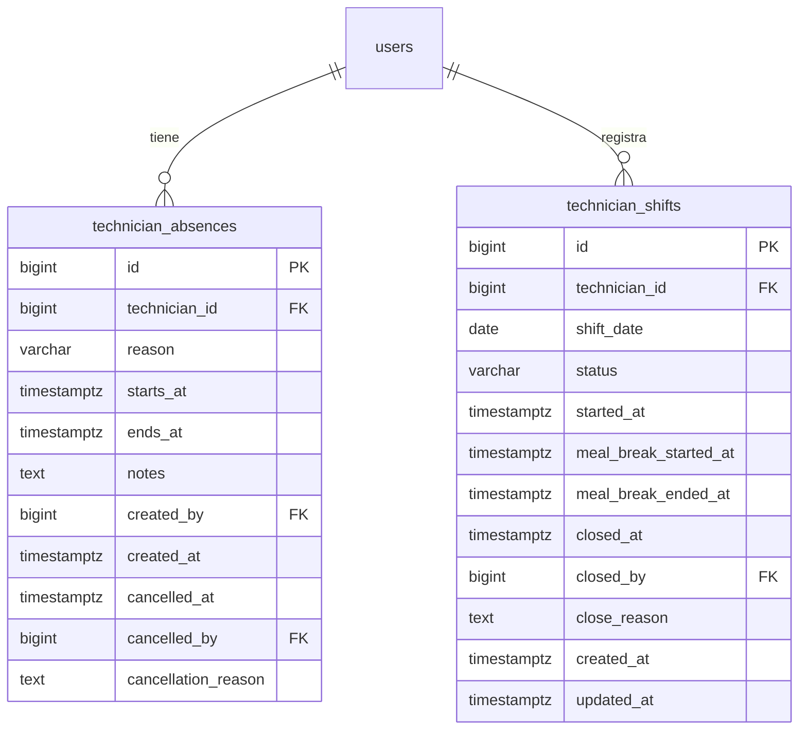

# ESPECIFICACIÓN FUNCIONAL: GESTIÓN DE AUSENCIAS TEMPORALES Y RELEVO DE FIN DE TURNO (SHIFT HANDOVER & ABSENCE COVERAGE)

**Proyecto:** Gestor de Incidencias de Vending (*VendGuard*)  
**Módulo:** 21 · Gestión de Ausencias Temporales y Relevo de Fin de Turno  
**Documento Canónico:** `specs/21-absence-shift-handover/spec.md`  
**Versión:** 2.0 · Incorpora las 10 resoluciones de la auditoría QA y blindaje constitucional (2026-10-23)  
**Estado:** Resoluciones R1–R10 **aprobadas por el Product Owner** · Puerta SDD Fase 1 superada  
**Fecha:** Octubre 2026  
**Origen:** Feature 10 del catálogo [`docs/features_pendientes.md`](../../docs/features_pendientes.md) (Bloque 2)  
**Alineación Constitucional:** Art. I (supremacía de la especificación SDD), Art. II (salvaguarda sanitaria innegociable de frío y protocolo fail-safe), Art. III.1 y III.3 (inviolabilidad de datos y auditoría inmutable), Art. IV.1–IV.3 (Dogma Vanilla: PHP 8.2+ puro, Vue 3 sin bundlers, cero librerías externas), Art. V.3 (técnico único responsable), Art. V.4 (segregación estricta y privacidad de notas internas frente a sede), Art. VI.1–VI.2 (delimitación del MVP y canalización de ideas al backlog).

---

## 1. Autorización Formal del Alcance (Art. VI.1 y Art. I)

La presente especificación formaliza la implementación de la **Feature 10 del Catálogo de Pendientes**, ubicada en el Bloque 2 de calidad operativa y logística. Conforme a la Constitución de VendGuard y el Dogma SDD, no se creará ni modificará ninguna línea de código de producción (`src/`) hasta la validación y firma formal de este documento.

### 1.1. Requisito Original del Catálogo (`docs/features_pendientes.md` §10)

> * **Propósito:** Permitir gestionar vacaciones, bajas médicas, permisos o fin de turno de los técnicos sin tener que desactivar su cuenta (`is_active = false`), logrando que el recomendador territorial (Módulo 17) promueva automáticamente al técnico `BACKUP` de la zona y facilitando el traspaso ordenado de la cola pendiente al cerrar la jornada.
> * **Componentes Técnicos:**
>   * Tabla `technician_absences` (`id`, `technician_id`, `reason` [`VACATION`, `SICK_LEAVE`, `TRAINING`, `OFF_SHIFT`], `starts_at`, `ends_at`, `notes`, `created_by`, `created_at`).
>   * Integración en `TechnicianAssignmentSuggester`: excluir o marcar como *"No disponible (Ausencia activa)"* a los técnicos con ventana vigente en `technician_absences`, elevando automáticamente al suplente (`BACKUP`) de la zona operativa al puesto `#1` del ranking sin requerir edición manual de los cuadrantes.
>   * Acción **"Cerrar Turno / Relevo de Ruta"** en Coordinación y vista móvil: permite reasignar en bloque o individualmente las averías en estado `ASSIGNED` (aún no iniciadas) al técnico de guardia o suplente de zona, exigiendo una nota interna de contexto (`is_internal = TRUE`, oculta a la sede según Art. V.4).
> * **Valor para el Cliente:** Evita que queden tickets asignados a técnicos que ya han finalizado su jornada o están de baja y automatiza las suplencias territoriales.
> * **Complejidad:** Baja-Media (1.5–2 días).

### 1.2. Resoluciones Vinculantes del Product Owner (Consenso 2026-10-23)

Durante la sesión de definición y la auditoría exhaustiva de QA, el Product Owner dictaminó las siguientes decisiones normativas:

1. **Gestión Exclusiva de Ausencias por Coordinación (D1):** El alta, edición y cancelación de ausencias se realiza exclusivamente desde el panel web de Coordinación.
2. **Cierre de Turno y Traspaso desde el Móvil (D2):** El técnico dispone de la acción "Cerrar Turno / Traspasar" en su vista móvil.
3. **Cierre sin Relevo con Retención (D3):** Si no hay relevo disponible, las averías ordinarias permanecen retenidas para el día siguiente y el técnico entra en `OFF_SHIFT`.
4. **Guardia contra Intervenciones en Curso (D4):** Bloqueo fail-fast estricto de cierre de turno si existe algún ticket en `IN_PROGRESS` (debe resolverse o pausarse previamente).
5. **Inicio de Turno y Pausa de Comida (D5):** Control manual de jornada con botones "Iniciar Turno", "Pausa para Comer" y "Reanudar Turno".
6. **Segregación del Control Horario (D6):** La analítica de horas trabajadas se segrega a la **Feature 20** en `docs/features_pendientes.md`.
7. **Reasignación Asistida al Cargar Ausencia (D7):** El alta de una ausencia ofrece reasignar los tickets afectados usando el recomendador del Módulo 17.
8. **Transparencia en el Recomendador (D8):** Los técnicos no disponibles van al final con badge `NO_DISPONIBLE` y motivo explícito.
9. **Cierre Forzado por Coordinación (D9):** Acción administrativa en panel web con justificación obligatoria y auditoría.
10. **Resoluciones de Auditoría QA (R1 a R10):** Detalladas en la sección 12 de este documento.

---

## 2. Alcance del Módulo

### 2.1. Dentro del Alcance (In-Scope)

1. **Gestión de Ausencias (Coordinación):**
   * CRUD completo de ausencias de técnicos (`technician_absences`).
   * Tipos de motivo: `VACATION`, `SICK_LEAVE`, `TRAINING`, `PERSONAL_LEAVE`, `COMPENSATORY`, `OTHER`.
   * Granularidad `TIMESTAMPTZ` con soporte de días completos por defecto (00:00 a 23:59) y selector horario opcional (R5).
   * Detección de solapamiento de fechas y cancelación lógica auditada con `cancelled_at` y motivo (Art. III.1).
   * Asistente en modal para ofrecer reasignación de averías activas asignadas al técnico ausente.
2. **Ciclo de Turno del Técnico (Móvil y Backend):**
   * Estados de jornada: `OFF_SHIFT` (Fuera de turno), `ON_SHIFT` (En turno / Disponible), `MEAL_BREAK` (Pausa de comida).
   * Tabla `technician_shifts` con índice único parcial `UNIQUE (technician_id) WHERE closed_at IS NULL` para soportar turno partido y múltiples sesiones diarias (R3).
   * Botones en `TechnicianRouteView.js` para iniciar jornada, pausar/reanudar comida y cerrar turno.
   * Permisión de cierre directo desde `MEAL_BREAK` sin obligar a reanudar previamente (R10).
3. **Relevo de Fin de Turno (Shift Handover):**
   * Traspaso atómico de averías en estados `ASSIGNED`, `PENDING_PARTS` y `PENDING_INFO` (R2).
   * Obligatoriedad de nota interna (`is_internal = TRUE`, Art. V.4) en cada ticket traspasado.
   * Notificación automática en `notification_outbox` al Telegram del técnico receptor con enlace profundo (R8).
   * Concurrencia atómica con cerrojo `SELECT ... FOR UPDATE` y `409 CONFLICT` si algún ticket cambió durante la redacción (R9).
   * Bloqueo estricto (*fail-fast*) si existe algún ticket en estado `IN_PROGRESS` (D4).
4. **Protocolo Sanitario Art. II en Cierre de Turno (R1):**
   * En caso de averías `FOOD_PERISHABLE` sin relevo manual seleccionado:
     * **Nivel 1:** Traspaso automático al técnico de guardia 24/7 (`is_on_call = TRUE`) con nota interna y alerta Telegram.
     * **Nivel 2:** Si no hay guardia, desasignación a `REGISTERED` y alarma crítica a Coordinación. El técnico saliente nunca queda secuestrado por la app.
5. **Guardia 24/7 Pasiva (R6):**
   * El técnico con `is_on_call = TRUE` puede cerrar su turno comercial ordinario (`OFF_SHIFT`) manteniendo su condición de guardia para emergencias de frío.
6. **Exclusión de Preventivos (R7):**
   * Las órdenes preventivas (`preventive_orders`) permanecen retenidas en el técnico titular y no entran en el relevo.
7. **Recomendador Territorial Asistido (`TechnicianAssignmentSuggester`):**
   * Clasificación de disponibilidad: ausentes y fuera de turno se ordenan al final con badge `NO_DISPONIBLE` y motivo.
   * Promoción automática del suplente de zona (`BACKUP`) a `RECOMENDADO ⭐` cuando el titular está no disponible.
   * Precedencia de presencia física: si el técnico pulsa "Iniciar Turno", pasa a disponible aunque tenga una ausencia planificada, auditando el aviso (R4).

### 2.2. Fuera del Alcance (Exclusiones Explícitas / Anti-Feature Creep)

* **Cálculo y analítica de horas trabajadas:** Reservado para la **Feature 20** de `docs/features_pendientes.md`.
* **Autogestión de ausencias desde el móvil:** El técnico no solicita ni aprueba vacaciones/bajas desde su teléfono.
* **Geofencing / Fichaje por GPS:** Sin validación de coordenadas físicas para abrir o cerrar turno.
* **Traspaso de averías `IN_PROGRESS`:** No se permite transferir intervenciones a medias sin resolución o pausa formal.
* **Reasignaciones desatendidas no sanitarias:** Ningún ticket ordinario se reasigna sin la confirmación del coordinador o del técnico.

---

## 3. Usuarios y Roles Implicados

| Rol | Interacción con el Módulo | Restricciones y Reglas Constitucionales |
| :--- | :--- | :--- |
| **📊 Coordinador de Operaciones** | Registra y cancela ausencias de técnicos. Supervisa el estado de turno de la flota. Reasigna averías de ausentes de forma asistida. Fuerza el cierre de turno ante olvidos. | Control total del despacho. Sus acciones de cierre forzado quedan auditadas en `audit_log` (Art. III.3). |
| **📱 Técnico de Campo** | Inicia su turno, gestiona pausas de comida y cierra su jornada relevando averías `ASSIGNED`, `PENDING_PARTS` y `PENDING_INFO` a su compañero con nota interna, o reteniéndolas si no hay relevo. | No autogestiona ausencias. No puede cerrar turno con tickets en `IN_PROGRESS` (Art. V.1). |
| **🏢 Responsable de Sede** | Ninguna interacción directa. | **Aislamiento total:** Notas de traspaso y motivos de ausencia son estrictamente confidenciales e invisibles para la sede (Art. V.4). |

---

## 4. Historias de Usuario

### HU-01: Gestión de ausencias desde Coordinación
> **Como** Coordinador de Operaciones,  
> **quiero** registrar las vacaciones o bajas médicas de un técnico indicando fechas y motivo,  
> **para** que el recomendador territorial promueva automáticamente al suplente de zona.

### HU-02: Reasignación asistida ante ausencia
> **Como** Coordinador de Operaciones,  
> **quiero** que al guardar una ausencia me muestre los tickets pendientes del técnico y me sugiera a quién reasignárselos,  
> **para** evitar cuellos de botella y proteger los SLAs de los clientes.

### HU-03: Control de jornada en ruta móvil
> **Como** Técnico de Campo,  
> **quiero** pulsar un botón para iniciar mi turno al salir a la calle y pausarlo al parar a comer,  
> **para** que Coordinación y el sistema sepan si estoy disponible para emergencias.

### HU-04: Cierre de jornada con relevo y aviso por Telegram
> **Como** Técnico de Campo,  
> **quiero** cerrar mi turno traspasando mis averías pendientes a mi relevo con una nota explicativa,  
> **para** que mi compañero reciba un aviso inmediato en su Telegram y yo pueda marcharme con la jornada cerrada.

### HU-05: Cierre sin relevo y protocolo sanitario de frío
> **Como** Técnico de Campo,  
> **quiero** cerrar mi turno aunque no haya compañeros disponibles, sabiendo que mis averías ordinarias me esperan mañana y que cualquier aviso de frío se deriva automáticamente a la guardia sanitaria,  
> **para** finalizar mi jornada sin vulnerar la salud pública (Art. II).

### HU-06: Cierre administrativo forzado
> **Como** Coordinador de Operaciones,  
> **quiero** forzar el cierre de turno de un técnico que olvidó cerrarlo al marcharse,  
> **para** que el recomendador nocturno no lo considere disponible.

---

## 5. Requisitos Funcionales con Criterios de Aceptación (EARS)

### RF-01 · Gestión de Ausencias de Técnicos (`technician_absences`)

* **RF-01.1 (Alta de Ausencia):** `POST /api/coordinator/technicians/{id}/absences` crea un registro con:
  * `reason`: Enum tipificado (`VACATION`, `SICK_LEAVE`, `TRAINING`, `PERSONAL_LEAVE`, `COMPENSATORY`, `OTHER`).
  * `starts_at` y `ends_at`: Marcas `TIMESTAMPTZ` válidas en formato ISO 8601. Si no se indican horas, por defecto abarcan desde las `00:00:00` del día inicial hasta las `23:59:59` del día final en hora local (R5).
  * `notes`: Texto explicativo opcional ($\le 500$ caracteres).
* **RF-01.2 (Validaciones):**
  * `ends_at >= starts_at`. Error: `422 UNPROCESSABLE_ENTITY` con `INVALID_DATE_RANGE`.
  * Técnico existente, rol `TECHNICIAN`, `deleted_at IS NULL`. Error: `404 NOT_FOUND`.
  * Detección de solapamiento con ausencias activas no canceladas del mismo técnico: `409 CONFLICT` con `ABSENCE_OVERLAP`.
* **RF-01.3 (Cancelación Lógica):** `DELETE /api/coordinator/absences/{id}` registra `cancelled_at = CURRENT_TIMESTAMP`, `cancelled_by = :auth_user_id` y `cancellation_reason` obligatoria ($\ge 5$ caracteres). Prohibido el borrado físico (Art. III.1).
* **RF-01.4 (Listado y Filtros):** `GET /api/coordinator/technicians/absences` con filtros por `technician_id`, rango de fechas y estado (`active`, `future`, `cancelled`, `all`).

### RF-02 · Asistente de Reasignación en Alta de Ausencia

* **RF-02.1:** Si la ausencia comprende la fecha actual o futura inmediata y el técnico tiene averías activas (`ASSIGNED`, `PENDING_PARTS`, `PENDING_INFO`), el endpoint responde `201 CREATED` incluyendo `affected_incidents` con la propuesta de técnico sugerido por `TechnicianAssignmentSuggester`.
* **RF-02.2:** La reasignación queda a criterio del coordinador, quien puede confirmar los traspasos desde el modal asistido en el panel de Coordinación.

### RF-03 · Ciclo de Turno Móvil del Técnico (`technician_shifts`)

* **RF-03.1 (Estado Inicial):** Un técnico sin turno abierto se encuentra operativamente en `OFF_SHIFT`.
* **RF-03.2 (Inicio de Turno):** `POST /api/technician/shift/start` abre una sesión en `ON_SHIFT` con `started_at = CURRENT_TIMESTAMP`.
  * Si ya tiene un turno abierto en `ON_SHIFT`: Responde `200 OK` idempotente.
  * Si tiene una ausencia activa planificada: Se permite abrir turno (la presencia física manda, R4), pasando a `ON_SHIFT` y emitiendo una traza `ABSENCE_OVERRIDE_BY_SHIFT_START` en `audit_log`.
* **RF-03.3 (Pausa de Comida):** `POST /api/technician/shift/pause-meal` transiciona de `ON_SHIFT` a `MEAL_BREAK`, marcando `meal_break_started_at = CURRENT_TIMESTAMP`. Precondición: debe estar en `ON_SHIFT`.
* **RF-03.4 (Reanudación de Turno):** `POST /api/technician/shift/resume` transiciona de `MEAL_BREAK` a `ON_SHIFT`, marcando `meal_break_ended_at = CURRENT_TIMESTAMP`. Precondición: debe estar en `MEAL_BREAK`.
* **RF-03.5 (Cierre Directo desde Pausa):** Se permite ejecutar el cierre de turno (`close-handover`) directamente desde `MEAL_BREAK` sin obligar a reanudar previamente (R10).

### RF-04 · Guardia contra Intervenciones en Curso (`IN_PROGRESS`)

* **RF-04.1 (Bloqueo Absoluto):** Ante cualquier intento de cierre de turno (técnico o forzado por coordinador), el sistema verifica si el técnico tiene alguna avería en estado `IN_PROGRESS`.
* **RF-04.2 (Rechazo Fail-Fast):** Si existe al menos un ticket en `IN_PROGRESS`, la petición se rechaza con `422 UNPROCESSABLE_ENTITY`, código `HAS_IN_PROGRESS_INCIDENTS` y la lista de tickets bloqueantes. Mensaje: *"No es posible cerrar turno con averías en curso. Debe resolver la intervención o pausarla por repuesto (PENDING_PARTS) o falta de acceso (PENDING_INFO)"*.

### RF-05 · Relevo de Fin de Turno (Shift Handover)

* **RF-05.1 (Estados Elegibles):** El técnico puede traspasar averías en estados `ASSIGNED`, `PENDING_PARTS` y `PENDING_INFO` (R2). Las órdenes preventivas quedan excluidas y se retienen (R7).
* **RF-05.2 (Validaciones):**
  * `target_technician_id`: Técnico activo (`is_active = TRUE`), rol `TECHNICIAN`, distinto del emisor.
  * `handover_notes`: Obligatoria si se traspasan averías ($\ge 10$ caracteres).
* **RF-05.3 (Concurrencia Atómica y Bloqueo):**
  * La transacción bloquea los tickets con `SELECT ... FOR UPDATE`.
  * Si algún ticket ya no pertenece al técnico o cambió de estado concurrentemente: se realiza `ROLLBACK` y se responde `409 CONFLICT` con `CONCURRENT_ROUTE_MODIFICATION` para obligar a refrescar la pantalla (R9).
* **RF-05.4 (Efectos del Traspaso):**
  1. Reasignación atómica de los tickets seleccionados a `target_technician_id`.
  2. Inserción de nota interna (`is_internal = TRUE`, Art. V.4) en cada ticket con el texto del traspaso.
  3. Cierre del turno del técnico saliente a `OFF_SHIFT` con `closed_at = CURRENT_TIMESTAMP`.
  4. Encolado de notificación prioritaria en `notification_outbox` hacia el Telegram del técnico receptor con deep linking (R8).

### RF-06 · Cierre sin Relevo y Protocolo Sanitario de Frío (Art. II)

* **RF-06.1 (Cierre sin Relevo Comercial):** Cuando no se selecciona técnico de relevo:
  * Las averías comerciales ordinarias permanecen retenidas en el técnico saliente (`ASSIGNED`, `PENDING_PARTS`, `PENDING_INFO`) para la siguiente jornada.
  * El turno se cierra a `OFF_SHIFT`.
* **RF-06.2 (Protocolo Sanitario Fail-Safe para Perecederos, R1):**
  * Si el técnico saliente tiene alguna avería sobre máquina de alimentos perecederos (`FOOD_PERISHABLE` / riesgo de frío):
    * **Nivel 1 (Traspaso a Guardia 24/7):** Si existe un técnico con `is_on_call = TRUE`, la avería perecedera se le traspasa automáticamente con nota interna del sistema y alerta urgente a su Telegram.
    * **Nivel 2 (Alarma Roja a Coordinación):** Si no hay ningún técnico de guardia en el sistema, la avería se desasigna a `REGISTERED` y se emite un aviso crítico al canal de emergencias de Coordinación: *"🚨 ALERTA ART. II: Máquina de perecederos desatendida por fin de turno sin guardia disponible"*.
    * El técnico saliente puede cerrar su turno viendo en pantalla la confirmación del traspaso a guardia o derivación a emergencias.

### RF-07 · Cierre Forzado por Coordinación

* **RF-07.1:** `POST /api/coordinator/technicians/{id}/shifts/force-close` permite a un coordinador forzar el cierre de turno con `reason` obligatorio ($\ge 10$ caracteres).
* **RF-07.2:** Comprueba la precondición de que no haya averías en `IN_PROGRESS` (RF-04) y aplica el protocolo sanitario (RF-06.2) si existen averías perecederas.
* **RF-07.3:** Registra el evento `FORCE_CLOSE_SHIFT` en `audit_log` vinculando al coordinador y al técnico (Art. III.3).

### RF-08 · Integración con el Recomendador (`TechnicianAssignmentSuggester`)

* **RF-08.1 (Evaluación de Disponibilidad):** Un técnico es `is_available = true` si su turno actual es `ON_SHIFT` (o si pulsa inicio de turno durante una ausencia, R4). Si está en `OFF_SHIFT`, `MEAL_BREAK` o en ausencia activa sin turno iniciado, es `is_available = false`.
* **RF-08.2 (Ordenación Canónica):** En `usort`, los candidatos `is_available = false` se relegan obligatoriamente al final del listado, tras todos los candidatos disponibles.
* **RF-08.3 (Insignias de Indisponibilidad):** Los técnicos no disponibles conservan sus datos de carga pero reciben el badge `NO_DISPONIBLE` con etiqueta explícita (*"Baja médica"*, *"Vacaciones"*, *"Fuera de turno"*, *"Pausa comida"*).
* **RF-08.4 (Promoción del Suplente):** Si el titular de la zona (`PRIMARY`) no está disponible, el recomendador promueve automáticamente al suplente (`BACKUP`) al puesto `#1` coronándolo con la insignia `RECOMENDADO ⭐` y explicando el motivo en `explanation`.
* **RF-08.5 (Persistencia de la Guardia):** El técnico de guardia (`is_on_call = TRUE`) conserva su capacidad de ser sugerido para emergencias sanitarias de frío aunque se encuentre en `OFF_SHIFT` (R6).

---

## 6. Requisitos No Funcionales (RNF)

* **RNF-01 (Rendimiento en Despacho):** La consulta de disponibilidad y ausencias en `PdoTechnicianSuggestionRepository` se ejecuta en un único viaje SQL indexado sin incurrir en N+1, manteniendo el tiempo de respuesta total $\le 100\text{ ms}$.
* **RNF-02 (Atomicidad Transaccional):** Toda reasignación de fin de turno con notas internas y cambio de turno opera bajo transacción PDO (`BEGIN ... COMMIT`). Si falla un solo elemento, se ejecuta `ROLLBACK` total.
* **RNF-03 (Segregación Art. V.4):** Las notas de traspaso nacen con `is_internal = TRUE` y son filtradas en origen para que jamás sean expuestas en el Portal de Sede ni en reportes QR.
* **RNF-04 (Dogma Vanilla):** PHP 8.2+ POO estricto (`declare(strict_types=1);`), PDO nativo y Vue 3 Options API modular estándar sin transpiladores ni bundlers en runtime.

---

## 7. Modelo de Datos y Esquema de Persistencia (PostgreSQL)

El módulo añade **dos nuevas tablas** normalizadas al esquema relacional de VendGuard (Tablas 29 y 30 del DDL canónico).



### 7.1. Tabla 29 · `technician_absences`

```sql
CREATE TABLE IF NOT EXISTS technician_absences (
    id                    BIGINT GENERATED ALWAYS AS IDENTITY,
    technician_id         BIGINT NOT NULL,
    reason                VARCHAR(30) NOT NULL,
    starts_at             TIMESTAMPTZ NOT NULL,
    ends_at               TIMESTAMPTZ NOT NULL,
    notes                 TEXT,
    created_by            BIGINT NOT NULL,
    created_at            TIMESTAMPTZ NOT NULL DEFAULT CURRENT_TIMESTAMP,
    cancelled_at          TIMESTAMPTZ,
    cancelled_by          BIGINT,
    cancellation_reason   TEXT,

    CONSTRAINT pk_technician_absences PRIMARY KEY (id),
    CONSTRAINT fk_tech_absences_user FOREIGN KEY (technician_id) REFERENCES users(id),
    CONSTRAINT fk_tech_absences_creator FOREIGN KEY (created_by) REFERENCES users(id),
    CONSTRAINT fk_tech_absences_canceller FOREIGN KEY (cancelled_by) REFERENCES users(id),
    CONSTRAINT chk_tech_absences_dates CHECK (ends_at >= starts_at),
    CONSTRAINT chk_tech_absences_reason CHECK (
        reason IN ('VACATION', 'SICK_LEAVE', 'TRAINING', 'PERSONAL_LEAVE', 'COMPENSATORY', 'OTHER')
    )
);

CREATE INDEX IF NOT EXISTS idx_tech_absences_lookup 
    ON technician_absences (technician_id, starts_at, ends_at)
    WHERE cancelled_at IS NULL;
```

### 7.2. Tabla 30 · `technician_shifts`

```sql
CREATE TABLE IF NOT EXISTS technician_shifts (
    id                    BIGINT GENERATED ALWAYS AS IDENTITY,
    technician_id         BIGINT NOT NULL,
    shift_date            DATE NOT NULL DEFAULT CURRENT_DATE,
    status                VARCHAR(20) NOT NULL DEFAULT 'ON_SHIFT',
    started_at            TIMESTAMPTZ NOT NULL DEFAULT CURRENT_TIMESTAMP,
    meal_break_started_at TIMESTAMPTZ,
    meal_break_ended_at   TIMESTAMPTZ,
    closed_at             TIMESTAMPTZ,
    closed_by             BIGINT,
    close_reason          TEXT,
    created_at            TIMESTAMPTZ NOT NULL DEFAULT CURRENT_TIMESTAMP,
    updated_at            TIMESTAMPTZ NOT NULL DEFAULT CURRENT_TIMESTAMP,

    CONSTRAINT pk_technician_shifts PRIMARY KEY (id),
    CONSTRAINT fk_tech_shifts_user FOREIGN KEY (technician_id) REFERENCES users(id),
    CONSTRAINT fk_tech_shifts_closer FOREIGN KEY (closed_by) REFERENCES users(id),
    CONSTRAINT chk_tech_shifts_status CHECK (
        status IN ('ON_SHIFT', 'MEAL_BREAK', 'OFF_SHIFT')
    )
);

-- Soporte canónico de turno partido y múltiples sesiones diarias (Resolución R3):
-- Un técnico solo puede tener un único turno abierto simultáneo en todo el sistema.
CREATE UNIQUE INDEX IF NOT EXISTS uq_tech_shifts_single_active 
    ON technician_shifts (technician_id)
    WHERE closed_at IS NULL;

CREATE INDEX IF NOT EXISTS idx_tech_shifts_lookup 
    ON technician_shifts (technician_id, shift_date);

CREATE OR REPLACE TRIGGER trg_touch_technician_shifts
    BEFORE UPDATE ON technician_shifts
    FOR EACH ROW EXECUTE FUNCTION touch_updated_at();
```

---

## 8. Contratos de Interfaz (API REST)

### 8.1. Endpoints de Coordinación

* `GET /api/coordinator/technicians/absences`: Listado de ausencias con filtrado por fecha, técnico y estado.
* `POST /api/coordinator/technicians/{id}/absences`: Alta de ausencia con detección de solapamiento (`409`) y retorno de `affected_incidents` con técnico sugerido.
* `DELETE /api/coordinator/absences/{id}`: Cancelación lógica de ausencia (`cancelled_at = NOW()`) con motivo obligatorio ($\ge 5$ chars).
* `POST /api/coordinator/technicians/{id}/shifts/force-close`: Cierre forzado administrativo con motivo obligatorio ($\ge 10$ chars), validación fail-fast de `IN_PROGRESS` y protocolo sanitario Art. II.

### 8.2. Endpoints del Técnico Móvil

* `GET /api/technician/shift/status`: Estado de turno actual (`OFF_SHIFT`, `ON_SHIFT`, `MEAL_BREAK`), marcas temporales y conteo de averías activas.
* `POST /api/technician/shift/start`: Inicio de jornada (idempotente; admite override con auditoría si hay ausencia activa, R4).
* `POST /api/technician/shift/pause-meal`: Pasa de `ON_SHIFT` a `MEAL_BREAK`.
* `POST /api/technician/shift/resume`: Reanuda de `MEAL_BREAK` a `ON_SHIFT`.
* `POST /api/technician/shift/close-handover`: Cierre de turno y traspaso opcional de averías (`ASSIGNED`, `PENDING_PARTS`, `PENDING_INFO`). Admite cierre directo desde comida (R10), dispara notificación de Telegram al receptor (R8) y aplica protocolo sanitario para perecederos si no hay relevo (R1).

---

## 9. Interfaz de Usuario (Diseño UI/UX)

* **Móvil (`TechnicianRouteView.js`):**
  * Widget superior de turno: punto pulsante 🟢 `En Turno`, 🟡 `Pausa Comida` o ⚫ `Fuera de Turno`. Botones rápidos correspondientes.
  * Modal táctil de cierre de turno:
    * Si hay averías `IN_PROGRESS`: Alerta roja bloqueante.
    * Si hay averías transferibles: Selector de compañero relevo o casilla *"Cerrar sin relevo (retener para mañana)"*.
    * Si hay averías perecederas y no se selecciona relevo: Banner azul informativo indicando que el ticket se transfiere a la guardia sanitaria (Art. II).
* **Panel de Coordinación (`CoordinatorDashboardView.js`):**
  * Pestaña Equipo: Indicador en tiempo real del estado de turno de cada técnico y botón contextual `[Forzar Cierre de Turno]`.
  * Sub-pestaña de Ausencias: Calendario y tabla con botón `[+ Registrar Ausencia]`. Al crear, modal con lista de tickets afectados y recomendación asistida en dos toques.
  * Modal de Triaje / Asignación (`SuggestedTechniciansModal`): Los técnicos no disponibles se agrupan al final con opacidad atenuada y chip explicativo (`Baja médica`, `Vacaciones`, `Fuera de turno`, `Pausa comida`).

---

## 10. Batería de Pruebas y Criterios de Aceptación

Para certificar el Módulo 21, se implementarán y superarán las siguientes suites de pruebas:

1. **Pruebas Unitarias de Dominio:**
   * `TechnicianAbsenceTest`: Rango de fechas, motivos y cancelaciones lógicas.
   * `TechnicianShiftLifecycleTest`: Transiciones de turno (`OFF_SHIFT` <-> `ON_SHIFT` <-> `MEAL_BREAK`), soporte de turno partido y bloqueo por `IN_PROGRESS`.
   * `TechnicianAssignmentSuggesterAbsenceTest`: Relegación de ausentes y fuera de turno al final con badges explicativos; promoción del `BACKUP` de zona a recomendado; persistencia del técnico de guardia en `OFF_SHIFT`.
2. **Pruebas de Integración HTTP y Base de Datos:**
   * `CoordinatorAbsenceApiTest`: CRUD de ausencias, detección de solapamiento (`409`), cancelación auditada y sugerencias de reasignación.
   * `TechnicianShiftApiTest`: Flujo completo de turno móvil, pausa de comida y cierre con traspaso atómico de averías (`ASSIGNED`, `PENDING_PARTS`, `PENDING_INFO`).
   * `ShiftHandoverSanitaryTest`: Protocolo fail-safe Art. II (traspaso a guardia de frío o desasignación a `REGISTERED` con alerta).
   * `ShiftHandoverConcurrencyTest`: Verificación de `409 CONFLICT` ante colisiones concurrentes en el traspaso.
   * `CoordinatorForceCloseShiftTest`: Cierre administrativo forzado y auditoría en `audit_log`.
3. **Pruebas Constitucionales y de Regresión:**
   * Verificación de que las notas de traspaso nacen con `is_internal = TRUE` y son inaccesibles desde `LocationPortalController` (Art. V.4).
   * Verificación de cero sentencias `DELETE` en la base de datos (Art. III.1).
   * Ejecución limpia y en verde de la batería global (`php tests/run_all.php`).

---

## 11. Resoluciones Normativas de la Revisión QA (R1–R10)

| # | Pregunta de QA | Resolución Vinculante del Product Owner |
| :--- | :--- | :--- |
| **R1** | Conflicto Art. II al cerrar turno sin relevo con averías perecederas | **Protocolo Sanitario en 2 Niveles:** Nivel 1 traspasa automáticamente al técnico de guardia 24/7 (`is_on_call = TRUE`) con alerta Telegram. Nivel 2 desasigna a `REGISTERED` y lanza alarma roja a Coordinación. El operario nunca queda bloqueado en el móvil. |
| **R2** | Estados transferibles en el relevo | Se permite traspasar averías en **`ASSIGNED`, `PENDING_PARTS` y `PENDING_INFO`** con nota interna explicativa. Solo `IN_PROGRESS` bloquea el cierre. |
| **R3** | Soporte de turno partido y múltiples sesiones diarias | Se sustituye la unicidad por fecha por un **índice único parcial: `UNIQUE (technician_id) WHERE closed_at IS NULL`**. |
| **R4** | Precedencia de presencia física sobre ausencia planificada | **La presencia física manda (Opción A):** Si el técnico pulsa "Iniciar Turno", el turno se abre (`ON_SHIFT`), pasa a disponible en el recomendador y se emite traza informativa en `audit_log`. |
| **R5** | Granularidad temporal de las ausencias | **Backend en `TIMESTAMPTZ` exacto; frontend con días completos por defecto (00:00:00 a 23:59:59)** y selector de horario opcional para permisos cortos. |
| **R6** | El técnico de guardia 24/7 cierra turno | **La guardia es un rol continuo pasivo (Opción A):** El técnico puede cerrar su turno comercial ordinario (`OFF_SHIFT`) manteniendo su condición de guardia activa para emergencias de frío. |
| **R7** | Órdenes preventivas en el relevo | **Excluidas del relevo (Opción A):** Las preventivas permanecen retenidas en el técnico titular y no se transfieren en el cierre de turno. |
| **R8** | Notificación al técnico receptor en el traspaso | **Aviso por Telegram obligatorio:** Se encola notificación prioritaria en `notification_outbox` con enlace profundo a la ruta (Módulo 15). |
| **R9** | Concurrencia en traspaso masivo de averías | **Atomicidad estricta:** Cerrojo `SELECT ... FOR UPDATE` y respuesta **`409 CONFLICT`** si algún ticket cambió mientras el técnico redactaba el traspaso. |
| **R10** | Cierre directo desde pausa de comida | **Permitido:** Se puede ejecutar `close-handover` directamente desde `MEAL_BREAK` sin obligar a reanudar previamente a `ON_SHIFT`. |

---

## 12. Criterios de Cierre del Módulo

1. Las suites de prueba de §10 ejecutadas y al 100% en verde en `php tests/run_all.php`.
2. Las tablas 29 y 30 incorporadas a la migración `012_technician_absences_and_shifts.sql` y sincronizadas en `database/supabase_init.sql` con paridad certificada.
3. Catálogo de acciones de `audit_log` actualizado con los nuevos eventos sin acciones fantasma.
4. Documentación de cifras auditada y sincronizada.
5. `docs/features_pendientes.md` actualiza la Feature 10 como implementada.
