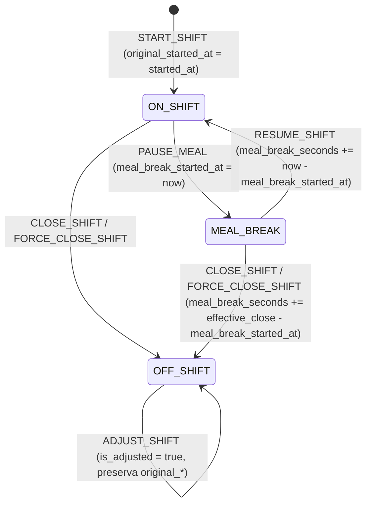

# PLAN DE IMPLEMENTACIÓN TÉCNICA: REGISTRO DE JORNADA Y CÓMPUTO DE HORAS EFECTIVAS

**Proyecto:** Gestor de Incidencias de Vending (*VendGuard*)  
**Módulo:** 22 · Registro de Jornada y Cómputo de Horas Efectivas (*Technician Time Tracking & Work Hours*)  
**Documento Canónico:** `specs/22-technician-time-tracking/plan.md`  
**Especificación Funcional:** [`spec.md`](spec.md) (v2.0, 2026-10-25) y espejo [`../functional/technician_time_tracking_spec.md`](../functional/technician_time_tracking_spec.md)  
**Contratos Técnicos:** [`../technical/technician_time_tracking_contracts.md`](../technical/technician_time_tracking_contracts.md)  
**Fecha:** Octubre 2026  
**Alineación Constitucional:** Art. I.1 (SDD estricto), Art. II (prioridad sanitaria innegociable e inmutabilidad de marcas de frío), Art. III.1 y III.3 (prohibición de borrado físico, bitácora append-only y preservación de marcas originales), Art. IV.1–IV.3 (Dogma Vanilla: PHP 8.2+ OOP nativo, Vue 3 sin bundlers, cero librerías externas), Art. V.1 (justificación obligatoria $\ge 20$ caracteres reales), Art. V.4 (segregación estricta de datos laborales frente a sedes y entre técnicos), Art. VI.1 (alcance autorizado).

---

## 1. Estructura de Módulos y Ficheros a Crear y Modificar

### 1.1. Base de Datos PostgreSQL 16+ / Supabase (`database/` y `specs/technical/`)

| Fichero | Acción | Responsabilidad |
| :--- | :--- | :--- |
| `database/supabase_migrations/015_technician_time_tracking.sql` | **Crear** | Migración incremental idempotente: añade columnas de cómputo y trazabilidad original a la Tabla 30 `technician_shifts` (`meal_break_seconds`, `original_started_at`, `original_closed_at`, `original_meal_break_seconds`, `is_force_closed`, `is_adjusted`, `adjusted_at`, `adjusted_by`, `adjustment_reason`), añade las restricciones `chk_tech_shifts_meal_seconds` y `chk_tech_shifts_adjustment_consistency`, y crea la Tabla 31 `technician_shift_logs` con disparadores `trg_no_delete_technician_shift_logs` (`prevent_hard_delete()`) y `trg_no_update_technician_shift_logs` (`prevent_service_sheet_update()`). |
| `database/supabase_init.sql` | **Modificar** | Convergencia canónica del DDL completo incorporando las nuevas columnas de `technician_shifts` y la Tabla 31 `technician_shift_logs`. |
| `database/supabase_seeds.sql` | **Modificar** | Semillas realistas de sesiones de jornada cerradas, pausas múltiples, un turno ajustado por Coordinación con su bitácora en `technician_shift_logs` y trazabilidad en `audit_log`. |
| `specs/technical/schema_correspondence_contract.md` | **Modificar** | Registro de la Tabla 31 (`technician_shift_logs`) y las nuevas columnas y restricciones de `technician_shifts`. |
| `tests/Support/TestDataCleaner.php` | **Modificar** | Inclusión de `technician_shift_logs` antes de `technician_shifts` en el orden de limpieza de pruebas de integración. |

### 1.2. Backend PHP 8.2+ (`declare(strict_types=1);` · Clean Architecture)

| Capa | Fichero | Acción | Responsabilidad |
| :--- | :--- | :--- | :--- |
| **Core / Domain** | `src/Core/Domain/ValueObject/ShiftEventType.php` | **Crear** | Enum tipificado de eventos de bitácora (`START_SHIFT`, `PAUSE_MEAL`, `RESUME_SHIFT`, `CLOSE_SHIFT`, `FORCE_CLOSE_SHIFT`, `ADJUST_SHIFT`) con etiquetas en castellano. |
| **Core / Domain** | `src/Core/Domain/Model/TechnicianShift.php` | **Modificar** | Extensión inmutable con `mealBreakSeconds`, `originalStartedAt`, `originalClosedAt`, `originalMealBreakSeconds`, `isForceClosed`, `isAdjusted`, `adjustedAt`, `adjustedBy`, `adjustmentReason`; acumulación de pausas en `resume()`, descuento automático en `close()` desde `MEAL_BREAK`, método `adjust()` con validación cuádruple y métodos de cálculo al segundo (`grossDurationSeconds()`, `totalMealBreakSeconds()`, `effectiveWorkSeconds()`, `isAnomalousDuration()`). |
| **Core / Domain** | `src/Core/Domain/Model/TechnicianShiftLog.php` | **Crear** | Entidad inmutable que representa una entrada en la bitácora `technician_shift_logs`. |
| **Core / Domain** | `src/Core/Domain/Exception/ShiftAdjustmentValidationException.php` | **Crear** | Excepciones de dominio con código de error semántico y estado HTTP (`422` / `409`) para rectificaciones y cierres forzados con `effective_closed_at`. |
| **Core / Domain** | `src/Core/Domain/Repository/TechnicianShiftRepositoryInterface.php` | **Modificar** | Nuevos métodos `findById()`, `saveAdjustment()`, `findOverlappingShiftId()`, `findShiftsByDateRange()` y `findOrphanOpenShiftsBefore()`, más parámetros de cierre forzado y hora efectiva en `closeShift()`. |
| **Core / Domain** | `src/Core/Domain/Repository/TechnicianShiftLogRepositoryInterface.php` | **Crear** | Puerto de persistencia para registrar (`record()`) y consultar (`findByShiftId()`) eventos inmutables de turno. |
| **Infrastructure** | `src/Infrastructure/Repository/PdoTechnicianShiftRepository.php` | **Modificar** | Persistencia PDO de las nuevas columnas de `technician_shifts`, detección de solapamiento temporal (`tstzrange` / comparación semiabierta `[started_at, closed_at)`), filtrado por rango de `shift_date` y consulta de turnos abiertos huérfanos. |
| **Infrastructure** | `src/Infrastructure/Repository/PdoTechnicianShiftLogRepository.php` | **Crear** | Implementación PDO para `technician_shift_logs` con serialización `JSONB` de `previous_state` y `new_state`. |
| **Application** | `src/Application/DTO/TechnicianShiftDto.php` | **Modificar** | Proyección enriquecida con métricas en segundos y formateadas (`HHh MMm`), flags `is_anomalous`, `is_force_closed`, `is_adjusted`, marcas originales `original_*` y resumen diario opcional (`today_summary`). |
| **Application** | `src/Application/DTO/WorkHoursReportDto.php` | **Crear** | Proyección inmutable del informe de jornada para Coordinación (totales del periodo, lista de turnos abiertos huérfanos, desglose por técnico y listado de sesiones). |
| **Application** | `src/Application/Service/ShiftLifecycleService.php` | **Modificar** | Registro automático de eventos `START_SHIFT`, `PAUSE_MEAL` y `RESUME_SHIFT` en `TechnicianShiftLogRepositoryInterface`, acumulación de `meal_break_seconds` al reanudar y cálculo del bloque `today_summary` en `getCurrentShift()`. |
| **Application** | `src/Application/Service/ShiftHandoverService.php` | **Modificar** | Soporte de `effective_closed_at` opcional en `forceCloseShift()` (con exigencia de $\ge 20$ caracteres reales, validación contra actividad previa y pausas, y blindaje del reloj real `NOW()` para el protocolo sanitario del Art. II) y registro de `CLOSE_SHIFT` / `FORCE_CLOSE_SHIFT` en `technician_shift_logs`. |
| **Application** | `src/Application/Service/TechnicianWorkHoursService.php` | **Crear** | Motor de cálculo de horas efectivas, cruce con Tiempo en Intervención In Situ (averías resueltas + órdenes preventivas completadas sin `linked_incident_id`), Tiempo en Ruta (`max(0, effective - intervention)`), rectificación transaccional `adjustShift()` con cerrojo `FOR UPDATE`, consulta de bitácora por turno, resumen mensual propio del técnico (`getTechnicianOwnMonthlyHours()`) y exportación CSV con UTF-8 BOM y separador `;`. |
| **Presentation** | `src/Presentation/Controller/CoordinatorShiftController.php` | **Modificar** | Extensión de `forceClose()` con `effective_closed_at` y nuevos métodos `workHoursReport()`, `exportWorkHoursCsv()`, `adjustShift()` y `shiftLogs()`. |
| **Presentation** | `src/Presentation/Controller/TechnicianShiftController.php` | **Modificar** | Nuevo método `myHours()` (`GET /api/technician/shift/my-hours`) aislado estrictamente al `user_id` del token autenticado (Art. V.4). |
| **Presentation** | `src/Presentation/Routing/AppRouter.php` | **Modificar** | Registro de las rutas REST bajo `InternalAuthMiddleware(['COORDINATOR', 'ADMIN'])` e `InternalAuthMiddleware(['TECHNICIAN'])`. |

### 1.3. Frontend Vanilla ES Modules (`public/assets/js/`)

| Fichero | Acción | Responsabilidad |
| :--- | :--- | :--- |
| `public/assets/js/api.js` | **Modificar** | Nuevos métodos en `api.coordinatorShifts` (`getWorkHoursReport`, `getWorkHoursCsvUrl`, `adjustShift`, `getShiftLogs`, y soporte de `effective_closed_at` en `forceClose`) y en `api.technicianShift` (`getMyHours`). |
| `public/assets/js/components/CoordinatorWorkHoursTab.js` | **Crear** | Componente de la sub-pestaña «⏱️ Registro de Jornada y Horas»: tarjetas KPI del periodo, alerta de turnos abiertos huérfanos de fechas anteriores, tabla resumen por técnico, tabla de sesiones con insignias (`⚠️ > 12h`, `Cierre forzado`, `Ajustado por Coordinación`), botón de exportación CSV y modales de ajuste horario (`>= 20` chars), cierre forzado con `effective_closed_at` y visor de bitácora de la sesión. |
| `public/assets/js/views/CoordinatorMetricsView.js` | **Modificar** | Incorporación de la 4.ª sub-pestaña `work-hours` («⏱️ Registro de Jornada y Horas») sincronizada con el selector de periodo temporal global (`selectedPeriod`, `customFrom`, `customTo`). |
| `public/assets/js/views/TechnicianRouteView.js` | **Modificar** | Visualización del tiempo efectivo acumulado hoy y pausa de comida en la barra superior de turno (`today_summary`) y botón «⏱️ Mis Horas» que despliega el modal de solo lectura con las sesiones del mes en curso, sus insignias y las marcas originales si hubo ajuste de Coordinación. |
| `public/assets/js/utils/AuditActionLabels.js` | **Modificar** | Traducción en castellano de la acción `ADJUST_TECHNICIAN_SHIFT` para el visor de auditoría. |

---

## 2. Modelo de Datos JSON y Contratos de API REST

### 2.1. Matriz de Endpoints y Códigos HTTP

| Método y Ruta | Rol Autorizado | Propósito | Códigos HTTP |
| :--- | :--- | :--- | :--- |
| `GET /api/coordinator/metrics/work-hours` | `COORDINATOR`, `ADMIN` | Informe de jornada, cruce con intervenciones, turnos huérfanos y sesiones del periodo. | `200`, `401`, `403`, `422` |
| `GET /api/coordinator/metrics/work-hours/export` | `COORDINATOR`, `ADMIN` | Descarga de archivo CSV con UTF-8 BOM, separador `;` y dos secciones en hora local `Europe/Madrid`. | `200`, `401`, `403`, `422` |
| `PATCH /api/coordinator/shifts/{id}/adjust` | `COORDINATOR`, `ADMIN` | Rectificación auditada de `started_at`, `closed_at` y `meal_break_seconds` en turno cerrado con motivo $\ge 20$ caracteres reales. | `200`, `400`, `401`, `403`, `404`, `409`, `422` |
| `GET /api/coordinator/shifts/{id}/logs` | `COORDINATOR`, `ADMIN` | Historial cronológico inmutable de eventos y ajustes de una sesión de turno. | `200`, `400`, `401`, `403`, `404` |
| `POST /api/coordinator/technicians/{id}/shifts/force-close` | `COORDINATOR`, `ADMIN` | Cierre forzado de turno abierto con soporte opcional de `effective_closed_at` y blindaje sanitario Art. II. | `200`, `400`, `401`, `403`, `404`, `409`, `422` |
| `GET /api/technician/shift/status` | `TECHNICIAN` | Estado de turno actual + bloque aditivo `today_summary` con tiempo efectivo acumulado hoy. | `200`, `401`, `403` |
| `GET /api/technician/shift/my-hours` | `TECHNICIAN` | Resumen y sesiones propias del mes actual en modo solo lectura (aislado por `user_id` del token, Art. V.4). | `200`, `401`, `403` |

### 2.2. Payloads de Entrada y Salida Clave

#### A. `PATCH /api/coordinator/shifts/{id}/adjust`
* **Entrada:**
```json
{
  "started_at": "2026-10-24T08:00:00+02:00",
  "closed_at": "2026-10-24T17:00:00+02:00",
  "meal_break_seconds": 3600,
  "reason": "El técnico olvidó fichar la salida al terminar su ruta a las 17:00 y avisó al coordinador."
}
```
* **Salida `200 OK`:**
```json
{
  "status": "success",
  "message": "Turno rectificado y auditado correctamente.",
  "data": {
    "shift": {
      "id": 12,
      "technician_id": 2,
      "shift_date": "2026-10-24",
      "status": "OFF_SHIFT",
      "started_at": "2026-10-24T08:00:00+02:00",
      "closed_at": "2026-10-24T17:00:00+02:00",
      "meal_break_seconds": 3600,
      "gross_seconds": 32400,
      "gross_formatted": "09h 00m",
      "meal_break_formatted": "01h 00m",
      "effective_seconds": 28800,
      "effective_formatted": "08h 00m",
      "is_anomalous": false,
      "is_force_closed": true,
      "is_adjusted": true,
      "original_started_at": "2026-10-24T08:00:00+02:00",
      "original_closed_at": "2026-10-25T09:00:00+01:00",
      "original_meal_break_seconds": 3600,
      "adjusted_at": "2026-10-25T09:05:00+01:00",
      "adjusted_by": 1,
      "adjustment_reason": "El técnico olvidó fichar la salida al terminar su ruta a las 17:00 y avisó al coordinador."
    }
  }
}
```

#### B. `GET /api/technician/shift/my-hours`
* **Salida `200 OK`:**
```json
{
  "status": "success",
  "data": {
    "month_label": "Octubre 2026",
    "from_date": "2026-10-01",
    "to_date": "2026-10-25",
    "summary": {
      "sessions_count": 10,
      "gross_seconds": 288000,
      "gross_formatted": "80h 00m",
      "meal_break_seconds": 36000,
      "meal_break_formatted": "10h 00m",
      "effective_seconds": 252000,
      "effective_formatted": "70h 00m"
    },
    "sessions": [
      {
        "id": 12,
        "shift_date": "2026-10-24",
        "status": "OFF_SHIFT",
        "status_label": "Cerrado",
        "is_open": false,
        "started_at": "2026-10-24T08:00:00+02:00",
        "closed_at": "2026-10-24T17:00:00+02:00",
        "gross_seconds": 32400,
        "gross_formatted": "09h 00m",
        "meal_break_seconds": 3600,
        "meal_break_formatted": "01h 00m",
        "effective_seconds": 28800,
        "effective_formatted": "08h 00m",
        "is_force_closed": true,
        "is_adjusted": true,
        "original_started_at": "2026-10-24T08:00:00+02:00",
        "original_closed_at": "2026-10-25T09:00:00+01:00",
        "original_meal_break_seconds": 3600,
        "close_reason": "Cierre forzado matutino.",
        "adjustment_reason": "El técnico olvidó fichar la salida al terminar su ruta a las 17:00 y avisó al coordinador."
      }
    ]
  }
}
```

---

## 3. Algoritmos Clave en Pseudocódigo y Máquinas de Estado

### 3.1. Máquina de Estados del Turno y Eventos de Bitácora (`RF-01`, `RF-02`, `RF-03`)



### 3.2. Algoritmo 1: Acumulación de Múltiples Pausas y Descuento en Cierre Directo desde Comida (`RF-01.2`, `RF-01.3`)

```text
FUNCIÓN resumeShift(shift, resumedAt):
    SI shift.status != 'MEAL_BREAK' ENTONCES
        LANZAR InvalidShiftTransitionException::notPaused()
    FIN SI
    pauseDelta = MAX(0, resumedAt.timestamp - shift.mealBreakStartedAt.timestamp)
    newMealBreakSeconds = shift.mealBreakSeconds + pauseDelta
    RETORNAR copiaInmutable(shift, {
        status: 'ON_SHIFT',
        mealBreakEndedAt: resumedAt,
        mealBreakSeconds: newMealBreakSeconds,
        updatedAt: resumedAt
    })

FUNCIÓN closeShift(shift, closedBy, reason, effectiveClosedAt, isForceClosed, executionNow):
    SI shift.status == 'OFF_SHIFT' O shift.closedAt != NULL ENTONCES
        LANZAR InvalidShiftTransitionException::alreadyClosed()
    FIN SI
    targetCloseTime = effectiveClosedAt ?? executionNow
    newMealBreakSeconds = shift.mealBreakSeconds

    // RF-01.3: Si se cierra directamente desde MEAL_BREAK, el tramo final es pausa, no trabajo
    SI shift.status == 'MEAL_BREAK' Y shift.mealBreakStartedAt != NULL ENTONCES
        finalBreakDelta = MAX(0, targetCloseTime.timestamp - shift.mealBreakStartedAt.timestamp)
        newMealBreakSeconds = newMealBreakSeconds + finalBreakDelta
    FIN SI

    hasRetroactiveClose = (effectiveClosedAt != NULL Y effectiveClosedAt.timestamp != executionNow.timestamp)
    RETORNAR copiaInmutable(shift, {
        status: 'OFF_SHIFT',
        closedAt: targetCloseTime,
        closedBy: closedBy,
        closeReason: reason,
        mealBreakSeconds: newMealBreakSeconds,
        originalClosedAt: shift.originalClosedAt ?? executionNow,
        originalMealBreakSeconds: shift.originalMealBreakSeconds ?? newMealBreakSeconds,
        isForceClosed: isForceClosed,
        isAdjusted: shift.isAdjusted O hasRetroactiveClose,
        adjustedAt: hasRetroactiveClose ? executionNow : shift.adjustedAt,
        adjustedBy: hasRetroactiveClose ? closedBy : shift.adjustedBy,
        adjustmentReason: hasRetroactiveClose ? reason : shift.adjustmentReason,
        updatedAt: executionNow
    })
```

### 3.3. Algoritmo 2: Cierre Forzado con `effective_closed_at` y Blindaje del Artículo II (`RF-02.1` a `RF-02.3`, Resolución QA 2)

```text
FUNCIÓN forceCloseShift(technicianId, coordinatorId, reason, effectiveClosedAtRaw = NULL):
    now = new DateTimeImmutable('now') // Reloj real innegociable para el protocolo sanitario Art. II
    trimmedReason = TRIM(reason)

    SI effectiveClosedAtRaw == NULL O trimmedReason == '' ENTONCES
        SI LONGITUD_MB(trimmedReason) < 10 ENTONCES
            LANZAR JustificationTooShortException(10)
        FIN SI
        effectiveClosedAt = NULL
    SINO
        // Resolución QA 2: Si altera la hora de salida, exige >= 20 caracteres reales (Art. V.1)
        SI LONGITUD_MB(trimmedReason) < 20 ENTONCES
            LANZAR JustificationTooShortException(20)
        FIN SI
        effectiveClosedAt = parseTimestamp(effectiveClosedAtRaw)
    FIN SI

    INICIAR TRANSACCIÓN PDO:
        lockTechnicianRow(technicianId) // SELECT id FROM users WHERE id = :id FOR UPDATE
        activeShift = shiftRepo.findActiveShiftByTechnician(technicianId)
        SI activeShift == NULL ENTONCES
            LANZAR InvalidShiftTransitionException::noOpenShiftToForceClose()
        FIN SI

        // Guardia de intervenciones en curso (M21 RF-04)
        SI incidentRepo.countInProgressByTechnician(technicianId) > 0 ENTONCES
            LANZAR ActiveIncidentInProgressException(...)
        FIN SI

        SI effectiveClosedAt != NULL ENTONCES
            validarEffectiveClosedAt(activeShift, effectiveClosedAt, now)
            conflictId = shiftRepo.findOverlappingShiftId(technicianId, activeShift.startedAt, effectiveClosedAt, activeShift.id)
            SI conflictId != NULL ENTONCES
                LANZAR ShiftAdjustmentValidationException::overlappingShift(conflictId)
            FIN SI
        FIN SI

        // BLINDAJE ART. II (Resolución QA 2): Las averías perecederas se traspasan a guardia 24/7
        // o se desasignan con alarma crítica usando SIEMPRE `now` (instante real), jamás `effectiveClosedAt`.
        ejecutarProtocoloSanitarioFrioEnTiempoReal(technicianId, coordinatorId, now)

        closedShift = shiftRepo.closeShift(
            activeShift.id,
            coordinatorId,
            trimmedReason,
            effectiveClosedAt ?? now,
            isForceClosed: TRUE,
            executionTime: now
        )
        shiftLogRepo.record(closedShift.id, technicianId, 'FORCE_CLOSE_SHIFT', coordinatorId, effectiveClosedAt ?? now, activeShift.toArray(), closedShift.toArray(), trimmedReason)
        auditLogRepo.record('USER', technicianId, 'FORCE_CLOSE_TECHNICIAN_SHIFT', ...)
    COMMIT TRANSACCIÓN
    RETORNAR resultado
```

### 3.4. Algoritmo 3: Rectificación Transaccional bajo Validación Cuádruple (`RF-03`, Resolución QA 3)

```text
FUNCIÓN adjustShift(shiftId, newStartedAt, newClosedAt, newMealBreakSeconds, coordinatorId, reason):
    now = new DateTimeImmutable('now')
    trimmedReason = TRIM(reason)
    SI LONGITUD_MB(trimmedReason) < 20 ENTONCES
        LANZAR ShiftAdjustmentValidationException::reasonTooShort() // 422 INVALID_ADJUSTMENT_REASON
    FIN SI

    INICIAR TRANSACCIÓN PDO:
        shift = shiftRepo.findById(shiftId)
        SI shift == NULL ENTONCES LANZAR ShiftNotFoundException(shiftId) FIN SI

        lockTechnicianRow(shift.technicianId)
        shift = shiftRepo.findById(shiftId) // Relectura bajo cerrojo
        SI shift.isOpen() ENTONCES
            LANZAR ShiftAdjustmentValidationException::shiftStillOpen() // 422 SHIFT_STILL_OPEN
        FIN SI

        // Regla 1: Coherencia temporal y prohibición de fechas futuras
        SI newStartedAt > now O newClosedAt > now ENTONCES
            LANZAR ShiftAdjustmentValidationException::futureTimestampNotAllowed()
        FIN SI
        SI newClosedAt <= newStartedAt ENTONCES
            LANZAR ShiftAdjustmentValidationException::invalidCloseOrder()
        FIN SI

        grossSeconds = newClosedAt.timestamp - newStartedAt.timestamp

        // Regla 2: Pausa >= 0 y <= duración bruta (permite 0s efectivos para anular errores, QA 3)
        SI newMealBreakSeconds < 0 O newMealBreakSeconds > grossSeconds ENTONCES
            LANZAR ShiftAdjustmentValidationException::invalidMealBreakDuration()
        FIN SI

        // Regla 3: Tope máximo de 24 horas brutas por sesión
        SI grossSeconds > 86400 ENTONCES
            LANZAR ShiftAdjustmentValidationException::exceedsMaxShiftDuration()
        FIN SI

        // Regla 4: Prohibición de solapamiento con otros turnos del mismo técnico
        conflictId = shiftRepo.findOverlappingShiftId(shift.technicianId, newStartedAt, newClosedAt, shift.id)
        SI conflictId != NULL ENTONCES
            LANZAR ShiftAdjustmentValidationException::overlappingShift(conflictId) // 409 SHIFT_OVERLAP_CONFLICT
        FIN SI

        // Recálculo de shift_date en Europe/Madrid y preservación inmutable de original_*
        newShiftDate = newStartedAt.setTimezone('Europe/Madrid').format('Y-m-d')
        adjustedShift = shift.adjust(newStartedAt, newClosedAt, newMealBreakSeconds, coordinatorId, trimmedReason, now, newShiftDate)

        savedShift = shiftRepo.saveAdjustment(adjustedShift)
        shiftLogRepo.record(savedShift.id, savedShift.technicianId, 'ADJUST_SHIFT', coordinatorId, now, shift.toArray(), savedShift.toArray(), trimmedReason)
        auditLogRepo.record('USER', savedShift.technicianId, 'ADJUST_TECHNICIAN_SHIFT', coordinatorId, shift.toArray(), savedShift.toArray(), { reason: trimmedReason, shift_id: savedShift.id })
    COMMIT TRANSACCIÓN
    RETORNAR savedShift
```

### 3.5. Algoritmo 4: Motor de Cómputo de Presencia vs. Intervención In Situ vs. Ruta (`RF-04`, Resolución QA 1 y QA 4)

```text
FUNCIÓN buildWorkHoursReport(filter, technicianId = NULL):
    now = new DateTimeImmutable('now')
    fromDate = filter.fromDate // YYYY-MM-DD en Europe/Madrid
    toDate = filter.toDate     // YYYY-MM-DD en Europe/Madrid

    shifts = shiftRepo.findShiftsByDateRange(fromDate, toDate, technicianId)
    orphanOpenShifts = shiftRepo.findOrphanOpenShiftsBefore(fromDate, technicianId)
    interventionsByTech = fetchClosedInterventionMetricsByTech(fromDate, toDate, technicianId)
    allTechnicians = userRepo.findAllTechniciansIncludingInactive()

    PARA CADA tech EN allTechnicians:
        techShifts = filtrar(shifts, s => s.technicianId == tech.id)
        techInterv = interventionsByTech[tech.id] ?? { seconds: 0, count: 0 }

        // C5 / RF-05.2: Incluir todos los activos + los inactivos con actividad en el periodo
        SI !tech.isActive Y COUNT(techShifts) == 0 Y techInterv.count == 0 ENTONCES
            CONTINUAR
        FIN SI

        grossSec = SUMA(techShifts, s => s.grossDurationSeconds(now))
        mealSec = SUMA(techShifts, s => s.totalMealBreakSeconds(now))
        effectiveSec = SUMA(techShifts, s => s.effectiveWorkSeconds(now))
        intervSec = techInterv.seconds
        routeSec = MAX(0, effectiveSec - intervSec)
        hasOutOfShift = (intervSec > effectiveSec) O (techInterv.count > 0 Y COUNT(techShifts) == 0)

        AGREGAR fila a byTechnician
    FIN PARA

    RETORNAR WorkHoursReportDto(summary, orphanOpenShifts, byTechnician, sessions)
```

---

## 4. Arquitectura de Eventos y Componentes Frontend Vanilla

### 4.1. Integración en el Panel de Coordinación (`CoordinatorMetricsView.js` + `CoordinatorWorkHoursTab.js`)
* **`CoordinatorMetricsView.js`:**
  * Añade el botón de sub-pestaña `data-testid="subtab-work-hours"` (**«⏱️ Registro de Jornada y Horas»**) junto a *Cuadro de Mandos (KPIs)*, *Desglose Multidimensional* y *Registro de Auditoría*.
  * Pasa como props reactivas al componente `CoordinatorWorkHoursTab` el filtro temporal activo (`selectedPeriod`, `customFrom`, `customTo`).
* **`CoordinatorWorkHoursTab.js`:**
  * Observa cambios en `selectedPeriod`, `customFrom`, `customTo` y en su selector local `selectedTechnicianId` para recargar `api.coordinatorShifts.getWorkHoursReport(...)`.
  * **Banner de Turnos Abiertos Huérfanos (`RF-04.2` / QA 4):** Si `orphan_open_shifts.length > 0`, muestra una alerta ámbar/roja superior con acceso en un clic al modal **«🛑 Forzar Cierre»** de cada sesión olvidada.
  * **Tabla Resumen por Técnico (`RF-05.2`):** Muestra Sesiones, Horas Brutas, Pausa Comida, Horas Efectivas Netas, Tiempo en Intervención, Tiempo en Ruta, Intervenciones Resueltas, contador de turnos `⚠️ > 12h` e insignia `⚠️ Intervención fuera de turno` cuando `has_out_of_shift_interventions === true`.
  * **Tabla de Sesiones (`RF-05.3`):** Lista cada turno con sus insignias diferenciadas (`En curso`, `⚠️ > 12h`, `Cierre forzado`, `Ajustado por Coordinación`), muestra entre paréntesis o en sublínea las marcas originales del trabajador si `is_adjusted === true`, y ofrece los botones:
    * `✏️ Ajustar Turno` (abre modal con `started_at`, `closed_at`, minutos de comida y textarea de justificación con contador en vivo `X / 20 caracteres`).
    * `🛑 Forzar Cierre` (en turnos abiertos, permitiendo marcar opcionalmente «Indicar hora efectiva de salida» con validación reactiva de $\ge 20$ caracteres).
    * `📜 Bitácora` (abre modal con la secuencia cronológica de eventos de `GET /api/coordinator/shifts/{id}/logs`).

### 4.2. Integración en la Vista Móvil del Técnico (`TechnicianRouteView.js`)
* **Contador Diario en Vivo (`RF-07.1`):** En la tarjeta superior de estado de turno, muestra el chip `Hoy: {{ shiftStatus.today_summary.effective_formatted }} efectivas ({{ shiftStatus.today_summary.meal_break_formatted }} comida)`.
* **Modal «⏱️ Mis Horas» (`RF-07.2`, `RF-07.3`):** Botón `data-testid="btn-open-my-hours"` en la barra de jornada que consulta `api.technicianShift.getMyHours()` y despliega un modal móvil de solo lectura con los totales del mes en curso y las tarjetas de cada sesión propia, destacando de forma transparente las insignias `Cierre forzado` o `Ajustado por Coordinación`, las marcas originales fichadas por el técnico y el motivo registrado por Coordinación.

---

## 5. Decisiones Técnicas Justificadas y Alternativas Descartadas

| Decisión Técnica | Justificación | Alternativa Descartada y Por Qué |
| :--- | :--- | :--- |
| **1. Acumulador `meal_break_seconds` en `technician_shifts` + bitácora append-only `technician_shift_logs`** | Permite calcular en $O(1)$ las horas brutas, pausas y horas efectivas de cualquier rango en una sola consulta indexada sin subconsultas recursivas, manteniendo al mismo tiempo el rastro forense completo de cada pausa en `technician_shift_logs`. | *Reconstruir intervalos sumando pares de eventos en cada lectura:* descartado porque encarece las agregaciones mensuales y complica innecesariamente las consultas SQL por rango. |
| **2. Columnas inmutables `original_started_at`, `original_closed_at` y `original_meal_break_seconds` en `technician_shifts`** | Garantiza que, aunque Coordinación rectifique un turno 2 o 3 veces seguidas, el fichaje original del trabajador nunca se pierda y pueda mostrarse de inmediato en la tabla, en el móvil y en el CSV (Art. III.3, Resolución QA 3). | *Leer solo el penúltimo estado del log:* descartado porque tras una segunda rectificación se perdería de vista cuál fue el fichaje original del operario. |
| **3. Exclusión de órdenes preventivas con `linked_incident_id` en el Tiempo en Intervención In Situ** | Cuando una orden preventiva detecta un fallo y genera una avería vinculada in situ, el reloj de reparación ya corre en la avería; excluir la orden con `linked_incident_id IS NOT NULL` evita duplicar minutos de máquina (Resolución QA 1). | *Sumar ciegamente ambas duraciones:* descartado porque inflaría artificialmente el Tiempo en Intervención por encima del tiempo real en sede. |
| **4. Blindaje de reloj real (`NOW()`) para el Protocolo Sanitario Art. II en Cierre Forzado** | Aunque Coordinación indique una `effective_closed_at` del día anterior para corregir las horas laborales del turno, el traspaso a guardia 24/7 o la alerta de frío ocurre en el presente y jamás debe falsificar ni retrotraer marcas de SLA sanitario (Resolución QA 2). | *Usar `effective_closed_at` como fecha de traspaso de las averías:* descartado por colisionar con el Artículo II y el Artículo III.3 de la Constitución. |

---

## 6. Estrategia de Pruebas

1. **Pruebas Unitarias de Dominio (`tests/unit/`):**
   * `tests/unit/TechnicianShiftTimeTrackingTest.php`:
     * Acumulación de 2 y 3 pausas de comida sucesivas en la misma sesión (`RF-01.2`).
     * Cierre directo desde `MEAL_BREAK` sumando el tramo final al acumulador de pausa (`RF-01.3`).
     * Turno nocturno que cruza la medianoche imputado al `shift_date` de apertura (`RF-01.4`).
     * Detección de duración anómala `> 12h` brutas (`43.200 s`, `RF-02.4`).
     * Validación cuádruple en `adjust()`: rechazo de fechas futuras, `closed_at <= started_at`, `meal_break_seconds > gross_seconds`, `gross_seconds > 86400`, permisión de `0s` efectivos (`meal_break_seconds == gross_seconds`), recálculo de `shift_date` y preservación inmutable de `original_*` tras múltiples ajustes (`RF-03.3`, `RF-03.4`).
   * `tests/unit/TechnicianWorkHoursServiceTest.php`:
     * Cálculo de presencia, inclusión de turnos `En curso`, cruce con Tiempo en Intervención In Situ (excluyendo preventivos con `linked_incident_id`), suelo `0` en Tiempo en Ruta, flag `has_out_of_shift_interventions` y formato del CSV con UTF-8 BOM y `;` (`RF-04`, `RF-06`).
2. **Pruebas de Integración de Base de Datos y API HTTP (`tests/integration/`):**
   * `tests/integration/PostgresTimeTrackingSchemaTest.php`:
     * Verificación de columnas en `technician_shifts`, constraints `chk_tech_shifts_meal_seconds` y `chk_tech_shifts_adjustment_consistency`, Tabla 31 `technician_shift_logs` y disparadores de inmutabilidad (`DELETE` y `UPDATE` prohibidos en `technician_shift_logs`, Art. III.1 y III.3).
   * `tests/integration/TechnicianTimeTrackingApiTest.php`:
     * Ciclo completo HTTP: inicio, múltiples pausas, cierre, cierre forzado con `effective_closed_at` (validando motivo $\ge 20$ chars, coherencia con pausas previas y blindaje de marcas en tiempo real para avería `FOOD_PERISHABLE` Art. II), rectificación `PATCH /api/coordinator/shifts/{id}/adjust` (incluyendo rechazo `409 SHIFT_OVERLAP_CONFLICT` y preservación de `original_*`), informe `GET /api/coordinator/metrics/work-hours` (incluyendo turnos huérfanos abiertos), exportación CSV y aislamiento Art. V.4 en `GET /api/technician/shift/my-hours` y Portal de Sede.
3. **Pruebas Unitarias Frontend ESM (`tests/unit/*.mjs`):**
   * `tests/unit/CoordinatorWorkHoursTabTest.mjs`:
     * Renderizado de la sub-pestaña en `CoordinatorMetricsView.js`, tabla por técnico, insignias `⚠️ > 12h`, `Cierre forzado` y `Ajustado por Coordinación`, modal de ajuste con validación de 20 caracteres y modal de bitácora.
   * `tests/unit/TechnicianMyHoursModalTest.mjs`:
     * Renderizado del contador diario `today_summary` y del modal de solo lectura «⏱️ Mis Horas» en `TechnicianRouteView.js` mostrando las marcas originales cuando una sesión fue ajustada.

---

## 7. Mapeo Estricto de Trazabilidad Bidireccional

| Requisito / Resolución | Artefacto de Base de Datos | Artefacto de Backend (PHP 8.2+) | Artefacto de Frontend (Vue 3 ESM) | Suite de Pruebas |
| :--- | :--- | :--- | :--- | :--- |
| **`RF-01.1` a `RF-01.4`** (Bitácora, múltiples pausas, cierre desde comida, medianoche) | `015_technician_time_tracking.sql` (`meal_break_seconds`, `technician_shift_logs`) | `ShiftEventType`, `TechnicianShift`, `PdoTechnicianShiftLogRepository`, `ShiftLifecycleService` | `CoordinatorWorkHoursTab.js` (visor de bitácora) | `TechnicianShiftTimeTrackingTest.php`, `PostgresTimeTrackingSchemaTest.php` |
| **`RF-02.1` a `RF-02.4` / `QA 2` / `QA 4`** (Cierre forzado con `effective_closed_at`, Art. II, alerta `> 12h`) | `technician_shifts.is_force_closed`, `original_closed_at` | `ShiftHandoverService::forceCloseShift`, `CoordinatorShiftController::forceClose` | `CoordinatorWorkHoursTab.js` (modal cierre forzado e insignia `⚠️ > 12h`) | `TechnicianTimeTrackingApiTest.php` |
| **`RF-03.1` a `RF-03.4` / `QA 3`** (Rectificación cerrada, $\ge 20$ chars, validación cuádruple, `0s` efectivos, `original_*`) | `chk_tech_shifts_meal_seconds`, `chk_tech_shifts_adjustment_consistency` | `TechnicianShift::adjust`, `ShiftAdjustmentValidationException`, `TechnicianWorkHoursService::adjustShift` | `CoordinatorWorkHoursTab.js` (modal `✏️ Ajustar Turno`) | `TechnicianShiftTimeTrackingTest.php`, `TechnicianTimeTrackingApiTest.php` |
| **`RF-04.1` a `RF-04.4` / `QA 1` / `QA 4`** (Presencia, `En curso`, huérfanos, intervención vs. ruta, suelo `0`) | Índices en `technician_shifts`, `incidents` y `preventive_orders` | `TechnicianWorkHoursService::getWorkHoursReport`, `PdoTechnicianShiftRepository` | `CoordinatorWorkHoursTab.js` (banner huérfanos y tabla resumen) | `TechnicianWorkHoursServiceTest.php`, `TechnicianTimeTrackingApiTest.php` |
| **`RF-05.1` a `RF-05.3` / `C5`** (Sub-pestaña en Métricas, activos + inactivos con actividad, insignias separadas) | Consultas en `PdoTechnicianShiftRepository` | `CoordinatorShiftController::workHoursReport`, `CoordinatorShiftController::shiftLogs` | `CoordinatorMetricsView.js`, `CoordinatorWorkHoursTab.js` | `CoordinatorWorkHoursTabTest.mjs`, `TechnicianTimeTrackingApiTest.php` |
| **`RF-06.1` y `RF-06.2` / `QA 5`** (Exportación CSV con UTF-8 BOM, `;`, `Europe/Madrid`, 2 secciones) | — | `TechnicianWorkHoursService::exportCsv`, `CoordinatorShiftController::exportWorkHoursCsv` | `CoordinatorWorkHoursTab.js` (`📥 Exportar Jornada CSV`) | `TechnicianWorkHoursServiceTest.php`, `TechnicianTimeTrackingApiTest.php` |
| **`RF-07.1` a `RF-07.3`** (Contador diario en vivo y modal móvil «⏱️ Mis Horas» con marcas originales) | `technician_shifts` | `ShiftLifecycleService::getCurrentShift`, `TechnicianWorkHoursService::getTechnicianOwnMonthlyHours`, `TechnicianShiftController::myHours` | `TechnicianRouteView.js`, `api.js` | `TechnicianMyHoursModalTest.mjs`, `TechnicianTimeTrackingApiTest.php` |
| **`RF-08.1` y `RF-08.2` / Art. V.4** (Aislamiento horizontal entre técnicos y opacidad ante Sede) | — | `TechnicianShiftController::myHours` (filtrado por token), `LocationController` | `TechnicianRouteView.js`, `LocationPortalView.js` | `TechnicianTimeTrackingApiTest.php` |
| **`RNF-01` a `RNF-05`** (Segundos enteros, auditoría Art. III, $\le 200\text{ ms}$, ergonomía móvil, diseño e idioma) | Disparadores `trg_no_delete_*` y `trg_no_update_*` | Todos los artefactos del módulo | `CoordinatorWorkHoursTab.js`, `TechnicianRouteView.js` | Todas las suites del Módulo 22 |

---

## 8. Garantía de Dogma Vanilla, Sistema de Diseño Docker (`docs/design.md`) y Dualidad Lingüística (`AGENTS.md` §3 y §4)

* **Dogma Vanilla (Art. IV.1–IV.3):**
  * Backend construido al 100 % en **PHP 8.2+ nativo** con `declare(strict_types=1);`, `DateTimeImmutable`, `DateTimeZone('Europe/Madrid')`, transacciones PDO explícitas (`BEGIN ... COMMIT` y `SELECT ... FOR UPDATE`) y generación nativa de CSV en memoria sin paquetes de Composer.
  * Frontend construido al 100 % en **Vue 3 (ES Modules nativos)** sin bundlers en runtime.
* **Cumplimiento Estricto de [`docs/design.md`](../../docs/design.md) y [`public/assets/css/design-tokens.css`](../../public/assets/css/design-tokens.css) (`RNF-05`):**
  * **Paleta y Voltaje Único:** Uso exclusivo de tokens CSS corporativos (`--color-primary` `#2560ff` como voltaje interactivo, `--color-canvas` `#f9fafb`, `--color-surface-card` `#ffffff`, `--color-slate` `#2c333f`, `--color-ink-secondary` `#434c5f`, `--color-ink-muted` `#6c7e9d`, `--color-hairline` `#c8cfda`) y tripletes semánticos (`--color-error*`, `--color-warning*`, `--color-success*`, `--color-info*`). Prohibido hardcodear colores hexadecimales literales en `CoordinatorWorkHoursTab.js` o `TechnicianRouteView.js`.
  * **Tipografía Dual (`Repro`/`DM Sans` + `Inter`):** `--font-display` (`DM Sans`, peso 500) para las cifras principales de las tarjetas KPI de horas trabajadas y titulares de sección; `--font-body` (`Inter`, 12–20px, peso 400–500) para tablas de sesiones, etiquetas, filtros y botones.
  * **Geometría de Bordes Conservadora ("tool, not toy"):** Escala binaria estricta de `docs/design.md`: `4px` (`var(--radius-interactive)` / `var(--radius-xs)`) para botones, selectores, inputs y chips/insignias (`En curso`, `⚠️ > 12h`, `Cierre forzado`, `Ajustado por Coordinación`), y `8px` (`var(--radius-card)` / `var(--radius-sm)`) para tarjetas de resumen, contenedores de tabla y modales. Prohibidos los radios de `12px`/`16px` o bordes píldora en botones y chips.
  * **Elevación y Escalera de Controles:** Tarjetas en reposo delimitadas por borde hairline (`1px solid var(--color-hairline)`), reservando la sombra para estados hover/modal (`var(--shadow-card-hover)`, `var(--shadow-modal)`), y uso de la escalera de controles `--control-height-sm/md/lg` (`.vg-btn`, `.vg-select`, `.vg-input`, `.vg-textarea`).
* **Dualidad Lingüística (`AGENTS.md` §3):**
  * **Inglés (`camelCase` / `PascalCase` / `snake_case` SQL):** Nombres de tablas, columnas, clases, métodos, variables, rutas de código y nombres de tests (`TechnicianWorkHoursService`, `ShiftAdjustmentValidationException`, `meal_break_seconds`).
  * **Castellano:** Comentarios explicativos de código, bloques PHPDoc/JSDoc, etiquetas de interfaz de usuario, cabeceras del archivo CSV y todos los mensajes de error o validación orientados al usuario final.
