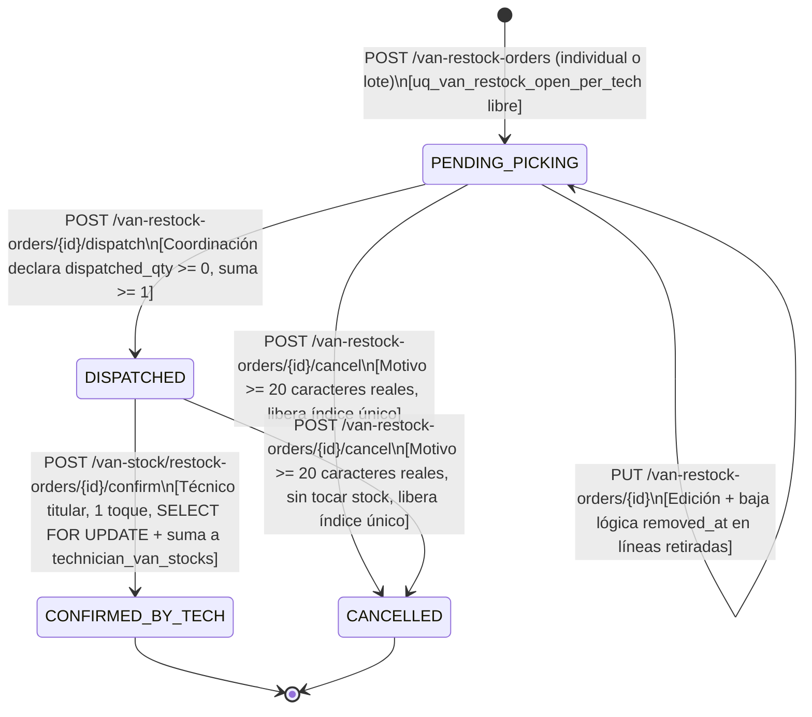

# PLAN DE IMPLEMENTACIÓN TÉCNICA: ÓRDENES DE CARGA DE FURGONETA Y CRUCE DE STOCK EN TRIAJE

**Proyecto:** Gestor de Incidencias de Vending (*VendGuard*)  
**Módulo:** 23 · Órdenes de Carga de Furgoneta y Cruce de Stock en Triaje (*Van Restock Orders & Stock-Aware Triage*)  
**Documento Canónico:** `specs/23-van-restock-stock-aware-triage/plan.md`  
**Especificación Funcional:** [`spec.md`](spec.md) (v2.0, 2026-10-26) y espejo [`../functional/van_restock_stock_aware_triage_spec.md`](../functional/van_restock_stock_aware_triage_spec.md)  
**Contratos Técnicos:** [`../technical/van_restock_stock_aware_triage_contracts.md`](../technical/van_restock_stock_aware_triage_contracts.md)  
**Fecha:** Octubre 2026  
**Alineación Constitucional:**
* **Art. I.1 (SDD estricto):** Ninguna línea de código sin especificación y contrato aprobados; cero implementaciones simuladas o *stubs*.
* **Art. II (Prioridad Sanitaria Absoluta):** El cruce de stock en triaje (`RF-06`, `D2`) es **100% informativo**. No altera ni un solo punto de `TechnicianWorkloadScorer` (`BREAKDOWN_KEYS` intactas) ni interfiere con el escalado al técnico de guardia en averías críticas de máquinas perecederas.
* **Art. III.1 y III.3 (Inviolabilidad de Datos e Histórico):** Prohibición absoluta de `DELETE FROM` en lógica de aplicación. Las tablas `van_restock_orders` y `van_restock_order_items` incluyen disparadores `trg_no_delete_*` (`prevent_hard_delete()`). La eliminación de líneas durante la edición en `PENDING_PICKING` se realiza mediante **baja lógica** (`removed_at TIMESTAMPTZ` y `removed_by BIGINT`, `QA 1`). La confirmación de carga no reescribe `incident_replaced_parts` ni transiciona automáticamente estados de averías ni de `spare_part_requests` (`C4`, `QA 3`).
* **Art. IV.1–IV.3 (Dogma Vanilla):** Backend en PHP 8.2+ POO estricto (`declare(strict_types=1);`) con PDO (`pdo_pgsql`); frontend en Vue 3 mediante Vanilla ES Modules nativos sin *bundlers*; impresión del Albarán de Picking A4 mediante CSS `@media print` y `window.print()`, sin librerías PDF externas.
* **Art. V.1 y V.4 (Reglas de Negocio y Privacidad):** Justificación obligatoria $\ge 20$ caracteres reales tras `btrim()` al cancelar una orden. Segregación estricta frente al `LOCATION_RESPONSIBLE` (`403 FORBIDDEN` y saneador de salida) y aislamiento por `user_id` entre técnicos. Ausencia total de costes (`reference_cost`) en API y en el Picking A4.
* **Art. VI.1 (Alcance Autorizado):** Fase 2 de los Módulos 18 y 17 (Feature 9 de `docs/features_pendientes.md`). Sin stock central de almacén, sin transferencias entre furgonetas y sin firmas manuscritas en almacén.

---

## 1. Estructura de Módulos y Ficheros a Crear y Modificar

### 1.1. Base de Datos PostgreSQL 16+ / Supabase (`database/`, `specs/technical/` y `tests/`)

| Fichero | Acción | Responsabilidad |
| :--- | :--- | :--- |
| `database/supabase_migrations/016_van_restock_orders.sql` | **Crear** | Migración incremental idempotente: extiende `audit_entity_type` con `'VAN_RESTOCK_ORDER'`; crea la Tabla 32 `van_restock_orders` con índice único parcial `uq_van_restock_open_per_tech (technician_id) WHERE status IN ('PENDING_PICKING', 'DISPATCHED')` y `CHECK` de cancelación $\ge 20$ caracteres reales; crea la Tabla 33 `van_restock_order_items` con snapshots (`current_quantity_snapshot`, `min_threshold_snapshot`, `pending_request_qty_snapshot`), doble cantidad (`requested_qty`, `dispatched_qty`) y baja lógica (`removed_at`, `removed_by`); y declara los disparadores `trg_no_delete_*` y `trg_touch_*`. |
| `database/supabase_init.sql` | **Modificar** | Convergencia canónica del DDL maestro incorporando el valor `'VAN_RESTOCK_ORDER'` en `audit_entity_type`, las Tablas 32 y 33 con sus restricciones, índices y disparadores, y actualizando el bloque final de recuentos verificables (33 tablas). |
| `database/supabase_seeds.sql` | **Modificar** | Semillas representativas de órdenes de carga en los 4 estados (`PENDING_PICKING`, `DISPATCHED`, `CONFIRMED_BY_TECH`, `CANCELLED`), incluyendo líneas con motivos `BOTH`, `LOW_STOCK`, `PENDING_REQUEST` y `MANUAL`, y eventos correspondientes en `audit_log`. |
| `src/Infrastructure/Database/SeedRunner.php` | **Modificar** | Incorporación de `seedVanRestockOrders()` en la secuencia de sembrado programático junto a `seedVanStocks()`. |
| `specs/technical/schema_correspondence_contract.md` | **Modificar** | Actualización del contrato de correspondencia de esquema de 31 a 33 tablas (`van_restock_orders` y `van_restock_order_items`), sus claves foráneas, restricciones `CHECK`, índices únicos parciales y disparadores. |
| `tests/Support/TestDataCleaner.php` | **Modificar** | Inclusión de `van_restock_order_items` y `van_restock_orders` antes de `spare_parts` y `users` en el orden de purgado con ventana de limpieza. |
| `tests/Support/PostgresFixtureBuilder.php` | **Modificar** | Registro de `van_restock_orders` y `van_restock_order_items` en `CRUD_EXCLUDED_COLUMNS` para que el `UPDATE` genérico de certificación modifique `notes` y `requested_qty` sin violar invariantes de rama/estado. |
| `tests/integration/PostgresSchemaTest.php` y `tests/integration/SchemaConvergenceParityTest.php` | **Modificar** | Actualización de `CONTRACT_TABLES` de 31 a 33 tablas y recuento de disparadores `BEFORE DELETE`. |

### 1.2. Backend PHP 8.2+ (`declare(strict_types=1);` · Clean Architecture)

| Capa | Fichero | Acción | Responsabilidad |
| :--- | :--- | :--- | :--- |
| **Core / Domain** | `src/Core/Domain/Model/VanRestockOrder.php` | **Crear** | Entidad inmutable de cabecera de orden de carga con constantes de estado (`PENDING_PICKING`, `DISPATCHED`, `CONFIRMED_BY_TECH`, `CANCELLED`), motivos (`LOW_STOCK`, `PENDING_REQUEST`, `BOTH`, `MANUAL`), cota `QUANTITY_MAX = 9999` y `MIN_CANCELLATION_REASON_LENGTH = 20`. |
| **Core / Domain** | `src/Core/Domain/Model/VanRestockOrderItem.php` | **Crear** | Entidad inmutable de línea de orden de carga con snapshots, `requestedQty`, `dispatchedQty`, `reason`, `removedAt` y `removedBy`. |
| **Core / Domain** | `src/Core/Domain/Exception/VanRestockOrderValidationException.php` | **Crear** | Excepción tipada con constructores estáticos para los 7 códigos canónicos (`INVALID_RESTOCK_ORDER_PAYLOAD`, `TECHNICIAN_NOT_ELIGIBLE`, `SPARE_PART_NOT_ELIGIBLE`, `RESTOCK_ORDER_NOT_FOUND`, `OPEN_RESTOCK_ORDER_ALREADY_EXISTS`, `INVALID_RESTOCK_ORDER_TRANSITION`, `RESTOCK_ORDER_OWNERSHIP_MISMATCH`) y estados HTTP (`422`, `409`, `404`, `403`). |
| **Core / Domain** | `src/Core/Domain/Repository/VanRestockOrderRepositoryInterface.php` | **Crear** | Puerto de persistencia: cálculo de insumos de propuesta (`fetchProposalInputs()`), CRUD sin borrado físico (`createOrder()`, `updatePendingOrderWithSoftDelete()`, `markDispatched()`, `markCancelled()`), confirmación transaccional con cerrojo `FOR UPDATE` (`confirmOrderAndIncrementVanStock()`), y consultas (`findById()`, `findAllForCoordinator()`, `findActiveDispatchedForTechnician()`, `findLastConfirmedForTechnician()`). |
| **Application** | `src/Application/DTO/VanRestockProposalDto.php` | **Crear** | Proyección inmutable de propuesta de carga por técnico con sus líneas ordenadas de forma determinista (`QA 5`), indicador `recipient_currently_absent` (`QA 4`) y referencia a orden abierta si existe. |
| **Application** | `src/Application/Service/VanRestockOrderService.php` | **Crear** | Orquestador de casos de uso (`RF-01` a `RF-05`): fórmula de pre-cálculo (`LOW_STOCK`, `PENDING_REQUEST`, `BOTH`) con tope doble `9999` (`QA 1`), ordenación determinista (`QA 5`), creación individual (`RF-02.1`), generación por lotes omitiendo ausentes/sin déficit/con orden abierta (`RF-02.2`, `QA 4`), edición en `PENDING_PICKING` con baja lógica (`RF-02.4`, `QA 1`), expedición (`RF-04.1`), cancelación justificada (`RF-04.2`) y confirmación móvil en 1 toque (`RF-05.2`). |
| **Application** | `src/Application/Service/TechnicianAssignmentSuggester.php` | **Modificar** | Incorporación del cálculo informativo en 2 niveles (`evaluateVanStockMatch()`, `RF-06`, `D2`, `C1`, `QA 2`) y adición de la insignia (`STOCK_COMPATIBLE`, `STOCK_PARCIAL`, `SIN_STOCK_COMPATIBLE`) y del objeto `van_stock_match` en cada candidato de `SuggestedTechnicianDto`, **sin modificar `TechnicianWorkloadScorer`**. |
| **Application** | `src/Application/DTO/SuggestedTechnicianDto.php` | **Modificar** | Inclusión de las constantes de insignia de stock y del campo `van_stock_match` en la proyección de cada candidato sugerido. |
| **Application** | `src/Application/Service/VanStockReadinessCalculator.php` | **Crear** | Calculador puro del indicador `van_stock_readiness` (`READY_IN_VAN`, `SHARED_IN_VAN`, `NOT_READY`, `HAS_OUT_OF_CATALOG`, `NOT_APPLICABLE`, `RF-05.4` y `QA 3`) para enriquecer las tarjetas de averías activas sin N+1. |
| **Infrastructure** | `src/Infrastructure/Repository/PdoVanRestockOrderRepository.php` | **Crear** | Implementación PDO sobre PostgreSQL de `VanRestockOrderRepositoryInterface`: consultas agregadas sin N+1, reactivación o baja lógica de líneas en `PUT`, bloqueo pesimista `SELECT ... FOR UPDATE` en `van_restock_orders` y `technician_van_stocks` durante la confirmación móvil, y escritura atómica en `audit_log` (`entity_type = 'VAN_RESTOCK_ORDER'`). |
| **Infrastructure** | `src/Infrastructure/Repository/PdoTechnicianSuggestionRepository.php` | **Modificar** | Ampliación de `findSuggestionPhoto()` en un número constante de viajes SQL para aportar: (a) `incident.category` y `incident.machine_model`, (b) solicitudes `PENDING` de la avería (`spare_part_requests` catalogadas y flag de fuera de catálogo), (c) universo de repuestos activos compatibles con `(machine_model, category)` y (d) saldos de `technician_van_stocks` de los candidatos para esas piezas (`RNF-01`). |
| **Presentation** | `src/Presentation/Controller/CoordinatorVanRestockOrderController.php` | **Crear** | Controlador REST para Coordinación: `getProposals()`, `listOrders()`, `getOrderDetail()`, `createOrder()`, `generateBatch()`, `updateOrder()`, `dispatchOrder()`, `cancelOrder()`. |
| **Presentation** | `src/Presentation/Controller/TechnicianVanStockController.php` | **Modificar** | Enriquecimiento de `getInventory()` con `active_dispatched_order` y `last_confirmed_order` (`RF-05.1`, `QA 5`), y nuevo método `confirmRestockOrder()` (`POST /api/technician/van-stock/restock-orders/{id}/confirm`, `RF-05.2`) independiente del estado de turno (`QA 4`). |
| **Presentation** | `src/Presentation/Controller/CoordinatorController.php` y `src/Presentation/Controller/TechnicianController.php` | **Modificar** | Enriquecimiento de las tarjetas de averías activas en `GET /api/coordinator/incidents` y `GET /api/technician/my-route` con `van_stock_readiness` (`RF-05.4`, `QA 3`). |
| **Presentation** | `src/Presentation/Controller/LocationPortalController.php` | **Modificar** | Ampliación de la lista de claves vedadas del saneador del portal de sede con `van_stock_match`, `van_stock_readiness`, `active_dispatched_order`, `last_confirmed_order` y `restock_order` (`Art. V.4`, `RNF-03`). |
| **Presentation** | `src/Presentation/Routing/AppRouter.php` | **Modificar** | Registro de las 8 rutas de Coordinación y la ruta de confirmación del Técnico bajo `InternalAuthMiddleware`. |

### 1.3. Frontend Vue 3 (Vanilla ES Modules sin Bundlers, `public/assets/js/` y `public/assets/css/`)

| Fichero | Acción | Responsabilidad |
| :--- | :--- | :--- |
| `public/assets/js/api.js` | **Modificar** | Nuevos métodos en `api.coordinator` (`getVanRestockProposals`, `getVanRestockOrders`, `getVanRestockOrderDetail`, `createVanRestockOrder`, `generateVanRestockBatch`, `updateVanRestockOrder`, `dispatchVanRestockOrder`, `cancelVanRestockOrder`) y en `api.technician` (`confirmVanRestockOrder`). |
| `public/assets/js/components/CoordinatorVanStockTab.js` | **Modificar** | Incorporación de la sub-vista **«📦 Órdenes de Carga y Propuestas»** junto a «Alertas» e «Inventario completo»: listado de propuestas pre-calculadas con botón **«Generar órdenes de carga pendientes (Lote)»**, formulario de creación/edición en `PENDING_PICKING` con adición manual (`MANUAL`) y baja lógica de líneas, modal de expedición con `dispatched_qty` por línea, modal de cancelación ($\ge 20$ caracteres), alerta visual `⚠️ Destinatario actualmente ausente / inactivo` (`QA 4`) y vista de impresión de **Albarán de Picking A4** (`window.print()`, `RF-03`) sin ningún coste ni precio. |
| `public/assets/js/components/TechnicianVanStockPanel.js` | **Modificar** | Incorporación de la tarjeta destacada de recepción **«📦 Carga Expedida Pendiente de Confirmar»** con botón de 1 toque **«Confirmar recepción de carga»** (`min-height: 44px`, `RF-05.1`, `RF-05.2`) y bloque colapsable/resumen de **«Última carga confirmada»** (`last_confirmed_order`, `QA 5`). |
| `public/assets/js/views/CoordinatorDashboardView.js` | **Modificar** | Renderizado de la insignia informativa de stock (`🟢 Stock compatible`, `🟡 Stock parcial`, `⚪ Sin stock compatible`) y del texto `van_stock_match.label` en cada candidato del modal de sugerencia de triaje (`RF-06`), además del chip `📦 Repuesto ya en furgoneta` / `📦 Repuesto en furgoneta (stock compartido)` en las tarjetas de averías activas (`RF-05.4`, `QA 3`). |
| `public/assets/js/views/TechnicianRouteView.js` | **Modificar** | Renderizado del chip `van_stock_readiness.badge_label` (`📦 Repuesto ya en furgoneta` o `📦 Repuesto en furgoneta (stock compartido)`) en las tarjetas de averías activas de Mi Ruta (`RF-05.4`, `QA 3`). |
| `public/assets/js/utils/AuditActionLabels.js` | **Modificar** | Etiquetas en castellano para `CREATE_VAN_RESTOCK_ORDER`, `UPDATE_VAN_RESTOCK_ORDER`, `DISPATCH_VAN_RESTOCK_ORDER`, `CONFIRM_VAN_RESTOCK_ORDER` y `CANCEL_VAN_RESTOCK_ORDER`. |
| `public/assets/css/styles.css` | **Modificar** | Reglas `@media print` para el Albarán de Picking A4 (ocultando navegación lateral, cabeceras de aplicación y botones de acción, y formateando la tabla técnica con casillas de verificación física `[ ]` usando exclusivamente variables CSS `var(--color-*)` para respetar `DesignTokenDebtRatchetTest`). |

---

## 2. Modelo de Datos JSON y Contratos de API REST

### 2.1. Matriz de Endpoints y Códigos HTTP

| # | Método | Endpoint | Rol Requerido | Códigos HTTP | Requisitos |
| :---: | :---: | :--- | :---: | :---: | :--- |
| **1** | `GET` | `/api/coordinator/van-restock-orders/proposals` | `COORDINATOR` | `200`, `401`, `403`, `422` | `RF-01`, `QA 1`, `QA 4`, `QA 5` |
| **2** | `GET` | `/api/coordinator/van-restock-orders` | `COORDINATOR` | `200`, `401`, `403`, `422` | `RF-02`, `RF-04.4`, `QA 4` |
| **3** | `GET` | `/api/coordinator/van-restock-orders/{id}` | `COORDINATOR` | `200`, `401`, `403`, `404` | `RF-03`, `Art. V.4` |
| **4** | `POST` | `/api/coordinator/van-restock-orders` | `COORDINATOR` | `201`, `401`, `403`, `409`, `422` | `RF-02.1`, `RF-02.3`, `D3`, `QA 1`, `QA 4` |
| **5** | `POST` | `/api/coordinator/van-restock-orders/generate-batch` | `COORDINATOR` | `200`, `401`, `403` | `RF-02.2`, `D3`, `QA 4` |
| **6** | `PUT` | `/api/coordinator/van-restock-orders/{id}` | `COORDINATOR` | `200`, `401`, `403`, `404`, `409`, `422` | `RF-02.4`, `QA 1`, `Art. III.1` |
| **7** | `POST` | `/api/coordinator/van-restock-orders/{id}/dispatch` | `COORDINATOR` | `200`, `401`, `403`, `404`, `409`, `422` | `RF-04.1`, `D1`, `QA 1` |
| **8** | `POST` | `/api/coordinator/van-restock-orders/{id}/cancel` | `COORDINATOR` | `200`, `401`, `403`, `404`, `409`, `422` | `RF-04.2`, `Art. V.1` |
| **9** | `GET` | `/api/technician/van-stock` *(enriquecido)* | `TECHNICIAN` | `200`, `401`, `403` | `RF-05.1`, `QA 5`, `Art. V.4` |
| **10** | `POST` | `/api/technician/van-stock/restock-orders/{id}/confirm` | `TECHNICIAN` | `200`, `401`, `403`, `404`, `409`, `422` | `RF-05.2`, `D3`, `QA 1`, `QA 4`, `RNF-02` |
| **11** | `GET` | `/api/coordinator/incidents/{id}/suggested-technicians` *(enriquecido)* | `COORDINATOR` | `200`, `401`, `403`, `404` | `RF-06`, `D2`, `C1`, `QA 2`, `RNF-01` |
| **12** | `GET` | `/api/coordinator/incidents` y `/api/technician/my-route` *(enriquecidos)* | `COORDINATOR` / `TECHNICIAN` | `200`, `401`, `403` | `RF-05.4`, `QA 3` |

### 2.2. Síntesis de Payloads Clave

* **Propuesta y Orden (`GET /proposals`, `POST /van-restock-orders`, `GET /van-restock-orders/{id}`):**
  Cada línea expone `spare_part_id`, `part_code`, `part_name`, `category`, `current_quantity_snapshot`, `min_threshold_snapshot`, `pending_request_qty_snapshot`, `requested_qty`, `dispatched_qty` (`null` en `PENDING_PICKING`) y `reason` (`LOW_STOCK` | `PENDING_REQUEST` | `BOTH` | `MANUAL`). La cabecera incluye `order_code` (`sprintf('RO-%06d', $id)`), `status`, `technician_is_active`, `recipient_currently_absent`, marcas de auditoría (`created_*`, `dispatched_*`, `confirmed_*`, `cancelled_*`) y **cero campos monetarios** (`Art. V.4`).
* **Expedición (`POST /van-restock-orders/{id}/dispatch`):**
  Recibe `{"notes": "...", "items": [{"spare_part_id": 14, "dispatched_qty": 4}, ...]}`. Valida que todas las líneas activas estén declaradas, que `0 <= dispatched_qty <= 9999`, que `current_quantity_available + dispatched_qty <= 9999` (`QA 1`) y que $\sum \text{dispatched\_qty} \ge 1$.
* **Confirmación Móvil (`POST /api/technician/van-stock/restock-orders/{id}/confirm`):**
  Cuerpo vacío `{}`. Devuelve la orden en `CONFIRMED_BY_TECH` y el array `updated_van_stock` con `previous_quantity_available`, `dispatched_qty` y `new_quantity_available` por cada referencia recibida.
* **Cruce de Stock en Triaje (`GET /api/coordinator/incidents/{id}/suggested-technicians`):**
  Añade a cada elemento de `suggestions`:
  ```json
  "van_stock_match": {
    "status": "FULL_MATCH | PARTIAL_MATCH | NO_STOCK | NOT_APPLICABLE",
    "evaluation_level": "EXPLICIT_REQUESTS | CATEGORY_COMPATIBILITY",
    "badge": "STOCK_COMPATIBLE | STOCK_PARCIAL | SIN_STOCK_COMPATIBLE | null",
    "matched_references": 2,
    "total_references": 2,
    "has_out_of_catalog_requests": false,
    "label": "Repuesto solicitado en furgoneta (2/2 ref.)"
  }
  ```

---

## 3. Algoritmos Clave en Pseudocódigo y Máquinas de Estado

### 3.1. Máquina de Estados de `van_restock_orders` (`D1`, `RF-02` a `RF-05`)



### 3.2. Algoritmo de Pre-cálculo de Reposición y Tope Doble `9999` (`RF-01`, `D4`, `QA 1`, `QA 5`)

```text
FUNCTION buildRestockProposalForTechnician(technician, activeSpareParts, vanStockByPart, pendingReqByPart):
    lines = []

    FOR EACH part IN activeSpareParts:
        partId = part.id
        hasStockRow = EXISTS(vanStockByPart[partId])
        currentQty  = hasStockRow ? vanStockByPart[partId].quantity_available : 0
        threshold   = hasStockRow ? vanStockByPart[partId].min_threshold : 0
        pendingReq  = pendingReqByPart[partId] ?? 0

        reason = NULL
        rawQty = 0

        IF pendingReq == 0 AND hasStockRow AND currentQty <= threshold THEN
            reason = 'LOW_STOCK'
            rawQty = (threshold - currentQty) + 1

        ELSE IF pendingReq > 0 AND (
            (hasStockRow AND currentQty <= threshold)
            OR (threshold > 0 AND (currentQty - pendingReq) <= threshold)
        ) THEN
            reason = 'BOTH'
            rawQty = (threshold + 1 + pendingReq) - currentQty

        ELSE IF pendingReq > 0 AND pendingReq > currentQty THEN
            reason = 'PENDING_REQUEST'
            rawQty = pendingReq - MAX(0, currentQty)
        END IF

        IF reason != NULL AND rawQty > 0 THEN
            maxAddable   = 9999 - currentQty
            suggestedQty = MIN(9999, maxAddable, rawQty)

            IF suggestedQty >= 1 THEN
                lines.APPEND({
                    spare_part_id: partId,
                    part_code: part.part_code,
                    part_name: part.name,
                    category: part.category,
                    current_quantity: currentQty,
                    min_threshold: threshold,
                    pending_request_qty: pendingReq,
                    suggested_qty: suggestedQty,
                    max_allowed_qty: MIN(9999, maxAddable),
                    reason: reason
                })
            END IF
        END IF
    END FOR

    // Ordenación determinista (QA 5):
    // 1. Prioridad de motivo: BOTH (1) -> PENDING_REQUEST (2) -> LOW_STOCK (3) -> MANUAL (4)
    // 2. current_quantity ASC (saldos negativos primero)
    // 3. part_code ASC
    SORT lines BY (reasonPriority(line.reason) ASC, line.current_quantity ASC, line.part_code ASC)

    RETURN lines
```

### 3.3. Transacción de Confirmación Móvil en 1 Toque con Bloqueo Pesimista (`RF-05.2`, `RNF-02`, `QA 1`, `QA 4`)

```text
FUNCTION confirmOrderAndIncrementVanStock(orderId, authenticatedTechnicianId):
    // Nota QA 4: No se verifica technician_shifts.status; permitido en ON_SHIFT, MEAL_BREAK y OFF_SHIFT.
    pdo.beginTransaction()
    TRY:
        orderRow = SELECT * FROM van_restock_orders WHERE id = :orderId FOR UPDATE

        IF orderRow IS NULL THEN
            THROW RestockOrderNotFound (404)
        END IF
        IF orderRow.technician_id != authenticatedTechnicianId THEN
            THROW RestockOrderOwnershipMismatch (403)
        END IF
        IF orderRow.status != 'DISPATCHED' THEN
            THROW InvalidRestockOrderTransition (409)
        END IF

        activeItems = SELECT * FROM van_restock_order_items
                      WHERE order_id = :orderId AND removed_at IS NULL
                      ORDER BY spare_part_id ASC

        stockBefore = []
        stockAfter  = []

        FOR EACH item IN activeItems:
            dispatchedQty = item.dispatched_qty ?? 0
            IF dispatchedQty <= 0 THEN
                CONTINUE
            END IF

            existingStock = SELECT id, quantity_available, min_threshold
                            FROM technician_van_stocks
                            WHERE technician_id = :techId AND spare_part_id = :partId
                            FOR UPDATE

            prevQty   = existingStock != NULL ? existingStock.quantity_available : 0
            threshold = existingStock != NULL ? existingStock.min_threshold : 0
            newQty    = prevQty + dispatchedQty

            // Tope doble superior (QA 1)
            IF newQty > 9999 THEN
                THROW InvalidRestockOrderPayload (422, "El saldo resultante superaría 9999 unidades.")
            END IF

            UPSERT INTO technician_van_stocks (technician_id, spare_part_id, quantity_available, min_threshold)
            VALUES (:techId, :partId, :dispatchedQty, 0)
            ON CONFLICT (technician_id, spare_part_id)
            DO UPDATE SET quantity_available = technician_van_stocks.quantity_available + EXCLUDED.quantity_available,
                          updated_at = CURRENT_TIMESTAMP

            stockBefore.APPEND({spare_part_id: item.spare_part_id, quantity_available: prevQty})
            stockAfter.APPEND({
                spare_part_id: item.spare_part_id,
                previous_quantity_available: prevQty,
                dispatched_qty: dispatchedQty,
                new_quantity_available: newQty,
                min_threshold: threshold,
                is_below_threshold: newQty <= threshold
            })
        END FOR

        UPDATE van_restock_orders
           SET status = 'CONFIRMED_BY_TECH',
               confirmed_by = :techId,
               confirmed_at = CURRENT_TIMESTAMP
         WHERE id = :orderId

        auditRepository.record('VAN_RESTOCK_ORDER', orderId, 'CONFIRM_VAN_RESTOCK_ORDER', stockBefore, stockAfter)
        pdo.commit()
        RETURN {order, updated_van_stock: stockAfter}
    CATCH Throwable e:
        IF pdo.inTransaction() THEN pdo.rollBack()
        RETHROW e
```

### 3.4. Algoritmo de Cruce Informativo en 2 Niveles en Triaje (`RF-06`, `D2`, `C1`, `QA 2`)

```text
FUNCTION evaluateVanStockMatch(incidentContext, technicianVanStockMap):
    // Nivel 1: Solicitudes explícitas en PENDING (catalogadas y/o fuera de catálogo)
    pendingCatalogReqs = incidentContext.pending_catalog_requests // map<spare_part_id, total_qty_requested>
    hasOutOfCatalog    = incidentContext.has_pending_out_of_catalog_requests // bool

    IF COUNT(pendingCatalogReqs) > 0 OR hasOutOfCatalog THEN
        nCat = COUNT(pendingCatalogReqs)
        mCat = 0
        FOR EACH (partId => reqQty) IN pendingCatalogReqs:
            IF (technicianVanStockMap[partId] ?? 0) >= reqQty THEN
                mCat = mCat + 1
            END IF
        END FOR

        IF nCat == 0 AND hasOutOfCatalog THEN
            RETURN {
                status: 'NOT_APPLICABLE',
                evaluation_level: 'EXPLICIT_REQUESTS',
                badge: NULL,
                matched_references: 0,
                total_references: 0,
                has_out_of_catalog_requests: TRUE,
                label: 'Solicitud fuera de catálogo (no verificable en furgoneta)'
            }
        END IF

        IF mCat == nCat AND NOT hasOutOfCatalog THEN
            RETURN {
                status: 'FULL_MATCH',
                evaluation_level: 'EXPLICIT_REQUESTS',
                badge: 'STOCK_COMPATIBLE',
                matched_references: mCat,
                total_references: nCat,
                has_out_of_catalog_requests: FALSE,
                label: "Repuesto solicitado en furgoneta (" + mCat + "/" + nCat + " ref.)"
            }
        ELSE IF mCat >= 1 THEN
            suffix = hasOutOfCatalog ? " ref. + pieza fuera de catálogo)" : " ref.)"
            RETURN {
                status: 'PARTIAL_MATCH',
                evaluation_level: 'EXPLICIT_REQUESTS',
                badge: 'STOCK_PARCIAL',
                matched_references: mCat,
                total_references: nCat,
                has_out_of_catalog_requests: hasOutOfCatalog,
                label: "Repuesto solicitado parcial (" + mCat + "/" + nCat + suffix
            }
        ELSE
            suffix = hasOutOfCatalog ? " ref. + pieza fuera de catálogo)" : " ref.)"
            RETURN {
                status: 'NO_STOCK',
                evaluation_level: 'EXPLICIT_REQUESTS',
                badge: 'SIN_STOCK_COMPATIBLE',
                matched_references: 0,
                total_references: nCat,
                has_out_of_catalog_requests: hasOutOfCatalog,
                label: "Sin repuesto solicitado en furgoneta (0/" + nCat + suffix
            }
        END IF
    END IF

    // Nivel 2: Compatibilidad por modelo de máquina y categoría de avería
    compatiblePartIds = incidentContext.compatible_part_ids // list<int>
    nCompat = COUNT(compatiblePartIds)

    IF nCompat == 0 THEN
        RETURN {
            status: 'NOT_APPLICABLE',
            evaluation_level: 'CATEGORY_COMPATIBILITY',
            badge: NULL,
            matched_references: 0,
            total_references: 0,
            has_out_of_catalog_requests: FALSE,
            label: NULL
        }
    END IF

    mCompat = 0
    FOR EACH partId IN compatiblePartIds:
        IF (technicianVanStockMap[partId] ?? 0) >= 1 THEN
            mCompat = mCompat + 1
        END IF
    END FOR

    IF mCompat == nCompat THEN
        RETURN {status: 'FULL_MATCH', evaluation_level: 'CATEGORY_COMPATIBILITY', badge: 'STOCK_COMPATIBLE', matched_references: mCompat, total_references: nCompat, has_out_of_catalog_requests: FALSE, label: "Stock compatible (" + mCompat + "/" + nCompat + " ref.)"}
    ELSE IF mCompat >= 1 THEN
        RETURN {status: 'PARTIAL_MATCH', evaluation_level: 'CATEGORY_COMPATIBILITY', badge: 'STOCK_PARCIAL', matched_references: mCompat, total_references: nCompat, has_out_of_catalog_requests: FALSE, label: "Stock compatible parcial (" + mCompat + "/" + nCompat + " ref.)"}
    ELSE
        RETURN {status: 'NO_STOCK', evaluation_level: 'CATEGORY_COMPATIBILITY', badge: 'SIN_STOCK_COMPATIBLE', matched_references: 0, total_references: nCompat, has_out_of_catalog_requests: FALSE, label: "Sin stock compatible (0/" + nCompat + " ref.)"}
    END IF
```

### 3.5. Cálculo de `van_stock_readiness` en Tarjetas de Avería Activa (`RF-05.4`, `QA 3`)

```text
FUNCTION computeIncidentVanStockReadiness(incident, pendingReqsByIncident, totalPendingByTechAndPart, vanStockByTechAndPart):
    IF incident.status NOT IN ('ASSIGNED', 'IN_PROGRESS', 'PENDING_PARTS', 'PENDING_INFO', 'REOPENED')
       OR incident.assigned_technician_id IS NULL THEN
        RETURN {status: 'NOT_APPLICABLE', badge_label: NULL}
    END IF

    reqs = pendingReqsByIncident[incident.id] ?? NULL
    IF reqs IS NULL OR (COUNT(reqs.catalog_parts) == 0 AND NOT reqs.has_out_of_catalog) THEN
        RETURN {status: 'NOT_APPLICABLE', badge_label: NULL}
    END IF

    IF reqs.has_out_of_catalog THEN
        RETURN {
            status: 'HAS_OUT_OF_CATALOG',
            badge_label: NULL,
            covered_references: 0,
            total_catalog_references: COUNT(reqs.catalog_parts),
            has_out_of_catalog_requests: TRUE
        }
    END IF

    techId = incident.assigned_technician_id
    covered = 0
    isShared = FALSE

    FOR EACH (partId => incidentReqQty) IN reqs.catalog_parts:
        available = vanStockByTechAndPart[techId][partId] ?? 0
        IF available >= incidentReqQty THEN
            covered = covered + 1
            totalTechDemand = totalPendingByTechAndPart[techId][partId] ?? incidentReqQty
            IF available < totalTechDemand THEN
                isShared = TRUE
            END IF
        END IF
    END FOR

    totalRefs = COUNT(reqs.catalog_parts)
    IF covered < totalRefs THEN
        RETURN {status: 'NOT_READY', badge_label: NULL, covered_references: covered, total_catalog_references: totalRefs, has_out_of_catalog_requests: FALSE}
    END IF

    IF isShared THEN
        RETURN {status: 'SHARED_IN_VAN', badge_label: '📦 Repuesto en furgoneta (stock compartido)', covered_references: covered, total_catalog_references: totalRefs, has_out_of_catalog_requests: FALSE}
    END IF

    RETURN {status: 'READY_IN_VAN', badge_label: '📦 Repuesto ya en furgoneta', covered_references: covered, total_catalog_references: totalRefs, has_out_of_catalog_requests: FALSE}
```

---

## 4. Arquitectura de Vistas y Componentes Frontend (Sistema de Diseño `docs/design.md`)

Todas las vistas y componentes nuevos o modificados cumplen estrictamente las reglas de [`docs/design.md`](../../docs/design.md) y sus guardas automatizadas (`CoordinatorButtonVariantsGuardTest.mjs`, `LegacyButtonPaletteRetirementTest.php` y `DesignTokenDebtRatchetTest.php`):

* **Escalera única de botones (`vg-btn`) y cero geometría inline en `Coordinator*.js` (`docs/design.md` §§ Components / Do's and Don'ts):**
  * Todo `<button>` en `CoordinatorVanStockTab.js` y `CoordinatorDashboardView.js` viste obligatoriamente la clase base `vg-btn` más su peldaño (`vg-btn-sm` de 30px en acciones de fila de tabla y filtros; `vg-btn` estándar de 36px en barras de acción y modales; `vg-btn-lg` de 40px en acciones primarias de ancho completo) y su variante de tono (`vg-btn-primary`, `vg-btn-secondary`, `vg-btn-primary-outline`, `vg-btn-danger`, `vg-btn-danger-soft`, `vg-btn-tab` + `vg-btn-tab-active`).
  * **Prohibido declarar geometría en `style` o `:style` dentro de `<button>` en `Coordinator*.js`** (ni `height`, `min-height`, `width`, `padding`, `margin`, `font-size`, `border`, `border-radius`, `display`, `gap`, `background` ni colores hexadecimales), tal como vigila `CoordinatorButtonVariantsGuardTest.mjs`. Tampoco se emplean jamás las clases heredadas retiradas (`.btn`, `.btn-primary`, `.btn-sm`, `.btn-close`).
  * Las barras de filtros y selectores de modo se envuelven en `vg-action-group` y las celdas de acciones de cada fila de tabla se envuelven en `vg-row-actions` para evitar saltos de línea dentro de los botones.
* **Separación «Lectura vs. Acción» para el tono ámbar (`docs/design.md` § Reading versus action):**
  * El tono ámbar (`var(--color-warning-*)`) viste **lecturas e indicadores de estado** (la insignia `STOCK_PARCIAL`, la alerta `⚠️ Destinatario actualmente ausente / inactivo`, el chip `Solicitud en avería`), **nunca se pinta a mano en un `<button>`**. Los botones de confirmación (`Crear orden`, `Generar lote`, `Expedir`, `Confirmar recepción`) usan `vg-btn-primary`; las acciones secundarias (`Editar`, `🖨️ Imprimir Albarán A4`) usan `vg-btn-secondary` o `vg-btn-primary-outline`; la acción destructiva (`Cancelar orden`) usa `vg-btn-danger` / `vg-btn-danger-soft`.
* **Jerarquía tipográfica en dos familias y radios conservadores binarios (`4px` / `8px`):**
  * `var(--font-display)` (Repro / DM Sans / Geist, 24–48px, peso 500–700) reservado a titulares de sección, cifras KPI y cabecera del Albarán A4; `var(--font-body)` (Inter, 12–20px, peso 400–600) para cuerpo, tablas, etiquetas, inputs (`vg-input`) y chips.
  * Escala de radios binaria: `var(--radius-interactive)` (`4px`) en botones, inputs y chips; `var(--radius-card)` (`8px`) en tarjetas y paneles con borde `1px solid var(--color-hairline)` y **sin `box-shadow` en reposo** (sin radios `12px`/`16px` ni píldoras en CTAs).

1. **Sub-vista «📦 Órdenes de Carga y Propuestas» en `CoordinatorVanStockTab.js`:**
   * Selector superior de 3 modos dentro de la pestaña de Stock de Furgonetas envuelto en `vg-action-group` con botones `vg-btn vg-btn-tab` (`vg-btn-tab-active` en el activo): **«Alertas bajo umbral»**, **«Inventario completo»** y **«📦 Órdenes de Carga»**.
   * **Bloque de Propuestas Pre-calculadas:** muestra por cada técnico con déficit sus líneas sugeridas con chips de motivo (`Bajo umbral`, `Solicitud en avería`, `Ambos`), botón global `vg-btn vg-btn-primary` **«Generar órdenes de carga pendientes (Lote)»** (`RF-02.2`) y botón individual `vg-btn vg-btn-sm vg-btn-primary-outline` **«Crear orden»** (`RF-02.1`).
   * **Tabla y Detalle de Órdenes (`PENDING_PICKING`, `DISPATCHED`, `CONFIRMED_BY_TECH`, `CANCELLED`):**
     * Muestra insignia de estado (`4px`), código `RO-XXXXXX`, nombre del técnico y chip de lectura ámbar `⚠️ Destinatario actualmente ausente / inactivo` si `recipient_currently_absent === true` o `!technician_is_active` (`QA 4`).
     * En `PENDING_PICKING`: celda `vg-row-actions` con botones `vg-btn vg-btn-sm` para editar cantidades/añadir piezas `MANUAL`/retirar líneas (baja lógica en servidor), **«🖨️ Imprimir Albarán A4»** (`vg-btn vg-btn-sm vg-btn-secondary`, `window.print()`) y **«Expedir desde Almacén»** (`vg-btn vg-btn-sm vg-btn-primary`, declarando `dispatched_qty` por línea).
     * En `PENDING_PICKING` y `DISPATCHED`: botón **«Cancelar orden»** (`vg-btn vg-btn-sm vg-btn-danger-soft`) que despliega modal con `textarea.vg-input` validado a $\ge 20$ caracteres reales (`Art. V.1`) y confirmación `vg-btn vg-btn-danger`.
2. **Albarán de Picking A4 (`@media print` en `CoordinatorVanStockTab.js` + `styles.css`):**
   * Al pulsar **«🖨️ Imprimir Albarán A4»**, se abre el contenedor de albarán formateado para página A4 con cabecera técnica en `var(--font-display)` (`RO-XXXXXX`, fecha/hora, técnico destinatario, coordinador emisor), tabla de líneas en `var(--font-body)` (`Código`, `Repuesto`, `Categoría`, `Motivo`, `Stock actual`, `Uds. solicitadas`, `Casilla [ ]`) y pie de observaciones. **Cero precios o costes (`Art. V.4`)**.
3. **Tarjeta de Recepción en 1 Toque en `TechnicianVanStockPanel.js`:**
   * Cuando `active_dispatched_order !== null`, encabeza el panel con una tarjeta destacada (`border-radius: var(--radius-card)`, borde `1px solid var(--color-primary)`, fondo `var(--color-surface-card)` sin sombra en reposo) detallando el código de orden, las referencias y `dispatched_qty`, y un botón táctil primario `vg-btn vg-btn-primary` (`min-height: 44px`, consistente con el resto de `TechnicianVanStockPanel.js`) **«Confirmar recepción de carga»** (`RF-05.1`, `RF-05.2`).
   * Debajo muestra el resumen compacto de `last_confirmed_order` (`QA 5`) como comprobante de la última entrega recibida.
4. **Insignias de Triaje y Ruta (`CoordinatorDashboardView.js` y `TechnicianRouteView.js`):**
   * En el modal de sugerencia de asignación (`CoordinatorDashboardView.js`), cada candidato renderiza el chip `van_stock_match` (`border-radius: var(--radius-interactive)`) con semántica visual (`STOCK_COMPATIBLE` en tokens `--color-success*`, `STOCK_PARCIAL` en tokens `--color-warning*`, `SIN_STOCK_COMPATIBLE` en tokens `--color-neutral*`) junto con su etiqueta `van_stock_match.label`.
   * En las tarjetas de averías activas de Coordinación y de Mi Ruta, cuando `van_stock_readiness.badge_label !== null`, se renderiza el chip informativo `📦 Repuesto ya en furgoneta` o `📦 Repuesto en furgoneta (stock compartido)` (`QA 3`).

---

## 5. Decisiones Técnicas Justificadas y Alternativas Descartadas

| ID | Decisión Adoptada | Alternativa Descartada | Justificación Técnica y Constitucional |
| :--- | :--- | :--- | :--- |
| **D1** | Ciclo de 3 estados (`PENDING_PICKING` $\rightarrow$ `DISPATCHED` $\rightarrow$ `CONFIRMED_BY_TECH`) + `CANCELLED` y doble cantidad (`requested_qty`, `dispatched_qty`). | Orden de 1 solo paso que suma el stock al crearla en Coordinación. | Evita inflar artificialmente el stock en ruta antes de que el técnico recoja físicamente las piezas en almacén y permite gestionar roturas parciales de stock en almacén central (`dispatched_qty < requested_qty`). |
| **D2** | Cruce de stock en 2 niveles **100% informativo** en `TechnicianAssignmentSuggester` sin alterar `TechnicianWorkloadScorer`. | Sumar o restar puntos al `total_score` del recomendador según el stock de la furgoneta. | Protege incondicionalmente el **Art. II** (prioridad sanitaria y proximidad geográfica/guardia) y mantiene intactas las pruebas de regresión del Módulo 17 (`TechnicianWorkloadScorerTest`). |
| **D3** | Índice único parcial `uq_van_restock_open_per_tech` (`WHERE status IN ('PENDING_PICKING', 'DISPATCHED')`) y confirmación móvil en 1 toque bajo `SELECT ... FOR UPDATE`. | Permitir múltiples órdenes abiertas por técnico o permitir editar `received_qty` en el móvil. | Impide duplicar reposiciones para el mismo déficit en concurrencia (`RNF-02`) y reduce la fricción en movilidad a un único toque (`RF-05.2`). |
| **D4** | Fórmula de pre-cálculo determinista (`LOW_STOCK`, `PENDING_REQUEST`, `BOTH`) y Picking A4 con `@media print` sin costes. | Librería PDF externa (DOMPDF/TCPDF) o inclusión de `reference_cost` en el albarán. | Cumple el **Art. IV** (Cero Bloatware) y el **Art. V.4** (privacidad de costes frente a almacén y ruta). |
| **QA 1** | Baja lógica (`removed_at`, `removed_by`) al retirar líneas en `PENDING_PICKING` y tope doble `9999`. | `DELETE FROM van_restock_order_items` al editar líneas. | El **Art. III.1** prohíbe `DELETE FROM` en toda tabla del esquema; la baja lógica con reactivación por `(order_id, spare_part_id)` conserva trazabilidad y respeta el disparador `trg_no_delete_van_restock_order_items`. |
| **QA 2 / QA 3** | Distinción explícita de piezas fuera de catálogo y de stock compartido (`SHARED_IN_VAN`) entre averías activas. | Asumir cobertura completa si las piezas catalogadas están en la furgoneta o ignorar la demanda de otras averías del mismo técnico. | Evita falsos positivos cuando existe un repuesto libre (`spare_part_id IS NULL`) o cuando dos averías en `PENDING_PARTS` compiten por la misma unidad física en la furgoneta. |
| **QA 4** | Excluir técnicos con ausencia activa en el lote (`SKIPPED_ACTIVE_ABSENCE`), permitir orden individual con bandera `recipient_currently_absent`, y permitir confirmar carga en `OFF_SHIFT`. | Bloquear confirmación móvil fuera de turno o generar órdenes por lotes a técnicos de vacaciones. | En la operativa real el técnico recoge repuestos en almacén justo antes de fichar el inicio de ruta; en cambio, el lote automático no debe comprometer material para técnicos de baja o vacaciones. |

---

## 6. Estrategia de Pruebas

### 6.1. Pruebas Unitarias (`tests/unit/`)
1. **`tests/unit/VanRestockOrderProposalTest.php`:**
   * Certifica la fórmula de pre-cálculo en los casos `'LOW_STOCK'` (incluyendo saldos negativos `current_quantity = -2`), `'PENDING_REQUEST'`, `'BOTH'` y no elegibilidad cuando el saldo supera holgadamente el umbral y la demanda.
   * Certifica el tope doble `9999` (`QA 1`) y la ordenación determinista (`BOTH` $\rightarrow$ `PENDING_REQUEST` $\rightarrow$ `LOW_STOCK` $\rightarrow$ `MANUAL`, luego `current_quantity ASC`, luego `part_code ASC`, `QA 5`).
2. **`tests/unit/VanRestockOrderServiceTest.php`:**
   * Certifica transiciones válidas e inválidas de la máquina de estados, bloqueo de segunda orden abierta (`409 OPEN_RESTOCK_ORDER_ALREADY_EXISTS`), baja lógica y reactivación de líneas en `PUT` (`QA 1`), validación de `dispatched_qty` (suma $\ge 1$, tope `9999`), rechazo de cancelación con $< 20$ caracteres reales (`Art. V.1`), exclusión de ausentes en lote (`SKIPPED_ACTIVE_ABSENCE`, `QA 4`) y confirmación móvil independiente del turno (`QA 4`).
3. **`tests/unit/TechnicianAssignmentSuggesterVanStockTest.php`:**
   * Certifica el cruce en 2 niveles (`EXPLICIT_REQUESTS` con degradación a `PARTIAL_MATCH` ante pieza fuera de catálogo `QA 2`, y `CATEGORY_COMPATIBILITY` con mapeo de las 5 categorías y `NOT_APPLICABLE` cuando $N=0$, `C1`).
   * Certifica que `total_score`, `score_breakdown` y el orden del ranking (incluido el escalado sanitario del Art. II) son **idénticos** con o sin stock en furgoneta (`D2`).
4. **`tests/unit/VanStockReadinessCalculatorTest.php`:**
   * Certifica los estados `READY_IN_VAN`, `SHARED_IN_VAN` (cuando dos averías activas del técnico reclaman la misma pieza, `QA 3`), `NOT_READY`, `HAS_OUT_OF_CATALOG` (`QA 2`) y `NOT_APPLICABLE`.
5. **`tests/unit/VanRestockUiComponentsTest.mjs`:**
   * Guarda de plantilla para `CoordinatorVanStockTab.js` y `TechnicianVanStockPanel.js`: verifica `data-testid`, ausencia de literales hexadecimales nuevos (`DesignTokenDebtRatchetTest`) y ausencia de `reference_cost` en la plantilla de Picking A4.

### 6.2. Pruebas de Integración (`tests/integration/`)
1. **`tests/integration/VanRestockOrderApiTest.php`:**
   * Ciclo completo HTTP/PDO: propuesta $\rightarrow$ alta individual y por lotes $\rightarrow$ edición en `PENDING_PICKING` verificando que la línea retirada tiene `removed_at IS NOT NULL` en BD (`Art. III.1`) $\rightarrow$ expedición parcial $\rightarrow$ confirmación móvil en 1 toque verificando el incremento exacto en `technician_van_stocks` y el registro en `audit_log` $\rightarrow$ actualización de `van_stock_readiness` en las tarjetas de avería.
   * Pruebas de segregación de roles (`Art. V.4`): `LOCATION_RESPONSIBLE` recibe `403 FORBIDDEN`; un `TECHNICIAN` recibe `403 RESTOCK_ORDER_OWNERSHIP_MISMATCH` al intentar confirmar la orden de otro compañero.
2. **`tests/integration/PostgresSchemaTest.php` y `SchemaConvergenceParityTest.php`:**
   * Certificación de las 33 tablas del contrato y disparadores `trg_no_delete_*`.

---

## 7. Matriz de Trazabilidad (`RF` / `RNF` $\rightarrow$ Artefactos $\rightarrow$ Pruebas)

| Requisito | Artefactos de Implementación | Suites de Verificación |
| :--- | :--- | :--- |
| **RF-01** (Pre-cálculo por umbral y averías activas + ordenación) | `VanRestockOrderService`, `PdoVanRestockOrderRepository::fetchProposalInputs`, `CoordinatorVanRestockOrderController::getProposals` | `VanRestockOrderProposalTest`, `VanRestockOrderApiTest` |
| **RF-02** (Creación individual/lote, 1 orden abierta, edición con baja lógica) | `016_van_restock_orders.sql` (`uq_van_restock_open_per_tech`), `VanRestockOrderService`, `PdoVanRestockOrderRepository` | `VanRestockOrderServiceTest`, `VanRestockOrderApiTest` |
| **RF-03** (Albarán de Picking A4 imprimible sin costes) | `CoordinatorVanRestockOrderController::getOrderDetail`, `CoordinatorVanStockTab.js`, `styles.css` (`@media print`) | `VanRestockUiComponentsTest.mjs`, `VanRestockOrderApiTest` |
| **RF-04** (Expedición con `dispatched_qty` y cancelación $\ge 20$ chars) | `VanRestockOrderService::dispatchOrder`, `VanRestockOrderService::cancelOrder`, `chk_van_restock_orders_cancel_consistency` | `VanRestockOrderServiceTest`, `VanRestockOrderApiTest` |
| **RF-05** (Confirmación móvil en 1 toque + incremento atómico + `van_stock_readiness`) | `PdoVanRestockOrderRepository::confirmOrderAndIncrementVanStock`, `TechnicianVanStockController::confirmRestockOrder`, `VanStockReadinessCalculator` | `VanRestockOrderServiceTest`, `VanStockReadinessCalculatorTest`, `VanRestockOrderApiTest` |
| **RF-06** (Cruce informativo en 2 niveles en Triaje sin alterar puntos ni Art. II) | `TechnicianAssignmentSuggester`, `PdoTechnicianSuggestionRepository`, `SuggestedTechnicianDto`, `CoordinatorDashboardView.js` | `TechnicianAssignmentSuggesterVanStockTest`, `VanRestockOrderApiTest` |
| **RNF-01** (Rendimiento $\le 300\text{ ms}$ y cero N+1) | `PdoTechnicianSuggestionRepository`, `PdoVanRestockOrderRepository`, `VanStockReadinessCalculator` | `TechnicianAssignmentSuggesterVanStockTest`, `VanRestockOrderApiTest` |
| **RNF-02** (Atomicidad `SELECT ... FOR UPDATE` e idempotencia) | `PdoVanRestockOrderRepository::confirmOrderAndIncrementVanStock`, `uq_van_restock_open_per_tech` | `VanRestockOrderServiceTest`, `VanRestockOrderApiTest` |
| **RNF-03** (Segregación Art. V.4 y ausencia de costes) | `AppRouter`, `LocationPortalController`, `TechnicianVanStockController`, `CoordinatorVanStockTab.js` | `VanRestockOrderApiTest`, `VanRestockUiComponentsTest.mjs` |
| **RNF-04** (Dogma Vanilla, tokens CSS y dualidad lingüística) | Todos los artefactos PHP/JS/SQL/CSS del módulo | `ConstitutionalAuditTest`, `DesignTokenDebtRatchetTest`, `PostgresSchemaTest` |

---

## 8. Garantía de Dogma Vanilla y Dualidad Lingüística

1. **Cero Dependencias Externas (Art. IV):** Todo el backend se implementa en PHP 8.2+ nativo con `declare(strict_types=1);` y consultas parametrizadas PDO (`pdo_pgsql`). Todo el frontend se implementa en componentes Vue 3 nativos (Vanilla ES Modules) y hojas de estilo CSS estándar (`@media print` + `window.print()`), sin instalar paquetes `npm` ni `composer`.
2. **Trinquete de Tokens de Diseño (`docs/design.md`):** Los nuevos elementos visuales en `CoordinatorVanStockTab.js`, `TechnicianVanStockPanel.js`, `CoordinatorDashboardView.js`, `TechnicianRouteView.js` y `styles.css` emplean exclusivamente tokens CSS existentes (`var(--color-*)`, `var(--radius-xs)`, `var(--radius-sm)`), manteniendo en `0` la introducción de literales hexadecimales fuera de `:root`.
3. **Dualidad Lingüística Estricta (`AGENTS.md` §3):**
   * **Inglés (`camelCase` / `PascalCase` / `snake_case`):** Nombres de tablas (`van_restock_orders`, `van_restock_order_items`), columnas (`requested_qty`, `dispatched_qty`, `removed_at`), clases (`VanRestockOrderService`, `VanStockReadinessCalculator`), métodos (`confirmOrderAndIncrementVanStock()`, `evaluateVanStockMatch()`) y claves JSON.
   * **Castellano Neutro Profesional:** Comentarios DocBlock, mensajes de excepción y validación HTTP, etiquetas de interfaz de usuario, Albarán de Picking A4 y documentación técnica.
