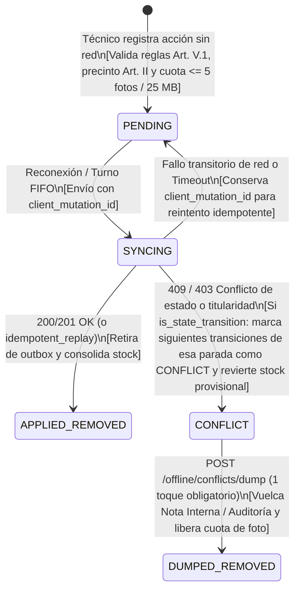

# PLAN DE IMPLEMENTACIÓN TÉCNICA: MODO SIN CONEXIÓN E INSTALABILIDAD MÓVIL PARA TÉCNICOS DE CAMPO

**Proyecto:** Gestor de Incidencias de Vending (*VendGuard*)  
**Módulo:** 24 · Modo Sin Conexión para Técnicos de Campo (*Offline PWA Mode for Field Technicians*)  
**Documento Canónico:** `specs/24-offline-pwa/plan.md`  
**Especificación Funcional:** [`spec.md`](spec.md) (v2.0, 2026-10-27)  
**Contratos Técnicos:** [`../technical/offline_pwa_contracts.md`](../technical/offline_pwa_contracts.md)  
**Fecha:** Octubre 2026  
**Alineación Constitucional:**
* **Art. I.1 (SDD estricto):** Ninguna línea de código sin especificación y contrato aprobados; cero implementaciones simuladas o *stubs*.
* **Art. II (Prioridad Sanitaria Absoluta):**
  * El reloj biológico continuo de **4,0 horas naturales** en máquinas `FOOD_PERISHABLE` jamás se congela por desconexión del técnico (`D2`). Si el barrido del servidor declaró la máquina en `SANITARY_QUARANTINE` antes de sincronizarse una resolución offline, el servidor cierra la avería técnica pero **mantiene `machines.status = 'SANITARY_QUARANTINE'`** (`EARS 05.4`).
  * Toda pausa en avería térmica/crítica o inspección preventiva desfavorable registrada sin conexión sobre una máquina `FOOD_PERISHABLE` exige marcar la confirmación bloqueante de precinto físico in situ (`sanitary_seal_confirmed = true`, `EARS 03.4`, `QA 1`).
* **Art. III.1 y III.3 (Inviolabilidad de Datos e Histórico):**
  * Prohibición absoluta de `DELETE FROM` en tablas de dominio. La Tabla 34 `offline_sync_mutations` porta el disparador `trg_no_delete_offline_sync_mutations` (`prevent_hard_delete()`).
  * Prohibición de descarte silencioso de conflictos (`QA 1`). Todo conflicto se resuelve únicamente mediante `POST /api/technician/offline/conflicts/dump` dejando rastro en `incident_comments` (`is_internal = TRUE`), en `preventive_orders.notes` y en `audit_log` con doble sello temporal (`client_occurred_at` y `synced_at`).
* **Art. IV.1–IV.3 (Dogma Vanilla):** Backend en PHP 8.2+ POO estricto (`declare(strict_types=1);`) con PDO (`pdo_pgsql`); frontend en Vue 3 mediante Vanilla ES Modules nativos sin *bundlers*; capacidades PWA implementadas exclusivamente con APIs nativas del navegador (`manifest.webmanifest`, `navigator.serviceWorker`, `CacheStorage`, `IndexedDB` nativo), sin librerías externas (sin Workbox, Dexie ni localForage).
* **Art. V.1, V.3, V.4 y V.5 (Reglas de Negocio y Privacidad):**
  * Diagnóstico $\ge 20$ caracteres reales, acción $\ge 20$ caracteres reales y motivos de pausa $\ge 20$ caracteres reales validados tanto antes de encolar en cliente como al sincronizar en servidor.
  * Prevalencia de la titularidad vigente en servidor (`Art. V.3`): ante cambio de titular o estado, responde `409 OFFLINE_MUTATION_CONFLICT`.
  * Aislamiento en `IndexedDB` por `technician_id` y opacidad total de los volcados de conflicto (`is_internal = TRUE`) frente al Portal de Sede y al canal QR (`Art. V.4`).
  * Fotografías $\le 5\text{ MB}$ verificadas por *magic bytes* con cuota acumulada de **máximo 5 fotografías o 25 MB** en la bandeja local, quedando exento el trazo PNG de la firma digital ($\le 300\text{ KiB}$, `QA 3`, `Art. V.5`).

---

## 1. Estructura de Módulos y Ficheros a Crear y Modificar

### 1.1. Base de Datos PostgreSQL 16+ / Supabase (`database/`, `specs/technical/` y `tests/`)

| Fichero | Acción | Responsabilidad |
| :--- | :--- | :--- |
| `database/supabase_migrations/020_offline_pwa_sync.sql` | **Crear** | Migración incremental idempotente: crea la Tabla 34 `offline_sync_mutations` con restricción única `uq_offline_sync_tech_mutation (technician_id, client_mutation_id)`, restricciones `CHECK` para `stop_type` (`INCIDENT` \| `PREVENTIVE_ORDER`), `operation_type` (las 9 operaciones autorizadas en `D1`) y `outcome_status` (`APPLIED` \| `CONFLICT_DUMPED` \| `DEACTIVATED_ACCOUNT_DUMP`), índices de consulta y disparador constitucional `trg_no_delete_offline_sync_mutations` (`prevent_hard_delete()`, Art. III.1). |
| `database/supabase_init.sql` | **Modificar** | Convergencia canónica del DDL maestro incorporando la Tabla 34 `offline_sync_mutations` con sus restricciones, índices y disparador `BEFORE DELETE`, actualizando el inventario a 34 tablas. |
| `database/supabase_seeds.sql` | **Modificar** | Semillas representativas de sincronizaciones aplicadas (`APPLIED`) y volcados de conflicto (`CONFLICT_DUMPED`) en `offline_sync_mutations` con su correspondiente rastro en `audit_log`. |
| `src/Infrastructure/Database/SeedRunner.php` | **Modificar** | Incorporación de `seedOfflineSyncMutations()` en la secuencia programática de sembrado. |
| `specs/technical/schema_correspondence_contract.md` | **Modificar** | Actualización del contrato de correspondencia de esquema de 33 a 34 tablas (`offline_sync_mutations`), detallando columnas, claves foráneas, restricciones `CHECK`, índices y disparador `trg_no_delete_offline_sync_mutations`. |
| `tests/Support/TestDataCleaner.php` | **Modificar** | Inclusión de `offline_sync_mutations` antes de `users` en el orden de purgado de pruebas de integración. |
| `tests/Support/PostgresFixtureBuilder.php` | **Modificar** | Registro de `offline_sync_mutations` en `CRUD_EXCLUDED_COLUMNS` para la certificación genérica de esquema. |
| `tests/integration/PostgresSchemaTest.php` y `tests/integration/SchemaConvergenceParityTest.php` | **Modificar** | Actualización de `CONTRACT_TABLES` de 33 a 34 tablas y verificación de paridad de columnas y disparadores `BEFORE DELETE`. |

### 1.2. Backend PHP 8.2+ (`declare(strict_types=1);` · Clean Architecture)

| Capa | Fichero | Acción | Responsabilidad |
| :--- | :--- | :--- | :--- |
| **Core / Domain** | `src/Core/Domain/Model/OfflineSyncMutation.php` | **Crear** | Entidad inmutable de registro de mutación sincronizada con constantes de `STOP_TYPE_*`, `OPERATION_*`, `OUTCOME_*` (`APPLIED`, `CONFLICT_DUMPED`, `DEACTIVATED_ACCOUNT_DUMP`), tolerancia de reloj `MAX_FUTURE_SKEW_SECONDS = 300` (5 min) y `MAX_CHAIN_DELTA_SECONDS = 43200` (12 h). |
| **Core / Domain** | `src/Core/Domain/ValueObject/OfflineSyncMetadata.php` | **Crear** | Objeto de valor inmutable que encapsula `clientMutationId`, `clientOccurredAt`, `chainStartedAt`, `chainEndedAt` y `sanitarySealConfirmed`, con validación de formato (`^[A-Za-z0-9_.:-]{8,64}$`) y cálculo puro del sello temporal efectivo y ajuste $\Delta t$ (`RF-04.3`, `QA 4`). |
| **Core / Domain** | `src/Core/Domain/Exception/OfflineSyncValidationException.php` | **Crear** | Excepción tipada con constructores estáticos para los códigos del contrato (`OFFLINE_MUTATION_CONFLICT`, `SANITARY_SEAL_CONFIRMATION_REQUIRED`, `INVALID_OFFLINE_DUMP_PAYLOAD`, `ACCOUNT_STILL_ACTIVE_USE_STANDARD_SYNC`, `ACCOUNT_DEACTIVATED`) y sus estados HTTP (`403`, `409`, `422`). |
| **Core / Domain** | `src/Core/Domain/Repository/OfflineSyncMutationRepositoryInterface.php` | **Crear** | Puerto de persistencia: `findByTechnicianAndMutationId()`, `recordAppliedMutation()`, `recordConflictDump()`, `recordDeactivatedAccountDumpBatch()` y armado del paquete consolidado `fetchBootstrapSnapshotForTechnician()`. |
| **Application** | `src/Application/DTO/OfflineBootstrapSnapshotDto.php` | **Crear** | DTO inmutable para la respuesta de `GET /api/technician/offline/bootstrap` con `synced_at`, `warn_after_seconds = 14400` (4 h), `readonly_after_seconds = 43200` (12 h), ruta correctiva, órdenes preventivas asignadas/en curso con sus checklists, catálogo de repuestos compatibles por máquina de la ruta y stock de furgoneta (`RF-02.1`). |
| **Application** | `src/Application/Service/OfflineSyncService.php` | **Crear** | Orquestador de casos de uso del Módulo 24: (1) generación del paquete `getBootstrapSnapshot()`, (2) envoltura idempotente `executeIdempotentMutation()` con resolución de reloj efectivo y preservación de $\Delta t$ (`RF-04.2`, `RF-04.3`, `QA 4`), (3) validación de `sanitary_seal_confirmed` en máquinas `FOOD_PERISHABLE` (`EARS 03.4`, `QA 1`), (4) gestión de colisión parcial de reintegro convirtiendo el hallazgo en Nota Interna (`EARS 05.2`, `QA 2`), (5) retención de `SANITARY_QUARANTINE` en resoluciones tardías de perecederos (`EARS 05.4`, Art. II), (6) volcado en 1 toque `dumpConflict()` con excepción de auditoría sobre averías canceladas/cerradas y órdenes preventivas (`EARS 05.3`, `QA 1`, `QA 2`), y (7) volcado en lote por baja de cuenta `dumpDeactivatedAccountQueue()` (`EARS 06.4`, `QA 5`). |
| **Infrastructure** | `src/Infrastructure/Repository/PdoOfflineSyncMutationRepository.php` | **Crear** | Implementación PDO sobre PostgreSQL de `OfflineSyncMutationRepositoryInterface`: consultas agregadas sin N+1 para el bootstrap, inserción transaccional en `offline_sync_mutations`, inserción directa con excepción de auditoría en `incident_comments` (`is_internal = TRUE`, permitiendo escribir sobre expedientes en `CANCELLED` o `CLOSED` $> 48\text{ h}$ según `QA 2`), anexado en `preventive_orders.notes` y registro en `audit_log`. |
| **Presentation** | `src/Presentation/Controller/TechnicianOfflineSyncController.php` | **Crear** | Controlador REST para los tres endpoints específicos del módulo: `getBootstrap()` (`GET /api/technician/offline/bootstrap`), `dumpConflict()` (`POST /api/technician/offline/conflicts/dump`) y `dumpDeactivatedAccount()` (`POST /api/technician/offline/deactivated-account-dump`). |
| **Presentation** | `src/Presentation/Controller/TechnicianController.php` y `src/Presentation/Controller/TechnicianPreventiveController.php` | **Modificar** | Extracción de `OfflineSyncMetadata` desde el cuerpo o cabeceras (`X-Client-Mutation-Id`, `X-Client-Occurred-At`, `X-Chain-Started-At`, `X-Chain-Ended-At`, `sanitary_seal_confirmed`) en las 9 operaciones encolables de parada y delegación en `OfflineSyncService::executeIdempotentMutation()`. |
| **Presentation** | `src/Presentation/Controller/LocationPortalController.php` | **Modificar** | Ampliación de la lista de claves vedadas en el saneador del portal de sede con `offline_sync`, `client_mutation_id`, `clock_skew_adjusted` y `partial_refund_collision_dumped` (`Art. V.4`). |
| **Presentation** | `src/Presentation/Routing/AppRouter.php` | **Modificar** | Registro de `/api/technician/offline/bootstrap`, `/api/technician/offline/conflicts/dump` y `/api/technician/offline/deactivated-account-dump`. |

### 1.3. Frontend Vue 3 y Estándares PWA (Vanilla ES Modules, `public/`)

| Fichero | Acción | Responsabilidad |
| :--- | :--- | :--- |
| `public/manifest.webmanifest` | **Crear** | Manifiesto Web App con identidad corporativa (`#2560ff` / `#f9fafb`), `display: "standalone"`, `start_url: "/?source=pwa"` e iconos vectoriales escalables (`RF-01.1`). |
| `public/assets/icons/vendguard-icon-192.svg` y `vendguard-icon-512.svg` | **Crear** | Iconos vectoriales oficiales de VendGuard para instalación en pantalla de inicio. |
| `public/sw.js` | **Crear** | Service Worker nativo en la raíz pública (`scope: "/"`): precachea el App Shell (`index.html`, CSS y módulos ES de Vue 3), aplica *Stale-While-Revalidate* para activos estáticos del mismo origen (`< 2,0 s` sin red, `RF-01.2`, `RNF-01`) y aplica **`Network-Only` estricto** para `/api/*` (`Art. V.4`). |
| `public/index.html` | **Modificar** | Enlace a `<link rel="manifest" href="/manifest.webmanifest">`, `<meta name="theme-color" content="#2560ff">` y registro seguro de `/sw.js` en `navigator.serviceWorker`. |
| `public/assets/js/utils/OfflineStorage.js` | **Crear** | Adaptador nativo sobre `IndexedDB` (`vendguard_offline_v1`) sin dependencias externas (`RNF-02`): gestiona los almacenes `route_snapshots` y `mutation_outbox`, calcula el estado de vigencia (`FRESH` $\le 4\text{h}$, `STALE_WARNING` $4\text{h}\text{–}12\text{h}$, `EXPIRED_READONLY` $> 12\text{h}$, `D6`), aplica mutaciones optimistas sobre la copia local de la parada y el descuento provisional de furgoneta (`D5`), y valida la cuota de **5 fotos / 25 MB** eximiendo el trazo PNG de firma digital (`D3`, `QA 3`). |
| `public/assets/js/utils/OfflineSyncManager.js` | **Crear** | Motor de encolado y sincronización FIFO (`RF-04`, `RF-05`, `RF-06`): genera `client_mutation_id`, encadena `chain_started_at`/`chain_ended_at` entre pasos de la misma parada (`QA 4`), procesa la cola al dispararse `online` o pulsar *«Sincronizar ahora»*, aísla conflictos de transición de estado (`is_state_transition = true`) sin detener paradas independientes ni bloquear por comentarios intermedios (`QA 3`), revierte descuentos provisionales de stock ante conflicto, y ejecuta el volcado en 1 toque (`dumpConflict`) o el volcado automático por cuenta desactivada (`403 ACCOUNT_DEACTIVATED`, `QA 5`). |
| `public/assets/js/components/OfflineSyncTrayModal.js` | **Crear** | Componente de barra de estado de sincronización y modal de bandeja de cola/conflictos para el técnico: muestra el reloj de antigüedad (*«Última sincronización: hace X min»*, `RF-02.2`), el aviso ámbar de $> 4\text{ h}$ (`RF-02.3`), el bloqueo de $> 12\text{ h}$ (`RF-02.4`), el progreso de envío FIFO y las tarjetas de acciones `CONFLICT` con el botón único de 1 toque **«Volcar trabajo al expediente y cerrar conflicto»** (`min-height: 44px`, sin opción de descarte silencioso, `QA 1`). |
| `public/assets/js/components/AppNavbar.js` | **Modificar** | Guardia en el botón «Cerrar sesión» (`RF-06.1`, `D4`): si el técnico tiene elementos `PENDING`, `SYNCING` o `CONFLICT` en `mutation_outbox`, bloquea el cierre de sesión mostrando el recuento pendiente; si la bandeja está vacía, limpia `route_snapshots` de ese técnico al salir (`RF-06.5`). |
| `public/assets/js/views/TechnicianRouteView.js` | **Modificar** | Integración completa del flujo offline: hidratación automática de `route_snapshots` al cargar con red y fallback automático a la copia local cuando cae la red (`RF-02.1`); encolado transparente en las 9 acciones permitidas (`RF-03.1`); bloqueo con mensaje claro en acciones que exigen red en vivo (reclamo de preventivas libres, órdenes de carga, altas oportunistas fuera de ruta, `RF-03.2`, `QA 4`); casilla bloqueante de confirmación de precinto físico in situ en pausas térmicas o preventivas desfavorables de máquinas `FOOD_PERISHABLE` (`RF-03.4`, `QA 1`); aviso *«📄 Albarán oficial A4 disponible al sincronizar con el servidor»* mientras la resolución está en cola (`QA 4`); sincronización previa obligatoria antes de pausar/cerrar turno (`RF-06.2`, `QA 5`); y modal de re-autenticación del mismo técnico ante `401` (`RF-06.3`). |
| `public/assets/js/api.js` | **Modificar** | Incorporación de `api.technician.getOfflineBootstrap()`, `api.technician.dumpOfflineConflict()` y `api.technician.dumpDeactivatedAccountOfflineQueue()`, más propagación de metadatos `offlineSync` en los métodos de parada del técnico. |
| `public/assets/js/utils/AuditActionLabels.js` | **Modificar** | Etiquetas en castellano para `OFFLINE_CONFLICT_DUMPED` y `OFFLINE_DEACTIVATED_ACCOUNT_DUMP`. |

---

## 2. Modelo de Datos JSON, Esquemas `IndexedDB` y Contratos de API REST

### 2.1. Matriz de Endpoints y Códigos HTTP

| # | Método | Endpoint | Rol Requerido | Códigos HTTP | Requisitos |
| :---: | :---: | :--- | :---: | :---: | :--- |
| **1** | `GET` | `/api/technician/offline/bootstrap` | `TECHNICIAN` | `200`, `401`, `403` | `RF-02.1`, `D6`, `QA 4` |
| **2** | `POST` | `/api/technician/offline/conflicts/dump` | `TECHNICIAN` | `200`, `401`, `403`, `404`, `422` | `RF-05.3`, `D2`, `QA 1`, `QA 2`, `Art. III.3`, `Art. V.4` |
| **3** | `POST` | `/api/technician/offline/deactivated-account-dump` | `TECHNICIAN` *(inactivo con token propio)* | `200`, `401`, `409`, `422` | `RF-06.4`, `QA 5`, `Art. III.3` |
| **4** | `PATCH` / `POST` | Endpoints de parada del técnico (`start`, `resume-pending-info`, `pause`, `pause-pending-info`, `resolve`, `comments`, y preventivas `start`, `complete`, `reinspect`) *(enriquecidos con metadatos offline)* | `TECHNICIAN` | `200`/`201`, `401`, `403`, `404`, `409`, `422` | `RF-03.1`, `RF-03.4`, `RF-04.2`, `RF-04.3`, `RF-05.1`, `RF-05.2`, `RF-05.4`, `QA 1`–`QA 4` |

### 2.2. Síntesis de Esquemas `IndexedDB` (`vendguard_offline_v1`) y Payloads REST

1. **Almacén `route_snapshots` (`keyPath: 'technician_id'`):**
   * Guarda `technician_id`, `technician_email`, `synced_at` (ISO-8601), `warn_after_at` (`synced_at + 4h`), `readonly_after_at` (`synced_at + 12h`), `route_envelope`, `preventive_orders`, `preventive_checklists_by_order`, `spare_parts_catalog_by_machine`, `van_stock`, el mapa `provisional_stock_deductions` (`{ [spare_part_id]: qty }`) y el campo **local** `offline_shift` (`{ status, recorded_at }`) que restaura el turno activo al recargar sin red dentro de la vigencia de 12 h (`EARS 03.1`).
2. **Almacén `mutation_outbox` (`keyPath: 'client_mutation_id'`):**
   * Guarda `client_mutation_id`, `technician_id`, `sequence_order` (entero monótono ascendente), `status` (`PENDING` | `SYNCING` | `CONFLICT`), `stop_type` (`INCIDENT` | `PREVENTIVE_ORDER`), `stop_id`, `operation_type`, `is_state_transition` (`boolean`), `client_occurred_at`, `chain_started_at`, `chain_ended_at`, `sanitary_seal_confirmed`, `payload`, `photo_attachment` (`{ name, type, size, base64 }` $\le 5\text{ MB}$), `provisional_parts_deducted` y `conflict` (`{ code, message, detected_at }`).
3. **Metadatos de Sincronización en Peticiones a Paradas (`§6.2` de Contratos):**
   * Cabeceras o campos de cuerpo: `client_mutation_id`, `client_occurred_at`, `chain_started_at`, `chain_ended_at`, `sanitary_seal_confirmed`.
   * Respuesta enriquecida con el bloque `"offline_sync": { "client_mutation_id", "effective_occurred_at", "synced_at", "clock_skew_adjusted", "idempotent_replay", "partial_refund_collision_dumped", "sanitary_quarantine_retained" }`.

---

## 3. Algoritmos Clave en Pseudocódigo y Máquinas de Estado

### 3.1. Máquina de Estados de Vigencia de la Copia Local de Ruta (`D6`, `RF-02.2` a `RF-02.4`)

```mermaid
stateDiagram-v2
    [*] --> FRESH : Descarga con conexión (GET /offline/bootstrap)\n[age <= 4.0 h]
    FRESH --> STALE_WARNING : Transcurren > 4.0 h sin conexión\n[4.0 h < age <= 12.0 h · Banner ámbar preventivo Art. II]
    STALE_WARNING --> EXPIRED_READONLY : Transcurren > 12.0 h sin conexión\n[age > 12.0 h · Bloquea nuevas acciones offline; conserva outbox]
    STALE_WARNING --> FRESH : Reconexión y refresco exitoso
    EXPIRED_READONLY --> FRESH : Reconexión y refresco exitoso
```



```text
FUNCTION evaluateSnapshotValidity(snapshot, nowMs):
    IF snapshot IS NULL THEN
        RETURN { status: 'MISSING', canEnqueueNewActions: FALSE, ageMinutes: NULL }
    END IF

    syncedAtMs = PARSE_ISO_MS(snapshot.synced_at)
    ageMs = MAX(0, nowMs - syncedAtMs)
    ageMinutes = FLOOR(ageMs / 60000)

    IF ageMs <= 14400000 THEN // <= 4.0 horas
        RETURN { status: 'FRESH', canEnqueueNewActions: TRUE, ageMinutes: ageMinutes }
    ELSE IF ageMs <= 43200000 THEN // 4.0 h < edad <= 12.0 horas
        RETURN {
            status: 'STALE_WARNING',
            canEnqueueNewActions: TRUE,
            ageMinutes: ageMinutes,
            warningMessage: '⚠️ Tu copia de ruta lleva más de 4 horas sin actualizarse. Recupera cobertura cuanto antes, especialmente si atiendes máquinas de alimentos perecederos.'
        }
    ELSE // > 12.0 horas
        RETURN {
            status: 'EXPIRED_READONLY',
            canEnqueueNewActions: FALSE,
            ageMinutes: ageMinutes,
            errorMessage: '🔒 Copia de ruta caducada (> 12 h sin conexión). Conéctate para actualizar tu ruta antes de registrar nuevas intervenciones.'
        }
    END IF
```

### 3.2. Máquina de Estados de la Cola `mutation_outbox` y Cuota Fotográfica (`D3`, `D5`, `QA 1`, `QA 3`)



#### Pseudocódigo de Validación de Cuota Fotográfica y Encolado con Encadenamiento (`RF-03.3`, `RF-03.5`, `QA 3`):

```text
FUNCTION enqueueOfflineMutation(techId, stopType, stopId, opType, payload, photoFile, isPerishable, sanitarySealConfirmed):
    snapshot = IndexedDB.get('route_snapshots', techId)
    validity = evaluateSnapshotValidity(snapshot, NOW_MS())
    IF NOT validity.canEnqueueNewActions THEN
        THROW OfflineQueueError('SNAPSHOT_EXPIRED_READONLY', validity.errorMessage)
    END IF

    // 1. Blindaje Art. II (QA 1): Precinto físico obligatorio en riesgo sanitario de perecederos
    IF isPerishable AND isSanitaryRiskOperation(opType, payload) AND sanitarySealConfirmed !== TRUE THEN
        THROW OfflineQueueError('SANITARY_SEAL_CONFIRMATION_REQUIRED',
            'Debes confirmar que has precintado físicamente la máquina in situ antes de guardar.')
    END IF

    // 2. Cuota fotográfica (D3, QA 3): Máx 5 fotos de cámara/galería o 25 MB (Firma PNG exenta)
    IF photoFile IS NOT NULL THEN
        VALIDATE_IMAGE_FORMAT_AND_SIZE(photoFile, 5 * 1024 * 1024) // Art. V.5
        activeItems = IndexedDB.getAllByTechnician('mutation_outbox', techId) // PENDING + SYNCING + CONFLICT
        currentPhotoCount = COUNT(item IN activeItems WHERE item.photo_attachment IS NOT NULL)
        currentPhotoBytes = SUM(item.photo_attachment.size FOR item IN activeItems WHERE item.photo_attachment IS NOT NULL)

        IF currentPhotoCount + 1 > 5 OR (currentPhotoBytes + photoFile.size) > 26214400 THEN
            THROW OfflineQueueError('OFFLINE_PHOTO_QUOTA_EXCEEDED',
                'Se ha alcanzado el límite de seguridad sin conexión (máx. 5 fotografías o 25 MB en cola). Guarda sin foto o sincroniza primero.')
        END IF
    END IF

    // 3. Enlace con paso de inicio previo en la misma parada para preservar Δt (QA 4)
    priorStartItem = FIND_LAST(activeItems, item =>
        item.stop_type == stopType AND item.stop_id == stopId
        AND item.status == 'PENDING'
        AND item.operation_type IN ('START_INCIDENT', 'RESUME_INCIDENT_PENDING_INFO', 'START_PREVENTIVE')
    )
    nowIso = NOW_ISO_UTC()
    chainStartedAt = priorStartItem ? priorStartItem.client_occurred_at : NULL

    IF priorStartItem IS NOT NULL AND opType IN ('PAUSE_INCIDENT_PARTS', 'PAUSE_INCIDENT_PENDING_INFO', 'RESOLVE_INCIDENT', 'COMPLETE_PREVENTIVE', 'REINSPECT_PREVENTIVE') THEN
        priorStartItem.chain_ended_at = nowIso
        IndexedDB.put('mutation_outbox', priorStartItem)
    END IF

    // 4. Descuento provisional de stock de furgoneta y mutación optimista de la parada (D5)
    provisionalParts = extractConsumedCatalogParts(opType, payload)
    applyOptimisticStopTransitionAndStockDeduction(snapshot, stopType, stopId, opType, payload, provisionalParts)

    mutation = {
        client_mutation_id: generateMutationId(),
        technician_id: techId,
        sequence_order: nextSequenceOrder(techId),
        status: 'PENDING',
        stop_type: stopType,
        stop_id: stopId,
        operation_type: opType,
        is_state_transition: (opType != 'ADD_INCIDENT_COMMENT'),
        client_occurred_at: nowIso,
        chain_started_at: chainStartedAt,
        chain_ended_at: NULL,
        sanitary_seal_confirmed: Boolean(sanitarySealConfirmed),
        payload: payload,
        photo_attachment: serializePhoto(photoFile),
        provisional_parts_deducted: provisionalParts,
        conflict: NULL
    }
    IndexedDB.put('mutation_outbox', mutation)
    IndexedDB.put('route_snapshots', snapshot)
    RETURN mutation
```

#### Pseudocódigo de Sincronización FIFO y Aislamiento de Conflictos por Parada (`RF-04.1`, `RF-05.1`, `QA 3`, `QA 5`):

```text
FUNCTION processOutboxQueue(techId):
    pendingItems = IndexedDB.getByTechOrderedBySequence(techId, status = 'PENDING')
    failedStateStops = SET() // Paradas cuya transición de estado falló en esta pasada

    FOR EACH item IN pendingItems:
        stopKey = item.stop_type + ':' + item.stop_id

        // Si una transición de estado previa de esta misma parada entró en conflicto,
        // las transiciones posteriores de esa parada pasan directamente a CONFLICT (D5, QA 3)
        IF item.is_state_transition AND stopKey IN failedStateStops THEN
            markItemAsConflict(item, 'Paso previo de esta parada rechazado por conflicto en el servidor.')
            revertProvisionalStockDeduction(techId, item.provisional_parts_deducted)
            CONTINUE
        END IF

        item.status = 'SYNCING'
        IndexedDB.put('mutation_outbox', item)

        TRY:
            response = dispatchMutationToServer(item)
            // Éxito (200/201 o replay idempotente): consolidar y retirar de la cola
            IndexedDB.delete('mutation_outbox', item.client_mutation_id)
        CATCH (apiError):
            IF apiError.status == 401 THEN
                item.status = 'PENDING'
                IndexedDB.put('mutation_outbox', item)
                OPEN_SAME_TECHNICIAN_REAUTH_MODAL(techId) // EARS 06.3
                BREAK
            ELSE IF apiError.status == 403 AND apiError.code == 'ACCOUNT_DEACTIVATED' THEN
                item.status = 'PENDING'
                IndexedDB.put('mutation_outbox', item)
                executeDeactivatedAccountEmergencyDump(techId) // EARS 06.4, QA 5
                BREAK
            ELSE IF apiError.status IN (403, 409, 422) THEN
                // Conflicto de dominio
                IF item.is_state_transition THEN
                    failedStateStops.ADD(stopKey)
                END IF
                // QA 3: Si es un comentario intermedio (is_state_transition == false),
                // NO se añade stopKey a failedStateStops, por lo que la resolución posterior SÍ se envía.
                markItemAsConflict(item, apiError.message, apiError.code)
                revertProvisionalStockDeduction(techId, item.provisional_parts_deducted)
            ELSE
                // Caída de red o timeout (status == 0 o 5xx): vuelve a PENDING y detiene el bucle hasta reconectar
                item.status = 'PENDING'
                IndexedDB.put('mutation_outbox', item)
                BREAK
            END IF
    END FOR
```

### 3.3. Algoritmo Transaccional en Servidor: Idempotencia, Reloj $\Delta t$ y Blindaje Sanitario (`OfflineSyncService`)

```text
FUNCTION executeIdempotentMutation(techId, metadata, stopType, stopId, opType, previousMilestoneAt, domainCallback):
    IF metadata IS NULL OR metadata.clientMutationId IS NULL THEN
        // Ejecución online ordinaria sin cola offline
        RETURN domainCallback(CURRENT_TIMESTAMP)
    END IF

    // 1. Comprobación rápida de idempotencia (RF-04.2)
    existing = repo.findByTechnicianAndMutationId(techId, metadata.clientMutationId)
    IF existing IS NOT NULL AND existing.outcomeStatus == 'APPLIED' THEN
        RETURN APPEND_FLAG(existing.responsePayload, 'idempotent_replay', TRUE)
    END IF

    // 2. Cálculo del sello temporal efectivo y preservación de Δt (RF-04.3, QA 4)
    syncedAt = CURRENT_TIMESTAMP
    maxAllowedAt = syncedAt + 5 MINUTES
    clientAt = metadata.clientOccurredAt

    // Ancla del segmento activo: la última mutación APPLIED de inicio o
    // reanudación de la misma parada. Si el inicio fue online, el hito del
    // expediente sigue siendo el ancla.
    chainAnchorAt = previousMilestoneAt
    IF metadata.chainStartedAt IS NOT NULL THEN
        priorStart = repo.findLatestAppliedChainStart(techId, stopType, stopId)
        IF priorStart IS NOT NULL THEN
            chainAnchorAt = priorStart.effectiveOccurredAt
        END IF
    END IF

    IF clientAt >= previousMilestoneAt AND clientAt <= maxAllowedAt THEN
        effectiveAt = clientAt
        clockSkewAdjusted = FALSE
    ELSE
        clockSkewAdjusted = TRUE
        // Verificar si pertenece a una cadena con Δt positivo y coherente (<= 12h)
        IF opType IN ('START_INCIDENT', 'RESUME_INCIDENT_PENDING_INFO', 'START_PREVENTIVE')
           AND metadata.chainEndedAt IS NOT NULL
           AND (metadata.chainEndedAt - clientAt) > 0
           AND (metadata.chainEndedAt - clientAt) <= 12 HOURS THEN
            deltaSeconds = metadata.chainEndedAt - clientAt
            effectiveAt = MAX(previousMilestoneAt, syncedAt - deltaSeconds)
        ELSE IF opType IN ('PAUSE_INCIDENT_PARTS', 'PAUSE_INCIDENT_PENDING_INFO', 'RESOLVE_INCIDENT', 'COMPLETE_PREVENTIVE', 'REINSPECT_PREVENTIVE')
           AND metadata.chainStartedAt IS NOT NULL
           AND (clientAt - metadata.chainStartedAt) > 0
           AND (clientAt - metadata.chainStartedAt) <= 12 HOURS THEN
            // El cierre se ancla al inicio o la reanudación efectivos, nunca a
            // la asignación; el tope en syncedAt descarta el latido de la
            // petición sin recortar Δt.
            deltaSeconds = clientAt - metadata.chainStartedAt
            effectiveAt = MIN(syncedAt, chainAnchorAt + deltaSeconds)
            effectiveAt = MAX(chainAnchorAt, effectiveAt)
        ELSE
            effectiveAt = MAX(previousMilestoneAt, syncedAt)
        END IF
    END IF

    // 3. Ejecución de la operación de dominio con manejo de colisión parcial de reintegro (QA 2)
    //    y retención de SANITARY_QUARANTINE en máquinas perecederas (EARS 05.4, Art. II)
    result = domainCallback(effectiveAt, metadata)

    // 4. Registro de idempotencia y trazabilidad dual en offline_sync_mutations y audit_log
    repo.recordAppliedMutation(techId, metadata, stopType, stopId, opType, effectiveAt, syncedAt, clockSkewAdjusted, result)

    RETURN APPEND_OFFLINE_SYNC_ENVELOPE(result, metadata, effectiveAt, syncedAt, clockSkewAdjusted)
```

---

## 4. Arquitectura de Eventos y Componentes Frontend (`docs/design.md`)

1. **Integración con `api.js` y `ConnectionStateBanner.js`:**
   * Cuando `navigator.onLine === false` o `api.js` detecta un fallo de transporte (`NETWORK_ERROR` / `REQUEST_TIMEOUT`) durante una de las 9 operaciones permitidas de parada en `TechnicianRouteView.js`, el gestor `OfflineSyncManager` intercepta el fallo, encola la operación en `mutation_outbox` en menos de `150 ms` (`RNF-01`) y emite el evento `vendguard:offline-queue-updated`.
   * Cuando el navegador dispara el evento `online` o `api.js` anuncia `reconnected` en `vendguard:network-status`, `OfflineSyncManager` arranca automáticamente `processOutboxQueue(techId)`.
2. **Barra de Estado y Modal `OfflineSyncTrayModal.js` en `TechnicianRouteView.js`:**
   * Se sitúa en la cabecera de la vista móvil del técnico mostrando en todo momento:
     * Estado de conexión (`🟢 En línea`, `🟠 Modo sin conexión`, `🔵 Sincronizando (M/N)…`) y antigüedad de la copia local (*«Última sincronización: hace X min»*, `RF-02.2`).
     * Banner preventivo ámbar (`var(--color-warning-bg)`, `var(--color-warning-text)`, `var(--color-warning-border)`) cuando la copia local supera las **4,0 horas** (`STALE_WARNING`, `RF-02.3`).
     * Banner de bloqueo de lectura cuando supera las **12,0 horas** (`EXPIRED_READONLY`, `RF-02.4`).
   * Si existen acciones en estado `CONFLICT`, despliega un aviso destacado que abre el modal de conflictos. Cada tarjeta de conflicto muestra el código de parada, la hora in situ, el motivo del rechazo del servidor, el texto íntegro redactado por el técnico y un **único botón de cierre obligatorio** `vg-btn vg-btn-primary` (`min-height: 44px`): **«Volcar trabajo al expediente y cerrar conflicto»** (`EARS 05.3`, `QA 1`).
3. **Alerta Sanitaria Crítica Bloqueante en Máquinas Perecederas (`EARS 03.4`, `QA 1`, Art. II):**
   * En los modales de pausa (`TechnicianSparePartsPauseModal.js`, `PendingInfoPauseModal.js`) y checklist preventivo (`TechnicianChecklistModal.js`, `TechnicianReinspectionModal.js`), cuando el dispositivo está sin conexión y la máquina es `FOOD_PERISHABLE` con fallo térmico o ítem crítico `NOK`, se renderiza un bloque de peligro (`var(--color-danger-bg)`, `var(--color-danger-text)`, `border-radius: var(--radius-card)`) con un checkbox obligatorio (`min-height: 44px`):
     * *«Confirmo que he precintado físicamente la máquina / inhabilitado la venta in situ y acudiré a una zona con cobertura al finalizar para transmitir la alerta sanitaria.»*
4. **Cumplimiento Estricto del Sistema de Diseño (`docs/design.md`):**
   * Cero literales hexadecimales en los nuevos componentes JS/CSS (todo color referenciado mediante `var(--color-*)`, verificado por `DesignTokenDebtRatchetTest`).
   * Radios conservadores binarios: `4px` (`var(--radius-xs)` / `var(--radius-interactive)`) en botones, inputs e insignias `⏳ Pendiente de sincronizar`; `8px` (`var(--radius-sm)` / `var(--radius-card)`) en tarjetas y modales con borde `1px solid var(--color-hairline)` y sin sombra en reposo.
   * Objetivos táctiles móviles con `min-height: 44px` para operación con una sola mano (`RNF-03`).

---

## 5. Decisiones Técnicas Justificadas y Alternativas Descartadas

| ID | Decisión Adoptada | Alternativa Descartada | Justificación Técnica y Constitucional |
| :--- | :--- | :--- | :--- |
| **DT-01** | Estrategia **`Network-Only`** en el Service Worker para `/api/*` y persistencia estructurada en `IndexedDB` particionada por `technician_id`. | Cachear respuestas GET de `/api/*` directamente en `CacheStorage` del Service Worker. | Cachear `/api/*` en `CacheStorage` expondría respuestas JSON crudas sin aislamiento por usuario en dispositivos compartidos (violando el **Art. V.4**) e impediría aplicar mutaciones optimistas encadenadas (`D5`) y el reloj de caducidad de 4h/12h (`D6`). |
| **DT-02** | `IndexedDB` nativo encapsulado en `OfflineStorage.js` sin librerías externas. | Instalar `Dexie.js`, `idb` o `localForage`, o usar `localStorage`. | El **Art. IV.3** prohíbe dependencias de terceros; además, `localStorage` es síncrono y está limitado a ~5 MB, incapaz de alojar la cuota de 5 fotografías / 25 MB (`D3`). |
| **DT-03** | Tabla relacional `offline_sync_mutations` con clave única `(technician_id, client_mutation_id)`. | Confiar solo en la memoria de sesión o no persistir claves de mutación en PostgreSQL. | Garantiza idempotencia transaccional real en PostgreSQL/Supavisor ante cortes de señal en mitad de una respuesta HTTP (`RF-04.2`) y conserva el doble sello temporal (`RF-04.3`, **Art. III.3**). |
| **DT-04** | Excepción de auditoría en `POST /api/technician/offline/conflicts/dump` y prohibición del botón de descarte local (`QA 1`, `QA 2`). | Permitir borrar el conflicto en el cliente o rechazar la nota interna si el ticket fue cancelado. | Cumple de forma incondicional el **Art. III.1 y III.3**: ningún trabajo técnico ejecutado in situ puede desaparecer sin dejar rastro en el expediente y en `audit_log`. |
| **DT-05** | Preservación del intervalo relativo $\Delta t = t_2 - t_1$ al corregir relojes desajustados en pasos encadenados (`QA 4`). | Anclar el cierre en el instante efectivo de la última mutación `START_*`/`RESUME_*` de la parada y aplicar $\min(synced\_at, inicio\_efectivo + \Delta t)$; persistir el inicio offline con su instante efectivo en `incidents.started_at`. | Evita que una intervención real de 30 minutos en un sótano con el reloj del móvil desajustado se registre con `0 segundos` de duración, y que la latencia entre las dos peticiones alargue artificialmente el segmento in situ; protege el MTTR (Módulo 03) y las horas efectivas (Módulo 22). |

---

## 6. Estrategia de Pruebas

### 6.1. Pruebas Unitarias (`tests/unit/`)
1. **`tests/unit/OfflineSyncClockAndQuotaTest.php`:**
   * Certifica el cálculo de `OfflineSyncMetadata`: aceptación de `client_occurred_at` dentro de $[T_{\text{prev}}, T_{\text{sync}} + 5\text{ min}]$, corrección con `clock_skew_adjusted = true` fuera de rango, y preservación exacta de la duración relativa $\Delta t$ en cadenas *Iniciar* $\rightarrow$ *Resolver* (`QA 4`).
   * Certifica el rechazo `422 SANITARY_SEAL_CONFIRMATION_REQUIRED` cuando falta `sanitary_seal_confirmed = true` en operaciones de riesgo sanitario sobre máquinas `FOOD_PERISHABLE` (`QA 1`, Art. II).
2. **`tests/unit/OfflineSyncServiceTest.php`:**
   * Certifica la idempotencia por `(technician_id, client_mutation_id)` (`RF-04.2`), la resolución exitosa con colisión parcial de reintegro volcando el dictamen como Nota Interna (`EARS 05.2`, `QA 2`), la retención de `SANITARY_QUARANTINE` en máquinas perecederas (`EARS 05.4`, Art. II), el volcado obligatorio de conflictos sobre averías canceladas/cerradas y órdenes preventivas (`EARS 05.3`, `QA 1`, `QA 2`), y el volcado en lote por cuenta desactivada (`EARS 06.4`, `QA 5`).
3. **`tests/unit/OfflineStorageAndSyncManagerTest.mjs` (Node ESM):**
   * Certifica la máquina de estados de vigencia del snapshot (`FRESH` $\le 4\text{h}$, `STALE_WARNING` $4\text{h}\text{–}12\text{h}$, `EXPIRED_READONLY` $> 12\text{h}$, `D6`).
   * Certifica el validador de cuota fotográfica (máx. 5 fotos / 25 MB entre `PENDING`, `SYNCING` y `CONFLICT`, y exención de la firma PNG, `D3`, `QA 3`).
   * Certifica el encadenamiento FIFO por parada: detención de transiciones posteriores si falla `START_INCIDENT`, pero continuidad de `RESOLVE_INCIDENT` si lo único que falla es un comentario intermedio (`ADD_INCIDENT_COMMENT`, `QA 3`).
4. **`tests/unit/OfflinePwaAssetsAndUiGuardTest.mjs` (Node ESM):**
   * Verifica la validez de `public/manifest.webmanifest`, la estrategia `Network-Only` para `/api/*` en `public/sw.js`, la ausencia de opción de descarte silencioso en `OfflineSyncTrayModal.js`, el cumplimiento de `min-height: 44px` y cero literales hexadecimales nuevos (`DesignTokenDebtRatchetTest`).

### 6.2. Pruebas de Integración (`tests/integration/`)
1. **`tests/integration/OfflinePwaSyncApiTest.php`:**
   * Certifica extremo a extremo contra PostgreSQL:
     1. `GET /api/technician/offline/bootstrap` devuelve paradas correctivas, preventivas asignadas con checklists, catálogo compatible y stock de furgoneta aislados por el técnico del token (`Art. V.4`).
     2. Cadena completa sincronizada (*Iniciar* $\rightarrow$ *Comentario* $\rightarrow$ *Resolver con piezas y firma*) con `client_mutation_id` y `client_occurred_at`, verificando idempotencia ante reenvío duplicado, descuento único de stock en `technician_van_stocks` y doble sello temporal en `offline_sync_mutations` y `audit_log`.
     3. Preservación de $\Delta t$ cuando `client_occurred_at` viene con reloj atrasado 24 horas (`QA 4`).
     4. Colisión parcial de reintegro ya regularizado por Coordinación: la avería se cierra (`200 OK`) y se crea automáticamente la Nota Interna de Taller (`QA 2`).
     5. Retención de `SANITARY_QUARANTINE` cuando se sincroniza una resolución tardía sobre máquina `FOOD_PERISHABLE` ya cuarentenada por el barrido de 4h (`Art. II`).
     6. `POST /api/technician/offline/conflicts/dump` sobre una avería reasignada a otro técnico y sobre una avería `CANCELLED`, verificando que la Nota Interna (`is_internal = TRUE`) queda persistida y es invisible para `LOCATION_RESPONSIBLE` (`Art. III.3`, `Art. V.4`, `QA 2`).
     7. `POST /api/technician/offline/deactivated-account-dump` para un técnico recién desactivado (`is_active = false`), verificando el volcado de auditoría y la bandera `clear_local_storage = true` (`QA 5`).
2. **`tests/integration/PostgresSchemaTest.php` y `SchemaConvergenceParityTest.php`:**
   * Certificación de las 34 tablas del dominio y del disparador `trg_no_delete_offline_sync_mutations`.

---

## 7. Mapeo Estricto de Trazabilidad (`RF` / `RNF` / `D` / `QA` $\rightarrow$ Artefactos $\rightarrow$ Pruebas)

| Requisito / Decisión | Artefactos de Implementación | Suites de Verificación |
| :--- | :--- | :--- |
| **RF-01** (`EARS 01.1`–`01.3`: Manifest, carga sin red $< 2\text{ s}$ y actualización SW) | `public/manifest.webmanifest`, `public/sw.js`, `public/index.html`, `public/assets/icons/*.svg` | `OfflinePwaAssetsAndUiGuardTest.mjs` |
| **RF-02** (`EARS 02.1`–`02.4`, `D6`: Snapshot por técnico y vigencia 4h ámbar / 12h solo lectura) | `TechnicianOfflineSyncController::getBootstrap`, `OfflineStorage.js`, `OfflineSyncTrayModal.js`, `TechnicianRouteView.js` | `OfflineStorageAndSyncManagerTest.mjs`, `OfflinePwaSyncApiTest.php` |
| **RF-03** (`EARS 03.1`–`03.5`, `D1`, `D3`, `D5`, `QA 1`, `QA 3`, `QA 4`: 9 acciones encolables, bloqueo online-only, Albarán A4 diferido, precinto Art. II y cuota 5 fotos / 25 MB sin contar firma) | `OfflineStorage.js`, `OfflineSyncManager.js`, `TechnicianRouteView.js`, `OfflineSyncService` | `OfflineSyncClockAndQuotaTest.php`, `OfflineStorageAndSyncManagerTest.mjs`, `OfflinePwaSyncApiTest.php` |
| **RF-04** (`EARS 04.1`–`04.3`, `D2`, `QA 4`: Sincronización FIFO, idempotencia `client_mutation_id`, doble sello temporal y preservación de $\Delta t$) | `020_offline_pwa_sync.sql`, `OfflineSyncMetadata.php`, `OfflineSyncService.php`, `PdoOfflineSyncMutationRepository.php`, `OfflineSyncManager.js` | `OfflineSyncClockAndQuotaTest.php`, `OfflineSyncServiceTest.php`, `OfflinePwaSyncApiTest.php` |
| **RF-05** (`EARS 05.1`–`05.4`, `D2`, `QA 1`, `QA 2`, `QA 3`: Conflicto aislado por parada, comentario intermedio independiente, colisión parcial de reintegro, volcado obligatorio 1 toque y blindaje `SANITARY_QUARANTINE` Art. II) | `OfflineSyncService::dumpConflict`, `PdoOfflineSyncMutationRepository`, `TechnicianOfflineSyncController::dumpConflict`, `OfflineSyncTrayModal.js` | `OfflineSyncServiceTest.php`, `OfflineStorageAndSyncManagerTest.mjs`, `OfflinePwaSyncApiTest.php` |
| **RF-06** (`EARS 06.1`–`06.5`, `D4`, `QA 5`: Bloqueo de logout y turno con cola viva, re-login mismo técnico, volcado por cuenta desactivada y limpieza al salir) | `AppNavbar.js`, `TechnicianRouteView.js`, `OfflineSyncManager.js`, `TechnicianOfflineSyncController::dumpDeactivatedAccount` | `OfflineStorageAndSyncManagerTest.mjs`, `OfflinePwaSyncApiTest.php` |
| **RNF-01 a RNF-04** (Rendimiento $< 2\text{ s}$ / $< 150\text{ ms}$, Cero Dependencias Art. IV.3, Tokens `docs/design.md` y Dualidad Lingüística) | Todos los artefactos PHP, JS, SQL, CSS y PWA del Módulo 24 | `OfflinePwaAssetsAndUiGuardTest.mjs`, `DesignTokenDebtRatchetTest`, `PostgresSchemaTest`, `SchemaConvergenceParityTest` |

---

## 8. Garantía de Dogma Vanilla y Dualidad Lingüística

1. **Cero Dependencias Externas (Art. IV.3):**
   * Backend 100 % en PHP 8.2+ nativo (`declare(strict_types=1);`) con PDO (`pdo_pgsql`).
   * Frontend 100 % en Vue 3 ES Modules nativos, `navigator.serviceWorker`, `CacheStorage` e `IndexedDB` nativo sin instalar ningún paquete de terceros.
2. **Alineación con el Sistema de Diseño (`docs/design.md`):**
   * Uso exclusivo de variables CSS corporativas (`var(--color-*)`, `var(--radius-xs)`, `var(--radius-sm)`), bordes binarios de `4px` y `8px`, objetivos táctiles de al menos `44px` de altura y cero literales hexadecimales en componentes JS/CSS.
3. **Dualidad Lingüística Estricta (`AGENTS.md` §3):**
   * **Inglés (`camelCase` / `PascalCase` / `snake_case`):** Nombres de tabla (`offline_sync_mutations`), columnas (`client_mutation_id`, `client_occurred_at`, `effective_occurred_at`, `clock_skew_adjusted`), clases (`OfflineSyncService`, `OfflineSyncMetadata`, `OfflineStorage`, `OfflineSyncManager`), métodos y propiedades JSON.
   * **Castellano Neutro Profesional:** Comentarios DocBlock, mensajes de error y alerta al usuario, textos del manifiesto PWA, notas internas generadas por volcado de conflictos y documentación técnica.
