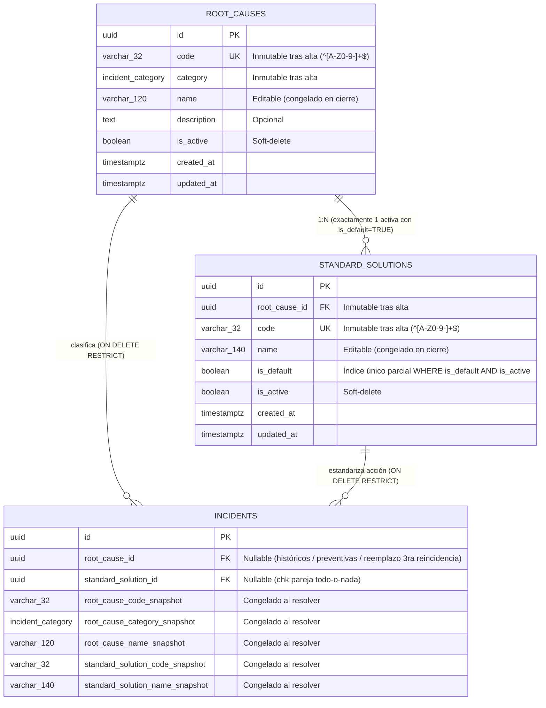
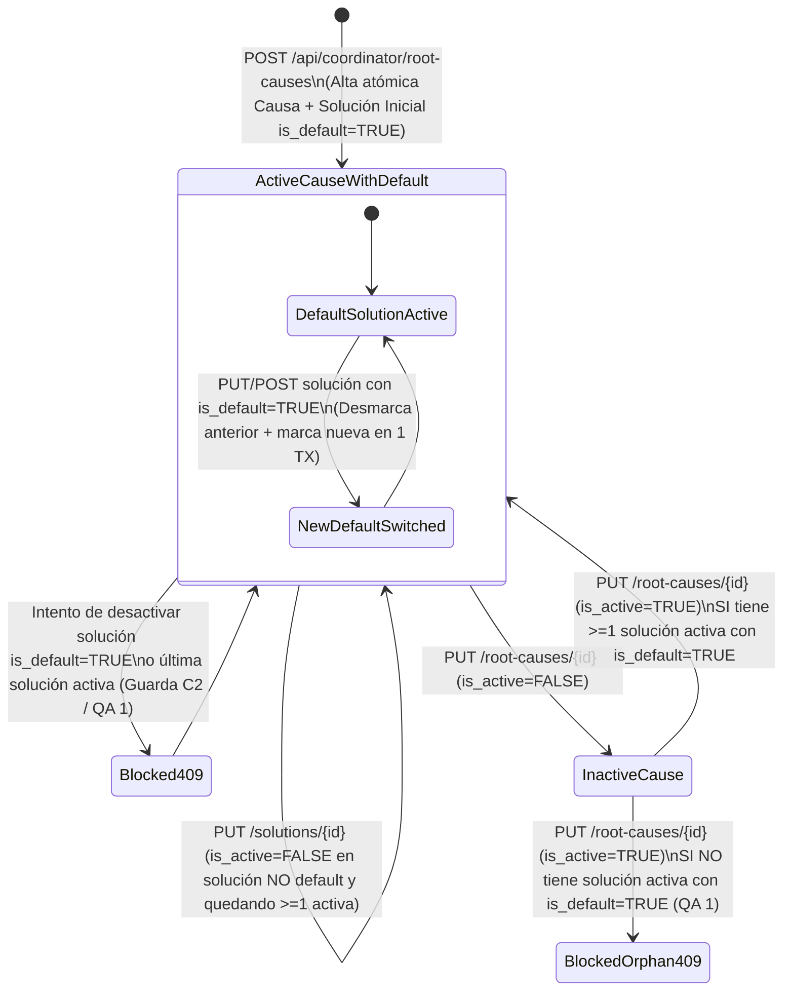

# Plan de Implementación Técnica: Taxonomía de Causas Raíz y Soluciones Estandarizadas
**Módulo:** `25-root-cause-taxonomy` (Feature 11 de `docs/features_pendientes.md`)  
**Versión:** 1.0  
**Estado:** Plan Técnico para Validación SDD (Fase 2 — Sin Código de Implementación)  
**Marco Normativo:** [`constitution.md`](file:///c:/Users/Friki/.gemini/antigravity/scratch/gestor-incidencias-vending/constitution.md) · [`AGENTS.md`](file:///c:/Users/Friki/.gemini/antigravity/scratch/gestor-incidencias-vending/AGENTS.md) · [`docs/design.md`](file:///c:/Users/Friki/.gemini/antigravity/scratch/gestor-incidencias-vending/docs/design.md)  
**Especificación Funcional:** [`specs/25-root-cause-taxonomy/spec.md`](file:///c:/Users/Friki/.gemini/antigravity/scratch/gestor-incidencias-vending/specs/25-root-cause-taxonomy/spec.md) · [`specs/functional/root_cause_taxonomy_spec.md`](file:///c:/Users/Friki/.gemini/antigravity/scratch/gestor-incidencias-vending/specs/functional/root_cause_taxonomy_spec.md)  
**Contratos Técnicos:** [`specs/technical/root_cause_taxonomy_contracts.md`](file:///c:/Users/Friki/.gemini/antigravity/scratch/gestor-incidencias-vending/specs/technical/root_cause_taxonomy_contracts.md) · [`specs/technical/database_schema.md`](file:///c:/Users/Friki/.gemini/antigravity/scratch/gestor-incidencias-vending/specs/technical/database_schema.md) · [`specs/technical/schema_correspondence_contract.md`](file:///c:/Users/Friki/.gemini/antigravity/scratch/gestor-incidencias-vending/specs/technical/schema_correspondence_contract.md)

---

## 1. Arquitectura de Módulos y Estructura de Ficheros

La solución se diseña bajo **Clean Architecture** en PHP 8.2+ POO puro (`declare(strict_types=1);`) en el backend, persistencia única sobre **PostgreSQL 16+ (`pdo_pgsql`)** y **Vue 3 (Composition API via ES Modules nativos)** junto con **Chart.js 4.x** alojado localmente en el frontend, respetando los artículos III, IV y V de `constitution.md`.

```mermaid
flowchart TD
    subgraph Frontend ["Frontend · Vue 3 ESM + Chart.js 4.x Local + IndexedDB"]
        TRV["TechnicianRouteView.js\n(Selector Causa Raíz + Preselección 1-Tap)"]
        IDB["OfflineStorageService.js\n(route_snapshots.root_cause_taxonomy)"]
        CPT["CoordinatorRootCauseParetoTab.js\n(Gráfico Combinado Pareto 80/20 + Tabla + CSV)"]
        CCM["CoordinatorRootCauseCatalogModal.js\n(CRUD Maestro Causas y Soluciones)"]
        CID["CoordinatorIncidentDetailModal.js\n(Insignia Clasificación en Detalle/Historial)"]
        CHJS["/assets/js/vendor/chart.umd.min.js\n(Chart.js 4.x Local Precacheado en sw.js)"]
    end

    subgraph Presentation ["Presentation Layer · REST API Controllers"]
        TC["TechnicianController.php\n(GET /root-causes, POST /incidents/{id}/resolve)"]
        TOSC["TechnicianOfflineSyncController.php\n(GET /offline/bootstrap con taxonomía)"]
        CC["CoordinatorController.php\n(POST /coordinator/incidents/{id}/resolve)"]
        CRCC["CoordinatorRootCauseController.php\n(CRUD /api/coordinator/root-causes & /solutions)"]
        CMC["CoordinatorMetricsController.php\n(GET /metrics/root-causes-pareto & /export)"]
    end

    subgraph Application ["Application Layer · Use Cases & Services"]
        RCTS["RootCauseTaxonomyService.php\n(Catálogo Maestro + Invariantes QA 1 + Auditoría)"]
        RCPS["RootCauseParetoService.php\n(Motor Pareto 80/20 + MTTR + Costes + CSV UTF-8 BOM)"]
        SPTS["SparePartTraceabilityService.php\n(Resolución Correctiva + Congelación Snapshot)"]
        OSS["OfflineSyncService.php\n(Tolerancia Catálogo Desactivado + Volcado C5)"]
    end

    subgraph Domain ["Core / Domain Layer · Entities & Validators"]
        RC["RootCause.php & StandardSolution.php"]
        RTV["ResolutionTaxonomyValidator.php\n(Reglas D1/D2/QA 3 + Independencia >=20 chars)"]
        MN["ManufacturerNormalizer.php\n(Extracción Determinista Formato Título QA 4)"]
        INC["Incident.php\n(+7 campos de taxonomía y snapshots)"]
    end

    subgraph Infrastructure ["Infrastructure Layer · PDO PostgreSQL 16+"]
        PRCR["PdoRootCauseRepository.php\n(Tablas 35 y 36 + Bloqueos FOR UPDATE)"]
        PRPA["PdoRootCauseParetoAnalyticsRepository.php\n(Agregación SQL Pareto + Costes Repuestos)"]
        PIR["PdoIncidentRepository.php\n(Persistencia de Snapshots en Tabla 4)"]
        PG[("PostgreSQL 16+\nroot_causes (T35)\nstandard_solutions (T36)\nincidents (T4 +7 cols)")]
    end

    TRV --> IDB
    TRV --> TC
    CPT --> CHJS
    CPT --> CMC
    CCM --> CRCC
    CID --> CC
    TC --> RCTS
    TC --> SPTS
    TOSC --> RCTS
    CC --> SPTS
    CRCC --> RCTS
    CMC --> RCPS
    RCTS --> PRCR
    RCPS --> MN
    RCPS --> PRPA
    SPTS --> RTV
    SPTS --> PRCR
    SPTS --> PIR
    OSS --> RTV
    OSS --> PRCR
    PRCR --> PG
    PRPA --> PG
    PIR --> PG
```



### 1.1. Base de Datos y Esquema Relacional (`database/` y `specs/technical/`)
| Fichero | Acción | Responsabilidad |
| :--- | :--- | :--- |
| `database/migrations/021_root_cause_taxonomy.sql` | **Crear** | Migración DDL incremental idempotente: creación de `root_causes` (Tabla 35) y `standard_solutions` (Tabla 36), índice parcial único `idx_standard_solutions_one_default_per_cause`, triggers `updated_at`, ampliación de `incidents` (Tabla 4, +7 columnas y `chk_incidents_taxonomy_pair_consistency`) y sembrado idempotente (`ON CONFLICT DO NOTHING`) de las 16 causas raíz y 34 soluciones estandarizadas iniciales. |
| `database/supabase_init.sql` | **Modificar** | Incorporar las Tablas 35 (`root_causes`) y 36 (`standard_solutions`) y las 7 nuevas columnas de `incidents` al esquema maestro consolidado para mantener paridad 1:1 con migraciones. |
| `database/supabase_seeds.sql` | **Modificar** | Añadir el catálogo inicial de 16 Causas Raíz (`RC-MEC-*`, `RC-ELE-*`, `RC-PAY-*`, `RC-REF-*`, `RC-DSP-*`, `RC-COM-*`, `RC-EXT-*`) y 34 Soluciones Estandarizadas (`SOL-*`), más datos semilla de resoluciones clasificadas para certificación analítica. |
| `src/Infrastructure/Database/SeedRunner.php` | **Modificar** | Sincronizar el sembrado programático de entorno de pruebas con las 16 causas raíz y 34 soluciones estandarizadas. |
| `specs/technical/database_schema.md` | **Modificar** | Documentar las Tablas 35 y 36 y las 7 nuevas columnas de `incidents` (pasando de 34 a 36 tablas de dominio). |
| `specs/technical/schema_correspondence_contract.md` | **Modificar** | Actualizar el inventario canónico de tablas (36 tablas) y columnas de `incidents` (50 columnas) verificado por `SchemaCorrespondenceTest`. |

### 1.2. Capa de Dominio (`src/Core/`)
| Fichero | Acción | Responsabilidad |
| :--- | :--- | :--- |
| `src/Core/Domain/Model/RootCause.php` | **Crear** | Entidad inmutable de dominio que modela una Causa Raíz (`id`, `code`, `category`, `name`, `description`, `isActive`, `solutions`, `createdAt`, `updatedAt`). |
| `src/Core/Domain/Model/StandardSolution.php` | **Crear** | Entidad inmutable de dominio que modela una Solución Estandarizada (`id`, `rootCauseId`, `code`, `name`, `isDefault`, `isActive`, `createdAt`, `updatedAt`). |
| `src/Core/Domain/Model/Incident.php` | **Modificar** | Ampliar la entidad con los 7 atributos anulables de clasificación (`rootCauseId`, `standardSolutionId`, `rootCauseCodeSnapshot`, `rootCauseCategorySnapshot`, `rootCauseNameSnapshot`, `standardSolutionCodeSnapshot`, `standardSolutionNameSnapshot`) y el método de dominio `applyResolutionTaxonomySnapshot()`. |
| `src/Core/Domain/Repository/RootCauseRepositoryInterface.php` | **Crear** | Contrato de persistencia del catálogo de causas raíz y soluciones (lectura activa para técnico/offline, listado administrativo para coordinador, bloqueo `FOR UPDATE`, alta atómica, actualización e inmutabilidad). |
| `src/Core/Service/ResolutionTaxonomyValidator.php` | **Crear** | Servicio puro de dominio que valida: (1) presencia conjunta de `root_cause_id` y `standard_solution_id`, (2) pertenencia jerárquica `solution.root_cause_id === root_cause.id`, (3) estado `is_active = true` en cierres online vs. tolerancia a desactivación sobrevenida en sincronización offline (`isOfflineDeferredSync = true`, `D2`, `EARS 03.3`), y (4) independencia estricta respecto a los $\ge 20$ caracteres reales de `resolution_diagnosis` y `resolution_action` (Art. V.1). |
| `src/Core/Service/ManufacturerNormalizer.php` | **Crear** | Servicio puro determinista (`QA 4`) que extrae la marca a partir de `machines.model` (`btrim` $\rightarrow$ primer token antes del primer espacio $\rightarrow$ normalización *Case-Insensitive* a *Title Case*: `Necta`, `Jofemar`, `Fasel`, `Saeco`, `Bianchi`, `Azkoyen`, `Sanden`, o `'Sin Marca Especificada'` si es nulo/vacío) y expone `matchesManufacturerFilter()`. |

### 1.3. Capa de Aplicación (`src/Application/`)
| Fichero | Acción | Responsabilidad |
| :--- | :--- | :--- |
| `src/Application/DTO/RootCauseCatalogItemDto.php` | **Crear** | DTO de serialización JSON de una Causa Raíz y su lista de `StandardSolutionItemDto` para los endpoints de técnico, bootstrap offline y administración de coordinación. |
| `src/Application/DTO/ParetoFilterDto.php` | **Crear** | DTO inmutable de filtrado analítico (`startDate`, `endDate`, `category`, `manufacturer`, `machineModel`, `locationId`, `technicianId`, `vitalFewOnly`). |
| `src/Application/DTO/RootCauseParetoReportDto.php` | **Crear** | DTO del informe completo de Pareto 80/20 (`summary`, `availableFilters`, `paretoItems`). |
| `src/Application/DTO/CoordinatorIncidentDetailDto.php` | **Modificar** | Incluir el bloque `root_cause_classification` en la respuesta de detalle e historial para roles `COORDINATOR` y `TECHNICIAN`, manteniéndolo ausente en DTOs de `LOCATION_RESPONSIBLE`, seguimiento QR y albarán A4 (Art. V.4, `D4`, `QA 5`). |
| `src/Application/DTO/OfflineBootstrapSnapshotDto.php` | **Modificar** | Incorporar la colección `root_cause_taxonomy` al paquete de precarga offline del técnico (`RF-03`, `EARS 03.1`). |
| `src/Application/Service/RootCauseTaxonomyService.php` | **Crear** | Orquestador transaccional del catálogo maestro (`RF-01`, `D1`, `D3`, `C2`, `C4`, `QA 1`): alta atómica de causa + solución predeterminada inicial, edición con inmutabilidad de `code`/`category`/`root_cause_id`, conmutación atómica de `is_default`, guardas de bloqueo al desactivar la última solución activa o la solución por defecto vigente, bloqueo de reactivación huérfana y registro en `audit_log` bajo `ROOT_CAUSE_TAXONOMY`. |
| `src/Application/Service/RootCauseParetoService.php` | **Crear** | Motor matemático del Diagrama de Pareto 80/20 (`RF-05`, `D5`, `C1`, `C3`, `C6`, `QA 2`, `QA 4`): cálculo de porcentajes redondeados a 2 decimales con cierre exacto del último peldaño en `100.00%`, marcaje de Zona Vital (`<= 80.00%` acumulado inclusive), cruce con MTTR y repuestos, desempate determinista de solución más frecuente (`is_default DESC, code ASC`) y generador CSV `UTF-8 BOM` en dos secciones. |
| `src/Application/Service/SparePartTraceabilityService.php` | **Modificar** | Integrar `ResolutionTaxonomyValidator` y la congelación de los 5 campos `*_snapshot` en `resolveIncidentWithConsumption()`, soportando tanto cierres online como sincronizaciones diferidas offline y reaperturas en garantía `< 48h` (`C1`). |
| `src/Application/Service/OfflineSyncService.php` | **Modificar** | Propagar `root_cause_id` y `standard_solution_id` desde las mutaciones `RESOLVE_STOP` hacia el servicio de resolución con `isOfflineDeferredSync = true` y preservar la pareja elegida + nombres congelados dentro del JSON de `conflict_dump` cuando ocurra colisión `409 CONFLICT` (`C5`, `EARS 03.4`). |

### 1.4. Capa de Infraestructura (`src/Infrastructure/`)
| Fichero | Acción | Responsabilidad |
| :--- | :--- | :--- |
| `src/Infrastructure/Repository/PdoRootCauseRepository.php` | **Crear** | Implementación PDO PostgreSQL de `RootCauseRepositoryInterface` con soporte para bloqueos pesimistas `SELECT ... FOR UPDATE`, conmutación atómica del índice parcial `is_default = TRUE` y consultas optimizadas sin N+1. |
| `src/Infrastructure/Repository/PdoRootCauseParetoAnalyticsRepository.php` | **Crear** | Consultas analíticas SQL sobre `incidents`, `machines`, `locations`, `incident_spare_parts` y `spare_parts` filtradas por `resolved_at` vigente en `RESOLVED`/`CLOSED` (`QA 2`), devolviendo filas crudas listas para la normalización de fabricante y agregación de Pareto. |
| `src/Infrastructure/Repository/PdoIncidentRepository.php` | **Modificar** | Mapear las 7 nuevas columnas de `incidents` en lecturas (`hydrate`) y escrituras (`save` / `update`), además de registrar la clasificación previa en `incident_history` ante reaperturas en garantía (`C1`). |

### 1.5. Capa de Presentación REST (`src/Presentation/`)
| Fichero | Acción | Responsabilidad |
| :--- | :--- | :--- |
| `src/Presentation/Controller/CoordinatorRootCauseController.php` | **Crear** | Endpoints exclusivos de `COORDINATOR` (`QA 5`): `GET /api/coordinator/root-causes`, `POST /api/coordinator/root-causes`, `PUT /api/coordinator/root-causes/{id}`, `POST /api/coordinator/root-causes/{id}/solutions` y `PUT /api/coordinator/root-causes/{id}/solutions/{solutionId}`. |
| `src/Presentation/Controller/CoordinatorMetricsController.php` | **Modificar** | Añadir `GET /api/coordinator/metrics/root-causes-pareto` y `GET /api/coordinator/metrics/root-causes-pareto/export` con blindaje de rol `COORDINATOR` (`403 FORBIDDEN` para otros roles, `QA 5`). |
| `src/Presentation/Controller/TechnicianController.php` | **Modificar** | Añadir `GET /api/technician/root-causes` y extender `POST /api/technician/incidents/{id}/resolve` para validar y persistir `root_cause_id` y `standard_solution_id`. |
| `src/Presentation/Controller/CoordinatorController.php` | **Modificar** | Extender `POST /api/coordinator/incidents/{id}/resolve` (`QA 3`) para exigir y persistir `root_cause_id` y `standard_solution_id` en cierres administrativos manuales. |
| `src/Presentation/Controller/TechnicianOfflineSyncController.php` | **Modificar** | Incluir `root_cause_taxonomy` en `GET /api/technician/offline/bootstrap`. |
| `src/Presentation/Routing/AppRouter.php` | **Modificar** | Registrar las nuevas rutas REST de catálogo técnico, administración de causas raíz y analítica/exportación de Pareto. |

### 1.6. Frontend Web y PWA (`public/`)
| Fichero | Acción | Responsabilidad |
| :--- | :--- | :--- |
| `public/assets/js/vendor/chart.umd.min.js` | **Crear** | Librería oficial **Chart.js v4.4.x** (build UMD autocontenido sin dependencias externas), autorizada bajo Art. IV.3 (`D6`). |
| `public/index.html` | **Modificar** | Cargar `<script src="/assets/js/vendor/chart.umd.min.js"></script>` antes de `app.js`. |
| `public/sw.js` | **Modificar** | Incrementar `CACHE_NAME` a `vendguard-app-shell-v3` e incluir `/assets/js/vendor/chart.umd.min.js` y los nuevos componentes JS en `APP_SHELL_ASSETS` para cumplir `OfflinePwaAppShellContractTest`. |
| `public/assets/js/services/OfflineStorageService.js` | **Modificar** | Almacenar y recuperar `root_cause_taxonomy` dentro de `route_snapshots` en `IndexedDB` e incluir `root_cause_id` y `standard_solution_id` en los payloads `RESOLVE_STOP` de `mutation_outbox`. |
| `public/assets/js/views/TechnicianRouteView.js` | **Modificar** | Incorporar en el modal de resolución el selector de Causa Raíz (priorizando la categoría de la avería + `OTHER` con conmutador *"Mostrar todas las categorías"*) y el selector de Solución Estandarizada con preselección automática en 1 toque (`is_default = true`), sin rellenar ni alterar los campos `diagnosis` ni `action` (`D1`–`D3`, `RF-02`). |
| `public/assets/js/components/CoordinatorRootCauseParetoTab.js` | **Crear** | Pestaña analítica en el Dashboard de Coordinación con tarjetas KPI, barra de filtros multicriterio (fechas, categoría, fabricante, modelo, sede, técnico, solo Zona Vital 80/20), lienzo `<canvas>` Chart.js combinado (barras + curva acumulada 0–100% + línea umbral 80%), tabla de desglose con MTTR y repuestos, botón de exportación CSV y acceso al modal del catálogo. |
| `public/assets/js/components/CoordinatorRootCauseCatalogModal.js` | **Crear** | Modal de administración del catálogo maestro para crear/editar causas raíz, añadir soluciones estandarizadas, conmutar la solución predeterminada y activar/desactivar registros con feedback claro de las guardas de integridad (`409 CONFLICT`). |
| `public/assets/js/components/CoordinatorDashboardView.js` | **Modificar** | Integrar la pestaña *"Causas Raíz (Pareto 80/20)"* y el acceso al catálogo maestro. |
| `public/assets/js/components/CoordinatorIncidentDetailModal.js` | **Modificar** | Mostrar la insignia técnica `[RC-CODE] Nombre Causa → [SOL-CODE] Nombre Solución` en el detalle de averías resueltas/cerradas y exigir el selector de taxonomía cuando el Coordinador resuelva manualmente una avería (`QA 3`). |
| `public/assets/css/styles.css` | **Modificar** | Estilos de las insignias técnicas, contenedor del gráfico de Pareto, indicadores de Zona Vital 80/20 y selectores táctiles ($\ge 44\text{px}$) usando exclusivamente tokens CSS (`var(--color-*)`, bordes `4px`/`8px`) conforme a `docs/design.md`. |

---

## 2. Modelo de Datos Relacional, Esquema `IndexedDB` y Contratos REST

### 2.1. Modelo Relacional PostgreSQL (`021_root_cause_taxonomy.sql`)



#### Invariantes garantizados en el motor PostgreSQL:
1. **Unicidad de Solución Predeterminada Activa:**
   ```sql
   CREATE UNIQUE INDEX IF NOT EXISTS idx_standard_solutions_one_default_per_cause
       ON standard_solutions (root_cause_id)
       WHERE is_default = TRUE AND is_active = TRUE;
   ```
2. **Coherencia Todo-o-Nada en `incidents`:**
   ```sql
   CONSTRAINT chk_incidents_taxonomy_pair_consistency CHECK (
       (
           root_cause_id IS NULL
           AND standard_solution_id IS NULL
           AND root_cause_code_snapshot IS NULL
           AND root_cause_category_snapshot IS NULL
           AND root_cause_name_snapshot IS NULL
           AND standard_solution_code_snapshot IS NULL
           AND standard_solution_name_snapshot IS NULL
       )
       OR (
           root_cause_id IS NOT NULL
           AND standard_solution_id IS NOT NULL
           AND root_cause_code_snapshot IS NOT NULL
           AND root_cause_category_snapshot IS NOT NULL
           AND root_cause_name_snapshot IS NOT NULL
           AND standard_solution_code_snapshot IS NOT NULL
           AND standard_solution_name_snapshot IS NOT NULL
       )
   )
   ```

### 2.2. Extensión del Esquema `IndexedDB` (`vendguard_offline_v1`)
Sin alterar la versión ni los almacenes de `IndexedDB` creados en el módulo 24 (`route_snapshots` y `mutation_outbox`), se enriquece el contrato de sus documentos JSON:
- **En `route_snapshots` (clave `technician_id`):** el objeto almacenado incorpora `root_cause_taxonomy: Array<RootCauseCatalogItem>` con las causas raíz activas y sus soluciones estandarizadas activas descargadas en `/api/technician/offline/bootstrap`.
- **En `mutation_outbox` (operaciones `RESOLVE_STOP`):** el objeto `payload` incorpora obligatoriamente:
  ```json
  {
    "diagnosis": "Texto libre >= 20 caracteres...",
    "action": "Texto libre >= 20 caracteres...",
    "root_cause_id": "uuid-causa-raiz",
    "standard_solution_id": "uuid-solucion-estandarizada",
    "consumed_parts": []
  }
  ```

### 2.3. Matriz de Contratos de API REST

| Método y Ruta | Roles Autorizados | Códigos HTTP | Propósito |
| :--- | :--- | :--- | :--- |
| `GET /api/technician/root-causes` | `TECHNICIAN`, `COORDINATOR` | `200`, `401`, `403` | Devuelve el catálogo activo (`is_active = true`) con soluciones anidadas ordenadas por `is_default DESC, code ASC`. |
| `GET /api/technician/offline/bootstrap` | `TECHNICIAN` | `200`, `401`, `403` | Incluye `root_cause_taxonomy` dentro del snapshot offline de ruta. |
| `POST /api/technician/incidents/{id}/resolve` | `TECHNICIAN`, `COORDINATOR` | `200`, `401`, `403`, `404`, `409`, `422` | Resuelve una avería validando taxonomía, repuestos y $\ge 20$ caracteres, congelando los 5 campos `*_snapshot`. |
| `POST /api/coordinator/incidents/{id}/resolve` | `COORDINATOR` | `200`, `401`, `403`, `404`, `409`, `422` | Resolución administrativa manual desde Coordinación exigiendo clasificación de Causa Raíz y Solución (`QA 3`). |
| `GET /api/coordinator/root-causes` | `COORDINATOR` | `200`, `401`, `403` | Lista el catálogo completo (activos e inactivos) + contadores de uso histórico (`incidents_count`). |
| `POST /api/coordinator/root-causes` | `COORDINATOR` | `201`, `400`, `401`, `403`, `409`, `422` | Alta atómica de Causa Raíz junto con su `initial_solution` predeterminada (`is_default = true`, `QA 1`). |
| `PUT /api/coordinator/root-causes/{id}` | `COORDINATOR` | `200`, `400`, `401`, `403`, `404`, `409`, `422` | Actualiza `name`, `description` o `is_active`. Rechaza cambios en `code` o `category` (`422`) y reactivaciones huérfanas (`409`). |
| `POST /api/coordinator/root-causes/{id}/solutions` | `COORDINATOR` | `201`, `400`, `401`, `403`, `404`, `409`, `422` | Añade una Solución Estandarizada a la causa; si `is_default = true`, desmarca atómicamente la anterior. |
| `PUT /api/coordinator/root-causes/{id}/solutions/{solutionId}` | `COORDINATOR` | `200`, `400`, `401`, `403`, `404`, `409`, `422` | Actualiza `name`, `is_default` o `is_active`. Aplica guardas `C2` y `QA 1` ante desactivación de solución por defecto o última activa. |
| `GET /api/coordinator/metrics/root-causes-pareto` | `COORDINATOR` | `200`, `400`, `401`, `403`, `422` | Devuelve el informe analítico de Pareto 80/20, KPIs globales, filtros disponibles y filas agregadas. |
| `GET /api/coordinator/metrics/root-causes-pareto/export` | `COORDINATOR` | `200`, `400`, `401`, `403`, `422` | Descarga el CSV `UTF-8 BOM` (`;`) en dos secciones (Ranking Pareto + Detalle de Averías Clasificadas). |

---

## 3. Algoritmos Clave en Pseudocódigo y Máquinas de Estado

### 3.1. Máquina de Estados e Invariantes del Catálogo Maestro (`RootCauseTaxonomyService`)



#### Pseudocódigo Transaccional (`RootCauseTaxonomyService`):
```text
FUNCTION createRootCauseWithInitialSolution(coordinatorId, payload):
    ASSERT_IMMUTABLE_FORMAT(payload.code, "^[A-Z0-9-]+$")
    ASSERT_VALID_CATEGORY(payload.category)
    ASSERT_NON_EMPTY(payload.name, maxLen = 120)
    ASSERT_NON_EMPTY(payload.initial_solution.code, "^[A-Z0-9-]+$")
    ASSERT_NON_EMPTY(payload.initial_solution.name, maxLen = 140)

    BEGIN TRANSACTION
        IF repo.existsRootCauseCode(payload.code) THEN
            THROW DomainConflictException("ROOT_CAUSE_CODE_ALREADY_EXISTS") // 409
        IF repo.existsSolutionCode(payload.initial_solution.code) THEN
            THROW DomainConflictException("STANDARD_SOLUTION_CODE_ALREADY_EXISTS") // 409

        cause = repo.insertRootCause(
            code: UPPER(TRIM(payload.code)),
            category: payload.category,
            name: TRIM(payload.name),
            description: NULL_IF_BLANK(payload.description),
            isActive: TRUE
        )

        solution = repo.insertStandardSolution(
            rootCauseId: cause.id,
            code: UPPER(TRIM(payload.initial_solution.code)),
            name: TRIM(payload.initial_solution.name),
            isDefault: TRUE,
            isActive: TRUE
        )

        auditService.record(
            entityType: "ROOT_CAUSE_TAXONOMY",
            entityId: cause.id,
            action: "CREATE_ROOT_CAUSE",
            performedBy: coordinatorId,
            previousState: NULL,
            newState: { cause, initial_solution: solution }
        )
    COMMIT
    RETURN cause.withSolutions([solution])

FUNCTION updateRootCause(coordinatorId, causeId, payload):
    BEGIN TRANSACTION
        current = repo.findRootCauseForUpdate(causeId) // SELECT ... FOR UPDATE
        IF current IS NULL THEN THROW NotFoundException("ROOT_CAUSE_NOT_FOUND") // 404

        // QA 1 / C4: Inmutabilidad estricta de code y category
        IF (payload HAS "code" AND payload.code !== current.code)
           OR (payload HAS "category" AND payload.category !== current.category) THEN
            THROW ValidationException("TAXONOMY_IMMUTABLE_FIELD_MODIFICATION") // 422

        targetIsActive = payload.is_active ?? current.isActive
        IF current.isActive == FALSE AND targetIsActive == TRUE THEN
            // QA 1: Bloqueo de reactivación de causa huérfana
            IF NOT repo.hasActiveDefaultSolution(causeId) THEN
                THROW DomainConflictException("CANNOT_REACTIVATE_ORPHAN_ROOT_CAUSE") // 409

        updated = repo.updateRootCause(causeId, name: TRIM(payload.name), description: payload.description, isActive: targetIsActive)
        auditService.record("ROOT_CAUSE_TAXONOMY", causeId, "UPDATE_ROOT_CAUSE", coordinatorId, current, updated)
    COMMIT
    RETURN updated

FUNCTION updateStandardSolution(coordinatorId, causeId, solutionId, payload):
    BEGIN TRANSACTION
        cause = repo.findRootCauseForUpdate(causeId)
        solution = repo.findSolutionForUpdate(solutionId)
        IF cause IS NULL OR solution IS NULL OR solution.rootCauseId !== cause.id THEN
            THROW NotFoundException("STANDARD_SOLUTION_NOT_FOUND") // 404

        // QA 1 / C4: Inmutabilidad de code y root_cause_id
        IF (payload HAS "code" AND payload.code !== solution.code)
           OR (payload HAS "root_cause_id" AND payload.root_cause_id !== solution.rootCauseId) THEN
            THROW ValidationException("TAXONOMY_IMMUTABLE_FIELD_MODIFICATION") // 422

        targetIsActive = payload.is_active ?? solution.isActive
        targetIsDefault = payload.is_default ?? solution.isDefault

        // Caso 1: Desactivación de una solución activa
        IF solution.isActive == TRUE AND targetIsActive == FALSE THEN
            activeSolutionsCount = repo.countActiveSolutions(causeId)
            IF cause.isActive == TRUE AND activeSolutionsCount <= 1 THEN
                THROW DomainConflictException("CANNOT_DEACTIVATE_LAST_ACTIVE_SOLUTION") // 409 (C2)
            IF solution.isDefault == TRUE THEN
                THROW DomainConflictException("CANNOT_DEACTIVATE_DEFAULT_SOLUTION") // 409 (C2 / QA 1)
            targetIsDefault = FALSE

        // Caso 2: Reactivación de una solución previamente inactiva (QA 1)
        IF solution.isActive == FALSE AND targetIsActive == TRUE THEN
            IF targetIsDefault == TRUE THEN
                repo.clearActiveDefaultForCause(causeId)
            ELSE IF NOT repo.hasActiveDefaultSolution(causeId) THEN
                // Si la causa estaba inactiva y sin default activa, sigue requiring designación explícita
                targetIsDefault = FALSE

        // Caso 3: Conmutación o intento de desmarcar en vacío la solución predeterminada
        IF solution.isActive == TRUE AND targetIsActive == TRUE THEN
            IF solution.isDefault == TRUE AND targetIsDefault == FALSE THEN
                THROW DomainConflictException("CANNOT_UNSET_DEFAULT_WITHOUT_REPLACEMENT") // 409 (QA 1)
            IF solution.isDefault == FALSE AND targetIsDefault == TRUE THEN
                repo.clearActiveDefaultForCause(causeId)

        updated = repo.updateStandardSolution(solutionId, name: TRIM(payload.name), isDefault: targetIsDefault, isActive: targetIsActive)
        auditService.record("ROOT_CAUSE_TAXONOMY", solutionId, "UPDATE_STANDARD_SOLUTION", coordinatorId, solution, updated)
    COMMIT
    RETURN updated
```

---

### 3.2. Validación de Resolución, Congelación de Snapshots, Reaperturas y Sincronización Offline (`ResolutionTaxonomyValidator` + `SparePartTraceabilityService` + `OfflineSyncService`)

```text
FUNCTION validateAndResolveTaxonomy(incident, payload, isOfflineDeferredSync, requireTaxonomy):
    // Exención QA 3: El cierre automático a CLOSED por reemplazo de máquina en 3.ª reincidencia crónica
    // no pasa por resolveIncidentWithConsumption() y conserva NULL en las 7 columnas.

    hasRootCause = NOT IS_EMPTY(payload.root_cause_id)
    hasSolution  = NOT IS_EMPTY(payload.standard_solution_id)

    // Compatibilidad regresiva con suites de test legadas (cuando no envían campos de taxonomía y requireTaxonomy=false)
    IF NOT hasRootCause AND NOT hasSolution AND NOT requireTaxonomy THEN
        RETURN NULL_TAXONOMY_SNAPSHOT

    // Regla D2 / EARS 02.3: Ambos campos son obligatorios
    IF NOT hasRootCause OR NOT hasSolution THEN
        THROW ValidationException("MISSING_ROOT_CAUSE_OR_SOLUTION") // 422

    // Regla Art. V.1 / D2: Independencia estricta de los >= 20 caracteres reales de diagnosis y action
    // (Validado en paralelo por ResolutionValidator::validate without auto-fill)

    rootCause = rootCauseRepo.findRootCauseById(payload.root_cause_id)
    solution  = rootCauseRepo.findSolutionById(payload.standard_solution_id)

    IF rootCause IS NULL OR solution IS NULL THEN
        THROW ValidationException("ROOT_CAUSE_OR_SOLUTION_NOT_FOUND") // 422

    // Regla D1 / EARS 02.4: Coherencia jerárquica causa -> solución
    IF solution.rootCauseId !== rootCause.id THEN
        THROW ValidationException("SOLUTION_DOES_NOT_BELONG_TO_ROOT_CAUSE") // 422

    // Regla D2 vs EARS 03.3: En online deben estar activos; en sincronización diferida offline se tolera
    // que el Coordinador los haya desactivado mientras el técnico trabajaba sin cobertura
    IF NOT isOfflineDeferredSync THEN
        IF NOT rootCause.isActive OR NOT solution.isActive THEN
            THROW ValidationException("INACTIVE_ROOT_CAUSE_OR_SOLUTION") // 422

    // Regla C1 (Reapertura en garantía < 48h):
    // Si la incidencia ya tenía una clasificación previa de su primer cierre fallido,
    // antes de sobrescribirla se preserva en incident_history / audit_log el episodio previo.
    IF incident.rootCauseId IS NOT NULL THEN
        incidentHistoryRepo.recordPreviousResolutionClassification(incident)

    // Regla C4 / QA 3: Congelación atómica de los 5 campos *_snapshot
    RETURN TaxonomySnapshot(
        rootCauseId: rootCause.id,
        standardSolutionId: solution.id,
        rootCauseCodeSnapshot: rootCause.code,
        rootCauseCategorySnapshot: rootCause.category,
        rootCauseNameSnapshot: rootCause.name,
        standardSolutionCodeSnapshot: solution.code,
        standardSolutionNameSnapshot: solution.name
    )
```

#### Preservación en Volcado de Conflictos Offline (`C5` / `EARS 03.4`):
Cuando `OfflineSyncService` detecta una colisión `409 CONFLICT` (p. ej., la avería fue reasignada o cerrada en servidor mientras el técnico estaba sin cobertura) al procesar una mutación `RESOLVE_STOP` que contiene `root_cause_id` y `standard_solution_id`, el servicio resuelve los nombres del catálogo y adjunta en `conflict_dump` (y en el comentario de auditoría `[OFFLINE SYNC CONFLICT DUMP]`):
```json
{
  "offline_root_cause_classification": {
    "root_cause_id": "...",
    "root_cause_code": "RC-PAY-001",
    "root_cause_name": "Atasco en validador o canal de monedas",
    "standard_solution_id": "...",
    "standard_solution_code": "SOL-PAY-001A",
    "standard_solution_name": "Desmontaje, limpieza óptica y desatasco de validador de monedas"
  }
}
```

---

### 3.3. Motor Matemático del Diagrama de Pareto 80/20 y Exportación CSV (`RootCauseParetoService` + `ManufacturerNormalizer`)

#### A. Extracción Determinista de Fabricante (`QA 4`):
```text
FUNCTION extractManufacturer(rawMachineModel):
    trimmed = TRIM(rawMachineModel ?? "")
    IF trimmed == "" THEN
        RETURN "Sin Marca Especificada"
    firstToken = SPLIT_BY_WHITESPACE(trimmed)[0]
    RETURN TITLE_CASE_UTF8(LOWER_UTF8(firstToken))
    // Ejemplo: "NECTA KIKKO MAX" -> "Necta"; "jofemar vision" -> "Jofemar"; "Fasel" -> "Fasel"
```

#### B. Algoritmo de Agregación de Pareto 80/20 (`QA 2`, `C1`, `C3`, `C6`):
```text
FUNCTION buildParetoReport(filter: ParetoFilterDto):
    // 1. Consulta de averías correctivas con estado actual RESOLVED o CLOSED y resolved_at en [startDate, endDate]
    //    aplicando filtros de category, machineModel, locationId, technicianId en SQL,
    //    y filtrando en memoria o SQL por ManufacturerNormalizer::extractManufacturer(machine.model).
    rows = analyticsRepo.fetchResolvedIncidentsWithMetrics(filter)

    totalResolved = COUNT(rows)
    classifiedRows = FILTER(rows, r => r.rootCauseId IS NOT NULL)
    unclassifiedHistoricalCount = totalResolved - COUNT(classifiedRows)
    classifiedTotal = COUNT(classifiedRows)

    // Estado vacío seguro (C6): cero divisiones por cero
    IF classifiedTotal == 0 THEN
        RETURN EmptyParetoReport(totalResolved, classifiedTotal: 0, unclassifiedHistoricalCount)

    // 2. Agrupación por root_cause_id (1 incidencia = 1 voto con su causa definitiva actual tras eventual reapertura, C1 / QA 2)
    groups = GROUP_BY(classifiedRows, r => r.rootCauseId)

    // 3. Cálculo de métricas por grupo
    groupMetrics = []
    FOR EACH (rootCauseId, incList) IN groups:
        incidentsCount = COUNT(incList)
        // MTTR neto en minutos por avería (QA 2 / Spec 20/22)
        avgMttrMinutes = ROUND(AVG(incList.map(i => i.netMttrMinutes)), 1)
        sparePartsUnits = SUM(incList.map(i => i.totalConsumedUnits))
        sparePartsCostCents = SUM(incList.map(i => i.totalConsumedCostCents))

        // Solución más frecuente con desempate determinista (C6): count DESC, is_default DESC, code ASC
        topSolution = FIND_TOP_SOLUTION(incList, tieBreaker: "count DESC, is_default DESC, code ASC")

        // Marca/ modelo más frecuente dentro de esta causa
        topManufacturerModel = FIND_TOP_MANUFACTURER_MODEL(incList)

        groupMetrics.APPEND({
            rootCauseId,
            rootCauseCode: incList[0].currentRootCauseCode,
            rootCauseName: incList[0].currentRootCauseName, // QA 2: nombre vigente del catálogo en ranking
            rootCauseCategory: incList[0].currentRootCauseCategory,
            isActiveInCatalog: incList[0].rootCauseIsActive,
            incidentsCount,
            avgMttrMinutes,
            sparePartsUnits,
            sparePartsCostCents,
            topSolution,
            topManufacturerModel
        })

    // 4. Ordenación Pareto determinista (C6): incidents_count DESC, root_cause_code ASC
    SORT(groupMetrics, BY: [incidentsCount DESC, rootCauseCode ASC])

    // 5. Cálculo de porcentajes y Zona Vital 80/20 (QA 2, C3)
    runningCumulativeCount = 0
    crossed80Threshold = FALSE
    vitalFewCausesCount = 0
    vitalFewIncidentsCount = 0
    totalGroups = COUNT(groupMetrics)

    FOR index = 0 TO totalGroups - 1:
        item = groupMetrics[index]
        runningCumulativeCount += item.incidentsCount

        item.percentage = ROUND((item.incidentsCount / classifiedTotal) * 100, 2)

        // QA 2: El último elemento cierra exactamente en 100.00% para absorber derivas de coma flotante
        IF index == totalGroups - 1 THEN
            item.cumulativePercentage = 100.00
        ELSE
            item.cumulativePercentage = MIN(100.00, ROUND((runningCumulativeCount / classifiedTotal) * 100, 2))

        // C3: Pertenecen a la Zona Vital 80/20 todas las causas desde el rango 1 hasta e incluyendo
        // la primera causa cuyo cumulativePercentage alcanza o supera 80.00%
        IF NOT crossed80Threshold THEN
            item.isVitalFew8020 = TRUE
            vitalFewCausesCount += 1
            vitalFewIncidentsCount += item.incidentsCount
            IF item.cumulativePercentage >= 80.00 THEN
                crossed80Threshold = TRUE
        ELSE
            item.isVitalFew8020 = FALSE

        item.rank = index + 1

    vitalFewSharePercentage = ROUND((vitalFewIncidentsCount / classifiedTotal) * 100, 2)

    IF filter.vitalFewOnly == TRUE THEN
        displayedItems = FILTER(groupMetrics, item => item.isVitalFew8020 == TRUE)
    ELSE
        displayedItems = groupMetrics

    RETURN RootCauseParetoReportDto(summary, availableFilters, displayedItems)
```

#### C. Generación de CSV `UTF-8 BOM` en Dos Secciones (`QA 2`, `EARS 05.6`):
- **Prefijo binario:** `\xEF\xBB\xBF` (`UTF-8 BOM`) y delimitador `;`.
- **Sección 1 (Resumen de Pareto por Causa Raíz):** usa `current_root_cause_name` y `current_standard_solution_name` vigentes del catálogo maestro.
- **Sección 2 (Detalle de Averías Clasificadas):** separada por una línea en blanco, incluye tanto los nombres vigentes (`Causa_Raiz_Nombre_Vigente`, `Solucion_Nombre_Vigente`) como los nombres históricos congelados en el momento de la resolución (`Causa_Raiz_Nombre_Congelado_Cierre`, `Solucion_Nombre_Congelado_Cierre`).

---

## 4. Arquitectura de Componentes Frontend, Chart.js y Cumplimiento de Diseño (`docs/design.md`)

### 4.1. Modal de Resolución en `TechnicianRouteView.js` y `CoordinatorIncidentDetailModal.js`
- **Ubicación en el formulario:** Justo encima de los campos de texto libre `Diagnóstico realizado` y `Acción correctiva ejecutada`.
- **Filtrado inteligente de Causas Raíz (`D3`, `RF-02`):**
  - Por defecto, el desplegable muestra las causas activas cuya `category` coincide con `incident.category` (agrupadas bajo *"Sugeridas para esta categoría"*) seguidas de las causas activas de categoría `OTHER` (*"Causas transversales / externas"*).
  - Un conmutador explícito (`checkbox` / `switch` táctil $\ge 44\text{px}$) **"Mostrar todas las categorías"** despliega el resto del catálogo activo agrupado por categoría.
- **Preselección en 1 toque (`D1`, `EARS 02.2`):**
  - Al cambiar `selectedRootCauseId`, un `watch` en Vue localiza automáticamente la solución activa con `is_default === true` dentro de `selectedCause.solutions` y asigna `selectedStandardSolutionId = defaultSolution.id`.
  - Si existen soluciones adicionales activas para esa causa, el técnico puede cambiarla en un segundo toque.
- **Prohibición de autorrelleno trampa (`D2`, Art. V.1):**
  - Seleccionar una causa o solución **jamás** inyecta texto en `diagnosis` ni en `action`. Ambos textareas mantienen su contador en vivo de $\ge 20$ caracteres reales.

### 4.2. Gráfico Combinado de Pareto 80/20 en `CoordinatorRootCauseParetoTab.js` (`D5`, `D6`)
- **Integración con Chart.js (`window.Chart`):**
  - Se instancia un gráfico de tipo `'bar'` con dos datasets:
    1. **Dataset 1 (`type: 'bar'`, `yAxisID: 'yFrequency'`):** Frecuencia absoluta de averías (`incidents_count`). Los colores se resuelven leyendo los tokens CSS computados desde `getComputedStyle(document.documentElement)` (sin literales hexadecimales en el JS para cumplir `DesignTokenDebtRatchetTest`):
       - Barras en **Zona Vital 80/20 (`is_vital_few_80_20 === true`):** token `--color-primary` (azul eléctrico institucional) con radio de borde superior `4px` (`borderRadius: 4`).
       - Barras en **Cola Trivial 20% (`is_vital_few_80_20 === false`):** token `--color-border` / gris pizarra atenuado.
    2. **Dataset 2 (`type: 'line'`, `yAxisID: 'yCumulative'`):** Porcentaje acumulado (`cumulative_percentage`, escala `0` a `100%`), trazado con el token `--color-warning` o `--color-danger`, puntos de `4px` y línea continua de `2px`.
  - **Línea horizontal de corte del 80 %:** Trazada mediante un tercer dataset horizontal ligero o plugin inline de canvas en `y = 80%` con trazo discontinuo (`borderDash: [6, 4]`) para evidenciar visualmente el umbral de Pareto.
  - **Ciclo de vida Vue 3:** La instancia de `Chart` se guarda en una variable no reactiva (`let chartInstance = null`) para evitar proxies profundos de Vue 3, actualizándose al cambiar filtros y destruyéndose limpiamente en `onBeforeUnmount()`.

### 4.3. Blindaje de Privacidad de Taller (Art. V.4, `D4`, `QA 5`)
- **Visible para `COORDINATOR` y `TECHNICIAN`:** En `CoordinatorIncidentDetailModal.js`, historial de máquina y vista de parada resuelta del técnico se muestra el chip técnico con borde hairline `4px`:
  `[RC-PAY-001] Atasco en validador o canal de monedas → [SOL-PAY-001A] Desmontaje, limpieza óptica y desatasco de validador de monedas`.
- **Oculto al 100 % para `LOCATION_RESPONSIBLE`, QR público y Albarán A4:**
  - Los controladores/DTOs de sede (`LocationIncidentController`), seguimiento público QR (`PublicMachineQrController`) y albarán de conformidad A4 (`ServiceSheetFormatter` / `DigitalSignatureController`) **no leen ni serializan** ninguna de las 7 columnas de taxonomía ni exponen los endpoints de Pareto o del catálogo maestro (`403 FORBIDDEN`).

---

## 5. Decisiones Técnicas Justificadas y Alternativas Descartadas

| Decisión Técnica | Justificación Arquitectónica | Alternativa Descartada y Motivo de Rechazo |
| :--- | :--- | :--- |
| **1. Congelación de 5 columnas `*_snapshot` en `incidents` además de las FKs (`C4`, `QA 3`)** | Permite que el Coordinador corrija erratas tipográficas o mejore la redacción del catálogo vivo (viéndolo reflejado en el ranking agregado de Pareto), mientras el expediente histórico de cada avería y la Sección 2 del CSV conservan intacto el texto exacto vigente cuando el técnico cerró la intervención (Art. III.3). | *Leer siempre por `JOIN` sin snapshots:* Descartado porque un cambio de redacción futuro alteraría retroactivamente la evidencia histórica del cierre técnico. |
| **2. Índice único parcial `WHERE is_default = TRUE AND is_active = TRUE` en PostgreSQL (`D1`, `QA 1`)** | Garantiza a nivel de motor relacional que nunca puedan coexistir dos soluciones predeterminadas activas para una misma causa raíz, eliminando condiciones de carrera en ediciones concurrentes. | *Validarlo únicamente en PHP antes del `UPDATE`:* Descartado por riesgo de condición de carrera (*TOCTOU*) y por violar el principio de integridad relacional de `constitution.md` Art. IV.2. |
| **3. Chart.js 4.x UMD alojado en `/public/assets/js/vendor/chart.umd.min.js` y precacheado en `sw.js` (`D6`)** | Cumple simultáneamente el Dogma Vanilla sin bundlers ni `node_modules` (Art. IV.3, con autorización expresa del Product Owner), el funcionamiento 100% autónomo sin CDNs de terceros que puedan fallar por bloqueo de red y el contrato `OfflinePwaAppShellContractTest`. | *Cargar Chart.js desde `cdn.jsdelivr.net`:* Descartado porque rompe la autonomía de red en entornos corporativos restringidos y el precacheo determinista del Service Worker. |
| **4. Extracción determinista de Fabricante en `ManufacturerNormalizer` (`QA 4`)** | Evita introducir una migración destructiva sobre `machines` y normaliza de forma 100% predecible y sin duplicados por mayúsculas/minúsculas (`"NECTA KIKKO MAX"` $\rightarrow$ `"Necta"`) tanto para el selector de filtro como para el cruce en la tabla y el CSV de Pareto. | *Agrupar por `SPLIT_PART(model, ' ', 1)` crudo en SQL sin normalizar caja:* Descartado porque separaría `"NECTA"` y `"Necta"` en dos marcas distintas si un coordinador introduce un modelo con capitalización diferente. |

---

## 6. Estrategia de Pruebas y Certificación

La batería de pruebas cubrirá los 3 niveles exigidos por `AGENTS.md` y `constitution.md` Art. III.4:

### 6.1. Pruebas Unitarias (`tests/Unit/`)
1. **`ResolutionTaxonomyValidatorTest.php`:**
   - Rechazo cuando falta `root_cause_id` o `standard_solution_id` (`422`).
   - Rechazo cuando la solución pertenece a otra causa raíz (`422`).
   - Rechazo cuando la causa o la solución están inactivas en una resolución online (`422`), pero aceptación cuando `isOfflineDeferredSync = true` (`EARS 03.3`).
   - Verificación de que la presencia de taxonomía válida **no** exime del mínimo de $\ge 20$ caracteres reales en `diagnosis` y `action` (Art. V.1).
2. **`ManufacturerNormalizerTest.php` (`QA 4`):**
   - Extracción de `"Necta"` desde `"Necta Kikko Max"`, `"NECTA SAMBA"` y `"  necta   krea  "`.
   - Modelos de una sola palabra (`"Fasel"` $\rightarrow$ `"Fasel"`).
   - Valores nulos o en blanco $\rightarrow$ `"Sin Marca Especificada"`.
3. **`RootCauseTaxonomyServiceTest.php` (`QA 1`, `C2`, `C4`):**
   - Alta atómica de causa raíz + solución inicial con `is_default = true`.
   - Rechazo (`422`) ante cualquier intento de mutar `code`, `category` o `root_cause_id`.
   - Rechazo (`409`) al intentar desactivar la última solución activa de una causa activa o la solución con `is_default = true` sin relevarla antes.
   - Conmutación atómica de `is_default = true` entre dos soluciones de la misma causa.
   - Reactivación de una solución antigua entrando siempre con `is_default = false` y bloqueo (`409`) al intentar reactivar una causa huérfana sin solución predeterminada activa.
   - Generación de trazas en `audit_log` con `previous_state` y `new_state`.
4. **`RootCauseParetoServiceTest.php` (`QA 2`, `C1`, `C3`, `C6`):**
   - Ordenación descendente por frecuencia y desempate alfabético por `code ASC`.
   - Redondeo a 2 decimales y cierre exacto del último peldaño acumulado en `100.00%`.
   - Marcaje de `is_vital_few_80_20 = true` desde el rango 1 hasta la primera causa que alcanza o supera el `80.00%` inclusive.
   - Separación entre averías clasificadas (base `100.00%`) e históricas sin clasificar (`unclassified_historical_count`).
   - Estado vacío seguro (`classified_incidents_count = 0`) sin división por cero.
   - Generación del CSV `UTF-8 BOM` con separador `;` y las dos secciones diferenciadas (nombre vigente en Sección 1; nombre vigente + nombre congelado en Sección 2).

### 6.2. Pruebas de Integración y Contratos (`tests/Integration/`)
1. **`RootCauseTaxonomyIntegrationTest.php`:**
   - Flujo E2E sobre PostgreSQL real: listado para técnico, resolución online congelando los 5 snapshots en `incidents`, renombrado posterior de la causa en el catálogo por el Coordinador y verificación de que el snapshot en `incidents` permanece inmutable mientras el ranking de Pareto muestra el nuevo nombre vigente (`C4`, `QA 2`).
   - Reapertura en garantía `< 48h` (`C1`): el segundo cierre actualiza la clasificación activa para Pareto mientras el primer episodio queda preservado en `incident_history`.
   - Sincronización diferida Offline PWA con causa desactivada en el ínterin (`EARS 03.3`) y preservación en `conflict_dump` ante colisión `409` (`C5`).
   - Cierre desde Coordinación (`POST /api/coordinator/incidents/{id}/resolve`, `QA 3`) exigiendo taxonomía, y cierre automático por reemplazo en 3.ª reincidencia crónica exento (`NULL`).
   - Blindaje de privacidad Art. V.4 y `QA 5`: verificación de que `LOCATION_RESPONSIBLE`, seguimiento QR y albarán A4 no reciben campos de taxonomía y que `TECHNICIAN` / `LOCATION_RESPONSIBLE` reciben `403 FORBIDDEN` en los endpoints de Pareto, exportación CSV y CRUD del catálogo.
2. **Paridad Estructural y Contratos Arquitectónicos Existentes:**
   - Actualización de `TestDataCleaner.php`, `PostgresFixtureBuilder.php`, `PostgresSchemaTest.php`, `SchemaCorrespondenceTest.php` y `SchemaConvergenceParityTest.php` para reflejar las 36 tablas y las 50 columnas de `incidents`.
   - Ejecución de `SingleEngineDialectContractTest`, `OfflinePwaAppShellContractTest` y `DesignTokenDebtRatchetTest` (cero deuda de tokens CSS).

---

## 7. Matriz de Trazabilidad Completa

| Requisito / Decisión / Caso QA | Artefactos de Implementación Asociados | Pruebas de Verificación |
| :--- | :--- | :--- |
| **`RF-01` / `D1` / `D3` / `QA 1` / `C2` / `C4`** (Catálogo 1-a-N, solución predeterminada única, alta atómica, inmutabilidad de códigos/categoría, guardas de desactivación/reactivación y auditoría) | `021_root_cause_taxonomy.sql`, `RootCause.php`, `StandardSolution.php`, `RootCauseTaxonomyService.php`, `PdoRootCauseRepository.php`, `CoordinatorRootCauseController.php`, `CoordinatorRootCauseCatalogModal.js` | `RootCauseTaxonomyServiceTest`, `RootCauseTaxonomyIntegrationTest` |
| **`RF-02` / `D1` / `D2` / `D3` / `QA 3`** (Captura guiada con priorización por categoría, preselección 1-Tap, obligatoriedad en cierres de técnico y coordinador, exención en reemplazo por 3.ª reincidencia e independencia de $\ge 20$ caracteres) | `ResolutionTaxonomyValidator.php`, `SparePartTraceabilityService.php`, `TechnicianController.php`, `CoordinatorController.php`, `TechnicianRouteView.js`, `CoordinatorIncidentDetailModal.js` | `ResolutionTaxonomyValidatorTest`, `RootCauseTaxonomyIntegrationTest` |
| **`RF-03` / `C5`** (Soporte Offline PWA en `IndexedDB`, tolerancia a desactivación sobrevenida y preservación en volcado de conflictos) | `OfflineBootstrapSnapshotDto.php`, `TechnicianOfflineSyncController.php`, `OfflineSyncService.php`, `OfflineStorageService.js`, `public/sw.js` | `RootCauseTaxonomyIntegrationTest`, `OfflinePwaAppShellContractTest` |
| **`RF-04` / `D4` / `QA 5` / Art. V.4** (Visibilidad en Coordinación y Técnico; opacidad total ante Sede, QR y Albarán A4; bloqueo `403` por rol) | `CoordinatorIncidentDetailDto.php`, `CoordinatorRootCauseController.php`, `CoordinatorMetricsController.php`, `CoordinatorIncidentDetailModal.js` | `RootCauseTaxonomyIntegrationTest` |
| **`RF-05` / `D5` / `D6` / `C1` / `C3` / `C6` / `QA 2` / `QA 4`** (Motor Pareto 80/20, normalización determinista de Fabricante, MTTR y coste de repuestos, Chart.js local y exportación CSV UTF-8 BOM en 2 secciones) | `ManufacturerNormalizer.php`, `RootCauseParetoService.php`, `PdoRootCauseParetoAnalyticsRepository.php`, `CoordinatorMetricsController.php`, `CoordinatorRootCauseParetoTab.js`, `/public/assets/js/vendor/chart.umd.min.js` | `ManufacturerNormalizerTest`, `RootCauseParetoServiceTest`, `RootCauseTaxonomyIntegrationTest`, `DesignTokenDebtRatchetTest` |
| **`RNF-01` a `RNF-03`** (Rendimiento SQL indexado $< 300\text{ ms}$, integridad relacional `ON DELETE RESTRICT` + snapshots inmutables y ergonomía táctil $\ge 44\text{px}$) | `021_root_cause_taxonomy.sql`, `PdoRootCauseParetoAnalyticsRepository.php`, `public/assets/css/styles.css` | `PostgresSchemaTest`, `SchemaCorrespondenceTest`, `DesignTokenDebtRatchetTest` |

---

## 8. Garantía de Dogma Vanilla y Dualidad Lingüística (`constitution.md` Art. IV.3 y Art. VI)

1. **Dogma Vanilla y Excepción Autorizada Art. IV.3:**
   - **Backend:** PHP 8.2+ POO puro (`declare(strict_types=1);`), sin frameworks ni librerías de Composer ajenas al motor estándar y `pdo_pgsql`.
   - **Frontend:** Vue 3 en ES Modules nativos sin bundlers (`webpack`, `vite`, `rollup`) ni `node_modules`. La única librería gráfica incorporada es **Chart.js 4.x** en un único fichero estático local (`/public/assets/js/vendor/chart.umd.min.js`) precacheado en `public/sw.js`, expresamente autorizada en `D6` conforme al Artículo IV.3 de `constitution.md`.
2. **Dualidad Lingüística Estricta:**
   - **100 % Inglés Técnico:** Todos los nombres de tablas (`root_causes`, `standard_solutions`), columnas (`root_cause_code_snapshot`, `is_default`), clases (`RootCauseParetoService`, `ManufacturerNormalizer`), métodos (`buildParetoReport`, `extractManufacturer`), variables, rutas de API y tests.
   - **100 % Castellano Neutro Profesional:** Todos los comentarios contextuales de código, mensajes de interfaz de usuario, etiquetas del catálogo inicial de causas y soluciones, cabeceras del archivo CSV exportado y documentación técnica/funcional.
