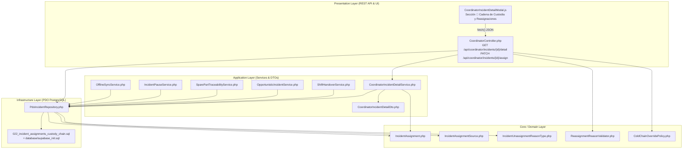
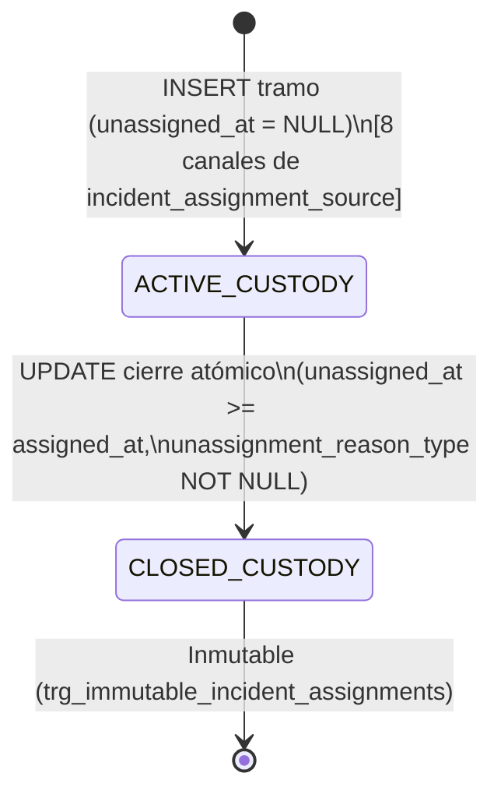
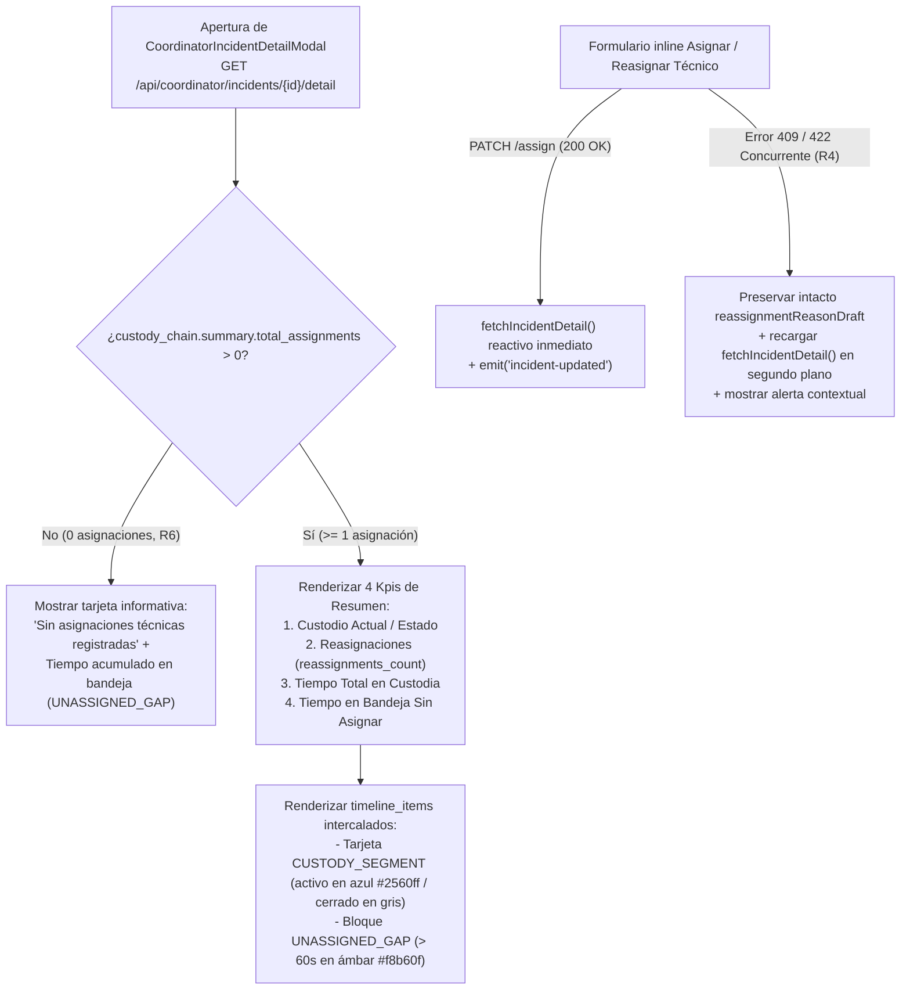

# Plan Técnico de Implementación: Historial Completo de Reasignaciones y Cadena de Custodia

**Módulo:** `26-reassignment-history-custody-chain` (Feature 12 — *Nice-to-Have* v1.1)  
**Versión:** 1.0  
**Fecha:** 2026-11-02  
**Estado:** Pendiente de Aprobación Humana (Gate SDD)  
**Especificación Funcional Base:** [`specs/26-reassignment-history-custody-chain/spec.md`](file:///c:/Users/Friki/.gemini/antigravity/scratch/gestor-incidencias-vending/specs/26-reassignment-history-custody-chain/spec.md)  
**Contratos Técnicos Base:** [`specs/technical/reassignment_history_custody_chain_contracts.md`](file:///c:/Users/Friki/.gemini/antigravity/scratch/gestor-incidencias-vending/specs/technical/reassignment_history_custody_chain_contracts.md)  
**Marco Normativo:** [`constitution.md`](file:///c:/Users/Friki/.gemini/antigravity/scratch/gestor-incidencias-vending/constitution.md) · [`AGENTS.md`](file:///c:/Users/Friki/.gemini/antigravity/scratch/gestor-incidencias-vending/AGENTS.md) · [`docs/design.md`](file:///c:/Users/Friki/.gemini/antigravity/scratch/gestor-incidencias-vending/docs/design.md)

---

## 1. Estructura de Módulos y Ficheros

La arquitectura respeta el aislamiento de capas de **Clean Architecture** en PHP 8.2+ POO puro (`declare(strict_types=1);`), persistencia relacional unificada mediante `pdo_pgsql` (PostgreSQL en Supabase / entorno de certificación local) y frontend reactivo en **Vue 3 (Composition API)** con ES Modules nativos sin *bundlers* ni librerías de terceros (Art. IV de [`constitution.md`](file:///c:/Users/Friki/.gemini/antigravity/scratch/gestor-incidencias-vending/constitution.md)).



### 1.1. Inventario de Archivos a Crear y Modificar

| Capa | Ruta del Archivo | Acción | Responsabilidad Técnica |
| :--- | :--- | :--- | :--- |
| **Domain** | [`src/Core/Domain/Enum/IncidentAssignmentSource.php`](file:///c:/Users/Friki/.gemini/antigravity/scratch/gestor-incidencias-vending/src/Core/Domain/Enum/IncidentAssignmentSource.php) | **Crear** | `enum` respaldado en `string` con los 8 canales de apertura de custodia (`INITIAL_ASSIGNMENT`, `COORDINATOR_REASSIGN`, `ABSENCE_COVERAGE`, `OPPORTUNISTIC_NEW`, `OPPORTUNISTIC_ASSUMED`, `OPPORTUNISTIC_TAKEOVER`, `SHIFT_HANDOVER_RELEASE`, `SANITARY_FAILSAFE_GUARD`) y sus etiquetas en español. |
| **Domain** | [`src/Core/Domain/Enum/IncidentUnassignmentReasonType.php`](file:///c:/Users/Friki/.gemini/antigravity/scratch/gestor-incidencias-vending/src/Core/Domain/Enum/IncidentUnassignmentReasonType.php) | **Crear** | `enum` respaldado en `string` con las 10 causas de cierre de tramo (`REASSIGNED_BY_COORDINATOR`, `ABSENCE_COVERAGE_REASSIGN`, `TAKEN_OVER_IN_SITU`, `SHIFT_HANDOVER`, `SANITARY_FAILSAFE_GUARD`, `SANITARY_FAILSAFE_UNASSIGNED`, `RESOLVED`, `CANCELLED`, `CHRONIC_REPLACEMENT_CLOSED`, `WARRANTY_REOPENED`) y el método `isUnresolvedTransferOrRelease(): bool` (`R2`, `QA 2`). |
| **Domain** | [`src/Core/Domain/Model/IncidentAssignment.php`](file:///c:/Users/Friki/.gemini/antigravity/scratch/gestor-incidencias-vending/src/Core/Domain/Model/IncidentAssignment.php) | **Crear** | Entidad inmutable (`readonly`) que modela un tramo de custodia con *snapshots* congelados del técnico y de los actores de apertura/cierre, validación de invariante temporal (`unassigned_at >= assigned_at`) y cálculo de retención en segundos (`retentionSecondsAt(DateTimeImmutable $now)`). |
| **Domain** | [`src/Core/Domain/Service/ReassignmentReasonValidator.php`](file:///c:/Users/Friki/.gemini/antigravity/scratch/gestor-incidencias-vending/src/Core/Domain/Service/ReassignmentReasonValidator.php) | **Crear** | Validador determinista de `reassignment_reason`: colapsa espacios en blanco internos (`/\s+/u`), exige longitud efectiva $\ge 10$ caracteres (`mb_strlen`) y presencia de al menos un carácter alfanumérico (`/[\p{L}\p{N}]/u`), rechazando rellenos de símbolos o guiones (`R1`, `QA 1`). |
| **Application** | [`src/Application/DTO/CoordinatorIncidentDetailDto.php`](file:///c:/Users/Friki/.gemini/antigravity/scratch/gestor-incidencias-vending/src/Application/DTO/CoordinatorIncidentDetailDto.php) | **Modificar** | Incorpora la propiedad `public array $custodyChain = []` (con valor por defecto vacío para retrocompatibilidad con tests existentes del Módulo 09) y expone la clave `'custody_chain'` en `toArray()`. |
| **Application** | [`src/Application/Service/CoordinatorIncidentDetailService.php`](file:///c:/Users/Friki/.gemini/antigravity/scratch/gestor-incidencias-vending/src/Application/Service/CoordinatorIncidentDetailService.php) | **Modificar** | Construye la proyección completa `custody_chain` (`summary`, `segments`, `unassigned_gaps`, `timeline_items`), calcula `retention_seconds` en tiempo natural continuo (`D4`), intercala huecos `UNASSIGNED_GAP` ($> 60\text{ s}$) excluyendo intervalos en `RESOLVED` previos a reapertura (`D4`, `QA 2`), y ejecuta el motor de *Fallback* determinista en lectura para incidencias históricas sin filas en `incident_assignments` (`D4`, `QA 5`). |
| **Application** | [`src/Application/Service/ShiftHandoverService.php`](file:///c:/Users/Friki/.gemini/antigravity/scratch/gestor-incidencias-vending/src/Application/Service/ShiftHandoverService.php) | **Modificar** | Garantiza la trazabilidad de autoría humana real en cierres de turno manuales (`technicianId`) y forzados por coordinación (`coordinatorId` + motivo administrativo de cierre forzado) al cerrar el tramo del técnico saliente y abrir el tramo del receptor cuando el modo es `REASSIGN_TO_COLLEAGUE` (`QA 3`). |
| **Application** | [`src/Application/Service/OpportunisticIncidentService.php`](file:///c:/Users/Friki/.gemini/antigravity/scratch/gestor-incidencias-vending/src/Application/Service/OpportunisticIncidentService.php) | **Modificar** | Propaga el canal exacto de apertura (`OPPORTUNISTIC_NEW`, `OPPORTUNISTIC_ASSUMED`, `OPPORTUNISTIC_TAKEOVER`) y el cierre previo con `TAKEN_OVER_IN_SITU` (en absorción de compañero) o `WARRANTY_REOPENED` (si hubiera un tramo heredado sin sellar al reabrir en garantía in situ). |
| **Application** | [`src/Application/Service/SparePartTraceabilityService.php`](file:///c:/Users/Friki/.gemini/antigravity/scratch/gestor-incidencias-vending/src/Application/Service/SparePartTraceabilityService.php) | **Modificar** | Asegura que la resolución de una intervención cierre el tramo activo en `incident_assignments` aplicando el suelo temporal `GREATEST(assigned_at, resolved_at)` y guardando el `resolution_diagnosis` en `reassignment_reason` (`QA 3`, `QA 4`). |
| **Application** | [`src/Application/Service/IncidentPauseService.php`](file:///c:/Users/Friki/.gemini/antigravity/scratch/gestor-incidencias-vending/src/Application/Service/IncidentPauseService.php) | **Modificar** | Verifica que las pausas operativas (`WAITING_PARTS`, `PENDING_INFO`, `PAUSED`) mantengan intacto el tramo de custodia activo (`unassigned_at IS NULL`) mientras la avería no sea transferida ni liberada a bandeja (`D4`). |
| **Application** | [`src/Application/Service/OfflineSyncService.php`](file:///c:/Users/Friki/.gemini/antigravity/scratch/gestor-incidencias-vending/src/Application/Service/OfflineSyncService.php) | **Modificar** | Al sincronizar diferidamente un cierre `RESOLVED` desde la cola PWA (`mutation_outbox`), aplica `GREATEST(assigned_at, client_occurred_at)` como `unassigned_at` del tramo de custodia activo para evitar duraciones negativas ante desajustes leves de reloj móvil (`QA 4`). |
| **Infrastructure** | [`src/Infrastructure/Repository/PdoIncidentRepository.php`](file:///c:/Users/Friki/.gemini/antigravity/scratch/gestor-incidencias-vending/src/Infrastructure/Repository/PdoIncidentRepository.php) | **Modificar** | Implementa el cierre del tramo activo (`UPDATE ... WHERE incident_id = :id AND unassigned_at IS NULL`) y la inserción con *snapshots* congelados en `incident_assignments` dentro de la misma transacción PDO en todas las operaciones de asignación, reasignación, relevo, intervención oportunista, protocolo sanitario Art. II, resolución, cancelación, retirada por 3.ª reincidencia crónica y cierre automático a las 48 h; añade la lectura de `'assignments'` en `findEnrichedDetailById()` y registra `previous_state` / `new_state` en `audit_log` (`Art. III.3`, `QA 1`). |
| **Infrastructure** | [`database/supabase_migrations/022_incident_assignments_custody_chain.sql`](file:///c:/Users/Friki/.gemini/antigravity/scratch/gestor-incidencias-vending/database/supabase_migrations/022_incident_assignments_custody_chain.sql) | **Crear** | Migración SQL idempotente con creación de `incident_assignment_source`, `incident_unassignment_reason_type`, tabla `incident_assignments` (Tabla 37), índice único parcial `uq_incident_assignments_active_custody`, disparadores `trg_no_delete_incident_assignments` y `trg_immutable_incident_assignments`, y *Backfill* histórico idempotente. |
| **Infrastructure** | [`database/supabase_init.sql`](file:///c:/Users/Friki/.gemini/antigravity/scratch/gestor-incidencias-vending/database/supabase_init.sql) | **Modificar** | Sincroniza el DDL canónico de arranque con la migración `022` (24 tipos `ENUM` y 37 tablas relacionales) para mantener paridad 1:1 en `SchemaConvergenceParityTest`. |
| **Infrastructure** | [`src/Infrastructure/Persistence/SeedRunner.php`](file:///c:/Users/Friki/.gemini/antigravity/scratch/gestor-incidencias-vending/src/Infrastructure/Persistence/SeedRunner.php) | **Modificar** | Puebla tramos de custodia realistas en `incident_assignments` (asignación inicial, reasignación por coordinación, relevo de turno y hueco en bandeja) para verificación visual e integración. |
| **Presentation** | [`src/Presentation/Controller/CoordinatorController.php`](file:///c:/Users/Friki/.gemini/antigravity/scratch/gestor-incidencias-vending/src/Presentation/Controller/CoordinatorController.php) | **Modificar** | Integra `ReassignmentReasonValidator` en `assignTechnician()`, manteniendo independientes las validaciones `COLD_CHAIN_OVERRIDE_JUSTIFICATION_REQUIRED` (20 caracteres, `Art. II`) y `TECHNICIAN_ALREADY_ASSIGNED` (`422`), y pasa el motivo normalizado al repositorio (`QA 1`). |
| **Presentation (UI)** | [`public/assets/js/components/CoordinatorIncidentDetailModal.js`](file:///c:/Users/Friki/.gemini/antigravity/scratch/gestor-incidencias-vending/public/assets/js/components/CoordinatorIncidentDetailModal.js) | **Modificar** | Renderiza permanentemente la sección **«🔄 Cadena de Custodia y Reasignaciones»** (`R6`), tarjetas de resumen, línea de tiempo intercalada (`CUSTODY_SEGMENT` / `UNASSIGNED_GAP`), validación en cliente del motivo de reasignación ($\ge 10$ caracteres reales con alfanumérico), refresco reactivo tras asignar/reasignar/cancelar y preservación del borrador con recarga automática ante colisión concurrente (`R4`). |
| **Specs / Docs** | [`specs/technical/database_schema.md`](file:///c:/Users/Friki/.gemini/antigravity/scratch/gestor-incidencias-vending/specs/technical/database_schema.md) y [`specs/technical/schema_correspondence_contract.md`](file:///c:/Users/Friki/.gemini/antigravity/scratch/gestor-incidencias-vending/specs/technical/schema_correspondence_contract.md) | **Modificar** | Actualiza el inventario oficial a 37 tablas relacionales y 24 tipos `ENUM` incluyendo `incident_assignments`, `incident_assignment_source` e `incident_unassignment_reason_type`. |

---

## 2. Modelo de Datos Relacional (`incident_assignments`, Tabla 37), Tipos `ENUM` y Contratos de API REST

### 2.1. Tipos `ENUM` y DDL Relacional (`022_incident_assignments_custody_chain.sql`)

```sql
-- 1. Tipos ENUM para canal de apertura y causa de cierre de custodia
DO $$
BEGIN
    IF NOT EXISTS (SELECT 1 FROM pg_type WHERE typname = 'incident_assignment_source') THEN
        CREATE TYPE incident_assignment_source AS ENUM (
            'INITIAL_ASSIGNMENT',
            'COORDINATOR_REASSIGN',
            'ABSENCE_COVERAGE',
            'OPPORTUNISTIC_NEW',
            'OPPORTUNISTIC_ASSUMED',
            'OPPORTUNISTIC_TAKEOVER',
            'SHIFT_HANDOVER_RELEASE',
            'SANITARY_FAILSAFE_GUARD'
        );
    END IF;

    IF NOT EXISTS (SELECT 1 FROM pg_type WHERE typname = 'incident_unassignment_reason_type') THEN
        CREATE TYPE incident_unassignment_reason_type AS ENUM (
            'REASSIGNED_BY_COORDINATOR',
            'ABSENCE_COVERAGE_REASSIGN',
            'TAKEN_OVER_IN_SITU',
            'SHIFT_HANDOVER',
            'SANITARY_FAILSAFE_GUARD',
            'SANITARY_FAILSAFE_UNASSIGNED',
            'RESOLVED',
            'CANCELLED',
            'CHRONIC_REPLACEMENT_CLOSED',
            'WARRANTY_REOPENED'
        );
    END IF;
END $$;

-- 2. Tabla 37: Cadena de custodia e historial de reasignaciones
CREATE TABLE IF NOT EXISTS incident_assignments (
    id                          UUID PRIMARY KEY DEFAULT gen_random_uuid(),
    incident_id                 UUID NOT NULL,
    technician_id               UUID NOT NULL,
    technician_name_snapshot    VARCHAR(150) NOT NULL,
    technician_code_snapshot    VARCHAR(50) NOT NULL,
    assignment_source           incident_assignment_source NOT NULL DEFAULT 'INITIAL_ASSIGNMENT',
    assigned_by                 UUID NULL,
    assigned_by_name_snapshot   VARCHAR(150) NOT NULL,
    assigned_at                 TIMESTAMPTZ NOT NULL DEFAULT CURRENT_TIMESTAMP,
    unassigned_at               TIMESTAMPTZ NULL,
    unassigned_by               UUID NULL,
    unassigned_by_name_snapshot VARCHAR(150) NULL,
    unassignment_reason_type    incident_unassignment_reason_type NULL,
    reassignment_reason         TEXT NULL,

    CONSTRAINT fk_incident_assignments_incident
        FOREIGN KEY (incident_id) REFERENCES incident(id)
        ON UPDATE CASCADE ON DELETE RESTRICT,
    CONSTRAINT fk_incident_assignments_technician
        FOREIGN KEY (technician_id) REFERENCES technician(id)
        ON UPDATE CASCADE ON DELETE RESTRICT,
    CONSTRAINT fk_incident_assignments_assigned_by
        FOREIGN KEY (assigned_by) REFERENCES app_user(id)
        ON UPDATE CASCADE ON DELETE RESTRICT,
    CONSTRAINT fk_incident_assignments_unassigned_by
        FOREIGN KEY (unassigned_by) REFERENCES app_user(id)
        ON UPDATE CASCADE ON DELETE RESTRICT,
    CONSTRAINT chk_incident_assignments_dates
        CHECK (unassigned_at IS NULL OR unassigned_at >= assigned_at),
    CONSTRAINT chk_incident_assignments_closure_consistency
        CHECK (
            (unassigned_at IS NULL AND unassignment_reason_type IS NULL)
            OR (unassigned_at IS NOT NULL AND unassignment_reason_type IS NOT NULL)
        ),
    CONSTRAINT chk_incident_assignments_reason_length
        CHECK (
            unassigned_at IS NULL
            OR unassignment_reason_type NOT IN ('REASSIGNED_BY_COORDINATOR', 'ABSENCE_COVERAGE_REASSIGN')
            OR (
                reassignment_reason IS NOT NULL
                AND char_length(btrim(regexp_replace(reassignment_reason, '\s+', ' ', 'g'))) >= 10
                AND reassignment_reason ~ '[[:alnum:]]'
            )
        )
);

-- 3. Índices de rendimiento y unicidad de custodia activa (Art. V.3)
CREATE INDEX IF NOT EXISTS idx_incident_assignments_incident_timeline
    ON incident_assignments (incident_id, assigned_at ASC, id ASC);

CREATE INDEX IF NOT EXISTS idx_incident_assignments_technician
    ON incident_assignments (technician_id, assigned_at DESC);

CREATE UNIQUE INDEX IF NOT EXISTS uq_incident_assignments_active_custody
    ON incident_assignments (incident_id)
    WHERE unassigned_at IS NULL;

-- 4. Blindaje de borrado físico (Art. III.1)
DROP TRIGGER IF EXISTS trg_no_delete_incident_assignments ON incident_assignments;
CREATE TRIGGER trg_no_delete_incident_assignments
    BEFORE DELETE ON incident_assignments
    FOR EACH ROW EXECUTE FUNCTION fn_prevent_physical_deletion();

-- 5. Blindaje de inmutabilidad tras el cierre del tramo (Art. III.3)
CREATE OR REPLACE FUNCTION fn_protect_incident_assignments_immutability()
RETURNS TRIGGER AS $$
BEGIN
    IF OLD.incident_id <> NEW.incident_id
       OR OLD.technician_id <> NEW.technician_id
       OR OLD.technician_name_snapshot <> NEW.technician_name_snapshot
       OR OLD.technician_code_snapshot <> NEW.technician_code_snapshot
       OR OLD.assignment_source <> NEW.assignment_source
       OR OLD.assigned_by IS DISTINCT FROM NEW.assigned_by
       OR OLD.assigned_by_name_snapshot <> NEW.assigned_by_name_snapshot
       OR OLD.assigned_at <> NEW.assigned_at THEN
        RAISE EXCEPTION 'IMMUTABLE_CUSTODY_RECORD: Opening fields of incident_assignments cannot be altered once created (Art. III.3).';
    END IF;

    IF OLD.unassigned_at IS NOT NULL THEN
        RAISE EXCEPTION 'IMMUTABLE_CUSTODY_RECORD: Closed custody segment (%) cannot be modified after closure (Art. III.3).', OLD.id;
    END IF;

    RETURN NEW;
END;
$$ LANGUAGE plpgsql;

DROP TRIGGER IF EXISTS trg_immutable_incident_assignments ON incident_assignments;
CREATE TRIGGER trg_immutable_incident_assignments
    BEFORE UPDATE ON incident_assignments
    FOR EACH ROW EXECUTE FUNCTION fn_protect_incident_assignments_immutability();
```

### 2.2. Contratos de API REST y Códigos HTTP

#### A. `GET /api/coordinator/incidents/{id}/detail`
Se amplía el objeto `data` con el bloque de primer nivel `custody_chain` sin romper ninguna de las 10 claves existentes del Módulo 09:

```json
{
  "status": "ok",
  "data": {
    "incident": { "...": "..." },
    "location": { "...": "..." },
    "machine": { "...": "..." },
    "technician": { "...": "..." },
    "timeline": [ "..." ],
    "sla": { "...": "..." },
    "technical_intervention": { "...": "..." },
    "comments": [ "..." ],
    "refund": null,
    "permissions": { "...": "..." },
    "custody_chain": {
      "summary": {
        "total_assignments": 2,
        "reassignments_count": 1,
        "distinct_technicians_count": 2,
        "active_custody": {
          "assignment_id": "9f8e7d6c-5b4a-4321-8765-1029384756ab",
          "sequence_number": 2,
          "technician_id": "22222222-2222-4222-8222-222222222222",
          "technician_name": "Laura Gómez",
          "technician_code": "TEC-014",
          "assignment_source": "COORDINATOR_REASSIGN",
          "assignment_source_label": "Reasignación por Coordinación",
          "assigned_by_id": "99999999-9999-4999-8999-999999999999",
          "assigned_by_name": "Elena Martín (Coordinadora)",
          "assigned_at": "2026-11-02T10:15:00+00:00",
          "retention_seconds": 2700,
          "retention_formatted": "45 min"
        },
        "total_custody_seconds": 7200,
        "total_custody_formatted": "2 h 00 min",
        "total_unassigned_seconds": 900,
        "total_unassigned_formatted": "15 min",
        "is_synthesized_fallback": false
      },
      "segments": [ "..." ],
      "unassigned_gaps": [ "..." ],
      "timeline_items": [ "..." ]
    }
  }
}
```

#### B. `PATCH /api/coordinator/incidents/{id}/assign`
* **Payload de entrada:**
  ```json
  {
    "technician_id": "22222222-2222-4222-8222-222222222222",
    "reassignment_reason": "Técnico original bloqueado en tráfico de la M-30; reasignado por cercanía a sede.",
    "urgency_override_reason": null,
    "override_justification": null
  }
  ```
* **Catálogo de respuestas HTTP:**
  * `200 OK`: Asignación inicial o reasignación completada atómicamente (`status`, `data.id`, `data.status`, `data.assigned_technician_id`, `data.reassigned`, `data.reassignment_reason`).
  * `400 Bad Request`: JSON malformado o `technician_id` vacío (`VALIDATION_ERROR`).
  * `403 Forbidden`: Actor autenticado sin rol `COORDINATOR` (`FORBIDDEN`).
  * `404 Not Found`: Incidencia o técnico destino inexistente (`INCIDENT_NOT_FOUND` / `TECHNICIAN_NOT_FOUND`).
  * `422 Unprocessable Entity`:
    * `REASSIGNMENT_REASON_REQUIRED`: Reasignación manual (`previousTechnicianId !== null`) con motivo vacío, $< 10$ caracteres reales tras colapsar espacios, o sin caracteres alfanuméricos (`R1`, `QA 1`).
    * `TECHNICIAN_ALREADY_ASSIGNED`: El `technician_id` solicitado ya ostenta la custodia activa (`R4`).
    * `COLD_CHAIN_OVERRIDE_JUSTIFICATION_REQUIRED`: Postergación de riesgo sanitario (`COLD_CHAIN_RISK`) con `override_justification` $< 20$ caracteres (`Art. II`, `Art. V.1`, `QA 1`).
    * `URGENCY_OVERRIDE_JUSTIFICATION_REQUIRED`: Omisión de alerta crítica de otro técnico sin `urgency_override_reason` ($\ge 10$ caracteres).
    * `INCIDENT_TERMINAL_STATE`: Avería en `RESOLVED` o `CANCELLED` (`R4`).
    * `TECHNICIAN_UNAVAILABLE`: Técnico inactivo, con ausencia activa hoy o turno cerrado hoy.

### 2.3. Matriz de Segregación de Privacidad por Rol (`Art. V.4`, `D3`, `QA 5`)

| Superficie / Endpoint | Rol Consumidor | Acceso a `custody_chain` / `incident_assignments` |
| :--- | :--- | :--- |
| `GET /api/coordinator/incidents/{id}/detail` | `COORDINATOR` | **Completo** (`summary`, `segments`, `unassigned_gaps`, `timeline_items`). |
| `GET /api/technician/route` · `GET /api/technician/incidents/{id}` · `GET /api/technician/history` · `GET /api/technician/offline/bootstrap` | `TECHNICIAN` | **PROHIBIDO (`QA 5`)**. Cero exposición de tramos previos, tiempos de compañeros ni motivos administrativos de reasignación. |
| `GET /api/location/incidents` · `GET /api/location/incidents/{id}` | `LOCATION_RESPONSIBLE` | **PROHIBIDO (`Art. V.4`)**. Solo ve estado público y nombre de pila + código del técnico actual cuando está asignada. |
| `GET /api/public/incidents/track/{token}` | Público (QR) | **PROHIBIDO (`Art. V.4`)**. |
| `GET /api/incidents/{id}/service-report` (Parte A4) | `LOCATION_RESPONSIBLE` / `COORDINATOR` | **PROHIBIDO (`D3`)**. Solo refleja al técnico ejecutor del cierre de la intervención. |

---

## 3. Algoritmos Clave en Pseudocódigo y Máquinas de Estado

### 3.1. Máquina de Estados del Ciclo de Vida de un Tramo de Custodia (`D1`, `QA 3`, `QA 4`)

Cada fila en `incident_assignments` atraviesa únicamente dos estados: `ACTIVE_CUSTODY` (`unassigned_at IS NULL`, garantizado único por `uq_incident_assignments_active_custody`) y `CLOSED_CUSTODY` (`unassigned_at IS NOT NULL`, inmutable por `trg_immutable_incident_assignments`).



#### Pseudocódigo de Transición Transaccional Atómica en `PdoIncidentRepository`

```php
/**
 * Cierra el tramo de custodia activo (si existe) para una incidencia dentro de una transacción PDO activa.
 * Aplica el suelo temporal GREATEST(assigned_at, closedAt) para evitar duraciones negativas (QA 4).
 */
private function closeActiveCustodySegmentInTransaction(
    string $incidentId,
    ?string $unassignedByUserId,
    string $unassignedByNameSnapshot,
    IncidentUnassignmentReasonType $reasonType,
    ?string $reassignmentReason,
    ?string $closedAtIso = null
): ?array {
    $selectStmt = $this->pdo->prepare(
        'SELECT id, technician_id, technician_name_snapshot, technician_code_snapshot,
                assignment_source, assigned_at
           FROM incident_assignments
          WHERE incident_id = :incident_id
            AND unassigned_at IS NULL
          FOR UPDATE'
    );
    $selectStmt->execute([':incident_id' => $incidentId]);
    $activeRow = $selectStmt->fetch(PDO::FETCH_ASSOC);

    if ($activeRow === false) {
        return null;
    }

    $updateStmt = $this->pdo->prepare(
        'UPDATE incident_assignments
            SET unassigned_at = GREATEST(assigned_at, COALESCE(:closed_at::timestamptz, CURRENT_TIMESTAMP)),
                unassigned_by = :unassigned_by,
                unassigned_by_name_snapshot = :unassigned_by_name_snapshot,
                unassignment_reason_type = :reason_type,
                reassignment_reason = :reassignment_reason
          WHERE id = :id
          RETURNING id, unassigned_at'
    );
    $updateStmt->execute([
        ':closed_at' => $closedAtIso,
        ':unassigned_by' => $unassignedByUserId,
        ':unassigned_by_name_snapshot' => $unassignedByNameSnapshot,
        ':reason_type' => $reasonType->value,
        ':reassignment_reason' => $reassignmentReason,
        ':id' => $activeRow['id'],
    ]);

    $closedRow = $updateStmt->fetch(PDO::FETCH_ASSOC);
    return array_merge($activeRow, $closedRow ?: []);
}

/**
 * Abre un nuevo tramo de custodia activa (unassigned_at = NULL) con snapshots congelados (D2).
 */
private function openCustodySegmentInTransaction(
    string $incidentId,
    string $technicianId,
    string $technicianNameSnapshot,
    string $technicianCodeSnapshot,
    IncidentAssignmentSource $source,
    ?string $assignedByUserId,
    string $assignedByNameSnapshot,
    ?string $assignedAtIso = null
): string {
    $insertStmt = $this->pdo->prepare(
        'INSERT INTO incident_assignments (
            incident_id, technician_id, technician_name_snapshot, technician_code_snapshot,
            assignment_source, assigned_by, assigned_by_name_snapshot, assigned_at
         ) VALUES (
            :incident_id, :technician_id, :tech_name, :tech_code,
            :source, :assigned_by, :assigned_by_name,
            COALESCE(:assigned_at::timestamptz, CURRENT_TIMESTAMP)
         )
         RETURNING id'
    );
    $insertStmt->execute([
        ':incident_id' => $incidentId,
        ':technician_id' => $technicianId,
        ':tech_name' => $technicianNameSnapshot,
        ':tech_code' => $technicianCodeSnapshot,
        ':source' => $source->value,
        ':assigned_by' => $assignedByUserId,
        ':assigned_by_name' => $assignedByNameSnapshot,
        ':assigned_at' => $assignedAtIso,
    ]);

    return (string) $insertStmt->fetchColumn();
}
```

#### Reglas Específicas por Canal Operativo (`D1`, `QA 3`, `QA 4`)
1. **Coordinación (`assignTechnician` / cobertura por ausencia):**
   * Si no había técnico previo (`assigned_technician_id IS NULL`): abre tramo con `INITIAL_ASSIGNMENT` (o `ABSENCE_COVERAGE` si proviene del flujo de cobertura de ausencia).
   * Si había técnico previo (`assigned_technician_id IS NOT NULL`): cierra el tramo activo con `REASSIGNED_BY_COORDINATOR` (o `ABSENCE_COVERAGE_REASSIGN`) y el `reassignment_reason` validado, y abre inmediatamente el nuevo tramo con `COORDINATOR_REASSIGN` (o `ABSENCE_COVERAGE`).
   * Registra en `audit_log` la acción `'INCIDENT_CUSTODY_ASSIGNED'` o `'INCIDENT_CUSTODY_REASSIGNED'` con `previous_state` y `new_state` completos (`Art. III.3`, `QA 1`).
2. **Intervención Oportunista In Situ (`OpportunisticIncidentService`):**
   * `NEW`: abre tramo con `OPPORTUNISTIC_NEW` y `assigned_by = $technicianUserId`.
   * `ASSUMED`: abre tramo con `OPPORTUNISTIC_ASSUMED` y `assigned_by = $technicianUserId`.
   * `TAKEOVER`: cierra tramo del compañero previo con `TAKEN_OVER_IN_SITU` (`unassigned_by = $technicianUserId`, `reassignment_reason = $takeoverJustification`) y abre tramo del técnico presencial con `OPPORTUNISTIC_TAKEOVER`.
   * Reapertura en garantía in situ: si existiera un tramo previo sin sellar, lo cierra defensivamente con `WARRANTY_REOPENED`; abre el nuevo tramo con `OPPORTUNISTIC_ASSUMED`.
3. **Relevo de Fin de Turno (`ShiftHandoverService`, `QA 3`):**
   * En cierre manual desde el móvil del técnico: `actorUserId = $technicianUserId`, `actorNameSnapshot = "$techName ($techCode)"`.
   * En cierre administrativo forzado por Coordinación: `actorUserId = $coordinatorUserId`, `actorNameSnapshot = "$coordinatorName (Cierre forzado)"`, concatenando la nota de relevo y el motivo administrativo de cierre forzado en `reassignment_reason`.
   * Cierra el tramo del técnico saliente con `SHIFT_HANDOVER`. Si el modo es `REASSIGN_TO_COLLEAGUE`, abre en la misma transacción el tramo del compañero receptor con `SHIFT_HANDOVER_RELEASE` y `assigned_by = $actorUserId`.
4. **Protocolo Sanitario Art. II (`enforceColdChainFailSafe`):**
   * **Nivel 1 (Guardia 24/7 disponible):** Si tenía técnico previo, cierra su tramo con `SANITARY_FAILSAFE_GUARD` (`unassigned_by = NULL`, `unassigned_by_name_snapshot = 'Protocolo Sanitario Art. II'`, motivo automático). Abre el tramo del técnico de guardia con `SANITARY_FAILSAFE_GUARD`.
   * **Nivel 2 (Sin guardia disponible — liberación a bandeja + cuarentena):** Si tenía técnico previo, cierra su tramo con `SANITARY_FAILSAFE_UNASSIGNED` y motivo automático de liberación por alerta sanitaria sin guardia.
5. **Resolución, Cancelación y Sellado Defensivo (`QA 3`, `QA 4`):**
   * **Resolución (`RESOLVED` online o sincronización diferida PWA):** Cierra el tramo activo con `unassignment_reason_type = 'RESOLVED'`, `unassigned_at = GREATEST(assigned_at, resolved_at)` y `reassignment_reason = $resolutionDiagnosis`.
   * **Cancelación ordinaria o por $> 72\text{ h}$ hábiles en `PENDING_INFO`:** Si tenía técnico asignado, cierra el tramo activo con `unassignment_reason_type = 'CANCELLED'` y el motivo de cancelación del coordinador (`QA 3`).
   * **Sellado defensivo en retirada por 3.ª reincidencia crónica, cierre automático a las 48 h o reapertura por responsable de sede:** Si una incidencia predecesora o reabierta conservara por inconsistencia histórica un tramo con `unassigned_at IS NULL`, lo cierra defensivamente con `CHRONIC_REPLACEMENT_CLOSED`, `RESOLVED` o `WARRANTY_REOPENED` respectivamente (`QA 4`).

---

### 3.2. Algoritmo de Proyección de `custody_chain` en `CoordinatorIncidentDetailService` (`D4`, `R2`, `QA 2`)

```php
/**
 * Construye el bloque custody_chain completo para GET /api/coordinator/incidents/{id}/detail.
 *
 * @param array<string, mixed> $incidentRow
 * @param array<int, array<string, mixed>> $assignmentRows
 * @param array<int, array<string, mixed>> $historyRows
 */
private function buildCustodyChain(
    array $incidentRow,
    array $assignmentRows,
    array $historyRows,
    DateTimeImmutable $now
): array {
    $isSynthesizedFallback = false;

    // 1. Si no existen filas en incident_assignments pero la incidencia tiene o tuvo técnico,
    // ejecutar el motor de Fallback determinista en lectura (D4, QA 5).
    if ($assignmentRows === [] && $this->requiresCustodyFallback($incidentRow, $historyRows)) {
        $assignmentRows = $this->synthesizeFallbackAssignments($incidentRow, $historyRows);
        $isSynthesizedFallback = $assignmentRows !== [];
    }

    $segments = [];
    $distinctTechIds = [];
    $reassignmentsCount = 0;
    $totalCustodySeconds = 0;
    $activeCustodySummary = null;

    foreach ($assignmentRows as $index => $row) {
        $seq = $index + 1;
        $assignedAt = new DateTimeImmutable((string) $row['assigned_at']);
        $isActive = ($row['unassigned_at'] === null);
        $unassignedAt = $isActive ? null : new DateTimeImmutable((string) $row['unassigned_at']);

        // Cálculo al segundo exacto en tiempo natural continuo (D4, QA 4)
        $endRef = $unassignedAt ?? $now;
        $retentionSeconds = max(0, $endRef->getTimestamp() - $assignedAt->getTimestamp());
        $totalCustodySeconds += $retentionSeconds;

        $techId = (string) $row['technician_id'];
        $distinctTechIds[$techId] = true;

        $sourceEnum = IncidentAssignmentSource::from((string) $row['assignment_source']);
        $reasonTypeEnum = $row['unassignment_reason_type'] !== null
            ? IncidentUnassignmentReasonType::from((string) $row['unassignment_reason_type'])
            : null;

        // Conteo exacto sin doble cómputo (R2, QA 2):
        // Solo tramos cerrados cuya causa sea transferencia o liberación sin resolver.
        if (!$isActive && $reasonTypeEnum !== null && $reasonTypeEnum->isUnresolvedTransferOrRelease()) {
            $reassignmentsCount++;
        }

        $segment = [
            'assignment_id' => (string) $row['id'],
            'sequence_number' => $seq,
            'is_active' => $isActive,
            'technician' => [
                'id' => $techId,
                'name' => (string) $row['technician_name_snapshot'],
                'code' => (string) $row['technician_code_snapshot'],
            ],
            'assignment_source' => $sourceEnum->value,
            'assignment_source_label' => $sourceEnum->label(),
            'assigned_by' => [
                'id' => $row['assigned_by'] !== null ? (string) $row['assigned_by'] : null,
                'name' => (string) $row['assigned_by_name_snapshot'],
            ],
            'assigned_at' => $assignedAt->format(DATE_ATOM),
            'unassigned_at' => $unassignedAt?->format(DATE_ATOM),
            'unassigned_by' => $isActive ? null : [
                'id' => $row['unassigned_by'] !== null ? (string) $row['unassigned_by'] : null,
                'name' => (string) ($row['unassigned_by_name_snapshot'] ?? 'Coordinación / Sistema'),
            ],
            'unassignment_reason_type' => $reasonTypeEnum?->value,
            'unassignment_reason_type_label' => $reasonTypeEnum?->label(),
            'reassignment_reason' => $row['reassignment_reason'] !== null
                ? (string) $row['reassignment_reason']
                : null,
            'retention_seconds' => $retentionSeconds,
            'retention_formatted' => $this->formatCustodyDuration($retentionSeconds),
        ];

        $segments[] = $segment;

        if ($isActive) {
            $activeCustodySummary = [
                'assignment_id' => $segment['assignment_id'],
                'sequence_number' => $seq,
                'technician_id' => $techId,
                'technician_name' => $segment['technician']['name'],
                'technician_code' => $segment['technician']['code'],
                'assignment_source' => $segment['assignment_source'],
                'assignment_source_label' => $segment['assignment_source_label'],
                'assigned_by_id' => $segment['assigned_by']['id'],
                'assigned_by_name' => $segment['assigned_by']['name'],
                'assigned_at' => $segment['assigned_at'],
                'retention_seconds' => $retentionSeconds,
                'retention_formatted' => $segment['retention_formatted'],
            ];
        }
    }

    // 2. Detección y acotación de huecos en bandeja (UNASSIGNED_GAP > 60 s),
    // excluyendo intervalos en estado RESOLVED previos a reapertura (D4, QA 2).
    $unassignedGaps = $this->computeUnassignedGaps($incidentRow, $segments, $historyRows, $now);
    $totalUnassignedSeconds = array_sum(array_column($unassignedGaps, 'duration_seconds'));

    // 3. Fusión ordenada cronológicamente de CUSTODY_SEGMENT y UNASSIGNED_GAP
    $timelineItems = $this->interleaveCustodyTimeline($segments, $unassignedGaps);

    return [
        'summary' => [
            'total_assignments' => count($segments),
            'reassignments_count' => $reassignmentsCount,
            'distinct_technicians_count' => count($distinctTechIds),
            'active_custody' => $activeCustodySummary,
            'total_custody_seconds' => $totalCustodySeconds,
            'total_custody_formatted' => $this->formatCustodyDuration($totalCustodySeconds),
            'total_unassigned_seconds' => $totalUnassignedSeconds,
            'total_unassigned_formatted' => $this->formatCustodyDuration($totalUnassignedSeconds),
            'is_synthesized_fallback' => $isSynthesizedFallback,
        ],
        'segments' => $segments,
        'unassigned_gaps' => $unassignedGaps,
        'timeline_items' => $timelineItems,
    ];
}
```

#### Reglas de Acotación de Huecos en Bandeja (`computeUnassignedGaps`, `D4`, `QA 2`)
1. **Hueco inicial (`created_at` $\rightarrow$ primer `assigned_at` o fin de espera):**
   * Si la avería tiene al menos un tramo, el candidato inicial va de `incident.created_at` a `segments[0].assigned_at`.
   * Si la avería nunca tuvo técnico (`segments === []`):
     * Si `status === 'CANCELLED'`, el hueco se acota hasta `incident.cancelled_at` (o marca temporal del evento `CANCELLED` en `incident_history`).
     * Si sigue activa en bandeja (`OPEN`), el hueco se acota hasta `$now`.
2. **Huecos intermedios o posteriores al último tramo cerrado:**
   * Si un tramo $i$ se cierra con `unassignment_reason_type === 'RESOLVED'`: **NO** se computa como espera en bandeja el tiempo que la máquina permaneció reparada en estado `RESOLVED`. Si posteriormente la incidencia fue reabierta en garantía (`WARRANTY_REOPENED` / transición `RESOLVED -> OPEN`), el nuevo reloj de espera sin técnico comienza exactamente en el `created_at` del evento de reapertura en `incident_history` hasta el `assigned_at` del tramo $i+1$ (o hasta `cancelled_at` / `$now` si sigue sin técnico tras reabrirse).
   * Si un tramo $i$ se cierra con liberación a bandeja (`SHIFT_HANDOVER` con modo `RELEASE_TO_INBOX` o `SANITARY_FAILSAFE_UNASSIGNED`), el hueco comienza en `segments[i].unassigned_at` y termina en `segments[i+1].assigned_at` (si fue reasignada después), en `cancelled_at` (si fue descartada estando en bandeja) o en `$now` (si continúa en `OPEN` sin técnico).
3. **Umbral de ruido transaccional:** Solo se emiten como `UNASSIGNED_GAP` aquellos intervalos con `duration_seconds > 60`.

---

### 3.3. Algoritmo de *Backfill* SQL Idempotente, Motor de *Fallback* en Lectura y Validador de Motivo (`D4`, `R1`, `QA 1`, `QA 5`)

#### A. *Backfill* SQL Idempotente en `022_incident_assignments_custody_chain.sql`
Para toda incidencia existente en `incident` con `assigned_technician_id IS NOT NULL` que aún no posea filas en `incident_assignments`, la migración inserta un tramo base reconstruido desde `incident`, `technician`, `app_user` e `incident_history`:

```sql
INSERT INTO incident_assignments (
    incident_id,
    technician_id,
    technician_name_snapshot,
    technician_code_snapshot,
    assignment_source,
    assigned_by,
    assigned_by_name_snapshot,
    assigned_at,
    unassigned_at,
    unassigned_by,
    unassigned_by_name_snapshot,
    unassignment_reason_type,
    reassignment_reason
)
SELECT
    i.id AS incident_id,
    i.assigned_technician_id AS technician_id,
    COALESCE(NULLIF(btrim(u.full_name), ''), 'Técnico #' || left(t.id::text, 8)) AS technician_name_snapshot,
    COALESCE(NULLIF(btrim(t.operator_code), ''), 'SIN-CODIGO') AS technician_code_snapshot,
    'INITIAL_ASSIGNMENT'::incident_assignment_source AS assignment_source,
    first_assign.changed_by AS assigned_by,
    COALESCE(NULLIF(btrim(assign_user.full_name), ''), 'Coordinación / Sistema') AS assigned_by_name_snapshot,
    LEAST(
        COALESCE(first_assign.created_at, i.created_at),
        COALESCE(i.resolved_at, i.cancelled_at, CURRENT_TIMESTAMP)
    ) AS assigned_at,
    CASE
        WHEN i.status = 'RESOLVED' THEN GREATEST(
            LEAST(COALESCE(first_assign.created_at, i.created_at), COALESCE(i.resolved_at, CURRENT_TIMESTAMP)),
            COALESCE(i.resolved_at, i.updated_at, CURRENT_TIMESTAMP)
        )
        WHEN i.status = 'CANCELLED' THEN GREATEST(
            LEAST(COALESCE(first_assign.created_at, i.created_at), COALESCE(i.cancelled_at, CURRENT_TIMESTAMP)),
            COALESCE(i.cancelled_at, i.updated_at, CURRENT_TIMESTAMP)
        )
        ELSE NULL
    END AS unassigned_at,
    CASE
        WHEN i.status IN ('RESOLVED', 'CANCELLED') THEN terminal_evt.changed_by
        ELSE NULL
    END AS unassigned_by,
    CASE
        WHEN i.status IN ('RESOLVED', 'CANCELLED') THEN COALESCE(NULLIF(btrim(terminal_user.full_name), ''), 'Coordinación / Sistema')
        ELSE NULL
    END AS unassigned_by_name_snapshot,
    CASE
        WHEN i.status = 'RESOLVED' THEN 'RESOLVED'::incident_unassignment_reason_type
        WHEN i.status = 'CANCELLED' THEN 'CANCELLED'::incident_unassignment_reason_type
        ELSE NULL
    END AS unassignment_reason_type,
    CASE
        WHEN i.status = 'RESOLVED' THEN COALESCE(NULLIF(btrim(i.resolution_diagnosis), ''), 'Registro histórico previo')
        WHEN i.status = 'CANCELLED' THEN COALESCE(NULLIF(btrim(i.cancellation_reason), ''), 'Registro histórico previo')
        ELSE NULL
    END AS reassignment_reason
FROM incident i
JOIN technician t ON t.id = i.assigned_technician_id
LEFT JOIN app_user u ON u.id = t.user_id
LEFT JOIN LATERAL (
    SELECT ih.changed_by, ih.created_at
      FROM incident_history ih
     WHERE ih.incident_id = i.id
       AND ih.new_status IN ('ASSIGNED', 'IN_PROGRESS')
     ORDER BY ih.created_at ASC
     LIMIT 1
) first_assign ON TRUE
LEFT JOIN app_user assign_user ON assign_user.id = first_assign.changed_by
LEFT JOIN LATERAL (
    SELECT ih.changed_by, ih.created_at
      FROM incident_history ih
     WHERE ih.incident_id = i.id
       AND ih.new_status IN ('RESOLVED', 'CANCELLED')
     ORDER BY ih.created_at DESC
     LIMIT 1
) terminal_evt ON TRUE
LEFT JOIN app_user terminal_user ON terminal_user.id = terminal_evt.changed_by
WHERE i.assigned_technician_id IS NOT NULL
  AND NOT EXISTS (
      SELECT 1
        FROM incident_assignments ia
       WHERE ia.incident_id = i.id
  );
```

#### B. Motor de *Fallback* Determinista en Lectura (`synthesizeFallbackAssignments`, `D4`, `QA 5`)
Si en tiempo de lectura una incidencia histórica o de fixture de test no posee filas en `incident_assignments` pero tiene `assigned_technician_id !== null`, `CoordinatorIncidentDetailService` sintetiza el tramo aplicando exactamente los valores de respaldo aprobados en `QA 5`:
* Código de operador ausente: `"SIN-CODIGO"`.
* Actor ausente en `incident_history`: `"Coordinación / Sistema"`.
* Nota/motivo ausente: `"Registro histórico previo"`.
* Marca `summary.is_synthesized_fallback = true`.

#### C. Validador de Motivo de Reasignación e Independencia Sanitaria (`ReassignmentReasonValidator`, `R1`, `QA 1`)

```php
<?php

declare(strict_types=1);

namespace VendGuard\Core\Domain\Service;

use InvalidArgumentException;

final class ReassignmentReasonValidator
{
    public const int MIN_EFFECTIVE_LENGTH = 10;

    /**
     * Normaliza espacios (trim + colapso de whitespace interno) y valida >= 10 caracteres reales
     * con al menos un carácter alfanumérico Unicode (R1, QA 1).
     */
    public static function normalizeAndValidate(?string $rawReason): string
    {
        $normalized = preg_replace('/\s+/u', ' ', trim((string) $rawReason)) ?? '';

        if (
            mb_strlen($normalized, 'UTF-8') < self::MIN_EFFECTIVE_LENGTH
            || preg_match('/[\p{L}\p{N}]/u', $normalized) !== 1
        ) {
            throw new InvalidArgumentException(
                'El motivo de reasignación es obligatorio y debe contener al menos 10 caracteres reales con texto descriptivo.'
            );
        }

        return $normalized;
    }
}
```
* **Independencia respecto al Artículo II (`QA 1`):** En `CoordinatorController::assignTechnician()`, la validación de `ReassignmentReasonValidator` ($\ge 10$ caracteres reales para reasignación de custodio) se ejecuta de forma **independiente y acumulativa** respecto a `ColdChainOverridePolicy::validateOverrideJustification()` ($\ge 20$ caracteres en `override_justification` cuando se posterga una alerta `COLD_CHAIN_RISK`). Ninguna de las dos relaja ni sustituye a la otra.

---

## 4. Arquitectura de Eventos y Componentes Frontend (`CoordinatorIncidentDetailModal.js`)

### 4.1. Ubicación y Estructura Visual en el Modal (`D3`, `R6`)
La sección **«🔄 Cadena de Custodia y Reasignaciones»** (`data-testid="incident-custody-chain-section"`) se renderiza **siempre** en la columna izquierda del cuerpo del modal ([`CoordinatorIncidentDetailModal.js`](file:///c:/Users/Friki/.gemini/antigravity/scratch/gestor-incidencias-vending/public/assets/js/components/CoordinatorIncidentDetailModal.js)), inmediatamente debajo de la tarjeta **«Línea de Tiempo de Estados»** y por encima de **«Intervención Técnica y Repuestos»**.



### 4.2. Tokens de Diseño y Reglas Visuales ([`docs/design.md`](file:///c:/Users/Friki/.gemini/antigravity/scratch/gestor-incidencias-vending/docs/design.md))
* **Cero literales hexadecimales dispersos:** Todos los estilos emplean las clases utilitarias y variables CSS del sistema de diseño (`--color-accent-primary: #2560ff`, `--color-warning: #f8b60f`, `--color-bg-canvas: #f9fafb`, `--color-text-primary: #2c333f`, `--color-border-hairline: #c8cfda`).
* **Bordes técnicos conservadores:** `rounded` (`4px`) en insignias (`assignment_source_label`, `unassignment_reason_type_label`), botones e inputs; `rounded-lg` (`8px`) en el contenedor de la sección y tarjetas de tramo. Prohibido `rounded-full`.
* **Jerarquía cromática de tramos:**
  * **Tramo Activo (`is_active = true`):** Borde izquierdo acentuado en azul eléctrico (`border-blue-600`), insignia `EN CUSTODIA ACTIVA` con fondo `bg-blue-50 text-blue-700 border-blue-200`, y duración formateada en tipografía monoespaciada (`font-mono`).
  * **Tramo Cerrado (`is_active = false`):** Borde hairline `border-slate-200`, fondo `bg-white`, bloque de cierre con el motivo íntegro (`reassignment_reason`), autor del cierre (`unassigned_by.name`), causa (`unassignment_reason_type_label`) y marcas temporales de entrada/salida.
  * **Hueco sin Asignar (`UNASSIGNED_GAP` $> 60\text{ s}$):** Franja intercalada con borde discontinuo ámbar (`border-amber-300 bg-amber-50/70 text-amber-900`), icono de reloj y duración de espera en bandeja.

### 4.3. Gestión Reactiva del Formulario de Reasignación y Colisiones (`R1`, `R4`, `QA 1`)
1. **Validación preventiva en cliente (`canSubmitAssign`):**
   * Calcula la longitud efectiva normalizando espacios (`reassignmentReasonDraft.trim().replace(/\s+/g, ' ')`) y verifica que tenga $\ge 10$ caracteres y al menos un carácter alfanumérico (`/[a-zA-Z0-9áéíóúÁÉÍÓÚñÑüÜ]/`).
   * Muestra un contador reactivo de caracteres válidos (`X / 10 mín.`) bajo el `<textarea>` cuando se trata de una reasignación (`Boolean(detail.technician)`).
2. **Preservación de borrador ante colisión concurrente (`R4`):**
   * Si la petición `PATCH /api/coordinator/incidents/{id}/assign` devuelve un error (`409` o `422` por cambio concurrente de técnico o cierre de la avería), el componente **NO** limpia `reassignmentReasonDraft` ni `urgencyOverrideReasonDraft`, muestra el mensaje de error en `assignActionError` y dispara automáticamente `await fetchIncidentDetail()` (con un flag `preserveAssignDrafts = true`) para que el coordinador vea de inmediato quién ostenta ahora la custodia y la nueva fila en **«🔄 Cadena de Custodia y Reasignaciones»** sin perder el texto que había redactado.

---

## 5. Decisiones Técnicas Justificadas y Alternativas Descartadas

| Decisión Técnica | Justificación Arquitectónica y Constitucional | Alternativa Descartada y Motivo de Rechazo |
| :--- | :--- | :--- |
| **1. Tabla relacional dedicada `incident_assignments` (Tabla 37) con *snapshots* congelados e índice único parcial `WHERE unassigned_at IS NULL`** | Garantiza por motor PostgreSQL que jamás existan dos técnicos con custodia activa simultánea (Art. V.3), congela los nombres y códigos históricos frente a cambios futuros de perfil (Art. III.3) y permite agregar tiempos exactos al segundo en una sola consulta indexada (`RNF-01`). | **Parsear texto libre en `incident_history.comment`:** Frágil ante cambios de redacción, carece de claves foráneas a `technician(id)`, impide garantizar unicidad activa por índice y obliga a heurísticas lentas en PHP. |
| **2. Disparadores `trg_no_delete_incident_assignments` y `trg_immutable_incident_assignments`** | Cumple el Art. III.1 (prohibición de `DELETE` físico) y el Art. III.3 (inmutabilidad de registros de auditoría una vez cerrado el tramo con `unassigned_at IS NOT NULL`). | **Confiar únicamente en que los servicios PHP no editen filas cerradas:** Insuficiente ante consultas manuales o futuros servicios que pudieran alterar retroactivamente quién tuvo una avería. |
| **3. Suelo temporal `GREATEST(assigned_at, resolved_at)` al cerrar custodia por resolución (`QA 4`)** | En sincronizaciones diferidas de la PWA Offline (Módulo 24), el reloj del móvil (`client_occurred_at`) puede estar unos segundos atrasado respecto al reloj del servidor que registró `assigned_at`. Aplicar `GREATEST` asegura `unassigned_at >= assigned_at` y una duración mínima de `0 s` (`"< 1 s"`) sin abortar la sincronización del técnico. | **Lanzar excepción `422` al sincronizar una resolución con reloj móvil levemente atrasado:** Bloquearía injustamente el cierre de una reparación real ya ejecutada en campo. |
| **4. Exclusión total de `custody_chain` en endpoints móviles del técnico (`/api/technician/*`) y portales externos (`D3`, `QA 5`)** | Cumple estrictamente el Art. V.4 (Privacidad por Diseño y mínimo privilegio) y evita engordar el payload de `/api/technician/offline/bootstrap` o `IndexedDB`. | **Reutilizar el mismo DTO de detalle entre Coordinación y Técnico:** Violaría el Art. V.4 filtrando motivos administrativos internos y comparativas de tiempos entre compañeros de ruta. |

---

## 6. Estrategia de Pruebas

La verificación se estructura en tres niveles complementarios que deben ejecutarse en verde antes de dar por cerrado el módulo:

### 6.1. Pruebas Unitarias (`tests/unit/`)
1. **[`tests/unit/ReassignmentReasonValidatorTest.php`](file:///c:/Users/Friki/.gemini/antigravity/scratch/gestor-incidencias-vending/tests/unit/ReassignmentReasonValidatorTest.php) (Nuevo):**
   * Rechaza motivos vacíos, solo espacios (`"            "`), textos cortos con espacios intercalados (`"a        b"`) y cadenas de $\ge 10$ símbolos o guiones sin caracteres alfanuméricos (`"----------"`, `".........."`).
   * Acepta motivos válidos ($\ge 10$ caracteres reales con alfanuméricos) y devuelve la cadena con espacios internos colapsados (`QA 1`).
2. **[`tests/unit/IncidentAssignmentTest.php`](file:///c:/Users/Friki/.gemini/antigravity/scratch/gestor-incidencias-vending/tests/unit/IncidentAssignmentTest.php) (Nuevo):**
   * Verifica la entidad `IncidentAssignment`, el cálculo de `retentionSecondsAt($now)`, la invariante `unassigned_at >= assigned_at` y la clasificación exacta de `IncidentUnassignmentReasonType::isUnresolvedTransferOrRelease()` (`R2`, `QA 2`).
3. **[`tests/unit/CoordinatorIncidentDetailServiceTest.php`](file:///c:/Users/Friki/.gemini/antigravity/scratch/gestor-incidencias-vending/tests/unit/CoordinatorIncidentDetailServiceTest.php) (Ampliación):**
   * Verifica la construcción de `custody_chain` con múltiples tramos, cálculo de `reassignments_count` sin doble conteo (`QA 2`), intercalación de `UNASSIGNED_GAP` ($> 60\text{ s}$), exclusión del intervalo en `RESOLVED` previo a una reapertura en garantía (`D4`), acotación hasta `cancelled_at` en incidencias descartadas sin técnico (`QA 2`), y motor de *Fallback* con `"SIN-CODIGO"`, `"Coordinación / Sistema"` y `"Registro histórico previo"` (`QA 5`).

### 6.2. Pruebas de Integración HTTP y Base de Datos (`tests/integration/`)
1. **[`tests/integration/CustodyChainApiTest.php`](file:///c:/Users/Friki/.gemini/antigravity/scratch/gestor-incidencias-vending/tests/integration/CustodyChainApiTest.php) (Nuevo):**
   * Cubre el ciclo completo en PostgreSQL real: apertura de incidencia (`0` asignaciones $\rightarrow$ `UNASSIGNED_GAP`), asignación inicial (`INITIAL_ASSIGNMENT`), reasignación por coordinación (`REASSIGNED_BY_COORDINATOR` + `COORDINATOR_REASSIGN`), relevo de turno manual y forzado con autoría humana real (`QA 3`), absorción oportunista in situ (`TAKEN_OVER_IN_SITU` + `OPPORTUNISTIC_TAKEOVER`), protocolo sanitario Art. II Niveles 1 y 2 (`SANITARY_FAILSAFE_GUARD` / `SANITARY_FAILSAFE_UNASSIGNED`), y cierre por resolución con suelo temporal `GREATEST(assigned_at, resolved_at)` (`QA 4`).
   * Verifica el rechazo HTTP `422 REASSIGNMENT_REASON_REQUIRED` ante motivos $< 10$ caracteres reales o sin alfanuméricos, la independencia de `422 COLD_CHAIN_OVERRIDE_JUSTIFICATION_REQUIRED` ($< 20$ caracteres, `QA 1`), y el registro de `previous_state` / `new_state` en `audit_log` (`Art. III.3`).
2. **[`tests/integration/CustodyChainConstitutionalTest.php`](file:///c:/Users/Friki/.gemini/antigravity/scratch/gestor-incidencias-vending/tests/integration/CustodyChainConstitutionalTest.php) (Nuevo):**
   * Verifica en base de datos que `DELETE FROM incident_assignments` es bloqueado por `trg_no_delete_incident_assignments` (`Art. III.1`).
   * Verifica que un `UPDATE` sobre un tramo ya cerrado (`unassigned_at IS NOT NULL`) o sobre campos de apertura es abortado por `trg_immutable_incident_assignments` (`Art. III.3`).
   * Verifica que un segundo `INSERT` con `unassigned_at IS NULL` para la misma `incident_id` es rechazado por `uq_incident_assignments_active_custody` (`Art. V.3`).
   * Verifica que ningún endpoint de Técnico (`/api/technician/*`), Responsable de Sede (`/api/location/*`), QR público ni Parte A4 incluye la clave `custody_chain` ni filtra datos de `incident_assignments` (`Art. V.4`, `QA 5`).

### 6.3. Suites de Gobernanza Arquitectónica y Diseño
* **[`tests/integration/SchemaConvergenceParityTest.php`](file:///c:/Users/Friki/.gemini/antigravity/scratch/gestor-incidencias-vending/tests/integration/SchemaConvergenceParityTest.php):** Actualizado a 37 tablas canónicas (`incident_assignments`) y 24 tipos `ENUM` (`incident_assignment_source`, `incident_unassignment_reason_type`), validando paridad 1:1 entre `database/supabase_init.sql`, migraciones `001`–`022` y contratos técnicos.
* **[`tests/integration/SingleEngineDialectContractTest.php`](file:///c:/Users/Friki/.gemini/antigravity/scratch/gestor-incidencias-vending/tests/integration/SingleEngineDialectContractTest.php):** Certifica el uso exclusivo de SQL PostgreSQL estándar y `pdo_pgsql`.
* **[`tests/integration/DesignTokenDebtRatchetTest.php`](file:///c:/Users/Friki/.gemini/antigravity/scratch/gestor-incidencias-vending/tests/integration/DesignTokenDebtRatchetTest.php):** Certifica que los cambios en [`CoordinatorIncidentDetailModal.js`](file:///c:/Users/Friki/.gemini/antigravity/scratch/gestor-incidencias-vending/public/assets/js/components/CoordinatorIncidentDetailModal.js) no introducen literales hexadecimales fuera de tokens ni bordes prohibidos.

---

## 7. Mapeo Estricto de Trazabilidad

| ID Requisito / Decisión / QA | Descripción en `spec.md` | Artefacto / Componente Técnico | Prueba de Verificación |
| :--- | :--- | :--- | :--- |
| **`RF-01` · `D1` · `D2`** | Registro transaccional de apertura y cierre de custodia en los 4 canales con *snapshots* congelados | `PdoIncidentRepository`, `022_incident_assignments_custody_chain.sql`, `IncidentAssignmentSource`, `IncidentUnassignmentReasonType` | `CustodyChainApiTest`, `IncidentAssignmentTest` |
| **`RF-02` · `R1` · `QA 1`** | Motivo obligatorio en reasignación ($\ge 10$ caracteres reales con alfanumérico) + independencia de 20 caracteres sanitarios + `audit_log` | `ReassignmentReasonValidator`, `CoordinatorController::assignTechnician`, `ColdChainOverridePolicy`, `PdoIncidentRepository` | `ReassignmentReasonValidatorTest`, `CustodyChainApiTest` |
| **`RF-03` · `D4` · `R2` · `QA 2` · `QA 5`** | Proyección de `custody_chain`, retención continua al segundo, huecos $> 60\text{ s}$ sin contar tiempo `RESOLVED`, `reassignments_count` sin doble conteo y *Fallback* | `CoordinatorIncidentDetailService`, `CoordinatorIncidentDetailDto` | `CoordinatorIncidentDetailServiceTest`, `CustodyChainApiTest` |
| **`RF-04` · `D3` · `R4` · `R6`** | Sección **«🔄 Cadena de Custodia y Reasignaciones»** en modal, estado `0` asignaciones, refresco reactivo y preservación de borrador en colisión | `CoordinatorIncidentDetailModal.js` | `CustodyChainApiTest`, `DesignTokenDebtRatchetTest` |
| **`RF-05` · `D3` · `QA 5`** | Opacidad estricta en endpoints móviles de Técnico, Portal de Sede, QR público y Parte A4 (`Art. V.4`) | `CoordinatorIncidentDetailDto` (exclusivo de Coordinación) | `CustodyChainConstitutionalTest` |
| **`RNF-01`** | Rendimiento $< 300\text{ ms}$ p95 sin consultas $N+1$ | `PdoIncidentRepository::findEnrichedDetailById` + índice `idx_incident_assignments_incident_timeline` | `CustodyChainApiTest` |
| **`RNF-02`** | Inmutabilidad de tramos cerrados, prohibición de `DELETE` e índice único parcial de custodia activa | `trg_no_delete_incident_assignments`, `trg_immutable_incident_assignments`, `uq_incident_assignments_active_custody` | `CustodyChainConstitutionalTest`, `SchemaConvergenceParityTest` |
| **`RNF-03`** | Fidelidad al Sistema de Diseño (`#2560ff`, `#f8b60f`, bordes `4px`/`8px`) | `CoordinatorIncidentDetailModal.js` | `DesignTokenDebtRatchetTest` |
| **`RNF-04`** | Dogma Vanilla (PHP 8.2+ POO puro y Vue 3 ES Modules sin librerías externas) | Todos los archivos del módulo | `SingleEngineDialectContractTest` |
| **`QA 3`** | Autoría humana real en relevos manuales/forzados, `resolution_diagnosis` al cerrar en `RESOLVED` y cierre en cancelación por 72 h | `ShiftHandoverService`, `SparePartTraceabilityService`, `PdoIncidentRepository` | `CustodyChainApiTest` |
| **`QA 4`** | Suelo temporal `GREATEST(assigned_at, resolved_at)` (sincronización PWA) y sellado defensivo en 3.ª reincidencia crónica y 48 h | `PdoIncidentRepository`, `OfflineSyncService` | `CustodyChainApiTest` |

---

## 8. Garantía de Dogma Vanilla y Dualidad Lingüística

1. **Dogma Vanilla (Art. IV de [`constitution.md`](file:///c:/Users/Friki/.gemini/antigravity/scratch/gestor-incidencias-vending/constitution.md)):**
   * **Backend:** PHP 8.2+ POO nativo con `declare(strict_types=1);`, `enum` nativos, entidades `readonly` y consultas preparadas con `PDO` (`pdo_pgsql`). Cero paquetes de Composer añadidos.
   * **Frontend:** Vue 3 (Composition API) en ES Modules nativos consumidos directamente por el navegador en [`public/assets/js/components/CoordinatorIncidentDetailModal.js`](file:///c:/Users/Friki/.gemini/antigravity/scratch/gestor-incidencias-vending/public/assets/js/components/CoordinatorIncidentDetailModal.js). Cero dependencias de npm o librerías de líneas de tiempo de terceros.
2. **Dualidad Lingüística (Sección 3 de [`AGENTS.md`](file:///c:/Users/Friki/.gemini/antigravity/scratch/gestor-incidencias-vending/AGENTS.md)):**
   * **Inglés:** Todos los nombres de tablas, columnas SQL, tipos `ENUM`, clases, métodos, propiedades, variables, claves JSON e identificadores de test (`IncidentAssignment`, `IncidentAssignmentSource`, `ReassignmentReasonValidator`, `custody_chain`, `retention_seconds`).
   * **Español neutro profesional:** Todos los textos visibles en la interfaz de usuario (`«🔄 Cadena de Custodia y Reasignaciones»`, etiquetas `assignment_source_label` y `unassignment_reason_type_label`, mensajes de error al usuario), comentarios contextuales y documentación técnica.
