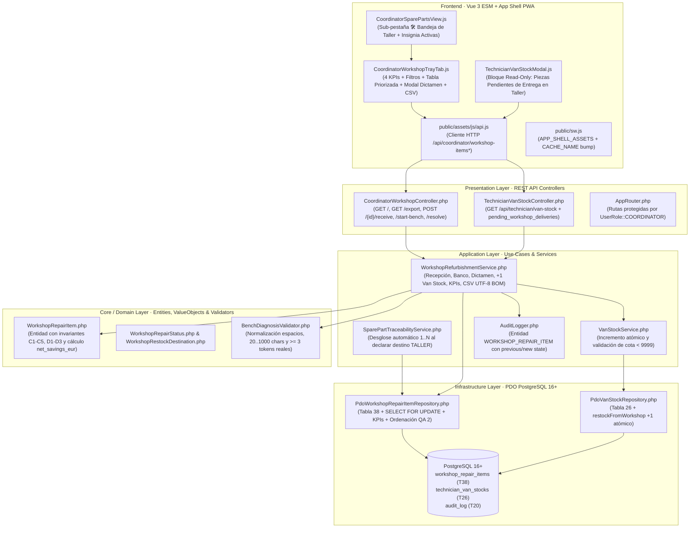
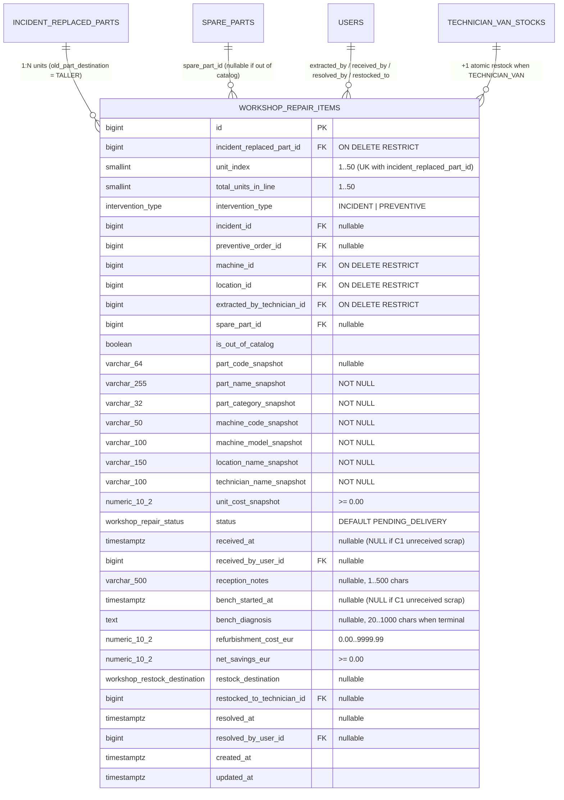
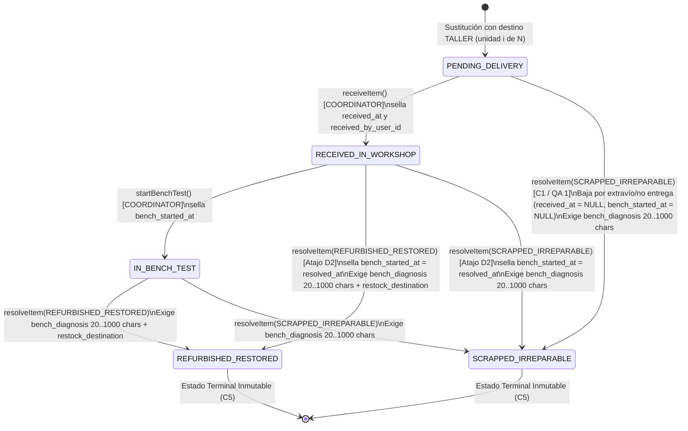

# Plan de Implementación Técnica: Bandeja de Taller Central para Piezas Recuperadas
**Módulo:** `27-workshop-refurbishment-loop` (Feature 14 de `docs/features_pendientes.md`)  
**Versión:** 2.1  
**Estado:** Plan Técnico para Validación SDD (Fase 2 — Sin Código de Implementación)  
**Marco Normativo:** [`constitution.md`](file:///c:/Users/Friki/.gemini/antigravity/scratch/gestor-incidencias-vending/constitution.md) · [`AGENTS.md`](file:///c:/Users/Friki/.gemini/antigravity/scratch/gestor-incidencias-vending/AGENTS.md) · [`docs/design.md`](file:///c:/Users/Friki/.gemini/antigravity/scratch/gestor-incidencias-vending/docs/design.md)  
**Especificación Funcional:** [`specs/27-workshop-refurbishment-loop/spec.md`](file:///c:/Users/Friki/.gemini/antigravity/scratch/gestor-incidencias-vending/specs/27-workshop-refurbishment-loop/spec.md) (v2.1) · [`specs/functional/workshop_refurbishment_loop_spec.md`](file:///c:/Users/Friki/.gemini/antigravity/scratch/gestor-incidencias-vending/specs/functional/workshop_refurbishment_loop_spec.md)  
**Contratos Técnicos:** [`specs/technical/workshop_refurbishment_loop_contracts.md`](file:///c:/Users/Friki/.gemini/antigravity/scratch/gestor-incidencias-vending/specs/technical/workshop_refurbishment_loop_contracts.md) · [`specs/technical/database_schema.md`](file:///c:/Users/Friki/.gemini/antigravity/scratch/gestor-incidencias-vending/specs/technical/database_schema.md) · [`specs/technical/schema_correspondence_contract.md`](file:///c:/Users/Friki/.gemini/antigravity/scratch/gestor-incidencias-vending/specs/technical/schema_correspondence_contract.md)

---

## 1. Arquitectura de Módulos y Estructura de Ficheros

La solución se diseña bajo **Clean Architecture** en PHP 8.2+ POO puro (`declare(strict_types=1);`) en el backend, persistencia única sobre **PostgreSQL 16+ (`pdo_pgsql`)** y **Vue 3 (Composition API via ES Modules nativos)** en el frontend sin bundlers ni dependencias externas adicionales, respetando los artículos I, II, III, IV, V y VI de `constitution.md`.



### 1.1. Base de Datos y Esquema Relacional (`database/` y `specs/technical/`)
| Fichero | Acción | Responsabilidad |
| :--- | :--- | :--- |
| `database/supabase_migrations/023_workshop_repair_items.sql` | **Crear** | Migración DDL incremental idempotente: creación de tipos `workshop_repair_status` (5 valores) y `workshop_restock_destination` (2 valores), adición de `'WORKSHOP_REPAIR_ITEM'` en `audit_entity_type`, creación de `workshop_repair_items` (Tabla 38, 34 columnas) con `uq_workshop_repair_replaced_part_unit`, 4 restricciones `CHECK` (`chk_workshop_repair_unit_bounds`, `chk_workshop_repair_costs_non_negative`, `chk_workshop_repair_reception_notes_len`, `chk_workshop_repair_bench_diagnosis_len`, `chk_workshop_repair_terminal_coherence`), 3 índices secundarios, disparadores constitucionales `trg_no_delete_workshop_repair_items` / `trg_touch_workshop_repair_items`, y backfill idempotente con `generate_series(1, irp.quantity)` en estado `PENDING_DELIVERY` sobre filas previas con `old_part_destination = 'TALLER'` (`D4`, `QA 2`). |
| `database/supabase_init.sql` | **Modificar** | Incorporar los 2 nuevos enumerados (`workshop_repair_status`, `workshop_restock_destination`), el valor `'WORKSHOP_REPAIR_ITEM'` en `audit_entity_type` y la Tabla 38 `workshop_repair_items` al esquema maestro consolidado para mantener paridad 1:1 con migraciones. |
| `database/supabase_seeds.sql` | **Modificar** | Sembrar unidades de taller representativas en los 5 estados (`PENDING_DELIVERY`, `RECEIVED_IN_WORKSHOP`, `IN_BENCH_TEST`, `REFURBISHED_RESTORED` con `TECHNICIAN_VAN` y `CENTRAL_WAREHOUSE`, y `SCRAPPED_IRREPARABLE` en banco y por no entrega) para certificación analítica. |
| `src/Infrastructure/Database/SeedRunner.php` | **Modificar** | Sincronizar el sembrado programático de entorno de pruebas con las unidades de taller en los 5 estados y el backfill idempotente. |
| `specs/technical/database_schema.md` | **Modificar** | Documentar la Tabla 38 `workshop_repair_items` (pasando de 37 a 38 tablas de dominio). |
| `specs/technical/schema_correspondence_contract.md` | **Modificar** | Actualizar el inventario canónico de tablas (38 tablas y 34 enumerados) verificado por `SchemaCorrespondenceTest`. |

### 1.2. Capa de Dominio (`src/Core/`)
| Fichero | Acción | Responsabilidad |
| :--- | :--- | :--- |
| `src/Core/Domain/ValueObject/WorkshopRepairStatus.php` | **Crear** | Enum nativo de los 5 estados (`PENDING_DELIVERY`, `RECEIVED_IN_WORKSHOP`, `IN_BENCH_TEST`, `REFURBISHED_RESTORED`, `SCRAPPED_IRREPARABLE`), etiquetas en castellano (`label()`), predicados `isTerminal()`, `isActiveInWorkshop()` y matriz de transición `canTransitionTo()` incluyendo la baja excepcional desde `PENDING_DELIVERY` hacia `SCRAPPED_IRREPARABLE` (`C1`, `QA 1`). |
| `src/Core/Domain/ValueObject/WorkshopRestockDestination.php` | **Crear** | Enum nativo de los 2 destinos de reincorporación (`CENTRAL_WAREHOUSE`, `TECHNICIAN_VAN`) y `label()`. |
| `src/Core/Domain/Model/WorkshopRepairItem.php` | **Crear** | Entidad de dominio que modela una unidad física retirada hacia taller (`id`, `incidentReplacedPartId`, `unitIndex`, `totalUnitsInLine`, `interventionType`, `incidentId`, `preventiveOrderId`, `machineId`, `locationId`, `extractedByTechnicianId`, `sparePartId`, `isOutOfCatalog`, snapshots de pieza/máquina/sede/técnico/coste, `status`, marcas y actores de recepción, banco y dictamen, `benchDiagnosis`, `refurbishmentCostEur`, `netSavingsEur`, `restockDestination`, `restockedToTechnicianId`). Expone `receive()`, `startBenchTest()`, `resolveRefurbished()`, `resolveScrapped()` y cálculo puro de `calculateNetSavings()`. |
| `src/Core/Service/BenchDiagnosisValidator.php` | **Crear** | Servicio puro de dominio (`Art. V.1`, `QA 1`, `QA 3`) que normaliza `bench_diagnosis` (`trim` + colapso de espacios/saltos de línea repetidos `/\s+/u` a un espacio simple), valida longitud en `[20, 1000]` caracteres significativos y exige al menos **3 tokens alfanuméricos reales** (`/\p{L}|\p{N}/u`) para impedir rellenos con signos repetidos. También valida `reception_notes` ($\le 500$ chars). |
| `src/Core/Domain/Repository/WorkshopRepairItemRepositoryInterface.php` | **Crear** | Contrato de persistencia: `createBatchForReplacedPart()`, `findByIdForUpdate()`, `findById()`, `findFilteredWithSummary()`, `findPendingDeliveriesByTechnician()` y `update()`. |

### 1.3. Capa de Aplicación (`src/Application/`)
| Fichero | Acción | Responsabilidad |
| :--- | :--- | :--- |
| `src/Application/DTO/WorkshopFilterDto.php` | **Crear** | DTO inmutable de filtrado (`status`, `technicianId`, `category`, `search`). |
| `src/Application/DTO/WorkshopSummaryDto.php` | **Crear** | DTO de resumen ejecutivo con las 12 métricas de taller (`pendingDeliveryCount`, `receivedInWorkshopCount`, `inBenchTestCount`, `inWorkshopCount`, `refurbishedCount`, `scrappedInBenchCount`, `scrappedUnreceivedCount`, `scrappedCount`, `evaluatedInWorkshopCount`, `resolvedTotalCount`, `recoveryRatePct`, `totalReferenceValueEur`, `totalRefurbishmentCostEur`, `totalNetSavingsEur`). |
| `src/Application/Service/WorkshopRefurbishmentService.php` | **Crear** | Orquestador transaccional del ciclo de taller (`RF-02` a `RF-05`, `D2`–`D4`, `C1`–`C5`, `QA 1`–`QA 5`): listado con resumen KPI inmune al filtro de pestaña `status`, confirmación de recepción (`receiveItem`), inicio de banco (`startBenchTest`), dictamen final inmutable (`resolveItem`) bajo `SELECT ... FOR UPDATE`, reincorporación `+1` en `technician_van_stocks` verificando técnico activo, pieza de catálogo activa y cota `< 9999`, registro en `audit_log` con `previous_state` y `new_state` bajo `WORKSHOP_REPAIR_ITEM` y generador CSV `UTF-8 BOM` en dos secciones en huso horario `Europe/Madrid`. |
| `src/Application/Service/SparePartTraceabilityService.php` | **Modificar** | En el punto único donde se persisten líneas de `incident_replaced_parts` (tanto en `resolveIncidentWithParts` como en `completePreventiveWithParts`, online y sincronizadas desde Offline PWA), si `$part->getOldPartDestination() === OldPartDestination::TALLER`, invocar dentro de la misma transacción la creación desglosada de las `1..quantity` unidades en `workshop_repair_items` atribuyendo `extracted_by_technician_id` al técnico asignado a la intervención (`D1`, `C4`, `C6`, `QA 4`). |

### 1.4. Capa de Infraestructura (`src/Infrastructure/`)
| Fichero | Acción | Responsabilidad |
| :--- | :--- | :--- |
| `src/Infrastructure/Repository/PdoWorkshopRepairItemRepository.php` | **Crear** | Implementación PDO PostgreSQL 16+ de `WorkshopRepairItemRepositoryInterface`: inserción desglosada `1..N`, bloqueo pesimista `SELECT ... FOR UPDATE`, consulta con ordenación determinista `QA 2`, cálculo del resumen KPI ignorando el filtro de pestaña `status` (`QA 2`) y consulta ligera de `PENDING_DELIVERY` para el técnico sin columnas financieras (`Art. V.4`). |
| `src/Infrastructure/Repository/PdoVanStockRepository.php` | **Modificar** | Añadir el método atómico `incrementFromWorkshopRefurbishment(int $technicianId, int $sparePartId): VanStockItem` (que inserta con `quantity_available = 1, min_threshold = 1` si no existía pareja, o incrementa `quantity_available = quantity_available + 1` tras validar `quantity_available < 9999` bajo bloqueo de fila, `D3`, `QA 3`). |

### 1.5. Capa de Presentación REST (`src/Presentation/`)
| Fichero | Acción | Responsabilidad |
| :--- | :--- | :--- |
| `src/Presentation/Controller/CoordinatorWorkshopController.php` | **Crear** | Endpoints exclusivos de `COORDINATOR` (`Art. V.4`): `GET /api/coordinator/workshop-items`, `GET /api/coordinator/workshop-items/export`, `POST /api/coordinator/workshop-items/{id}/receive`, `POST /api/coordinator/workshop-items/{id}/start-bench` y `POST /api/coordinator/workshop-items/{id}/resolve`. |
| `src/Presentation/Controller/TechnicianVanStockController.php` | **Modificar** | Enriquecer `GET /api/technician/van-stock` con `pending_workshop_deliveries_count` y `pending_workshop_deliveries` (filtradas por el `user_id` del token del técnico y `status = 'PENDING_DELIVERY'`, ordenadas por `created_at ASC, id ASC`, sin ningún campo monetario según `Art. V.4` y `QA 4`). |
| `src/Presentation/Routing/AppRouter.php` | **Modificar** | Registrar las 5 rutas de `/api/coordinator/workshop-items*` protegidas por `$coordinatorAuth` (`export` registrada antes de `{id}`). |

### 1.6. Frontend Web y PWA (`public/`)
| Fichero | Acción | Responsabilidad |
| :--- | :--- | :--- |
| `public/assets/js/components/CoordinatorWorkshopTrayTab.js` | **Crear** | Sub-pestaña **"🛠️ Bandeja de Taller"** en Coordinación: 4 tarjetas KPI clicables como filtro rápido de estado sin apagarse entre sí (`QA 2`), barra de filtros (estado, técnico extractor, categoría, búsqueda textual) y botón *"📥 Exportar CSV"*, tabla con insignia de unidad (`1/2`), origen (`INC-2026-...` / `PREV-...`), estado, diagnóstico y ahorro neto, y modales de **Recepción**, **Dictamen en Banco** (con cálculo reactivo del Ahorro Neto, aviso ámbar de *"Reparación sin ahorro neto"* cuando `refurbishment_cost_eur >= unit_cost_snapshot`, y selector de destino `Almacén Central` vs. `Furgoneta de Técnico`) y **Baja por No Entrega / Extravío** (`C1`). |
| `public/assets/js/components/CoordinatorSparePartsView.js` | **Modificar** | Añadir la sub-pestaña **"🛠️ Bandeja de Taller"** junto a Catálogo, Analítica y Solicitudes, mostrando un badge con las unidades activas pendientes de gestión. |
| `public/assets/js/components/TechnicianVanStockModal.js` | **Modificar** | Incorporar el bloque informativo de solo lectura **"🔧 Piezas retiradas pendientes de entregar en Taller Central"** mostrando `pending_workshop_deliveries` ordenadas desde la más antigua y sin importes (`Art. V.4`, `D2`). |
| `public/assets/js/components/AuditActionLabels.js` | **Modificar** | Registrar las etiquetas legibles en castellano para `WORKSHOP_REPAIR_ITEM` y las 6 acciones de auditoría (`RECEIVE_WORKSHOP_ITEM`, `START_WORKSHOP_BENCH_TEST`, `SCRAP_UNRECEIVED_WORKSHOP_ITEM`, `REFURBISH_WORKSHOP_ITEM`, `SCRAP_WORKSHOP_ITEM`, `EXPORT_WORKSHOP_ITEMS_CSV`). |
| `public/assets/js/api.js` | **Modificar** | Añadir `getWorkshopItems()`, `exportWorkshopItemsCsv()`, `receiveWorkshopItem()`, `startWorkshopBenchTest()` y `resolveWorkshopItem()`. |
| `public/sw.js` | **Modificar** | Añadir `/assets/js/components/CoordinatorWorkshopTrayTab.js` en `APP_SHELL_ASSETS` y actualizar `CACHE_NAME` para cumplir `OfflinePwaAppShellContractTest`. |
| `public/assets/css/styles.css` | **Modificar** | Estilos de la Bandeja de Taller, tarjetas KPI de Economía Circular, insignias de estado de taller y aviso de reparación sin ahorro usando exclusivamente tokens CSS (`var(--color-*)`, bordes `4px`/`8px`, áreas táctiles $\ge 44\text{px}$) conforme a `docs/design.md` y `DesignTokenDebtRatchetTest`. |

---

## 2. Modelo de Datos Relacional y Contratos de API REST

### 2.1. Modelo Relacional PostgreSQL (`workshop_repair_items`, Tabla 38)



### 2.2. Resumen de Contratos de Endpoints REST y Códigos HTTP

| Método y Ruta | Rol Autorizado | Entrada Principal | Respuesta Éxito | Códigos de Error y Causas |
| :--- | :--- | :--- | :--- | :--- |
| `GET /api/coordinator/workshop-items` | `COORDINATOR` | Query: `status`, `technician_id`, `category`, `search` | `200 OK` (`{ summary, items }`) | `401 UNAUTHORIZED`, `403 FORBIDDEN` (si `TECHNICIAN` o `LOCATION_RESPONSIBLE`) |
| `GET /api/coordinator/workshop-items/export` | `COORDINATOR` | Query: `status`, `technician_id`, `category`, `search` | `200 OK` (`text/csv; charset=UTF-8` con `UTF-8 BOM`, 2 secciones) | `401 UNAUTHORIZED`, `403 FORBIDDEN` |
| `POST /api/coordinator/workshop-items/{id}/receive` | `COORDINATOR` | JSON: `{ reception_notes?: string }` | `200 OK` (`{ item, message }`) | `401`, `403`, `404 WORKSHOP_ITEM_NOT_FOUND`, `409 INVALID_WORKSHOP_STATUS_TRANSITION`, `422 INVALID_RECEPTION_NOTES_LENGTH` ($> 500$ chars) |
| `POST /api/coordinator/workshop-items/{id}/start-bench` | `COORDINATOR` | Sin body requerido | `200 OK` (`{ item, message }`) | `401`, `403`, `404 WORKSHOP_ITEM_NOT_FOUND`, `409 INVALID_WORKSHOP_STATUS_TRANSITION` (si `status !== 'RECEIVED_IN_WORKSHOP'`) |
| `POST /api/coordinator/workshop-items/{id}/resolve` | `COORDINATOR` | JSON: `{ outcome_status, bench_diagnosis, refurbishment_cost_eur?, restock_destination?, restocked_to_technician_id? }` | `200 OK` (`{ item, van_stock_updated, no_net_savings_warning, message }`) | `401`, `403`, `404 WORKSHOP_ITEM_NOT_FOUND`, `409 INVALID_WORKSHOP_STATUS_TRANSITION`, `422 INVALID_WORKSHOP_OUTCOME`, `422 INVALID_BENCH_DIAGNOSIS_LENGTH`, `422 INVALID_REFURBISHMENT_COST`, `422 INVALID_RESTOCK_DESTINATION`, `422 OUT_OF_CATALOG_CANNOT_RESTOCK_VAN`, `422 INACTIVE_SPARE_PART_CANNOT_RESTOCK_VAN`, `422 INVALID_RESTOCK_TECHNICIAN`, `422 VAN_STOCK_MAX_CAPACITY_REACHED` |
| `GET /api/technician/van-stock` | `TECHNICIAN` | Sin parámetros (identidad del JWT) | `200 OK` (`{ ..., pending_workshop_deliveries_count, pending_workshop_deliveries }`) | `401 UNAUTHORIZED`, `403 FORBIDDEN` |

---

## 3. Algoritmos Clave en Pseudocódigo y Máquinas de Estado

### 3.1. Algoritmo de Apertura Automática Desglosada (`1..N`) y Backfill Histórico (`D1`, `D4`, `C4`, `C6`, `QA 2`, `QA 4`)

```text
ALGORITHM createWorkshopItemsOnPartReplacement(replacedPart, machine, location, technicianName, partMeta)
  // Se invoca DENTRO de la transacción de SparePartTraceabilityService::resolveIncidentWithParts()
  // y SparePartTraceabilityService::completePreventiveWithParts().
  // Nota (C6): En colisiones offline volcadas como conflict_dump NO se invoca este flujo.
  IF replacedPart.oldPartDestination !== OldPartDestination::TALLER THEN
      RETURN []
  END IF

  // QA 4: El técnico responsable de entrega es SIEMPRE el técnico asignado a la intervención
  // (persistido en replacedPart.technicianId), incluso si el cierre lo ejecutó un Coordinador.
  totalUnits = replacedPart.quantity // 1..50
  itemsToInsert = []

  FOR unitIndex = 1 TO totalUnits DO
      itemsToInsert.append(new WorkshopRepairItem(
          id: null,
          incidentReplacedPartId: replacedPart.id,
          unitIndex: unitIndex,
          totalUnitsInLine: totalUnits,
          interventionType: replacedPart.interventionType, // 'INCIDENT' | 'PREVENTIVE'
          incidentId: replacedPart.incidentId,
          preventiveOrderId: replacedPart.preventiveOrderId,
          machineId: replacedPart.machineId,
          locationId: replacedPart.locationId,
          extractedByTechnicianId: replacedPart.technicianId,
          sparePartId: replacedPart.sparePartId,
          isOutOfCatalog: replacedPart.isOutOfCatalog,
          partCodeSnapshot: partMeta.partCode, // NULL si isOutOfCatalog
          partNameSnapshot: replacedPart.isOutOfCatalog ? replacedPart.customPartName : partMeta.partName,
          partCategorySnapshot: replacedPart.isOutOfCatalog ? 'OTHER' : partMeta.category,
          machineCodeSnapshot: machine.code,
          machineModelSnapshot: machine.model,
          locationNameSnapshot: location.name,
          technicianNameSnapshot: technicianName,
          unitCostSnapshot: replacedPart.unitCostSnapshot,
          status: WorkshopRepairStatus::PENDING_DELIVERY
      ))
  END FOR

  // uq_workshop_repair_replaced_part_unit (incident_replaced_part_id, unit_index)
  // garantiza que reaperturas < 48h (C4) nunca dupliquen unidades de episodios previos.
  RETURN workshopRepo.createBatch(itemsToInsert)
END ALGORITHM
```

**Backfill SQL idempotente en `023_workshop_repair_items.sql` (`D4`, `QA 2`):**
```sql
INSERT INTO workshop_repair_items (
    incident_replaced_part_id, unit_index, total_units_in_line,
    intervention_type, incident_id, preventive_order_id,
    machine_id, location_id, extracted_by_technician_id,
    spare_part_id, is_out_of_catalog,
    part_code_snapshot, part_name_snapshot, part_category_snapshot,
    machine_code_snapshot, machine_model_snapshot, location_name_snapshot,
    technician_name_snapshot, unit_cost_snapshot, status, created_at, updated_at
)
SELECT
    irp.id,
    gs.unit_idx::SMALLINT,
    irp.quantity::SMALLINT,
    irp.intervention_type,
    irp.incident_id,
    irp.preventive_order_id,
    irp.machine_id,
    irp.location_id,
    irp.technician_id,
    irp.spare_part_id,
    irp.is_out_of_catalog,
    sp.part_code,
    COALESCE(sp.name, irp.custom_part_name, 'Componente fuera de catálogo'),
    COALESCE(sp.category::VARCHAR, 'OTHER'),
    m.code,
    m.model,
    l.name,
    u.name,
    irp.unit_cost_snapshot,
    'PENDING_DELIVERY'::workshop_repair_status,
    irp.installed_at,
    irp.installed_at
FROM incident_replaced_parts irp
CROSS JOIN LATERAL generate_series(1, GREATEST(1, irp.quantity::INT)) AS gs(unit_idx)
INNER JOIN machines m ON m.id = irp.machine_id
INNER JOIN locations l ON l.id = irp.location_id
INNER JOIN users u ON u.id = irp.technician_id
LEFT JOIN spare_parts sp ON sp.id = irp.spare_part_id
WHERE irp.old_part_destination = 'TALLER'
ON CONFLICT (incident_replaced_part_id, unit_index) DO NOTHING;
```

### 3.2. Máquina de Estados de Taller y Validador de Diagnóstico de Banco (`D2`, `C1`, `C5`, `QA 1`, `QA 3`)



**Validador `BenchDiagnosisValidator::normalizeAndValidate(string $raw)` (`Art. V.1`, `QA 1`, `QA 3`):**
```text
ALGORITHM normalizeAndValidateBenchDiagnosis(rawText)
  // 1. Recortar espacios extremos y colapsar espacios/saltos de línea múltiples a 1 espacio
  normalized = preg_replace('/\s+/u', ' ', trim(rawText))
  length = mb_strlen(normalized, 'UTF-8')

  // 2. Validar rango [20, 1000] caracteres significativos
  IF length < 20 OR length > 1000 THEN
      THROW DomainValidationException('INVALID_BENCH_DIAGNOSIS_LENGTH', 422)
  END IF

  // 3. Exigir al menos 3 palabras/bloques con caracteres alfanuméricos reales (Art. V.1, QA 1)
  tokens = preg_split('/\s+/u', normalized)
  validTokens = count(filter(tokens, token => preg_match('/[\p{L}\p{N}]{2,}/u', token)))
  IF validTokens < 3 THEN
      THROW DomainValidationException('INVALID_BENCH_DIAGNOSIS_LENGTH', 422)
  END IF

  RETURN normalized
END ALGORITHM
```

### 3.3. Algoritmo Transaccional de Dictamen, Reincorporación a Stock y Analítica (`WorkshopRefurbishmentService`, `D3`, `C2`, `C3`, `C5`, `QA 1`–`QA 5`)

```text
ALGORITHM resolveWorkshopItem(itemId, payload, coordinatorActor)
  RETURN transactionManager.runInTransaction(FUNCTION ()
      // 1. Bloqueo pesimista exclusivo contra concurrencia de dos coordinadores (QA 3)
      item = workshopRepo.findByIdForUpdate(itemId)
      IF item IS NULL THEN
          THROW NotFoundException('WORKSHOP_ITEM_NOT_FOUND', 404)
      END IF

      previousState = item.toAuditSnapshot()

      // 2. Validar estado de partida e inmutabilidad terminal (C5, EARS 02.5)
      outcome = WorkshopRepairStatus::tryFrom(payload.outcome_status)
      IF outcome NOT IN [REFURBISHED_RESTORED, SCRAPPED_IRREPARABLE] THEN
          THROW ValidationException('INVALID_WORKSHOP_OUTCOME', 422)
      END IF

      IF item.status.isTerminal() THEN
          THROW ConflictException('INVALID_WORKSHOP_STATUS_TRANSITION', 409)
      END IF

      // Prohibir REFURBISHED_RESTORED directo desde PENDING_DELIVERY (D2, C1, EARS 02.3.1)
      IF item.status === PENDING_DELIVERY AND outcome === REFURBISHED_RESTORED THEN
          THROW ConflictException('INVALID_WORKSHOP_STATUS_TRANSITION', 409)
      END IF

      // 3. Validar diagnóstico de banco [20..1000 chars, >= 3 palabras reales] (Art. V.1, QA 1)
      diagnosis = BenchDiagnosisValidator::normalizeAndValidate(payload.bench_diagnosis)
      now = new DateTimeImmutable('now', new DateTimeZone('UTC'))

      // 4. Rama A: SCRAPPED_IRREPARABLE (en banco o por no entrega C1)
      IF outcome === SCRAPPED_IRREPARABLE THEN
          isUnreceivedScrap = (item.status === PENDING_DELIVERY)
          // QA 1: Si nunca llegó al taller, received_at y bench_started_at quedan NULL.
          // Si ya estaba en RECEIVED_IN_WORKSHOP, sella bench_started_at = now.
          benchStartedAt = isUnreceivedScrap ? null : (item.benchStartedAt ?? now)
          item.markScrapped(diagnosis, benchStartedAt, now, coordinatorActor.id)
          saved = workshopRepo.update(item)

          auditAction = isUnreceivedScrap ? 'SCRAP_UNRECEIVED_WORKSHOP_ITEM' : 'SCRAP_WORKSHOP_ITEM'
          auditLogger.log(auditAction, 'WORKSHOP_REPAIR_ITEM', saved.id, previousState, saved.toAuditSnapshot(), coordinatorActor)
          RETURN { item: saved, van_stock_updated: false, no_net_savings_warning: false }
      END IF

      // 5. Rama B: REFURBISHED_RESTORED (D3, C2, C3, QA 3)
      costRaw = payload.refurbishment_cost_eur ?? 0.00
      IF NOT is_numeric(costRaw) OR float(costRaw) < 0.00 OR float(costRaw) > 9999.99 THEN
          THROW ValidationException('INVALID_REFURBISHMENT_COST', 422)
      END IF
      refurbishmentCost = round(float(costRaw), 2)
      netSavings = round(max(0.00, item.unitCostSnapshot - refurbishmentCost), 2)
      noNetSavingsWarning = (refurbishmentCost >= item.unitCostSnapshot)

      destination = WorkshopRestockDestination::tryFrom(payload.restock_destination ?? '')
      IF destination IS NULL THEN
          THROW ValidationException('INVALID_RESTOCK_DESTINATION', 422)
      END IF

      targetTechId = null
      vanStockUpdated = false

      IF destination === TECHNICIAN_VAN THEN
          // Guarda D1: Pieza fuera de catálogo solo puede ir a CENTRAL_WAREHOUSE
          IF item.isOutOfCatalog OR item.sparePartId IS NULL THEN
              THROW ValidationException('OUT_OF_CATALOG_CANNOT_RESTOCK_VAN', 422)
          END IF

          // Guarda C3: La referencia en spare_parts debe seguir activa
          sparePart = sparePartRepo.findById(item.sparePartId)
          IF sparePart IS NULL OR NOT sparePart.isActive() THEN
              THROW ValidationException('INACTIVE_SPARE_PART_CANNOT_RESTOCK_VAN', 422)
          END IF

          // Guarda C3: El técnico destinatario debe existir, tener rol TECHNICIAN y estar activo
          targetTechId = int(payload.restocked_to_technician_id ?? 0)
          tech = vanStockRepo.findTechnician(targetTechId)
          IF tech IS NULL OR tech.role !== 'TECHNICIAN' OR NOT tech.is_active THEN
              THROW ValidationException('INVALID_RESTOCK_TECHNICIAN', 422)
          END IF

          // Guarda QA 3: Verificar cota máxima < 9999 bajo bloqueo y sumar +1 en technician_van_stocks
          currentVanStock = vanStockRepo.findByPairForUpdate(targetTechId, item.sparePartId)
          IF currentVanStock IS NOT NULL AND currentVanStock.quantityAvailable >= 9999 THEN
              THROW ValidationException('VAN_STOCK_MAX_CAPACITY_REACHED', 422)
          END IF

          vanStockRepo.incrementFromWorkshop(targetTechId, item.sparePartId, coordinatorActor.id)
          vanStockUpdated = true
      END IF

      benchStartedAt = item.benchStartedAt ?? now
      item.markRefurbished(diagnosis, refurbishmentCost, netSavings, destination, targetTechId, benchStartedAt, now, coordinatorActor.id)
      saved = workshopRepo.update(item)

      auditLogger.log('REFURBISH_WORKSHOP_ITEM', 'WORKSHOP_REPAIR_ITEM', saved.id, previousState, saved.toAuditSnapshot(), coordinatorActor)
      RETURN { item: saved, van_stock_updated: vanStockUpdated, no_net_savings_warning: noNetSavingsWarning }
  END FUNCTION)
END ALGORITHM
```

**Cálculo de las 4 Tarjetas KPI y Ordenación Determinista (`QA 1`, `QA 2`):**
* **Inmunidad de las tarjetas frente al filtro `status` (`QA 2`):** La consulta que alimenta `summary` aplica `technician_id`, `category` y `search`, pero **no** filtra por `status`. Así, las 4 tarjetas superiores (*Pendientes en Furgoneta*, *En Taller / Banco*, *Tasa de Recuperación %* y *Ahorro Neto Acumulado €*) mantienen sus valores globales para ese filtro aunque el coordinador pulse una pestaña de estado para acotar las filas de la tabla.
* **Fórmula de `recovery_rate_pct` (`QA 1`):**
  $$\text{evaluated\_in\_workshop\_count} = \text{refurbished\_count} + \text{scrapped\_in\_bench\_count}$$
  $$\text{recovery\_rate\_pct} = \begin{cases} \text{round}\!\left(\dfrac{\text{refurbished\_count}}{\text{evaluated\_in\_workshop\_count}} \times 100,\; 2\right) & \text{si } \text{evaluated\_in\_workshop\_count} > 0 \\ 0.00 & \text{si } \text{evaluated\_in\_workshop\_count} = 0 \end{cases}$$
  Donde `scrapped_in_bench_count` cuenta las filas con `status = 'SCRAPPED_IRREPARABLE' AND received_at IS NOT NULL`, mientras que `scrapped_unreceived_count` cuenta las bajas sin recepción (`status = 'SCRAPPED_IRREPARABLE' AND received_at IS NULL`).
* **Cláusula `ORDER BY` determinista de la Bandeja de Coordinación (`QA 2`):**
  ```sql
  ORDER BY
      CASE wri.status
          WHEN 'PENDING_DELIVERY' THEN 1
          WHEN 'RECEIVED_IN_WORKSHOP' THEN 2
          WHEN 'IN_BENCH_TEST' THEN 3
          WHEN 'REFURBISHED_RESTORED' THEN 4
          WHEN 'SCRAPPED_IRREPARABLE' THEN 5
      END ASC,
      CASE WHEN wri.status IN ('PENDING_DELIVERY', 'RECEIVED_IN_WORKSHOP', 'IN_BENCH_TEST')
           THEN EXTRACT(EPOCH FROM wri.created_at)
           ELSE -EXTRACT(EPOCH FROM COALESCE(wri.resolved_at, wri.created_at))
      END ASC,
      wri.id ASC
  ```

---

## 4. Arquitectura de Componentes Frontend y Cumplimiento de `docs/design.md`

1. **`CoordinatorSparePartsView.js`:**
   * Incorpora el botón de sub-pestaña `🛠️ Bandeja de Taller` en la barra de navegación del módulo de Repuestos, con un contador reactivo (`pending_delivery_count + in_workshop_count`).
2. **`CoordinatorWorkshopTrayTab.js`:**
   * **Cabecera de 4 Tarjetas KPI (8px radius `var(--radius-sm)`, borde hairline `var(--color-hairline)`):**
     1. *Pendientes en Furgoneta* (`pending_delivery_count`).
     2. *En Taller / Banco* (`in_workshop_count`, desglosando recibidas vs. en banco).
     3. *Tasa de Recuperación* (`recovery_rate_pct %`, con subtítulo de evaluadas en banco y bajas sin recepción `scrapped_unreceived_count`).
     4. *Ahorro Neto Acumulado* (`total_net_savings_eur €`, destacando valor a nuevo vs. coste de reparación).
   * **Barra de Filtros y Acciones:** Selector de estado (`Todos`, `Pendiente de entrega`, `Recibida en taller`, `En banco de pruebas`, `Reacondicionada`, `Desguazada`), selector de técnico extractor, selector de categoría de pieza, buscador libre y botón `📥 Exportar CSV`.
   * **Modal de Dictamen / Baja Justificada:**
     * Muestra datos congelados de origen (`[part_code] part_name`, unidad `unit_index/total_units_in_line`, máquina, sede y `unit_cost_snapshot`).
     * Textarea `bench_diagnosis` con contador en vivo de caracteres significativos (`20..1000`) y palabras reales ($\ge 3$).
     * En `REFURBISHED_RESTORED`: input numérico `refurbishment_cost_eur` (`0.00` por defecto), previsualización en vivo del **Ahorro Neto (`net_savings_eur €`)**, alerta preventiva ámbar (`⚠️ Reparación sin ahorro neto: el coste de reparación iguala o supera el valor de la pieza nueva. El ahorro neto quedará en 0,00 €`) cuando `refurbishment_cost_eur >= unit_cost_snapshot` (`C2`), y selector de destino (`Almacén Central` o `Furgoneta de Técnico`, deshabilitando automáticamente `Furgoneta de Técnico` si `is_out_of_catalog = true` o si la pieza está inactiva en catálogo, `D1`, `C3`).
3. **`TechnicianVanStockModal.js`:**
   * Debajo de la tabla de stock disponible de la furgoneta, renderiza la sección de solo lectura **«🔧 Piezas averiadas pendientes de entregar en Taller Central»** con las unidades de `pending_workshop_deliveries` (código/nombre de pieza, insignia `Unidad i/N`, máquina, sede, código de ticket/orden y fecha de retirada), sin ningún campo de precio ni ahorro (`Art. V.4`).

---

## 5. Decisiones Técnicas Justificadas y Alternativas Descartadas

| Decisión Técnica | Justificación Arquitectónica | Alternativa Descartada y Por Qué |
| :--- | :--- | :--- |
| **1. Desglose físico `1..N` en filas individuales (`unit_index`) con `uq_workshop_repair_replaced_part_unit`** | Permite que si un técnico retira 2 unidades en una misma intervención, una pueda dictaminarse como `REFURBISHED_RESTORED` (e ir a una furgoneta) y la otra como `SCRAPPED_IRREPARABLE`, sin contadores parciales ni particiones de filas a mitad del ciclo (`D1`). | *Una sola fila agrupada con `quantity`:* Impedía dictámenes mixtos sobre un lote sin añadir columnas de estados múltiples y romper la trazabilidad unitaria de destino. |
| **2. Creación automática enganchada en `SparePartTraceabilityService` dentro de la misma transacción** | Tanto las resoluciones online (técnico o coordinador) como las órdenes preventivas y las sincronizaciones diferidas de Offline PWA pasan por `SparePartTraceabilityService`. Al crear allí las fichas de taller, cubrimos todos los canales con cero duplicación de lógica y excluimos automáticamente los `conflict_dump` (`C6`). | *Disparador SQL o llamadas dispersas en cada controlador:* Un trigger en BD dificultaría la hidratación de entidades en pruebas unitarias sin BD; llamarlo en cada controlador correría el riesgo de olvidar el canal preventivo o el offline. |
| **3. Bloqueo pesimista `SELECT ... FOR UPDATE` en `workshop_repair_items` y en `technician_van_stocks`** | Impide que dos coordinadores que pulsen simultáneamente sobre la misma ficha sumen dos veces `+1` en el inventario de la furgoneta o sobrescriban un dictamen terminal (`C5`, `QA 3`). | *Actualización optimista sin bloqueo de fila:* Permitiría condiciones de carrera entre lecturas y escrituras concurrentes de stock. |
| **4. Snapshots inmutables en `workshop_repair_items` + validación viva de `spare_parts.is_active` al reincorporar** | Congelar `part_code_snapshot`, `part_name_snapshot` y `unit_cost_snapshot` preserva la contabilidad histórica (Art. III.3), mientras que consultar `spare_parts.is_active` al dictaminar `TECHNICIAN_VAN` impide inyectar piezas descatalogadas en furgonetas (`C3`). | *JOIN dinámico sin snapshots:* Un cambio posterior del precio de tarifa en `spare_parts` alteraría retroactivamente el ahorro histórico del taller. |

---

## 6. Estrategia de Pruebas (Fases 3 y 5 SDD)

1. **Pruebas Unitarias de Dominio y Aplicación (PHP):**
   * `tests/Unit/Core/Service/BenchDiagnosisValidatorTest.php`: Normalización de espacios, rechazo de $< 20$ o $> 1000$ caracteres, rechazo de cadenas con menos de 3 palabras alfanuméricas reales (relleno con puntos/guiones, `QA 1`).
   * `tests/Unit/Application/Service/WorkshopRefurbishmentServiceTest.php`: Máquina de estados completa, bloqueo de salto `PENDING_DELIVERY` $\rightarrow$ `REFURBISHED_RESTORED`, baja directa por no entrega `PENDING_DELIVERY` $\rightarrow$ `SCRAPPED_IRREPARABLE` con `received_at = NULL` y `bench_started_at = NULL` (`C1`, `QA 1`), cálculo de `net_savings_eur` con suelo `0.00` (`C2`), guardas de pieza fuera de catálogo (`D1`), pieza descatalogada (`C3`), técnico inactivo (`C3`) y tope `9999` en furgoneta (`QA 3`), cálculo de `recovery_rate_pct` excluyendo bajas sin recepción (`QA 1`) y generación CSV `UTF-8 BOM` en `Europe/Madrid` (`QA 5`).
2. **Pruebas de Integración de Base de Datos y API HTTP (PostgreSQL 16+):**
   * `tests/Integration/Database/PostgresWorkshopRepairSchemaTest.php`: Verificación de la Tabla 38 `workshop_repair_items`, enumerados, `uq_workshop_repair_replaced_part_unit`, restricciones `CHECK`, disparador `trg_no_delete_workshop_repair_items` (`SQLSTATE 45000`, Art. III.1) y backfill idempotente.
   * `tests/Integration/WorkshopRefurbishmentIntegrationTest.php`: Flujo extremo a extremo desde resolución correctiva y preventiva con `quantity = 2` y `old_part_destination = 'TALLER'` $\rightarrow$ consulta móvil del técnico sin importes (Art. V.4) $\rightarrow$ recepción $\rightarrow$ banco $\rightarrow$ dictamen con `+1` en `technician_van_stocks` $\rightarrow$ reapertura en garantía `< 48h` sin duplicar unidades previas (`C4`) $\rightarrow$ inmutabilidad terminal `409` (`C5`) $\rightarrow$ blindaje `403` ante `TECHNICIAN` y `LOCATION_RESPONSIBLE` $\rightarrow$ auditoría `previous_state`/`new_state` $\rightarrow$ exportación CSV de 2 secciones.
3. **Pruebas de Frontend y Guardas Globales (Node ESM + PHP):**
   * `tests/Frontend/WorkshopRefurbishmentFrontendTest.mjs`: Contratos de `CoordinatorWorkshopTrayTab.js`, `CoordinatorSparePartsView.js`, `TechnicianVanStockModal.js`, `api.js` y `sw.js`.
   * Guardas globales existentes: `SchemaCorrespondenceTest`, `SingleEngineDialectContractTest`, `AuditActionCatalogTest`, `OfflinePwaAppShellContractTest` y `DesignTokenDebtRatchetTest`.

---

## 7. Matriz de Trazabilidad del Plan con la Especificación v2.1

| Requisito / Decisión | Componentes que lo implementan | Pruebas que lo verifican |
| :--- | :--- | :--- |
| **`RF-01` (`EARS 01.1–01.3`), `D1`, `D4`, `C4`, `C6`, `QA 2`, `QA 4`** | `SparePartTraceabilityService`; `PdoWorkshopRepairItemRepository::createBatch`; `023_workshop_repair_items.sql` (backfill `generate_series` + `uq_workshop_repair_replaced_part_unit`) | `WorkshopRefurbishmentIntegrationTest`; `PostgresWorkshopRepairSchemaTest` |
| **`RF-02` (`EARS 02.1–02.5`), `D2`, `C1`, `C5`, `QA 1`, `QA 3`** | `WorkshopRepairStatus`; `WorkshopRepairItem`; `BenchDiagnosisValidator`; `WorkshopRefurbishmentService` (`SELECT ... FOR UPDATE` + `AuditLogger`) | `BenchDiagnosisValidatorTest`; `WorkshopRefurbishmentServiceTest`; `WorkshopRefurbishmentIntegrationTest` |
| **`RF-03` (`EARS 03.1–03.4`), `D3`, `C2`, `C3`, `QA 3`** | `WorkshopRefurbishmentService::resolveItem`; `PdoVanStockRepository::incrementFromWorkshopRefurbishment`; `CoordinatorWorkshopTrayTab.js` (aviso `C2`) | `WorkshopRefurbishmentServiceTest`; `WorkshopRefurbishmentIntegrationTest`; `WorkshopRefurbishmentFrontendTest.mjs` |
| **`RF-04` (`EARS 04.1–04.2`), `D2`, `Art. V.4`, `QA 4`** | `TechnicianVanStockController::getInventory`; `TechnicianVanStockModal.js`; `AppRouter.php` (`$coordinatorAuth`) | `WorkshopRefurbishmentIntegrationTest`; `WorkshopRefurbishmentFrontendTest.mjs` |
| **`RF-05` (`EARS 05.1–05.2`), `D4`, `QA 1`, `QA 2`, `QA 5`** | `PdoWorkshopRepairItemRepository::findFilteredWithSummary`; `WorkshopRefurbishmentService::exportCsv`; `CoordinatorWorkshopController`; `CoordinatorWorkshopTrayTab.js` | `WorkshopRefurbishmentServiceTest`; `WorkshopRefurbishmentIntegrationTest`; `WorkshopRefurbishmentFrontendTest.mjs` |
| **`RNF-01` a `RNF-03`** | `trg_no_delete_workshop_repair_items`; `PdoTransactionManager`; `AuditLogger`; `styles.css` (tokens `docs/design.md`) | `PostgresWorkshopRepairSchemaTest`; `DesignTokenDebtRatchetTest`; `AuditActionCatalogTest` |

---

## 8. Garantía de Dogma Vanilla y Dualidad Lingüística

* **Dogma Vanilla (Art. IV):** Cero paquetes de terceros nuevos. Todo el backend se construye en PHP 8.2+ POO con `declare(strict_types=1);` y `pdo_pgsql`; todo el frontend se construye en Vue 3 Composition API (ES Modules nativos).
* **Dualidad Lingüística (`AGENTS.md` §3):** Nombres de clases, métodos, variables, tablas, columnas, enumerados y rutas en **inglés** (`WorkshopRepairItem`, `WorkshopRefurbishmentService`, `bench_diagnosis`, `net_savings_eur`); comentarios contextuales, mensajes de error de usuario, etiquetas de UI, columnas de exportación CSV y documentación en **español neutro profesional**.
