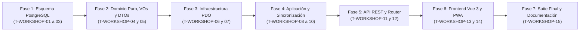

# Plan de Tareas de Implementación (`tasks.md`): Bandeja de Taller Central y Ciclo de Reacondicionamiento de Piezas Recuperadas (`27-workshop-refurbishment-loop`)

**Módulo:** `27-workshop-refurbishment-loop`  
**Versión:** 1.0 (Alineado con `spec.md` v2.1, `workshop_refurbishment_loop_contracts.md` v1.0 y `plan.md` v2.1)  
**Estado:** Pendiente de Ejecución (Puerta SDD: Aprobación de `tasks.md` antes de escribir código)  
**Metodología:** SDD (Specification-Driven Development) · Clean Architecture · TDD / Guardas de Esquema  
**Ley Suprema:** [`constitution.md`](../../constitution.md) y [`AGENTS.md`](../../AGENTS.md)

---

## Resumen de Fases y Grafo de Dependencias

| Fase | Rango de Tareas | Descripción | Tiempo Estimado |
| :--- | :--- | :--- | :--- |
| **Fase 1** | `T-WORKSHOP-01` .. `T-WORKSHOP-03` | Esquema PostgreSQL / Supabase (Migración `023`, Tabla 38 `workshop_repair_items`, enums `33..34`, backfill con `generate_series`, semillas y guardas) | ~80 min |
| **Fase 2** | `T-WORKSHOP-04` .. `T-WORKSHOP-05` | Modelos de Dominio, Enums PHP, `BenchDiagnosisValidator`, Excepciones y DTOs inmutables + Tests Unitarios | ~50 min |
| **Fase 3** | `T-WORKSHOP-06` .. `T-WORKSHOP-07` | Repositorio PDO (`PdoWorkshopRepairItemRepository`), bloqueo `FOR UPDATE`, ordenación determinista, KPIs y recordatorio en furgoneta | ~55 min |
| **Fase 4** | `T-WORKSHOP-08` .. `T-WORKSHOP-10` | Apertura unitaria `1..N` en `SparePartTraceabilityService`, flujo en `WorkshopRefurbishmentService`, exportación CSV y pruebas de concurrencia/offline | ~80 min |
| **Fase 5** | `T-WORKSHOP-11` .. `T-WORKSHOP-12` | Controladores REST (`WorkshopRefurbishmentController`, `TechnicianVanStockController`), cableado en `AppRouter` y suite de integración API | ~55 min |
| **Fase 6** | `T-WORKSHOP-13` .. `T-WORKSHOP-14` | Cliente `api.js`, pestaña `CoordinatorWorkshopTrayTab.js`, integración en `CoordinatorSparePartsView.js`, bloque en `TechnicianVanStockModal.js` y `sw.js` | ~55 min |
| **Fase 7** | `T-WORKSHOP-15` | Verificación Integral (`composer test`), regresión cero y cierre de documentación (`docs/features_pendientes.md`) | ~25 min |

---

## Fase 1: Esquema de Base de Datos PostgreSQL / Supabase y Guardas de Esquema

- [x] **T-WORKSHOP-01 · Crear migración incremental `023_workshop_repair_items.sql` y converger `database/supabase_init.sql`**
  - **Tiempo estimado:** 30 min
  - **Dependencias previas:** Ninguna
  - **Archivos exactos a crear o modificar:**
    - Crear `database/supabase_migrations/023_workshop_repair_items.sql`
    - Modificar `database/supabase_init.sql`
  - **Requisitos cubiertos:** `RF-01.1`–`RF-01.5`, `RF-02.1`–`RF-02.4`, `RF-03.1`–`RF-03.5`, `RF-05.3`, `RNF-01`, `D1`–`D4`, `C1`–`C5`, `QA 1`, `QA 2`, `constitution.md` Art. III.3 (Inmutabilidad Histórica y `ON DELETE RESTRICT`), Art. IV.2 y Art. VIII.
  - **Detalle de implementación:**
    1. Crear de forma idempotente los tipos enumerados nativos `workshop_repair_status` (`'PENDING_DELIVERY'`, `'RECEIVED_IN_WORKSHOP'`, `'IN_BENCH_TEST'`, `'REFURBISHED_RESTORED'`, `'SCRAPPED_IRREPARABLE'`) y `workshop_restock_destination` (`'CENTRAL_WAREHOUSE'`, `'TECHNICIAN_VAN'`).
    2. Añadir de forma idempotente `'WORKSHOP_REPAIR_ITEM'` al tipo enumerado `audit_entity_type` (`ALTER TYPE audit_entity_type ADD VALUE IF NOT EXISTS 'WORKSHOP_REPAIR_ITEM'`).
    3. Crear la Tabla 38 `workshop_repair_items` (34 columnas) con claves foráneas `ON DELETE RESTRICT`, restricción única `uq_workshop_repair_replaced_part_unit UNIQUE (incident_replaced_part_id, unit_index)` y las 5 restricciones `CHECK`:
       - `chk_workshop_repair_unit_bounds` (`unit_index >= 1 AND total_units_in_line >= 1 AND unit_index <= total_units_in_line`)
       - `chk_workshop_repair_costs_non_negative` (`unit_cost_snapshot >= 0.00 AND refurbishment_cost_eur >= 0.00 AND net_savings_eur >= 0.00`)
       - `chk_workshop_repair_reception_notes_len` (`reception_notes IS NULL OR char_length(btrim(reception_notes)) <= 500`)
       - `chk_workshop_repair_bench_diagnosis_len` (`bench_diagnosis IS NULL OR char_length(btrim(bench_diagnosis)) BETWEEN 20 AND 1000`)
       - `chk_workshop_repair_terminal_coherence` (coherencia estricta de sellos temporales, diagnóstico obligatorio, `restock_destination`, `restocked_technician_id` y vedado de `is_out_of_catalog = TRUE` hacia `TECHNICIAN_VAN`).
    4. Crear los 6 índices (`idx_workshop_repair_status_created`, `idx_workshop_repair_extracted_tech`, `idx_workshop_repair_spare_part`, `idx_workshop_repair_incident`, `idx_workshop_repair_preventive_order`, `idx_workshop_repair_resolved_at`) y los disparadores constitucionales `trg_no_delete_workshop_repair_items` (`prevent_hard_delete()`) y `trg_touch_workshop_repair_items` (`touch_updated_at()`).
    5. Incluir el backfill idempotente con `generate_series(1, irp.quantity) AS gs(unit_idx)` en estado `'PENDING_DELIVERY'` para todas las filas existentes en `incident_replaced_parts` con `old_part_destination = 'TALLER'`, atribuyendo `extracted_by_technician_id = COALESCE(i.assigned_technician_id, po.assigned_technician_id, irp.recorded_by_user_id)` y preservando `created_at = irp.created_at`.
    6. Reflejar exactamente las mismas definiciones en `database/supabase_init.sql`.
  - **Hecho cuando:** `vendor/bin/phpunit tests/integration/SchemaConvergenceParityTest.php`

- [x] **T-WORKSHOP-02 · Poblar semillas representativas en `supabase_seeds.sql` y `SeedRunner.php` en los 5 estados del ciclo de taller**
  - **Tiempo estimado:** 25 min
  - **Dependencias previas:** `T-WORKSHOP-01`
  - **Archivos exactos a crear o modificar:**
    - Modificar `database/supabase_seeds.sql`
    - Modificar `src/Infrastructure/Database/SeedRunner.php`
  - **Requisitos cubiertos:** `RF-02.1`–`RF-02.4`, `RF-03.1`–`RF-03.5`, `RF-05.1`–`RF-05.3`, `D2`, `D3`, `D4`, `C1`, `C2`, `QA 1`, `QA 2`.
  - **Detalle de implementación:**
    1. Actualizar las semillas deterministas en `database/supabase_seeds.sql` y `SeedRunner.php` para que las sustituciones de piezas con `old_part_destination = 'TALLER'` generen expedientes en `workshop_repair_items` cubriendo los **5 estados del ciclo** (`PENDING_DELIVERY`, `RECEIVED_IN_WORKSHOP`, `IN_BENCH_TEST`, `REFURBISHED_RESTORED` con reintegro tanto a `CENTRAL_WAREHOUSE` como a `TECHNICIAN_VAN`, y `SCRAPPED_IRREPARABLE` tanto por fallo en banco de pruebas como por extravío previo a la recepción `received_at IS NULL`), además de una línea con `quantity > 1` desglosada en `unit_index = 1..N`.
    2. Garantizar que la ejecución repetida de `SeedRunner` sea 100% idempotente (`ON CONFLICT (incident_replaced_part_id, unit_index) DO UPDATE ...`).
  - **Hecho cuando:** `php database/run_seeds.php && vendor/bin/phpunit tests/integration/SchemaConvergenceParityTest.php`

- [x] **T-WORKSHOP-03 · Actualizar contratos de esquema (`38 tablas`, `34 ENUMs`), utilidades de test y crear `PostgresWorkshopRepairSchemaTest.php`**
  - **Tiempo estimado:** 25 min
  - **Dependencias previas:** `T-WORKSHOP-01`, `T-WORKSHOP-02`
  - **Archivos exactos a crear o modificar:**
    - Modificar `specs/technical/database_schema.md`
    - Modificar `specs/technical/schema_correspondence_contract.md`
    - Modificar `tests/Support/TestDataCleaner.php`
    - Modificar `tests/Support/PostgresFixtureBuilder.php`
    - Modificar `tests/integration/SchemaConvergenceParityTest.php`
    - Modificar `tests/integration/PostgresSchemaTest.php`
    - Crear `tests/integration/PostgresWorkshopRepairSchemaTest.php`
  - **Requisitos cubiertos:** `RF-01.1`–`RF-01.5`, `RF-02.1`–`RF-02.4`, `RF-03.1`–`RF-03.5`, `RNF-01`, `D1`–`D4`, `C1`–`C5`, `QA 1`.
  - **Detalle de implementación:**
    1. Documentar la Tabla 38 (`workshop_repair_items`) y elevar el contador de tablas de dominio a **38** y los tipos enumerados nativos a **34** (`workshop_repair_status`, `workshop_restock_destination`) en `specs/technical/database_schema.md` y `specs/technical/schema_correspondence_contract.md`.
    2. Añadir `workshop_repair_items` en el orden topológico de truncado de `TestDataCleaner.php` (antes de `incident_replaced_parts`) y helper de creación de fixtures en `PostgresFixtureBuilder.php`.
    3. Actualizar las aserciones de tablas/enums en `SchemaConvergenceParityTest.php` y `PostgresSchemaTest.php`.
    4. Crear `tests/integration/PostgresWorkshopRepairSchemaTest.php` verificando en PostgreSQL real:
       - Existencia de columnas, índices, claves foráneas `ON DELETE RESTRICT` y restricción única `uq_workshop_repair_replaced_part_unit`.
       - Bloqueo de `DELETE FROM workshop_repair_items` por `trg_no_delete_workshop_repair_items`.
       - Rechazo por `chk_workshop_repair_terminal_coherence` de: dictamen sin `bench_diagnosis`, pieza `is_out_of_catalog = TRUE` hacia `TECHNICIAN_VAN`, `SCRAPPED_IRREPARABLE` con `restock_destination IS NOT NULL` o `net_savings_eur > 0`.
       - Ejecución idempotente del backfill con `generate_series(1, irp.quantity)`.
  - **Hecho cuando:** `vendor/bin/phpunit tests/integration/SchemaConvergenceParityTest.php tests/integration/PostgresSchemaTest.php tests/integration/SchemaCorrespondenceTest.php tests/integration/PostgresWorkshopRepairSchemaTest.php`

---

## Fase 2: Modelos de Dominio, Value Objects, Validadores y DTOs

- [x] **T-WORKSHOP-04 · Implementar Enums de Dominio, entidad `WorkshopRepairItem`, `BenchDiagnosisValidator` y `WorkshopRepairValidationException`**
  - **Tiempo estimado:** 25 min
  - **Dependencias previas:** `T-WORKSHOP-03`
  - **Archivos exactos a crear o modificar:**
    - Crear `src/Core/Domain/ValueObject/WorkshopRepairStatus.php`
    - Crear `src/Core/Domain/ValueObject/WorkshopRestockDestination.php`
    - Crear `src/Core/Domain/Entity/WorkshopRepairItem.php`
    - Crear `src/Core/Domain/Service/BenchDiagnosisValidator.php`
    - Crear `src/Core/Domain/Exception/WorkshopRepairValidationException.php`
  - **Requisitos cubiertos:** `RF-02.1`–`RF-02.4`, `RF-03.1`–`RF-03.5`, `D1`–`D3`, `C1`–`C5`, `QA 1`, `constitution.md` Art. III.3 y Art. IV.2 (`declare(strict_types=1);`).
  - **Detalle de implementación:**
    1. Implementar `WorkshopRepairStatus` (`PENDING_DELIVERY`, `RECEIVED_IN_WORKSHOP`, `IN_BENCH_TEST`, `REFURBISHED_RESTORED`, `SCRAPPED_IRREPARABLE`) con helpers `isTerminal(): bool` y `canTransitionTo(self $target): bool`.
    2. Implementar `WorkshopRestockDestination` (`CENTRAL_WAREHOUSE`, `TECHNICIAN_VAN`).
    3. Implementar `BenchDiagnosisValidator::normalizeAndValidate(string $rawText, string $errorCode = 'BENCH_DIAGNOSIS_TOO_SHORT'): string` que colapsa espacios/saltos de línea múltiples (`preg_replace('/\s+/u', ' ', trim($rawText))`), exige longitud entre `20` y `1000` caracteres (`mb_strlen`) y al menos **3 palabras o tokens alfanuméricos** (`preg_match_all('/[\p{L}\p{N}]{2,}/u', ...)` $\ge 3$), lanzando `WorkshopRepairValidationException` con HTTP `422`.
    4. Implementar `WorkshopRepairValidationException` con constructores semánticos para todos los códigos de error de `workshop_refurbishment_loop_contracts.md` (`404`: `WORKSHOP_ITEM_NOT_FOUND`, `TECHNICIAN_NOT_FOUND`; `409`: `INVALID_WORKSHOP_STATUS_TRANSITION`, `WORKSHOP_ITEM_ALREADY_RESOLVED`; `422`: `RECEPTION_NOTES_TOO_LONG`, `INVALID_RESOLUTION_OUTCOME`, `BENCH_DIAGNOSIS_TOO_SHORT`, `BENCH_DIAGNOSIS_TOO_LONG`, `INVALID_RESTOCK_DESTINATION`, `OUT_OF_CATALOG_VAN_RESTOCK_FORBIDDEN`, `INACTIVE_SPARE_PART_VAN_RESTOCK_FORBIDDEN`, `RESTOCK_TECHNICIAN_REQUIRED`, `RESTOCK_TECHNICIAN_INACTIVE`, `VAN_STOCK_MAX_CAPACITY_REACHED`, `INVALID_REFURBISHMENT_COST`, `UNRECEIVED_PART_CANNOT_BE_REFURBISHED`).
    5. Implementar la entidad inmutable `WorkshopRepairItem` con métodos de transición (`markReceivedInWorkshop()`, `startBenchTest()`, `resolveAsRefurbished()`, `resolveAsScrapped()`), cálculo puro `calculateNetSavings(float $unitCostSnapshot, float $refurbishmentCostEur): float` con suelo `0.00` (`C2`) y bandera `hasZeroNetSavingsWarning(): bool` cuando `refurbishment_cost_eur >= unit_cost_snapshot`.
  - **Hecho cuando:** `php -l src/Core/Domain/ValueObject/WorkshopRepairStatus.php && php -l src/Core/Domain/Entity/WorkshopRepairItem.php && php -l src/Core/Domain/Service/BenchDiagnosisValidator.php`

- [x] **T-WORKSHOP-05 · Implementar DTOs de Aplicación y suite unitaria `WorkshopRepairDomainAndValidatorTest.php`**
  - **Tiempo estimado:** 25 min
  - **Dependencias previas:** `T-WORKSHOP-04`
  - **Archivos exactos a crear o modificar:**
    - Crear `src/Application/DTO/WorkshopTrayQueryDTO.php`
    - Crear `src/Application/DTO/ReceiveWorkshopItemRequestDTO.php`
    - Crear `src/Application/DTO/ResolveWorkshopItemRequestDTO.php`
    - Crear `tests/unit/WorkshopRepairDomainAndValidatorTest.php`
  - **Requisitos cubiertos:** `RF-02.1`–`RF-02.4`, `RF-03.1`–`RF-03.5`, `RF-04.1`–`RF-04.2`, `D2`, `D3`, `C1`–`C5`, `QA 1`, `QA 2`.
  - **Detalle de implementación:**
    1. Crear los DTOs inmutables `WorkshopTrayQueryDTO` (`status`, `technicianId`, `category`, `search`, `page`, `perPage` acotado a `1..100`), `ReceiveWorkshopItemRequestDTO` (`workshopItemId`, `actorUserId`, `receptionNotes`) y `ResolveWorkshopItemRequestDTO` (`workshopItemId`, `actorUserId`, `outcomeStatus`, `benchDiagnosis`, `restockDestination`, `restockedTechnicianId`, `refurbishmentCostEur`).
    2. Crear `tests/unit/WorkshopRepairDomainAndValidatorTest.php` probando exhaustivamente:
       - Normalización y validación de `BenchDiagnosisValidator` (textos vacíos, `< 20` chars, `> 1000` chars, relleno con espacios/guiones sin 3 palabras reales, y diagnósticos válidos).
       - Transiciones válidas e inválidas de `WorkshopRepairItem`, incluyendo el atajo desde `RECEIVED_IN_WORKSHOP` a dictamen final (sellando `bench_started_at = resolved_at`) y la vía excepcional de extravío desde `PENDING_DELIVERY` a `SCRAPPED_IRREPARABLE` (`received_at = null`, `bench_started_at = null`).
       - Bloqueo `409 WORKSHOP_ITEM_ALREADY_RESOLVED` ante cualquier intento de mutar un expediente terminal (`C5`).
       - Cálculo de `net_savings_eur = max(0.00, unit_cost_snapshot - refurbishment_cost_eur)` y activación de `zero_net_savings_warning` cuando el coste de reacondicionar iguala o supera el coste de snapshot (`C2`).
       - Cálculo puro de `recovery_rate_pct` excluyendo `scrapped_unreceived_count` del denominador (`QA 1`).
  - **Hecho cuando:** `vendor/bin/phpunit tests/unit/WorkshopRepairDomainAndValidatorTest.php`

---

## Fase 3: Capa de Infraestructura y Repositorio PDO (`PdoWorkshopRepairItemRepository`)

- [ ] **T-WORKSHOP-06 · Definir `WorkshopRepairItemRepositoryInterface` e implementar `PdoWorkshopRepairItemRepository` (escritura, bloqueo `FOR UPDATE` y recordatorio móvil)**
  - **Tiempo estimado:** 30 min
  - **Dependencias previas:** `T-WORKSHOP-05`
  - **Archivos exactos a crear o modificar:**
    - Crear `src/Core/Domain/Repository/WorkshopRepairItemRepositoryInterface.php`
    - Crear `src/Infrastructure/Persistence/PdoWorkshopRepairItemRepository.php`
  - **Requisitos cubiertos:** `RF-01.1`–`RF-01.5`, `RF-02.1`–`RF-02.4`, `RF-03.1`–`RF-03.5`, `RF-04.4`, `RNF-01`, `D1`–`D3`, `C1`–`C6`, `QA 3`, `QA 4`.
  - **Detalle de implementación:**
    1. Definir en `WorkshopRepairItemRepositoryInterface`:
       - `createUnitBreakdownForReplacedPart(array $breakdownPayload): array` (`INSERT ... ON CONFLICT (incident_replaced_part_id, unit_index) DO NOTHING RETURNING id`)
       - `findById(int $id): ?array` y `findByIdForUpdate(int $id): ?array` (`SELECT ... FOR UPDATE`)
       - `updateReception(int $id, int $receivedByUserId, ?string $receptionNotes, string $receivedAt): array`
       - `updateStartBench(int $id, int $benchStartedByUserId, string $benchStartedAt): array`
       - `updateResolution(int $id, array $resolutionData): array`
       - `findPendingDeliveriesForTechnician(int $technicianId): array` (consulta sin importes monetarios para `GET /api/technician/van-stock`, ordenada por `created_at ASC, id ASC`).
    2. Implementar los métodos en `PdoWorkshopRepairItemRepository` con enriquecimiento de joins hacia `users` (técnico extractor y actores de taller), `incidents`, `preventive_orders`, `machines` y `locations` para devolver la estructura exacta del contrato `WorkshopRepairItemSummary`.
  - **Hecho cuando:** `php -l src/Core/Domain/Repository/WorkshopRepairItemRepositoryInterface.php && php -l src/Infrastructure/Persistence/PdoWorkshopRepairItemRepository.php`

- [ ] **T-WORKSHOP-07 · Implementar consultas de Bandeja de Taller, KPIs inmunes a `status`, ordenación determinista y listado para exportación CSV en `PdoWorkshopRepairItemRepository`**
  - **Tiempo estimado:** 25 min
  - **Dependencias previas:** `T-WORKSHOP-06`
  - **Archivos exactos a crear o modificar:**
    - Modificar `src/Core/Domain/Repository/WorkshopRepairItemRepositoryInterface.php`
    - Modificar `src/Infrastructure/Persistence/PdoWorkshopRepairItemRepository.php`
  - **Requisitos cubiertos:** `RF-04.1`–`RF-04.3`, `RF-05.1`–`RF-05.2`, `RNF-02`, `D4`, `QA 1`, `QA 2`, `QA 5`.
  - **Detalle de implementación:**
    1. Implementar `paginateWorkshopTray(WorkshopTrayQueryDTO $query): array` con:
       - Filtros opcionales combinables: `status` (`ALL` o estado específico), `technician_id`, `category` y `search` (`ILIKE` sobre `spare_part_code_snapshot`, `spare_part_name_snapshot`, código de máquina, código/ID de ticket y nombre de técnico).
       - Ordenación determinista (`QA 2`): primero estados activos (`PENDING_DELIVERY` = 1, `RECEIVED_IN_WORKSHOP` = 2, `IN_BENCH_TEST` = 3) ordenados por `wri.created_at ASC, wri.id ASC` (más antiguos primero), seguidos de estados terminales (`REFURBISHED_RESTORED` = 4, `SCRAPPED_IRREPARABLE` = 5) ordenados por `wri.resolved_at DESC, wri.id ASC`.
       - Cálculo de `age_hours` (horas desde `created_at` para estados activos o duración total hasta `resolved_at` para estados terminales).
    2. Implementar `computeTrayKpis(WorkshopTrayQueryDTO $query): array` aplicando los filtros de `technician_id`, `category` y `search`, pero **ignorando el filtro `status`** (`QA 2`), devolviendo: `pending_delivery_count`, `in_workshop_active_count`, `received_in_workshop_count`, `in_bench_test_count`, `refurbished_count`, `scrapped_count`, `scrapped_in_bench_count`, `scrapped_unreceived_count`, `recovery_rate_pct` (con denominador `refurbished_count + scrapped_in_bench_count`, `QA 1`), `gross_recovered_value_eur`, `total_refurbishment_cost_eur` y `net_Refurbished_savings_eur`.
    3. Implementar `findAllForExport(WorkshopTrayQueryDTO $query): array` con el mismo predicado y ordenación determinista (incluyendo el filtro `status` activo en la vista al exportar) y conversión de sellos temporales a `Europe/Madrid` (`YYYY-MM-DD HH:MM:SS`, `QA 5`).
  - **Hecho cuando:** `php -l src/Infrastructure/Persistence/PdoWorkshopRepairItemRepository.php`

---

## Fase 4: Capa de Aplicación, Enganche en Sustitución de Piezas, Sincronización Offline y Exportación CSV

- [ ] **T-WORKSHOP-08 · Conectar la apertura automática y desglose unitario `1..N` en `SparePartTraceabilityService` (averías, preventivos y Offline PWA)**
  - **Tiempo estimado:** 30 min
  - **Dependencias previas:** `T-WORKSHOP-07`
  - **Archivos exactos a crear o modificar:**
    - Modificar `src/Application/Service/SparePartTraceabilityService.php`
  - **Requisitos cubiertos:** `RF-01.1`–`RF-01.5`, `D1`, `C4`, `C6`, `QA 4`, `constitution.md` Art. III.3.
  - **Detalle de implementación:**
    1. Inyectar `WorkshopRepairItemRepositoryInterface` (con fallback por defecto a `PdoWorkshopRepairItemRepository` cuando se construya con `$pdo`) en `SparePartTraceabilityService`.
    2. En `recordReplacedPartsWithinTransaction()` (invocado al resolver averías correctivas `INCIDENT` y al completar órdenes preventivas `PREVENTIVE`, tanto online como desde `OfflineSyncService`):
       - Cuando `old_part_destination === 'TALLER'`, resolver el técnico extractor como el técnico asignado a la avería u orden preventiva (`assigned_technician_id`), con fallback a `$actorUserId` si el actor es `TECHNICIAN` (`QA 4`).
       - Generar `1..$quantity` filas en `workshop_repair_items` en estado `'PENDING_DELIVERY'` con `unit_index = 1..$quantity`, `total_units_in_line = $quantity` y snapshots inmutables (`spare_part_code_snapshot`, `spare_part_name_snapshot`, `spare_part_category_snapshot`, `is_out_of_catalog`, `unit_cost_snapshot`).
       - Registrar en `audit_log` una entrada por cada expediente unitario creado con `entity_type = 'WORKSHOP_REPAIR_ITEM'`, `action = 'WORKSHOP_ITEM_CREATED_FROM_EXTRACTION'` y detalle JSON con `incident_replaced_part_id`, `unit_index`, `total_units_in_line`, `source_type` y `extracted_by_technician_id`.
    3. Garantizar que las reaperturas en garantía (`< 48h`, `C4`) no alteren ni dupliquen los expedientes de taller de la visita anterior, y que los volcados de conflicto offline (`conflict_dump`, `C6`) no disparen `recordReplacedPartsWithinTransaction()` ni creen filas huérfanas en `workshop_repair_items`.
  - **Hecho cuando:** `vendor/bin/phpunit tests/integration/SparePartCatalogAndPreventiveTraceabilityTest.php tests/integration/OfflinePwaSyncIntegrationTest.php`

- [ ] **T-WORKSHOP-09 · Implementar `WorkshopRefurbishmentService` (recepción física, inicio de banco, dictamen con reintegro atómico `FOR UPDATE` y exportación CSV)**
  - **Tiempo estimado:** 30 min
  - **Dependencias previas:** `T-WORKSHOP-08`
  - **Archivos exactos a crear o modificar:**
    - Crear `src/Application/Service/WorkshopRefurbishmentService.php`
  - **Requisitos cubiertos:** `RF-02.1`–`RF-02.4`, `RF-03.1`–`RF-03.5`, `RF-04.1`–`RF-04.3`, `RF-05.1`–`RF-05.2`, `RNF-01`–`RNF-03`, `D2`, `D3`, `C1`–`C3`, `C5`, `QA 1`–`QA 3`, `QA 5`.
  - **Detalle de implementación:**
    1. Implementar `listWorkshopTray(WorkshopTrayQueryDTO $query): array` combinando `computeTrayKpis()` y `paginateWorkshopTray()`.
    2. Implementar `receiveInWorkshop(ReceiveWorkshopItemRequestDTO $dto): array` bajo transacción PDO con `findByIdForUpdate()`:
       - Validar transición exclusiva desde `PENDING_DELIVERY` (`409` en caso contrario) y longitud de `reception_notes` ($\le 500$ chars, `422 RECEPTION_NOTES_TOO_LONG`).
       - Persistir transición a `RECEIVED_IN_WORKSHOP` y registrar `WORKSHOP_ITEM_RECEIVED` en `audit_log`.
    3. Implementar `startBenchTest(int $workshopItemId, int $actorUserId): array` bajo transacción PDO con `findByIdForUpdate()`:
       - Validar transición exclusiva desde `RECEIVED_IN_WORKSHOP` (`409` en caso contrario).
       - Persistir transición a `IN_BENCH_TEST` y registrar `WORKSHOP_ITEM_BENCH_STARTED` en `audit_log`.
    4. Implementar `resolveWorkshopItem(ResolveWorkshopItemRequestDTO $dto): array` bajo transacción PDO con `findByIdForUpdate()`:
       - Rechazar si ya está en estado terminal (`409 WORKSHOP_ITEM_ALREADY_RESOLVED`, `C5`).
       - Validar `bench_diagnosis` con `BenchDiagnosisValidator` (`20..1000` chars y $\ge 3$ palabras reales, `QA 1`).
       - Si `outcome_status === 'REFURBISHED_RESTORED'`:
         - Rechazar si el estado actual es `PENDING_DELIVERY` (`422 UNRECEIVED_PART_CANNOT_BE_REFURBISHED`, `C1`).
         - Validar `refurbishment_cost_eur` en `0.00..9999.99` (`422 INVALID_REFURBISHMENT_COST`) y calcular `net_savings_eur = max(0.00, unit_cost_snapshot - refurbishment_cost_eur)` (`C2`).
         - Si el estado actual era `RECEIVED_IN_WORKSHOP`, sellar `bench_started_at = resolved_at` y `bench_started_by_user_id = actor_user_id` (`D2`).
         - Si `restock_destination === 'TECHNICIAN_VAN'`: verificar que `is_out_of_catalog === false` (`422 OUT_OF_CATALOG_VAN_RESTOCK_FORBIDDEN`), que la pieza en `spare_parts` siga `is_active = TRUE` (`422 INACTIVE_SPARE_PART_VAN_RESTOCK_FORBIDDEN`), que `restocked_technician_id` exista con `role = 'TECHNICIAN'` (`404 TECHNICIAN_NOT_FOUND`) y `is_active = TRUE` (`422 RESTOCK_TECHNICIAN_INACTIVE`, `C3`), bloquear o crear la fila en `technician_van_stocks` con `FOR UPDATE` verificando `quantity_available + 1 <= 9999` (`422 VAN_STOCK_MAX_CAPACITY_REACHED`, `QA 3`), e incrementar `quantity_available + 1` (con `min_threshold = 1` si no existía).
         - Registrar en `audit_log` `WORKSHOP_ITEM_REFURBISHED_TO_CENTRAL` o `WORKSHOP_ITEM_REFURBISHED_TO_VAN`.
       - Si `outcome_status === 'SCRAPPED_IRREPARABLE'`:
         - Permitir desde `IN_BENCH_TEST`, `RECEIVED_IN_WORKSHOP` (sellando `bench_started_at = resolved_at`) o desde `PENDING_DELIVERY` por extravío/no entrega manteniendo `received_at = NULL` y `bench_started_at = NULL` (`C1`).
         - Forzar `refurbishment_cost_eur = 0.00`, `net_savings_eur = 0.00`, `restock_destination = NULL` y `restocked_technician_id = NULL`.
         - Registrar en `audit_log` `WORKSHOP_ITEM_SCRAPPED_IN_BENCH` o `WORKSHOP_ITEM_SCRAPPED_UNRECEIVED`.
    5. Implementar `exportWorkshopCsv(WorkshopTrayQueryDTO $query): string` generando el CSV con BOM UTF-8 (`\xEF\xBB\xBF`), delimitador `;`, **Sección 1** (`Indicador;Valor`, 11 filas de KPIs), línea en blanco y **Sección 2** (24 columnas de detalle con fechas en `Europe/Madrid`, `QA 5`), más protección contra CSV Injection (`=`, `+`, `-`, `@`).
  - **Hecho cuando:** `php -l src/Application/Service/WorkshopRefurbishmentService.php`

- [ ] **T-WORKSHOP-10 · Crear suite de integración de servicio, concurrencia, reaperturas y sincronización offline (`WorkshopRefurbishmentServiceIntegrationTest.php`)**
  - **Tiempo estimado:** 25 min
  - **Dependencias previas:** `T-WORKSHOP-09`
  - **Archivos exactos a crear o modificar:**
    - Crear `tests/integration/WorkshopRefurbishmentServiceIntegrationTest.php`
  - **Requisitos cubiertos:** `RF-01.1`–`RF-01.5`, `RF-02.1`–`RF-02.4`, `RF-03.1`–`RF-03.5`, `RF-04.1`–`RF-04.4`, `RF-05.1`–`RF-05.2`, `D1`–`D4`, `C1`–`C6`, `QA 1`–`QA 5`.
  - **Detalle de implementación:**
    1. Probar la apertura automática de `1..N` unidades al sustituir piezas con `old_part_destination = 'TALLER'` tanto en averías (`INCIDENT`, incluyendo resolución manual por Coordinación que atribuye `extracted_by_technician_id` al técnico asignado `QA 4`) como en preventivos (`PREVENTIVE`) y en sincronización diferida Offline PWA (verificando que `conflict_dump` no cree filas huérfanas `C6`).
    2. Probar que una reapertura en garantía (`< 48h`, `C4`) conserva intactos los expedientes de taller de la primera intervención.
    3. Probar el ciclo completo `PENDING_DELIVERY` $\rightarrow$ `RECEIVED_IN_WORKSHOP` $\rightarrow$ `IN_BENCH_TEST` $\rightarrow$ `REFURBISHED_RESTORED` con reintegro `+1` en `technician_van_stocks` (tanto sobre fila existente como creando fila nueva con `min_threshold = 1`) y tope `9999` (`422 VAN_STOCK_MAX_CAPACITY_REACHED`, `QA 3`).
    4. Probar las guardas `422` y `409`: pieza fuera de catálogo hacia furgoneta (`OUT_OF_CATALOG_VAN_RESTOCK_FORBIDDEN`), técnico inactivo (`RESTOCK_TECHNICIAN_INACTIVE`), pieza de catálogo inactiva (`INACTIVE_SPARE_PART_VAN_RESTOCK_FORBIDDEN`), coste de reacondicionamiento $\ge$ coste original (`zero_net_savings_warning = true` y `net_savings_eur = 0.00`, `C2`), baja directa por extravío desde `PENDING_DELIVERY` (`C1`), e inmutabilidad terminal (`409 WORKSHOP_ITEM_ALREADY_RESOLVED`, `C5`).
    5. Verificar el formato de las 2 secciones del CSV exportado (`QA 5`) y las 6 acciones en `audit_log`.
  - **Hecho cuando:** `vendor/bin/phpunit tests/integration/WorkshopRefurbishmentServiceIntegrationTest.php`

---

## Fase 5: Capa de Presentación REST, Enriquecimiento de Stock de Furgoneta y Router

- [ ] **T-WORKSHOP-11 · Implementar `WorkshopRefurbishmentController`, enriquecer `TechnicianVanStockController` y registrar rutas en `AppRouter.php`**
  - **Tiempo estimado:** 30 min
  - **Dependencias previas:** `T-WORKSHOP-10`
  - **Archivos exactos a crear o modificar:**
    - Crear `src/Presentation/Controller/WorkshopRefurbishmentController.php`
    - Modificar `src/Presentation/Controller/TechnicianVanStockController.php`
    - Modificar `src/Presentation/Routing/AppRouter.php`
  - **Requisitos cubiertos:** `RF-02.1`–`RF-02.4`, `RF-03.1`–`RF-03.5`, `RF-04.1`–`RF-04.4`, `RF-05.1`–`RF-05.2`, `RNF-03`, `D2`, `D3`, `QA 1`–`QA 5`, `constitution.md` Art. II.3 (RBAC estricto).
  - **Detalle de implementación:**
    1. Implementar `WorkshopRefurbishmentController` con verificación estricta de sesión autenticada (`401`) y rol `COORDINATOR` (`403 FORBIDDEN_ROLE`) para los 5 endpoints:
       - `GET /api/coordinator/workshop-items`
       - `GET /api/coordinator/workshop-items/export` (`Content-Type: text/csv; charset=UTF-8`, `Content-Disposition: attachment; filename="taller_piezas_recuperadas_YYYYMMDD_HHMM.csv"`)
       - `POST /api/coordinator/workshop-items/{id}/receive`
       - `POST /api/coordinator/workshop-items/{id}/start-bench`
       - `POST /api/coordinator/workshop-items/{id}/resolve`
    2. En `TechnicianVanStockController::listOwnVanStock()` (`GET /api/technician/van-stock`), añadir `pending_workshop_deliveries_count` y `pending_workshop_deliveries` consultando `findPendingDeliveriesForTechnician($technicianId)` sin exponer `unit_cost_snapshot`, `refurbishment_cost_eur` ni `net_savings_eur` (`RF-04.4`, `RNF-03`, `QA 4`).
    3. Registrar las 5 rutas de `/api/coordinator/workshop-items*` en `AppRouter.php` e inyectar `WorkshopRepairItemRepositoryInterface` en `TechnicianVanStockController`.
  - **Hecho cuando:** `php -l src/Presentation/Controller/WorkshopRefurbishmentController.php && php -l src/Presentation/Controller/TechnicianVanStockController.php && php -l src/Presentation/Routing/AppRouter.php`

- [ ] **T-WORKSHOP-12 · Crear suite de integración de contratos HTTP y RBAC (`WorkshopRefurbishmentApiIntegrationTest.php`)**
  - **Tiempo estimado:** 25 min
  - **Dependencias previas:** `T-WORKSHOP-11`
  - **Archivos exactos a crear o modificar:**
    - Crear `tests/integration/WorkshopRefurbishmentApiIntegrationTest.php`
  - **Requisitos cubiertos:** `RF-02.1`–`RF-02.4`, `RF-03.1`–`RF-03.5`, `RF-04.1`–`RF-04.4`, `RF-05.1`–`RF-05.2`, `RNF-03`, `D1`–`D4`, `C1`–`C6`, `QA 1`–`QA 5`.
  - **Detalle de implementación:**
    1. Verificar RBAC HTTP: `401` sin token y `403 FORBIDDEN_ROLE` cuando un `TECHNICIAN` o `LOCATION_MANAGER` invoca cualquiera de los 5 endpoints de `/api/coordinator/workshop-items*`.
    2. Verificar `GET /api/coordinator/workshop-items` con filtros por `status`, `technician_id`, `category` y `search`, comprobando que el bloque `kpis` mantiene los totales globales respecto a `status` (`QA 2`) y que la ordenación prioriza las etapas activas más antiguas (`created_at ASC, id ASC`).
    3. Verificar las transiciones HTTP `200`, `404`, `409` y `422` en `/receive`, `/start-bench` y `/resolve`, incluyendo el banner `zero_net_savings_warning` (`C2`) y el reintegro atómico a furgoneta (`+1`).
    4. Verificar `GET /api/coordinator/workshop-items/export` (cabeceras HTTP, BOM UTF-8, Sección 1 de 11 KPIs y Sección 2 de 24 columnas).
    5. Verificar que `GET /api/technician/van-stock` incluye `pending_workshop_deliveries_count` y `pending_workshop_deliveries` sin campos monetarios (`QA 4`), y se vacía inmediatamente cuando Coordinación acusa recibo en taller.
  - **Hecho cuando:** `vendor/bin/phpunit tests/integration/WorkshopRefurbishmentApiIntegrationTest.php`

---

## Fase 6: Frontend Vue 3 (`CoordinatorWorkshopTrayTab`, `CoordinatorSparePartsView`, `TechnicianVanStockModal`), `api.js` y `sw.js`

- [ ] **T-WORKSHOP-13 · Añadir métodos cliente en `api.js` y construir el componente `CoordinatorWorkshopTrayTab.js` e integrarlo en `CoordinatorSparePartsView.js`**
  - **Tiempo estimado:** 30 min
  - **Dependencias previas:** `T-WORKSHOP-12`
  - **Archivos exactos a crear o modificar:**
    - Modificar `public/assets/js/api.js`
    - Crear `public/assets/js/components/CoordinatorWorkshopTrayTab.js`
    - Modificar `public/assets/js/components/CoordinatorSparePartsView.js`
  - **Requisitos cubiertos:** `RF-02.1`–`RF-02.4`, `RF-03.1`–`RF-03.5`, `RF-04.1`–`RF-04.3`, `RF-05.1`–`RF-05.2`, `D1`–`D4`, `C1`–`C3`, `C5`, `QA 1`, `QA 2`, `QA 5`, `docs/design.md`.
  - **Detalle de implementación:**
    1. Añadir en `public/assets/js/api.js`: `fetchCoordinatorWorkshopItems(params)`, `receiveCoordinatorWorkshopItem(id, payload)`, `startBenchCoordinatorWorkshopItem(id)`, `resolveCoordinatorWorkshopItem(id, payload)` y `exportCoordinatorWorkshopItemsCsv(params)`.
    2. Crear `public/assets/js/components/CoordinatorWorkshopTrayTab.js` siguiendo `docs/design.md` (`#2560ff`, bordes hairline `#c8cfda`, radios `4px`/`8px`, tipografía `Geist`/`Inter`, `font-variant-numeric: tabular-nums`):
       - **4 Tarjetas KPI superiores (`RF-05.1`):** *Pendientes de Entrega*, *En Taller / Banco*, *Tasa de Recuperación (%)* y *Ahorro Neto Acumulado (€)*.
       - **Barra de filtros y exportación (`RF-04.2`, `RF-05.2`):** Píldoras de estado (`Todas`, `Pendientes de entrega`, `Recibidas en taller`, `En banco de pruebas`, `Reacondicionadas`, `Irreparables / Chatarrería`), selector de técnico extractor, selector de categoría, buscador con debounce (250 ms) y botón *"Exportar CSV"*.
       - **Tabla técnica de expedientes:** Insignia de lote (`Unidad X de Y`), insignia `"Fuera de catálogo"`, origen navegable (`INCIDENT` / `PREVENTIVE`), máquina/sede, técnico extractor, antigüedad (`age_hours`), desglose económico y acciones contextuales según estado.
       - **Modales operativos:** Modal de recepción física (`reception_notes` $\le 500$ chars), acción de inicio de banco y modal de dictamen final con contador en vivo de caracteres (`20..1000`) y palabras ($\ge 3$), selector de destino de reintegro (bloqueando `TECHNICIAN_VAN` si `is_out_of_catalog = true` con aviso explicativo `D1`), preselección del técnico extractor si está activo (`C3`), y alerta ámbar en vivo `"Reparación sin ahorro neto"` cuando `refurbishment_cost_eur >= unit_cost_snapshot` (`C2`).
    3. Integrar la sub-pestaña **"Bandeja de Taller"** junto a *"Catálogo Maestro"* y *"Stock en Furgonetas"* en `CoordinatorSparePartsView.js`, mostrando el badge con el total de unidades activas pendientes (`pending_delivery_count + in_workshop_active_count`).
  - **Hecho cuando:** `node --check public/assets/js/api.js && node --check public/assets/js/components/CoordinatorWorkshopTrayTab.js && node --check public/assets/js/components/CoordinatorSparePartsView.js`

- [ ] **T-WORKSHOP-14 · Añadir bloque informativo de entregas pendientes a taller en `TechnicianVanStockModal.js` y registrar `CoordinatorWorkshopTrayTab.js` en `public/sw.js`**
  - **Tiempo estimado:** 25 min
  - **Dependencias previas:** `T-WORKSHOP-13`
  - **Archivos exactos a crear o modificar:**
    - Modificar `public/assets/js/components/TechnicianVanStockModal.js`
    - Modificar `public/sw.js`
  - **Requisitos cubiertos:** `RF-04.4`, `RNF-03`, `D2`, `QA 4`, `docs/design.md`.
  - **Detalle de implementación:**
    1. En `public/assets/js/components/TechnicianVanStockModal.js`, renderizar una sección informativa de solo lectura **"Piezas extraídas pendientes de entregar a Taller (`pending_workshop_deliveries_count`)"** cuando el técnico tenga unidades en estado `PENDING_DELIVERY`:
       - Mostrar código y nombre de la pieza, lote (`Unidad X de Y`), código de máquina, ubicación, referencia de intervención (`#INC-...` o `#PREV-...`) y antigüedad en horas (`age_hours`).
       - No mostrar ningún importe monetario ni botones de transición de taller (`RF-04.4`, `RNF-03`).
    2. Añadir `/assets/js/components/CoordinatorWorkshopTrayTab.js` a la lista `APP_SHELL_ASSETS` de `public/sw.js` e incrementar la versión de caché del Service Worker para garantizar paridad en el App Shell PWA.
  - **Hecho cuando:** `node --check public/assets/js/components/TechnicianVanStockModal.js && node --check public/sw.js`

---

## Fase 7: Verificación Integral, Regresión Cero y Documentación

- [ ] **T-WORKSHOP-15 · Ejecutar suite completa (`composer test`), verificar paridad documental y actualizar `docs/features_pendientes.md`**
  - **Tiempo estimado:** 25 min
  - **Dependencias previas:** `T-WORKSHOP-01` a `T-WORKSHOP-14`
  - **Archivos exactos a crear o modificar:**
    - Modificar `docs/features_pendientes.md`
    - Modificar `specs/27-workshop-refurbishment-loop/tasks.md` (marcar tareas `[x]`)
  - **Requisitos cubiertos:** `RF-01` a `RF-05`, `RNF-01` a `RNF-03`, `D1`–`D4`, `C1`–`C6`, `QA 1`–`QA 5`, `constitution.md` Art. I–VIII.
  - **Detalle de implementación:**
    1. Ejecutar la suite completa de pruebas unitarias, de esquema y de integración (`composer test`) verificando **0 fallos y 0 errores**.
    2. Verificar con `node --check` la sintaxis de todos los módulos JavaScript modificados/creados en `public/`.
    3. Actualizar `docs/features_pendientes.md` marcando la **Feature 14 (`🛠️ Bandeja de Taller Central para Piezas Recuperadas` · Módulo 27)** como **Completada (`100%`)** con el resumen de capacidades entregadas.
  - **Hecho cuando:** `composer test`
