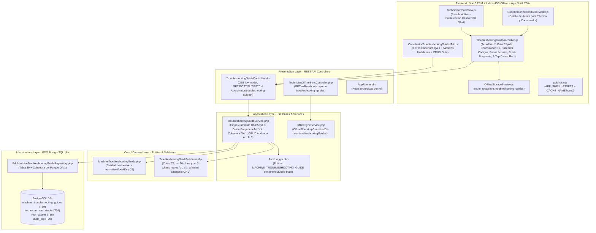

# Plan de Implementación Técnica: Guías Rápidas de Diagnóstico por Modelo
**Módulo:** `28-troubleshooting-guides` (Feature 15 de `docs/features_pendientes.md`)  
**Versión:** 2.0  
**Estado:** Plan Técnico para Validación SDD (Fase 2 — Sin Código de Implementación)  
**Marco Normativo:** [`constitution.md`](file:///c:/Users/Friki/.gemini/antigravity/scratch/gestor-incidencias-vending/constitution.md) · [`AGENTS.md`](file:///c:/Users/Friki/.gemini/antigravity/scratch/gestor-incidencias-vending/AGENTS.md) · [`docs/design.md`](file:///c:/Users/Friki/.gemini/antigravity/scratch/gestor-incidencias-vending/docs/design.md)  
**Especificación Funcional:** [`specs/28-troubleshooting-guides/spec.md`](file:///c:/Users/Friki/.gemini/antigravity/scratch/gestor-incidencias-vending/specs/28-troubleshooting-guides/spec.md) (v2.0) · [`specs/functional/troubleshooting_guides_spec.md`](file:///c:/Users/Friki/.gemini/antigravity/scratch/gestor-incidencias-vending/specs/functional/troubleshooting_guides_spec.md)  
**Contratos Técnicos:** [`specs/technical/troubleshooting_guides_contracts.md`](file:///c:/Users/Friki/.gemini/antigravity/scratch/gestor-incidencias-vending/specs/technical/troubleshooting_guides_contracts.md) · [`specs/technical/database_schema.md`](file:///c:/Users/Friki/.gemini/antigravity/scratch/gestor-incidencias-vending/specs/technical/database_schema.md) · [`specs/technical/schema_correspondence_contract.md`](file:///c:/Users/Friki/.gemini/antigravity/scratch/gestor-incidencias-vending/specs/technical/schema_correspondence_contract.md)

---

## 1. Arquitectura de Módulos y Estructura de Ficheros

La solución se diseña bajo **Clean Architecture** en PHP 8.2+ POO puro (`declare(strict_types=1);`) en el backend, persistencia única sobre **PostgreSQL 16+ (`pdo_pgsql`)** y **Vue 3 (Composition API via ES Modules nativos)** en el frontend sin bundlers ni dependencias externas adicionales, respetando los artículos I, II, III, IV, V y VI de `constitution.md`.

### 1.1. Base de Datos y Esquema Relacional (`database/` y `specs/technical/`)
| Fichero | Acción | Responsabilidad |
| :--- | :--- | :--- |
| `database/supabase_migrations/024_machine_troubleshooting_guides.sql` | **Crear** | Migración DDL incremental idempotente: adición de `'MACHINE_TROUBLESHOOTING_GUIDE'` en `audit_entity_type`, creación de `machine_troubleshooting_guides` (Tabla 39, 14 columnas) con `uq_troubleshooting_guides_model_category (machine_model_key, breakdown_type)`, 3 claves foráneas (`suggested_root_cause_id`, `created_by`, `updated_by` con `ON DELETE RESTRICT`), 5 restricciones `CHECK` (`chk_troubleshooting_guides_model_not_empty`, `chk_troubleshooting_guides_title_len`, `chk_troubleshooting_guides_error_codes_bounds`, `chk_troubleshooting_guides_steps_bounds`, `chk_troubleshooting_guides_spare_parts_bounds`), 3 índices secundarios y 3 disparadores constitucionales (`trg_no_delete_machine_troubleshooting_guides`, `trg_touch_machine_troubleshooting_guides`, `trg_immutable_machine_troubleshooting_guides`). |
| `database/supabase_init.sql` | **Modificar** | Incorporar `'MACHINE_TROUBLESHOOTING_GUIDE'` en `audit_entity_type`, la Tabla 39 `machine_troubleshooting_guides` y la función `enforce_troubleshooting_guides_immutability()` al esquema maestro consolidado para mantener paridad 1:1 con migraciones. |
| `database/supabase_seeds.sql` | **Modificar** | Sembrar en la Sección 20 las guías reales del parque (*Sanden Vendo G-Drink*, *Bianchi Gaia Espresso*, *Necta Samba Combo*, *Fas Fast 900*, *Azkoyen Palma+*, *Necta Korinto*, *Jofemar Vision*, *Saeco Cristallo*) con códigos de error reales, pasos de $\ge 20$ caracteres reales, repuestos recomendados del catálogo y causas raíz vinculadas (`RF-05.2`). |
| `src/Infrastructure/Database/SeedRunner.php` | **Modificar** | Sincronizar el sembrado programático de entorno de pruebas con las guías de diagnóstico del Módulo 28. |
| `specs/technical/database_schema.md` | **Modificar** | Documentar la Tabla 39 `machine_troubleshooting_guides` y `enforce_troubleshooting_guides_immutability()`. |
| `specs/technical/schema_correspondence_contract.md` | **Modificar** | Actualizar el inventario canónico de tablas (pasando de 38 a 39 tablas de dominio) verificado por `SchemaCorrespondenceTest`. |

### 1.2. Capa de Dominio (`src/Core/`)
| Fichero | Acción | Responsabilidad |
| :--- | :--- | :--- |
| `src/Core/Domain/Model/MachineTroubleshootingGuide.php` | **Crear** | Entidad de dominio inmutable/rica que representa una ficha de diagnóstico (`id`, `machineModel`, `machineModelKey`, `breakdownType`, `title`, `errorCodes`, `steps`, `recommendedSparePartIds`, `suggestedRootCauseId`, `isActive`, `createdBy`, `updatedBy`, `createdAt`, `updatedAt`) y el normalizador canónico `normalizeModelKey(string $model): string` (`C5`, `QA 1`). |
| `src/Core/Service/TroubleshootingGuideValidator.php` | **Crear** | Validador puro de dominio (`Art. V.1`, `C1`–`C3`, `QA 2`): normaliza espacios, valida `machine_model` (`2..100` chars), `title` (`5..150` chars), `steps` (`2..10` pasos con `title` `3..120` e `instruction` `20..500` chars y $\ge 3$ tokens alfanuméricos reales `/\p{L}|\p{N}/u`), `error_codes` (`0..20` entradas con `code` `1..20` único insensible a mayúsculas y `meaning` `5..200`), `recommended_spare_part_ids` (`0..10` IDs enteros únicos) y coherencia de categoría de `suggested_root_cause_id` (`QA 2`). |
| `src/Core/Domain/Repository/MachineTroubleshootingGuideRepositoryInterface.php` | **Crear** | Contrato de persistencia: `findById()`, `findByModelKeyAndCategory()`, `findActiveByModelKey()`, `findAllActive()`, `findFilteredForCoordinator()`, `fetchFleetCoverageSummary()`, `create()` y `update()`. |

### 1.3. Capa de Aplicación (`src/Application/`)
| Fichero | Acción | Responsabilidad |
| :--- | :--- | :--- |
| `src/Application/DTO/OfflineBootstrapSnapshotDto.php` | **Modificar** | Añadir la propiedad `public readonly array $troubleshootingGuides = []` y exponer `'troubleshooting_guides' => $this->troubleshootingGuides` en `toArray()` (`D3`, `RF-03.1`). |
| `src/Application/Service/OfflineSyncService.php` | **Modificar** | Pasar `troubleshootingGuides` en `getBootstrapSnapshot()`. |
| `src/Application/Service/TroubleshootingGuideService.php` | **Crear** | Orquestador de los casos de uso (`RF-01` a `RF-05`): consulta por modelo con ordenación canónica `QA 3` (`TEMPERATURE_COLD` prioritaria según `Art. II`), inyección de `sanitary_cold_warning`, cruce con `technician_van_stocks` sin exponer precios (`Art. V.4`), marcaje de piezas/causas inactivas (`C2`), cálculo del resumen de cobertura del parque inmune a filtros (`QA 1`), y CRUD con auditoría antes/después bajo `MACHINE_TROUBLESHOOTING_GUIDE` (`Art. III.3`). |

### 1.4. Capa de Infraestructura (`src/Infrastructure/`)
| Fichero | Acción | Responsabilidad |
| :--- | :--- | :--- |
| `src/Infrastructure/Repository/PdoMachineTroubleshootingGuideRepository.php` | **Crear** | Implementación PDO PostgreSQL 16+ de `MachineTroubleshootingGuideRepositoryInterface` y cálculo SQL de cobertura sobre máquinas activas (`is_active = TRUE AND deleted_at IS NULL`) agrupadas por clave normalizada (`QA 1`). |
| `src/Infrastructure/Repository/PdoOfflineSyncMutationRepository.php` | **Modificar** | Incluir `troubleshooting_guides` en `fetchBootstrapSnapshotForTechnician(int $technicianId)` enriquecido con el stock de furgoneta del técnico y sin costes unitarios (`D3`, `Art. V.4`). |

### 1.5. Capa de Presentación REST (`src/Presentation/`)
| Fichero | Acción | Responsabilidad |
| :--- | :--- | :--- |
| `src/Presentation/Controller/TroubleshootingGuideController.php` | **Crear** | Endpoints REST: `GET /api/troubleshooting-guides/by-model` (`TECHNICIAN` y `COORDINATOR`), `GET /api/coordinator/troubleshooting-guides`, `POST /api/coordinator/troubleshooting-guides`, `PUT /api/coordinator/troubleshooting-guides/{id}` y `PATCH /api/coordinator/troubleshooting-guides/{id}/status` (exclusivos de `COORDINATOR`, `403` para otros roles). |
| `src/Presentation/Routing/AppRouter.php` | **Modificar** | Registrar las rutas de `/api/troubleshooting-guides/by-model` y `/api/coordinator/troubleshooting-guides*`. |

### 1.6. Frontend Web y PWA (`public/`)
| Fichero | Acción | Responsabilidad |
| :--- | :--- | :--- |
| `public/assets/js/components/TroubleshootingGuideAccordion.js` | **Crear** | Componente reutilizable **«📖 Guía Rápida de Modelo»** para parada activa y modal de detalle: alerta sanitaria prioritaria (`Art. II`), conmutador *«Ver todas las guías de este modelo»* (`D1`, `QA 3`, usando `vg-action-group` y `vg-btn-sm`), buscador instantáneo de códigos de display (`rounded.xs` `4px`), pasos ordenados `1..N` con casillas locales por `incident_id` (`C6`), repuestos recomendados con semáforo de stock en furgoneta sin precios (`Art. V.4`), botón *«Aplicar causa sugerida por la guía»* (`vg-btn vg-btn-primary-outline`, `D2`, `QA 4`) y soporte transparente desde `OfflineStorageService` cuando no hay red (`D3`). |
| `public/assets/js/components/CoordinatorTroubleshootingGuidesTab.js` | **Crear** | Vista administrativa en Coordinación cumpliendo `docs/design.md` (§Components, §Do's and Don'ts): 3 tarjetas KPI de cobertura del parque con borde hairline `#c8cfda` sin sombra en reposo e inmunes al filtro de tabla (`QA 1`), panel de modelos activos huérfanos con botón rápido (`vg-btn vg-btn-sm vg-btn-primary-outline`), barra de filtros (`vg-action-group`) y tabla con celda de acciones `vg-row-actions` (`vg-btn-sm`, sin geometría ni hex inline en `<button>` y sin clases heredadas `.btn*`), y modal de alta/edición con `vg-btn-close` vacío y listas dinámicas de códigos (`0..20`), pasos (`2..10`), repuestos (`0..10`) y causa raíz sugerida filtrada por categoría compatible (`QA 2`). |
| `public/assets/js/components/TechnicianRouteView.js` | **Modificar** | Integrar `<troubleshooting-guide-accordion>` en la tarjeta de parada activa correctiva y conectar el evento `apply-suggested-root-cause` con el modal de resolución (activando `showAllRootCauses = true` si la causa pertenece a otra categoría según `QA 4`, sin tocar jamás `diagnosis` ni `action_taken` según `Art. V.1`). |
| `public/assets/js/components/CoordinatorIncidentDetailModal.js` | **Modificar** | Integrar `<troubleshooting-guide-accordion>` en el expediente de averías correctivas para asistencia técnica in situ y telefónica (`D3`). |
| `public/assets/js/components/CoordinatorSparePartsView.js` | **Modificar** | Añadir la sub-pestaña **«📖 Guías de Diagnóstico»** para gobernar las guías junto al catálogo de repuestos y taller. |
| `public/assets/js/services/OfflineStorageService.js` | **Modificar** | Persistir `troubleshooting_guides` en `route_snapshots` y exponer `getOfflineTroubleshootingGuidesByModel(machineModel, breakdownType)` para lectura 100 % local en sótanos sin cobertura (`D3`). |
| `public/assets/js/components/AuditActionLabels.js` | **Modificar** | Registrar las etiquetas en castellano para `MACHINE_TROUBLESHOOTING_GUIDE` y las 4 acciones (`CREATE_TROUBLESHOOTING_GUIDE`, `UPDATE_TROUBLESHOOTING_GUIDE`, `ACTIVATE_TROUBLESHOOTING_GUIDE`, `DEACTIVATE_TROUBLESHOOTING_GUIDE`). |
| `public/assets/js/api.js` | **Modificar** | Añadir `getTroubleshootingGuidesByModel()`, `getCoordinatorTroubleshootingGuides()`, `createTroubleshootingGuide()`, `updateTroubleshootingGuide()` y `setTroubleshootingGuideStatus()`. |
| `public/sw.js` | **Modificar** | Añadir `/assets/js/components/TroubleshootingGuideAccordion.js` y `/assets/js/components/CoordinatorTroubleshootingGuidesTab.js` en `APP_SHELL_ASSETS` y actualizar `CACHE_NAME`. |
| `public/assets/css/styles.css` | **Modificar** | Estilos del acordeón de guía rápida, semáforo de stock en furgoneta y tarjetas de cobertura de modelos usando exclusivamente tokens CSS (`var(--color-*)`, bordes `4px`/`8px`, áreas táctiles $\ge 44\text{px}$). |

---

## 2. Plan de Pruebas y Certificación (Fase 3 y 5 SDD)

1. **`tests/Unit/Domain/TroubleshootingGuideValidatorTest.php`:**
   * Normalización de `machine_model_key` (`C5`), límites de título (`5..150`), límites de pasos (`2..10`), rechazo de pasos con menos de 20 caracteres reales o menos de 3 tokens alfanuméricos (`Art. V.1`, `C3`), rechazo de códigos duplicados en la misma guía (`C3`), límite de `0..10` repuestos y afinidad de categoría de causa raíz (`QA 2`).
2. **`tests/Integration/TroubleshootingGuideApiTest.php`:**
   * Emparejamiento exacto e insensible a mayúsculas/espacios (`D1`, `C5`), orden canónico del conmutador con `TEMPERATURE_COLD` primero (`QA 3`), alerta sanitaria en `TEMPERATURE_COLD` y `PERISHABLE_FOOD` (`Art. II`), cruce de stock en furgoneta para `TECHNICIAN` sin exponer jamás costes (`Art. V.4`), inclusión en `GET /api/technician/offline/bootstrap` (`D3`), tolerancia ante pieza o causa raíz desactivada a posteriori (`C2`), bloqueo `409` en duplicados (`C1`), inmutabilidad de `machine_model` y `breakdown_type` en `PUT` (`C1`), KPIs de cobertura inmunes a filtros (`QA 1`), auditoría antes/después en `audit_log` (`Art. III.3`) y bloqueo `403` para `TECHNICIAN` y `LOCATION_RESPONSIBLE` en endpoints de Coordinación (`Art. V.4`).
3. **`tests/Integration/TroubleshootingGuideConstitutionalTest.php`:**
   * Prohibición de `DELETE FROM machine_troubleshooting_guides` (`trg_no_delete_machine_troubleshooting_guides`, `Art. III.1`), prohibición de mutar `machine_model_key` o `breakdown_type` en SQL (`trg_immutable_machine_troubleshooting_guides`, `C1`), paridad de `APP_SHELL_ASSETS` en `public/sw.js` y cero deuda de tokens CSS.
