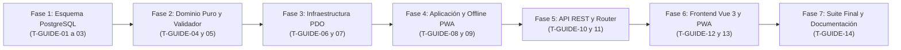

# Plan de Tareas de Implementación (`tasks.md`): Guías Rápidas de Diagnóstico por Modelo (`28-troubleshooting-guides`)

**Módulo:** `28-troubleshooting-guides`  
**Versión:** 1.0 (Alineado con `spec.md` v2.0, `troubleshooting_guides_contracts.md` v1.0 y `plan.md` v2.0)  
**Estado:** Aprobado por el Product Owner el 2026-11-04 · Puerta SDD cerrada · Listo para Ejecución (Fase 3: tests y código)  
**Metodología:** SDD (Specification-Driven Development) · Clean Architecture · TDD / Guardas de Esquema  
**Ley Suprema:** [`constitution.md`](../../constitution.md) y [`AGENTS.md`](../../AGENTS.md)

---

## Resumen de Fases y Grafo de Dependencias

| Fase | Rango de Tareas | Descripción | Tiempo Estimado |
| :--- | :--- | :--- | :--- |
| **Fase 1** | `T-GUIDE-01` .. `T-GUIDE-03` | Esquema PostgreSQL / Supabase (Migración `024`, Tabla 39 `machine_troubleshooting_guides`, valor `'MACHINE_TROUBLESHOOTING_GUIDE'` en `audit_entity_type`, disparador de inmutabilidad, semillas y guardas) | ~65 min |
| **Fase 2** | `T-GUIDE-04` .. `T-GUIDE-05` | Entidad `MachineTroubleshootingGuide`, `TroubleshootingGuideValidator`, Excepciones y DTOs inmutables + Tests Unitarios | ~45 min |
| **Fase 3** | `T-GUIDE-06` .. `T-GUIDE-07` | Repositorio PDO (`PdoMachineTroubleshootingGuideRepository`), cobertura del parque (`QA 1`), orden canónico (`QA 3`) e integración en `PdoOfflineSyncMutationRepository` | ~50 min |
| **Fase 4** | `T-GUIDE-08` .. `T-GUIDE-09` | `TroubleshootingGuideService`, enriquecimiento en `OfflineSyncService` (`OfflineBootstrapSnapshotDto`) y suite de integración de servicio/offline | ~55 min |
| **Fase 5** | `T-GUIDE-10` .. `T-GUIDE-11` | `TroubleshootingGuideController`, cableado en `AppRouter` y suite de integración API REST y RBAC | ~50 min |
| **Fase 6** | `T-GUIDE-12` .. `T-GUIDE-13` | Cliente `api.js`, `OfflineStorageService.js`, acordeón `TroubleshootingGuideAccordion.js`, vista `CoordinatorTroubleshootingGuidesTab.js`, integración en Ruta/Detalle/Repuestos y `sw.js` | ~55 min |
| **Fase 7** | `T-GUIDE-14` | Verificación Integral (`composer test`), matriz de trazabilidad (`traceability-matrix.md`) y cierre en `docs/features_pendientes.md` | ~25 min |

---

## Fase 1: Esquema de Base de Datos PostgreSQL / Supabase y Guardas de Esquema

- [x] **T-GUIDE-01 · Crear migración incremental `024_machine_troubleshooting_guides.sql` y converger `database/supabase_init.sql`**
  - **Tiempo estimado:** 25 min
  - **Dependencias previas:** Ninguna
  - **Archivos exactos a crear o modificar:**
    - Crear `database/supabase_migrations/024_machine_troubleshooting_guides.sql`
    - Modificar `database/supabase_init.sql`
  - **Requisitos cubiertos:** `RF-01.1`, `RF-04.1`–`RF-04.3`, `RNF-01`, `RNF-02`, `D1`, `D2`, `C1`, `C3`, `C5`, `constitution.md` Art. III.1 y Art. III.3.
  - **Detalle de implementación:**
    1. Añadir de forma idempotente `'MACHINE_TROUBLESHOOTING_GUIDE'` al tipo enumerado `audit_entity_type` (`ALTER TYPE audit_entity_type ADD VALUE IF NOT EXISTS 'MACHINE_TROUBLESHOOTING_GUIDE'`).
    2. Crear la Tabla 39 `machine_troubleshooting_guides` (14 columnas) con clave única `uq_troubleshooting_guides_model_category UNIQUE (machine_model_key, breakdown_type)`, claves foráneas `ON DELETE RESTRICT ON UPDATE CASCADE` (`fk_troubleshooting_guides_root_cause`, `fk_troubleshooting_guides_created_by`, `fk_troubleshooting_guides_updated_by`) y las 5 restricciones `CHECK`:
       - `chk_troubleshooting_guides_model_not_empty` (`char_length(btrim(machine_model)) BETWEEN 2 AND 100 AND char_length(btrim(machine_model_key)) BETWEEN 2 AND 100 AND machine_model_key = lower(btrim(machine_model_key))`)
       - `chk_troubleshooting_guides_title_len` (`char_length(btrim(title)) BETWEEN 5 AND 150`)
       - `chk_troubleshooting_guides_error_codes_bounds` (`jsonb_typeof(error_codes_json) = 'array' AND jsonb_array_length(error_codes_json) BETWEEN 0 AND 20`)
       - `chk_troubleshooting_guides_steps_bounds` (`jsonb_typeof(steps_json) = 'array' AND jsonb_array_length(steps_json) BETWEEN 2 AND 10`)
       - `chk_troubleshooting_guides_spare_parts_bounds` (`jsonb_typeof(recommended_spare_part_ids) = 'array' AND jsonb_array_length(recommended_spare_part_ids) BETWEEN 0 AND 10`)
    3. Crear los 3 índices (`idx_troubleshooting_guides_model_active`, `idx_troubleshooting_guides_category_active`, `idx_troubleshooting_guides_root_cause`), la función `enforce_troubleshooting_guides_immutability()` (que rechaza con `SQLSTATE 45000` cualquier alteración de `machine_model`, `machine_model_key` o `breakdown_type` tras el alta, `C1`) y los 3 disparadores (`trg_no_delete_machine_troubleshooting_guides`, `trg_touch_machine_troubleshooting_guides`, `trg_immutable_machine_troubleshooting_guides`).
    4. Reflejar exactamente las mismas definiciones en `database/supabase_init.sql`.
  - **Hecho cuando:** `vendor/bin/phpunit tests/integration/SchemaConvergenceParityTest.php`

- [x] **T-GUIDE-02 · Poblar semillas reales del parque en `database/supabase_seeds.sql` y `SeedRunner.php`**
  - **Tiempo estimado:** 20 min
  - **Dependencias previas:** `T-GUIDE-01`
  - **Archivos exactos a crear o modificar:**
    - Modificar `database/supabase_seeds.sql`
    - Modificar `src/Infrastructure/Database/SeedRunner.php`
  - **Requisitos cubiertos:** `RF-05.1`, `RF-05.2`, `D1`, `D2`, `D4`, `QA 1`, `QA 2`, `QA 3`, `constitution.md` Art. I.3.
  - **Detalle de implementación:**
    1. Añadir la Sección 20 en `database/supabase_seeds.sql` y el sembrado homólogo en `SeedRunner.php` con guías reales para los modelos del parque (*Sanden Vendo G-Drink*, *Bianchi Gaia Espresso*, *Necta Samba Combo*, *Fas Fast 900*, *Azkoyen Palma+*, *Necta Korinto*, *Jofemar Vision* y *Saeco Cristallo*), dejando deliberadamente `Fas Perla` como modelo activo huérfano para demostrar en vivo el indicador `Modelos Activos sin Guía` (`QA 1`).
    2. Resolver dinámicamente los identificadores de `spare_parts` por su `part_code` y el `suggested_root_cause_id` por su `code` en `root_causes`, usando `ON CONFLICT (machine_model_key, breakdown_type) DO NOTHING` para preservar las ediciones de Coordinación en arranques sucesivos.
  - **Hecho cuando:** `php database/run_seeds.php && vendor/bin/phpunit tests/integration/SchemaConvergenceParityTest.php`

- [x] **T-GUIDE-03 · Actualizar contratos de esquema (`39 tablas`), utilidades de test y crear `PostgresTroubleshootingGuideSchemaTest.php`**
  - **Tiempo estimado:** 20 min
  - **Dependencias previas:** `T-GUIDE-01`, `T-GUIDE-02`
  - **Archivos exactos a crear o modificar:**
    - Modificar `specs/technical/database_schema.md`
    - Modificar `specs/technical/schema_correspondence_contract.md`
    - Modificar `tests/Support/TestDataCleaner.php`
    - Modificar `tests/Support/PostgresFixtureBuilder.php`
    - Modificar `tests/integration/SchemaConvergenceParityTest.php`
    - Modificar `tests/integration/PostgresSchemaTest.php`
    - Crear `tests/integration/PostgresTroubleshootingGuideSchemaTest.php`
  - **Requisitos cubiertos:** `RF-04.1`–`RF-04.3`, `RNF-02`, `C1`, `C3`, `constitution.md` Art. III.1.
  - **Detalle de implementación:**
    1. Documentar la Tabla 39 (`machine_troubleshooting_guides`) y elevar el contador de tablas de dominio a **39** en `specs/technical/database_schema.md` y `specs/technical/schema_correspondence_contract.md`.
    2. Añadir `machine_troubleshooting_guides` en el orden topológico de limpieza de `TestDataCleaner.php` (antes de `root_causes` y `users`) y helper en `PostgresFixtureBuilder.php`.
    3. Actualizar las aserciones de número de tablas en `SchemaConvergenceParityTest.php` y `PostgresSchemaTest.php`.
    4. Crear `tests/integration/PostgresTroubleshootingGuideSchemaTest.php` verificando en PostgreSQL real:
       - Existencia de las 14 columnas, índices, claves foráneas `ON DELETE RESTRICT` y unicidad `uq_troubleshooting_guides_model_category`.
       - Bloqueo de `DELETE FROM machine_troubleshooting_guides` por `trg_no_delete_machine_troubleshooting_guides` (`Art. III.1`).
       - Bloqueo de `UPDATE` sobre `machine_model`, `machine_model_key` o `breakdown_type` por `trg_immutable_machine_troubleshooting_guides` (`C1`).
       - Rechazo por restricciones `CHECK` de arrays JSONB fuera de cotas (`steps_json` con `< 2` o `> 10` pasos, `error_codes_json` `> 20`, `recommended_spare_part_ids` `> 10`).
  - **Hecho cuando:** `vendor/bin/phpunit tests/integration/SchemaConvergenceParityTest.php tests/integration/PostgresSchemaTest.php tests/integration/PostgresTroubleshootingGuideSchemaTest.php`

---

## Fase 2: Modelos de Dominio, Validador Puro y DTOs

- [x] **T-GUIDE-04 · Implementar entidad `MachineTroubleshootingGuide`, `TroubleshootingGuideValidator` y `TroubleshootingGuideValidationException`**
  - **Tiempo estimado:** 25 min
  - **Dependencias previas:** `T-GUIDE-03`
  - **Archivos exactos a crear o modificar:**
    - Crear `src/Core/Domain/Model/MachineTroubleshootingGuide.php`
    - Crear `src/Core/Service/TroubleshootingGuideValidator.php`
    - Crear `src/Core/Domain/Exception/TroubleshootingGuideValidationException.php`
  - **Requisitos cubiertos:** `RF-01.1`, `RF-04.1`, `RF-04.2`, `C1`–`C3`, `C5`, `QA 2`, `constitution.md` Art. IV.1 y Art. V.1.
  - **Detalle de implementación:**
    1. Implementar `MachineTroubleshootingGuide::normalizeModelName(string $rawModel): string` (recorta extremos y colapsa espacios repetidos a un espacio simple) y `MachineTroubleshootingGuide::normalizeModelKey(string $rawModel): string` (`mb_strtolower(self::normalizeModelName($rawModel), 'UTF-8')`, `C5`).
    2. Implementar `TroubleshootingGuideValidator` validando:
       - `machine_model`: `2..100` caracteres reales (`422 INVALID_GUIDE_MODEL`).
       - `breakdown_type`: valor válido de `IncidentCategory` (`TEMPERATURE_COLD`, `PAYMENT_SYSTEM`, `PRODUCT_JAM`, `ELECTRICAL_OFF`, `OTHER`; `422 INVALID_GUIDE_CATEGORY`).
       - `title`: `5..150` caracteres reales (`422 INVALID_GUIDE_TITLE`).
       - `steps`: entre `2` y `10` pasos; cada paso con `title` de `3..120` chars e `instruction` normalizada de **`20..500` caracteres reales** y al menos **3 palabras o bloques alfanuméricos reales** (`/\p{L}|\p{N}/u`, `422 INVALID_GUIDE_STEPS`, `Art. V.1`, `C3`), renumerando `step_order = 1..N`.
       - `error_codes`: entre `0` y `20` entradas; cada una con `code` `1..20` chars (sin duplicados insensibles a mayúsculas en la misma guía) y `meaning` `5..200` chars (`422 INVALID_GUIDE_ERROR_CODES`, `C3`).
       - `recommended_spare_part_ids`: entre `0` y `10` enteros positivos únicos conservando el orden original (`422 INVALID_GUIDE_SPARE_PARTS`, `C3`, `QA 3`).
       - Coherencia de categoría de `suggested_root_cause_id`: la causa raíz debe pertenecer a la misma `breakdown_type` de la guía o a `OTHER` (`422 INVALID_GUIDE_ROOT_CAUSE`, `QA 2`).
    3. Implementar `TroubleshootingGuideValidationException` con constructores semánticos para `404`, `409` y `422`.
  - **Hecho cuando:** `php -l src/Core/Domain/Model/MachineTroubleshootingGuide.php && php -l src/Core/Service/TroubleshootingGuideValidator.php && php -l src/Core/Domain/Exception/TroubleshootingGuideValidationException.php`

- [x] **T-GUIDE-05 · Crear suite unitaria `TroubleshootingGuideValidatorTest.php`**
  - **Tiempo estimado:** 20 min
  - **Dependencias previas:** `T-GUIDE-04`
  - **Archivos exactos a crear o modificar:**
    - Crear `tests/unit/TroubleshootingGuideValidatorTest.php`
  - **Requisitos cubiertos:** `RF-01.1`, `RF-04.1`, `RF-04.2`, `C1`–`C3`, `C5`, `QA 2`, `constitution.md` Art. V.1.
  - **Detalle de implementación:**
    1. Probar `normalizeModelName()` y `normalizeModelKey()` con variantes de mayúsculas, espacios extremos y espacios múltiples (`"  NECTA   Korinto  "` $\rightarrow$ `"necta korinto"`).
    2. Probar las cotas de `title` (`< 5`, `> 150`), número de pasos (`0`, `1`, `11`), títulos de paso (`< 3`, `> 120`) e instrucciones de paso (`< 20` chars, `> 500` chars y relleno trampa `"...................."` sin 3 palabras reales, `Art. V.1`).
    3. Probar la detección de códigos de error duplicados insensibles a mayúsculas (`"e04"` y `"E04"`), más de 20 códigos, más de 10 repuestos o IDs de repuestos duplicados.
    4. Probar la validación de afinidad de categoría de la causa raíz sugerida (`QA 2`: misma categoría o `OTHER` aceptadas; categoría ajena rechazada con `422 INVALID_GUIDE_ROOT_CAUSE`).
  - **Hecho cuando:** `vendor/bin/phpunit tests/unit/TroubleshootingGuideValidatorTest.php`

---

## Fase 3: Capa de Infraestructura y Repositorio PDO (`PdoMachineTroubleshootingGuideRepository`)

- [x] **T-GUIDE-06 · Definir `MachineTroubleshootingGuideRepositoryInterface` e implementar `PdoMachineTroubleshootingGuideRepository`**
  - **Tiempo estimado:** 30 min
  - **Dependencias previas:** `T-GUIDE-05`
  - **Archivos exactos a crear o modificar:**
    - Crear `src/Core/Domain/Repository/MachineTroubleshootingGuideRepositoryInterface.php`
    - Crear `src/Infrastructure/Repository/PdoMachineTroubleshootingGuideRepository.php`
  - **Requisitos cubiertos:** `RF-01.1`–`RF-01.3`, `RF-02.1`–`RF-02.3`, `RF-04.1`–`RF-04.3`, `RF-05.1`, `D1`–`D4`, `C1`, `C2`, `C5`, `QA 1`, `QA 3`.
  - **Detalle de implementación:**
    1. Definir en `MachineTroubleshootingGuideRepositoryInterface` e implementar en `PdoMachineTroubleshootingGuideRepository`:
       - `findById(int $id): ?MachineTroubleshootingGuide`
       - `findByModelKeyAndCategory(string $modelKey, string $breakdownType): ?MachineTroubleshootingGuide`
       - `findActiveByModelKey(string $modelKey): array` (ordenando por jerarquía canónica `QA 3`: `TEMPERATURE_COLD` = 1, `PAYMENT_SYSTEM` = 2, `PRODUCT_JAM` = 3, `ELECTRICAL_OFF` = 4, `OTHER` = 5).
       - `findAllActive(): array`
       - `findFilteredForCoordinator(?string $machineModel, ?string $breakdownType, string $status, ?string $search): array`
       - `fetchFleetCoverageSummary(): array` (calculando sobre `machines WHERE is_active = TRUE AND deleted_at IS NULL` agrupadas por clave normalizada de modelo: `total_active_guides`, `total_guides`, `covered_fleet_models_count`, `total_active_fleet_models_count`, `orphan_fleet_models_count`, `orphan_fleet_models` y `fleet_models`, `QA 1`).
       - `create(MachineTroubleshootingGuide $guide): MachineTroubleshootingGuide` y `update(MachineTroubleshootingGuide $guide): MachineTroubleshootingGuide`.
  - **Hecho cuando:** `php -l src/Core/Domain/Repository/MachineTroubleshootingGuideRepositoryInterface.php && php -l src/Infrastructure/Repository/PdoMachineTroubleshootingGuideRepository.php`

- [x] **T-GUIDE-07 · Integrar `troubleshooting_guides` en `PdoOfflineSyncMutationRepository`, `OfflineBootstrapSnapshotDto` y `OfflineSyncService`**
  - **Tiempo estimado:** 20 min
  - **Dependencias previas:** `T-GUIDE-06`
  - **Archivos exactos a crear o modificar:**
    - Modificar `src/Application/DTO/OfflineBootstrapSnapshotDto.php`
    - Modificar `src/Application/Service/OfflineSyncService.php`
    - Modificar `src/Infrastructure/Repository/PdoOfflineSyncMutationRepository.php`
  - **Requisitos cubiertos:** `RF-02.2`, `RF-03.1`, `D3`, `C2`, `C6`, `constitution.md` Art. V.4.
  - **Detalle de implementación:**
    1. Añadir `public readonly array $troubleshootingGuides = []` al constructor de `OfflineBootstrapSnapshotDto` e incluir `'troubleshooting_guides' => $this->troubleshootingGuides` en `toArray()`.
    2. En `OfflineSyncService::getBootstrapSnapshot()`, propagar `$snapshot['troubleshooting_guides'] ?? []` hacia `OfflineBootstrapSnapshotDto`.
    3. En `PdoOfflineSyncMutationRepository::fetchBootstrapSnapshotForTechnician(int $technicianId)`, poblar `'troubleshooting_guides'` con todas las guías activas enriquecidas con sus repuestos recomendados (cruzados con el `technician_van_stocks` del técnico y **sin incluir jamás costes unitarios**, `Art. V.4`) y su `suggested_root_cause` (solo si está activa en `root_causes`, `C2`).
  - **Hecho cuando:** `vendor/bin/phpunit tests/integration/OfflinePwaSyncIntegrationTest.php`

---

## Fase 4: Capa de Aplicación (`TroubleshootingGuideService`) y Suite de Integración de Servicio

- [x] **T-GUIDE-08 · Implementar `TroubleshootingGuideService` (consulta por modelo, cruce de furgoneta, cobertura `QA 1` y CRUD auditado `Art. III.3`)**
  - **Tiempo estimado:** 30 min
  - **Dependencias previas:** `T-GUIDE-07`
  - **Archivos exactos a crear o modificar:**
    - Crear `src/Application/Service/TroubleshootingGuideService.php`
  - **Requisitos cubiertos:** `RF-01.1`–`RF-01.3`, `RF-02.1`–`RF-02.3`, `RF-04.1`–`RF-04.3`, `RF-05.1`, `RNF-02`, `RNF-03`, `D1`–`D4`, `C1`–`C5`, `QA 1`–`QA 4`.
  - **Detalle de implementación:**
    1. Implementar `getGuidesForModel(string $machineModel, ?string $breakdownType, ?string $machineType, ?int $technicianId, ?int $machineId = null): array`:
       - Normalizar `machine_model_key` (`C5`) y recuperar todas las guías activas del modelo.
       - Si existe guía para `breakdownType`, situarla en primera posición y ordenar el resto según la jerarquía canónica (`TEMPERATURE_COLD` $\rightarrow$ `PAYMENT_SYSTEM` $\rightarrow$ `PRODUCT_JAM` $\rightarrow$ `ELECTRICAL_OFF` $\rightarrow$ `OTHER`, `QA 3`); si no existe para `breakdownType`, `has_exact_category_match = false` y preseleccionar la primera guía disponible según dicha jerarquía (`RF-01.2`).
       - Resolver la tipología sanitaria de forma autoritativa contra `machines` (primero por `machine_id`, después por el modelo normalizado) y evaluar `sanitary_cold_warning = ($guideCategory === 'TEMPERATURE_COLD' || $isPerishable)` (`Art. II`, `RF-01.3`). El `machine_type` de la query queda sólo como respaldo para modelos ausentes del parque y nunca puede apagar el aviso de una máquina perecedera real.
       - Enriquecer `recommended_spare_parts` respetando el orden definido en la guía (`QA 3`), marcando `is_active` (`C2`), cruzando `van_stock_quantity` y `has_van_stock` para el técnico autenticado y **omitiendo todo importe económico** (`Art. V.4`).
       - Enriquecer `suggested_root_cause` incluyendo su solución predeterminada activa, u ocultándola si la causa fue desactivada a posteriori (`C2`).
    2. Implementar `listForCoordinator(array $filters): array` combinando `fetchFleetCoverageSummary()` (inmune a filtros, `QA 1`) y `findFilteredForCoordinator()`.
    3. Implementar `createGuide(array $payload, int $actorId, string $actorName): array`, `updateGuide(int $id, array $payload, int $actorId, string $actorName): array` y `setGuideActiveStatus(int $id, bool $isActive, int $actorId, string $actorName): array` dentro de transacción PDO:
       - Verificar unicidad `(machine_model_key, breakdown_type)` (`409 DUPLICATE_TROUBLESHOOTING_GUIDE`, `C1`) e inmutabilidad de modelo/categoría al editar (`422 IMMUTABLE_GUIDE_IDENTITY`, `C1`).
       - Verificar que todos los `recommended_spare_part_ids` existan y estén activos en `spare_parts` (`422 INVALID_GUIDE_SPARE_PARTS`, `C2`) y que `suggested_root_cause_id` exista, esté activa y sea compatible en categoría (`422 INVALID_GUIDE_ROOT_CAUSE`, `C2`, `QA 2`).
       - Registrar en `audit_log` bajo `entity_type = 'MACHINE_TROUBLESHOOTING_GUIDE'` las acciones `CREATE_TROUBLESHOOTING_GUIDE`, `UPDATE_TROUBLESHOOTING_GUIDE`, `ACTIVATE_TROUBLESHOOTING_GUIDE` o `DEACTIVATE_TROUBLESHOOTING_GUIDE` con `previous_state` y `new_state` completos (`Art. III.3`).
  - **Hecho cuando:** `php -l src/Application/Service/TroubleshootingGuideService.php`

- [x] **T-GUIDE-09 · Crear suite de integración de servicio (`TroubleshootingGuideServiceIntegrationTest.php`)**
  - **Tiempo estimado:** 25 min
  - **Dependencias previas:** `T-GUIDE-08`
  - **Archivos exactos a crear o modificar:**
    - Crear `tests/integration/TroubleshootingGuideServiceIntegrationTest.php`
  - **Requisitos cubiertos:** `RF-01` a `RF-05`, `D1`–`D4`, `C1`–`C5`, `QA 1`–`QA 3`.
  - **Detalle de implementación:**
    1. Probar el emparejamiento insensible a mayúsculas/espacios (`C5`), el conmutador con prioridad `TEMPERATURE_COLD` (`QA 3`), el respaldo cuando el aviso inicial es `OTHER` (`RF-01.2`) y la bandera `sanitary_cold_warning` en `TEMPERATURE_COLD` y `PERISHABLE_FOOD` (`Art. II`).
    2. Probar el cruce de `recommended_spare_parts` con `technician_van_stocks` (saldo positivo, cero y negativo) verificando que ningún campo de precio o coste viaje en el resultado (`Art. V.4`).
    3. Probar la tolerancia cuando una pieza recomendada o la causa raíz sugerida se desactivan posteriormente en sus catálogos (`C2`).
    4. Probar el resumen `coverage_summary` (`QA 1`): agrupación de variantes de nombre de modelo en máquinas activas, detección de modelos huérfanos (`Fas Perla`) e inmunidad de las 3 métricas al aplicar filtros en el listado.
    5. Probar el alta, edición, desactivación y reactivación con verificación de `previous_state` y `new_state` en `audit_log` (`Art. III.3`).
  - **Hecho cuando:** `vendor/bin/phpunit tests/integration/TroubleshootingGuideServiceIntegrationTest.php`

---

## Fase 5: Capa de Presentación REST (`TroubleshootingGuideController`) y Router

- [x] **T-GUIDE-10 · Implementar `TroubleshootingGuideController` y registrar rutas en `AppRouter.php`**
  - **Tiempo estimado:** 25 min
  - **Dependencias previas:** `T-GUIDE-09`
  - **Archivos exactos a crear o modificar:**
    - Crear `src/Presentation/Controller/TroubleshootingGuideController.php`
    - Modificar `src/Presentation/Routing/AppRouter.php`
  - **Requisitos cubiertos:** `RF-01.1`–`RF-01.3`, `RF-03.2`, `RF-04.1`–`RF-04.3`, `RF-05.1`, `RNF-03`, `constitution.md` Art. V.4.
  - **Detalle de implementación:**
    1. Implementar `TroubleshootingGuideController` exponiendo:
       - `GET /api/troubleshooting-guides/by-model` (accesible para `TECHNICIAN` y `COORDINATOR`; `401` sin sesión, `403` para `LOCATION_RESPONSIBLE`).
       - `GET /api/coordinator/troubleshooting-guides` (exclusivo `COORDINATOR`).
       - `POST /api/coordinator/troubleshooting-guides` (exclusivo `COORDINATOR`, responde `201`).
       - `PUT /api/coordinator/troubleshooting-guides/{id}` (exclusivo `COORDINATOR`).
       - `PATCH /api/coordinator/troubleshooting-guides/{id}/status` (exclusivo `COORDINATOR`).
    2. Registrar las 5 rutas en `src/Presentation/Routing/AppRouter.php` con los middlewares de autenticación y rol correspondientes.
  - **Hecho cuando:** `php -l src/Presentation/Controller/TroubleshootingGuideController.php && php -l src/Presentation/Routing/AppRouter.php`

- [x] **T-GUIDE-11 · Crear suite de integración de contratos HTTP y RBAC (`TroubleshootingGuideApiIntegrationTest.php`)**
  - **Tiempo estimado:** 25 min
  - **Dependencias previas:** `T-GUIDE-10`
  - **Archivos exactos a crear o modificar:**
    - Crear `tests/integration/TroubleshootingGuideApiIntegrationTest.php`
  - **Requisitos cubiertos:** `RF-01` a `RF-05`, `RNF-01` a `RNF-03`, `D1`–`D4`, `C1`–`C6`, `QA 1`–`QA 4`.
  - **Detalle de implementación:**
    1. Verificar RBAC y opacidad (`Art. V.4`): `401` sin sesión; `403` para `LOCATION_RESPONSIBLE` en `GET /api/troubleshooting-guides/by-model`; `403` para `TECHNICIAN` y `LOCATION_RESPONSIBLE` en los 4 endpoints de `/api/coordinator/troubleshooting-guides*`.
    2. Verificar `GET /api/troubleshooting-guides/by-model` para `TECHNICIAN` y `COORDINATOR`, comprobando cruce de stock de furgoneta, ausencia total de precios y alerta sanitaria.
    3. Verificar que `GET /api/technician/offline/bootstrap` incluye la colección `troubleshooting_guides` lista para `IndexedDB` (`D3`).
    4. Verificar `POST`, `PUT` y `PATCH` en `/api/coordinator/troubleshooting-guides*` incluyendo códigos `201`, `200`, `404`, `409 DUPLICATE_TROUBLESHOOTING_GUIDE` y `422` (`INVALID_GUIDE_STEPS`, `INVALID_GUIDE_ERROR_CODES`, `INVALID_GUIDE_SPARE_PARTS`, `INVALID_GUIDE_ROOT_CAUSE`, `IMMUTABLE_GUIDE_IDENTITY`).
  - **Hecho cuando:** `vendor/bin/phpunit tests/integration/TroubleshootingGuideApiIntegrationTest.php`

---

## Fase 6: Frontend Vue 3 (`TroubleshootingGuideAccordion`, `CoordinatorTroubleshootingGuidesTab`), Offline PWA y `sw.js`

- [x] **T-GUIDE-12 · Ampliar `api.js`, `OfflineStorageService.js` y `AuditActionLabels.js`, y construir `TroubleshootingGuideAccordion.js` e integrarlo en `TechnicianRouteView.js` y `CoordinatorIncidentDetailModal.js`**
  - **Tiempo estimado:** 30 min
  - **Dependencias previas:** `T-GUIDE-11`
  - **Archivos exactos a crear o modificar:**
    - Modificar `public/assets/js/api.js`
    - Modificar `public/assets/js/services/OfflineStorageService.js`
    - Modificar `public/assets/js/components/AuditActionLabels.js`
    - Crear `public/assets/js/components/TroubleshootingGuideAccordion.js`
    - Modificar `public/assets/js/components/TechnicianRouteView.js`
    - Modificar `public/assets/js/components/CoordinatorIncidentDetailModal.js`
  - **Requisitos cubiertos:** `RF-01.1`–`RF-01.3`, `RF-02.1`–`RF-02.3`, `RF-03.1`, `RF-03.2`, `RNF-01`, `RNF-03`, `D1`–`D3`, `C4`–`C6`, `QA 3`, `QA 4`.
  - **Detalle de implementación:**
    1. Añadir los métodos cliente en `public/assets/js/api.js` y el helper de lectura offline `getOfflineTroubleshootingGuidesByModel(machineModel, breakdownType, machineType)` en `OfflineStorageService.js` (leyendo `snapshot.troubleshooting_guides` y cruzando en vivo con `snapshot.van_stock`, `D3`).
    2. Registrar las etiquetas de `MACHINE_TROUBLESHOOTING_GUIDE` en `AuditActionLabels.js`.
    3. Crear `public/assets/js/components/TroubleshootingGuideAccordion.js` (interpolación segura de texto sin `v-html`, `RNF-01`, y cumplimiento estricto de `docs/design.md` líneas 399–460):
       - Banner sanitario prioritario cuando `sanitary_cold_warning === true` (`Art. II`).
       - Selector/conmutador *«Ver todas las guías de este modelo»* envuelto en `vg-action-group` con botones `vg-btn vg-btn-sm` (`D1`, `QA 3`, sin píldoras `9999px` ni clases heredadas `.btn*`).
       - Buscador instantáneo de códigos de error (`error_codes`) con input `4px` (`--radius-xs`).
       - Lista de pasos `1..N` con casillas de verificación guardadas en estado local del dispositivo por `incident_id` (`C6`).
       - Bloque de repuestos recomendados con chips de lectura (`vg-chip`) para el semáforo de stock en furgoneta (*«✅ En tu furgoneta: N uds.»* / *«⚠️ Sin stock en tu furgoneta»* / *«Inactiva en catálogo»*) sin precios (`Art. V.4`).
       - Bloque de Causa Raíz sugerida con botón `vg-btn vg-btn-primary-outline` *«Aplicar causa sugerida por la guía»* (`D2`, cero geometría o hex inline en `<button>`).
    4. Integrar `<troubleshooting-guide-accordion>` en la parada activa de `TechnicianRouteView.js` y en `CoordinatorIncidentDetailModal.js`, conectando la aplicación en 1 toque de la causa raíz sugerida (activando `showAllRootCauses = true` si la causa pertenece a otra categoría según `QA 4`, y dejando intactos `diagnosis` y `action_taken` según `Art. V.1`).
  - **Hecho cuando:** `node --check public/assets/js/api.js && node --check public/assets/js/services/OfflineStorageService.js && node --check public/assets/js/components/TroubleshootingGuideAccordion.js && node --check public/assets/js/components/TechnicianRouteView.js && node --check public/assets/js/components/CoordinatorIncidentDetailModal.js`

- [x] **T-GUIDE-13 · Construir `CoordinatorTroubleshootingGuidesTab.js`, integrarlo en `CoordinatorSparePartsView.js`, estilizar en `styles.css` y actualizar `public/sw.js`**
  - **Tiempo estimado:** 25 min
  - **Dependencias previas:** `T-GUIDE-12`
  - **Archivos exactos a crear o modificar:**
    - Crear `public/assets/js/components/CoordinatorTroubleshootingGuidesTab.js`
    - Modificar `public/assets/js/components/CoordinatorSparePartsView.js`
    - Modificar `public/assets/css/styles.css`
    - Modificar `public/sw.js`
  - **Requisitos cubiertos:** `RF-04.1`–`RF-04.3`, `RF-05.1`, `RNF-01`–`RNF-03`, `D4`, `C1`–`C3`, `QA 1`, `QA 2`, `docs/design.md`.
  - **Detalle de implementación:**
    1. Crear `public/assets/js/components/CoordinatorTroubleshootingGuidesTab.js` cumpliendo estrictamente `docs/design.md` (`CoordinatorButtonVariantsGuardTest`, `LegacyButtonPaletteRetirementTest` y `DesignTokenDebtRatchetTest`):
       - **3 Tarjetas KPI superiores (`QA 1`):** *Total de Guías Activas*, *Modelos del Parque Cubiertos (`X / Y`)* y *Modelos Activos sin Guía (`N`)* con borde hairline `#c8cfda` (`8px` radius, **cero sombra en reposo**) y botones rápidos `vg-btn vg-btn-sm vg-btn-primary-outline` *«+ Crear guía para [Modelo]»*.
       - **Barra de filtros (`vg-action-group`) y Tabla (`vg-row-actions`):** selector de modelo, selector de categoría, filtro de estado (`Todas`, `Activas`, `Inactivas` con `vg-btn vg-btn-sm`), buscador textual, botón `vg-btn vg-btn-primary` *«+ Nueva Guía Rápida»*, y acciones de fila con `vg-btn vg-btn-sm` dentro de `vg-row-actions` (prohibido usar `.btn*`, bordes píldora o atributos `style` con geometría/hex en `<button>`).
       - **Modal de Alta / Edición:** cabecera con botón de cierre `vg-btn-close` vacío (el glifo `✕` viene por hoja de estilo), selector de modelos del parque + opción de escribir modelo, selector de categoría (inmutables en modo edición, `C1`), título (`5..150`), editor dinámico de códigos de display (`0..20`), editor dinámico de pasos (`2..10` con contador de caracteres `20..500` y palabras reales $\ge 3$), selector múltiple de repuestos activos (`0..10`) y selector de Causa Raíz activa filtrada por la categoría de la guía o `OTHER` (`QA 2`).
    2. Añadir la sub-pestaña **«📖 Guías de Diagnóstico»** en `CoordinatorSparePartsView.js`.
    3. Añadir las clases CSS en `public/assets/css/styles.css` usando exclusivamente variables `var(--color-*)` (`DesignTokenDebtRatchetTest`) y registrar `/assets/js/components/TroubleshootingGuideAccordion.js` y `/assets/js/components/CoordinatorTroubleshootingGuidesTab.js` en `APP_SHELL_ASSETS` de `public/sw.js` incrementando `CACHE_NAME` (`OfflinePwaAppShellContractTest`).
  - **Hecho cuando:** `node --check public/assets/js/components/CoordinatorTroubleshootingGuidesTab.js && node --check public/assets/js/components/CoordinatorSparePartsView.js && node --check public/sw.js`

---

## Fase 7: Verificación Integral, Matriz de Trazabilidad y Cierre Documental

- [x] **T-GUIDE-14 · Ejecutar suite completa (`composer test`), generar `traceability-matrix.md` y actualizar `docs/features_pendientes.md`**
  - **Tiempo estimado:** 25 min
  - **Dependencias previas:** `T-GUIDE-01` a `T-GUIDE-13`
  - **Archivos exactos a crear o modificar:**
    - Crear `specs/28-troubleshooting-guides/traceability-matrix.md`
    - Modificar `docs/features_pendientes.md`
    - Modificar `specs/28-troubleshooting-guides/tasks.md` (marcar tareas `[x]`)
  - **Requisitos cubiertos:** `RF-01` a `RF-05`, `RNF-01` a `RNF-03`, `D1`–`D4`, `C1`–`C6`, `QA 1`–`QA 4`, `constitution.md` Art. I–VII.
  - **Detalle de implementación:**
    1. Ejecutar la batería completa de pruebas (`composer test`) verificando **0 fallos y 0 errores** (incluyendo `SchemaConvergenceParityTest`, `OfflinePwaAppShellContractTest`, `DesignTokenDebtRatchetTest` y `DocMetricsGuard`).
    2. Crear `specs/28-troubleshooting-guides/traceability-matrix.md` cruzando cada criterio EARS (`01.1` a `05.2`), `D1`–`D4`, `C1`–`C6` y `QA 1`–`QA 4` con su código de producción y sus pruebas automatizadas.
    3. Actualizar `docs/features_pendientes.md` marcando la **Feature 15 (`📖 Guías Rápidas de Diagnóstico por Modelo` · Módulo 28)** como **100 % Implementada**.
  - **Hecho cuando:** `composer test`

---

## Fase 8: Hardening de certificación (post-auditoría)

- [x] **T-GUIDE-15 · Cerrar los 7 huecos declarados en la auditoría de la Spec 28**
  - **Tiempo estimado:** 35 min
  - **Dependencias previas:** `T-GUIDE-01` a `T-GUIDE-14`
  - **Archivos exactos a crear o modificar:**
    - Crear `tests/unit/FunctionalSpecMirrorParityTest.php`
    - Crear `tests/unit/TroubleshootingGuideUiContractTest.mjs`
    - Crear `tests/unit/TroubleshootingGuideAccordionTest.mjs`
    - Crear `tests/unit/TroubleshootingGuideSurfacesGuardTest.mjs`
    - Modificar `public/assets/js/views/TechnicianRouteView.js`
    - Modificar `public/assets/css/styles.css`
    - Modificar `specs/28-troubleshooting-guides/spec.md`
    - Modificar `specs/functional/troubleshooting_guides_spec.md`
    - Modificar `docs/features_pendientes.md`
  - **Requisitos cubiertos:** `RF-01.2`, `RF-02.1`, `RF-02.3`, `RF-03.2`, `RNF-01`, `C6`, `QA 4`.
  - **Detalle de implementación:**
    1. Declarar el estado informativo `guide-empty-inline` en la parada de ruta tras resolverse la búsqueda de guías (`EARS 01.2.3`).
    2. Probar en runtime el buscador, las casillas locales sin red y el semáforo de stock del acordeón.
    3. Probar el handler de causa sugerida de ambas superficies (`QA 4`) y la opacidad de Sede/QR/A4 (`03.2`).
    4. Vigilar la ausencia de `v-html`, `innerHTML` y Markdown (`RNF-01`).
    5. Restaurar el espejo funcional completo y guardar su paridad de versión e identificadores.
    6. Corregir la grafía del modelo real a «Fas Fast 900» sin tocar el Módulo 25.
  - **Hecho cuando:** las cuatro suites nuevas ejecutan en verde y `php tests/run_all.php` mantiene la batería global al 100 %.

- [x] **T-GUIDE-16 · Cerrar los hallazgos de la auditoría de cumplimiento (`01.2.2`, `01.3` y `05.1`)**
  - **Tiempo estimado:** 25 min
  - **Dependencias previas:** `T-GUIDE-15`
  - **Archivos exactos a crear o modificar:**
    - Modificar `public/assets/js/components/TroubleshootingGuideAccordion.js`
    - Modificar `tests/unit/TroubleshootingGuideAccordionTest.mjs`
    - Crear `tests/unit/TroubleshootingGuideCoverageUiTest.mjs`
  - **Requisitos cubiertos:** `EARS 01.2.2`, `EARS 01.3`, `EARS 05.1`, `QA 1`, Art. II.
  - **Detalle de implementación:**
    1. Declarar `hasExactCategoryMatch` y el aviso `guide-no-exact-category` cuando la categoría reportada no tiene ficha pero el modelo sí tiene guías.
    2. Añadir aserciones runtime del banner sanitario (máquina perecedera, guía de frío, categoría de frío y prop explícito).
    3. Certificar que las tres tarjetas de cobertura leen `coverage_summary` y no las filas filtradas.
  - **Hecho cuando:** `TroubleshootingGuideAccordionTest.mjs` (35) y `TroubleshootingGuideCoverageUiTest.mjs` (11) ejecutan en verde y la batería global sigue al 100 %.
