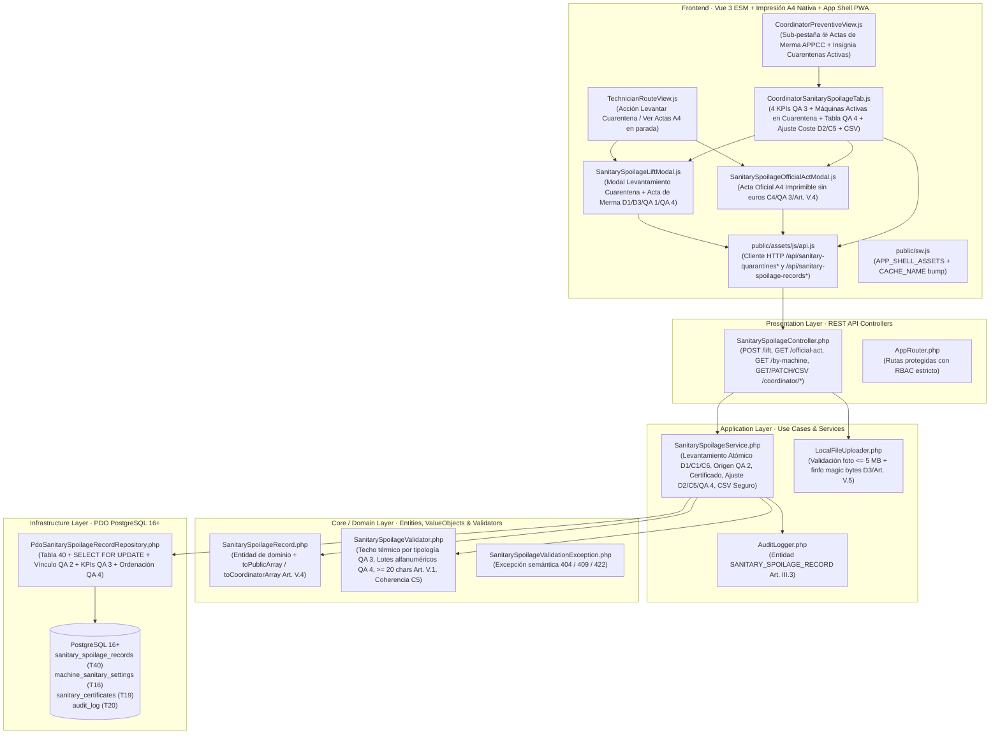
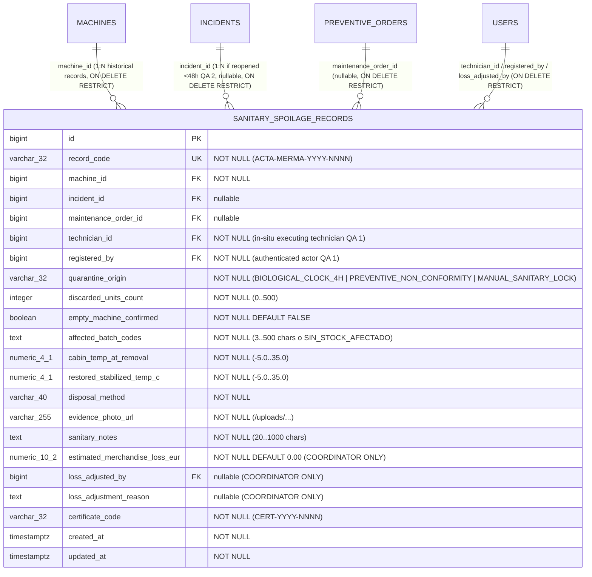

# Plan de Implementación Técnica: Acta de Merma y Destrucción de Lotes por Cuarentena Sanitaria
**Módulo:** `29-haccp-spoilage-log` (Feature 16 de `docs/features_pendientes.md`)  
**Versión:** 3.0 (Alineado con `spec.md` v3.0 · Aprobado por el Product Owner el 2026-11-05)  
**Estado:** Plan Técnico Aprobado por el Product Owner el 2026-11-05 · Puerta SDD cerrada · Definitivo para Ejecución SDD  
**Marco Normativo:** [`constitution.md`](file:///c:/Users/Friki/.gemini/antigravity/scratch/gestor-incidencias-vending/constitution.md) · [`AGENTS.md`](file:///c:/Users/Friki/.gemini/antigravity/scratch/gestor-incidencias-vending/AGENTS.md) · [`docs/design.md`](file:///c:/Users/Friki/.gemini/antigravity/scratch/gestor-incidencias-vending/docs/design.md)  
**Especificación Funcional:** [`specs/29-haccp-spoilage-log/spec.md`](file:///c:/Users/Friki/.gemini/antigravity/scratch/gestor-incidencias-vending/specs/29-haccp-spoilage-log/spec.md) (v3.0) · [`specs/functional/haccp_spoilage_log_spec.md`](file:///c:/Users/Friki/.gemini/antigravity/scratch/gestor-incidencias-vending/specs/functional/haccp_spoilage_log_spec.md)  
**Contratos Técnicos:** [`specs/technical/haccp_spoilage_log_contracts.md`](file:///c:/Users/Friki/.gemini/antigravity/scratch/gestor-incidencias-vending/specs/technical/haccp_spoilage_log_contracts.md) · [`specs/technical/database_schema.md`](file:///c:/Users/Friki/.gemini/antigravity/scratch/gestor-incidencias-vending/specs/technical/database_schema.md) · [`specs/technical/schema_correspondence_contract.md`](file:///c:/Users/Friki/.gemini/antigravity/scratch/gestor-incidencias-vending/specs/technical/schema_correspondence_contract.md)

---

## 1. Arquitectura de Módulos y Estructura de Ficheros

La solución se diseña bajo **Clean Architecture** en PHP 8.2+ POO puro (`declare(strict_types=1);`) en el backend, persistencia única sobre **PostgreSQL 16+ (`pdo_pgsql`)** y **Vue 3 (Composition API via ES Modules nativos)** en el frontend sin bundlers ni dependencias externas adicionales, respetando los artículos I, II, III, IV, V y VI de `constitution.md`.



### 1.1. Base de Datos y Esquema Relacional (`database/` y `specs/technical/`)
| Fichero | Acción | Responsabilidad |
| :--- | :--- | :--- |
| `database/supabase_migrations/025_sanitary_spoilage_records.sql` | **Crear** | Migración DDL incremental idempotente: adición de `'SANITARY_SPOILAGE_RECORD'` en `audit_entity_type`, creación de `sanitary_spoilage_records` (Tabla 40, 22 columnas incluyendo `technician_id` ejecutor in situ y `registered_by` actor registrador según `QA 1`) con `uq_sanitary_spoilage_records_code`, 6 claves foráneas (`machine_id`, `incident_id`, `maintenance_order_id`, `technician_id`, `registered_by`, `loss_adjusted_by` con `ON DELETE RESTRICT`), 9 restricciones `CHECK` (`chk_spoilage_records_origin`, `chk_spoilage_records_units_bounds`, `chk_spoilage_records_empty_coherence`, `chk_spoilage_records_batch_codes_len`, `chk_spoilage_records_temps_bounds`, `chk_spoilage_records_photo_not_empty`, `chk_spoilage_records_notes_len`, `chk_spoilage_records_loss_non_negative`, `chk_spoilage_records_adjustment_coherence`), 4 índices secundarios y 3 disparadores constitucionales (`trg_no_delete_sanitary_spoilage_records`, `trg_touch_sanitary_spoilage_records`, `trg_immutable_sanitary_spoilage_records`). |
| `database/supabase_init.sql` | **Modificar** | Incorporar `'SANITARY_SPOILAGE_RECORD'` en `audit_entity_type`, la Tabla 40 `sanitary_spoilage_records` y la función `enforce_sanitary_spoilage_records_immutability()` al esquema maestro consolidado para mantener paridad 1:1 con migraciones. |
| `database/supabase_seeds.sql` | **Modificar** | Sembrar en la Sección 21 actas de merma reales representativas (un episodio con unidades destruidas y lotes reales originado por reloj biológico de 4 h, un episodio con ajuste económico auditado por Coordinación y un episodio con máquina verificada vacía `0 unidades` y foto de cabina vacía). |
| `src/Infrastructure/Database/SeedRunner.php` | **Modificar** | Sincronizar el sembrado programático de entorno de pruebas con las actas de merma del Módulo 29 (`ON CONFLICT (record_code) DO NOTHING`). |
| `specs/technical/database_schema.md` | **Modificar** | Documentar la Tabla 40 `sanitary_spoilage_records` y `enforce_sanitary_spoilage_records_immutability()`. |
| `specs/technical/schema_correspondence_contract.md` | **Modificar** | Actualizar el inventario canónico de tablas (pasando de 39 a 40 tablas de dominio) verificado por `SchemaCorrespondenceTest`. |

### 1.2. Capa de Dominio (`src/Core/`)
| Fichero | Acción | Responsabilidad |
| :--- | :--- | :--- |
| `src/Core/Domain/Model/SanitarySpoilageRecord.php` | **Crear** | Entidad de dominio inmutable que representa un Acta de Merma APPCC (`id`, `recordCode`, `machineId`, `incidentId`, `maintenanceOrderId`, `technicianId`, `registeredBy`, `quarantineOrigin`, `discardedUnitsCount`, `emptyMachineConfirmed`, `affectedBatchCodes`, `cabinTempAtRemoval`, `restoredStabilizedTempC`, `disposalMethod`, `evidencePhotoUrl`, `sanitaryNotes`, `estimatedMerchandiseLossEur`, `lossAdjustedBy`, `lossAdjustmentReason`, `certificateCode`, `createdAt`, `updatedAt`, más metadatos de máquina/sede/técnico) y expone `toPublicArray()` (sin campos financieros para `TECHNICIAN` y Acta Oficial A4, `Art. V.4`) y `toCoordinatorArray()` (con campos financieros para `COORDINATOR`). |
| `src/Core/Service/SanitarySpoilageValidator.php` | **Crear** | Validador puro de dominio (`Art. II`, `Art. V.1`, `Art. V.5`, `D2`, `D3`, `C5`, `QA 3`, `QA 4`): valida temperaturas en `[-5.0, +35.0] °C` y aplica techo térmico de reapertura según tipología (`<= 4.0 °C` en `PERISHABLE_FOOD` / `COMBO`, `<= 8.0 °C` en `COLD_DRINKS`, `[-5.0, +35.0] °C` en `HOT_DRINKS` / `SNACKS`), valida coherencia de `discarded_units_count` (`0..500`) con `empty_machine_confirmed`, `affected_batch_codes` (`3..500` chars con al menos 1 bloque alfanumérico de $\ge 2$ caracteres cuando `units > 0`, o autocompletado `'SIN_STOCK_AFECTADO'` cuando `units === 0`) y `disposal_method`, exige `evidence_photo_url` no vacío en el 100 % de los casos, valida `sanitary_notes` (`20..1000` chars y $\ge 3$ tokens alfanuméricos reales), calcula el baremo automático `round(units * 2.50, 2)` y valida ajustes financieros (`C5`, `QA 4`: prohibido en `0 unidades`, importe en `(0.00, 99999.99]` distinto al vigente y motivo de `20..500` chars con $\ge 3$ tokens reales). |
| `src/Core/Domain/Exception/SanitarySpoilageValidationException.php` | **Crear** | Excepción semántica de dominio con código de error estructurado y código de estado HTTP (`404`, `409`, `422`). |
| `src/Core/Domain/Repository/SanitarySpoilageRecordRepositoryInterface.php` | **Crear** | Contrato de persistencia: `findById()`, `findByIdForUpdate()`, `findByMachineId()`, `findFilteredForCoordinator()`, `fetchKpiSummary()`, `fetchActiveQuarantinedMachines()`, `resolveLatestQuarantineEpisodeLinks()`, `nextRecordCode()`, `create()` y `updateLossEstimate()`. |

### 1.3. Capa de Aplicación (`src/Application/`)
| Fichero | Acción | Responsabilidad |
| :--- | :--- | :--- |
| `src/Application/Service/SanitarySpoilageService.php` | **Crear** | Orquestador transaccional de los casos de uso (`RF-01` a `RF-05`, `D1`–`D3`, `C1`–`C6`, `QA 1`–`QA 4`): verificación de máquina activa en `'QUARANTINE'` bajo bloqueo, verificación de ausencia de averías correctivas abiertas (`C1`), validación de autoría `technician_id` vs `registered_by` (`QA 1`), resolución determinista del origen y vínculos desde el último levantamiento previo (`QA 2`), emisión atómica de `record_code` + `certificate_code` + cierre de reinspección preventiva pendiente + restitución `sanitary_status = 'OK'` + auditoría (`C6`), generación del Acta Oficial A4 con evento `VIEW_SANITARY_SPOILAGE_ACT` (`C4`, `QA 3`), ajuste económico de Coordinación auditado antes/después (`C5`, `QA 4`) y exportación CSV UTF-8 BOM con neutralización anti-fórmulas (`QA 4`). |

### 1.4. Capa de Infraestructura (`src/Infrastructure/`)
| Fichero | Acción | Responsabilidad |
| :--- | :--- | :--- |
| `src/Infrastructure/Repository/PdoSanitarySpoilageRecordRepository.php` | **Crear** | Implementación PDO PostgreSQL 16+ de `SanitarySpoilageRecordRepositoryInterface`: consultas con joins a `machines`, `locations`, `users`, `incidents` y `preventive_orders`, bloqueo `SELECT ... FOR UPDATE`, cálculo de los 4 KPIs globales inmunes a filtros (contando en `active_quarantined_machines_count` únicamente máquinas con `m.is_active = TRUE AND m.deleted_at IS NULL AND mss.sanitary_status = 'QUARANTINE'`, `QA 3`) y ordenación determinista `created_at DESC, id DESC` (`QA 4`). |

### 1.5. Capa de Presentación REST (`src/Presentation/`)
| Fichero | Acción | Responsabilidad |
| :--- | :--- | :--- |
| `src/Presentation/Controller/SanitarySpoilageController.php` | **Crear** | Endpoints REST: `POST /api/sanitary-quarantines/machines/{machineId}/lift` (`TECHNICIAN` y `COORDINATOR`, soportando `multipart/form-data` con `LocalFileUploader` y JSON), `GET /api/sanitary-spoilage-records/{id}/official-act` (`TECHNICIAN` y `COORDINATOR`, sin campos financieros), `GET /api/sanitary-spoilage-records/by-machine/{machineId}` (`TECHNICIAN` y `COORDINATOR`, segregado por rol), `GET /api/coordinator/sanitary-spoilage-records`, `PATCH /api/coordinator/sanitary-spoilage-records/{id}/loss-estimate` y `GET /api/coordinator/sanitary-spoilage-records/export-csv` (estos 3 últimos exclusivos de `COORDINATOR`, `403 FORBIDDEN` para otros roles). |
| `src/Presentation/Routing/AppRouter.php` | **Modificar** | Registrar las 6 rutas REST del Módulo 29 con sus middlewares de autenticación y RBAC. |

### 1.6. Frontend Web y PWA (`public/`)
| Fichero | Acción | Responsabilidad |
| :--- | :--- | :--- |
| `public/assets/js/components/SanitarySpoilageLiftModal.js` | **Crear** | Modal reutilizable para Técnico y Coordinador cumpliendo `docs/design.md`: selector obligatorio de Técnico ejecutor in situ cuando el usuario es `COORDINATOR` (`QA 1`), bloqueo e indicación clara si el dispositivo está `offline` (`C3`), lecturas térmicas con validación en vivo del techo por tipología (`QA 3`), unidades desechadas (`0..500`) o casilla de *«Máquina vacía / sin stock expuesto»* (`D3`), códigos de lote con validación alfanumérica (`QA 4`), selector de método de destrucción, campo `sanitary_notes` (`20..1000` chars) con **aviso expreso de privacidad Art. V.4** (`QA 4`), selector de fotografía obligatoria ($\le 5\text{ MB}$, `D3`) y botonera `vg-btn` con cierre `vg-btn-close` vacío. |
| `public/assets/js/components/SanitarySpoilageOfficialActModal.js` | **Crear** | Visor e impresión A4 nativa (`window.print()`) del **Acta Oficial de Destrucción de Género Perecedero** (`C4`, `QA 3`, `Art. V.4`): muestra cabecera institucional, `record_code`, `certificate_code`, sede, máquina, técnico certificador in situ, origen, temperaturas, unidades/lotes, método, observaciones y fotografía de evidencia, omitiendo el 100 % de los campos económicos. |
| `public/assets/js/components/CoordinatorSanitarySpoilageTab.js` | **Crear** | Sub-pestaña **«☣️ Actas de Merma APPCC»** en Coordinación cumpliendo estrictamente `docs/design.md`: 4 tarjetas KPI superiores con borde hairline `#c8cfda` (`8px` radius, **cero sombra en reposo**) e inmunes al filtro de tabla (`QA 3`), panel de máquinas activas en `'QUARANTINE'` con estado de avería abierta (`C1`) y botón `vg-btn vg-btn-sm vg-btn-primary` *«Levantar cuarentena / Emitir Acta»*, barra de filtros (`vg-action-group`) con validación `date_from <= date_to` y botón `vg-btn vg-btn-secondary` *«📥 Exportar CSV APPCC»*, tabla histórica ordenada (`created_at DESC, id DESC`, `QA 4`) con celdas de acción `vg-row-actions` (`vg-btn vg-btn-sm`: *«📄 Acta A4»* y, solo si `discarded_units_count > 0`, *«💶 Ajustar coste»* según `C5`), y modal de ajuste económico con validación de importe distinto al actual y motivo de $\ge 20$ caracteres reales (`QA 4`). |
| `public/assets/js/components/TechnicianRouteView.js` | **Modificar** | Mostrar en paradas con máquina en `'QUARANTINE'` (cuando no queden averías abiertas en la máquina, `C1`) el botón para abrir `SanitarySpoilageLiftModal` y el acceso para consultar/imprimir las Actas Oficiales A4 de la máquina (`QA 3`). |
| `public/assets/js/components/CoordinatorPreventiveView.js` | **Modificar** | Añadir la sub-pestaña **«☣️ Actas de Merma APPCC»** (`vg-btn-tab` / `vg-btn-tab-active`) con contador de máquinas activas en cuarentena. |
| `public/assets/js/components/AuditActionLabels.js` | **Modificar** | Registrar las etiquetas en español para `SANITARY_SPOILAGE_RECORD` y las 4 acciones (`CREATE_SPOILAGE_RECORD_AND_LIFT_QUARANTINE`, `ADJUST_SPOILAGE_MERCHANDISE_LOSS`, `VIEW_SANITARY_SPOILAGE_ACT`, `EXPORT_SPOILAGE_RECORDS_CSV`). |
| `public/assets/js/api.js` | **Modificar** | Añadir `liftSanitaryQuarantineWithSpoilage()`, `getSanitarySpoilageOfficialAct()`, `getMachineSanitarySpoilageRecords()`, `getCoordinatorSanitarySpoilageRecords()`, `adjustCoordinatorSpoilageLossEstimate()` y `exportCoordinatorSanitarySpoilageCsv()`. |
| `public/sw.js` | **Modificar** | Añadir `/assets/js/components/SanitarySpoilageLiftModal.js`, `/assets/js/components/SanitarySpoilageOfficialActModal.js` y `/assets/js/components/CoordinatorSanitarySpoilageTab.js` en `APP_SHELL_ASSETS` y actualizar `CACHE_NAME`. |
| `public/assets/css/styles.css` | **Modificar** | Estilos de la pestaña de mermas APPCC, tarjetas KPI, modal de levantamiento y hoja de impresión `@media print` del Acta Oficial A4 usando exclusivamente tokens CSS (`var(--color-*)`, radios `4px`/`8px`, cero sombras en reposo). |

---

## 2. Modelo de Datos Relacional y Contratos de API REST

### 2.1. Modelo Relacional PostgreSQL (`sanitary_spoilage_records`, Tabla 40)



### 2.2. Resumen de Contratos de Endpoints REST y Códigos HTTP

| Método y Ruta | Rol Autorizado | Entrada Principal | Respuesta Éxito | Códigos de Error y Causas |
| :--- | :--- | :--- | :--- | :--- |
| `POST /api/sanitary-quarantines/machines/{machineId}/lift` | `TECHNICIAN`, `COORDINATOR` | `multipart/form-data` o JSON (`discarded_units_count`, `empty_machine_confirmed`, `affected_batch_codes`, `cabin_temp_at_removal`, `restored_stabilized_temp_c`, `disposal_method`, `sanitary_notes`, `technician_id?`, `photo`) | `201 Created` (`{ spoilage_record, machine_sanitary_status: 'OK', qr_unblocked: true }`) | `401`, `403`, `404 MACHINE_NOT_FOUND`, `409 MACHINE_INACTIVE`, `409 MACHINE_NOT_IN_QUARANTINE`, `409 ACTIVE_INCIDENT_BLOCKS_QUARANTINE_LIFT` (`C1`), `422 EXECUTING_TECHNICIAN_REQUIRED` (`QA 1`), `422 RESTORED_TEMPERATURE_EXCEEDS_SAFE_LIMIT` (`Art. II`, `QA 3`), `422 EMPTY_MACHINE_CONFIRMATION_REQUIRED` (`D3`), `422 EVIDENCE_PHOTO_REQUIRED` (`D3`), `422 INVALID_SPOILAGE_RECORD` |
| `GET /api/sanitary-spoilage-records/{id}/official-act` | `TECHNICIAN`, `COORDINATOR` | Parámetro de ruta `{id}` | `200 OK` (`{ official_act }` sin ningún campo financiero `Art. V.4`) | `401`, `403 FORBIDDEN` (si `LOCATION_RESPONSIBLE`), `404 SPOILAGE_RECORD_NOT_FOUND` |
| `GET /api/sanitary-spoilage-records/by-machine/{machineId}` | `TECHNICIAN`, `COORDINATOR` | Parámetro de ruta `{machineId}` | `200 OK` (`{ machine_id, is_in_quarantine, has_open_incidents, records }` segregado por rol) | `401`, `403`, `404 MACHINE_NOT_FOUND` |
| `GET /api/coordinator/sanitary-spoilage-records` | `COORDINATOR` | Query: `machine_id`, `quarantine_origin`, `disposal_method`, `date_from`, `date_to`, `search` | `200 OK` (`{ kpis, active_quarantined_machines, records }`) | `401`, `403 FORBIDDEN`, `422 INVALID_DATE_RANGE` (`date_from > date_to`, `QA 4`) |
| `PATCH /api/coordinator/sanitary-spoilage-records/{id}/loss-estimate` | `COORDINATOR` | JSON: `{ estimated_merchandise_loss_eur, loss_adjustment_reason }` | `200 OK` (`{ spoilage_record }`) | `401`, `403`, `404 SPOILAGE_RECORD_NOT_FOUND`, `422 EMPTY_MACHINE_LOSS_CANNOT_BE_ADJUSTED` (`C5`), `422 INVALID_LOSS_ESTIMATE_AMOUNT` (`C5`), `422 IDENTICAL_LOSS_ESTIMATE` (`QA 4`), `422 INVALID_LOSS_ADJUSTMENT_REASON` (`Art. V.1`) |
| `GET /api/coordinator/sanitary-spoilage-records/export-csv` | `COORDINATOR` | Query: `machine_id`, `quarantine_origin`, `disposal_method`, `date_from`, `date_to`, `search` | `200 OK` (`text/csv; charset=UTF-8` con `UTF-8 BOM`, 2 secciones) | `401`, `403 FORBIDDEN`, `422 INVALID_DATE_RANGE` |

---

## 3. Algoritmos Clave en Pseudocódigo y Máquinas de Estado

### 3.1. Máquina de Estados del Ciclo de Cuarentena y Levantamiento APPCC (`D1`, `C1`, `QA 2`)

```mermaid
stateDiagram-v2
    [*] --> OK : Máquina activa en servicio
    OK --> QUARANTINE : Reloj biológico > 4h en avería (Módulo 11)\no Preventivo NO_CONFORME (Módulo 05)
    QUARANTINE --> QUARANTINE_WITH_RESOLVED_INCIDENT : Cierre mecánico de avería (resolveIncident)\nRetiene QUARANTINE (Art. II / Módulo 24)
    QUARANTINE_WITH_RESOLVED_INCIDENT --> OK : liftQuarantineWithSpoilageRecord() [Online C3]\n1. Sin averías abiertas (C1)\n2. Temp estabilizada <= límite tipología (QA 3)\n3. Foto <= 5 MB + Lotes/Vacía + Notas >= 20 chars (D3)\n4. Emite ACTA-MERMA-YYYY-NNNN + CERT-YYYY-NNNN\n5. Desbloquea QR (C6)
    OK --> QUARANTINE : Reapertura en garantía < 48h (QA 2)\nConserva ACTA-0001 intacta; exigirá ACTA-0002
```

### 3.2. Algoritmo Transaccional de Levantamiento de Cuarentena y Determinación de Origen (`D1`–`D3`, `C1`–`C3`, `C6`, `QA 1`–`QA 4`)

```text
ALGORITHM liftQuarantineWithSpoilageRecord(machineId, payload, uploadedPhotoFile, actor)
  // 1. Validar y almacenar fotografía obligatoria ANTES de abrir o comprometer estado (D3, Art. V.5)
  IF uploadedPhotoFile IS NOT NULL THEN
      photoUrl = localFileUploader.upload(uploadedPhotoFile) // Valida <= 5MB y finfo JPEG/PNG/WEBP
  ELSE IF payload.evidence_photo_url Matches '^/uploads/[a-f0-9]{32}\.(jpg|png|webp)$' AND fileExists(payload.evidence_photo_url) THEN
      photoUrl = payload.evidence_photo_url
  ELSE
      THROW SanitarySpoilageValidationException('EVIDENCE_PHOTO_REQUIRED', 422)
  END IF

  RETURN transactionManager.runInTransaction(FUNCTION ()
      // 2. Bloquear máquina y verificar que esté activa y en QUARANTINE (EARS 01.1, QA 3)
      machine = machineRepo.findByIdForUpdate(machineId)
      IF machine IS NULL THEN
          THROW SanitarySpoilageValidationException('MACHINE_NOT_FOUND', 404)
      END IF
      IF NOT machine.isActive OR machine.deletedAt IS NOT NULL THEN
          THROW SanitarySpoilageValidationException('MACHINE_INACTIVE', 409)
      END IF

      settings = settingsRepo.getMachineSettingsForUpdate(machineId)
      IF settings.sanitary_status !== 'QUARANTINE' THEN
          THROW SanitarySpoilageValidationException('MACHINE_NOT_IN_QUARANTINE', 409)
      END IF

      // 3. Verificar ausencia de averías correctivas abiertas en la máquina (C1, EARS 01.1.2)
      IF spoilageRepo.hasOpenCorrectiveIncident(machineId) THEN
          THROW SanitarySpoilageValidationException('ACTIVE_INCIDENT_BLOCKS_QUARANTINE_LIFT', 409)
      END IF

      // 4. Resolver autoría física in situ vs usuario registrador (QA 1, Art. III.3)
      IF actor.role === 'TECHNICIAN' THEN
          executingTechId = actor.id
      ELSE IF actor.role === 'COORDINATOR' THEN
          executingTechId = int(payload.technician_id ?? 0)
          IF NOT spoilageRepo.isActiveTechnician(executingTechId) THEN
              THROW SanitarySpoilageValidationException('EXECUTING_TECHNICIAN_REQUIRED', 422)
          END IF
      END IF
      registeredByUserId = actor.id

      // 5. Validar temperaturas según tipología, unidades, lotes, método y notas (Art. II, V.1, D2, D3, QA 3, QA 4)
      validated = SanitarySpoilageValidator::validateCreation(payload, machine.machineType, photoUrl)

      // 6. Resolver determinísticamente el episodio causante desde el último levantamiento previo (QA 2)
      episodeLinks = spoilageRepo.resolveLatestQuarantineEpisodeLinks(machineId)
      // Prioridad QA 2:
      // 1º BIOLOGICAL_CLOCK_4H si existe avería resuelta en el ciclo con cuarentena térmica o > 4h
      // 2º PREVENTIVE_NON_CONFORMITY si existe orden preventiva NO_CONFORME en el ciclo
      // 3º MANUAL_SANITARY_LOCK en su defecto

      // 7. Generar códigos oficiales, insertar acta, emitir certificado y restituir a OK (RF-03.1, C6)
      recordCode = spoilageRepo.nextRecordCode(currentYear) // ACTA-MERMA-YYYY-NNNN
      certificateCode = sprintf('CERT-%s-%04d', currentYear, random_int(1000, 9999))

      record = spoilageRepo.create({
          record_code: recordCode,
          machine_id: machineId,
          incident_id: episodeLinks.incident_id,
          maintenance_order_id: episodeLinks.maintenance_order_id,
          technician_id: executingTechId,
          registered_by: registeredByUserId,
          quarantine_origin: episodeLinks.quarantine_origin,
          discarded_units_count: validated.discarded_units_count,
          empty_machine_confirmed: validated.empty_machine_confirmed,
          affected_batch_codes: validated.affected_batch_codes,
          cabin_temp_at_removal: validated.cabin_temp_at_removal,
          restored_stabilized_temp_c: validated.restored_stabilized_temp_c,
          disposal_method: validated.disposal_method,
          evidence_photo_url: photoUrl,
          sanitary_notes: validated.sanitary_notes,
          estimated_merchandise_loss_eur: validated.estimated_merchandise_loss_eur, // round(units * 2.50, 2)
          certificate_code: certificateCode
      })

      spoilageRepo.completePendingReinspectionOrdersAndRestoreMachineOk(
          machineId,
          executingTechId,
          validated.restored_stabilized_temp_c,
          certificateCode,
          validated.sanitary_notes
      )

      auditLogger.log(
          'CREATE_SPOILAGE_RECORD_AND_LIFT_QUARANTINE',
          'SANITARY_SPOILAGE_RECORD',
          record.id,
          { machine_sanitary_status: 'QUARANTINE' },
          record.toCoordinatorArray() + { machine_sanitary_status: 'OK' },
          actor
      )

      RETURN record
  END FUNCTION)
END ALGORITHM
```

### 3.3. Validador de Rigor Textual, Lotes Alfanuméricos y Coherencia Contable (`SanitarySpoilageValidator`, `D2`, `D3`, `C5`, `QA 3`, `QA 4`)

```text
ALGORITHM validateBatchCodesAndLossCoherence
  // Regla D3 + QA 4 para unidades y lotes:
  IF discardedUnits === 0 THEN
      IF emptyMachineConfirmed !== TRUE THEN
          THROW SanitarySpoilageValidationException('EMPTY_MACHINE_CONFIRMATION_REQUIRED', 422)
      END IF
      affectedBatchCodes = 'SIN_STOCK_AFECTADO'
      disposalMethod = 'NOT_APPLICABLE_EMPTY'
      estimatedLossEur = 0.00
  ELSE IF discardedUnits BETWEEN 1 AND 500 THEN
      emptyMachineConfirmed = FALSE
      normalizedBatches = preg_replace('/\s+/u', ' ', trim(rawBatchCodes))
      IF mb_strlen(normalizedBatches) < 3 OR mb_strlen(normalizedBatches) > 500 THEN
          THROW SanitarySpoilageValidationException('INVALID_BATCH_CODES', 422)
      END IF
      // QA 4: Exigir al menos 1 bloque alfanumérico de >= 2 caracteres reales (bloquea "---" o "...")
      IF NOT preg_match('/[\p{L}\p{N}]{2,}/u', normalizedBatches) THEN
          THROW SanitarySpoilageValidationException('INVALID_BATCH_CODES', 422)
      END IF
      IF disposalMethod NOT IN ['ON_SITE_ORGANIC_SEALED', 'RETURN_TO_CENTRAL_BIOHAZARD', 'AUTHORIZED_WASTE_MANAGER'] THEN
          THROW SanitarySpoilageValidationException('INVALID_DISPOSAL_METHOD', 422)
      END IF
      estimatedLossEur = round(discardedUnits * 2.50, 2)
  END IF

  // Regla C5 + QA 4 para ajuste económico de Coordinación:
  IF record.discardedUnitsCount === 0 THEN
      THROW SanitarySpoilageValidationException('EMPTY_MACHINE_LOSS_CANNOT_BE_ADJUSTED', 422)
  END IF
  IF newAmount <= 0.00 OR newAmount > 99999.99 THEN
      THROW SanitarySpoilageValidationException('INVALID_LOSS_ESTIMATE_AMOUNT', 422)
  END IF
  IF abs(newAmount - record.estimatedMerchandiseLossEur) < 0.005 THEN
      THROW SanitarySpoilageValidationException('IDENTICAL_LOSS_ESTIMATE', 422)
  END IF
END ALGORITHM
```

---

## 4. Arquitectura de Componentes Frontend y Cumplimiento de `docs/design.md`

Todos los componentes nuevos y modificados se sujetan de forma estricta a las directrices de [`docs/design.md`](file:///c:/Users/Friki/.gemini/antigravity/scratch/gestor-incidencias-vending/docs/design.md) y a los tres guardas automatizados del repositorio (`CoordinatorButtonVariantsGuardTest`, `LegacyButtonPaletteRetirementTest` y `DesignTokenDebtRatchetTest`):

1. **Paleta, Superficies y Bordes (`docs/design.md` §Colors, §Elevation, §Shapes):**
   * Un único voltaje interactivo (`var(--color-primary)` `#2560ff`), fondo canvas (`var(--color-canvas)` `#f9fafb`), texto principal slate (`var(--color-ink-slate)` `#2c333f`) y bordes hairline (`var(--color-hairline)` `#c8cfda`).
   * Escala binaria de radios: `4px` (`var(--radius-xs)`) para botones, inputs, selectores y chips; `8px` (`var(--radius-sm)`) para tarjetas KPI, paneles y modales. Prohibido usar `12px`, `16px` o bordes píldora (`9999px`) en botones o chips.
   * **Cero sombra en reposo** en las 4 tarjetas KPI y paneles (`box-shadow: none` en estado base; sombra sutil solo en `:hover`).
2. **Escalera Única de Botones (`vg-btn` — `docs/design.md` líneas 399–448):**
   * Uso exclusivo de `vg-btn`, `vg-btn-sm`, `vg-btn-lg`, `vg-btn-primary`, `vg-btn-secondary`, `vg-btn-primary-outline`, `vg-btn-danger-soft`, `vg-btn-tab`, `vg-btn-tab-active`, `vg-btn-close` (botón vacío sin texto interior; el glifo `✕` lo aporta el CSS) y `vg-chip` (para lecturas/contadores, nunca para acciones).
   * Agrupación de barras de filtros y cabeceras con `vg-action-group` y celdas de acciones de tabla con `vg-row-actions`.
   * **Prohibición absoluta** de clases heredadas `.btn*` y de declarar geometría (`height`, `padding`, `font-size`, `border-radius`) o colores hexadecimales literales en atributos `style` de etiquetas `<button>`.
3. **Separación de Responsabilidades en Componentes Vue 3 ESM:**
   * `SanitarySpoilageLiftModal.js`: Formulario de captura del Acta de Merma y levantamiento en línea (`C3`), con banner informativo de privacidad Art. V.4 junto a `sanitary_notes` (`QA 4`) y previsualización de la fotografía seleccionada.
   * `SanitarySpoilageOfficialActModal.js`: Documento oficial A4 con botón `vg-btn vg-btn-primary` *«🖨️ Imprimir Acta Oficial A4»* (`window.print()`), libre de cualquier campo económico (`Art. V.4`, `C4`).
   * `CoordinatorSanitarySpoilageTab.js`: Panel de Coordinación con las 4 tarjetas KPI inmunes a filtros (`QA 3`), listado de máquinas activas en `'QUARANTINE'`, filtros validados (`date_from <= date_to`), tabla histórica con orden `created_at DESC, id DESC` (`QA 4`), modal de ajuste económico (`C5`) y exportación CSV.

---

## 5. Decisiones Técnicas Justificadas y Alternativas Descartadas

| Decisión Técnica | Justificación Arquitectónica | Alternativa Descartada y Por Qué |
| :--- | :--- | :--- |
| **1. Flujo explícito `POST /api/sanitary-quarantines/machines/{machineId}/lift` desacoplado de `resolveIncident` (`D1`)** | Mantiene intacto el invariante certificado en los Módulos 11 y 24 (`preserve_sanitary_quarantine`), respeta la física del enfriamiento de cabina tras reparar un compresor y unifica el levantamiento tanto para cuarentenas nacidas por avería ($> 4\text{ h}$) como por preventivo `NO_CONFORME`. | *Levantar la cuarentena dentro de `resolveIncident`:* Rompería las pruebas de retención de cuarentena del Módulo 24 y obligaría a declarar $\le 4,0\text{ }^\circ\text{C}$ en el segundo exacto de cambiar una pieza con la cabina aún caliente. |
| **2. Separación de columnas `technician_id` (ejecutor in situ) y `registered_by` (actor autenticado) en la Tabla 40 (`QA 1`)** | Garantiza el cumplimiento del Art. III.3 de la Constitución: el Acta Oficial A4 siempre acredita al Técnico de Campo real que verificó el termómetro y retiró los lotes, mientras la base de datos y el `audit_log` conservan si el registro fue cargado por un Coordinador desde central. | *Una sola columna `user_id`:* Si un Coordinador registrara el levantamiento desde oficina, aparecería un administrativo como "técnico certificador in situ" en el documento para Sanidad. |
| **3. Relación `1..N` entre `machines` / `incidents` y `sanitary_spoilage_records` (`QA 2`)** | Permite que si una avería se reabre en garantía dentro de las 48 horas (Art. V.6) y vuelve a caer en cuarentena, el acta del primer levantamiento permanezca 100 % inmutable en el historial y el nuevo levantamiento emita una segunda acta correlativa. | *Restricción `UNIQUE (incident_id)`:* Impediría levantar una segunda cuarentena tras una reapertura en garantía o forzaría a sobrescribir el acta anterior violando el Art. III.3. |
| **4. Restricciones `CHECK` en PostgreSQL + `trg_immutable_sanitary_spoilage_records` (`D3`, `C5`, `Art. III.3`)** | Blinda en el propio motor relacional que `evidence_photo_url` nunca sea nulo, que `0 unidades` tenga siempre `0.00 €` sin ajustes financieros (`C5`) y que ningún `UPDATE` pueda alterar jamás los hechos físicos/sanitarios del acta una vez emitida. | *Validación solo en capa PHP:* Permitiría que una consulta SQL directa o un error futuro modificara hechos sanitarios ya certificados o asignara costes a máquinas vacías. |

---

## 6. Estrategia de Pruebas (Fases 3 y 5 SDD)

1. **Pruebas de Esquema e Invariantes Relacionales PostgreSQL (`tests/integration/PostgresSanitarySpoilageSchemaTest.php`):**
   * Verificación de la Tabla 40 `sanitary_spoilage_records` (22 columnas), `uq_sanitary_spoilage_records_code`, claves foráneas `ON DELETE RESTRICT` y las 9 restricciones `CHECK`.
   * Bloqueo de `DELETE FROM sanitary_spoilage_records` por `trg_no_delete_sanitary_spoilage_records` (`Art. III.1`).
   * Bloqueo de `UPDATE` sobre cualquier columna física/sanitaria (`discarded_units_count`, `affected_batch_codes`, `cabin_temp_at_removal`, `restored_stabilized_temp_c`, `evidence_photo_url`, `technician_id`, etc.) por `trg_immutable_sanitary_spoilage_records`, permitiendo únicamente actualizar `estimated_merchandise_loss_eur`, `loss_adjusted_by` y `loss_adjustment_reason` cuando `discarded_units_count > 0` (`Art. III.3`, `C5`).
2. **Pruebas Unitarias de Dominio y Validador (`tests/unit/SanitarySpoilageValidatorTest.php`):**
   * Techos térmicos por tipología (`QA 3`: $\le 4.0\text{ }^\circ\text{C}$ en `PERISHABLE_FOOD` / `COMBO`, $\le 8.0\text{ }^\circ\text{C}$ en `COLD_DRINKS`, $[-5.0, +35.0]\text{ }^\circ\text{C}$ en `HOT_DRINKS` / `SNACKS`).
   * Coherencia entre `discarded_units_count = 0` (`empty_machine_confirmed = true`, autocompletado `'SIN_STOCK_AFECTADO'` y `'NOT_APPLICABLE_EMPTY'`, coste `0.00 €`) y `discarded_units_count > 0` (lotes `3..500` chars con bloque alfanumérico real $\ge 2$ chars rechazando `"---"`, `QA 4`).
   * Obligatoriedad de `evidence_photo_url` incluso con `0` unidades (`D3`, `Art. V.5`), validación de `sanitary_notes` (`20..1000` chars y $\ge 3$ tokens reales, `Art. V.1`) y reglas de ajuste financiero (`C5`, `QA 4`: rechazo en `0 unidades`, rechazo de `0.00 €` cuando `units > 0` y rechazo de importe idéntico al actual `IDENTICAL_LOSS_ESTIMATE`).
3. **Pruebas de Integración de Servicio, API HTTP, RBAC y Reapertura < 48 h (`tests/integration/SanitarySpoilageApiIntegrationTest.php`):**
   * Levantamiento de cuarentena por Técnico activo (`C2`) y por Coordinador indicando `technician_id` ejecutor in situ (`QA 1`, rechazando con `422` si lo omite).
   * Bloqueo `409 ACTIVE_INCIDENT_BLOCKS_QUARANTINE_LIFT` si la máquina aún tiene una avería correctiva abierta (`C1`) y bloqueo `409 MACHINE_INACTIVE` si la máquina está dada de baja (`QA 3`).
   * Determinación determinista del origen (`QA 2`) y emisión de segunda acta correlativa (`ACTA-MERMA-...-0002`) cuando una avería se reabre en garantía `< 48h`, vuelve a caer en cuarentena y se vuelve a levantar, verificando que la primera acta permanece intacta (`QA 2`, `Art. V.6`).
   * Segregación financiera estricta (`Art. V.4`, `D2`, `C4`): ausencia total de `estimated_merchandise_loss_eur` en respuestas a `TECHNICIAN` y en `GET .../official-act`, registro de `VIEW_SANITARY_SPOILAGE_ACT` en `audit_log`, bloqueo `403` para `LOCATION_RESPONSIBLE` en todos los endpoints del módulo y para `TECHNICIAN` en los endpoints de `/api/coordinator/sanitary-spoilage-records*`.
   * KPIs globales inmunes a filtros y excluyendo máquinas inactivas de `active_quarantined_machines_count` (`QA 3`), validación `date_from <= date_to` y exportación CSV UTF-8 BOM con neutralización de fórmulas (`=`, `+`, `-`, `@`) y soporte de 0 resultados (`QA 4`).
4. **Pruebas de Frontend y Guardas de Diseño (`tests/unit/SanitarySpoilageFrontendTest.mjs`):**
   * Verificación de componentes Vue 3 ESM (`SanitarySpoilageLiftModal.js`, `SanitarySpoilageOfficialActModal.js`, `CoordinatorSanitarySpoilageTab.js`), aviso de privacidad Art. V.4 en observaciones (`QA 4`), bloqueo de envío en modo offline (`C3`), paridad de `APP_SHELL_ASSETS` en `public/sw.js` y cumplimiento de `CoordinatorButtonVariantsGuardTest`, `LegacyButtonPaletteRetirementTest` y `DesignTokenDebtRatchetTest`.

---

## 7. Matriz de Trazabilidad del Plan con la Especificación v3.0

| Requisito / Decisión | Componentes que lo implementan | Pruebas que lo verifican |
| :--- | :--- | :--- |
| **`RF-01` (`EARS 01.1–01.3`), `D1`, `C1`–`C3`, `QA 1`, `QA 3`** | `SanitarySpoilageValidator`; `SanitarySpoilageService::liftQuarantine`; `PdoSanitarySpoilageRecordRepository`; `SanitarySpoilageLiftModal.js` | `SanitarySpoilageValidatorTest`; `SanitarySpoilageApiIntegrationTest`; `SanitarySpoilageFrontendTest.mjs` |
| **`RF-02` (`EARS 02.1–02.3`), `D3`, `QA 4`, `Art. V.1`, `Art. V.4`, `Art. V.5`** | `LocalFileUploader`; `SanitarySpoilageValidator`; `025_sanitary_spoilage_records.sql`; `SanitarySpoilageLiftModal.js` | `PostgresSanitarySpoilageSchemaTest`; `SanitarySpoilageValidatorTest`; `SanitarySpoilageApiIntegrationTest` |
| **`RF-03` (`EARS 03.1–03.2`), `D1`, `D2`, `C6`, `QA 2`, `Art. III.3`, `Art. V.6`** | `SanitarySpoilageService::liftQuarantine`; `PdoSanitarySpoilageRecordRepository::resolveLatestQuarantineEpisodeLinks`; `AuditLogger` | `SanitarySpoilageApiIntegrationTest`; `PostgresSanitarySpoilageSchemaTest` |
| **`RF-04` (`EARS 04.1–04.2`), `D2`, `C4`, `C5`, `QA 4`, `Art. V.4`** | `SanitarySpoilageRecord::toPublicArray` / `toCoordinatorArray`; `SanitarySpoilageService::adjustLossEstimate`; `SanitarySpoilageController` | `SanitarySpoilageValidatorTest`; `SanitarySpoilageApiIntegrationTest`; `PostgresSanitarySpoilageSchemaTest` |
| **`RF-05` (`EARS 05.1–05.2`), `C4`, `QA 1`, `QA 3`, `QA 4`** | `SanitarySpoilageOfficialActModal.js`; `CoordinatorSanitarySpoilageTab.js`; `SanitarySpoilageService::exportCsv` | `SanitarySpoilageApiIntegrationTest`; `SanitarySpoilageFrontendTest.mjs` |
| **`RNF-01` a `RNF-03`** | `trg_no_delete_sanitary_spoilage_records`; `trg_immutable_sanitary_spoilage_records`; `LocalFileUploader`; `styles.css` (`docs/design.md`) | `PostgresSanitarySpoilageSchemaTest`; `DesignTokenDebtRatchetTest`; `CoordinatorButtonVariantsGuardTest.mjs`; `LegacyButtonPaletteRetirementTest` |

---

## 8. Garantía de Dogma Vanilla y Dualidad Lingüística

* **Dogma Vanilla (Art. IV):** Cero paquetes o librerías de terceros nuevos. Todo el backend se construye en PHP 8.2+ POO con `declare(strict_types=1);`, `pdo_pgsql` e inspección binaria nativa con `finfo`; todo el frontend se construye en Vue 3 Composition API (ES Modules nativos) e impresión A4 nativa del navegador (`window.print()`).
* **Dualidad Lingüística (`AGENTS.md` §3):** Nombres de clases, métodos, variables, tablas, columnas y rutas en **inglés** (`SanitarySpoilageRecord`, `SanitarySpoilageService`, `discarded_units_count`, `estimated_merchandise_loss_eur`); comentarios contextuales, mensajes de error de usuario, etiquetas de UI, Acta Oficial A4, columnas de exportación CSV y documentación en **español neutro profesional**.
