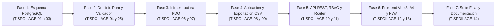

# Plan de Tareas de Implementación (`tasks.md`): Acta de Merma y Destrucción de Lotes por Cuarentena Sanitaria (`29-haccp-spoilage-log`)

**Módulo:** `29-haccp-spoilage-log`  
**Versión:** 3.0 (Alineado con `spec.md` v3.0, `haccp_spoilage_log_contracts.md` v1.0, `plan.md` v3.0 y `docs/design.md`)  
**Estado:** Aprobado por el Product Owner el 2026-11-05 · Puerta SDD cerrada · Listo para Ejecución de las Tareas `T-SPOILAGE-01` a `T-SPOILAGE-14` (Fase 3: tests y código)  
**Metodología:** SDD (Specification-Driven Development) · Clean Architecture · TDD / Guardas de Esquema y Diseño  
**Ley Suprema:** [`constitution.md`](../../constitution.md), [`AGENTS.md`](../../AGENTS.md) y [`docs/design.md`](../../docs/design.md)

---

## Resumen de Fases y Grafo de Dependencias

| Fase | Rango de Tareas | Descripción | Tiempo Estimado |
| :--- | :--- | :--- | :--- |
| **Fase 1** | `T-SPOILAGE-01` .. `T-SPOILAGE-03` | Esquema PostgreSQL / Supabase (Migración `025`, Tabla 40 `sanitary_spoilage_records`, valor `'SANITARY_SPOILAGE_RECORD'` en `audit_entity_type`, disparador de inmutabilidad de hechos sanitarios, semillas y guardas) | ~65 min |
| **Fase 2** | `T-SPOILAGE-04` .. `T-SPOILAGE-05` | Entidad `SanitarySpoilageRecord`, `SanitarySpoilageValidator` (techos térmicos `QA 3`, lotes alfanuméricos `QA 4`, coherencia `C5`), `SanitarySpoilageValidationException` + Tests Unitarios | ~45 min |
| **Fase 3** | `T-SPOILAGE-06` .. `T-SPOILAGE-07` | Repositorio PDO (`PdoSanitarySpoilageRecordRepository`), bloqueo `SELECT ... FOR UPDATE`, determinación de origen `QA 2`, KPIs inmunes a filtros `QA 3` y ordenación `QA 4` | ~50 min |
| **Fase 4** | `T-SPOILAGE-08` .. `T-SPOILAGE-09` | `SanitarySpoilageService` (levantamiento atómico, autoría `QA 1`, relación `1..N` ante reaperturas `QA 2`, Acta A4, ajuste `C5`/`QA 4`, CSV anti-fórmulas) + Suite de Integración de Servicio | ~55 min |
| **Fase 5** | `T-SPOILAGE-10` .. `T-SPOILAGE-11` | `SanitarySpoilageController` (soporte `multipart/form-data` con `LocalFileUploader` + JSON, RBAC y segregación `Art. V.4`), cableado en `AppRouter` y Suite de Integración API REST | ~50 min |
| **Fase 6** | `T-SPOILAGE-12` .. `T-SPOILAGE-13` | Cliente `api.js`, `AuditActionLabels.js`, modales `SanitarySpoilageLiftModal.js` y `SanitarySpoilageOfficialActModal.js`, vista `CoordinatorSanitarySpoilageTab.js`, integración en Ruta/Preventivo, `styles.css` (`docs/design.md`) y `sw.js` + Test Frontend `.mjs` | ~60 min |
| **Fase 7** | `T-SPOILAGE-14` | Verificación Integral (`php tests/run_all.php`), sincronización `DocMetricsGuard`, matriz de trazabilidad (`traceability-matrix.md`) y cierre en `docs/features_pendientes.md` | ~25 min |

---

## Fase 1: Esquema de Base de Datos PostgreSQL / Supabase y Guardas de Esquema

- [x] **T-SPOILAGE-01 · Crear migración incremental `025_sanitary_spoilage_records.sql` y converger `database/supabase_init.sql`**
  - **Tiempo estimado:** 25 min
  - **Dependencias previas:** Ninguna
  - **Archivos exactos a crear o modificar:**
    - Crear `database/supabase_migrations/025_sanitary_spoilage_records.sql`
    - Modificar `database/supabase_init.sql`
  - **Requisitos cubiertos:** `RF-01.1`, `RF-01.2`, `RF-02.1`–`RF-02.3`, `RF-03.1`, `RF-03.2`, `RF-04.2`, `RNF-01`, `D1`–`D3`, `C5`, `QA 1`, `QA 2`, `constitution.md` Art. III.1 y Art. III.3.
  - **Detalle de implementación:**
    1. Añadir de forma idempotente `'SANITARY_SPOILAGE_RECORD'` al tipo enumerado `audit_entity_type` (`ALTER TYPE audit_entity_type ADD VALUE IF NOT EXISTS 'SANITARY_SPOILAGE_RECORD'`).
    2. Crear la Tabla 40 `sanitary_spoilage_records` (21 columnas: `id`, `record_code`, `machine_id`, `incident_id`, `maintenance_order_id`, `technician_id`, `registered_by`, `quarantine_origin`, `discarded_units_count`, `empty_machine_confirmed`, `affected_batch_codes`, `cabin_temp_at_removal`, `restored_stabilized_temp_c`, `disposal_method`, `evidence_photo_url`, `sanitary_notes`, `estimated_merchandise_loss_eur`, `loss_adjusted_by`, `loss_adjustment_reason`, `certificate_code`, `created_at`, `updated_at`) con clave única `uq_sanitary_spoilage_records_code UNIQUE (record_code)`, 6 claves foráneas `ON DELETE RESTRICT ON UPDATE CASCADE` y las 8 restricciones `CHECK`:
       - `chk_spoilage_records_origin` (`quarantine_origin IN ('BIOLOGICAL_CLOCK_4H', 'PREVENTIVE_NON_CONFORMITY', 'MANUAL_SANITARY_LOCK')`)
       - `chk_spoilage_records_units_bounds` (`discarded_units_count BETWEEN 0 AND 500`)
       - `chk_spoilage_records_empty_coherence` (`(discarded_units_count = 0 AND empty_machine_confirmed = TRUE AND disposal_method = 'NOT_APPLICABLE_EMPTY') OR (discarded_units_count > 0 AND empty_machine_confirmed = FALSE AND disposal_method IN ('ON_SITE_ORGANIC_SEALED', 'RETURN_TO_CENTRAL_BIOHAZARD', 'AUTHORIZED_WASTE_MANAGER'))`)
       - `chk_spoilage_records_batch_codes_len` (`char_length(btrim(affected_batch_codes)) BETWEEN 3 AND 500`)
       - `chk_spoilage_records_temps_bounds` (`cabin_temp_at_removal BETWEEN -5.0 AND 35.0 AND restored_stabilized_temp_c BETWEEN -5.0 AND 35.0`)
       - `chk_spoilage_records_photo_not_empty` (`char_length(btrim(evidence_photo_url)) BETWEEN 5 AND 255`)
       - `chk_spoilage_records_notes_len` (`char_length(btrim(sanitary_notes)) BETWEEN 20 AND 1000`)
       - `chk_spoilage_records_loss_non_negative` (`(discarded_units_count = 0 AND estimated_merchandise_loss_eur = 0.00 AND loss_adjusted_by IS NULL AND loss_adjustment_reason IS NULL) OR (discarded_units_count > 0 AND estimated_merchandise_loss_eur > 0.00 AND estimated_merchandise_loss_eur <= 99999.99)`)
       - `chk_spoilage_records_adjustment_coherence` (`(loss_adjusted_by IS NULL AND loss_adjustment_reason IS NULL) OR (discarded_units_count > 0 AND loss_adjusted_by IS NOT NULL AND loss_adjustment_reason IS NOT NULL AND char_length(btrim(loss_adjustment_reason)) BETWEEN 20 AND 500)`)
    3. Crear los 4 índices (`idx_spoilage_records_machine_created`, `idx_spoilage_records_incident`, `idx_spoilage_records_preventive_order`, `idx_spoilage_records_technician_created`), la función `enforce_sanitary_spoilage_records_immutability()` (que rechaza con `SQLSTATE 45000` cualquier `UPDATE` sobre hechos físicos/sanitarios del acta, permitiendo únicamente modificar `estimated_merchandise_loss_eur`, `loss_adjusted_by`, `loss_adjustment_reason` y `updated_at`) y los 3 disparadores (`trg_no_delete_sanitary_spoilage_records`, `trg_touch_sanitary_spoilage_records`, `trg_immutable_sanitary_spoilage_records`).
    4. Reflejar exactamente las mismas definiciones en `database/supabase_init.sql`.
  - **Hecho cuando:** `vendor/bin/phpunit tests/integration/SchemaConvergenceParityTest.php`

- [x] **T-SPOILAGE-02 · Poblar semillas reales del parque en `database/supabase_seeds.sql` y `SeedRunner.php`**
  - **Tiempo estimado:** 20 min
  - **Dependencias previas:** `T-SPOILAGE-01`
  - **Archivos exactos a crear o modificar:**
    - Modificar `database/supabase_seeds.sql`
    - Modificar `src/Infrastructure/Database/SeedRunner.php`
  - **Requisitos cubiertos:** `RF-01` a `RF-05`, `D1`–`D3`, `C5`, `QA 1`, `QA 2`, `constitution.md` Art. I.3.
  - **Detalle de implementación:**
    1. Añadir la Sección 21 en `database/supabase_seeds.sql` y su homólogo en `SeedRunner.php` con 3 actas de merma históricas representativas:
       - `ACTA-MERMA-2026-0001`: origen `'BIOLOGICAL_CLOCK_4H'`, `14` unidades destruidas con lotes reales, método `'ON_SITE_ORGANIC_SEALED'`, coste inicial por baremo `35.00 €` (`14 * 2.50`).
       - `ACTA-MERMA-2026-0002`: origen `'PREVENTIVE_NON_CONFORMITY'`, `8` unidades destruidas con ajuste financiero auditado por Coordinación (`29.60 €` con `loss_adjustment_reason` de $\ge 20$ caracteres reales).
       - `ACTA-MERMA-2026-0003`: origen `'BIOLOGICAL_CLOCK_4H'`, `0` unidades (`empty_machine_confirmed = TRUE`, `affected_batch_codes = 'SIN_STOCK_AFECTADO'`, `disposal_method = 'NOT_APPLICABLE_EMPTY'`, coste `0.00 €` y fotografía de cabina vacía).
    2. Garantizar que el sembrado sea 100 % idempotente (`ON CONFLICT (record_code) DO NOTHING`).
  - **Hecho cuando:** `php database/run_seeds.php && vendor/bin/phpunit tests/integration/SchemaConvergenceParityTest.php`

- [x] **T-SPOILAGE-03 · Actualizar contratos de esquema (`40 tablas`), utilidades de test y crear `PostgresSanitarySpoilageSchemaTest.php`**
  - **Tiempo estimado:** 20 min
  - **Dependencias previas:** `T-SPOILAGE-01`, `T-SPOILAGE-02`
  - **Archivos exactos a crear o modificar:**
    - Modificar `specs/technical/database_schema.md`
    - Modificar `specs/technical/schema_correspondence_contract.md`
    - Modificar `tests/Support/TestDataCleaner.php`
    - Modificar `tests/Support/PostgresFixtureBuilder.php`
    - Modificar `tests/integration/SchemaConvergenceParityTest.php`
    - Modificar `tests/integration/PostgresSchemaTest.php`
    - Crear `tests/integration/PostgresSanitarySpoilageSchemaTest.php`
  - **Requisitos cubiertos:** `RF-02.1`–`RF-02.3`, `RF-04.2`, `RNF-01`, `D3`, `C5`, `QA 1`, `QA 2`, `constitution.md` Art. III.1 y Art. III.3.
  - **Detalle de implementación:**
    1. Documentar la Tabla 40 (`sanitary_spoilage_records`) y elevar el contador de tablas de dominio a **40** en `specs/technical/database_schema.md` y `specs/technical/schema_correspondence_contract.md`.
    2. Añadir `sanitary_spoilage_records` en el orden topológico de limpieza de `TestDataCleaner.php` (antes de `incidents`, `preventive_orders`, `machines` y `users`) y helper en `PostgresFixtureBuilder.php`.
    3. Actualizar las aserciones de número de tablas en `SchemaConvergenceParityTest.php` y `PostgresSchemaTest.php`.
    4. Crear `tests/integration/PostgresSanitarySpoilageSchemaTest.php` verificando en PostgreSQL real:
       - Existencia de las 21 columnas, índices, claves foráneas `ON DELETE RESTRICT` y unicidad `uq_sanitary_spoilage_records_code`.
       - Bloqueo de `DELETE FROM sanitary_spoilage_records` por `trg_no_delete_sanitary_spoilage_records` (`Art. III.1`).
       - Bloqueo de `UPDATE` sobre cualquier hecho sanitario/físico por `trg_immutable_sanitary_spoilage_records` (`Art. III.3`), permitiendo solo el ajuste financiero en filas con `discarded_units_count > 0`.
       - Rechazo por restricciones `CHECK` de incoherencias en máquina vacía (`0 unidades` con `estimated_merchandise_loss_eur > 0` o `empty_machine_confirmed = FALSE`, `C5`, `D3`) y de `units > 0` con `estimated_merchandise_loss_eur = 0.00`.
  - **Hecho cuando:** `vendor/bin/phpunit tests/integration/SchemaConvergenceParityTest.php tests/integration/PostgresSchemaTest.php tests/integration/SchemaCorrespondenceTest.php tests/integration/PostgresSanitarySpoilageSchemaTest.php`

---

## Fase 2: Modelos de Dominio, Validador Puro y Excepciones

- [x] **T-SPOILAGE-04 · Implementar entidad `SanitarySpoilageRecord`, `SanitarySpoilageValidator` y `SanitarySpoilageValidationException`**
  - **Tiempo estimado:** 25 min
  - **Dependencias previas:** `T-SPOILAGE-03`
  - **Archivos exactos a crear o modificar:**
    - Crear `src/Core/Domain/Model/SanitarySpoilageRecord.php`
    - Crear `src/Core/Service/SanitarySpoilageValidator.php`
    - Crear `src/Core/Domain/Exception/SanitarySpoilageValidationException.php`
  - **Requisitos cubiertos:** `RF-01.3`, `RF-02.1`–`RF-02.3`, `RF-04.1`, `RF-04.2`, `D2`, `D3`, `C4`, `C5`, `QA 3`, `QA 4`, `constitution.md` Art. II, Art. IV.1, Art. V.1, Art. V.4 y Art. V.5.
  - **Detalle de implementación:**
    1. Implementar `SanitarySpoilageRecord` con propiedades inmutables y métodos de serialización segregados por rol:
       - `toPublicArray(): array`: incluye todos los datos sanitarios, técnicos y fotográficos, y **omite siempre** `estimated_merchandise_loss_eur`, `loss_adjusted_by`, `loss_adjusted_by_name` y `loss_adjustment_reason` (`Art. V.4`, `D2`, `C4`).
       - `toCoordinatorArray(): array`: añade los campos financieros exclusivos de Coordinación.
       - `toOfficialActArray(): array`: estructura normalizada para el **Acta Oficial A4 de Destrucción de Género Perecedero** sin ningún dato económico.
    2. Implementar `SanitarySpoilageValidator` con constante `DEFAULT_UNIT_MERCHANDISE_COST_EUR = 2.50` y validaciones:
       - `cabin_temp_at_removal` y `restored_stabilized_temp_c` numéricos dentro de `[-5.0, +35.0] °C` (`422 INVALID_TEMPERATURE_RANGE`).
       - Techo térmico de reapertura según tipología de máquina (`QA 3`, `Art. II`): si `machineType` es `PERISHABLE_FOOD` o `COMBO` y `restored_stabilized_temp_c > 4.0`, o si es `COLD_DRINKS` y `> 8.0`, lanzar `422 RESTORED_TEMPERATURE_EXCEEDS_SAFE_LIMIT`; para `HOT_DRINKS` o `SNACKS` basta el rango `[-5.0, +35.0] °C`.
       - `discarded_units_count` entero entre `0` y `500` (`422 INVALID_DISCARDED_UNITS`).
       - Si `discarded_units_count === 0`: exigir `empty_machine_confirmed === true` (`422 EMPTY_MACHINE_CONFIRMATION_REQUIRED`), fijar `affected_batch_codes = 'SIN_STOCK_AFECTADO'`, `disposal_method = 'NOT_APPLICABLE_EMPTY'` y `estimated_merchandise_loss_eur = 0.00` (`D3`, `C5`).
       - Si `discarded_units_count > 0`: forzar `empty_machine_confirmed = false`, exigir `affected_batch_codes` normalizado de `3..500` caracteres que contenga al menos **un bloque alfanumérico de $\ge 2$ caracteres** (`/\p{L}\p{N}]{2,}/u`, `422 INVALID_BATCH_CODES`, `QA 4`), exigir `disposal_method` en `['ON_SITE_ORGANIC_SEALED', 'RETURN_TO_CENTRAL_BIOHAZARD', 'AUTHORIZED_WASTE_MANAGER']` (`422 INVALID_DISPOSAL_METHOD`) y calcular `estimated_merchandise_loss_eur = round($units * 2.50, 2)` (`D2`).
       - `evidence_photo_url` obligatorio y no vacío en el 100 % de los casos (`422 EVIDENCE_PHOTO_REQUIRED`, `D3`, `Art. V.5`).
       - `sanitary_notes` normalizado entre `20` y `1000` caracteres significativos con al menos **3 palabras o bloques alfanuméricos reales** (`422 INVALID_SANITARY_NOTES`, `Art. V.1`).
       - `validateLossAdjustment(int $discardedUnitsCount, float $currentLossEur, mixed $newLossRaw, string $rawReason)`: rechazar si `$discardedUnitsCount === 0` (`422 EMPTY_MACHINE_LOSS_CANNOT_BE_ADJUSTED`, `C5`), exigir importe numérico en `(0.00, 99999.99]` (`422 INVALID_LOSS_ESTIMATE_AMOUNT`, `C5`), rechazar si `abs($newLoss - $currentLossEur) < 0.005` (`422 IDENTICAL_LOSS_ESTIMATE`, `QA 4`) y exigir motivo de `20..500` caracteres reales con $\ge 3$ tokens alfanuméricos (`422 INVALID_LOSS_ADJUSTMENT_REASON`, `Art. V.1`).
       - `validateDateRange(?string $dateFrom, ?string $dateTo)`: validar formato `YYYY-MM-DD` y rechazar si `$dateFrom > $dateTo` (`422 INVALID_DATE_RANGE`, `QA 4`).
    3. Implementar `SanitarySpoilageValidationException`.
  - **Hecho cuando:** `php -l src/Core/Domain/Model/SanitarySpoilageRecord.php && php -l src/Core/Service/SanitarySpoilageValidator.php && php -l src/Core/Domain/Exception/SanitarySpoilageValidationException.php`

- [x] **T-SPOILAGE-05 · Crear suite unitaria `SanitarySpoilageValidatorTest.php`**
  - **Tiempo estimado:** 20 min
  - **Dependencias previas:** `T-SPOILAGE-04`
  - **Archivos exactos a crear o modificar:**
    - Crear `tests/unit/SanitarySpoilageValidatorTest.php`
  - **Requisitos cubiertos:** `RF-01.3`, `RF-02.1`–`RF-02.3`, `RF-04.1`, `RF-04.2`, `D2`, `D3`, `C5`, `QA 3`, `QA 4`, `constitution.md` Art. II, Art. V.1 y Art. V.4.
  - **Detalle de implementación:**
    1. Probar los techos térmicos por tipología (`QA 3`): `PERISHABLE_FOOD` y `COMBO` aceptan `4.0 °C` y rechazan `4.1 °C`; `COLD_DRINKS` acepta `8.0 °C` y rechaza `8.1 °C`; `HOT_DRINKS` y `SNACKS` aceptan `22.0 °C` y rechazan lecturas fuera de `[-5.0, +35.0] °C`.
    2. Probar la rama de máquina vacía (`discarded_units_count = 0`): rechazo si `empty_machine_confirmed = false`, autocompletado de `'SIN_STOCK_AFECTADO'` y `'NOT_APPLICABLE_EMPTY'`, coste `0.00 €` y exigencia innegociable de `evidence_photo_url` (`D3`).
    3. Probar la rama con stock destruido (`1..500`): rechazo de lotes con signos repetidos `"---"` o `"..."` sin bloque alfanumérico (`QA 4`), rechazo de método `'NOT_APPLICABLE_EMPTY'` cuando hay unidades `> 0`, y cálculo automático del baremo `2.50 €/ud.` (`D2`).
    4. Probar `sanitary_notes` y `loss_adjustment_reason` con menos de 20 caracteres o menos de 3 tokens reales (`Art. V.1`), y probar `validateLossAdjustment()` verificando bloqueo en `0 unidades` (`C5`), bloqueo de `0.00 €` en `> 0 unidades` (`C5`), bloqueo de importe idéntico (`IDENTICAL_LOSS_ESTIMATE`, `QA 4`) y segregación entre `toPublicArray()` y `toCoordinatorArray()` (`Art. V.4`).
  - **Hecho cuando:** `vendor/bin/phpunit tests/unit/SanitarySpoilageValidatorTest.php`

---

## Fase 3: Capa de Infraestructura y Repositorio PDO (`PdoSanitarySpoilageRecordRepository`)

- [x] **T-SPOILAGE-06 · Definir `SanitarySpoilageRecordRepositoryInterface` e implementar `PdoSanitarySpoilageRecordRepository` (escritura, bloqueo, origen `QA 2` y restitución sanitaria)**
  - **Tiempo estimado:** 30 min
  - **Dependencias previas:** `T-SPOILAGE-05`
  - **Archivos exactos a crear o modificar:**
    - Crear `src/Core/Domain/Repository/SanitarySpoilageRecordRepositoryInterface.php`
    - Crear `src/Infrastructure/Repository/PdoSanitarySpoilageRecordRepository.php`
  - **Requisitos cubiertos:** `RF-01.1`, `RF-01.2`, `RF-03.1`, `RF-03.2`, `RF-04.2`, `D1`, `C1`, `C2`, `C6`, `QA 1`, `QA 2`, `QA 3`.
  - **Detalle de implementación:**
    1. Implementar en `PdoSanitarySpoilageRecordRepository`:
       - `lockAndInspectMachineQuarantineState(int $machineId): ?array`: bloquea la fila de `machines` y `machine_sanitary_settings` con `SELECT ... FOR UPDATE`, devolviendo `is_active`, `deleted_at`, `machine_type`, `sanitary_status` y `sanitary_frequency_days`.
       - `hasOpenCorrectiveIncident(int $machineId): bool`: comprueba si existe en `incidents` alguna fila para `machine_id` con `status NOT IN ('RESOLVED', 'CLOSED', 'CANCELLED')` (`C1`).
       - `isActiveTechnician(int $userId): bool`: comprueba que exista en `users` con `role = 'TECHNICIAN' AND is_active = TRUE AND deleted_at IS NULL` (`QA 1`, `C2`).
       - `resolveLatestQuarantineEpisodeLinks(int $machineId): array`: obtiene la fecha del último `sanitary_spoilage_records` de esa máquina (si existe) y busca desde ese instante la avería resuelta más reciente y la orden preventiva `NO_CONFORME` más reciente de la máquina, determinando `quarantine_origin` con la jerarquía `QA 2` (`BIOLOGICAL_CLOCK_4H` $\rightarrow$ `PREVENTIVE_NON_CONFORMITY` $\rightarrow$ `MANUAL_SANITARY_LOCK`).
       - `nextRecordCode(int $year): string`: genera el correlativo `ACTA-MERMA-YYYY-NNNN` con bloqueo seguro.
       - `create(array $data): SanitarySpoilageRecord`, `findById(int $id): ?SanitarySpoilageRecord`, `findByIdForUpdate(int $id): ?SanitarySpoilageRecord` y `updateLossEstimate(int $id, float $lossEur, int $adjustedByUserId, string $reason): SanitarySpoilageRecord`.
       - `completePendingReinspectionAndRestoreMachineOk(int $machineId, int $technicianId, float $restoredTempC, string $certificateCode, string $notes): array`: cierra órdenes preventivas de reinspección pendientes en la máquina, actualiza `machine_sanitary_settings.sanitary_status = 'OK'` y `next_sanitary_inspection_due`, actualiza `machines.last_sanitary_inspection_at` e inserta o registra el nuevo certificado higiénico (`RF-03.1`, `C6`).
  - **Hecho cuando:** `php -l src/Core/Domain/Repository/SanitarySpoilageRecordRepositoryInterface.php && php -l src/Infrastructure/Repository/PdoSanitarySpoilageRecordRepository.php`

- [x] **T-SPOILAGE-07 · Implementar consultas de KPIs globales (`QA 3`), máquinas activas en cuarentena y listado filtrado con ordenación determinista (`QA 4`) en `PdoSanitarySpoilageRecordRepository`**
  - **Tiempo estimado:** 20 min
  - **Dependencias previas:** `T-SPOILAGE-06`
  - **Archivos exactos a crear o modificar:**
    - Modificar `src/Core/Domain/Repository/SanitarySpoilageRecordRepositoryInterface.php`
    - Modificar `src/Infrastructure/Repository/PdoSanitarySpoilageRecordRepository.php`
  - **Requisitos cubiertos:** `RF-05.1`, `RF-05.2`, `QA 3`, `QA 4`.
  - **Detalle de implementación:**
    1. Implementar `findByMachineId(int $machineId): array` ordenado por `created_at DESC, id DESC` (`QA 4`).
    2. Implementar `fetchKpiSummary(): array` (inmune a los filtros de la tabla inferior):
       - `active_quarantined_machines_count`: total de máquinas con `m.is_active = TRUE AND m.deleted_at IS NULL AND mss.sanitary_status = 'QUARANTINE'` (`QA 3`).
       - `total_records_count`: total histórico de filas en `sanitary_spoilage_records`.
       - `total_discarded_units_count`: suma histórica de `discarded_units_count`.
       - `total_estimated_loss_eur`: suma histórica de `estimated_merchandise_loss_eur` redondeada a 2 decimales (`QA 3`).
    3. Implementar `fetchActiveQuarantinedMachines(): array`: devuelve las máquinas activas actualmente en `'QUARANTINE'` ordenadas por `m.internal_code ASC` (`QA 4`), indicando para cada una si tiene alguna avería correctiva abierta (`has_open_incident`, `open_incident_code`) para que la UI informe del bloqueo `C1` o habilite directamente el botón de levantamiento.
    4. Implementar `findFilteredForCoordinator(array $filters): array`: aplica filtros combinables por `machine_id`, `quarantine_origin`, `disposal_method`, `date_from` (`>= YYYY-MM-DD 00:00:00`), `date_to` (`<= YYYY-MM-DD 23:59:59`) y `search` (`ILIKE` sobre `record_code`, `affected_batch_codes`, `certificate_code`, código/modelo de máquina y nombre de sede), ordenando determinísticamente por `ssr.created_at DESC, ssr.id DESC` (`QA 4`).
  - **Hecho cuando:** `php -l src/Infrastructure/Repository/PdoSanitarySpoilageRecordRepository.php`

---

## Fase 4: Capa de Aplicación (`SanitarySpoilageService`), Exportación CSV y Suite de Integración de Servicio

- [x] **T-SPOILAGE-08 · Implementar `SanitarySpoilageService` (levantamiento atómico, Acta Oficial A4, ajuste financiero `C5`/`QA 4` y exportación CSV anti-fórmulas)**
  - **Tiempo estimado:** 30 min
  - **Dependencias previas:** `T-SPOILAGE-07`
  - **Archivos exactos a crear o modificar:**
    - Crear `src/Application/Service/SanitarySpoilageService.php`
  - **Requisitos cubiertos:** `RF-01` a `RF-05`, `RNF-01`, `RNF-02`, `D1`–`D3`, `C1`–`C6`, `QA 1`–`QA 4`, `constitution.md` Art. II, Art. III.3 y Art. V.4.
  - **Detalle de implementación:**
    1. Implementar `liftQuarantineWithSpoilageRecord(int $machineId, array $payload, string $evidencePhotoUrl, array $actor): array` dentro de transacción PDO:
       - Verificar existencia de máquina (`404 MACHINE_NOT_FOUND`), que esté activa (`409 MACHINE_INACTIVE`, `QA 3`), que su `sanitary_status` sea `'QUARANTINE'` (`409 MACHINE_NOT_IN_QUARANTINE`) y que no tenga averías correctivas abiertas (`409 ACTIVE_INCIDENT_BLOCKS_QUARANTINE_LIFT`, `C1`).
       - Resolver `technician_id` (si `$actor['role'] === 'TECHNICIAN'`, es `$actor['id']`; si es `'COORDINATOR'`, exigir `technician_id` activo en el cuerpo o lanzar `422 EXECUTING_TECHNICIAN_REQUIRED`, `QA 1`) y `registered_by = $actor['id']`.
       - Validar con `SanitarySpoilageValidator::validateCreation()`, resolver origen y vínculos con `resolveLatestQuarantineEpisodeLinks($machineId)` (`QA 2`), insertar el acta, restituir la máquina a `'OK'`, emitir el certificado y auditar `'CREATE_SPOILAGE_RECORD_AND_LIFT_QUARANTINE'` bajo `SANITARY_SPOILAGE_RECORD` (`Art. III.3`, `C6`).
    2. Implementar `getOfficialAct(int $recordId, array $actor): array`: recupera el acta (`404 SPOILAGE_RECORD_NOT_FOUND`), registra en `audit_log` la acción `'VIEW_SANITARY_SPOILAGE_ACT'` (`RF-05.1`) y devuelve `toOfficialActArray()` (100 % libre de importes monetarios incluso si el actor es `COORDINATOR`, `Art. V.4`, `C4`).
    3. Implementar `listByMachine(int $machineId, string $actorRole): array`: devuelve el estado actual de la máquina y su lista de actas serializadas con `toCoordinatorArray()` si es `COORDINATOR` o `toPublicArray()` si es `TECHNICIAN` (`Art. V.4`, `QA 3`).
    4. Implementar `listForCoordinator(array $filters): array` y `adjustLossEstimate(int $recordId, array $payload, array $actor): array` (bajo `SELECT ... FOR UPDATE`, validando `C5` y `QA 4` y auditando `'ADJUST_SPOILAGE_MERCHANDISE_LOSS'` con `previous_state` y `new_state`).
    5. Implementar `exportCsvForCoordinator(array $filters, array $actor): string`: valida `date_from <= date_to` (`QA 4`), registra `'EXPORT_SPOILAGE_RECORDS_CSV'` en `audit_log` y genera el CSV con cabecera UTF-8 BOM (`\xEF\xBB\xBF`), separador `;`, **Sección 1** (4 KPIs globales) y **Sección 2** (detalle ordenado por `created_at DESC, id DESC`), neutralizando cualquier celda textual que comience por `=`, `+`, `-` o `@` (anteponiendo `'`) y devolviendo las cabeceras vacías si hay 0 filas (`QA 4`).
  - **Hecho cuando:** `php -l src/Application/Service/SanitarySpoilageService.php`

- [ ] **T-SPOILAGE-09 · Crear suite de integración de servicio (`SanitarySpoilageServiceIntegrationTest.php`)**
  - **Tiempo estimado:** 25 min
  - **Dependencias previas:** `T-SPOILAGE-08`
  - **Archivos exactos a crear o modificar:**
    - Crear `tests/integration/SanitarySpoilageServiceIntegrationTest.php`
  - **Requisitos cubiertos:** `RF-01` a `RF-05`, `D1`–`D3`, `C1`–`C6`, `QA 1`–`QA 4`.
  - **Detalle de implementación:**
    1. Probar el levantamiento completo por Técnico y por Coordinador (verificando la distinción `technician_id` vs `registered_by` en el acta y en `audit_log`, `QA 1`).
    2. Probar el bloqueo `409 ACTIVE_INCIDENT_BLOCKS_QUARANTINE_LIFT` mientras la avería está en `ASSIGNED` / `IN_PROGRESS` / `PENDING_PARTS`, y el éxito una vez que la avería pasa a `RESOLVED` (`C1`).
    3. Probar la reapertura en garantía (`< 48h`, `QA 2`): tras resolver la avería y levantar la cuarentena con `ACTA-MERMA-...-0001`, reabrir la avería, volver a poner la máquina en cuarentena, resolver de nuevo y levantar la nueva cuarentena comprobando que se crea `ACTA-MERMA-...-0002` y que `0001` permanece intacta.
    4. Probar la exclusión de máquinas inactivas en `active_quarantined_machines_count` (`QA 3`), los ajustes financieros sucesivos y el rechazo de ajuste sobre `0 unidades` o con importe idéntico (`C5`, `QA 4`), y el escape anti-fórmulas en `exportCsvForCoordinator()` (`QA 4`).
  - **Hecho cuando:** `vendor/bin/phpunit tests/integration/SanitarySpoilageServiceIntegrationTest.php`

---

## Fase 5: Capa de Presentación REST (`SanitarySpoilageController`), RBAC y Router

- [ ] **T-SPOILAGE-10 · Implementar `SanitarySpoilageController` y registrar rutas en `AppRouter.php`**
  - **Tiempo estimado:** 25 min
  - **Dependencias previas:** `T-SPOILAGE-09`
  - **Archivos exactos a crear o modificar:**
    - Crear `src/Presentation/Controller/SanitarySpoilageController.php`
    - Modificar `src/Presentation/Routing/AppRouter.php`
  - **Requisitos cubiertos:** `RF-01` a `RF-05`, `RNF-02`, `RNF-03`, `D1`–`D3`, `C4`, `QA 1`–`QA 4`, `constitution.md` Art. V.4 y Art. V.5.
  - **Detalle de implementación:**
    1. Implementar `SanitarySpoilageController` gestionando la subida de fotografía mediante `LocalFileUploader` ($\le 5\text{ MB}$, `finfo` magic bytes para `.jpg`, `.png`, `.webp`, `Art. V.5`) tanto en peticiones `multipart/form-data` (`$_FILES['photo']`) como JSON, y exponiendo los 6 endpoints del contrato técnico:
       - `POST /api/sanitary-quarantines/machines/{machineId}/lift` (`TECHNICIAN`, `COORDINATOR`, responde `201`).
       - `GET /api/sanitary-spoilage-records/{id}/official-act` (`TECHNICIAN`, `COORDINATOR`, responde `200`).
       - `GET /api/sanitary-spoilage-records/by-machine/{machineId}` (`TECHNICIAN`, `COORDINATOR`, responde `200`).
       - `GET /api/coordinator/sanitary-spoilage-records` (exclusivo `COORDINATOR`, responde `200`).
       - `PATCH /api/coordinator/sanitary-spoilage-records/{id}/loss-estimate` (exclusivo `COORDINATOR`, responde `200`).
       - `GET /api/coordinator/sanitary-spoilage-records/export-csv` (exclusivo `COORDINATOR`, responde `200` con `Content-Type: text/csv; charset=UTF-8`).
    2. Registrar las 6 rutas en `src/Presentation/Routing/AppRouter.php` (situando `export-csv` antes de `{id}`).
  - **Hecho cuando:** `php -l src/Presentation/Controller/SanitarySpoilageController.php && php -l src/Presentation/Routing/AppRouter.php`

- [ ] **T-SPOILAGE-11 · Crear suite de integración de contratos HTTP, subida de fotos y RBAC (`SanitarySpoilageApiIntegrationTest.php`)**
  - **Tiempo estimado:** 25 min
  - **Dependencias previas:** `T-SPOILAGE-10`
  - **Archivos exactos a crear o modificar:**
    - Crear `tests/integration/SanitarySpoilageApiIntegrationTest.php`
  - **Requisitos cubiertos:** `RF-01` a `RF-05`, `RNF-01` a `RNF-03`, `D1`–`D3`, `C1`–`C6`, `QA 1`–`QA 4`.
  - **Detalle de implementación:**
    1. Verificar RBAC y opacidad (`Art. V.4`, `C4`): `401` sin sesión; `403` para `LOCATION_RESPONSIBLE` en los 6 endpoints; `403` para `TECHNICIAN` en los 3 endpoints de `/api/coordinator/sanitary-spoilage-records*`.
    2. Verificar que en las respuestas para `TECHNICIAN` (`POST .../lift` y `GET .../by-machine/{machineId}`) y en `GET .../official-act` (incluso llamado por `COORDINATOR`) **no existe ninguna clave** `estimated_merchandise_loss_eur`, `loss_adjusted_by` ni `loss_adjustment_reason` (`Art. V.4`).
    3. Verificar la validación de imagen (`Art. V.5`, `D3`): rechazo `422` sin foto (incluso con `discarded_units_count = 0`), rechazo con archivo falso/texto renombrado a `.jpg` (`finfo`) o mayor de 5 MB, y éxito `201` con imagen PNG/JPEG real válida.
    4. Verificar todos los códigos de estado del contrato (`201`, `200`, `404`, `409 MACHINE_NOT_IN_QUARANTINE`, `409 ACTIVE_INCIDENT_BLOCKS_QUARANTINE_LIFT`, `409 MACHINE_INACTIVE`, `422 RESTORED_TEMPERATURE_EXCEEDS_SAFE_LIMIT`, `422 EMPTY_MACHINE_CONFIRMATION_REQUIRED`, `422 EXECUTING_TECHNICIAN_REQUIRED`, `422 EMPTY_MACHINE_LOSS_CANNOT_BE_ADJUSTED`, `422 IDENTICAL_LOSS_ESTIMATE`, `422 INVALID_DATE_RANGE`).
  - **Hecho cuando:** `vendor/bin/phpunit tests/integration/SanitarySpoilageApiIntegrationTest.php`

---

## Fase 6: Frontend Vue 3 (`SanitarySpoilageLiftModal`, `SanitarySpoilageOfficialActModal`, `CoordinatorSanitarySpoilageTab`), Impresión A4 y `sw.js`

- [ ] **T-SPOILAGE-12 · Ampliar `api.js` y `AuditActionLabels.js`, y construir `SanitarySpoilageLiftModal.js` y `SanitarySpoilageOfficialActModal.js` integrándolos en `TechnicianRouteView.js`**
  - **Tiempo estimado:** 30 min
  - **Dependencias previas:** `T-SPOILAGE-11`
  - **Archivos exactos a crear o modificar:**
    - Modificar `public/assets/js/api.js`
    - Modificar `public/assets/js/components/AuditActionLabels.js`
    - Crear `public/assets/js/components/SanitarySpoilageLiftModal.js`
    - Crear `public/assets/js/components/SanitarySpoilageOfficialActModal.js`
    - Modificar `public/assets/js/components/TechnicianRouteView.js`
  - **Requisitos cubiertos:** `RF-01.1`–`RF-01.3`, `RF-02.1`–`RF-02.3`, `RF-03.1`, `RF-04.1`, `RF-05.1`, `RNF-02`, `RNF-03`, `D1`–`D3`, `C1`–`C4`, `QA 1`, `QA 3`, `QA 4`, `docs/design.md`.
  - **Detalle de implementación:**
    1. Añadir en `public/assets/js/api.js` los 6 métodos cliente (`liftSanitaryQuarantineWithSpoilage`, `getSanitarySpoilageOfficialAct`, `getMachineSanitarySpoilageRecords`, `getCoordinatorSanitarySpoilageRecords`, `adjustCoordinatorSpoilageLossEstimate`, `exportCoordinatorSanitarySpoilageCsv`) y registrar en `AuditActionLabels.js` la entidad `SANITARY_SPOILAGE_RECORD` y sus 4 acciones.
    2. Crear `public/assets/js/components/SanitarySpoilageLiftModal.js` cumpliendo `docs/design.md`:
       - Botón de cierre `vg-btn-close` vacío en cabecera y alerta si el navegador está sin conexión (`!navigator.onLine`, bloqueando el envío según `C3`).
       - Selector obligatorio de *«Técnico ejecutor in situ»* visible cuando `userRole === 'COORDINATOR'` (`QA 1`).
       - Inputs de `cabin_temp_at_removal` y `restored_stabilized_temp_c` con indicador en vivo del techo según tipología de la máquina ($\le 4,0\text{ }^\circ\text{C}$ perecederos/mixtas, $\le 8,0\text{ }^\circ\text{C}$ bebidas frías, `QA 3`).
       - Input de `discarded_units_count` (`0..500`): si es `0`, muestra la casilla obligatoria `empty_machine_confirmed` (*«Confirmo que la máquina no contenía producto perecedero expuesto»*) e informa que los lotes se registrarán como `'SIN_STOCK_AFECTADO'`; si es `> 0`, muestra el campo `affected_batch_codes` (`3..500` chars con validación alfanumérica `QA 4`) y el selector `disposal_method`.
       - Selector de fotografía obligatoria ($\le 5\text{ MB}$, `.jpg`/`.png`/`.webp`) tanto para `0` como para `> 0` unidades (`D3`).
       - Campo `sanitary_notes` (`20..1000` chars y $\ge 3$ palabras reales) acompañado del **aviso expreso de privacidad Art. V.4** (`QA 4`: *«Aviso de privacidad: este texto se imprimirá en el Acta Oficial A4 para Sanidad. No incluya importes económicos, teléfonos personales ni notas internas de taller.»*).
       - Botones de pie con `vg-btn vg-btn-secondary` y `vg-btn vg-btn-primary` (cero clases `.btn*` y cero geometría/hex inline).
    3. Crear `public/assets/js/components/SanitarySpoilageOfficialActModal.js`: documento A4 limpio (`window.print()`) con todos los datos normativos APPCC, fotografía de evidencia e inexistencia total de campos monetarios (`Art. V.4`, `C4`).
    4. Integrar en `TechnicianRouteView.js` la acción para levantar la cuarentena con Acta de Merma cuando la máquina de la parada está en `'QUARANTINE'` (habilitada una vez resuelta la avería según `C1`) y el botón para abrir e imprimir el Acta Oficial A4 (`QA 3`).
  - **Hecho cuando:** `node --check public/assets/js/api.js && node --check public/assets/js/components/SanitarySpoilageLiftModal.js && node --check public/assets/js/components/SanitarySpoilageOfficialActModal.js && node --check public/assets/js/components/TechnicianRouteView.js`

- [ ] **T-SPOILAGE-13 · Construir `CoordinatorSanitarySpoilageTab.js`, integrarlo en `CoordinatorPreventiveView.js`, estilizar en `styles.css`, actualizar `public/sw.js` y crear `SanitarySpoilageFrontendTest.mjs`**
  - **Tiempo estimado:** 30 min
  - **Dependencias previas:** `T-SPOILAGE-12`
  - **Archivos exactos a crear o modificar:**
    - Crear `public/assets/js/components/CoordinatorSanitarySpoilageTab.js`
    - Modificar `public/assets/js/components/CoordinatorPreventiveView.js`
    - Modificar `public/assets/css/styles.css`
    - Modificar `public/sw.js`
    - Crear `tests/unit/SanitarySpoilageFrontendTest.mjs`
  - **Requisitos cubiertos:** `RF-04.1`, `RF-04.2`, `RF-05.1`, `RF-05.2`, `RNF-03`, `D2`, `C4`, `C5`, `QA 1`, `QA 3`, `QA 4`, `docs/design.md`.
  - **Detalle de implementación:**
    1. Crear `public/assets/js/components/CoordinatorSanitarySpoilageTab.js` cumpliendo estrictamente `docs/design.md` (`CoordinatorButtonVariantsGuardTest`, `LegacyButtonPaletteRetirementTest` y `DesignTokenDebtRatchetTest`):
       - **4 Tarjetas KPI superiores (`QA 3`):** *Máquinas en Cuarentena Activa*, *Total de Actas Emitidas*, *Unidades Perecederas Destruidas* y *Merma Económica Estimada (€)* con borde hairline `#c8cfda` (`8px` radius, **cero sombra en reposo**) e inmunes al filtrado de la tabla inferior.
       - **Bloque de Máquinas Activas en Cuarentena:** muestra cada máquina activa en `'QUARANTINE'` ordenada por código ascendente (`QA 4`); si tiene una avería abierta muestra chip informativo de bloqueo (`C1`) y si no tiene averías abiertas ofrece el botón `vg-btn vg-btn-sm vg-btn-primary` *«☣️ Emitir Acta y Levantar Cuarentena»*.
       - **Barra de filtros (`vg-action-group`) y Tabla histórica (`vg-row-actions`):** filtro por máquina, origen de cuarentena, método de destrucción, rango de fechas (`date_from` / `date_to` validando `date_from <= date_to`, `QA 4`), buscador textual y botón `vg-btn vg-btn-secondary` *«📥 Exportar CSV APPCC»*. En cada fila de la tabla, celda `vg-row-actions` con `vg-btn vg-btn-sm vg-btn-primary-outline` *«📄 Acta A4»* y, únicamente cuando `discarded_units_count > 0` (`C5`), botón `vg-btn vg-btn-sm vg-btn-secondary` *«💶 Ajustar coste»*.
       - **Modal de Ajuste Económico (`C5`, `QA 4`):** muestra unidades destruidas y coste actual, input numérico `> 0.00` distinto al actual y textarea `loss_adjustment_reason` (`20..500` chars y $\ge 3$ palabras reales).
    2. Integrar la sub-pestaña **«☣️ Actas de Merma APPCC»** en `CoordinatorPreventiveView.js`, añadir estilos en `public/assets/css/styles.css` usando solo variables `var(--color-*)` e incorporar los 3 nuevos componentes JS en `APP_SHELL_ASSETS` de `public/sw.js` actualizando `CACHE_NAME`.
    3. Crear `tests/unit/SanitarySpoilageFrontendTest.mjs` verificando la estructura y lógica de los 3 componentes, la presencia del aviso de privacidad Art. V.4, el bloqueo offline (`C3`), el registro en `sw.js` y el cumplimiento de los guardas de diseño.
  - **Hecho cuando:** `node tests/unit/SanitarySpoilageFrontendTest.mjs && node tests/unit/CoordinatorButtonVariantsGuardTest.mjs && vendor/bin/phpunit tests/unit/LegacyButtonPaletteRetirementTest.php tests/unit/DesignTokenDebtRatchetTest.php tests/unit/OfflinePwaAppShellContractTest.php`

---

## Fase 7: Verificación Integral, Matriz de Trazabilidad y Cierre Documental

- [ ] **T-SPOILAGE-14 · Ejecutar batería global (`php tests/run_all.php`), sincronizar `DocMetricsGuard`, generar `traceability-matrix.md` y actualizar `docs/features_pendientes.md`**
  - **Tiempo estimado:** 25 min
  - **Dependencias previas:** `T-SPOILAGE-01` a `T-SPOILAGE-13`
  - **Archivos exactos a crear o modificar:**
    - Crear `specs/29-haccp-spoilage-log/traceability-matrix.md`
    - Modificar `docs/features_pendientes.md`
    - Modificar `README.md` (si `DocMetricsGuard` requiere actualizar los contadores de suites y aserciones vigentes)
    - Modificar `specs/29-haccp-spoilage-log/tasks.md` (marcar tareas `[x]`)
  - **Requisitos cubiertos:** `RF-01` a `RF-05`, `RNF-01` a `RNF-03`, `D1`–`D3`, `C1`–`C6`, `QA 1`–`QA 4`, `constitution.md` Art. I–VII.
  - **Detalle de implementación:**
    1. Ejecutar la batería completa (`php tests/run_all.php`), sincronizar las cifras vigentes exigidas por `DocMetricsGuard` y verificar **100 % en verde (0 fallos y 0 desviaciones)**.
    2. Crear `specs/29-haccp-spoilage-log/traceability-matrix.md` cruzando cada criterio EARS (`01.1` a `05.2`), `D1`–`D3`, `C1`–`C6` y `QA 1`–`QA 4` con su archivo de implementación y su test automatizado.
    3. Actualizar `docs/features_pendientes.md` marcando la **Feature 16 (`☣️ Acta de Merma y Destrucción de Lotes por Cuarentena Sanitaria` · Módulo 29)** como **100 % Implementada**.
  - **Hecho cuando:** `php tests/run_all.php`
