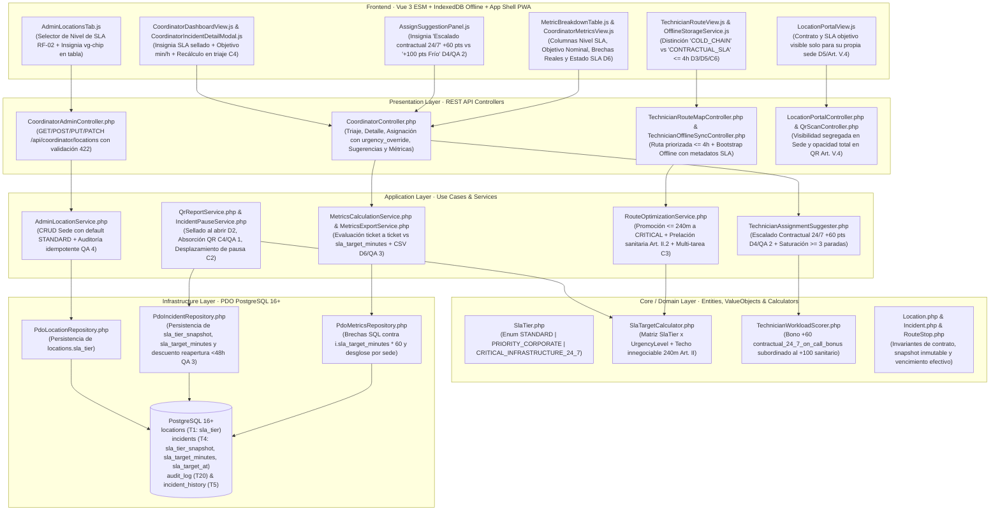
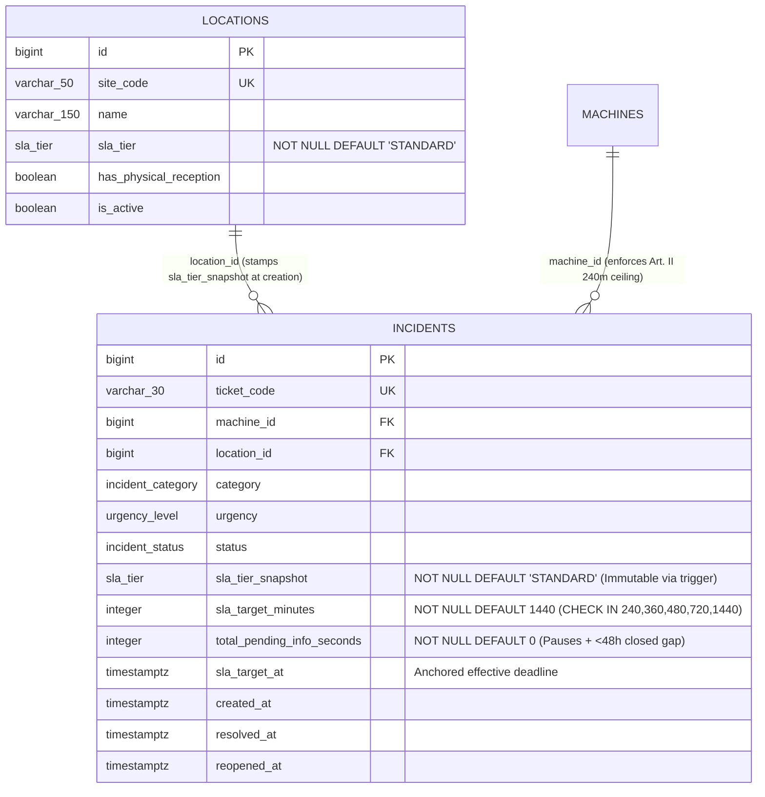
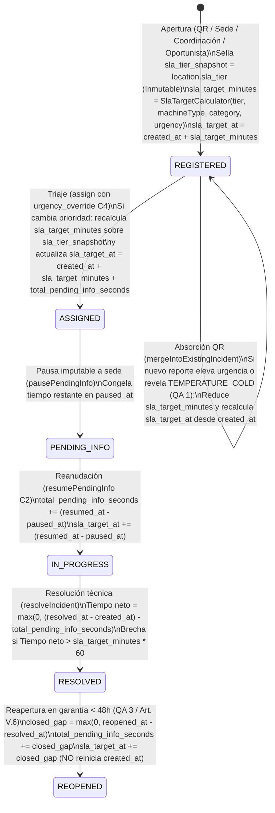

# Plan de Implementación Técnica: Perfiles de SLA Diferenciados por Tipo de Sede (Contratos de Nivel de Servicio Escalonados)
**Módulo:** `30-tiered-sla-contracts` (Feature 17 de `docs/features_pendientes.md`)\
**Versión:** 2.0 (Alineado con `spec.md` v2.0 y `tiered_sla_contracts_contracts.md` v1.0 · Aprobados por el Product Owner el 2026-11-09)\
**Estado:** Plan Técnico Aprobado por el Product Owner el 2026-11-09 · Puerta SDD cerrada · Definitivo para Ejecución SDD\
**Marco Normativo:** [`constitution.md`](file:///c:/Users/Friki/.gemini/antigravity/scratch/gestor-incidencias-vending/constitution.md) · [`AGENTS.md`](file:///c:/Users/Friki/.gemini/antigravity/scratch/gestor-incidencias-vending/AGENTS.md) · [`docs/design.md`](file:///c:/Users/Friki/.gemini/antigravity/scratch/gestor-incidencias-vending/docs/design.md)\
**Especificación Funcional:** [`specs/30-tiered-sla-contracts/spec.md`](file:///c:/Users/Friki/.gemini/antigravity/scratch/gestor-incidencias-vending/specs/30-tiered-sla-contracts/spec.md) (v2.0) · [`specs/functional/tiered_sla_contracts_spec.md`](file:///c:/Users/Friki/.gemini/antigravity/scratch/gestor-incidencias-vending/specs/functional/tiered_sla_contracts_spec.md)\
**Contratos Técnicos:** [`specs/technical/tiered_sla_contracts_contracts.md`](file:///c:/Users/Friki/.gemini/antigravity/scratch/gestor-incidencias-vending/specs/technical/tiered_sla_contracts_contracts.md) · [`specs/technical/database_schema.md`](file:///c:/Users/Friki/.gemini/antigravity/scratch/gestor-incidencias-vending/specs/technical/database_schema.md) · [`specs/technical/schema_correspondence_contract.md`](file:///c:/Users/Friki/.gemini/antigravity/scratch/gestor-incidencias-vending/specs/technical/schema_correspondence_contract.md)

---

## 1. Arquitectura de Módulos y Estructura de Ficheros

La solución se diseña bajo **Clean Architecture** en PHP 8.2+ POO puro (`declare(strict_types=1);`) en el backend, persistencia única sobre **PostgreSQL 16+ (`pdo_pgsql`)** y **Vue 3 (Composition API via ES Modules nativos)** en el frontend sin bundlers ni dependencias externas adicionales, respetando los artículos I, II, III, IV, V y VI de `constitution.md`.



### 1.1. Base de Datos y Esquema Relacional (`database/` y `specs/technical/`)
| Fichero | Acción | Responsabilidad |
| :--- | :--- | :--- |
| `database/supabase_migrations/026_tiered_sla_contracts.sql` | **Crear** | Migración DDL incremental idempotente: creación del tipo nativo `sla_tier AS ENUM ('STANDARD', 'PRIORITY_CORPORATE', 'CRITICAL_INFRASTRUCTURE_24_7')`, columna `locations.sla_tier` (`NOT NULL DEFAULT 'STANDARD'`) con índice `idx_locations_sla_tier`, columnas `incidents.sla_tier_snapshot` (`sla_tier NOT NULL DEFAULT 'STANDARD'`) e `incidents.sla_target_minutes` (`INTEGER NOT NULL DEFAULT 1440` con `chk_incidents_sla_target_minutes CHECK (sla_target_minutes IN (240, 360, 480, 720, 1440))`), backfill determinista diferenciado entre expedientes cerrados/resueltos/cancelados (`240` min frío / `1440` min resto para preservar las métricas históricas, `C5`) y expedientes abiertos (`RF-01`), y disparador `trg_incidents_protect_sla_tier_snapshot` que impide modificar `sla_tier_snapshot` tras el alta (`Art. III.3`, `D2`). |
| `database/supabase_init.sql` | **Modificar** | Incorporar el tipo `sla_tier`, las columnas en `locations` (Tabla 1) e `incidents` (Tabla 4), la restricción `chk_incidents_sla_target_minutes`, los índices y la función/disparador `trg_fn_incidents_protect_sla_tier_snapshot()` para mantener paridad 1:1 con las migraciones. |
| `database/supabase_seeds.sql` | **Modificar** | Enriquecer las sedes de demostración con los tres perfiles (`CRITICAL_INFRASTRUCTURE_24_7` para sede hospitalaria/24x7, `PRIORITY_CORPORATE` para sede corporativa y `STANDARD` para sedes generales) y sellar `sla_tier_snapshot` y `sla_target_minutes` coherentes en las incidencias semilla. |
| `src/Infrastructure/Database/SeedRunner.php` | **Modificar** | Sincronizar el sembrado programático de entorno de pruebas con `sla_tier`, `sla_tier_snapshot` y `sla_target_minutes`. |
| `specs/technical/database_schema.md` | **Modificar** | Documentar el enumerado `sla_tier`, las nuevas columnas de `locations` e `incidents` y el disparador `trg_incidents_protect_sla_tier_snapshot`. |
| `specs/technical/schema_correspondence_contract.md` | **Modificar** | Actualizar el inventario de tipos `ENUM` nativos (pasando de 24 a 25 con `sla_tier`) y las columnas auditadas por `SchemaConvergenceParityTest`. |

### 1.2. Capa de Dominio (`src/Core/`)
| Fichero | Acción | Responsabilidad |
| :--- | :--- | :--- |
| `src/Core/Domain/ValueObject/SlaTier.php` | **Crear** | Enumerado respaldado en string (`STANDARD`, `PRIORITY_CORPORATE`, `CRITICAL_INFRASTRUCTURE_24_7`) con etiquetas en español (`Estándar`, `Prioritario Corporativo`, `Infraestructura Crítica 24x7`), horas nominales de referencia (`24.0`, `12.0`, `8.0`) y resolución de minutos contractuales por `UrgencyLevel` (`RF-01`). |
| `src/Core/Service/SlaTargetCalculator.php` | **Crear** | Servicio puro y determinista de dominio (`RF-01`, `D1`, `QA 1`, `Art. II`): evalúa `isColdChainRisk(MachineType, IncidentCategory, UrgencyLevel)` (techo innegociable de `240` min para `PERISHABLE_FOOD` y para `COMBO` con `TEMPERATURE_COLD` o `CRITICAL`), calcula `calculateTargetMinutes(SlaTier, MachineType, IncidentCategory, UrgencyLevel)` y proyecta `computeEffectiveTargetAt(DateTimeImmutable $createdAt, int $slaTargetMinutes, int $totalDiscountableSeconds)`. |
| `src/Core/Domain/Model/Location.php` | **Modificar** | Incorporar la propiedad `$slaTier` (`SlaTier`, por defecto `SlaTier::STANDARD`), getters (`getSlaTier()`, `getSlaTierLabel()`), hidratación en `fromDatabaseRow()` y serialización en `toArray()`. |
| `src/Core/Domain/Model/Incident.php` | **Modificar** | Incorporar `$slaTierSnapshot` (`SlaTier`) y `$slaTargetMinutes` (`int`), métodos de lectura y recálculo de objetivo (`withRecalculatedSlaTarget(int $slaTargetMinutes, DateTimeImmutable $slaTargetAt)`), hidratación en `fromDatabaseRow()` y exposición en `toArray()`. |
| `src/Core/Domain/Model/RouteStop.php` | **Modificar** | Incorporar metadatos de SLA de la parada (`slaTier`, `slaTierLabel`, `criticalReason`: `'COLD_CHAIN' | 'CONTRACTUAL_SLA' | null`, `isColdChainCritical`, `isContractualCritical`) en la entidad y en `toArray()`. |
| `src/Core/Service/TechnicianWorkloadScorer.php` | **Modificar** | Añadir soporte para el bono `+60` (`BONUS_ON_CALL_CONTRACTUAL_24_7 = 60`, clave `contractual_24_7_on_call_bonus` en `score_breakdown`) cuando se activa el Escalado Contractual 24/7 en sedes `CRITICAL_INFRASTRUCTURE_24_7`, manteniéndolo estrictamente subordinado al bono sanitario de `+100` puntos (`Art. II`, `D4`, `QA 2`). |

### 1.3. Capa de Aplicación (`src/Application/`)
| Fichero | Acción | Responsabilidad |
| :--- | :--- | :--- |
| `src/Application/Service/AdminLocationService.php` | **Modificar** | Validar `sla_tier` en alta y edición de sedes (por defecto `'STANDARD'` en alta; `422 INVALID_SLA_TIER` si el valor no es válido) y garantizar auditoría idempotente en `LOCATION_UPDATED` registrando cambio contractual solo cuando `oldSlaTier !== newSlaTier` (`RF-02`, `C1`, `QA 4`). |
| `src/Application/Service/QrReportService.php` | **Modificar** | Al crear un aviso nuevo, sellar `sla_tier_snapshot`, `sla_target_minutes` y `sla_target_at` según la sede y máquina. En `mergeIntoExistingIncident()`, si el segundo reporte QR eleva la criticidad o revela `TEMPERATURE_COLD` sobre la misma máquina (p. ej. en una `COMBO`), elevar la urgencia del aviso activo, reducir `sla_target_minutes` al nuevo valor más estricto y recalcular `sla_target_at` desde `created_at` (`C4`, `QA 1`). |
| `src/Application/Service/OpportunisticInterventionService.php` | **Modificar** | Sellar `sla_tier_snapshot`, `sla_target_minutes` y `sla_target_at` al registrar averías oportunistas in situ utilizando `SlaTargetCalculator`. |
| `src/Application/Service/IncidentPauseService.php` | **Modificar** | Al reanudar una pausa `PENDING_INFO`, actualizar `sla_target_at` sumando los segundos acumulados de descuento (`total_pending_info_seconds`) al objetivo contractual sellado (`sla_target_minutes * 60`) medido desde `created_at` (`C2`). |
| `src/Application/Service/RouteOptimizationService.php` | **Modificar** | Promover a `StopPriority::CRITICAL` cualquier parada pendiente con tarea correctiva cuyo tiempo restante hacia su `sla_due_at` efectivo sea `<= 240 minutos` (`<= 14400 segundos`, inclusivo), ordenando dentro de `StopPriority::CRITICAL` primero las paradas con riesgo alimentario (`is_cold_chain_critical = true`) y después las urgencias puramente contractuales (`is_contractual_critical = true`), desempatando por `sla_due_at ASC`, `created_at ASC` y `location_id ASC`, y gobernando las paradas multi-tarea por la tarea correctiva más restrictiva (`RF-04`, `D3`, `C2`, `C3`, `QA 1`, `Art. II.2`). |
| `src/Application/Service/TechnicianAssignmentSuggester.php` | **Modificar** | Evaluar las condiciones del Escalado Contractual 24/7 en sedes `CRITICAL_INFRASTRUCTURE_24_7` (sin cobertura `PRIMARY`/`BACKUP` en turno, o con `sla_target_minutes <= 240` sin efectivo `PRIMARY`/`BACKUP` en turno con `0` paradas vivas), habilitar al técnico `is_on_call` activo con bono `+60` y motivo `"Escalado contractual 24/7"`, aplicar el respaldo por menor carga viva y distancia Haversine si no hay guardia disponible, y priorizar por menor carga viva cuando todos los efectivos en turno acumulen `>= 3` paradas vivas en objetivos `<= 480` min (`RF-05`, `D4`, `QA 2`). |
| `src/Application/Service/SuggestedTechniciansService.php` | **Modificar** | Exponer `sla_tier_snapshot`, `sla_tier_label`, `sla_target_minutes`, `contractual_24_7_escalation_active` y el nuevo campo `contractual_24_7_on_call_bonus` en la respuesta de sugerencias para Coordinación. |
| `src/Application/Service/CoordinatorIncidentDetailService.php` | **Modificar** | Enriquecer el expediente detallado de Coordinación con `sla_tier_snapshot`, `sla_tier_label`, `sla_target_minutes`, `sla_target_hours`, `sla_target_at` e `is_cold_chain_risk`, calculando el cumplimiento de SLA del expediente frente a su objetivo sellado. |
| `src/Application/Service/MetricsCalculationService.php` | **Modificar** | Actualizar `getBreakdown()` (`by_location`) para devolver `sla_tier`, `sla_tier_label`, `sla_target_hours` (`24.0` / `12.0` / `8.0` nominales de referencia), `sla_breaches` reales del período y `sla_status` (`'COMPLIANT' | 'BREACHED' | 'NO_DATA'`) (`RF-06`, `D6`, `QA 3`). |
| `src/Application/Service/MetricsExportService.php` | **Modificar** | Incorporar las columnas `Nivel SLA`, `Objetivo SLA (Horas)`, `Brechas SLA` y `Estado SLA` en la exportación CSV de métricas por sede (`RF-06`, `EARS 06.4`). |

### 1.4. Capa de Infraestructura (`src/Infrastructure/`)
| Fichero | Acción | Responsabilidad |
| :--- | :--- | :--- |
| `src/Infrastructure/Repository/PdoLocationRepository.php` | **Modificar** | Incluir `sla_tier` en todas las lecturas (`findAll`, `findById`, `findBySiteCode`), inserciones (`create`) y actualizaciones (`update`) de `locations`. |
| `src/Infrastructure/Repository/PdoIncidentRepository.php` | **Modificar** | Persistir y leer `sla_tier_snapshot` y `sla_target_minutes` (además de `l.sla_tier AS location_sla_tier` en joins de tablero/ruta); recalcular `sla_target_minutes` y `sla_target_at` en `assign()` cuando `urgencyOverride` cambia la prioridad (`C4`); y en `reopenWithLifecycleNotifications()` descontar el intervalo cerrado $\Delta t_{\text{closed}} = \max(0, \text{reopened\_at} - \text{resolved\_at})$ sumándolo a `total_pending_info_seconds` y desplazando `sla_target_at` sin reiniciar `created_at` (`QA 3`, `Art. V.6`). |
| `src/Infrastructure/Repository/PdoMetricsRepository.php` | **Modificar** | Evaluar en `countCriticalSlaBreaches()` y en `getBreakdownByLocation()` cada expediente resuelto contra su propio umbral sellado (`240 * 60` s si aplica techo sanitario Art. II; `i.sla_target_minutes * 60` s en caso contrario), descontando `i.total_pending_info_seconds`, y proyectar `l.sla_tier` y el conteo `sla_breaches` por sede (`RF-06`, `D6`, `QA 3`). |
| `src/Infrastructure/Repository/PdoOfflineSyncMutationRepository.php` | **Modificar** | Incluir `sla_tier_snapshot`, `sla_tier_label`, `sla_target_minutes`, `sla_target_at`, `critical_reason`, `is_cold_chain_critical` e `is_contractual_critical` en el snapshot de `GET /api/technician/offline/bootstrap` (`RF-07`, `C6`). |

### 1.5. Capa de Presentación REST (`src/Presentation/`)
| Fichero | Acción | Responsabilidad |
| :--- | :--- | :--- |
| `src/Presentation/Controller/CoordinatorAdminController.php` | **Modificar** | Aceptar y validar `sla_tier` en `POST /api/coordinator/locations` y `PUT\|PATCH /api/coordinator/locations/{id}`, devolviendo `422 INVALID_SLA_TIER` ante valores fuera del enumerado y exponiendo `sla_tier` y `sla_tier_label` en los listados. |
| `src/Presentation/Controller/CoordinatorController.php` | **Modificar** | Sellar `sla_tier_snapshot` y `sla_target_minutes` al crear incidencias desde Coordinación y exponer los campos de SLA en bandeja de triaje y detalle. |
| `src/Presentation/Controller/TechnicianRouteMapController.php` | **Modificar** | Unificar `incidentSlaDeadline()` para usar el `sla_target_at` / `sla_target_minutes` sellado en el expediente y exponer `sla_tier`, `sla_tier_label`, `sla_target_minutes`, `sla_due_at`, `critical_reason`, `is_cold_chain_critical` e `is_contractual_critical` en cada parada y tarea de la ruta. |
| `src/Presentation/Controller/LocationPortalController.php` | **Modificar** | Sellar `sla_tier_snapshot` y `sla_target_minutes` al reportar desde el Portal de Sede y exponer el `sla_tier`, `sla_tier_label`, `sla_target_minutes` y `sla_target_at` únicamente en las máquinas e incidencias de la propia sede autenticada (`RF-07`, `EARS 07.3`, `Art. V.4`). |
| `src/Presentation/Controller/QrScanController.php` | **Verificar / Blindar** | Garantizar que `GET /api/qr/scan/{code}` y `POST /api/qr/report` no filtren jamás ningún campo de `sla_tier` ni `sla_target_*` al canal público anónimo (`Art. V.4`, `D5`, `QA 4`). |

### 1.6. Frontend Web y PWA (`public/`)
| Fichero | Acción | Responsabilidad |
| :--- | :--- | :--- |
| `public/assets/js/components/AdminLocationsTab.js` | **Modificar** | Añadir selector de **Nivel de SLA** (`Estándar`, `Prioritario Corporativo`, `Infraestructura Crítica 24x7`, con `STANDARD` por defecto) en el formulario de alta/edición de sedes y mostrar chip informativo (`vg-chip`) en la tabla de sedes (`RF-02`). |
| `public/assets/js/views/CoordinatorDashboardView.js` y `public/assets/js/components/CoordinatorIncidentDetailModal.js` | **Modificar** | Mostrar en la bandeja de triaje y en el modal de detalle la insignia del contrato sellado (`sla_tier_label`) y el objetivo de resolución (`sla_target_minutes` / horas), manteniendo intacta la exclusión en los modales de impresión A4 (`ServiceSheetModal.js` y `SanitarySpoilageOfficialActModal.js`, `QA 4`). |
| `public/assets/js/components/AssignSuggestionPanel.js` | **Modificar** | Mostrar el aviso y la etiqueta explícita **«Escalado contractual 24/7»** (`+60 pts`) cuando `contractual_24_7_escalation_active === true`, diferenciándola visualmente del escalado sanitario por cadena de frío (`+100 pts`) (`RF-05`, `D4`). |
| `public/assets/js/components/MetricBreakdownTable.js` y `public/assets/js/views/CoordinatorMetricsView.js` | **Modificar** | Renderizar en la tabla de desglose por sede las columnas de **Nivel SLA**, **Objetivo Nominal (`24h` / `12h` / `8h`)**, **Brechas Reales (`sla_breaches`)** y **Estado SLA (`Cumple` / `Incumple` / `Sin datos`)** (`RF-06`, `D6`). |
| `public/assets/js/views/TechnicianRouteView.js` y `public/assets/js/components/TechnicianRouteMapModal.js` | **Modificar** | Mostrar en la tarjeta de parada y en el detalle del aviso el nivel de SLA de la sede, la cuenta atrás hacia `sla_due_at` y la distinción clara entre parada urgente por **Riesgo Sanitario de Cadena de Frío** (`COLD_CHAIN`) y parada urgente por **Vencimiento Contractual $\le 4\text{ h}$** (`CONTRACTUAL_SLA`), tanto online como desde `OfflineStorageService.js` (`RF-04`, `RF-07`, `D3`, `C6`). |
| `public/assets/js/views/LocationPortalView.js` | **Modificar** | Mostrar en la cabecera de la sede del Responsable de Ubicación su nivel de contrato (`sla_tier_label`) y en sus avisos activos el plazo objetivo comprometido (`RF-07`, `D5`, `Art. V.4`). |

---

## 2. Modelo de Datos Relacional y Contratos de API REST

### 2.1. Modelo Relacional PostgreSQL (`locations` T1 + `incidents` T4)



### 2.2. Resumen de Contratos de Endpoints REST y Códigos HTTP

| Método y Ruta | Rol Autorizado | Entrada / Efecto | Campos de SLA Expuestos | Códigos de Error y Blindajes |
| :--- | :--- | :--- | :--- | :--- |
| `GET /api/coordinator/locations`<br>`POST /api/coordinator/locations`<br>`PUT\|PATCH /api/coordinator/locations/{id}` | `COORDINATOR` | `sla_tier` opcional en alta (`DEFAULT 'STANDARD'`); validado contra `SlaTier` en alta y edición. Auditoría solo si `old.sla_tier !== new.sla_tier` (`QA 4`). | `sla_tier`, `sla_tier_label` | `401`, `403`, `422 INVALID_SLA_TIER` |
| `GET /api/coordinator/incidents`<br>`GET /api/coordinator/incidents/{id}`<br>`PATCH /api/coordinator/incidents/{id}/assign` | `COORDINATOR` | En `assign`, si `urgency_override` cambia la prioridad, recalcula `sla_target_minutes` y `sla_target_at` desde `created_at` sobre el `sla_tier_snapshot` original (`C4`). | `sla_tier_snapshot`, `sla_tier_label`, `sla_target_minutes`, `sla_target_hours`, `sla_target_at`, `is_cold_chain_risk` | `401`, `403`, `404`, `409`, `422` |
| `GET /api/coordinator/incidents/{id}/suggested-technicians` | `COORDINATOR` | Evalúa Escalado Contractual 24/7 (`+60` pts) en `CRITICAL_INFRASTRUCTURE_24_7` y umbral de saturación `>= 3` paradas en `sla_target_minutes <= 480` (`D4`, `QA 2`). | `sla_tier_snapshot`, `sla_target_minutes`, `contractual_24_7_escalation_active`, `score_breakdown.contractual_24_7_on_call_bonus` | `401`, `403`, `404` |
| `GET /api/coordinator/metrics/summary`<br>`GET /api/coordinator/metrics/breakdown`<br>`GET /api/coordinator/metrics/export` | `COORDINATOR` | Evalúa brechas ticket a ticket contra `i.sla_target_minutes * 60` (con techo `240 * 60` Art. II) y exporta columnas de SLA en CSV (`D6`, `QA 3`). | `sla_tier`, `sla_tier_label`, `sla_target_hours`, `sla_breaches`, `sla_status` | `401`, `403` |
| `GET /api/technician/route/map`<br>`GET /api/technician/incidents`<br>`GET /api/technician/offline/bootstrap` | `TECHNICIAN`, `COORDINATOR` | Ordena paradas promoviendo `remaining <= 240 min` a `CRITICAL` con prelación sanitaria (`Art. II.2`, `D3`, `C6`). | `sla_tier`, `sla_tier_label`, `sla_target_minutes`, `sla_due_at`, `critical_reason`, `is_cold_chain_critical`, `is_contractual_critical` | `401`, `403` |
| `GET /api/locations/{site_code}/machines`<br>`POST /api/locations/{site_code}/incidents/{id}/reopen` | `LOCATION_RESPONSIBLE` | Expone el SLA de su propia sede. Al reabrir `< 48h`, descuenta `reopened_at - resolved_at` sin reiniciar `created_at` (`QA 3`, `Art. V.6`). | `sla_tier`, `sla_tier_label`, `sla_target_minutes`, `sla_target_at` (solo de su sede) | `401`, `403`, `409`, `422` |
| `GET /api/qr/scan/{code}`<br>`POST /api/qr/report` | Público Anónimo | Si absorbe sobre ticket activo y eleva urgencia o revela `TEMPERATURE_COLD`, recalcula internamente `sla_target_minutes` (`QA 1`). | **NINGUNO** (Opacidad total `Art. V.4`, `D5`, `QA 4`) | `404`, `422` |

---

## 3. Algoritmos Clave en Pseudocódigo y Máquinas de Estado

### 3.1. Ciclo de Vida del Reloj y del Snapshot de SLA en el Expediente (`D2`, `C1`, `C2`, `C4`, `QA 1`, `QA 3`)



### 3.2. Algoritmo de Sellado, Absorción QR, Cambio de Prioridad y Reapertura en Garantía (`SlaTargetCalculator`, `QrReportService`, `PdoIncidentRepository`)

```text
ALGORITHM resolveIncidentSlaOnCreation(location, machine, category, urgency, createdAt)
  slaTierSnapshot = location.slaTier // STANDARD | PRIORITY_CORPORATE | CRITICAL_INFRASTRUCTURE_24_7
  IF machine.machineType === 'PERISHABLE_FOOD'
     OR (machine.machineType === 'COMBO' AND (category === 'TEMPERATURE_COLD' OR urgency === 'CRITICAL')) THEN
      slaTargetMinutes = 240 // Techo innegociable Art. II (4.0 h)
  ELSE
      slaTargetMinutes = slaTierSnapshot.contractualTargetMinutes(urgency)
  END IF
  slaTargetAt = createdAt + (slaTargetMinutes * 60 seconds)
  RETURN { slaTierSnapshot, slaTargetMinutes, slaTargetAt }
END ALGORITHM

ALGORITHM recalculateSlaOnQrMergeOrTriageOverride(incident, machine, effectiveCategory, effectiveUrgency)
  // Conserva SIEMPRE incident.slaTierSnapshot (Art. III.3, D2, C1)
  candidateMinutes = SlaTargetCalculator::calculateTargetMinutes(
      incident.slaTierSnapshot,
      machine.machineType,
      effectiveCategory,
      effectiveUrgency
  )
  // En absorción QR solo se actualiza si agrava la urgencia o reduce el objetivo (QA 1);
  // en triaje explícito del Coordinador se aplica la nueva prioridad validada (C4).
  incident.slaTargetMinutes = candidateMinutes
  incident.slaTargetAt = incident.createdAt
      + (candidateMinutes * 60 seconds)
      + incident.totalPendingInfoSeconds
END ALGORITHM

ALGORITHM discountClosedIntervalOnWarrantyReopen(incident, reopenedAt)
  // QA 3 + Art. V.6: Reapertura < 48h NO reinicia el reloj a cero, pero descuenta el tramo cerrado
  closedGapSeconds = max(0, reopenedAt.timestamp - incident.resolvedAt.timestamp)
  newTotalDiscountSeconds = incident.totalPendingInfoSeconds + closedGapSeconds
  newSlaTargetAt = incident.createdAt
      + (incident.slaTargetMinutes * 60 seconds)
      + newTotalDiscountSeconds
  RETURN { newTotalDiscountSeconds, newSlaTargetAt }
END ALGORITHM
```

### 3.3. Algoritmo de Priorización de Ruta (`<= 4,0 h`) y Escalado Contractual 24/7 (`RouteOptimizationService` & `TechnicianAssignmentSuggester`)

```text
ALGORITHM classifyAndSortRouteStops(stops, referenceNow)
  FOR EACH stop IN stops DO
      // C3: La parada multi-tarea se gobierna por la tarea correctiva pendiente más restrictiva
      correctiveTasks = stop.tasks.filter(t => t.type === 'INCIDENT')
      IF correctiveTasks IS EMPTY THEN
          stop.priority = StopPriority::PREVENTIVE
          CONTINUE
      END IF

      stop.isColdChainCritical = ANY(t IN correctiveTasks WHERE t.isColdChainRisk === TRUE)
      stop.earliestSlaDueAt = MIN(t.effectiveSlaDueAt FOR t IN correctiveTasks)
      // Si el ticket está en PENDING_INFO, su reloj restante se mide congelado en paused_at (C2)
      minRemainingSeconds = MIN(
          (t.isPaused ? (t.effectiveSlaDueAt - t.pausedAt) : (t.effectiveSlaDueAt - referenceNow))
          FOR t IN correctiveTasks
      )
      stop.isContractualCritical = (minRemainingSeconds <= 14400) // <= 240 min inclusivo (QA 1)

      IF stop.isColdChainCritical OR stop.isContractualCritical THEN
          stop.priority = StopPriority::CRITICAL
          stop.criticalReason = stop.isColdChainCritical ? 'COLD_CHAIN' : 'CONTRACTUAL_SLA'
      ELSE
          stop.priority = StopPriority::NORMAL_CORRECTIVE
          stop.criticalReason = NULL
      END IF
  END FOR

  // Ordenación dentro de StopPriority::CRITICAL (Art. II.2 + QA 1):
  // 1º Paradas con riesgo alimentario (isColdChainCritical = true)
  // 2º Paradas con urgencia contractual <= 4h (isColdChainCritical = false)
  // Dentro de cada sub-bloque: earliestSlaDueAt ASC, oldestCreatedAt ASC, locationId ASC
END ALGORITHM

ALGORITHM evaluateContractual24x7Escalation(incident, machine, zoneTechnicians, allActiveTechnicians)
  IF SlaTargetCalculator::isColdChainRisk(machine.machineType, incident.category, incident.urgency) THEN
      // Nivel 1: Prevalece el Escalado Sanitario Art. II (+100 pts)
      RETURN evaluateColdChainEscalation(...)
  END IF

  IF incident.slaTierSnapshot === SlaTier::CRITICAL_INFRASTRUCTURE_24_7 THEN
      onShiftZoneTechs = zoneTechnicians.filter(t => t.isActive AND NOT t.isAbsent AND t.shiftStatus === 'ON_SHIFT')
      freeOnShiftZoneTechs = onShiftZoneTechs.filter(t => (t.activeIncidents + t.preventiveOrdersToday) === 0)

      // D4 + QA 2: Se activa si no hay ningún PRIMARY/BACKUP en turno,
      // o si sla_target_minutes <= 240 y ningún PRIMARY/BACKUP en turno tiene 0 paradas vivas
      IF onShiftZoneTechs IS EMPTY OR (incident.slaTargetMinutes <= 240 AND freeOnShiftZoneTechs IS EMPTY) THEN
          contractual24x7EscalationActive = TRUE
          // Habilita técnicos con is_on_call = true activos y no ausentes (incluso OFF_SHIFT)
          // Otorga +60 puntos en 'contractual_24_7_on_call_bonus' y razón "Escalado contractual 24/7"
          // Si no hay ningún guardia disponible (on_call_available = false), ordena activos por
          // menor carga viva (activeIncidents + preventiveOrdersToday ASC) y distancia Haversine ASC
      END IF
  END IF
END ALGORITHM
```

---

## 4. Arquitectura de Componentes Frontend y Cumplimiento de `docs/design.md`

Todos los componentes modificados se sujetan de forma estricta a las directrices de [`docs/design.md`](file:///c:/Users/Friki/.gemini/antigravity/scratch/gestor-incidencias-vending/docs/design.md) y a los tres guardas automatizados del repositorio (`CoordinatorButtonVariantsGuardTest`, `LegacyButtonPaletteRetirementTest` y `DesignTokenDebtRatchetTest`):

1. **Paleta, Superficies y Bordes (`docs/design.md` §Colors, §Elevation, §Shapes):**
   * Un único voltaje interactivo (`var(--color-primary)` `#2560ff`), fondo canvas (`var(--color-canvas)` `#f9fafb`), texto principal slate (`var(--color-ink-slate)` `#2c333f`) y bordes hairline (`var(--color-hairline)` `#c8cfda`).
   * Escala binaria de radios: `4px` (`var(--radius-xs)`) para botones, selectores (`sla_tier`), inputs y chips (`vg-chip`); `8px` (`var(--radius-sm)`) para tarjetas y paneles. Prohibido usar bordes píldora (`9999px`) o radios fuera de escala.
   * **Cero sombra en reposo** en tarjetas y paneles (`box-shadow: none` en estado base).
2. **Escalera Única de Botones y Chips (`vg-btn` / `vg-chip` — `docs/design.md`):**
   * Las insignias de nivel de contrato (`Estándar`, `Prioritario Corporativo`, `Infraestructura Crítica 24x7`), de estado de cumplimiento (`Cumple`, `Incumple`, `Sin datos`) y de motivo de urgencia en ruta (`Riesgo Cadena de Frío` vs `Urgencia Contractual <= 4h`) se representan mediante `vg-chip` (lectura estática, nunca interactiva) y tokens semánticos CSS (`var(--color-*)`), sin estilos hexadecimales inline en botones ni clases heredadas `.btn*`.
3. **Segregación Visual por Rol (`Art. V.4`, `D5`, `QA 4`):**
   * **Coordinación:** Selector en `AdminLocationsTab.js`, insignias en triaje/detalle, motivo *«Escalado contractual 24/7»* en `AssignSuggestionPanel.js` y columnas de cumplimiento en `MetricBreakdownTable.js`.
   * **Técnico de Campo (Online y Offline):** Insignia de contrato de la sede, cuenta atrás de `sla_due_at` y distinción explícita entre `COLD_CHAIN` y `CONTRACTUAL_SLA` en `TechnicianRouteView.js`, alimentada también desde `OfflineStorageService.js`.
   * **Responsable de Ubicación:** Visualización del perfil `sla_tier_label` de su propia sede y del plazo objetivo de sus avisos en `LocationPortalView.js`.
   * **Exclusión total:** Ningún componente del flujo QR (`QrReportView.js`) ni de impresión A4 (`ServiceSheetModal.js`, `SanitarySpoilageOfficialActModal.js`) renderiza campos de SLA.

---

## 5. Decisiones Técnicas Justificadas y Alternativas Descartadas

| Decisión Técnica | Justificación Arquitectónica | Alternativa Descartada y Por Qué |
| :--- | :--- | :--- |
| **1. Snapshot inmutable `sla_tier_snapshot` + `sla_target_minutes` en `incidents` protegido por trigger SQL (`D2`, `C1`, `Art. III.3`)** | Garantiza que si una sede cambia de contrato comercial a mitad de año, ningún expediente abierto previamente ni ningún informe histórico de MTTR o brechas cambie su evaluación de cumplimiento pasado. | *Calcular el SLA haciendo `JOIN locations` en tiempo de consulta de métricas:* Falsearía retroactivamente todas las métricas históricas cada vez que una sede actualizara su `sla_tier`. |
| **2. Acumulación del intervalo cerrado ($\Delta t_{\text{closed}}$) en `total_pending_info_seconds` y desplazamiento de `sla_target_at` al reabrir en garantía `< 48 h` (`QA 3`, `Art. V.6`)** | Mantiene un único acumulador de segundos descontables tanto para el vencimiento vivo en ruta (`sla_target_at`) como para las consultas SQL agregadas de MTTR y brechas en `PdoMetricsRepository`, sin reiniciar jamás `created_at` a cero. | *Reiniciar `created_at` o `cycle_started_at` como origen del SLA:* Regalaría un segundo plazo completo de SLA a una reparación fallida en garantía, violando el Art. V.6 y `QA 3`. |
| **3. Sub-ordenación `cold_chain_rank` dentro de `StopPriority::CRITICAL` en `RouteOptimizationService` (`D3`, `QA 1`, `Art. II.2`)** | Permite que los avisos contractuales con $\le 4,0\text{ h}$ restantes suban al bloque urgente de la ruta, pero garantiza que jamás adelanten a una emergencia biológica de cadena de frío. | *Ordenar `StopPriority::CRITICAL` solo por `sla_due_at ASC`:* Un aviso de café o snacks de 4 h abierto 1 minuto antes que una avería de comida perecedera se pondría por delante del riesgo sanitario, violando el Art. II.2. |
| **4. Bono de `+60 puntos` (`contractual_24_7_on_call_bonus`) subordinado al `+100` sanitario en `TechnicianWorkloadScorer` (`D4`, `QA 2`)** | Activa la cobertura de guardia 24/7 para sedes `CRITICAL_INFRASTRUCTURE_24_7` sin efectivos disponibles en turno (o sin efectivo libre ante un objetivo de 4 h), pero respeta la jerarquía constitucional frente al riesgo alimentario y aprovecha al suplente (`BACKUP`) en turno si tiene `0` paradas. | *Reutilizar el mismo bono de `+100` puntos de cadena de frío:* Equipararía una urgencia comercial con una emergencia de seguridad alimentaria y ocultaría en auditoría si el escalado fue sanitario o contractual. |

---

## 6. Estrategia de Pruebas (Fases 3 y 5 SDD)

1. **Pruebas de Esquema, Migración Histórica e Inmutabilidad PostgreSQL (`tests/integration/PostgresTieredSlaSchemaTest.php`):**
   * Verificación del tipo nativo `sla_tier`, columna `locations.sla_tier` (`DEFAULT 'STANDARD'`), columnas `incidents.sla_tier_snapshot` e `incidents.sla_target_minutes` y restricción `chk_incidents_sla_target_minutes`.
   * Bloqueo de `UPDATE incidents SET sla_tier_snapshot = ...` mediante el disparador `trg_incidents_protect_sla_tier_snapshot` (`Art. III.3`, `D2`).
   * Verificación del backfill histórico (`C5`): los expedientes cerrados/resueltos conservan intacto su umbral original (`240` min frío / `1440` min resto).
2. **Pruebas Unitarias de Dominio: Matriz de SLA, Ruta y Recomendador (`tests/unit/TieredSlaDomainTest.php`):**
   * `SlaTier` y `SlaTargetCalculator`: verificación exhaustiva de las 12 combinaciones `SlaTier × UrgencyLevel` sin riesgo de frío y del techo innegociable de `240` min para `PERISHABLE_FOOD` (incluso con prioridad `LOW`) y para `COMBO` con `TEMPERATURE_COLD` o `CRITICAL` (`RF-01`, `D1`, `QA 1`, `Art. II`).
   * `RouteOptimizationService`: promoción inmediata en $t = 0$ de un ticket con objetivo de `240` min (`remaining_seconds = 14400 <= 14400`), promoción de tickets de `360`/`480`/`720`/`1440` min al entrar en la ventana de `<= 240` min restantes, prelación estricta de `is_cold_chain_critical = true` delante de `is_contractual_critical = true` dentro de `StopPriority::CRITICAL` (`Art. II.2`, `QA 1`), congelación en `PENDING_INFO` (`C2`) y gobierno de la tarea correctiva más restrictiva en paradas multi-tarea (`C3`).
   * `TechnicianAssignmentSuggester` y `TechnicianWorkloadScorer`: activación del Escalado Contractual 24/7 (`+60` puntos y motivo `"Escalado contractual 24/7"`) en sedes `CRITICAL_INFRASTRUCTURE_24_7` cuando no hay titulares/suplentes en turno o cuando en un objetivo de `240` min todos tienen $\ge 1$ parada; no activación si un `BACKUP` de la zona está `ON_SHIFT` con `0` paradas (`QA 2`); respaldo por menor carga + distancia Haversine si no hay guardia disponible (`QA 2`); y priorización por menor carga cuando todos acumulan $\ge 3$ paradas en objetivos $\le 480$ min (`D4`).
3. **Pruebas de Integración de API HTTP, Ciclo de Vida, Métricas y Privacidad (`tests/integration/TieredSlaContractsApiTest.php`):**
   * CRUD de sedes (`POST`/`PUT`/`PATCH /api/coordinator/locations`): valor por defecto `'STANDARD'`, rechazo `422 INVALID_SLA_TIER`, inmutabilidad de expedientes previos al cambiar el contrato de la sede (`C1`) y ausencia de evento de cambio de SLA si se guarda el mismo `sla_tier` (`QA 4`).
   * Recálculo de `sla_target_minutes` y `sla_target_at` desde `created_at` al cambiar la prioridad en triaje (`PATCH .../assign` con `urgency_override`, `C4`) y al absorber un reporte QR que agrave la urgencia o revele fallo térmico en una máquina `COMBO` (`QA 1`).
   * Reapertura en garantía `< 48 h` (`QA 3`, `Art. V.6`): verificación de que el intervalo cerrado `reopened_at - resolved_at` se descuenta en `total_pending_info_seconds` y desplaza `sla_target_at` sin reiniciar el reloj de resolución.
   * Métricas y CSV (`GET /api/coordinator/metrics/summary`, `/breakdown`, `/export`): contabilización de brechas reales contra `i.sla_target_minutes` sellado en cada ticket, campos `sla_tier`, `sla_tier_label`, `sla_target_hours`, `sla_breaches` y `sla_status` en `by_location`, y cabeceras CSV (`RF-06`, `D6`, `QA 3`).
   * Segregación de visibilidad (`Art. V.4`, `D5`, `C6`, `QA 4`): presencia en Coordinación, Ruta Móvil, Bootstrap Offline y Portal de Sede (solo su propia sede), y ausencia total de `sla_tier*` y `sla_target*` en `GET /api/qr/scan/{code}` y `POST /api/qr/report`.
4. **Pruebas de Frontend y Guardas de Diseño (`tests/unit/TieredSlaFrontendTest.mjs`):**
   * Verificación de selector e insignias en `AdminLocationsTab.js`, `AssignSuggestionPanel.js`, `MetricBreakdownTable.js`, `TechnicianRouteView.js` y `LocationPortalView.js`, ausencia de datos de SLA en `ServiceSheetModal.js` y `SanitarySpoilageOfficialActModal.js` (`QA 4`), y cumplimiento de `CoordinatorButtonVariantsGuardTest`, `LegacyButtonPaletteRetirementTest` y `DesignTokenDebtRatchetTest`.

---

## 7. Matriz de Trazabilidad del Plan con la Especificación v2.0

| Requisito / Decisión | Componentes que lo implementan | Pruebas que lo verifican |
| :--- | :--- | :--- |
| **`RF-01` (`EARS 01.1–01.3`), `D1`, `QA 1`, `Art. II`** | `SlaTier`; `SlaTargetCalculator`; `026_tiered_sla_contracts.sql` | `TieredSlaDomainTest`; `PostgresTieredSlaSchemaTest` |
| **`RF-02` (`EARS 02.1–02.5`), `C1`, `QA 4`** | `Location`; `PdoLocationRepository`; `AdminLocationService`; `CoordinatorAdminController`; `AdminLocationsTab.js` | `TieredSlaContractsApiTest`; `TieredSlaFrontendTest.mjs` |
| **`RF-03` (`EARS 03.1–03.5`), `D2`, `C1`, `C4`, `C5`, `QA 1`, `QA 3`, `Art. III.3`, `Art. V.6`** | `Incident`; `PdoIncidentRepository`; `QrReportService`; `IncidentPauseService`; `trg_incidents_protect_sla_tier_snapshot` | `PostgresTieredSlaSchemaTest`; `TieredSlaContractsApiTest` |
| **`RF-04` (`EARS 04.1–04.4`), `D3`, `C2`, `C3`, `QA 1`, `Art. II.2`** | `RouteOptimizationService`; `RouteStop`; `TechnicianRouteMapController`; `TechnicianRouteView.js` | `TieredSlaDomainTest`; `TieredSlaContractsApiTest`; `TieredSlaFrontendTest.mjs` |
| **`RF-05` (`EARS 05.1–05.4`), `D4`, `QA 2`** | `TechnicianWorkloadScorer`; `TechnicianAssignmentSuggester`; `SuggestedTechniciansService`; `AssignSuggestionPanel.js` | `TieredSlaDomainTest`; `TieredSlaContractsApiTest`; `TieredSlaFrontendTest.mjs` |
| **`RF-06` (`EARS 06.1–06.4`), `D6`, `QA 3`** | `PdoMetricsRepository`; `MetricsCalculationService`; `MetricsExportService`; `MetricBreakdownTable.js` | `TieredSlaContractsApiTest`; `TieredSlaFrontendTest.mjs` |
| **`RF-07` (`EARS 07.1–07.5`), `D5`, `C6`, `QA 4`, `Art. V.4`** | `PdoOfflineSyncMutationRepository`; `LocationPortalController`; `QrScanController`; `LocationPortalView.js`; `OfflineStorageService.js` | `TieredSlaContractsApiTest`; `TieredSlaFrontendTest.mjs` |
| **`RNF-01` a `RNF-04`** | `SlaTargetCalculator`; `trg_incidents_protect_sla_tier_snapshot`; `styles.css` (`docs/design.md`) | `PostgresTieredSlaSchemaTest`; `DesignTokenDebtRatchetTest`; `CoordinatorButtonVariantsGuardTest.mjs`; `LegacyButtonPaletteRetirementTest` |

---

## 8. Garantía de Dogma Vanilla y Dualidad Lingüística

* **Dogma Vanilla (Art. IV):** Cero paquetes o librerías de terceros nuevos. Todo el backend se construye en PHP 8.2+ POO con `declare(strict_types=1);` y `pdo_pgsql`, resolviendo la aritmética temporal con `DateTimeImmutable` nativo sobre reloj continuo de 24 horas; todo el frontend se construye en Vue 3 Composition API (ES Modules nativos) e `IndexedDB` nativo para el soporte offline.
* **Dualidad Lingüística (`AGENTS.md` §3):** Nombres de clases, métodos, variables, enumerados, tablas, columnas y rutas en **inglés** (`SlaTier`, `SlaTargetCalculator`, `sla_tier`, `sla_tier_snapshot`, `sla_target_minutes`, `contractual_24_7_on_call_bonus`); comentarios contextuales, mensajes de error de usuario, etiquetas de UI (`Estándar`, `Prioritario Corporativo`, `Infraestructura Crítica 24x7`, `Escalado contractual 24/7`), cabeceras de exportación CSV y documentación en **español neutro profesional**.
