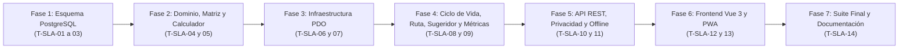

# Plan de Tareas de Implementación (`tasks.md`): Perfiles de SLA Diferenciados por Tipo de Sede (`30-tiered-sla-contracts`)

**Módulo:** `30-tiered-sla-contracts`  
**Versión:** 1.0 (Alineado con `spec.md` v2.0, `tiered_sla_contracts_contracts.md` v1.0, `plan.md` v2.0 y `docs/design.md`)  
**Estado:** Aprobado por el Product Owner el 2026-11-09 · Puerta SDD cerrada · Listo para Ejecución de las Tareas `T-SLA-01` a `T-SLA-14` (Fase 3: tests y código)  
**Metodología:** SDD (Specification-Driven Development) · Clean Architecture · TDD / Guardas de Esquema y Diseño  
**Ley Suprema:** [`constitution.md`](../../constitution.md), [`AGENTS.md`](../../AGENTS.md) y [`docs/design.md`](../../docs/design.md)

---

## Resumen de Fases y Grafo de Dependencias

| Fase | Rango de Tareas | Descripción | Tiempo Estimado |
| :--- | :--- | :--- | :--- |
| **Fase 1** | `T-SLA-01` .. `T-SLA-03` | Esquema PostgreSQL / Supabase (Migración `026_tiered_sla_contracts.sql`, tipo nativo `sla_tier`, columnas en `locations` e `incidents`, backfill histórico `C5`, disparador de inmutabilidad `trg_incidents_protect_sla_tier_snapshot`, semillas y guardas) | ~60 min |
| **Fase 2** | `T-SLA-04` .. `T-SLA-05` | ValueObject `SlaTier`, `SlaTargetCalculator` (matriz `SlaTier × UrgencyLevel` + techo `240` min `Art. II`), enriquecimiento de `Location`, `Incident`, `RouteStop` y `TechnicianWorkloadScorer` (`+60` pts) + Tests Unitarios | ~45 min |
| **Fase 3** | `T-SLA-06` .. `T-SLA-07` | Repositorios PDO (`PdoLocationRepository`, `PdoIncidentRepository` con recálculo en triaje `C4` y descuento de intervalo cerrado en reapertura `< 48h` `QA 3`, `PdoMetricsRepository` y `PdoOfflineSyncMutationRepository`) | ~55 min |
| **Fase 4** | `T-SLA-08` .. `T-SLA-09` | Servicios de Aplicación (`AdminLocationService` con auditoría idempotente `QA 4`, `QrReportService` con absorción `QA 1`, `IncidentPauseService`, `RouteOptimizationService` `<= 4,0h` con prelación sanitaria `Art. II.2`, `TechnicianAssignmentSuggester` `D4`/`QA 2`, `MetricsCalculationService` y `MetricsExportService`) + Suite Unitaria/Integración | ~60 min |
| **Fase 5** | `T-SLA-10` .. `T-SLA-11` | Controladores REST (`CoordinatorAdminController`, `CoordinatorController`, `TechnicianRouteMapController`, `LocationPortalController`, blindaje `QrScanController`) y Suite de Integración HTTP + RBAC + Opacidad `Art. V.4` | ~50 min |
| **Fase 6** | `T-SLA-12` .. `T-SLA-13` | Frontend Vue 3 (`AdminLocationsTab.js`, `AssignSuggestionPanel.js`, `MetricBreakdownTable.js`, `CoordinatorDashboardView.js`, `CoordinatorIncidentDetailModal.js`, `TechnicianRouteView.js`, `LocationPortalView.js`, `OfflineStorageService.js`, `styles.css`) + Test Frontend `.mjs` | ~55 min |
| **Fase 7** | `T-SLA-14` | Verificación Integral (`php tests/run_all.php`), sincronización `DocMetricsGuard`, matriz de trazabilidad (`traceability-matrix.md`) y cierre en `docs/features_pendientes.md` | ~25 min |

---

## Fase 1: Esquema de Base de Datos PostgreSQL / Supabase y Guardas de Esquema

- [x] **T-SLA-01 · Crear migración incremental `026_tiered_sla_contracts.sql` y converger `database/supabase_init.sql`**
  - **Tiempo estimado:** 25 min
  - **Dependencias previas:** Ninguna
  - **Archivos exactos a crear o modificar:**
    - Crear `database/supabase_migrations/026_tiered_sla_contracts.sql`
    - Modificar `database/supabase_init.sql`
  - **Requisitos cubiertos:** `RF-01.1`–`RF-01.3`, `RF-02.1`, `RF-03.1`, `RF-03.2`, `RNF-02`, `D1`, `D2`, `C1`, `C5`, `QA 1`, `constitution.md` Art. II y Art. III.3.
  - **Detalle de implementación:**
    1. Crear de forma idempotente el tipo enumerado nativo `sla_tier AS ENUM ('STANDARD', 'PRIORITY_CORPORATE', 'CRITICAL_INFRASTRUCTURE_24_7')`.
    2. Añadir en la Tabla 1 `locations` la columna `sla_tier sla_tier NOT NULL DEFAULT 'STANDARD'` y el índice parcial `idx_locations_sla_tier ON locations (sla_tier) WHERE deleted_at IS NULL`.
    3. Añadir en la Tabla 4 `incidents` las columnas `sla_tier_snapshot sla_tier NOT NULL DEFAULT 'STANDARD'` y `sla_target_minutes INTEGER NOT NULL DEFAULT 1440`, la restricción `chk_incidents_sla_target_minutes CHECK (sla_target_minutes IN (240, 360, 480, 720, 1440))` y el índice `idx_incidents_sla_target_lookup ON incidents (status, sla_target_at, sla_target_minutes) WHERE deleted_at IS NULL`.
    4. Ejecutar el backfill determinista (`C5`, `EARS 03.2`):
       - Para expedientes en `('RESOLVED', 'CLOSED', 'CANCELLED')`: sellar `sla_tier_snapshot = 'STANDARD'`, `sla_target_minutes = 240` si `m.machine_type = 'PERISHABLE_FOOD'` o (`m.machine_type = 'COMBO'` y (`i.category = 'TEMPERATURE_COLD'` o `i.urgency = 'CRITICAL'`)) y `1440` en caso contrario, asegurando que `sla_target_at` quede poblado sin alterar jamás las métricas históricas pasadas.
       - Para expedientes abiertos/activos: sellar `sla_tier_snapshot = COALESCE(l.sla_tier, 'STANDARD')`, calcular `sla_target_minutes` aplicando la matriz `RF-01` y poblar `sla_target_at = i.created_at + make_interval(mins => sla_target_minutes) + make_interval(secs => COALESCE(i.total_pending_info_seconds, 0))`.
    5. Crear la función `trg_fn_incidents_protect_sla_tier_snapshot()` y el disparador `trg_incidents_protect_sla_tier_snapshot` (`BEFORE UPDATE ON incidents`) que rechaza con `ERRCODE = '23514'` (`IMMUTABLE_SLA_TIER_SNAPSHOT`) cualquier intento de modificar `sla_tier_snapshot` tras la creación del expediente (`Art. III.3`, `D2`).
    6. Reflejar exactamente las mismas definiciones en `database/supabase_init.sql`.
  - **Hecho cuando:** `vendor/bin/phpunit tests/integration/SchemaConvergenceParityTest.php`

- [x] **T-SLA-02 · Enriquecer semillas del parque en `database/supabase_seeds.sql` y `SeedRunner.php`**
  - **Tiempo estimado:** 15 min
  - **Dependencias previas:** `T-SLA-01`
  - **Archivos exactos a crear o modificar:**
    - Modificar `database/supabase_seeds.sql`
    - Modificar `src/Infrastructure/Database/SeedRunner.php`
  - **Requisitos cubiertos:** `RF-01` a `RF-06`, `D1`, `D2`, `constitution.md` Art. I.3.
  - **Detalle de implementación:**
    1. Asignar en `database/supabase_seeds.sql` y `SeedRunner.php` perfiles diferenciados realistas a las sedes semilla: `'CRITICAL_INFRASTRUCTURE_24_7'` para la sede hospitalaria/24x7, `'PRIORITY_CORPORATE'` para la sede corporativa de oficinas y `'STANDARD'` para el resto de ubicaciones.
    2. Sellar `sla_tier_snapshot`, `sla_target_minutes` y `sla_target_at` coherentes en las incidencias semilla manteniendo idempotencia en ejecuciones repetidas.
  - **Hecho cuando:** `php database/run_seeds.php && vendor/bin/phpunit tests/integration/SchemaConvergenceParityTest.php`

- [x] **T-SLA-03 · Actualizar contratos de esquema (`25 ENUMs`), utilidades de test y crear `PostgresTieredSlaSchemaTest.php`**
  - **Tiempo estimado:** 20 min
  - **Dependencias previas:** `T-SLA-01`, `T-SLA-02`
  - **Archivos exactos a crear o modificar:**
    - Modificar `specs/technical/database_schema.md`
    - Modificar `specs/technical/schema_correspondence_contract.md`
    - Modificar `tests/Support/PostgresFixtureBuilder.php`
    - Modificar `tests/integration/SchemaConvergenceParityTest.php`
    - Modificar `tests/integration/PostgresSchemaTest.php`
    - Crear `tests/integration/PostgresTieredSlaSchemaTest.php`
  - **Requisitos cubiertos:** `RF-01.1`–`RF-01.3`, `RF-02.1`, `RF-03.1`, `RF-03.2`, `RNF-02`, `D2`, `C1`, `C5`, `constitution.md` Art. III.3.
  - **Detalle de implementación:**
    1. Documentar el tipo `sla_tier` (elevando el inventario de tipos `ENUM` nativos de 24 a **25**), las columnas `locations.sla_tier`, `incidents.sla_tier_snapshot` e `incidents.sla_target_minutes`, la restricción `chk_incidents_sla_target_minutes` y el disparador `trg_incidents_protect_sla_tier_snapshot` en `specs/technical/database_schema.md` y `specs/technical/schema_correspondence_contract.md`.
    2. Añadir soporte opcional de `sla_tier`, `sla_tier_snapshot` y `sla_target_minutes` en `PostgresFixtureBuilder.php`.
    3. Crear `tests/integration/PostgresTieredSlaSchemaTest.php` verificando en PostgreSQL real:
       - Existencia del tipo `sla_tier` con sus 3 valores, columnas con sus defaults (`'STANDARD'` y `1440`) e índices.
       - Rechazo por `chk_incidents_sla_target_minutes` de valores fuera de `(240, 360, 480, 720, 1440)`.
       - Bloqueo por `trg_incidents_protect_sla_tier_snapshot` al intentar ejecutar `UPDATE incidents SET sla_tier_snapshot = 'CRITICAL_INFRASTRUCTURE_24_7'`, permitiendo en cambio actualizar `sla_target_minutes` y `sla_target_at` dentro de los valores válidos (`C4`).
  - **Hecho cuando:** `vendor/bin/phpunit tests/integration/SchemaConvergenceParityTest.php tests/integration/PostgresSchemaTest.php tests/integration/SchemaCorrespondenceTest.php tests/integration/PostgresTieredSlaSchemaTest.php`

---

## Fase 2: Modelos de Dominio, Matriz de SLA y Calculador Determinista

- [x] **T-SLA-04 · Implementar `SlaTier`, `SlaTargetCalculator` y actualizar entidades `Location`, `Incident`, `RouteStop` y `TechnicianWorkloadScorer`**
  - **Tiempo estimado:** 25 min
  - **Dependencias previas:** `T-SLA-03`
  - **Archivos exactos a crear o modificar:**
    - Crear `src/Core/Domain/ValueObject/SlaTier.php`
    - Crear `src/Core/Service/SlaTargetCalculator.php`
    - Modificar `src/Core/Domain/Model/Location.php`
    - Modificar `src/Core/Domain/Model/Incident.php`
    - Modificar `src/Core/Domain/Model/RouteStop.php`
    - Modificar `src/Core/Service/TechnicianWorkloadScorer.php`
  - **Requisitos cubiertos:** `RF-01.1`–`RF-01.3`, `RF-03.1`, `RF-04.1`–`RF-04.3`, `RF-05.1`–`RF-05.4`, `RNF-01`, `D1`–`D4`, `QA 1`, `QA 2`, `constitution.md` Art. II y Art. IV.1.
  - **Detalle de implementación:**
    1. Implementar `SlaTier` (`STANDARD`, `PRIORITY_CORPORATE`, `CRITICAL_INFRASTRUCTURE_24_7`) con `label()`, `nominalReferenceHours()` (`24.0`, `12.0`, `8.0`), `contractualTargetMinutes(UrgencyLevel $urgency)`, `isValid()` y `fromString()`.
    2. Implementar `SlaTargetCalculator` con `isColdChainRisk(MachineType, IncidentCategory, UrgencyLevel)`, `calculateTargetMinutes(SlaTier, MachineType, IncidentCategory, UrgencyLevel)` y `computeEffectiveTargetAt(DateTimeImmutable $createdAt, int $slaTargetMinutes, int $totalDiscountableSeconds = 0)`.
    3. En `Location`: añadir `$slaTier` (por defecto `SlaTier::STANDARD`), `getSlaTier()`, `getSlaTierLabel()`, hidratación en `fromDatabaseRow()` y campos `sla_tier` y `sla_tier_label` en `toArray()`.
    4. En `Incident`: añadir `$slaTierSnapshot` (`SlaTier::STANDARD` por defecto) y `$slaTargetMinutes` (`int`, calculado o `1440` por defecto), getters `getSlaTierSnapshot()`, `getSlaTierLabel()`, `getSlaTargetMinutes()`, `getSlaTargetHours()`, mutador inmutable `withRecalculatedSlaTarget(int $slaTargetMinutes, DateTimeImmutable $slaTargetAt)`, hidratación en `fromDatabaseRow()` y exposición en `toArray()`.
    5. En `RouteStop`: añadir propiedades opcionales `slaTier`, `slaTierLabel`, `criticalReason` (`'COLD_CHAIN' | 'CONTRACTUAL_SLA' | null`), `isColdChainCritical` e `isContractualCritical` y exponerlas en `toArray()`.
    6. En `TechnicianWorkloadScorer`: añadir constante `BONUS_ON_CALL_CONTRACTUAL_24_7 = 60` y clave `contractual_24_7_on_call_bonus` en `score_breakdown`, subordinada a `on_call_cold_bonus` (`+100`) (`D4`, `QA 2`).
  - **Hecho cuando:** `php -l src/Core/Domain/ValueObject/SlaTier.php && php -l src/Core/Service/SlaTargetCalculator.php && php -l src/Core/Domain/Model/Location.php && php -l src/Core/Domain/Model/Incident.php && php -l src/Core/Domain/Model/RouteStop.php && php -l src/Core/Service/TechnicianWorkloadScorer.php`

- [x] **T-SLA-05 · Crear suite unitaria de dominio `TieredSlaDomainTest.php` (Matriz `RF-01`, Techo Art. II y Scorer `+60`)**
  - **Tiempo estimado:** 20 min
  - **Dependencias previas:** `T-SLA-04`
  - **Archivos exactos a crear o modificar:**
    - Crear `tests/unit/TieredSlaDomainTest.php`
  - **Requisitos cubiertos:** `RF-01.1`–`RF-01.3`, `RF-05.1`–`RF-05.4`, `D1`, `D4`, `QA 1`, `QA 2`, `constitution.md` Art. II.
  - **Detalle de implementación:**
    1. Probar las 12 combinaciones de `SlaTier × UrgencyLevel` en máquinas sin riesgo alimentario (`480`/`720`/`1440`/`1440` en `STANDARD`; `360`/`480`/`720`/`720` en `PRIORITY_CORPORATE`; `240`/`240`/`480`/`480` en `CRITICAL_INFRASTRUCTURE_24_7`).
    2. Probar el techo sanitario innegociable de `240` min (`Art. II`, `QA 1`): cualquier categoría o prioridad (`LOW`, `MEDIUM`, `HIGH`, `CRITICAL`) en máquina `PERISHABLE_FOOD` recibe `240` min; una máquina `COMBO` con `TEMPERATURE_COLD` o con prioridad `CRITICAL` recibe `240` min (`isColdChainRisk = true`), mientras que una `COMBO` con `PRODUCT_JAM` y prioridad `MEDIUM` en sede `STANDARD` recibe `1440` min (`isColdChainRisk = false`).
    3. Probar `computeEffectiveTargetAt()` con y sin segundos descontables acumulados, y probar `TechnicianWorkloadScorer` con `contractual_24_7_on_call_bonus = 60` frente a `on_call_cold_bonus = 100`.
  - **Hecho cuando:** `vendor/bin/phpunit tests/unit/TieredSlaDomainTest.php`

---

## Fase 3: Capa de Infraestructura y Repositorios PDO

- [x] **T-SLA-06 · Actualizar `PdoLocationRepository` y `PdoIncidentRepository` (persistencia de snapshot, recálculo en triaje `C4` y descuento de intervalo cerrado en reapertura `< 48h` `QA 3`)**
  - **Tiempo estimado:** 30 min
  - **Dependencias previas:** `T-SLA-05`
  - **Archivos exactos a crear o modificar:**
    - Modificar `src/Infrastructure/Repository/PdoLocationRepository.php`
    - Modificar `src/Infrastructure/Repository/PdoIncidentRepository.php`
  - **Requisitos cubiertos:** `RF-02.1`–`RF-02.4`, `RF-03.1`, `RF-03.3`–`RF-03.5`, `D2`, `C1`, `C2`, `C4`, `QA 1`, `QA 3`, `constitution.md` Art. III.3 y Art. V.6.
  - **Detalle de implementación:**
    1. En `PdoLocationRepository`: incluir `sla_tier` en `SELECT`, `INSERT` y `UPDATE` de `locations`.
    2. En `PdoIncidentRepository`:
       - En `create()`: persistir `sla_tier_snapshot`, `sla_target_minutes` y `sla_target_at` (calculando `sla_target_at` a partir del `created_at` efectivo si aún no venía fijado).
       - En `update()`: persistir `sla_target_minutes` y `sla_target_at` sin alterar jamás `sla_tier_snapshot`.
       - En `findRouteBoard()` y `findEnrichedDetailById()`: incluir `l.sla_tier AS board_location_sla_tier` / `l.sla_tier` en las lecturas de sede.
       - En `assign()`: cuando `urgencyOverride` cambie efectivamente la prioridad (`$urgencyChanged === true`), recalcular `sla_target_minutes` con `SlaTargetCalculator::calculateTargetMinutes($incident->getSlaTierSnapshot(), $machineType, $incident->getCategory(), $newUrgency)` y actualizar `sla_target_at = created_at + (sla_target_minutes * 60) + total_pending_info_seconds`, dejando constancia en la nota de `incident_history` (`C4`, `EARS 03.4`).
       - En `reopenWithLifecycleNotifications()`: antes de limpiar `resolved_at`, calcular el intervalo cerrado $\Delta t_{\text{closed}} = \max(0, \text{reopened\_at} - \text{resolved\_at})$, sumarlo a `total_pending_info_seconds` y desplazar `sla_target_at` en $+\Delta t_{\text{closed}}$ segundos sin reiniciar `created_at` (`QA 3`, `Art. V.6`).
  - **Hecho cuando:** `php -l src/Infrastructure/Repository/PdoLocationRepository.php && php -l src/Infrastructure/Repository/PdoIncidentRepository.php`

- [ ] **T-SLA-07 · Actualizar `PdoMetricsRepository` (evaluación ticket a ticket vs `sla_target_minutes`) y `PdoOfflineSyncMutationRepository`**
  - **Tiempo estimado:** 25 min
  - **Dependencias previas:** `T-SLA-06`
  - **Archivos exactos a crear o modificar:**
    - Modificar `src/Infrastructure/Repository/PdoMetricsRepository.php`
    - Modificar `src/Infrastructure/Repository/PdoOfflineSyncMutationRepository.php`
  - **Requisitos cubiertos:** `RF-06.1`–`RF-06.3`, `RF-07.2`, `D5`, `D6`, `C5`, `C6`, `QA 3`.
  - **Detalle de implementación:**
    1. En `PdoMetricsRepository::countCriticalSlaBreaches()`: evaluar cada ticket resuelto (`i.status IN ('RESOLVED', 'CLOSED')` con `i.resolved_at IS NOT NULL`) descontando `i.total_pending_info_seconds` y comparando contra el techo sanitario de `240 * 60` segundos si es `PERISHABLE_FOOD` o `COMBO` con fallo térmico/crítico, y contra `i.sla_target_minutes * 60` segundos en el resto de expedientes (`RF-06`, `EARS 06.1`, `QA 3`).
    2. En `PdoMetricsRepository::getBreakdownByLocation()`: seleccionar `l.sla_tier` y calcular `sla_breaches` como la suma de tickets resueltos en el período cuyo tiempo neto superó su umbral individual sellado (`240 * 60` s en riesgo de frío o `i.sla_target_minutes * 60` s en el resto).
    3. En `PdoOfflineSyncMutationRepository::fetchBootstrapSnapshotForTechnician()`: incluir en cada parada y aviso del paquete offline `sla_tier_snapshot`, `sla_tier_label`, `sla_target_minutes`, `sla_target_at`, `critical_reason`, `is_cold_chain_critical` e `is_contractual_critical` (`RF-07`, `C6`).
  - **Hecho cuando:** `php -l src/Infrastructure/Repository/PdoMetricsRepository.php && php -l src/Infrastructure/Repository/PdoOfflineSyncMutationRepository.php`

---

## Fase 4: Capa de Aplicación (Sedes, Absorción QR, Pausa, Ruta, Recomendador y Métricas)

- [ ] **T-SLA-08 · Actualizar `AdminLocationService`, `QrReportService`, `OpportunisticInterventionService`, `IncidentPauseService` y `CoordinatorIncidentDetailService`**
  - **Tiempo estimado:** 30 min
  - **Dependencias previas:** `T-SLA-07`
  - **Archivos exactos a crear o modificar:**
    - Modificar `src/Application/Service/AdminLocationService.php`
    - Modificar `src/Application/Service/QrReportService.php`
    - Modificar `src/Application/Service/OpportunisticInterventionService.php`
    - Modificar `src/Application/Service/IncidentPauseService.php`
    - Modificar `src/Application/Service/CoordinatorIncidentDetailService.php`
  - **Requisitos cubiertos:** `RF-02.1`–`RF-02.5`, `RF-03.1`, `RF-03.5`, `RF-07.1`, `D2`, `C1`, `C2`, `C4`, `QA 1`, `QA 4`, `constitution.md` Art. II y Art. III.3.
  - **Detalle de implementación:**
    1. En `AdminLocationService`: validar `sla_tier` (por defecto `SlaTier::STANDARD` al crear; lanzar excepción con código `'INVALID_SLA_TIER'` para `422` si recibe un string inválido) y asegurar que `LOCATION_UPDATED` solo marque cambio de SLA cuando `oldLocation->getSlaTier() !== newLocation->getSlaTier()` (`QA 4`).
    2. En `QrReportService`:
       - Al abrir nuevo ticket: sellar `sla_tier_snapshot = $location->getSlaTier()`, `sla_target_minutes = SlaTargetCalculator::calculateTargetMinutes(...)` y `sla_target_at`.
       - En `mergeIntoExistingIncident()`: calcular la urgencia y minutos objetivo que corresponderían a la categoría entrante (`incomingCategory`) sobre la máquina y el `sla_tier_snapshot` original del ticket activo. Si el nuevo reporte implica mayor urgencia o menor `sla_target_minutes` (p. ej. fallo `TEMPERATURE_COLD` sobre un ticket previo de `PAYMENT_FAILURE` en máquina `COMBO`), actualizar `urgency`, `sla_target_minutes` y `sla_target_at` medido desde `created_at` y registrar evento en `incident_history`, manteniendo 100 % libres de datos de SLA las respuestas JSON del canal QR (`QA 1`, `QA 4`, `Art. V.4`).
    3. En `OpportunisticInterventionService`: sellar `sla_tier_snapshot`, `sla_target_minutes` y `sla_target_at` al registrar averías oportunistas.
    4. En `IncidentPauseService`: al reanudar de `PENDING_INFO`, recalcular `sla_target_at` desplazando en segundos continuos `total_pending_info_seconds` desde `created_at + sla_target_minutes * 60` (`C2`).
    5. En `CoordinatorIncidentDetailService`: exponer `sla_tier_snapshot`, `sla_tier_label`, `sla_target_minutes`, `sla_target_hours`, `sla_target_at` e `is_cold_chain_risk` en el detalle de Coordinación.
  - **Hecho cuando:** `php -l src/Application/Service/AdminLocationService.php && php -l src/Application/Service/QrReportService.php && php -l src/Application/Service/OpportunisticInterventionService.php && php -l src/Application/Service/IncidentPauseService.php && php -l src/Application/Service/CoordinatorIncidentDetailService.php`

- [ ] **T-SLA-09 · Actualizar `RouteOptimizationService`, `TechnicianAssignmentSuggester`, `SuggestedTechniciansService`, `MetricsCalculationService` y `MetricsExportService` y ampliar `TieredSlaDomainTest.php`**
  - **Tiempo estimado:** 30 min
  - **Dependencias previas:** `T-SLA-08`
  - **Archivos exactos a crear o modificar:**
    - Modificar `src/Application/Service/RouteOptimizationService.php`
    - Modificar `src/Application/Service/TechnicianAssignmentSuggester.php`
    - Modificar `src/Application/Service/SuggestedTechniciansService.php`
    - Modificar `src/Application/Service/MetricsCalculationService.php`
    - Modificar `src/Application/Service/MetricsExportService.php`
    - Modificar `tests/unit/TieredSlaDomainTest.php`
  - **Requisitos cubiertos:** `RF-04.1`–`RF-04.4`, `RF-05.1`–`RF-05.4`, `RF-06.1`–`RF-06.4`, `D3`, `D4`, `D6`, `C2`, `C3`, `QA 1`–`QA 3`, `constitution.md` Art. II.2.
  - **Detalle de implementación:**
    1. En `RouteOptimizationService`:
       - Determinar para cada parada si posee alguna tarea correctiva con riesgo alimentario (`is_cold_chain_critical = true`) y si posee alguna tarea correctiva cuyo tiempo restante efectivo hacia `sla_due_at` sea `<= 14400` segundos (`<= 240` min, inclusivo; congelado en `paused_at` si está en `PENDING_INFO`, `C2`).
       - Promover a `StopPriority::CRITICAL` toda parada con `is_cold_chain_critical` o `is_contractual_critical`, asignando `critical_reason = 'COLD_CHAIN'` o `'CONTRACTUAL_SLA'`.
       - Ordenar dentro de `StopPriority::CRITICAL` situando primero `is_cold_chain_critical = true` delante de `is_contractual_critical = true` (`Art. II.2`, `QA 1`), y dentro de cada sub-bloque por `sla_due_at ASC`, `created_at ASC` y `location_id ASC`.
       - En paradas multi-tarea (`C3`), gobernar la parada por la tarea correctiva pendiente más restrictiva.
    2. En `TechnicianAssignmentSuggester` y `SuggestedTechniciansService`:
       - Implementar la activación del Escalado Contractual 24/7 en sedes `CRITICAL_INFRASTRUCTURE_24_7` sin riesgo de frío cuando no hay titulares/suplentes de zona en turno (`ON_SHIFT`) o cuando `sla_target_minutes <= 240` y ningún titular/suplente en turno tiene `0` paradas vivas (`D4`, `QA 2`).
       - Otorgar `+60` puntos (`contractual_24_7_on_call_bonus`) y motivo `"Escalado contractual 24/7"` al técnico `is_on_call` activo, aplicar el respaldo por menor carga viva y distancia Haversine cuando `on_call_available = false` (`QA 2`), y priorizar la menor carga viva cuando todos los efectivos de zona en turno tengan `>= 3` paradas vivas en avisos con `sla_target_minutes <= 480` (`EARS 05.4`).
    3. En `MetricsCalculationService` y `MetricsExportService`:
       - Enriquecer cada fila de `by_location` con `sla_tier`, `sla_tier_label`, `sla_target_hours` (`24.0`, `12.0` o `8.0`), `sla_breaches` y `sla_status` (`'NO_DATA'`, `'BREACHED'` o `'COMPLIANT'`) (`RF-06`, `D6`, `QA 3`).
       - Añadir las columnas `Nivel SLA`, `Objetivo SLA (Horas)`, `Brechas SLA` y `Estado SLA` en el CSV de `by_location`.
    4. Ampliar `tests/unit/TieredSlaDomainTest.php` con pruebas unitarias exhaustivas de `RouteOptimizationService` y `TechnicianAssignmentSuggester` cubriendo todos los casos límite (`D3`, `D4`, `C2`, `C3`, `QA 1`, `QA 2`).
  - **Hecho cuando:** `vendor/bin/phpunit tests/unit/TieredSlaDomainTest.php`

---

## Fase 5: Capa de Presentación REST, Segregación de Privacidad y Suite de Integración API

- [ ] **T-SLA-10 · Actualizar Controladores REST (`CoordinatorAdminController`, `CoordinatorController`, `TechnicianRouteMapController`, `LocationPortalController`) y blindar `QrScanController`**
  - **Tiempo estimado:** 25 min
  - **Dependencias previas:** `T-SLA-09`
  - **Archivos exactos a crear o modificar:**
    - Modificar `src/Presentation/Controller/CoordinatorAdminController.php`
    - Modificar `src/Presentation/Controller/CoordinatorController.php`
    - Modificar `src/Presentation/Controller/TechnicianRouteMapController.php`
    - Modificar `src/Presentation/Controller/LocationPortalController.php`
    - Modificar `src/Presentation/Controller/QrScanController.php` (si requiere blindaje explícito de claves)
  - **Requisitos cubiertos:** `RF-02.1`–`RF-02.4`, `RF-03.1`, `RF-04.1`–`RF-04.3`, `RF-07.1`–`RF-07.5`, `D5`, `C6`, `QA 4`, `constitution.md` Art. V.4.
  - **Detalle de implementación:**
    1. En `CoordinatorAdminController`: pasar `sla_tier` en alta y edición de sedes y mapear `INVALID_SLA_TIER` a respuesta HTTP `422`.
    2. En `CoordinatorController`: sellar `sla_tier_snapshot`, `sla_target_minutes` y `sla_target_at` al crear incidencias desde Coordinación y exponer los campos de SLA en los listados y detalles.
    3. En `TechnicianRouteMapController`: actualizar `incidentSlaDeadline()` para usar el `sla_target_at` / `sla_target_minutes` sellado en el expediente y exponer `sla_tier`, `sla_tier_label`, `sla_target_minutes`, `sla_due_at`, `critical_reason`, `is_cold_chain_critical` e `is_contractual_critical` en las paradas y tareas.
    4. En `LocationPortalController`: sellar `sla_tier_snapshot` y `sla_target_minutes` al crear incidencias desde el portal y exponer `sla_tier`, `sla_tier_label`, `sla_target_minutes` y `sla_target_at` únicamente para la sede autenticada del responsable (`EARS 07.3`).
    5. Verificar que `QrScanController` (`GET /api/qr/scan/{code}` y `POST /api/qr/report`) nunca exponga campos de SLA (`EARS 07.4`, `Art. V.4`).
  - **Hecho cuando:** `php -l src/Presentation/Controller/CoordinatorAdminController.php && php -l src/Presentation/Controller/CoordinatorController.php && php -l src/Presentation/Controller/TechnicianRouteMapController.php && php -l src/Presentation/Controller/LocationPortalController.php && php -l src/Presentation/Controller/QrScanController.php`

- [ ] **T-SLA-11 · Crear suite de integración de contratos HTTP, ciclo de vida, métricas y opacidad (`TieredSlaContractsApiTest.php`)**
  - **Tiempo estimado:** 25 min
  - **Dependencias previas:** `T-SLA-10`
  - **Archivos exactos a crear o modificar:**
    - Crear `tests/integration/TieredSlaContractsApiTest.php`
  - **Requisitos cubiertos:** `RF-01` a `RF-07`, `RNF-01` a `RNF-04`, `D1`–`D6`, `C1`–`C6`, `QA 1`–`QA 4`, `constitution.md` Art. II, Art. III.3, Art. V.4 y Art. V.6.
  - **Detalle de implementación:**
    1. Probar CRUD de sedes (`POST`/`PUT`/`PATCH /api/coordinator/locations`): alta sin `sla_tier` toma `'STANDARD'`; valor inválido responde `422 INVALID_SLA_TIER`; cambio de contrato en sede existente no modifica `sla_tier_snapshot` ni `sla_target_minutes` de tickets previos (`C1`); edición de sede sin cambiar `sla_tier` no registra cambio de contrato espurio (`QA 4`).
    2. Probar apertura de tickets, cambio de prioridad en triaje (`PATCH /api/coordinator/incidents/{id}/assign` con `urgency_override`, `C4`) y absorción QR (`POST /api/qr/report` sobre máquina `COMBO` con ticket activo que revela `TEMPERATURE_COLD`, `QA 1`), verificando el recálculo de `sla_target_minutes` y `sla_target_at` desde `created_at`.
    3. Probar reapertura en garantía (`< 48 h`, `QA 3`, `Art. V.6`): verificar que el intervalo cerrado `reopened_at - resolved_at` se acumula en `total_pending_info_seconds` y desplaza `sla_target_at` sin reiniciar `created_at`.
    4. Probar sugerencias de asignación (`GET /api/coordinator/incidents/{id}/suggested-technicians`), ruta del técnico (`GET /api/technician/route/map`), paquete offline (`GET /api/technician/offline/bootstrap`), métricas (`GET /api/coordinator/metrics/summary`, `/breakdown` y `/export`) y segregación de visibilidad en Portal de Sede vs opacidad total en QR público (`Art. V.4`, `D5`, `QA 4`).
  - **Hecho cuando:** `vendor/bin/phpunit tests/integration/TieredSlaContractsApiTest.php`

---

## Fase 6: Frontend Vue 3, Modo Offline PWA y Guardas de Diseño (`docs/design.md`)

- [ ] **T-SLA-12 · Actualizar componentes de Coordinación (`AdminLocationsTab.js`, `CoordinatorDashboardView.js`, `CoordinatorIncidentDetailModal.js`, `AssignSuggestionPanel.js`, `MetricBreakdownTable.js`, `CoordinatorMetricsView.js`)**
  - **Tiempo estimado:** 30 min
  - **Dependencias previas:** `T-SLA-11`
  - **Archivos exactos a crear o modificar:**
    - Modificar `public/assets/js/components/AdminLocationsTab.js`
    - Modificar `public/assets/js/views/CoordinatorDashboardView.js`
    - Modificar `public/assets/js/components/CoordinatorIncidentDetailModal.js`
    - Modificar `public/assets/js/components/AssignSuggestionPanel.js`
    - Modificar `public/assets/js/components/MetricBreakdownTable.js`
    - Modificar `public/assets/js/views/CoordinatorMetricsView.js`
  - **Requisitos cubiertos:** `RF-02.1`–`RF-02.5`, `RF-05.1`, `RF-06.3`, `RF-07.1`, `RNF-04`, `D4`–`D6`, `QA 4`, `docs/design.md`.
  - **Detalle de implementación:**
    1. En `AdminLocationsTab.js`: añadir selector de **Nivel de SLA** (`STANDARD` / `PRIORITY_CORPORATE` / `CRITICAL_INFRASTRUCTURE_24_7`) en el modal de alta/edición de sede y mostrar `vg-chip` con `sla_tier_label` en la tabla de sedes.
    2. En `CoordinatorDashboardView.js` y `CoordinatorIncidentDetailModal.js`: mostrar insignia `vg-chip` del contrato sellado (`sla_tier_label`) y objetivo (`sla_target_minutes` / horas), sin exponer jamás datos de SLA en `ServiceSheetModal.js` ni en `SanitarySpoilageOfficialActModal.js` (`QA 4`).
    3. En `AssignSuggestionPanel.js`: mostrar aviso e insignia de **«Escalado contractual 24/7»** (`+60 pts`) cuando `contractual_24_7_escalation_active === true`, diferenciada del escalado sanitario por cadena de frío (`+100 pts`).
    4. En `MetricBreakdownTable.js` y `CoordinatorMetricsView.js`: mostrar en el desglose por sede el **Nivel SLA**, el **Objetivo Nominal (`24h` / `12h` / `8h`)**, las **Brechas SLA (`sla_breaches`)** y el **Estado SLA (`Cumple` / `Incumple` / `Sin datos`)**.
  - **Hecho cuando:** `node --check public/assets/js/components/AdminLocationsTab.js && node --check public/assets/js/views/CoordinatorDashboardView.js && node --check public/assets/js/components/CoordinatorIncidentDetailModal.js && node --check public/assets/js/components/AssignSuggestionPanel.js && node --check public/assets/js/components/MetricBreakdownTable.js && node --check public/assets/js/views/CoordinatorMetricsView.js`

- [ ] **T-SLA-13 · Actualizar Ruta Móvil del Técnico (`TechnicianRouteView.js`, `TechnicianRouteMapModal.js`), `OfflineStorageService.js`, `LocationPortalView.js`, `styles.css` y crear `TieredSlaFrontendTest.mjs`**
  - **Tiempo estimado:** 25 min
  - **Dependencias previas:** `T-SLA-12`
  - **Archivos exactos a crear o modificar:**
    - Modificar `public/assets/js/views/TechnicianRouteView.js`
    - Modificar `public/assets/js/components/TechnicianRouteMapModal.js`
    - Modificar `public/assets/js/services/OfflineStorageService.js`
    - Modificar `public/assets/js/views/LocationPortalView.js`
    - Modificar `public/assets/css/styles.css`
    - Modificar `public/sw.js` (bump `CACHE_NAME`)
    - Crear `tests/unit/TieredSlaFrontendTest.mjs`
  - **Requisitos cubiertos:** `RF-04.1`–`RF-04.4`, `RF-07.2`–`RF-07.5`, `RNF-04`, `D3`, `D5`, `C6`, `QA 4`, `docs/design.md`.
  - **Detalle de implementación:**
    1. En `TechnicianRouteView.js`, `TechnicianRouteMapModal.js` y `OfflineStorageService.js`: mostrar en cada parada y tarea el contrato de la sede (`sla_tier_label`), el vencimiento `sla_due_at` y la distinción explícita entre urgencia por **Riesgo Sanitario de Cadena de Frío** (`critical_reason === 'COLD_CHAIN'`) y urgencia por **Vencimiento Contractual $\le 4\text{ h}$** (`critical_reason === 'CONTRACTUAL_SLA'`), tanto online como en modo offline (`C6`).
    2. En `LocationPortalView.js`: mostrar en la cabecera de la sede del Responsable de Ubicación su nivel contractual (`sla_tier_label`) y en cada aviso de su sede el plazo objetivo comprometido (`RF-07`, `EARS 07.3`).
    3. Añadir estilos en `public/assets/css/styles.css` usando exclusivamente variables `var(--color-*)`, radios `4px`/`8px` y cero sombras en reposo (`docs/design.md`), e incrementar `CACHE_NAME` en `public/sw.js`.
    4. Crear `tests/unit/TieredSlaFrontendTest.mjs` verificando las superficies de Coordinación, Ruta Móvil, Offline y Portal de Sede, la opacidad en QR (`QrReportView.js`) y en los modales de impresión A4 (`ServiceSheetModal.js` y `SanitarySpoilageOfficialActModal.js`), y la superación de `CoordinatorButtonVariantsGuardTest`, `LegacyButtonPaletteRetirementTest` y `DesignTokenDebtRatchetTest`.
  - **Hecho cuando:** `node tests/unit/TieredSlaFrontendTest.mjs && node tests/unit/CoordinatorButtonVariantsGuardTest.mjs && node tests/unit/LegacyButtonPaletteRetirementTest.mjs && node tests/unit/DesignTokenDebtRatchetTest.mjs && node tests/unit/OfflinePwaAssetsAndUiGuardTest.mjs`

---

## Fase 7: Verificación Integral, Matriz de Trazabilidad y Cierre Documental

- [ ] **T-SLA-14 · Ejecutar batería global (`php tests/run_all.php`), sincronizar `DocMetricsGuard`, generar `traceability-matrix.md` y actualizar `docs/features_pendientes.md`**
  - **Tiempo estimado:** 25 min
  - **Dependencias previas:** `T-SLA-01` a `T-SLA-13`
  - **Archivos exactos a crear o modificar:**
    - Crear `specs/30-tiered-sla-contracts/traceability-matrix.md`
    - Modificar `docs/features_pendientes.md`
    - Modificar `README.md` (si `DocMetricsGuard` requiere actualizar los contadores de suites y aserciones vigentes)
    - Modificar `specs/30-tiered-sla-contracts/tasks.md` (marcar tareas `[x]`)
  - **Requisitos cubiertos:** `RF-01` a `RF-07`, `RNF-01` a `RNF-04`, `D1`–`D6`, `C1`–`C6`, `QA 1`–`QA 4`, `constitution.md` Art. I–VII.
  - **Detalle de implementación:**
    1. Ejecutar la batería completa (`php tests/run_all.php`), sincronizar las cifras vigentes exigidas por `DocMetricsGuard` y verificar **100 % en verde (0 fallos y 0 desviaciones)**.
    2. Crear `specs/30-tiered-sla-contracts/traceability-matrix.md` cruzando cada criterio EARS (`01.1` a `07.5`), `D1`–`D6`, `C1`–`C6` y `QA 1`–`QA 4` con su archivo de implementación y su test automatizado.
    3. Actualizar `docs/features_pendientes.md` marcando la **Feature 17 (`⚖️ Perfiles de SLA Diferenciados por Tipo de Sede` · Módulo 30)** como **100 % Implementada**.
  - **Hecho cuando:** `php tests/run_all.php`
