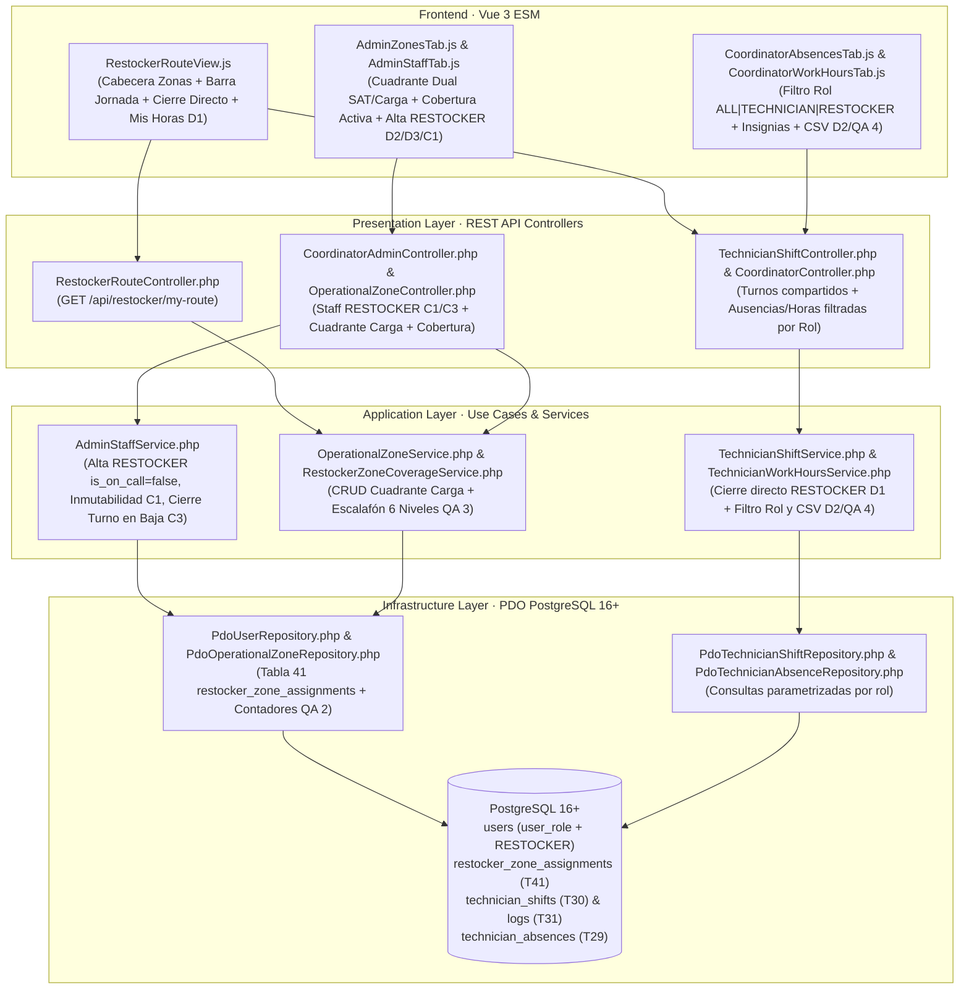

# Plan de Implementación Técnica: Rol de Cargador/Reponedor de Ruta (`RESTOCKER`), Zonificación de Carga y Control de Jornada

**Módulo:** `31-restocker-role-zones-shifts` (Feature 21 de `docs/features_pendientes.md`)\
**Versión:** 1.0 (Alineado con `spec.md` v2.0 y `restocker_role_zones_shifts_contracts.md` v1.0)\
**Estado:** Plan Técnico Aprobado por el Product Owner el 2026-11-11 · Puerta SDD cerrada · Definitivo para Ejecución SDD\
**Marco Normativo:** [`constitution.md`](../../constitution.md) · [`AGENTS.md`](../../AGENTS.md) · [`docs/design.md`](../../docs/design.md)\
**Especificación Funcional:** [`specs/31-restocker-role-zones-shifts/spec.md`](./spec.md) (v2.0) · [`specs/functional/restocker_role_zones_shifts_spec.md`](../functional/restocker_role_zones_shifts_spec.md)\
**Contratos Técnicos:** [`specs/technical/restocker_role_zones_shifts_contracts.md`](../technical/restocker_role_zones_shifts_contracts.md)

---

## 1. Arquitectura de Módulos y Estructura de Ficheros

La solución se construye bajo **Clean Architecture** en PHP 8.2+ POO puro (`declare(strict_types=1);`), persistencia única en **PostgreSQL 16+ (`pdo_pgsql`)** y **Vue 3 (Composition API via ES Modules nativos)** sin bundlers ni librerías externas.

### 1.1. Base de Datos y Esquema Relacional (`database/` y `specs/technical/`)
| Fichero | Acción | Responsabilidad |
| :--- | :--- | :--- |
| `database/supabase_migrations/027_restocker_role_and_zone_assignments.sql` | **Crear** | Migración DDL incremental idempotente: `ALTER TYPE user_role ADD VALUE IF NOT EXISTS 'RESTOCKER'`, `ALTER TYPE audit_entity_type ADD VALUE IF NOT EXISTS 'RESTOCKER_ZONE'`, constraint `chk_users_restocker_not_on_call`, creación de Tabla 41 `restocker_zone_assignments` con `role_in_zone` + `is_primary`, índices parciales `uq_restocker_zone_live` y `uq_restocker_primary_zone`, y disparador `trg_no_delete_restocker_zone_assignments`. |
| `database/supabase_init.sql` | **Modificar** | Converger el tipo `user_role`, `audit_entity_type`, constraint en `users` y la Tabla 41 `restocker_zone_assignments` con sus índices y disparador. |
| `database/supabase_seeds.sql` y `src/Infrastructure/Database/SeedRunner.php` | **Modificar** | Incorporar 2 reponedores semilla (`REP-01` titular y `REP-02` suplente) asignados a zonas operativas para pruebas y entorno local. |
| `specs/technical/database_schema.md` y `specs/technical/schema_correspondence_contract.md` | **Modificar** | Actualizar el inventario oficial de 40 a **41 tablas** y documentar `user_role` (`RESTOCKER`) y `audit_entity_type` (`RESTOCKER_ZONE`). |

### 1.2. Capa de Dominio (`src/Core/`)
| Fichero | Acción | Responsabilidad |
| :--- | :--- | :--- |
| `src/Core/Domain/Enum/UserRole.php` (o `ValueObject/UserRole.php`) | **Modificar** | Añadir el caso `RESTOCKER = 'RESTOCKER'`, etiqueta `'Cargador / Reponedor de Ruta'` y helpers `isFieldOperator()` (`TECHNICIAN` o `RESTOCKER`). |
| `src/Core/Domain/Model/RestockerZoneAssignment.php` | **Crear** | Entidad inmutable del vínculo de carga (`id`, `restockerId`, `zoneId`, `roleInZone`, `isPrimary`, `assignedAt`, `removedAt`). |
| `src/Core/Service/RestockerZoneCoverageRanker.php` | **Crear** | Calculador puro y determinista de dominio que ordena candidatos en los 6 niveles activos + `UNAVAILABLE` (`C2`, `QA 3`) y resuelve el `#1 RECOMENDADO ⭐`. |

### 1.3. Capa de Aplicación e Infraestructura (`src/Application/` y `src/Infrastructure/`)
| Fichero | Acción | Responsabilidad |
| :--- | :--- | :--- |
| `src/Application/Service/AdminStaffService.php` | **Modificar** | Admitir alta de `RESTOCKER` (`is_on_call = FALSE`, `422 RESTOCKER_CANNOT_BE_ON_CALL`), bloquear cambio de `role` en edición (`409 ROLE_CHANGE_FORBIDDEN`, `C1`) y cerrar automáticamente cualquier turno abierto al desactivar un operario (`C3`). |
| `src/Application/Service/OperationalZoneService.php` | **Modificar** | Gestionar el cuadrante de reponedores (`assignRestocker`, `removeRestocker` idempotente `QA 4`, `listZoneRestockers`, `listRestockerQuadrants`), liberar reponedores al desactivar zona (`RF-02.3`) e incluir `primary_restockers_count`/`backup_restockers_count` (`QA 2`). |
| `src/Application/Service/RestockerZoneCoverageService.php` | **Crear** | Orquestar la consulta de cobertura de carga de una zona combinando `restocker_zone_assignments`, `technician_shifts` y `technician_absences` (`RF-03`). |
| `src/Application/Service/TechnicianShiftService.php` y `AbsenceService.php` | **Modificar** | Permitir turnos y ausencias para `RESTOCKER`, aplicar cierre directo sin relevo de averías cuando el actor es `RESTOCKER` (`D1`), omitir asistente de tickets SAT al crear ausencia de `RESTOCKER` e informar zonas con promoción de `BACKUP` (`RF-05.1`). |
| `src/Application/Service/TechnicianWorkHoursService.php` y `WorkHoursCsvExportService.php` | **Modificar** | Soportar filtro `role` (`ALL` \| `TECHNICIAN` \| `RESTOCKER`), aplicar regla `C5` por rol (`QA 4`), fijar `0` intervenciones para `RESTOCKER` e incluir columna `Rol` en las dos secciones del CSV (`D2`, `RF-05.2`). |

### 1.4. Capa de Presentación y Frontend (`src/Presentation/` y `public/assets/js/`)
| Fichero | Acción | Responsabilidad |
| :--- | :--- | :--- |
| `src/Presentation/Controller/RestockerRouteController.php` y `public/index.php` | **Crear / Modificar** | Exponer `GET /api/restocker/my-route`, rutas del cuadrante de reponedores y ampliar el middleware RBAC de turnos/horas para `RESTOCKER` manteniendo `403` en rutas exclusivas SAT (`RF-01.4`). |
| `public/assets/js/components/RestockerRouteView.js` | **Crear** | Vista móvil dedicada para `RESTOCKER`: cabecera con insignias de zonas (`PRIMARY` / `BACKUP`), barra de control de turno con cierre directo, contador en vivo, modal «⏱️ Mis Horas» y estado base de ruta (`D1`, `RF-04`). |
| `public/assets/js/components/AdminStaffTab.js`, `AdminZonesTab.js`, `CoordinatorAbsencesTab.js`, `CoordinatorWorkHoursTab.js` | **Modificar** | Selector `RESTOCKER` en alta de personal (rol bloqueado en edición), bloque «📦 Cuadrante de Carga (Reponedores)» y cobertura en Zonas, y filtro por rol en Ausencias/Turnos y Registro de Horas (`D2`, `D3`). |
