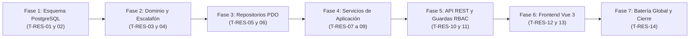

# Plan de Tareas de Implementación (`tasks.md`): Rol de Cargador/Reponedor de Ruta (`RESTOCKER`), Zonificación de Carga y Control de Jornada (`31-restocker-role-zones-shifts`)

**Módulo:** `31-restocker-role-zones-shifts`\
**Versión:** 1.0 (Alineado con `spec.md` v2.0, `restocker_role_zones_shifts_contracts.md` v1.0 y `plan.md` v1.0)\
**Estado:** Aprobado por el Product Owner el 2026-11-11 · Puerta SDD cerrada · Listo para Ejecución de las Tareas `T-RES-01` a `T-RES-14` (Fase 3: tests y código)\
**Metodología:** SDD (Specification-Driven Development) · Clean Architecture · TDD / Guardas de Esquema y Diseño\
**Ley Suprema:** [`constitution.md`](../../constitution.md), [`AGENTS.md`](../../AGENTS.md) y [`docs/design.md`](../../docs/design.md)

---

## Resumen de Fases y Grafo de Dependencias

| Fase | Rango de Tareas | Descripción | Tiempo Estimado |
| :--- | :--- | :--- | :--- |
| **Fase 1** | `T-RES-01` .. `T-RES-02` | Migración `027_restocker_role_and_zone_assignments.sql`, convergencia en `supabase_init.sql`, semillas (`REP-01`, `REP-02`), contrato de 41 tablas y suite de esquema PostgreSQL | ~45 min |
| **Fase 2** | `T-RES-03` .. `T-RES-04` | Ampliación de `UserRole::RESTOCKER`, entidad `RestockerZoneAssignment`, calculador puro `RestockerZoneCoverageRanker` (6 niveles activos `QA 3`) y tests unitarios | ~40 min |
| **Fase 3** | `T-RES-05` .. `T-RES-06` | Repositorios PDO: cuadrante de carga e indicadores `primary_restockers_count`/`backup_restockers_count` en zonas (`QA 2`), y filtros por rol en usuarios, turnos, ausencias y horas (`QA 4`) | ~45 min |
| **Fase 4** | `T-RES-07` .. `T-RES-09` | Servicios: `AdminStaffService` (`C1`, `C3`), `OperationalZoneService` + `RestockerZoneCoverageService` (`D3`, `QA 3`, `QA 4`), `TechnicianShiftService` (cierre directo `D1`), `AbsenceService` y `TechnicianWorkHoursService` + CSV con columna `Rol` (`D2`) | ~60 min |
| **Fase 5** | `T-RES-10` .. `T-RES-11` | Controladores REST, endpoint `GET /api/restocker/my-route`, blindaje RBAC (`403` en rutas SAT, `RF-01.4`) y suite de integración HTTP `RestockerRoleZonesShiftsApiTest.php` | ~50 min |
| **Fase 6** | `T-RES-12` .. `T-RES-13` | Frontend Vue 3: `RestockerRouteView.js` (`D1`), cuadrante dual en `AdminZonesTab.js`, `AdminStaffTab.js` (`C1`) y filtro de rol en Ausencias y Horas (`D2`) + tests `.mjs` | ~55 min |
| **Fase 7** | `T-RES-14` | Ejecución de batería global (`php tests/run_all.php`), sincronización `DocMetricsGuard`, matriz de trazabilidad `traceability-matrix.md` y actualización de `docs/features_pendientes.md` | ~25 min |

---

## Detalle de Tareas

- [x] **T-RES-01 · Crear migración `027_restocker_role_and_zone_assignments.sql`, converger `supabase_init.sql` y sembrar `REP-01` / `REP-02`**
  - **Requisitos:** `RF-01.1`, `RF-02.1`, `D3`, `QA 1`, `Art. III.1`.
  - **Verificación:** `php tests/integration/SchemaConvergenceParityTest.php`

- [x] **T-RES-02 · Actualizar contratos de esquema (41 tablas) y crear `PostgresRestockerZoneSchemaTest.php`**
  - **Requisitos:** `RF-01.1`, `RF-02.1`, `RNF-01`, `QA 1`, `Art. III.1`.
  - **Verificación:** `php tests/integration/PostgresSchemaTest.php && php tests/integration/PostgresConstitutionalTest.php && php tests/integration/PostgresRestockerZoneSchemaTest.php`

- [x] **T-RES-03 · Ampliar `UserRole` con `RESTOCKER`, crear entidad `RestockerZoneAssignment` y `RestockerZoneCoverageRanker`**
  - **Requisitos:** `RF-01.1`, `RF-02.1`, `RF-03.1`, `RF-03.2`, `C2`, `QA 1`, `QA 3`.
  - **Verificación:** `php tests/unit/RestockerZoneCoverageRankerTest.php`

- [x] **T-RES-04 · Verificar exclusión estricta de `RESTOCKER` en `TechnicianAssignmentSuggester` (`RF-01.4` / Art. V.3)**
  - **Requisitos:** `RF-01.4`, `Art. V.3`.
  - **Verificación:** `php tests/unit/TechnicianAssignmentSuggesterTest.php`

- [x] **T-RES-05 · Extender `PdoOperationalZoneRepository` para la Tabla 41 `restocker_zone_assignments` y contadores `QA 2`**
  - **Requisitos:** `RF-02.1`–`RF-02.4`, `QA 1`, `QA 2`, `QA 4`.
  - **Verificación:** `php tests/integration/PdoRestockerZoneRepositoryTest.php`

- [ ] **T-RES-06 · Extender repositorios de Personal, Ausencias, Turnos y Horas para filtrado por Rol (`ALL` | `TECHNICIAN` | `RESTOCKER`)**
  - **Requisitos:** `RF-01.1`–`RF-01.3`, `RF-05.1`, `RF-05.2`, `C1`, `C3`, `QA 4`.
  - **Verificación:** `php tests/integration/PdoWorkHoursRoleFilterTest.php`

- [ ] **T-RES-07 · Actualizar `AdminStaffService` con alta de `RESTOCKER` (`is_on_call = FALSE`), inmutabilidad de rol (`C1`) y cierre automático de turno en baja (`C3`)**
  - **Requisitos:** `RF-01.1`–`RF-01.3`, `C1`, `C3`, `D3`.
  - **Verificación:** `php tests/unit/AdminStaffRestockerServiceTest.php`

- [ ] **T-RES-08 · Implementar cuadrante de carga en `OperationalZoneService` y `RestockerZoneCoverageService` (`RF-02`, `RF-03`)**
  - **Requisitos:** `RF-02.2`–`RF-02.4`, `RF-03.1`–`RF-03.3`, `D3`, `C2`, `QA 2`, `QA 3`, `QA 4`.
  - **Verificación:** `php tests/unit/RestockerZoneCoverageServiceTest.php`

- [ ] **T-RES-09 · Actualizar `TechnicianShiftService` (cierre directo `D1`), `AbsenceService` y `TechnicianWorkHoursService` + CSV con columna `Rol` (`D2`, `QA 4`)**
  - **Requisitos:** `RF-04.2`, `RF-04.3`, `RF-05.1`, `RF-05.2`, `D1`, `D2`, `QA 4`.
  - **Verificación:** `php tests/unit/RestockerShiftAndWorkHoursTest.php`

- [ ] **T-RES-10 · Exponer rutas REST de `RESTOCKER`, cuadrante/cobertura de carga y guardas RBAC en `public/index.php`**
  - **Requisitos:** `RF-01.4`, `RF-02` a `RF-05`, `Art. V.4`.
  - **Verificación:** `php tests/integration/RestockerRoleZonesShiftsApiTest.php`

- [ ] **T-RES-11 · Certificar suite de integración HTTP y blindaje constitucional (`RestockerRoleZonesShiftsApiTest.php` y `RestockerRbacConstitutionalTest.php`)**
  - **Requisitos:** `RF-01` a `RF-05`, `C1`–`C3`, `QA 1`–`QA 4`, `Art. II`, `Art. III`, `Art. V.3`, `Art. V.4`.
  - **Verificación:** `php tests/integration/RestockerRoleZonesShiftsApiTest.php && php tests/integration/RestockerRbacConstitutionalTest.php`

- [ ] **T-RES-12 · Construir `RestockerRouteView.js` y enrutamiento de sesión para `RESTOCKER` en el Shell Vue 3 (`D1`, `RF-04`)**
  - **Requisitos:** `RF-04.1`–`RF-04.3`, `RNF-03`, `D1`.
  - **Verificación:** `node tests/frontend/restocker_route_view.test.mjs`

- [ ] **T-RES-13 · Actualizar `AdminStaffTab.js`, `AdminZonesTab.js`, `CoordinatorAbsencesTab.js` y `CoordinatorWorkHoursTab.js` (`D2`, `D3`, `C1`)**
  - **Requisitos:** `RF-01.1`, `RF-01.2`, `RF-02.4`, `RF-03.2`, `RF-05.1`, `RF-05.2`, `RNF-03`.
  - **Verificación:** `node tests/frontend/coordinator_restocker_tabs.test.mjs`

- [ ] **T-RES-14 · Ejecutar batería global, sincronizar `DocMetricsGuard`, generar `traceability-matrix.md` y actualizar `docs/features_pendientes.md`**
  - **Requisitos:** `DoD 1`–`DoD 7`.
  - **Verificación:** `php tests/run_all.php`
