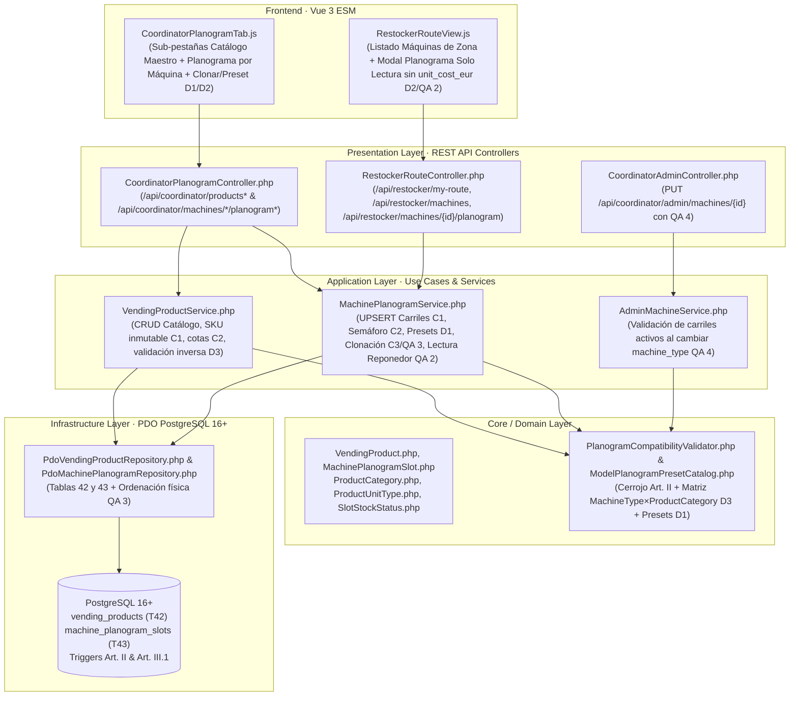

# Plan de Implementación Técnica: Catálogo Maestro de Productos, Consumibles y Planograma por Máquina (`32-product-catalog-planogram`)

**Módulo:** `32-product-catalog-planogram` (Feature 22 de `docs/features_pendientes.md`)\
**Versión:** 1.0 (Alineado con `spec.md` v2.0 y `product_catalog_planogram_contracts.md` v1.0)\
**Estado:** Plan Técnico Aprobado por el Product Owner el 2026-11-12 · Puerta SDD cerrada · Definitivo para Ejecución SDD\
**Marco Normativo:** [`constitution.md`](../../constitution.md) · [`AGENTS.md`](../../AGENTS.md) · [`docs/design.md`](../../docs/design.md)\
**Especificación Funcional:** [`specs/32-product-catalog-planogram/spec.md`](./spec.md) (v2.0) · [`specs/functional/product_catalog_planogram_spec.md`](../functional/product_catalog_planogram_spec.md)\
**Contratos Técnicos:** [`specs/technical/product_catalog_planogram_contracts.md`](../technical/product_catalog_planogram_contracts.md)

---

## 1. Arquitectura de Módulos y Estructura de Ficheros

La solución se construye bajo **Clean Architecture** en PHP 8.2+ POO puro (`declare(strict_types=1);`), persistencia única en **PostgreSQL 16+ (`pdo_pgsql`)** y **Vue 3 (ES Modules nativos)** sin bundlers ni dependencias externas.

### 1.1. Base de Datos y Esquema Relacional (`database/` y `specs/technical/`)
| Fichero | Acción | Responsabilidad |
| :--- | :--- | :--- |
| `database/supabase_migrations/028_product_catalog_and_planogram_slots.sql` | **Crear** | Migración DDL idempotente: creación de `vending_product_category` (#26) y `vending_product_unit_type` (#27), adición de `'VENDING_PRODUCT'` y `'MACHINE_PLANOGRAM'` a `audit_entity_type`, creación de Tabla 42 `vending_products` y Tabla 43 `machine_planogram_slots` con `CHECK` constraints (`C2`, `QA 1`), triggers `prevent_hard_delete()` (`Art. III.1`) y los 3 triggers bidireccionales del cerrojo sanitario (`Art. II`, `D3`). |
| `database/supabase_init.sql` | **Modificar** | Converger 1:1 los 2 nuevos tipos nativos, la ampliación de `audit_entity_type`, las Tablas 42 y 43 y las funciones/disparadores de blindaje sanitario. |
| `database/supabase_seeds.sql` y `src/Infrastructure/Database/SeedRunner.php` | **Modificar** | Sembrar el catálogo maestro de productos y consumibles (5 categorías: refrescos, snacks, perecederos con `requires_cold_chain = TRUE`, ingredientes de café en `GRAMS` y vasos/paletinas en `SLEEVE`) y planogramas en las máquinas semilla del parque (`C3`). |
| `specs/technical/database_schema.md`, `specs/technical/schema_correspondence_contract.md` y `tests/Support/TestDataCleaner.php` | **Modificar** | Actualizar el inventario oficial de **41 a 43 tablas** y de **25 a 27 tipos `ENUM`**, e incluir `machine_planogram_slots` y `vending_products` en el orden de purgado de pruebas. |

### 1.2. Capa de Dominio (`src/Core/`)
| Fichero | Acción | Responsabilidad |
| :--- | :--- | :--- |
| `src/Core/Domain/Enum/ProductCategory.php`, `ProductUnitType.php`, `SlotStockStatus.php` | **Crear** | Enumerados de dominio con etiquetas en español y helpers de reglas (`isDirectRetail()`, `requiresColdChainByDefault()`, `allowedUnitTypes()`). |
| `src/Core/Domain/Model/VendingProduct.php` y `MachinePlanogramSlot.php` | **Crear** | Entidades inmutables del producto y del carril de planograma con cálculo determinista de `stockStatus()` (`STOCKOUT`, `LOW_STOCK`, `OK`) y `restockNeededQty()`. |
| `src/Core/Service/PlanogramCompatibilityValidator.php` | **Crear** | Validador puro de dominio para las invariantes de producto (`C2`, `QA 1`), cotas de carril (`C2`), cerrojo sanitario `Art. II` y matriz `MachineType × ProductCategory` (`D3`). |
| `src/Core/Service/ModelPlanogramPresetCatalog.php` | **Crear** | Catálogo puro de dominio con los presets de carriles por modelo normalizado (*Necta Korinto*, *Saeco Cristallo*, *Fas Fast 900*, *Jofemar Vision*) y fallback por `MachineType` (`D1`). |

### 1.3. Capa de Aplicación e Infraestructura (`src/Application/` y `src/Infrastructure/`)
| Fichero | Acción | Responsabilidad |
| :--- | :--- | :--- |
| `src/Infrastructure/Repository/PdoVendingProductRepository.php` | **Crear** | Persistencia PDO de `vending_products`, filtros de catálogo, conteo de carriles activos por producto (`affected_active_slots_count`) y verificación de máquinas asignadas para el cerrojo inverso (`D3`). |
| `src/Infrastructure/Repository/PdoMachinePlanogramRepository.php` | **Crear** | Persistencia PDO de `machine_planogram_slots`, `UPSERT` por `(machine_id, slot_code)`, desactivación lógica sin `DELETE` (`C1`), ordenación física de bandejas (`QA 3`) y consultas agregadas de resumen por máquina y por zonas de reponedor (`QA 2`). |
| `src/Application/Service/VendingProductService.php` | **Crear** | Caso de uso CRUD de `vending_products` con `sku` inmutable (`C1`), validación inversa contra carriles activos (`D3`) y auditoría `VENDING_PRODUCT` (`C3`). |
| `src/Application/Service/MachinePlanogramService.php` | **Crear** | Gestión de planogramas: consulta para Coordinación y para Reponedor (con aislamiento territorial `QA 2` y omisión de `unit_cost_eur` `Art. V.4`), guardado individual/matriz por `UPSERT`, aplicación de preset por modelo (`D1`) y clonación (`C3`, `QA 3`). |
| `src/Application/Service/AdminMachineService.php` | **Modificar** | Integrar la comprobación de compatibilidad del planograma activo al cambiar `machine_type` (`409 PLANOGRAM_INCOMPATIBLE_WITH_MACHINE_TYPE`, `QA 4`). |

### 1.4. Capa de Presentación y Frontend (`src/Presentation/` y `public/assets/js/`)
| Fichero | Acción | Responsabilidad |
| :--- | :--- | :--- |
| `src/Presentation/Controller/CoordinatorPlanogramController.php`, `RestockerRouteController.php` y `public/index.php` | **Crear / Modificar** | Exponer los endpoints de Coordinación (`/api/coordinator/products*`, `/api/coordinator/machines/*/planogram*`) y del Reponedor (`/api/restocker/machines*`), blindando RBAC (`403` para roles no autorizados). |
| `public/assets/js/components/CoordinatorPlanogramTab.js` y `CoordinatorDashboard.js` | **Crear / Modificar** | Pestaña en Coordinación con sub-vistas **«🍫 Catálogo de Productos y Consumibles»** y **«🗄️ Planograma por Máquina»** (parrilla de carriles, semáforo de stock, botón «⚡ Aplicar Plantilla del Modelo» y modal «📋 Clonar desde otra Máquina»). |
| `public/assets/js/components/RestockerRouteView.js` | **Modificar** | Incorporar el listado de máquinas de las zonas asignadas al reponedor con badges de `STOCKOUT` / `LOW_STOCK` y modal de consulta del planograma en solo lectura sin `unit_cost_eur` (`D2`, `QA 2`, `Art. V.4`). |
