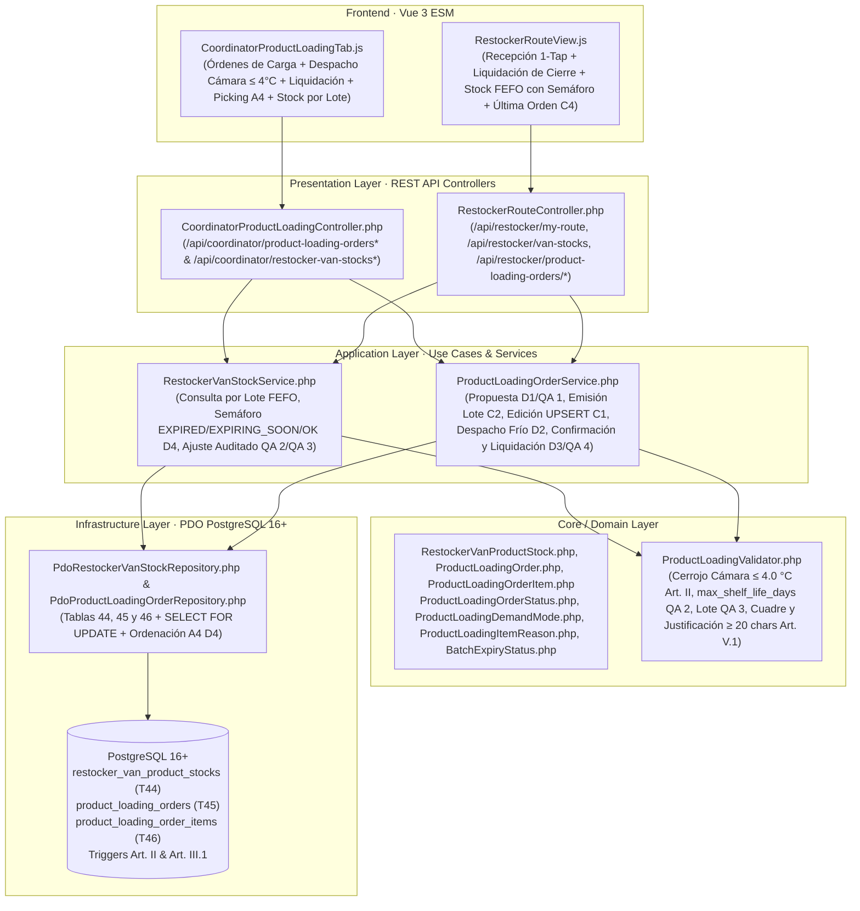

# Plan de Implementación Técnica: Órdenes de Carga de Furgoneta de Reposición y Picking con Trazabilidad de Frío (`33-product-loading-cold-picking`)

**Módulo:** `33-product-loading-cold-picking` (Feature 23 de `docs/features_pendientes.md`)\
**Versión:** 1.0 (Alineado con `spec.md` v2.0 y `product_loading_cold_picking_contracts.md` v1.0)\
**Estado:** Plan Técnico Aprobado por el Product Owner el 2026-11-13 · Puerta SDD Fase 2 cerrada · Definitivo para Ejecución SDD\
**Marco Normativo:** [`constitution.md`](../../constitution.md) · [`AGENTS.md`](../../AGENTS.md) · [`docs/design.md`](../../docs/design.md)\
**Especificación Funcional:** [`specs/33-product-loading-cold-picking/spec.md`](./spec.md) (v2.0) · [`specs/functional/product_loading_cold_picking_spec.md`](../functional/product_loading_cold_picking_spec.md)\
**Contratos Técnicos:** [`specs/technical/product_loading_cold_picking_contracts.md`](../technical/product_loading_cold_picking_contracts.md)

---

## 1. Arquitectura de Módulos y Estructura de Ficheros

La solución se construye bajo **Clean Architecture** en PHP 8.2+ POO puro (`declare(strict_types=1);`), persistencia única en **PostgreSQL 16+ (`pdo_pgsql`)** y **Vue 3 (ES Modules nativos)** sin bundlers ni dependencias externas.

### 1.1. Base de Datos y Esquema Relacional (`database/` y `specs/technical/`)
| Fichero | Acción | Responsabilidad |
| :--- | :--- | :--- |
| `database/supabase_migrations/029_product_loading_orders_and_cold_picking.sql` | **Crear** | Migración DDL idempotente: creación de `product_loading_order_status` (#28), `product_loading_demand_mode` (#29) y `product_loading_item_reason` (#30), adición de `'RESTOCKER_VAN_STOCK'` y `'PRODUCT_LOADING_ORDER'` a `audit_entity_type`, creación de Tablas 44 (`restocker_van_product_stocks`), 45 (`product_loading_orders`) y 46 (`product_loading_order_items`) con `CHECK` constraints (`C1`, `D2`, `D3`), índice único parcial de orden activa, triggers `prevent_hard_delete()` (`Art. III.1`) y triggers del cerrojo sanitario de frío y lote (`Art. II`, `D2`). |
| `database/supabase_init.sql` | **Modificar** | Converger 1:1 los 3 nuevos tipos nativos, la ampliación de `audit_entity_type`, las Tablas 44, 45 y 46 y sus funciones/disparadores. |
| `database/supabase_seeds.sql` y `src/Infrastructure/Database/SeedRunner.php` | **Modificar** | Sembrar lotes de producto en furgonetas de los reponedores semilla (`REP-01`, `REP-02`) y órdenes de carga de ejemplo (una liquidada histórica y una despachada con control de cámara frigorífica $\le 4,0\,^\circ\text{C}$). |
| `specs/technical/database_schema.md`, `specs/technical/schema_correspondence_contract.md` y `tests/Support/TestDataCleaner.php` | **Modificar** | Actualizar el inventario oficial de **43 a 46 tablas** y a **40 tipos `ENUM`**, e incluir `product_loading_order_items`, `product_loading_orders` y `restocker_van_product_stocks` en el orden de purgado de pruebas. |

### 1.2. Capa de Dominio (`src/Core/`)
| Fichero | Acción | Responsabilidad |
| :--- | :--- | :--- |
| `src/Core/Domain/Enum/ProductLoadingOrderStatus.php`, `ProductLoadingDemandMode.php`, `ProductLoadingItemReason.php`, `BatchExpiryStatus.php` | **Crear** | Enumerados de dominio con etiquetas en español, prelación de motivos y cálculo determinista de `BatchExpiryStatus` (`EXPIRED`, `EXPIRING_SOON`, `OK`). |
| `src/Core/Domain/Model/RestockerVanProductStock.php`, `ProductLoadingOrder.php`, `ProductLoadingOrderItem.php` | **Crear** | Entidades inmutables de lote en furgoneta, orden de carga y línea de orden con helpers de semáforo y cuadre de liquidación. |
| `src/Core/Service/ProductLoadingValidator.php` y `src/Core/Domain/Exception/ProductLoadingValidationException.php` | **Crear** | Validador puro de dominio para el cerrojo térmico de salida de cámara ($\in [-5.0, 4.0]\,^\circ\text{C}$, `Art. II`), formato de lote y ventana de caducidad (`> CURRENT_DATE` y `<= CURRENT_DATE + max_shelf_life_days`, `QA 2`), colisión de fecha en lote (`QA 3`), cotas `99999` (`C1`), cuadre matemático de liquidación y justificación $\ge 20$ caracteres reales (`Art. V.1`). |

### 1.3. Capa de Aplicación e Infraestructura (`src/Application/` y `src/Infrastructure/`)
| Fichero | Acción | Responsabilidad |
| :--- | :--- | :--- |
| `src/Infrastructure/Repository/PdoRestockerVanStockRepository.php` | **Crear** | Persistencia PDO de `restocker_van_product_stocks`, ordenación FEFO (`expiration_date ASC NULLS LAST`), agregación de stock útil no caducado por producto (`D1`) y `UPSERT` transaccional por lote (`D2`, `D3`, `D4`). |
| `src/Infrastructure/Repository/PdoProductLoadingOrderRepository.php` | **Crear** | Persistencia PDO de `product_loading_orders` y `product_loading_order_items`, bloqueo `SELECT ... FOR UPDATE`, baja lógica de líneas en `PENDING_PICKING` (`C1`), consulta de huecos de planograma excluyendo máquinas en `SANITARY_QUARANTINE` / `OUT_OF_SERVICE` (`QA 1`) y ordenación para Hoja A4 (`D4`). |
| `src/Application/Service/RestockerVanStockService.php` | **Crear** | Consulta de stock por lote para Coordinación y para el Reponedor (con omisión estructural de `unit_cost_eur`, `Art. V.4`) y ajuste manual auditado con validación `QA 2`, `QA 3` y motivo $\ge 20$ caracteres (`Art. V.1`). |
| `src/Application/Service/ProductLoadingOrderService.php` | **Crear** | Cálculo de propuesta (`D1`, `QA 1`), emisión individual y en lote (`C2`), edición `UPSERT` (`C1`), despacho con cerrojo de frío (`D2`, `QA 2`, `QA 3`), Hoja de Picking A4 en 2 secciones sin precios (`D4`, `Art. V.4`), confirmación móvil en 1 toque (`RF-04.1`), liquidación al cierre (`D3`, `QA 4`) y cancelación justificada (`RF-03.4`). |

### 1.4. Capa de Presentación y Frontend (`src/Presentation/` y `public/assets/js/`)
| Fichero | Acción | Responsabilidad |
| :--- | :--- | :--- |
| `src/Presentation/Controller/CoordinatorProductLoadingController.php`, `RestockerRouteController.php` y `src/Presentation/Http/AppRouter.php` | **Crear / Modificar** | Exponer los endpoints de Coordinación (`/api/coordinator/product-loading-orders*`, `/api/coordinator/restocker-van-stocks*`) y del Reponedor (`/api/restocker/van-stocks`, `/api/restocker/product-loading-orders/*`), blindando RBAC y aislamiento horizontal (`403`). |
| `public/assets/js/components/CoordinatorProductLoadingTab.js` y `CoordinatorDashboardView.js` (más `public/sw.js` y `public/assets/js/services/api.js`) | **Crear / Modificar** | Pestaña en Coordinación con sub-vistas **«🚚 Órdenes de Carga y Picking de Frío»** (propuesta individual/lote, edición, despacho con temperatura de cámara $\le 4,0\,^\circ\text{C}$, liquidación, cancelación y vista de impresión de Hoja A4 en 2 secciones) y **«🚐 Stock de Furgonetas por Lote»**. |
| `public/assets/js/components/RestockerRouteView.js` | **Modificar** | Incorporar el banner de recepción en 1 toque para orden `DISPATCHED`, el modal de liquidación al cierre para orden `CONFIRMED_BY_RESTOCKER`, la tabla de stock por lote FEFO con semáforo sanitario y el comprobante de última orden liquidada (`C4`), sin exponer jamás `unit_cost_eur` (`Art. V.4`). |
