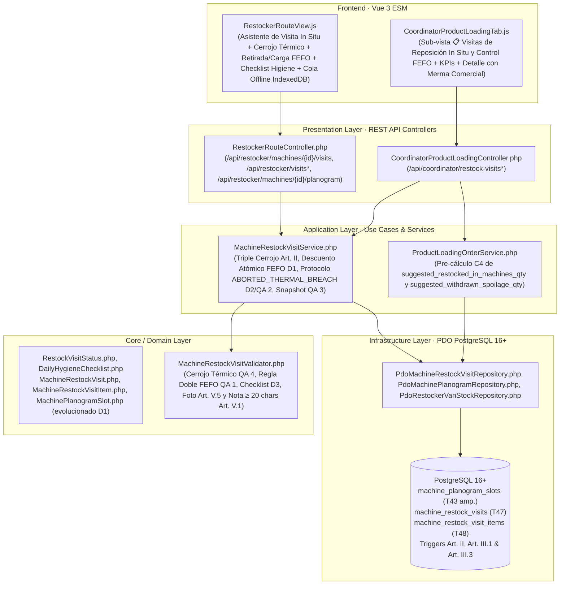

# Plan de Implementación Técnica: Visita de Reposición In Situ, Control FEFO de Caducidades y Limpieza Diaria (`34-in-situ-restock-visit`)

**Módulo:** `34-in-situ-restock-visit` (Feature 24 de `docs/features_pendientes.md`)\
**Versión:** 1.0 (Alineado con `spec.md` v2.0 y `in_situ_restock_visit_contracts.md` v1.0)\
**Estado:** Plan Técnico Aprobado por el Product Owner el 2026-11-14 · Puerta SDD Fase 2 cerrada · Definitivo para Ejecución SDD\
**Marco Normativo:** [`constitution.md`](../../constitution.md) · [`AGENTS.md`](../../AGENTS.md) · [`docs/design.md`](../../docs/design.md)\
**Especificación Funcional:** [`specs/34-in-situ-restock-visit/spec.md`](./spec.md) (v2.0) · [`specs/functional/in_situ_restock_visit_spec.md`](../functional/in_situ_restock_visit_spec.md)\
**Contratos Técnicos:** [`specs/technical/in_situ_restock_visit_contracts.md`](../technical/in_situ_restock_visit_contracts.md)

---

## 1. Arquitectura de Módulos y Estructura de Ficheros

La solución se construye bajo **Clean Architecture** en PHP 8.2+ POO puro (`declare(strict_types=1);`), persistencia única en **PostgreSQL 16+ (`pdo_pgsql`)** y **Vue 3 (ES Modules nativos)** sin bundlers ni dependencias externas.

### 1.1. Base de Datos y Esquema Relacional (`database/` y `specs/technical/`)
| Fichero | Acción | Responsabilidad |
| :--- | :--- | :--- |
| `database/supabase_migrations/030_in_situ_restock_visit_and_fefo.sql` | **Crear** | Migración DDL idempotente: creación de `restock_visit_status` (#31), adición de `'MACHINE_RESTOCK_VISIT'` a `audit_entity_type`, ampliación de `machine_planogram_slots` (Tabla 43) con `current_batch_code` y `current_expiration_date` (`D1`), creación de Tablas 47 (`machine_restock_visits`) y 48 (`machine_restock_visit_items`) con `CHECK` constraints (`C1`, `D2`, `QA 3`, `QA 4`), índice único de idempotencia `(restocker_id, client_mutation_id)` (`D4`), triggers `prevent_hard_delete()` (`Art. III.1`), triggers de inmutabilidad `prevent_restock_visit_mutation()` (`Art. III.3`) y triggers del cerrojo térmico (`Art. II`, `RNF-02`). |
| `database/supabase_init.sql` | **Modificar** | Converger 1:1 el nuevo tipo #31, la ampliación de `audit_entity_type` y `machine_planogram_slots`, las Tablas 47 y 48 y sus funciones/disparadores. |
| `database/supabase_seeds.sql` y `src/Infrastructure/Database/SeedRunner.php` | **Modificar** | Sembrar lotes vigentes en carriles de `machine_planogram_slots` (incluyendo un carril `EXPIRING_SOON` para demostración FEFO) y visitas de reposición de ejemplo (`COMPLETED` con retirada FEFO y `ABORTED_THERMAL_BREACH` histórica). |
| `specs/technical/database_schema.md`, `specs/technical/schema_correspondence_contract.md`, `tests/Support/PostgresFixtureBuilder.php` y `tests/Support/TestDataCleaner.php` | **Modificar** | Actualizar el inventario oficial de **46 a 48 tablas** y de **40 a 41 tipos `ENUM`**, e incluir `machine_restock_visit_items` y `machine_restock_visits` en el orden de purgado transitorio. |

### 1.2. Capa de Dominio (`src/Core/`)
| Fichero | Acción | Responsabilidad |
| :--- | :--- | :--- |
| `src/Core/Domain/Enum/RestockVisitStatus.php` | **Crear** | Enumerado de dominio (`COMPLETED`, `ABORTED_THERMAL_BREACH`) con etiquetas en español y helpers de estado. |
| `src/Core/Domain/Model/DailyHygieneChecklist.php`, `MachineRestockVisit.php`, `MachineRestockVisitItem.php` y `MachinePlanogramSlot.php` | **Crear / Modificar** | Value object y entidades inmutables de visita e ítem de visita (con cálculo de `qty_after` y `commercial_spoilage_loss_eur`), más evolución de `MachinePlanogramSlot` con `currentBatchCode`, `currentExpirationDate` y `slotExpiryStatus` (`D1`, `RF-01.1`). |
| `src/Core/Service/MachineRestockVisitValidator.php` y `src/Core/Domain/Exception/MachineRestockVisitValidationException.php` | **Crear** | Validador puro del Triple Cerrojo Sanitario (`Art. II`): bloqueo por cuarentena/fuera de servicio/avería térmica (`409 SANITARY_RESTOCK_BLOCKED`), rango y techo térmico por tipología (`422 INVALID_CABIN_TEMPERATURE`, `422 CABIN_TEMP_EXCEEDS_SANITARY_LIMIT`, `QA 4`), reglas de aborto térmico (`precautionary_seal_applied`, foto y nota $\ge 20$ chars), doble cerrojo FEFO en carril y en furgoneta (`422 FEFO_WITHDRAWAL_REQUIRED`, `422 EXPIRED_VAN_BATCH_FORBIDDEN`, `422 FEFO_OLDER_VAN_BATCH_AVAILABLE`, `QA 1`) y checklist diario adaptativo por `MachineType` (`D3`). |

### 1.3. Capa de Aplicación e Infraestructura (`src/Application/` y `src/Infrastructure/`)
| Fichero | Acción | Responsabilidad |
| :--- | :--- | :--- |
| `src/Core/Domain/Repository/MachineRestockVisitRepositoryInterface.php` y `src/Infrastructure/Repository/PdoMachineRestockVisitRepository.php` | **Crear** | Persistencia PDO de `machine_restock_visits` y `machine_restock_visit_items`, consulta idempotente por `(restocker_id, client_mutation_id)`, listado con KPIs y filtros para Coordinación, historial del reponedor y agregación por lote para el pre-cálculo de liquidación (`C4`). |
| `src/Infrastructure/Repository/PdoMachinePlanogramRepository.php` | **Modificar** | Incluir `current_batch_code`, `current_expiration_date` y `slot_expiry_status` en las lecturas de carriles, contadores FEFO por máquina y método de actualización atómica de carril tras visita (`D1`). |
| `src/Application/Service/MachineRestockVisitService.php` | **Crear** | Orquestación transaccional de la visita in situ: verificación territorial (`C2`), idempotencia `client_mutation_id` (`D4`), ejecución de `COMPLETED` (descuento FEFO de `restocker_van_product_stocks`, actualización de `machine_planogram_slots`, snapshot `QA 3` y auditoría) y ejecución de `ABORTED_THERMAL_BREACH` (paso a `SANITARY_QUARANTINE`/`OUT_OF_SERVICE`, creación o escalado idempotente `QA 2` de ticket `CRITICAL` `THERMAL_BREAKDOWN` con asignación SAT sugerida y notificación), además de subida de foto (`Art. V.5`) y volcado de conflicto offline (`C3`). |
| `src/Application/Service/ProductLoadingOrderService.php` y `MachinePlanogramService.php` | **Modificar** | Enriquecer el planograma del reponedor con lotes FEFO compatibles de su furgoneta y enriquecer la orden en `CONFIRMED_BY_RESTOCKER` con `suggested_restocked_in_machines_qty` y `suggested_withdrawn_spoilage_qty` (`C4`). |

### 1.4. Capa de Presentación y Frontend (`src/Presentation/` y `public/assets/js/`)
| Fichero | Acción | Responsabilidad |
| :--- | :--- | :--- |
| `src/Presentation/Controller/RestockerRouteController.php`, `CoordinatorProductLoadingController.php` y `src/Presentation/Http/AppRouter.php` | **Modificar** | Exponer los endpoints de visita in situ, subida de foto, volcado de conflicto offline y consulta en Coordinación, garantizando la opacidad de `unit_cost_snapshot_eur` y `commercial_spoilage_loss_eur` ante `RESTOCKER` (`Art. V.4`). |
| `public/assets/js/components/RestockerRouteView.js` y `public/assets/js/services/api.js` | **Modificar** | Incorporar en las tarjetas de máquina las insignias FEFO y el botón **«📋 Iniciar Visita de Reposición»**, el modal asistente de visita (control térmico con conmutación automática a `ABORTED_THERMAL_BREACH`, retirada FEFO y llenado rápido 1-Tap con lote FEFO de furgoneta, checklist diario adaptativo y foto), la cola Offline en `IndexedDB` con sincronización y volcado de conflictos (`D4`, `C3`), el historial de visitas recientes y el pre-rellenado automático en el modal de liquidación (`C4`). |
| `public/assets/js/components/CoordinatorProductLoadingTab.js` | **Modificar** | Incorporar la tercera sub-vista **«📋 Visitas de Reposición In Situ y Control FEFO»** con los 5 KPIs ejecutivos (incluido `Coste merma comercial (€)`), filtros reactivos, tabla histórica y modal de detalle de visita con desglose carril a carril, checklist, foto y enlace al ticket SAT. |
