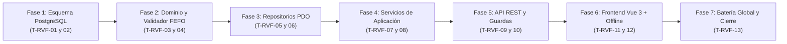

# Plan de Tareas de Implementación (`tasks.md`): Visita de Reposición In Situ, Control FEFO de Caducidades y Limpieza Diaria (`34-in-situ-restock-visit`)

**Módulo:** `34-in-situ-restock-visit`\
**Versión:** 1.0 (Alineado con `spec.md` v2.0, `in_situ_restock_visit_contracts.md` v1.0 y `plan.md` v1.0)\
**Estado:** Aprobado por el Product Owner el 2026-11-14 · Puerta SDD Fase 2 cerrada · Listo para iniciar en `T-RVF-01`\
**Metodología:** SDD (Specification-Driven Development) · Clean Architecture · TDD / Guardas de Esquema y Diseño\
**Ley Suprema:** [`constitution.md`](../../constitution.md), [`AGENTS.md`](../../AGENTS.md) y [`docs/design.md`](../../docs/design.md)

---

## Resumen de Fases y Grafo de Dependencias

| Fase | Rango de Tareas | Descripción | Tiempo Estimado |
| :--- | :--- | :--- | :--- |
| **Fase 1** | `T-RVF-01` .. `T-RVF-02` | Migración `030_in_situ_restock_visit_and_fefo.sql`, evolución de `machine_planogram_slots`, Tablas 47 y 48 inmutables, convergencia en `supabase_init.sql`, semillas del parque, contratos a 48 tablas / 41 enums y suite de esquema PostgreSQL | ~45 min |
| **Fase 2** | `T-RVF-03` .. `T-RVF-04` | Enum `RestockVisitStatus`, modelos `DailyHygieneChecklist`, `MachineRestockVisit`, `MachineRestockVisitItem`, evolución de `MachinePlanogramSlot` (`D1`) y `MachineRestockVisitValidator` (Triple Cerrojo `Art. II`, `QA 1`, `QA 4`, `D3`, `Art. V.1`) + tests unitarios | ~45 min |
| **Fase 3** | `T-RVF-05` .. `T-RVF-06` | Evolución de `PdoMachinePlanogramRepository` (`current_batch_code`, `current_expiration_date`, contadores FEFO y actualización tras visita `D1`) e implementación de `PdoMachineRestockVisitRepository` (Tablas 47 y 48, idempotencia `client_mutation_id`, KPIs y agregación `C4`) | ~50 min |
| **Fase 4** | `T-RVF-07` .. `T-RVF-08` | Servicio `MachineRestockVisitService` (visita `COMPLETED` con descuento atómico FEFO `D1` y snapshot `QA 3`, protocolo `ABORTED_THERMAL_BREACH` con ticket SAT idempotente `D2`/`QA 2`, subida de foto `Art. V.5` y volcado offline `C3`) e integración `C4` en `ProductLoadingOrderService` + tests unitarios | ~60 min |
| **Fase 5** | `T-RVF-09` .. `T-RVF-10` | Extensión de `RestockerRouteController`, `CoordinatorProductLoadingController` y `AppRouter`, y suites de integración HTTP y blindaje constitucional (`InSituRestockVisitApiTest.php` e `InSituRestockVisitConstitutionalTest.php`) | ~55 min |
| **Fase 6** | `T-RVF-11` .. `T-RVF-12` | Frontend Vue 3: sub-vista de supervisión en `CoordinatorProductLoadingTab.js` (`RF-05.2`, `QA 3`) y asistente de visita in situ + cola Offline `IndexedDB` + pre-cálculo de liquidación `C4` en `RestockerRouteView.js` (`RF-05.1`, sin costes `Art. V.4`) + tests `.mjs` | ~55 min |
| **Fase 7** | `T-RVF-13` | Ejecución de batería global (`php tests/run_all.php`), sincronización `DocMetricsGuard`, matriz de trazabilidad `traceability-matrix.md` y actualización de `docs/features_pendientes.md` | ~25 min |

---

## Detalle de Tareas

- [x] **T-RVF-01 · Crear migración `030_in_situ_restock_visit_and_fefo.sql`, converger `supabase_init.sql` y sembrar lotes en carril y visitas en `supabase_seeds.sql` y `SeedRunner`**
  - **Requisitos:** `RF-01.1`, `RF-01.2`, `RNF-01`, `RNF-02`, `D1`, `D2`, `D4`, `C1`, `QA 3`, `Art. II`, `Art. III.1`, `Art. III.3`.
  - **Verificación:** `php tests/integration/SchemaConvergenceParityTest.php`

- [ ] **T-RVF-02 · Actualizar contratos de esquema (48 tablas, 41 enums), `PostgresFixtureBuilder`, `TestDataCleaner` y crear `PostgresInSituRestockVisitSchemaTest.php`**
  - **Requisitos:** `RF-01.1`, `RF-01.2`, `RNF-01`, `RNF-02`, `C1`, `Art. II`, `Art. III.1`, `Art. III.3`.
  - **Verificación:** `php tests/integration/PostgresSchemaTest.php && php tests/integration/PostgresConstitutionalTest.php && php tests/integration/PostgresInSituRestockVisitSchemaTest.php`

- [ ] **T-RVF-03 · Crear `RestockVisitStatus`, `DailyHygieneChecklist`, `MachineRestockVisit`, `MachineRestockVisitItem` y evolucionar `MachinePlanogramSlot` con lote/caducidad vigente (`D1`)**
  - **Requisitos:** `RF-01.1`, `RF-01.2`, `RF-03.1`, `D1`, `D3`, `C1`, `QA 3`.
  - **Verificación:** `php tests/unit/InSituRestockVisitDomainModelsTest.php`

- [ ] **T-RVF-04 · Crear `MachineRestockVisitValidator` y `MachineRestockVisitValidationException` (Triple Cerrojo Sanitario `Art. II`, doble regla FEFO `QA 1`, techo térmico `QA 4`, checklist adaptativo `D3`, foto `Art. V.5` y nota $\ge 20$ chars `Art. V.1`)**
  - **Requisitos:** `RF-02.1`–`RF-02.3`, `RF-03.1`, `RF-03.2`, `D1`–`D3`, `C1`, `QA 1`, `QA 4`, `Art. II`, `Art. V.1`, `Art. V.5`.
  - **Verificación:** `php tests/unit/MachineRestockVisitValidatorTest.php`

- [ ] **T-RVF-05 · Evolucionar `PdoMachinePlanogramRepository` con `current_batch_code`, `current_expiration_date`, semáforo FEFO de carril y actualización transaccional post-visita (`D1`)**
  - **Requisitos:** `RF-01.1`, `RF-02.3`, `RF-03.3`, `D1`, `QA 1`, `Art. III.1`, `Art. V.4`.
  - **Verificación:** `php tests/integration/PdoMachinePlanogramRepositoryTest.php`

- [ ] **T-RVF-06 · Implementar `PdoMachineRestockVisitRepository` (alta inmutable en Tablas 47 y 48, idempotencia `client_mutation_id`, listado con 5 KPIs en Coordinación, historial del reponedor sin costes y agregación de pre-cálculo `C4`)**
  - **Requisitos:** `RF-01.2`, `RF-03.3`, `RF-03.4`, `RF-05.2`, `D4`, `C1`, `C4`, `QA 3`, `Art. III.1`, `Art. III.3`, `Art. V.4`.
  - **Verificación:** `php tests/integration/PdoMachineRestockVisitRepositoryTest.php`

- [ ] **T-RVF-07 · Implementar `MachineRestockVisitService` (ejecución `COMPLETED` con descuento FEFO `D1` y snapshot `QA 3`, protocolo `ABORTED_THERMAL_BREACH` con cuarentena y ticket SAT idempotente `D2`/`QA 2`, subida de foto `Art. V.5` y volcado de conflicto offline `C3`)**
  - **Requisitos:** `RF-02.1`–`RF-02.3`, `RF-03.1`–`RF-03.3`, `RF-04.2`, `D1`–`D4`, `C1`–`C3`, `QA 1`–`QA 4`, `Art. II`, `Art. III.3`, `Art. V.1`, `Art. V.2`, `Art. V.4`, `Art. V.5`.
  - **Verificación:** `php tests/unit/MachineRestockVisitServiceTest.php`

- [ ] **T-RVF-08 · Integrar en `ProductLoadingOrderService` y `MachinePlanogramService` el pre-cálculo de liquidación (`C4`: `suggested_restocked_in_machines_qty` y `suggested_withdrawn_spoilage_qty`) y los lotes FEFO de furgoneta compatibles por máquina**
  - **Requisitos:** `RF-03.4`, `RF-05.1`, `C4`, `QA 1`, `Art. V.4`.
  - **Verificación:** `php tests/unit/ProductLoadingOrderServiceTest.php && php tests/unit/MachinePlanogramServiceTest.php`

- [ ] **T-RVF-09 · Extender `RestockerRouteController`, `CoordinatorProductLoadingController` y registrar las nuevas rutas + guardas RBAC en `AppRouter`**
  - **Requisitos:** `RF-01` a `RF-05`, `Art. V.4`, `Art. V.5`.
  - **Verificación:** `php tests/integration/InSituRestockVisitApiTest.php`

- [ ] **T-RVF-10 · Certificar suites de integración HTTP y blindaje constitucional (`InSituRestockVisitApiTest.php` e `InSituRestockVisitConstitutionalTest.php`)**
  - **Requisitos:** `RF-01` a `RF-05`, `D1`–`D4`, `C1`–`C4`, `QA 1`–`QA 4`, `Art. II`, `Art. III.1`, `Art. III.3`, `Art. V.1`, `Art. V.2`, `Art. V.4`, `Art. V.5`.
  - **Verificación:** `php tests/integration/InSituRestockVisitApiTest.php && php tests/integration/InSituRestockVisitConstitutionalTest.php`

- [ ] **T-RVF-11 · Extender `CoordinatorProductLoadingTab.js` con la sub-vista «📋 Visitas de Reposición In Situ y Control FEFO» (5 KPIs con coste de merma comercial, filtros y modal de detalle carril a carril)**
  - **Requisitos:** `RF-05.2`, `RNF-03`, `D4`, `QA 3`, `Art. V.4`.
  - **Verificación:** `node tests/frontend/coordinator_product_loading_tab.test.mjs`

- [ ] **T-RVF-12 · Extender `RestockerRouteView.js` con el asistente de visita in situ (control térmico con aborto automático, retirada/carga FEFO, checklist diario adaptativo y foto), cola Offline en `IndexedDB` (`D4`, `C3`) y pre-rellenado de liquidación (`C4`) sin costes (`Art. V.4`)**
  - **Requisitos:** `RF-02` a `RF-05.1`, `RNF-03`, `D1`–`D4`, `C3`, `C4`, `QA 1`, `QA 3`, `Art. II`, `Art. V.4`.
  - **Verificación:** `node tests/frontend/restocker_route_view.test.mjs`

- [ ] **T-RVF-13 · Ejecutar batería global (`php tests/run_all.php`), sincronizar `DocMetricsGuard`, generar `traceability-matrix.md` y actualizar `docs/features_pendientes.md`**
  - **Requisitos:** `DoD 1`–`DoD 5`.
  - **Verificación:** `php tests/run_all.php`
