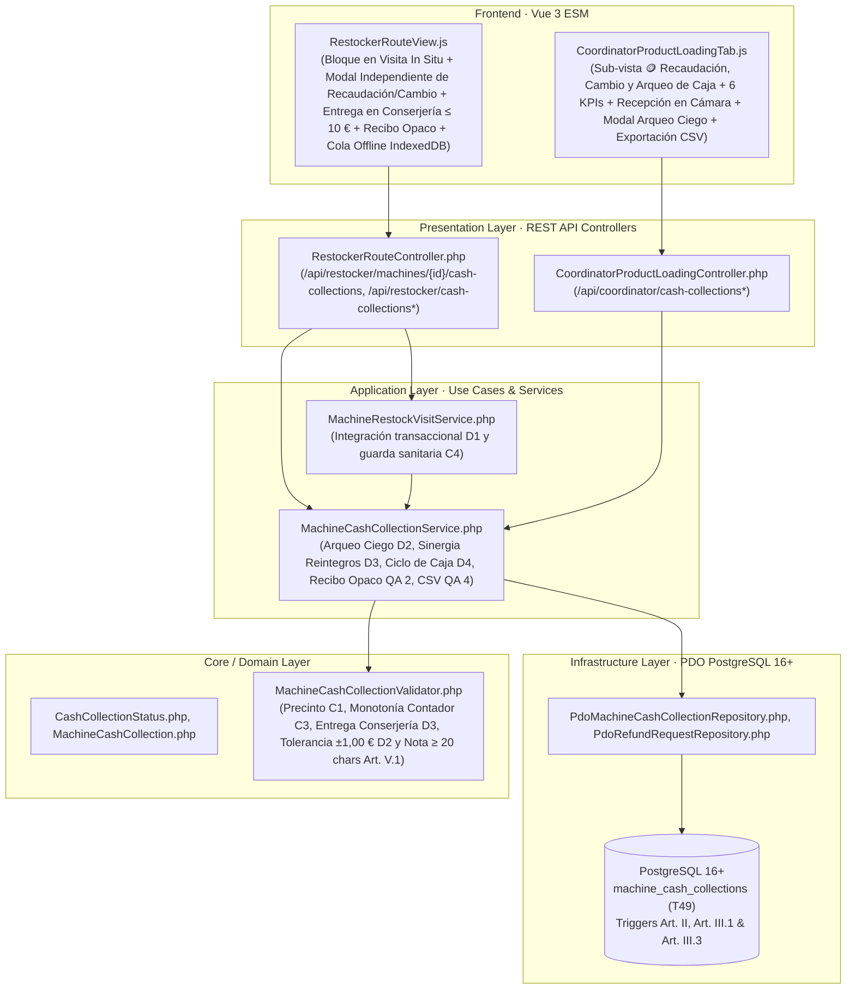

# Plan de Implementación Técnica: Recaudación de Efectivo, Carga de Tubos de Cambio y Arqueo de Caja (`35-cash-collection-vault-audit`)

**Módulo:** `35-cash-collection-vault-audit` (Feature 25 de `docs/features_pendientes.md`)\
**Versión:** 2.0 (Alineado con `spec.md` v2.0 y `cash_collection_vault_audit_contracts.md` v2.0, incorporando los 17 puntos de revisión QA)\
**Estado:** Plan Técnico Aprobado por el Product Owner el 2026-11-16 · Puerta SDD Fase 2 cerrada · Definitivo para Ejecución SDD\
**Marco Normativo:** [`constitution.md`](../../constitution.md) · [`AGENTS.md`](../../AGENTS.md) · [`docs/design.md`](../../docs/design.md)\
**Especificación Funcional:** [`specs/35-cash-collection-vault-audit/spec.md`](./spec.md) (v2.0) · [`specs/functional/cash_collection_vault_audit_spec.md`](../functional/cash_collection_vault_audit_spec.md)\
**Contratos Técnicos:** [`specs/technical/cash_collection_vault_audit_contracts.md`](../technical/cash_collection_vault_audit_contracts.md)

---

## 1. Arquitectura de Módulos y Estructura de Ficheros

La solución se construye bajo **Clean Architecture** en PHP 8.2+ POO puro (`declare(strict_types=1);`), persistencia única en **PostgreSQL 16+ (`pdo_pgsql`)** y **Vue 3 (ES Modules nativos)** sin bundlers ni dependencias externas.

### 1.1. Base de Datos y Esquema Relacional (`database/` y `specs/technical/`)
| Fichero | Acción | Responsabilidad |
| :--- | :--- | :--- |
| `database/supabase_migrations/031_cash_collection_vault_audit.sql` | **Crear** | Migración DDL idempotente: creación de `cash_collection_status` (#42), adición de `'MACHINE_CASH_COLLECTION'` a `audit_entity_type`, creación de la Tabla 49 (`machine_cash_collections`) con 8 restricciones `CHECK` (`D1`–`D4`, `C1`, `C3`, `QA 1`), índice único parcial `uq_machine_cash_collections_visit`, restricciones únicas de precinto e idempotencia, disparadores `prevent_hard_delete()` (`Art. III.1`), `touch_updated_at()`, `enforce_machine_cash_collections_immutability()` (`Art. III.3`) y `enforce_cash_collection_sanitary_guard()` (`Art. II.2`). |
| `database/supabase_init.sql` | **Modificar** | Converger 1:1 el nuevo tipo #42, la ampliación de `audit_entity_type`, la Tabla 49 y sus funciones/disparadores. |
| `database/supabase_seeds.sql` y `src/Infrastructure/Database/SeedRunner.php` | **Modificar** | Sembrar recaudaciones representativas del ciclo completo (`RECONCILED_OK`, `DISCREPANCY_FLAGGED` con justificación, `DELIVERED_TO_VAULT` y `SEALED_IN_ROUTE` con entrega en conserjería). |
| `specs/technical/database_schema.md`, `specs/technical/schema_correspondence_contract.md`, `tests/Support/PostgresFixtureBuilder.php` y `tests/Support/TestDataCleaner.php` | **Modificar** | Actualizar el inventario oficial de **48 a 49 tablas** y de **41 a 42 tipos `ENUM`** (47 a 48 columnas `ENUM`), e incluir `machine_cash_collections` en el orden de purgado transitorio (antes de `machine_restock_visits` y `refund_requests`). |

### 1.2. Capa de Dominio (`src/Core/`)
| Fichero | Acción | Responsabilidad |
| :--- | :--- | :--- |
| `src/Core/Domain/Enum/CashCollectionStatus.php` | **Crear** | Enumerado de dominio (`SEALED_IN_ROUTE`, `DELIVERED_TO_VAULT`, `RECONCILED_OK`, `DISCREPANCY_FLAGGED`) con etiquetas en español, estado público para reponedor (`publicRestockerStatus()`) y predicados de ciclo de vida. |
| `src/Core/Domain/Model/MachineCashCollection.php` | **Crear** | Entidad inmutable con proyecciones segregadas: `toRestockerArray()` (Arqueo Ciego estricto sin `expected_cashbox_eur`, `vault_counted_eur`, `discrepancy_eur` ni `discrepancy_justification`, `C2`, `Art. V.4`), `toCoordinatorArray()` y `toReceptionReceiptArray()` (`QA 2`, `Art. V.4`). |
| `src/Core/Service/MachineCashCollectionValidator.php` y `src/Core/Domain/Exception/MachineCashCollectionValidationException.php` | **Crear** | Validador puro de reglas de negocio: formato de precinto `bag_seal_code` (`C1`), monotonía del contador `sales_counter_reading` y reseteo con nota $\ge 20$ caracteres (`C3`, `Art. V.1`), cálculo de `expected_cashbox_eur` (`D2`), entrega en conserjería $\le 10,00\,\text{€}$ (`D3`), bloqueo ante aborto térmico (`C4`, `Art. II.2`) y umbral de tolerancia $\pm 1,00\,\text{€}$ en el arqueo de Caja Central con justificación obligatoria $\ge 20$ caracteres (`D2`, `Art. V.1`). |

### 1.3. Capa de Aplicación e Infraestructura (`src/Application/` y `src/Infrastructure/`)
| Fichero | Acción | Responsabilidad |
| :--- | :--- | :--- |
| `src/Core/Domain/Repository/MachineCashCollectionRepositoryInterface.php` y `src/Infrastructure/Repository/PdoMachineCashCollectionRepository.php` | **Crear** | Persistencia PDO de `machine_cash_collections`, consulta idempotente por `(restocker_id, client_mutation_id)`, comprobación de unicidad de `bag_seal_code`, lectura con bloqueo de la última recaudación por máquina, transiciones a `DELIVERED_TO_VAULT` y `RECONCILED_OK`/`DISCREPANCY_FLAGGED`, listado con 6 KPIs para Coordinación e historial del reponedor. |
| `src/Application/Service/MachineCashCollectionService.php` | **Crear** | Orquestación transaccional de recaudación en ruta (integrada o independiente `D1`), verificación territorial (`C2`) y sanitaria (`C4`), transición atómica del reintegro `linked_refund_request_id` a `DEPOSITED_AT_RECEPTION` (`D3`), recepción en cámara y arqueo en Caja Central (`D2`, `D4`), emisión del comprobante opaco de conserjería (`QA 2`), volcado de conflicto offline (`C4`) y exportación CSV UTF-8 BOM neutralizada (`QA 4`). |
| `src/Application/Service/MachineRestockVisitService.php` | **Modificar** | Integrar el registro atómico del bloque opcional `cash_collection` al completar una visita (`D1`), rechazarlo si la visita es `ABORTED_THERMAL_BREACH` (`C4`, `Art. II.2`) y adjuntar `cash_collection_summary` en el detalle de visita de Coordinación (`QA 3`). |

### 1.4. Capa de Presentación y Frontend (`src/Presentation/` y `public/assets/js/`)
| Fichero | Acción | Responsabilidad |
| :--- | :--- | :--- |
| `src/Presentation/Controller/RestockerRouteController.php`, `CoordinatorProductLoadingController.php` y `src/Presentation/Http/AppRouter.php` | **Modificar** | Exponer los endpoints móviles de recaudación, recibo de conserjería y volcado de conflicto offline, así como los endpoints de Coordinación (listado, detalle, recepción en cámara, arqueo y exportación CSV), garantizando el blindaje RBAC y de opacidad (`Art. V.4`). |
| `public/assets/js/components/RestockerRouteView.js` y `public/assets/js/services/api.js` | **Modificar** | Añadir el bloque opcional de recaudación/cambio dentro del asistente de visita in situ (`D1`), el modal independiente **«🪙 Recaudación / Cambio»** en cada máquina, la selección en 1 toque de reintegros pendientes en conserjería ($\le 10,00\,\text{€}$, `D3`), el modal imprimible de Recibo de Conserjería (`QA 2`), la cola Offline en `IndexedDB` para recaudaciones independientes (`D4`, `C4`) y el historial de bolsas del reponedor bajo Arqueo Ciego (`C2`). |
| `public/assets/js/components/CoordinatorProductLoadingTab.js` | **Modificar** | Incorporar la cuarta sub-vista **«🪙 Recaudación, Cambio y Arqueo de Caja»** con 6 KPIs, filtros (incluida búsqueda por precinto), recepción en cámara en 1 toque, modal interactivo de **Arqueo de Bolsa Precintada** con cálculo en vivo del descuadre y exportación CSV (`RF-05.3`, `QA 4`). |
