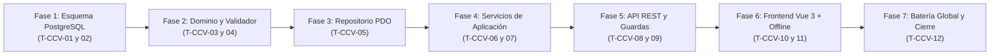

# Plan de Tareas de Implementación (`tasks.md`): Recaudación de Efectivo, Carga de Tubos de Cambio y Arqueo de Caja (`35-cash-collection-vault-audit`)

**Módulo:** `35-cash-collection-vault-audit`\
**Versión:** 2.1 (Alineado con `spec.md` v2.1, `cash_collection_vault_audit_contracts.md` y `plan.md` v2.1; 4 resoluciones QA agregadas `QA 1`–`QA 4`)\
**Estado:** Aprobado por el Product Owner el 2026-11-16 (enmienda `FIX-35-07` el 2026-11-16) · Puerta SDD Fase 2 cerrada · Listo para iniciar en `T-CCV-01`\
**Metodología:** SDD (Specification-Driven Development) · Clean Architecture · TDD / Guardas de Esquema y Diseño\
**Ley Suprema:** [`constitution.md`](../../constitution.md), [`AGENTS.md`](../../AGENTS.md) y [`docs/design.md`](../../docs/design.md)

---

## Resumen de Fases y Grafo de Dependencias

| Fase | Rango de Tareas | Descripción | Tiempo Estimado |
| :--- | :--- | :--- | :--- |
| **Fase 1** | `T-CCV-01` .. `T-CCV-02` | Migración `031_cash_collection_vault_audit.sql`, Tabla 49 `machine_cash_collections` y enum #42 `cash_collection_status`, convergencia en `supabase_init.sql`, semillas, contratos a 49 tablas / 42 enums y suite de esquema PostgreSQL | ~45 min |
| **Fase 2** | `T-CCV-03` .. `T-CCV-04` | Enum `CashCollectionStatus`, entidad `MachineCashCollection` (proyecciones segregadas `Art. V.4`) y `MachineCashCollectionValidator` (`D2`, `D3`, `C1`, `C3`, `C4`, `Art. II.2`, `Art. V.1`) + tests unitarios | ~45 min |
| **Fase 3** | `T-CCV-05` | Implementación de `PdoMachineCashCollectionRepository` (alta en ruta, idempotencia `client_mutation_id`, lectura de último contador, recepción en cámara, arqueo terminal, 6 KPIs y resumen del reponedor) + tests de integración | ~45 min |
| **Fase 4** | `T-CCV-06` .. `T-CCV-07` | Servicio `MachineCashCollectionService` (captura en ruta, sinergia con `refund_requests` `D3`, arqueo ciego `D2`/`D4`, recibo opaco `QA 2`, volcado offline `C4` y CSV `QA 4`) e integración `D1`/`QA 3` en `MachineRestockVisitService` + tests unitarios | ~55 min |
| **Fase 5** | `T-CCV-08` .. `T-CCV-09` | Extensión de `RestockerRouteController`, `CoordinatorProductLoadingController` y `AppRouter`, y suites de integración HTTP y blindaje constitucional (`CashCollectionVaultAuditApiTest.php` y `CashCollectionVaultAuditConstitutionalTest.php`) | ~55 min |
| **Fase 6** | `T-CCV-10` .. `T-CCV-11` | Frontend Vue 3: cuarta sub-vista en `CoordinatorProductLoadingTab.js` (`RF-05.3`, `QA 4`) y captura integrada/independiente + conserjería + recibo + cola Offline en `RestockerRouteView.js` (`RF-05.1`, `RF-05.2`, `Art. V.4`) + tests `.mjs` | ~55 min |
| **Fase 7** | `T-CCV-12` | Ejecución de batería global (`php tests/run_all.php`), sincronización `DocMetricsGuard`, matriz de trazabilidad `traceability-matrix.md` y actualización de `docs/features_pendientes.md` | ~25 min |

---

## Detalle de Tareas

- [x] **T-CCV-01 · Crear migración `031_cash_collection_vault_audit.sql`, converger `supabase_init.sql` y sembrar recaudaciones y arqueos en `supabase_seeds.sql` y `SeedRunner`**
  - **Requisitos:** `RF-01.1`–`RF-01.3`, `RNF-01`, `D1`–`D4`, `C1`, `C3`, `C4`, `QA 1`, `Art. II.2`, `Art. III.1`, `Art. III.3`.
  - **Verificación:** `php tests/integration/SchemaConvergenceParityTest.php`
  - **Cierre (2026-11-16):** `SchemaConvergenceParityTest` 39/39 (`exit=0`) con 49 tablas, 48 columnas `ENUM`, 42 tipos y 31 migraciones; `SeedRunnerSingleEngineTest` 26/26 y `SeedDataTest` en verde; `bin/migrate.php` aplica `031` y declara el esquema convergido. Las semillas crean las cuatro recaudaciones (una por estado de custodia) y son idempotentes. `PostgresSchemaTest` y `PostgresConstitutionalTest` se actualizan en `T-CCV-02`, que es su criterio de verificación declarado.

- [x] **T-CCV-02 · Actualizar contratos de esquema (49 tablas, 42 enums), `PostgresFixtureBuilder`, `TestDataCleaner` y crear `PostgresCashCollectionVaultAuditSchemaTest.php`**
  - **Requisitos:** `RF-01.1`–`RF-01.3`, `RNF-01`, `D4`, `C1`, `C3`, `C4`, `Art. II.2`, `Art. III.1`, `Art. III.3`.
  - **Verificación:** `php tests/integration/PostgresSchemaTest.php && php tests/integration/PostgresConstitutionalTest.php && php tests/integration/PostgresCashCollectionVaultAuditSchemaTest.php`
  - **Cierre (2026-11-16):** Contratos de esquema elevados a 49 tablas y 42 tipos en `schema_correspondence_contract.md` y `database_schema.md`. `PostgresFixtureBuilder` sintetiza los formatos cerrados `MCC-AAAA-NNNN` y `BAG-...` de la Tabla 49, y el expediente genérico nace como `PAYMENT_SYSTEM` para no dejar un ticket térmico abierto que el cerrojo sanitario convirtiera en un rechazo legítimo. `TestDataCleaner` incorpora `machine_cash_collections` como raíz de purga. Creada `PostgresCashCollectionVaultAuditSchemaTest.php` (46 aserciones).

- [x] **T-CCV-03 · Crear `CashCollectionStatus` y `MachineCashCollection` con proyecciones segregadas (`toRestockerArray`, `toCoordinatorArray`, `toReceptionReceiptArray` — `C2`, `QA 2`, `Art. V.4`)**
  - **Requisitos:** `RF-01.1`, `RF-03.2`, `RNF-02`, `D2`–`D4`, `C2`, `QA 1`, `QA 2`, `Art. V.4`.
  - **Verificación:** `php tests/unit/CashCollectionDomainModelsTest.php`
  - **Cierre (2026-11-16):** `CashCollectionStatus` con los cuatro estados, estado público `PROCESSED_IN_VAULT` para los arqueos terminales y predicados de ciclo de vida. `MachineCashCollection` inmutable, con las identidades del motor en el borde (código `MCC-AAAA-NNNN`, precinto normalizado, cotas, aritmética del contador, conserjería y ciclo de vida con tolerancia de ±1,00 €) y tres proyecciones segregadas: Arqueo Ciego del reponedor, vista financiera de Coordinación y recibo de conserjería de nueve campos sin PII. 65 aserciones unitarias.

- [x] **T-CCV-04 · Crear `MachineCashCollectionValidator` y `MachineCashCollectionValidationException` (precinto `C1`, monotonía y reseteo de contador `C3`, entrega en conserjería `D3`, guarda térmica `C4` y tolerancia $\pm 1,00\,\text{€}$ con justificación $\ge 20$ chars `D2`/`Art. V.1`)**
  - **Requisitos:** `RF-01.2`, `RF-02.1`, `RF-02.2`, `RF-03.1`, `RF-04.2`, `D2`, `D3`, `C1`, `C3`, `C4`, `Art. II.2`, `Art. V.1`.
  - **Verificación:** `php tests/unit/MachineCashCollectionValidatorTest.php`
  - **Cierre (2026-11-16):** `MachineCashCollectionValidationException` con los códigos exactos del contrato (precinto, contador, cotas, conserjería, bloqueo sanitario, aborto térmico, justificación y arqueo terminal) y `MachineCashCollectionValidator`, que normaliza el precinto, aplica la primacía sanitaria y de la visita, calcula en privado `expected_cashbox_eur` en los tres caminos del contador, valida la entrega en conserjería y resuelve el arqueo con la tolerancia de ±1,00 €. 114 aserciones unitarias.

- [x] **T-CCV-05 · Implementar `PdoMachineCashCollectionRepository` (alta en Tabla 49, idempotencia `client_mutation_id`, lectura de último contador por máquina, recepción en cámara, arqueo terminal, 6 KPIs de Coordinación y resumen del reponedor)**
  - **Requisitos:** `RF-01.1`–`RF-01.3`, `RF-02.2`, `RF-04.1`, `RF-04.2`, `RF-05.2`, `RF-05.3`, `D1`, `D2`, `D4`, `C1`, `QA 1`, `QA 3`, `Art. III.1`, `Art. III.3`, `Art. V.4`.
  - **Verificación:** `php tests/integration/PdoMachineCashCollectionRepositoryTest.php`
  - **Cierre (2026-11-16):** `MachineCashCollectionRepositoryInterface` y `PdoMachineCashCollectionRepository` con alta de la captura en ruta, idempotencia por `(restocker_id, client_mutation_id)`, detección del precinto consumido, última lectura de contador por máquina, historial del reponedor, libro de Coordinación con los 6 KPIs reactivos al filtro, resumen opaco de ruta, recepción en cámara y arqueo terminal. Las dos transiciones devuelven `null` cuando la fila ya no admite el paso, para que el servicio lo traduzca a `409`. 45 aserciones de integración.

- [x] **T-CCV-06 · Implementar `MachineCashCollectionService` (captura en ruta con cálculo privado `expected_cashbox_eur`, transición atómica de `refund_requests` a `DEPOSITED_AT_RECEPTION` `D3`, recepción en cámara, arqueo ciego `D2`/`D4`, recibo de conserjería `QA 2`, volcado offline `C4` y exportación CSV `QA 4`)**
  - **Requisitos:** `RF-02.1`, `RF-02.2`, `RF-03.1`, `RF-03.2`, `RF-04.1`, `RF-04.2`, `RF-05.1`, `RF-05.3`, `D1`–`D4`, `C1`–`C4`, `QA 1`–`QA 4`, `Art. II.2`, `Art. III.3`, `Art. V.1`, `Art. V.4`.
  - **Verificación:** `php tests/unit/MachineCashCollectionServiceTest.php`
  - **Cierre (2026-11-16):** `MachineCashCollectionService` con captura transaccional e idempotente, validación de rol/perímetro/cerrojos, cálculo privado del esperado, sinergia atómica con `refund_requests`, recepción en cámara, arqueo terminal, recibo de conserjería, volcado offline y CSV con BOM neutralizado. `MachineCashCollectionGatewayInterface` y `PdoMachineCashCollectionGateway` aportan los tres `FOR UPDATE` (máquina/sede, visita y reintegro). 44 aserciones unitarias.

- [x] **T-CCV-07 · Integrar `D1`, `C4` y `QA 3` en `MachineRestockVisitService` (registro atómico de `cash_collection` dentro de la visita `COMPLETED`, rechazo en `ABORTED_THERMAL_BREACH`, exposición de `cash_collection_summary` en detalle de visita y enriquecimiento de `/api/restocker/my-route`)**
  - **Requisitos:** `RF-02.1`, `RF-05.2`, `RF-05.3`, `D1`, `D3`, `C4`, `QA 3`, `Art. II.2`, `Art. V.4`.
  - **Verificación:** `php tests/unit/MachineRestockVisitServiceTest.php`
  - **Cierre (2026-11-16):** Puerto `CashCollectionRegistrarInterface` (`registerCollectionInTransaction`, `summarizeForVisit`, `routeCashContext`) implementado por `MachineCashCollectionService`, que ahora envuelve `registerCollection()` en la transacción del llamante. `MachineRestockVisitService` registra `cash_collection` dentro de la misma transacción de la visita `COMPLETED` con `restock_visit_id`, rechaza con `422 THERMAL_ABORT_CASH_COLLECTION_FORBIDDEN` cualquier captura en `ABORTED_THERMAL_BREACH` antes de escribir y expone `cash_collection_summary` en `findVisitDetail()` y `recent_cash_collections`/`cash_route_summary` en `/api/restocker/my-route`. El repositorio añade `findByRestockVisitId()`. 50 aserciones unitarias.

- [x] **T-CCV-08 · Extender `RestockerRouteController`, `CoordinatorProductLoadingController` y registrar las nuevas rutas + guardas RBAC en `AppRouter`**
  - **Requisitos:** `RF-01` a `RF-05`, `Art. V.4`.
  - **Verificación:** `php tests/integration/CashCollectionVaultAuditApiTest.php`
  - **Cierre (2026-11-16):** `RestockerRouteController` expone la captura independiente (`POST /api/restocker/machines/{machineId}/cash-collections`), el historial bajo Arqueo Ciego, el recibo de conserjería y el volcado de conflicto; `/api/restocker/my-route` enriquece cada máquina con `has_physical_reception`, `has_prior_cash_collection` y `pending_reception_refunds` (sin PII ni `pickup_pin`) y añade `recent_cash_collections`/`cash_route_summary`. `CoordinatorProductLoadingController` publica el libro con 6 KPIs, el detalle financiero, la recepción en cámara, el arqueo terminal, el recibo y el CSV, y adjunta `cash_collection_summary` al detalle de visita. `AppRouter` registra las rutas con `RESTOCKER`/`COORDINATOR` y el orden estático antes del dinámico. El gateway incorpora `routeBootstrap()` como lectura no bloqueante del bootstrap móvil. 25 aserciones HTTP.

- [x] **T-CCV-09 · Certificar suites de integración HTTP y blindaje constitucional (`CashCollectionVaultAuditApiTest.php` y `CashCollectionVaultAuditConstitutionalTest.php`)**
  - **Requisitos:** `RF-01` a `RF-05`, `D1`–`D4`, `C1`–`C4`, `QA 1`–`QA 4`, `Art. II.2`, `Art. III.1`, `Art. III.3`, `Art. V.1`, `Art. V.4`.
  - **Verificación:** `php tests/integration/CashCollectionVaultAuditApiTest.php && php tests/integration/CashCollectionVaultAuditConstitutionalTest.php`
  - **Cierre (2026-11-16):** Ampliada `CashCollectionVaultAuditApiTest.php` a 30 aserciones (regresión de contador, aborto térmico con recaudación, sede sin conserjería física, descuadre justificado y neutralización de fórmula en CSV) y creada `CashCollectionVaultAuditConstitutionalTest.php` con 23 aserciones que certifican la primacía sanitaria en aplicación y motor (`Art. II.2`), la opacidad del Arqueo Ciego, el recibo de nueve campos y el RBAC (`Art. V.4`), la inmutabilidad de ruta y el bloqueo terminal (`Art. III.1`, `Art. III.3`), las justificaciones reales y el `CHECK` de descuadre (`Art. V.1`), los snapshots tras la baja lógica (`QA 1`) y la auditoría con rol `COORDINATOR`. Ambas suites en verde y sin esquemas residuales.

- [x] **T-CCV-10 · Extender `CoordinatorProductLoadingTab.js` con la cuarta sub-vista «🪙 Recaudación, Cambio y Arqueo de Caja» (6 KPIs, filtros, recepción en cámara, modal de arqueo ciego y exportación CSV)**
  - **Requisitos:** `RF-04.1`, `RF-04.2`, `RF-05.3`, `RNF-03`, `D2`, `D4`, `QA 3`, `QA 4`, `Art. V.1`, `Art. V.4`.
  - **Verificación:** `node tests/frontend/coordinator_product_loading_tab.test.mjs`
  - **Cierre (2026-11-16):** `api.js` expone las seis operaciones de recaudación de Coordinación (libro, detalle, recepción, arqueo, recibo y CSV). `CoordinatorProductLoadingTab.js` incorpora la cuarta sub-vista con los 6 KPIs reactivos, filtros por reponedor/máquina/estado/precinto/fechas, tabla financiera, recepción en un toque, modal de arqueo ciego con cálculo en vivo y justificación obligatoria fuera de ±1,00 €, recibo de nueve campos, salto a la visita vinculada y exportación CSV con el filtro activo. El Service Worker sube a `vendguard-app-shell-v21`. Suite frontend: 80/80 aserciones; regresiones directas: planograma 50/50 y ruta del reponedor 171/171.

- [x] **T-CCV-11 · Extender `RestockerRouteView.js` con el bloque opcional de recaudación en la visita in situ (`D1`), el modal rápido de recaudación/cambio en máquina, entrega en conserjería ($\le 10,00\,\text{€}$, `D3`), recibo opaco (`QA 2`), cola Offline (`D4`, `C4`) e historial con Arqueo Ciego (`C2`, `Art. V.4`)**
  - **Requisitos:** `RF-02`, `RF-03`, `RF-05.1`, `RF-05.2`, `RNF-02`, `RNF-03`, `D1`–`D4`, `C1`–`C4`, `QA 2`, `Art. II.2`, `Art. V.4`.
  - **Verificación:** `node tests/frontend/restocker_route_view.test.mjs`
  - **Cierre (2026-11-16):** `api.js` expone las cuatro operaciones móviles de recaudación (captura independiente, historial, recibo y volcado de conflicto). `RestockerRouteView.js` incorpora el botón rápido «🪙 Recaudación / Cambio» por máquina con el indicador `pending_reception_refunds_count`, el bloque opcional «🪙 Recaudar Hucha / Cargar Cambio / Conserjería» dentro de la visita (`D1`), la selección en un toque de reintegros `EN_MANO_SEDE`, la entrega en conserjería limitada a 10,00 €, el nombre de conserje, el resumen de ruta, el recibo opaco de exactamente nueve campos (`QA 2`, `Art. V.4`) y el historial «🪙 Mis Bolsas Precintadas y Cambios de Ruta» sin las cinco claves privadas del Arqueo Ciego. El bloque de efectivo se oculta y se omite del payload en `ABORTED_THERMAL_BREACH` (`Art. II.2`). Creada `CashCollectionOfflineQueue.js` (IndexedDB FIFO aislada por `restocker_id`, idempotencia por `client_mutation_id`, conflictos y volcado a auditoría, con respaldo en memoria en Node) y el Service Worker sube a `vendguard-app-shell-v22` para precachearla. Suite frontend: 209/209 aserciones; regresiones directas: Coordinación 80/80 y planograma 50/50; `node --check` de componente, cola, API y Service Worker en verde; sin datos ni esquemas residuales (cambio exclusivamente frontend).

- [x] **T-CCV-12 · Ejecutar batería global (`php tests/run_all.php`), sincronizar `DocMetricsGuard`, generar `traceability-matrix.md` y actualizar `docs/features_pendientes.md`**
  - **Requisitos:** `DoD 1`–`DoD 5`.
  - **Verificación:** `php tests/run_all.php`
  - **Cierre (2026-11-16):** Creada `specs/35-cash-collection-vault-audit/traceability-matrix.md` con `RF-01`–`RF-05`, `RNF-01`–`RNF-03`, `D1`–`D4`, `C1`–`C4`, `QA 1`–`QA 4` y `DoD 1`–`DoD 5` enlazados a las suites y resultados medidos. La corrida global destapó y corrigió cinco deudas reales: el visor no catalogaba `MACHINE_CASH_COLLECTION` ni `OFFLINE_CASH_COLLECTION_CONFLICT_DUMP`; cuatro suites no publicaban el formato canónico de aserciones; cuatro botones móviles conservaban geometría en línea; el plan de purga seguía en 37 tablas frente a las 38 transitorias; y la semilla de recaudaciones abortaba la siembra completa si una máquina tenía una avería térmica viva. La semilla ahora respeta el Art. II omitiendo el corte bloqueado y lo recupera cuando la máquina vuelve a estar disponible. `README.md` y `docs/features_pendientes.md` quedan sincronizados con la cifra viva y la Feature 25 marcada como implementada. `php tests/run_all.php` → **435/435 suites · 16.676 aserciones · 0 fallos · `exit=0`**, con `DocMetricsGuard` coherente, base restablecida y sin esquemas residuales. `php tests/run_new_engine.php` (`.env.local`) → 64 suites, 63 en verde, 1 no ejecutable por el contrato TLS local, 2.089 aserciones, 0 fallos y `exit=0`.
