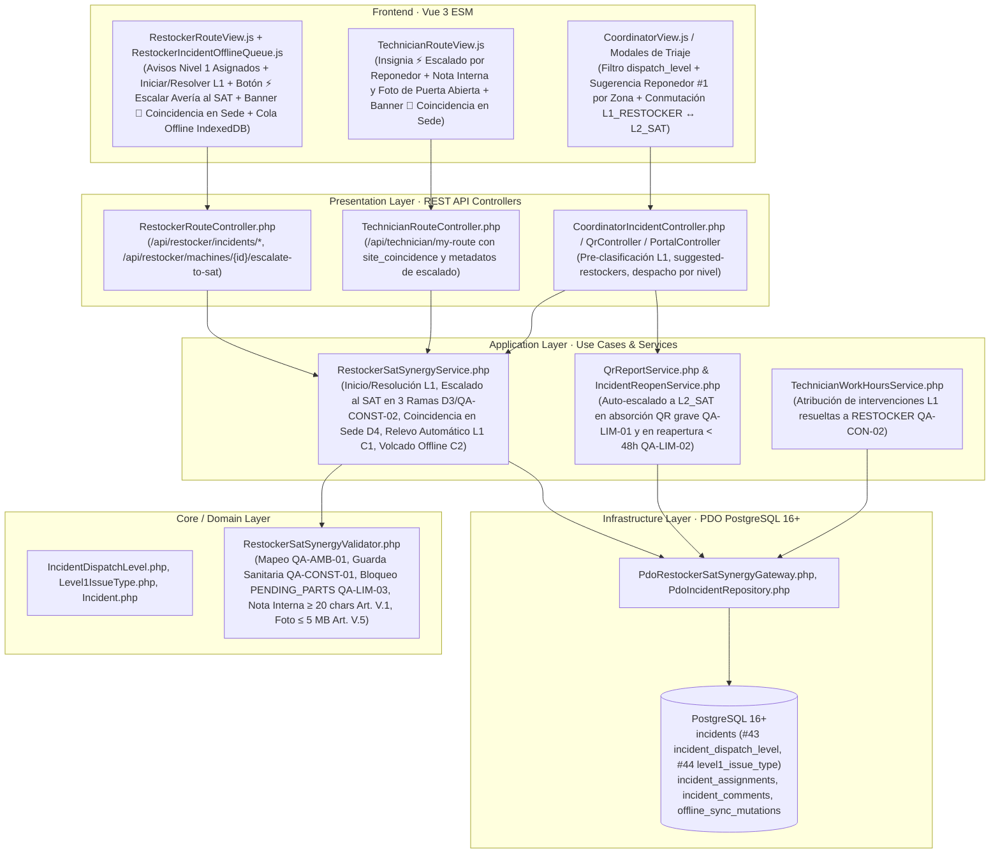

# Plan de Implementación Técnica: Sinergia Operativa Reponedor ↔ Técnico SAT (`36-restocker-sat-synergy`)

**Módulo:** `36-restocker-sat-synergy` (Feature 26 de `docs/features_pendientes.md`)\
**Versión:** 1.0 (Alineado con `spec.md` v1.0 y `restocker_sat_synergy_contracts.md`, incorporando `D1`–`D4`, `C1`–`C2` y las 9 salvaguardas de auditoría QA `QA-*`)\
**Estado:** Plan Técnico Aprobado por el Product Owner el 2026-11-18 · Puerta SDD Fase 2 cerrada · Definitivo para Ejecución SDD\
**Marco Normativo:** [`constitution.md`](../../constitution.md) · [`AGENTS.md`](../../AGENTS.md) · [`docs/design.md`](../../docs/design.md)\
**Especificación Funcional:** [`specs/36-restocker-sat-synergy/spec.md`](./spec.md) (v1.0) · [`specs/functional/restocker_sat_synergy_spec.md`](../functional/restocker_sat_synergy_spec.md)\
**Contratos Técnicos:** [`specs/technical/restocker_sat_synergy_contracts.md`](../technical/restocker_sat_synergy_contracts.md)

---

## 1. Arquitectura de Módulos y Estructura de Ficheros

La solución se construye bajo **Clean Architecture** en PHP 8.2+ POO puro (`declare(strict_types=1);`), persistencia única en **PostgreSQL 16+ (`pdo_pgsql`)** y **Vue 3 (ES Modules nativos)** sin bundlers ni dependencias externas.

### 1.1. Base de Datos y Esquema Relacional (`database/` y `specs/technical/`)
| Fichero | Acción | Responsabilidad |
| :--- | :--- | :--- |
| `database/supabase_migrations/032_restocker_sat_synergy.sql` | **Crear** | Migración DDL idempotente: creación de `incident_dispatch_level` (#43) y `level1_issue_type` (#44); ampliación de `comment_author_type` (`'RESTOCKER'`), `incident_assignment_source` y `incident_unassignment_reason_type` (`QA-AMB-02`); adición de `dispatch_level`, `level1_issue_type`, `escalated_from_restocker_id` y `escalated_to_sat_at` en `incidents` con `chk_incidents_l1_dispatch_coherence` (`Art. II`, `QA-LIM-03`, `QA-CONST-01`); ampliación de `offline_sync_mutations` (`chk_offline_sync_stop_type` y `chk_offline_sync_operation_type`, `RF-05.1`); y siembra de las 4 causas raíz (`RC-L1-*`) y soluciones estandarizadas (`SS-L1-*`) de Nivel 1 (`QA-AMB-01`). |
| `database/supabase_init.sql` | **Modificar** | Converger 1:1 los nuevos tipos #43 y #44, las ampliaciones de `ENUM`, las columnas y restricción `CHECK` de `incidents` y la evolución de `offline_sync_mutations`. |
| `database/supabase_seeds.sql` y `src/Infrastructure/Database/SeedRunner.php` | **Modificar** | Incorporar de forma idempotente las 4 causas raíz y soluciones estandarizadas de Nivel 1 (`RC-L1-*` / `SS-L1-*`) y expedientes semilla representativos (`L1_RESTOCKER` activo y ticket escalado in situ a `L2_SAT`). |
| `specs/technical/database_schema.md`, `specs/technical/schema_correspondence_contract.md` y `tests/Support/PostgresFixtureBuilder.php` | **Modificar** | Actualizar el inventario oficial de **42 a 44 tipos `ENUM`** (de 48 a 50 columnas `ENUM`, manteniendo **49 tablas**). |

### 1.2. Capa de Dominio (`src/Core/`)
| Fichero | Acción | Responsabilidad |
| :--- | :--- | :--- |
| `src/Core/Domain/ValueObject/IncidentDispatchLevel.php` y `src/Core/Domain/ValueObject/Level1IssueType.php` | **Crear** | Value Objects / Enums de dominio con mapeo determinista `Level1IssueType::mappedCategory()` (`QA-AMB-01`), código de causa raíz semilla recomendada, etiquetas en español y predicados de elegibilidad. |
| `src/Core/Domain/Model/Incident.php` | **Modificar** | Incorporar `dispatchLevel` (`L1_RESTOCKER` \| `L2_SAT`), `level1IssueType`, `escalatedFromRestockerId` y `escalatedToSatAt`, garantizando que las proyecciones públicas/Sede jamás expongan dichos campos (`QA-CONST-03`, `Art. V.4`). |
| `src/Core/Service/RestockerSatSynergyValidator.php` y `src/Core/Domain/Exception/RestockerSatSynergyValidationException.php` | **Crear** | Validador puro de reglas de negocio: elegibilidad y mapeo de `level1_issue_type` (`D2`, `QA-AMB-01`), prohibición de `L1_RESTOCKER` en `TEMPERATURE_COLD`/`ELECTRICAL_OFF` o máquina en `QUARANTINE` (`QA-CONST-01`, `Art. II`), coherencia de rol `RESTOCKER`/`TECHNICIAN` según `dispatch_level` (`QA-CON-01`), prohibición de `PENDING_PARTS` en Nivel 1 (`QA-LIM-03`), nota interna de escalado $\ge 20$ caracteres con $\ge 3$ bloques alfanuméricos (`Art. V.1`), diagnóstico/acción de resolución L1 $\ge 20$ caracteres (`Art. V.1`) y validación de imagen $\le 5\text{ MB}$ por magic bytes (`Art. V.5`). |

### 1.3. Capa de Aplicación e Infraestructura (`src/Application/` y `src/Infrastructure/`)
| Fichero | Acción | Responsabilidad |
| :--- | :--- | :--- |
| `src/Core/Domain/Repository/RestockerSatSynergyGatewayInterface.php` y `src/Infrastructure/Repository/PdoRestockerSatSynergyGateway.php` | **Crear** | Operaciones transaccionales PDO con `SELECT ... FOR UPDATE`: lectura y bloqueo de máquina e incidencia activa, inicio y resolución L1 con snapshots de taxonomía y cierre de custodia, escalado al SAT en sus 3 ramas (`ESCALATED_FROM_L1`, `CREATED_NEW_SAT_TICKET`, `MERGED_INTO_EXISTING_SAT_TICKET`), consulta de `site_coincidence` bidireccional (`D4`), relevo automático de tickets L1 al cerrar turno/ausencia/baja (`C1`) e idempotencia en `offline_sync_mutations` (`RF-05.1`). |
| `src/Application/Service/RestockerSatSynergyService.php` | **Crear** | Caso de uso integral de Sinergia Reponedor ↔ SAT: bootstrap de avisos L1 y `site_coincidence`, sugerencia de reponedores por zona (`RestockerZoneCoverageService`) enriquecida con carga viva L1 (`RF-02.1`), despacho/conmutación por Coordinación, inicio y resolución L1 in situ, escalado «⚡ Escalar Avería al SAT» con `TechnicianAssignmentSuggester` y `NotificationOutboxEnqueuerService` (`RF-03.2`), relevo de fin de turno L1 (`RF-04.2`) y volcado de conflictos Offline (`RF-05.1`). |
| `src/Application/Service/QrReportService.php`, `PortalIncidentService` / `IncidentReopenService` y `TechnicianWorkHoursService.php` | **Modificar** | (1) En `QrReportService`: pre-clasificación `L1_RESTOCKER` por `level1_issue_type` (`RF-01.2`) y auto-escalado inmediato a `L2_SAT` en `mergeIntoExistingIncident()` ante avería térmica/eléctrica o reclamación $> 10,00\,\text{€}$ / digital (`RF-02.2`, `QA-LIM-01`); (2) en reaperturas $< 48\text{ h}$: promoción automática de `L1_RESTOCKER` a `L2_SAT` (`RF-02.3`, `QA-LIM-02`); (3) en cierre de turno/ausencia/baja: bloqueo `409 SHIFT_CLOSE_BLOCKED_IN_PROGRESS_L1` y relevo automático (`C1`); (4) en `TechnicianWorkHoursService`: cómputo de intervenciones L1 resueltas por reponedor (`QA-CON-02`). |

### 1.4. Capa de Presentación y Frontend (`src/Presentation/` y `public/assets/js/`)
| Fichero | Acción | Responsabilidad |
| :--- | :--- | :--- |
| `src/Presentation/Controller/RestockerRouteController.php`, `TechnicianRouteController.php`, `CoordinatorController.php` y `src/Presentation/Http/AppRouter.php` | **Modificar** | Exponer los endpoints móviles del reponedor (`start`, `resolve`, `escalate-to-sat` por ticket y por máquina, `upload-photo`, `conflict-dump`), enriquecer `/api/restocker/my-route` y `/api/technician/my-route` con `site_coincidence`, y ampliar Coordinación (`?dispatch_level=`, `suggested-restockers`, asignación dual L1/L2) respetando el RBAC estricto (`QA-CON-01`) y la opacidad frente a Sede/QR (`QA-CONST-03`, `Art. V.4`). |
| `public/assets/js/components/RestockerRouteView.js`, `public/assets/js/services/RestockerIncidentOfflineQueue.js` y `public/assets/js/services/api.js` | **Modificar / Crear** | Incorporar en `RestockerRouteView.js` la bandeja y badges de **Avisos de Nivel 1**, los modales de **Resolución de Nivel 1** (con preselección 1-Tap de causa/solución L1) y **«⚡ Escalar Avería al SAT»** (desde aviso L1, tarjeta de máquina o asistente de visita in situ), el banner **«🤝 Coincidencia en Sede»** con enlace `tel:`, y la cola Offline `IndexedDB` (`RestockerIncidentOfflineQueue.js`) con volcado de conflictos. |
| `public/assets/js/components/TechnicianRouteView.js` y vistas de Coordinación (`CoordinatorView.js` / `IncidentDetailModal.js`) | **Modificar** | En `TechnicianRouteView.js`: mostrar la insignia **«⚡ Escalado por Reponedor In Situ»** con acceso destacado a la Nota Interna + foto y el banner **«🤝 Coincidencia en Sede»**. En Coordinación: filtro por nivel operativo (`ALL` \| `L1_RESTOCKER` \| `L2_SAT`), selector de nivel en Triaje y despacho en 1 clic al Reponedor `#1 RECOMENDADO ⭐` de la zona. |
