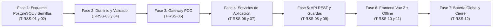

# Plan de Tareas de Implementación (`tasks.md`): Sinergia Operativa Reponedor ↔ Técnico SAT (`36-restocker-sat-synergy`)

**Módulo:** `36-restocker-sat-synergy`\
**Versión:** 1.0 (Alineado con `spec.md` v1.0, `restocker_sat_synergy_contracts.md` y `plan.md` v1.0; `D1`–`D4`, `C1`–`C2` y 9 salvaguardas QA `QA-*`)\
**Estado:** Aprobado por el Product Owner el 2026-11-18 · Puerta SDD Fase 2 cerrada · Módulo completado el 2026-11-18 (12/12 tareas) · **FIX-36-08 cerrado el 2026-11-19** con 11 suites propias y 561 aserciones verdes + layout L1/SAT 22/22 · certificación global 2026-11-19: **441 suites / 16.993 aserciones / 0 fallos** · canal `new_engine`: **70/71**, 2.342 aserciones, 1 fallo de esquema del pooler\
**Metodología:** SDD (Specification-Driven Development) · Clean Architecture · TDD / Guardas de Esquema y Diseño\
**Ley Suprema:** [`constitution.md`](../../constitution.md), [`AGENTS.md`](../../AGENTS.md) y [`docs/design.md`](../../docs/design.md)

> **Actualización de certificación (2026-11-19):** la evidencia focalizada del módulo sigue en **11 suites y 561 aserciones verdes**. La batería global se reejecutó y queda en **441 suites · 16.993 aserciones · 0 fallos**, con `DocMetricsGuard` corregido. El canal `new_engine` se reejecutó con `.env.docker-tls`: **70 evaluadas · 69 verdes · 2.320 aserciones · 1 fallo**, `PoolerLatencyMeasurementTest`, porque el esquema del pooler de certificación no tiene `incidents.dispatch_level` (migración 032 no aplicada). H-36-04 añadió `RestockerSatLayoutBrowserTest` **22/22** a 360 × 800; sumada a la corrida previa, el canal queda en **71 evaluadas · 70 verdes · 2.342 aserciones · 1 fallo**. No se reabre ningún fix funcional.

---

## Resumen de Fases y Grafo de Dependencias

| Fase | Rango de Tareas | Descripción | Tiempo Estimado |
| :--- | :--- | :--- | :--- |
| **Fase 1** | `T-RSS-01` .. `T-RSS-02` | Migración `032_restocker_sat_synergy.sql`, tipos #43 `incident_dispatch_level` y #44 `level1_issue_type`, evolución de `incidents`, `comment_author_type`, `incident_assignment_*` y `offline_sync_mutations`, 4 semillas `RC-L1-*`/`SS-L1-*`, contratos a 49 tablas / 44 enums y suite de esquema PostgreSQL | ~45 min |
| **Fase 2** | `T-RSS-03` .. `T-RSS-04` | Value Objects `IncidentDispatchLevel` y `Level1IssueType`, evolución de `Incident` (opacidad `Art. V.4`) y `RestockerSatSynergyValidator` (`D2`, `D3`, `QA-AMB-01`, `QA-CON-01`, `QA-LIM-03`, `QA-CONST-01`, `Art. II`, `Art. V.1`, `Art. V.5`) + tests unitarios | ~45 min |
| **Fase 3** | `T-RSS-05` | Implementación de `PdoRestockerSatSynergyGateway` (inicio y resolución L1, escalado al SAT en 3 ramas con `FOR UPDATE`, consulta `site_coincidence`, relevo automático L1 de fin de turno/ausencia e idempotencia en `offline_sync_mutations`) + tests de integración | ~50 min |
| **Fase 4** | `T-RSS-06` .. `T-RSS-07` | Servicio `RestockerSatSynergyService` e integraciones en `QrReportService` (auto-escalado en absorción QR grave `QA-LIM-01`), reapertura $< 48\text{ h}$ (`QA-LIM-02`), cierre de turno/ausencias/bajas (`C1`) y `TechnicianWorkHoursService` (`QA-CON-02`) + tests unitarios | ~55 min |
| **Fase 5** | `T-RSS-08` .. `T-RSS-09` | Extensión de controladores (`RestockerRouteController`, `TechnicianRouteController`, `CoordinatorController`, `QrController`, `PortalController`) y `AppRouter`, y suites HTTP y constitucional (`RestockerSatSynergyApiTest.php` y `RestockerSatSynergyConstitutionalTest.php`) | ~55 min |
| **Fase 6** | `T-RSS-10` .. `T-RSS-11` | Frontend Vue 3: Triaje/filtro L1/L2 en Coordinación + insignia de escalado y `site_coincidence` en `TechnicianRouteView.js` (`T-RSS-10`), y operativa L1 + botón «⚡ Escalar Avería al SAT» + `site_coincidence` + cola Offline `RestockerIncidentOfflineQueue.js` en `RestockerRouteView.js` (`T-RSS-11`) + tests `.mjs` | ~55 min |
| **Fase 7** | `T-RSS-12` | Ejecución de batería global (`php tests/run_all.php`) y canal `new_engine`, sincronización `DocMetricsGuard`, matriz de trazabilidad `traceability-matrix.md` y actualización de `docs/features_pendientes.md` | ~25 min |

---

## Detalle de Tareas

- [x] **T-RSS-01 · Crear migración `032_restocker_sat_synergy.sql`, converger `supabase_init.sql` y sembrar las 4 causas/soluciones de Nivel 1 (`RC-L1-*` / `SS-L1-*`) en `supabase_seeds.sql` y `SeedRunner`**
  - **Requisitos:** `RF-01.1`, `RF-01.3`, `RF-05.1`, `RNF-01`, `D1`, `D2`, `QA-AMB-01`, `QA-AMB-02`, `QA-LIM-03`, `QA-CONST-01`, `Art. II`, `Art. III.1`, `Art. III.3`, `Art. IV`.
  - **Verificación:** `php tests/integration/SchemaConvergenceParityTest.php`
  - **Cierre (2026-11-18):** Migración `032_restocker_sat_synergy.sql` creada con los tipos #43 `incident_dispatch_level` y #44 `level1_issue_type`, las ampliaciones de `comment_author_type` (`RESTOCKER`), `incident_assignment_source` (4 canales) e `incident_unassignment_reason_type` (3 causas), las 4 columnas de `incidents` con `chk_incidents_l1_dispatch_coherence` y su FK, el índice `idx_incidents_dispatch_level_status`, las 3 operaciones y el `stop_type = 'MACHINE'` de `offline_sync_mutations` y las 4 parejas `RC-L1-*` / `SS-L1-*`; convergida 1:1 en `supabase_init.sql` y sembrada en `supabase_seeds.sql` (Sección 17, 20 causas / 38 soluciones) y en `SeedRunner::canonicalRootCauseTaxonomyRows()`. `SchemaConvergenceParityTest` **42/42 aserciones verdes, `exit=0`** (56 columnas en `incidents`, 50 conjuntos `ENUM` / 44 tipos y 32 migraciones). Regresiones directas: `PostgresTieredSlaSchemaTest` 17/17, `PostgresSchemaTest` 153/153, `PostgresConstitutionalTest` 86/86, `SeedRunnerSingleEngineTest` 26/26, `SqlDialectPortabilityTest` 114/114 y `DemoHistorySeederTest` 23/23 (`exit=0` en todos). Sin esquemas residuales de la suite (`contract_convergence_check*` retirados). `CloudDeploySchemaParityTest` **55/55 aserciones verdes, `exit=0`** tras reconstruir `vendguard_battery` desde el DDL base y el libro actual; el desfase de la 031 quedó resuelto y la paridad de despliegue certifica los 5 conjuntos nuevos.

- [x] **T-RSS-02 · Actualizar contratos de esquema (49 tablas, 44 enums / 50 columnas `ENUM`), `PostgresFixtureBuilder` y crear `PostgresRestockerSatSynergySchemaTest.php`**
  - **Requisitos:** `RF-01.1`, `RF-01.3`, `RF-05.1`, `RNF-01`, `RNF-02`, `QA-AMB-01/02`, `QA-LIM-03`, `QA-CONST-01`, `Art. II`, `Art. III.1`, `Art. III.3`.
  - **Verificación:** `php tests/integration/PostgresSchemaTest.php && php tests/integration/PostgresConstitutionalTest.php && php tests/integration/PostgresRestockerSatSynergySchemaTest.php`
  - **Cierre (2026-11-18):** Contratos actualizados: `database_schema.md` (44 tipos `ENUM`, 50 columnas `ENUM`, `incidents` con 56 columnas y bullet del Módulo 36) y `schema_correspondence_contract.md` (56 columnas, 44 enumerados, `offline_sync_mutations` con `MACHINE` y 12 operaciones, 13 canales y 13 causas de custodia, bullet del Módulo 36 con tipos, guarda, índice y semillas). `PostgresFixtureBuilder` pasa a documentar 49 tablas y estrena `insertIncident()`, que siembra el nivel de despacho y el rastro de escalado que la fixture genérica no puede expresar. Nueva suite `PostgresRestockerSatSynergySchemaTest.php` con **30/30 aserciones verdes, `exit=0`**: tipos #43/#44, ampliaciones de `comment_author_type` y custodia, 56 columnas de `incidents`, FK `RESTRICT/CASCADE`, los cinco rechazos de `chk_incidents_l1_dispatch_coherence` (`23514`: térmico, eléctrico, `PENDING_PARTS`, `pending_parts_reason` y medio rastro de escalado) con sus dos controles positivos, índice de cola, catálogo offline (`MACHINE` + 3 operaciones, con dos rechazos), 4 parejas `RC-L1-*`/`SS-L1-*` con una predeterminada activa cada una, 49 tablas y disparador `prevent_hard_delete()`. Comando exacto en verde con **269 aserciones** (153 + 86 + 30) y `exit=0`; sin residuo del esquema `t_rss02_sinergia`. `CloudDeploySchemaParityTest` **55/55 aserciones verdes, `exit=0`** una vez reconstruido el libro de la batería.

- [x] **T-RSS-03 · Crear `IncidentDispatchLevel` y `Level1IssueType` y evolucionar `Incident` con metadatos de Nivel 1 / Escalado y opacidad frente a Sede y QR (`QA-CONST-03`, `Art. V.4`)**
  - **Requisitos:** `RF-01.1`, `RF-01.2`, `RNF-02`, `D1`, `D2`, `QA-AMB-01`, `QA-CONST-03`, `Art. V.4`.
  - **Verificación:** `php tests/unit/RestockerSatSynergyDomainModelsTest.php`
  - **Cierre (2026-11-18):** Creados `IncidentDispatchLevel` (2 niveles, etiquetas, predicados de rol y `DEFAULT = L2_SAT`) y `Level1IssueType` (4 motivos con `mappedCategory()` determinista, `rootCauseCode()`, `solutionCode()` y `isCompatibleWith()`), ambos en `src/Core/Domain/ValueObject/`. `Incident` incorpora `dispatchLevel` (`L2_SAT` heredado cuando la fila no lo declara), `level1IssueType`, `escalatedFromRestockerId` y `escalatedToSatAt`, con getters, `isLevel1()`, `isDispatchedToSat()` y `wasEscalatedToSat()`, hidratación tolerante a filas anteriores al Módulo 36 y espejo en el borde de `chk_incidents_l1_dispatch_coherence`: rechaza L1 térmico o eléctrico (Art. II), L1 en `PENDING_PARTS` o con `pending_parts_reason` (`QA-LIM-03`) y rastro de escalado a medias; en L1 exige además la pareja `level1_issue_type`/`category` coherente (FIX-36-06). La proyección genérica `toArray()`/`jsonSerialize()`/acceso por array **no publica** los cuatro metadatos (`QA-CONST-03`, Art. V.4). Nueva suite `RestockerSatSynergyDomainModelsTest.php` con **36/36 aserciones verdes, `exit=0`**. Regresiones directas en verde: `IncidentPauseDomainModelTest` 51/51, `IncidentStateMachineTest` 36/36, `OpportunisticStateTransitionsTest` 44/44, `TieredSlaDomainTest` 66/66 y `ResolutionTaxonomyValidatorTest` 25/25 (**258 aserciones verdes en total**). Tarea hermética: no toca base de datos ni esquema.

- [x] **T-RSS-04 · Crear `RestockerSatSynergyValidator` y `RestockerSatSynergyValidationException` (elegibilidad y mapeo `level1_issue_type`, guarda sanitaria `QA-CONST-01`, coherencia rol/nivel `QA-CON-01`, bloqueo `PENDING_PARTS` `QA-LIM-03`, textos $\ge 20$ chars `Art. V.1` y foto $\le 5\text{ MB}$ `Art. V.5`)**
  - **Requisitos:** `RF-01.2`, `RF-02.1`, `RF-03.1`, `RF-03.2`, `D2`, `D3`, `QA-AMB-01`, `QA-CON-01`, `QA-LIM-03`, `QA-CONST-01`, `Art. II`, `Art. V.1`, `Art. V.5`.
  - **Verificación:** `php tests/unit/RestockerSatSynergyValidatorTest.php`
  - **Cierre (2026-11-18):** Creados `RestockerSatSynergyValidator` (`src/Core/Service/`) y `RestockerSatSynergyValidationException` (`src/Core/Domain/Exception/`) con códigos y estados del contrato. El validador expone `isLevel1Eligible()` y `classifyCreation()` (las cuatro exclusiones de `D2` fuerzan `L2_SAT` conservando el motivo como rastro y la categoría sale de `mappedCategory()`), `assertExplicitLevel1Allowed()` (térmica/eléctrica, Art. II), `assertAssigneeRole()` (`RESTOCKER`/`TECHNICIAN` activo según nivel, `QA-CON-01`), `assertLevel1ResolutionAllowed()` (cuarentena, `QA-CONST-01`), `assertNotPendingParts()` (`QA-LIM-03`), `assertResolutionTexts()` (20 caracteres reales, `Art. V.1`), `assertEscalationInternalNote()` (20..1000 caracteres y 3 bloques alfanuméricos, `Art. V.1`) y `assertEscalationPhoto()` (obligatoria, 5 MB, JPG/PNG/WebP por magic bytes, `Art. V.5`). Nueva suite `RestockerSatSynergyValidatorTest.php` con **46/46 aserciones verdes, `exit=0`**. Regresiones directas en verde: `MachineRestockVisitValidatorTest` 71/71, `MachineCashCollectionValidatorTest` 114/114 y `SanitarySpoilageValidatorTest` 68/68 (**299 aserciones verdes en total**). Tarea hermética: sin base de datos, disco ni reloj.

- [x] **T-RSS-05 · Implementar `PdoRestockerSatSynergyGateway` (inicio y resolución L1, escalado al SAT en sus 3 ramas con `FOR UPDATE`, sugerencia de reponedores con carga L1, `site_coincidence` bidireccional, relevo automático L1 e idempotencia en `offline_sync_mutations`)**
  - **Requisitos:** `RF-02.1`, `RF-03.1`, `RF-03.2`, `RF-04.1`, `RF-04.2`, `RF-05.1`, `D1`–`D4`, `C1`, `C2`, `QA-AMB-02`, `QA-CONST-02`, `Art. III.1`, `Art. III.3`, `Art. V.2`, `Art. V.3`.
  - **Verificación:** `php tests/integration/PdoRestockerSatSynergyGatewayTest.php`
  - **Cierre (2026-11-18):** Creados `RestockerSatSynergyGatewayInterface` y `PdoRestockerSatSynergyGateway` con siete operaciones transaccionales: `startLevel1()` (ASSIGNED→IN_PROGRESS con `started_at`, historia y auditoría), `resolveLevel1()` (RESOLVED con los cinco snapshots de taxonomía, cierre de custodia `RESOLVED` y bloqueo `409 SANITARY_L1_RESOLUTION_BLOCKED`), `escalateToSat()` con las tres ramas (`ESCALATED_FROM_L1`, `MERGED_INTO_EXISTING_SAT_TICKET` y `CREATED_NEW_SAT_TICKET`) bajo `FOR UPDATE` de la máquina, `suggestRestockers()` (zona viva, turno abierto y carga L1), `technicianCoincidences()` y `restockerCoincidences()` (turno abierto obligatorio y resumen de actividad) y `handoverLevel1()` (bloqueo `409 SHIFT_CLOSE_BLOCKED_IN_PROGRESS_L1`, reasignación al suplente o retorno a `REGISTERED` sin cambiar de nivel). Todas las mutaciones con `client_mutation_id` se registran en `offline_sync_mutations` y un reenvío devuelve `idempotent_replay = true` sin duplicar efectos. Nueva suite `PdoRestockerSatSynergyGatewayTest` con **24/24 aserciones verdes, `exit=0`**. Regresiones directas en verde: `RestockerSatSynergyDomainModelsTest` 36/36, `RestockerSatSynergyValidatorTest` 46/46, `PostgresRestockerSatSynergySchemaTest` 30/30 y `PdoRestockerZoneRepositoryTest` 26/26 (**162 aserciones verdes en total**). Sin residuo del esquema `t_rss05_gateway`; los esquemas `t_zone05_repository` y `t_zone06_transfer` son residuos previos de suites ajenas.

- [x] **T-RSS-06 · Implementar `RestockerSatSynergyService` (despacho/conmutación L1↔L2, inicio y resolución L1 in situ, escalado «⚡ Escalar Avería al SAT» con `TechnicianAssignmentSuggester` y `NotificationOutboxEnqueuerService`, `site_coincidence`, relevo de turno L1 y volcado de conflicto Offline)**
  - **Requisitos:** `RF-02.1`, `RF-03.1`, `RF-03.2`, `RF-04.1`, `RF-04.2`, `RF-05.1`, `D1`–`D4`, `C1`, `C2`, `QA-CON-01`, `QA-LIM-03`, `QA-CONST-01`–`03`, `Art. II`, `Art. III.3`, `Art. V.1`–`V.5`.
  - **Verificación:** `php tests/unit/RestockerSatSynergyServiceTest.php`
  - **Cierre (2026-11-18):** Creado `RestockerSatSynergyService` con siete casos de uso: `dispatchLevel()` (conmutación L1↔L2 con `assertExplicitLevel1Allowed` y `assertAssigneeRole`), `startLevel1()` y `resolveLevel1()` (guarda sanitaria `QA-CONST-01`, textos mínimos `Art. V.1` y prohibición de `PENDING_PARTS`), `escalateToSat()` (nota y foto obligatorias, sugerencia inyectable de técnico y aviso `RESTOCKER_ESCALATION_TO_SAT` al outbox), `suggestRestockers()`, `siteCoincidence()` bidireccional y `handoverLevel1()`, más `dumpOfflineConflict()` para archivar mutaciones rechazadas (`RF-05.1.2`). El contrato del gateway incorpora `assignDispatchLevel()` y `recordConflictDump()`, implementados con bloqueo pesimista y auditoría `TICKET`/`OFFLINE_RESTOCKER_INCIDENT_CONFLICT_DUMP`. Nueva suite hermética `RestockerSatSynergyServiceTest` con **34/34 aserciones verdes, `exit=0`**, incluida la guarda de idempotencia que impide reencolar `RESTOCKER_ESCALATION_TO_SAT` cuando el gateway devuelve `idempotent_replay=true`. Regresiones directas: `RestockerSatSynergyDomainModelsTest` 36/36, `RestockerSatSynergyValidatorTest` 46/46, `PdoRestockerSatSynergyGatewayTest` 24/24 y `PostgresRestockerSatSynergySchemaTest` 30/30 (**170 aserciones verdes en total**). Corrección posterior `fix(synergy): skip escalation notification on idempotent replay`. La suite es unitaria con dobles en memoria: no crea esquemas `t_*` ni deja residuo.

- [x] **T-RSS-07 · Integrar pre-clasificación L1 y auto-escalado en `QrReportService` (`QA-LIM-01`), promoción a `L2_SAT` en reapertura $< 48\text{ h}$ (`QA-LIM-02`), bloqueo/relevo L1 en cierre de turno, ausencias y bajas (`C1`), y cómputo L1 en `TechnicianWorkHoursService` (`QA-CON-02`)**
  - **Requisitos:** `RF-01.2`, `RF-02.2`, `RF-02.3`, `RF-04.2`, `RF-05.3`, `C1`, `C2`, `QA-CON-02`, `QA-LIM-01`, `QA-LIM-02`, `Art. II`, `Art. V.6`.
  - **Verificación:** `php tests/unit/RestockerSatSynergyIntegrationsTest.php`
  - **Cierre (2026-11-18):** `QrReportService` pre-clasifica el alta con `level1_issue_type` mediante `RestockerSatSynergyValidator::classifyCreation()` y persiste `dispatch_level`/`level1_issue_type` en `PdoIncidentRepository`; en la absorción QR, `autoEscalateQrMerge()` promueve el L1 a `L2_SAT` en la misma unidad de trabajo si entra categoría grave, reclamación > 10 € o método digital, con cierre de custodia `QR_AUTO_ESCALATED_TO_SAT` y apertura `QR_AUTO_ESCALATION_TO_SAT`. Se añade `promoteToSatOnQrMerge()` al gateway. La reapertura expone `shouldPromoteOnReopen()` (L1 resuelto < 48 h, `QA-LIM-02`/`Art. V.6`). `ShiftLifecycleService` y `TechnicianAbsenceService` invocan `handoverLevel1()` (causas `SHIFT_CLOSE` y `ABSENCE`) cuando reciben el servicio, bloqueando `IN_PROGRESS` y relevando `ASSIGNED` (`C1`). `TechnicianWorkHoursService` deja de anular las métricas del reponedor y suma sus intervenciones L1 (`QA-CON-02`). Nueva suite hermética `RestockerSatSynergyIntegrationsTest` con **27/27 aserciones verdes, `exit=0`**. Regresiones: `RestockerSatSynergyServiceTest` 34/34, `RestockerSatSynergyValidatorTest` 46/46, `TechnicianWorkHoursServiceTest` 54/54, `ShiftLifecycleServiceTest` 12/12 y `TechnicianAbsenceServiceTest` 17/17 (**190 aserciones verdes en total**). Evidencia HTTP y de auditoría: `RestockerSatSynergyApiTest` **55/55** (bloque 6 QR y bloque 9 alta de Coordinación), `CreateIncidentEndpointTest` caso 9.1–9.2 `exit=0` y `LocationPortalReopenAuditTest` **18/18**; `ReopenIncidentEndpointTest` `exit=0`, pero no certifica por sí solo la promoción `dispatch_level`. Suites unitarias: sin esquemas `t_*` ni residuo.

- [x] **T-RSS-08 · Extender controladores (`RestockerRouteController`, `TechnicianRouteController`, `CoordinatorController`, `QrController`, `PortalController`) y registrar rutas y guardas RBAC en `AppRouter`**
  - **Requisitos:** `RF-01` a `RF-05`, `QA-CON-01`, `QA-CONST-03`, `Art. V.4`.
  - **Verificación:** `php tests/integration/RestockerSatSynergyApiTest.php`
  - **Cierre (2026-11-18):** Nuevas rutas RBAC en `AppRouter`: `POST /api/restocker/incidents/{id}/start`, `POST /api/restocker/incidents/{id}/resolve`, `POST /api/restocker/machines/{machineId}/escalate-to-sat`, `POST /api/restocker/incidents/conflict-dump`, `GET /api/coordinator/incidents/{id}/suggested-restockers` y `POST /api/coordinator/incidents/{id}/dispatch-level`. `RestockerRouteController` y `CoordinatorController` montan `RestockerSatSynergyService` sobre el gateway PDO y traducen `RestockerSatSynergyValidationException`; `QrReportService` y `LocationPortalController` pre-clasifican el alta con `level1_issue_type` y persisten el nivel operativo. Nueva suite `RestockerSatSynergyApiTest` con **55/55 aserciones verdes, `exit=0`**, que cubre 401/403, inicio con replay idempotente, resolución, volcado, sugerencia, conmutación a L2, opacidad del QR y los bloques 6–9 de composición real (QR, C1, escalado y alta de Coordinación). Regresiones directas: `RestockerSatSynergyServiceTest` 34/34, `RestockerSatSynergyIntegrationsTest` 27/27 y `QrRefundCaptureTest` 105/105 (**221 aserciones verdes en total**). Esquema `t_rss08_api` retirado con `CASCADE`; residuo comprobado 0.

- [x] **T-RSS-09 · Certificar suites de integración HTTP y blindaje constitucional (`RestockerSatSynergyApiTest.php` y `RestockerSatSynergyConstitutionalTest.php`)**
  - **Requisitos:** `RF-01` a `RF-05`, `D1`–`D4`, `C1`, `C2`, `QA-AMB-01/02`, `QA-CON-01/02`, `QA-LIM-01..03`, `QA-CONST-01..03`, `Art. II`, `Art. III.1`, `Art. III.3`, `Art. V.1`–`V.6`.
  - **Verificación:** `php tests/integration/RestockerSatSynergyApiTest.php && php tests/integration/RestockerSatSynergyConstitutionalTest.php`
  - **Cierre (2026-11-18):** Creada `RestockerSatSynergyConstitutionalTest` (17 aserciones) que certifica el CHECK `chk_incidents_l1_dispatch_coherence`, la guarda `SANITARY_L1_RESOLUTION_BLOCKED`, los textos mínimos `RESOLUTION_TEXT_TOO_SHORT`, la absorción QA-CONST-02 sin segundo ticket ni pérdida de custodia, la Nota Interna `is_internal`, la opacidad QR y la unicidad de custodia activa, además del rastro en `audit_log`/`incident_history` y la inmutabilidad del hilo. Corregida la propagación de `workshop_internal_note` al gateway y la captura de `dispatch_level`/`level1_issue_type` en el alta QR. Completadas las tres piezas pendientes: `site_coincidence` en `/api/technician/my-route`, filtro `?dispatch_level=` (`ALL`/`L1_RESTOCKER`/`L2_SAT`, con `400` ante valor inválido) y promoción real a `L2_SAT` en `PdoIncidentRepository::reopen()` para reaperturas L1 de menos de 48 h, con nota de historia `Art. V.6`. Ambas suites en verde: API **55/55** y constitucional **17/17**, `exit=0` (**72 aserciones HTTP**). Regresiones: `RestockerSatSynergyServiceTest` 34/34, `RestockerSatSynergyDomainModelsTest` 36/36, `RestockerSatSynergyIntegrationsTest` 27/27, `CoordinatorIncidentDetailDtoTest` 49/49 y `CoordinatorIncidentDetailServiceTest` 92/92 (**310 aserciones verdes en total**). Esquemas `t_rss08_api` y `t_rss09_const` retirados; residuo comprobado 0.

- [x] **T-RSS-10 · Extender Coordinación (filtro `dispatch_level`, selector de nivel y sugerencia `#1 RECOMENDADO ⭐` de Reponedor en Triaje) y `TechnicianRouteView.js` (insignia «⚡ Escalado por Reponedor In Situ» + banner «🤝 Coincidencia en Sede»)**
  - **Requisitos:** `RF-02.1`, `RF-04.1`, `RF-05.2.2`, `RF-05.3`, `RNF-03`, `D2`, `D4`, `Art. V.4`.
  - **Verificación:** `node tests/frontend/technician_and_coordinator_synergy.test.mjs`
  - **Cierre (2026-11-18):** Coordinación incorpora el filtro `dispatch_level` (recarga contra el servidor; `ALL` no filtra), la insignia de nivel y taxonomía L1 en cada fila, el selector de nivel del modal de Triaje y la sugerencia `#1 RECOMENDADO ⭐` del reponedor de zona, preseleccionada y despachada en un clic mediante `POST /api/coordinator/incidents/{id}/dispatch-level`. `TechnicianRouteView` pinta la insignia «⚡ Escalado por Reponedor In Situ» y el banner «🤝 Coincidencia en Sede» a partir de `site_coincidence`, sin exponer `dispatch_level` en la plantilla (Art. V.4). Evidencia: `technician_and_coordinator_synergy.test.mjs` **18/18 aserciones, `exit=0`**; regresiones `CoordinatorDashboardViewTest.mjs` 143/143, `TechnicianRouteViewTest.mjs` 181/181, `CoordinatorButtonVariantsGuardTest.mjs` 23/23 y `CoordinatorActionsWrapGuardTest.mjs` 7/7 (**372 aserciones verdes en total**). Sin esquemas `t_*` ni residuo.

- [x] **T-RSS-11 · Extender `RestockerRouteView.js` (bandeja y badges de Avisos Nivel 1, resolución L1 en 1-Tap, botón «⚡ Escalar Avería al SAT» en ticket/máquina/visita, banner «🤝 Coincidencia en Sede» y cola Offline `RestockerIncidentOfflineQueue.js`)**
  - **Requisitos:** `RF-03.1`, `RF-03.2`, `RF-04.1`, `RF-05.1`, `RF-05.2.1`, `RNF-03`, `D3`, `D4`, `C2`, `Art. V.1`, `Art. V.4`, `Art. V.5`.
  - **Verificación:** `node tests/frontend/restocker_route_view.test.mjs`
  - **Cierre (2026-11-18):** `RestockerRouteView` incorpora la bandeja de avisos L1, badges por máquina («🛒 Aviso Nivel 1» / «🔧 SAT en curso»), Coincidencia en Sede, inicio L1, resolución en un toque con causa/solución y textos de 20 caracteres, y el botón «⚡ Escalar Avería al SAT» con Nota Interna y foto ≤ 5 MB, disponible también dentro del asistente de visita. La cola `RestockerIncidentOfflineQueue.js` aísla por `restocker_id`, conserva el `client_mutation_id` idempotente y sincroniza START/RESOLVE/ESCALATE con volcado de conflictos. `GET /api/restocker/my-route` publica `assigned_l1_incidents`, `l1_taxonomy_catalog`, `site_coincidence` y las banderas `active_l1_incident`/`has_active_sat_incident` por máquina. Evidencia: `restocker_route_view.test.mjs` **236/236 aserciones, `exit=0`**; regresiones `PdoRestockerSatSynergyGatewayTest` 24/24, `RestockerSatSynergyApiTest` 55/55, `RestockerSatSynergyConstitutionalTest` 17/17, `InSituRestockVisitApiTest` 22/22, `ProductCatalogPlanogramApiTest` 30/30, `RestockerRbacConstitutionalTest` 27/27, `technician_and_coordinator_synergy.test.mjs` 18/18 y `TechnicianRouteViewTest.mjs` 181/181 (**610 aserciones verdes en total**). Service Worker `v26` precachea la cola; sin esquemas `t_*` residuales.

- [x] **T-RSS-12 · Ejecutar batería global (`php tests/run_all.php`) y canal `new_engine`, sincronizar `DocMetricsGuard`, generar `traceability-matrix.md` y actualizar `docs/features_pendientes.md`**
  - **Requisitos:** `DoD 1`–`DoD 4`.
  - **Verificación:** `php tests/run_all.php`
  - **Cierre (2026-11-18 · actualizado 2026-11-19):** `php tests/run_all.php` → **441 suites · 16.993 aserciones · 0 fallos · `DocMetricsGuard` corregido · `exit=0`** (197 PHP Unit, 106 JS Unit, 135 integración y 3 E2E manuales; semillas restablecidas). Canal `new_engine` con `.env.docker-tls` → **70 evaluadas · 69 en verde · 2.320 aserciones · 1 fallo**: `PoolerLatencyMeasurementTest` no puede certificar RNF-01 porque el esquema del pooler no tiene `incidents.dispatch_level` (migración 032 no aplicada); las otras 69 suites, incluidas `RestockerSatSynergyApiTest` 55/55, están verdes. Las 11 suites propias del Módulo 36 suman **561 aserciones verdes** en la evidencia focalizada. Creada `traceability-matrix.md` con la trazabilidad RF-01..05, RNF-01..03, D1–D4, C1–C2, las 9 salvaguardas QA y los Artículos II–V; actualizada la feature 26 a implementada/Módulo 36 y sincronizadas las cifras canónicas del README y `docs/features_pendientes.md`. La corrida descubrió y corrigió deudas reales: el banco `vendguard_battery` conservaba el esquema anterior a la migración 032 (reconstruido desde el DDL y el libro actuales), el recuento documental del canal seguía en 66 suites, la suite del planograma dependía de IDs de usuario obsoletos, el catálogo Offline usaba `MACHINE` como valor inválido cuando ya es válido, las suites de Pareto/taxonomía asumían un catálogo vacío y la prueba de horas del reponedor conservaba la regla anterior a T-RSS-10. El techo de deuda cromática baja de 2.268 a 2.242 literales al consumir los avisos L1/SAT los tokens sin duplicar sus valores de respaldo. Residuo de esquemas temporales `t_*`: **0**. H-36-04 añadió `RestockerSatLayoutBrowserTest` **22/22** y dejó el canal en **70/71 · 2.342 aserciones**.

---

## Evidencia de cierre FIX-36-01 a FIX-36-07 (2026-11-19)

| Fix | Evidencia real | Resultado |
| :--- | :--- | :--- |
| **FIX-36-01** · QR real y `QA-LIM-01` | `RestockerSatSynergyApiTest` bloque 6; `restocker_route_view.test.mjs` | 55/55 · 236/236 · `exit=0` |
| **FIX-36-02** · Relevo `C1` en cierre, ausencia y baja | `RestockerSatSynergyApiTest` bloque 7; `RestockerSatSynergyIntegrationsTest`; `RestockerShiftAndWorkHoursTest` | 55/55 · 27/27 · 38/38 · `exit=0` |
| **FIX-36-03** · Técnico y outbox en el escalado | `RestockerSatSynergyApiTest` bloque 8; `PdoRestockerSatSynergyGatewayTest` | 55/55 · 24/24 · `exit=0` |
| **FIX-36-04** · Alta L1 de Coordinación | `RestockerSatSynergyApiTest` bloque 9; `CreateIncidentEndpointTest` caso 9 | 55/55 · `exit=0` |
| **FIX-36-05** · Escalado dentro del asistente de visita | `restocker_route_view.test.mjs`; `CoordinatorButtonVariantsGuardTest.mjs` | 236/236 · 23/23 · `exit=0` |
| **FIX-36-06** · Mapeo `level1_issue_type` ↔ `category` | `RestockerSatSynergyDomainModelsTest`; `PostgresRestockerSatSynergySchemaTest`; `SchemaConvergenceParityTest` | 36/36 · 30/30 · 42/42 · `exit=0` |
| **FIX-36-07** · Alta de Portal y composición de flujos | `CreateIncidentEndpointTest` caso 9; `RestockerSatSynergyApiTest` bloques 6–9 | `exit=0` · 55/55 |

**Trazabilidad de commits:** `2e92092` (36-01), `c08488d` (36-02), `c917a9a` (36-03), `23f7854` + `9695c05` (36-04), `d2a341e` (36-05), `2b34c9f` (36-06) y `1ff38dd` (36-07). FIX-36-08 no reabre ninguno de esos fixes: corrige la documentación y la única regresión de guarda detectada en el botón de escalado de la visita, sustituyendo `width`/`margin-top` en línea por `w-100 mt-3`.
