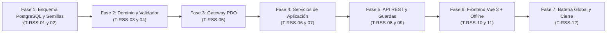

# Plan de Tareas de Implementación (`tasks.md`): Sinergia Operativa Reponedor ↔ Técnico SAT (`36-restocker-sat-synergy`)

**Módulo:** `36-restocker-sat-synergy`\
**Versión:** 1.0 (Alineado con `spec.md` v1.0, `restocker_sat_synergy_contracts.md` y `plan.md` v1.0; `D1`–`D4`, `C1`–`C2` y 9 salvaguardas QA `QA-*`)\
**Estado:** Aprobado por el Product Owner el 2026-11-18 · Puerta SDD Fase 2 cerrada · Listo para iniciar en `T-RSS-01`\
**Metodología:** SDD (Specification-Driven Development) · Clean Architecture · TDD / Guardas de Esquema y Diseño\
**Ley Suprema:** [`constitution.md`](../../constitution.md), [`AGENTS.md`](../../AGENTS.md) y [`docs/design.md`](../../docs/design.md)

---

## Resumen de Fases y Grafo de Dependencias

| Fase | Rango de Tareas | Descripción | Tiempo Estimado |
| :--- | :--- | :--- | :--- |
| **Fase 1** | `T-RSS-01` .. `T-RSS-02` | Migración `032_restocker_sat_synergy.sql`, tipos #43 `incident_dispatch_level` y #44 `level1_issue_type`, evolución de `incidents`, `comment_author_type`, `incident_assignment_*` y `offline_sync_mutations`, 4 semillas `RC-L1-*`/`SS-L1-*`, contratos a 49 tablas / 44 enums y suite de esquema PostgreSQL | ~45 min |
| **Fase 2** | `T-RSS-03` .. `T-RSS-04` | Value Objects `IncidentDispatchLevel` y `Level1IssueType`, evolución de `Incident` (opacidad `Art. V.4`) y `RestockerSatSynergyValidator` (`D2`, `D3`, `QA-AMB-01`, `QA-CON-01`, `QA-LIM-03`, `QA-CONST-01`, `Art. II`, `Art. V.1`, `Art. V.5`) + tests unitarios | ~45 min |
| **Fase 3** | `T-RSS-05` | Implementación de `PdoRestockerSatSynergyGateway` (inicio y resolución L1, escalado al SAT en 3 ramas con `FOR UPDATE`, consulta `site_coincidence`, relevo automático L1 de fin de turno/ausencia e idempotencia en `offline_sync_mutations`) + tests de integración | ~50 min |
| **Fase 4** | `T-RSS-06` .. `T-RSS-07` | Servicio `RestockerSatSynergyService` e integraciones en `QrReportService` (auto-escalado en absorción QR grave `QA-LIM-01`), reapertura $< 48\text{ h}$ (`QA-LIM-02`), cierre de turno/ausencias/bajas (`C1`) y `TechnicianWorkHoursService` (`QA-CON-02`) + tests unitarios | ~55 min |
| **Fase 5** | `T-RSS-08` .. `T-RSS-09` | Extensión de controladores (`RestockerRouteController`, `TechnicianRouteController`, `CoordinatorController`, `QrController`, `PortalController`) y `AppRouter`, y suites HTTP y constitucional (`RestockerSatSynergyApiTest.php` y `RestockerSatSynergyConstitutionalTest.php`) | ~55 min |
| **Fase 6** | `T-RSS-10` .. `T-RSS-11` | Frontend Vue 3: Triaje/filtro L1/L2 en Coordinación + insignia de escalado y `site_coincidence` en `TechnicianRouteView.js` (`T-RSS-10`), y operativa L1 + botón «⚡ Escalar Avería al SAT» + `site_coincidence` + cola Offline `RestockerIncidentOfflineQueue.js` en `RestockerRouteView.js` (`T-RSS-11`) + tests `.mjs` | ~55 min |
| **Fase 7** | `T-RSS-12` | Ejecución de batería global (`php tests/run_all.php`) y canal `new_engine`, sincronización `DocMetricsGuard`, matriz de trazabilidad `traceability-matrix.md` y actualización de `docs/features_pendientes.md` | ~25 min |

---

## Detalle de Tareas

- [x] **T-RSS-01 · Crear migración `032_restocker_sat_synergy.sql`, converger `supabase_init.sql` y sembrar las 4 causas/soluciones de Nivel 1 (`RC-L1-*` / `SS-L1-*`) en `supabase_seeds.sql` y `SeedRunner`**
  - **Requisitos:** `RF-01.1`, `RF-01.3`, `RF-05.1`, `RNF-01`, `D1`, `D2`, `QA-AMB-01`, `QA-AMB-02`, `QA-LIM-03`, `QA-CONST-01`, `Art. II`, `Art. III.1`, `Art. III.3`, `Art. IV`.
  - **Verificación:** `php tests/integration/SchemaConvergenceParityTest.php`
  - **Cierre (2026-11-18):** Migración `032_restocker_sat_synergy.sql` creada con los tipos #43 `incident_dispatch_level` y #44 `level1_issue_type`, las ampliaciones de `comment_author_type` (`RESTOCKER`), `incident_assignment_source` (4 canales) e `incident_unassignment_reason_type` (3 causas), las 4 columnas de `incidents` con `chk_incidents_l1_dispatch_coherence` y su FK, el índice `idx_incidents_dispatch_level_status`, las 3 operaciones y el `stop_type = 'MACHINE'` de `offline_sync_mutations` y las 4 parejas `RC-L1-*` / `SS-L1-*`; convergida 1:1 en `supabase_init.sql` y sembrada en `supabase_seeds.sql` (Sección 17, 20 causas / 38 soluciones) y en `SeedRunner::canonicalRootCauseTaxonomyRows()`. `SchemaConvergenceParityTest` **42/42 aserciones verdes, `exit=0`** (56 columnas en `incidents`, 50 conjuntos `ENUM` / 44 tipos y 32 migraciones). Regresiones directas: `PostgresTieredSlaSchemaTest` 17/17, `PostgresSchemaTest` 153/153, `PostgresConstitutionalTest` 86/86, `SeedRunnerSingleEngineTest` 26/26, `SqlDialectPortabilityTest` 114/114 y `DemoHistorySeederTest` 23/23 (`exit=0` en todos). Sin esquemas residuales de la suite (`contract_convergence_check*` retirados). `CloudDeploySchemaParityTest` queda **no verde por un desfase preexistente del libro de la batería**: `031_cash_collection_vault_audit.sql` cambió en `c8fc88d` (PR-09) después de aplicarse en el banco local, y el ejecutor rechaza la huella antigua (`16b6…` ≠ `a915…`) antes de llegar a la 032; la ruta de despliegue sí declara ya los 5 conjuntos nuevos (la suite los marca como «sobran» frente al banco sin converger).

- [ ] **T-RSS-02 · Actualizar contratos de esquema (49 tablas, 44 enums / 50 columnas `ENUM`), `PostgresFixtureBuilder` y crear `PostgresRestockerSatSynergySchemaTest.php`**
  - **Requisitos:** `RF-01.1`, `RF-01.3`, `RF-05.1`, `RNF-01`, `RNF-02`, `QA-AMB-01/02`, `QA-LIM-03`, `QA-CONST-01`, `Art. II`, `Art. III.1`, `Art. III.3`.
  - **Verificación:** `php tests/integration/PostgresSchemaTest.php && php tests/integration/PostgresConstitutionalTest.php && php tests/integration/PostgresRestockerSatSynergySchemaTest.php`

- [ ] **T-RSS-03 · Crear `IncidentDispatchLevel` y `Level1IssueType` y evolucionar `Incident` con metadatos de Nivel 1 / Escalado y opacidad frente a Sede y QR (`QA-CONST-03`, `Art. V.4`)**
  - **Requisitos:** `RF-01.1`, `RF-01.2`, `RNF-02`, `D1`, `D2`, `QA-AMB-01`, `QA-CONST-03`, `Art. V.4`.
  - **Verificación:** `php tests/unit/RestockerSatSynergyDomainModelsTest.php`

- [ ] **T-RSS-04 · Crear `RestockerSatSynergyValidator` y `RestockerSatSynergyValidationException` (elegibilidad y mapeo `level1_issue_type`, guarda sanitaria `QA-CONST-01`, coherencia rol/nivel `QA-CON-01`, bloqueo `PENDING_PARTS` `QA-LIM-03`, textos $\ge 20$ chars `Art. V.1` y foto $\le 5\text{ MB}$ `Art. V.5`)**
  - **Requisitos:** `RF-01.2`, `RF-02.1`, `RF-03.1`, `RF-03.2`, `D2`, `D3`, `QA-AMB-01`, `QA-CON-01`, `QA-LIM-03`, `QA-CONST-01`, `Art. II`, `Art. V.1`, `Art. V.5`.
  - **Verificación:** `php tests/unit/RestockerSatSynergyValidatorTest.php`

- [ ] **T-RSS-05 · Implementar `PdoRestockerSatSynergyGateway` (inicio y resolución L1, escalado al SAT en sus 3 ramas con `FOR UPDATE`, sugerencia de reponedores con carga L1, `site_coincidence` bidireccional, relevo automático L1 e idempotencia en `offline_sync_mutations`)**
  - **Requisitos:** `RF-02.1`, `RF-03.1`, `RF-03.2`, `RF-04.1`, `RF-04.2`, `RF-05.1`, `D1`–`D4`, `C1`, `C2`, `QA-AMB-02`, `QA-CONST-02`, `Art. III.1`, `Art. III.3`, `Art. V.2`, `Art. V.3`.
  - **Verificación:** `php tests/integration/PdoRestockerSatSynergyGatewayTest.php`

- [ ] **T-RSS-06 · Implementar `RestockerSatSynergyService` (despacho/conmutación L1↔L2, inicio y resolución L1 in situ, escalado «⚡ Escalar Avería al SAT» con `TechnicianAssignmentSuggester` y `NotificationOutboxEnqueuerService`, `site_coincidence`, relevo de turno L1 y volcado de conflicto Offline)**
  - **Requisitos:** `RF-02.1`, `RF-03.1`, `RF-03.2`, `RF-04.1`, `RF-04.2`, `RF-05.1`, `D1`–`D4`, `C1`, `C2`, `QA-CON-01`, `QA-LIM-03`, `QA-CONST-01`–`03`, `Art. II`, `Art. III.3`, `Art. V.1`–`V.5`.
  - **Verificación:** `php tests/unit/RestockerSatSynergyServiceTest.php`

- [ ] **T-RSS-07 · Integrar pre-clasificación L1 y auto-escalado en `QrReportService` (`QA-LIM-01`), promoción a `L2_SAT` en reapertura $< 48\text{ h}$ (`QA-LIM-02`), bloqueo/relevo L1 en cierre de turno, ausencias y bajas (`C1`), y cómputo L1 en `TechnicianWorkHoursService` (`QA-CON-02`)**
  - **Requisitos:** `RF-01.2`, `RF-02.2`, `RF-02.3`, `RF-04.2`, `RF-05.3`, `C1`, `C2`, `QA-CON-02`, `QA-LIM-01`, `QA-LIM-02`, `Art. II`, `Art. V.6`.
  - **Verificación:** `php tests/unit/RestockerSatSynergyIntegrationsTest.php`

- [ ] **T-RSS-08 · Extender controladores (`RestockerRouteController`, `TechnicianRouteController`, `CoordinatorController`, `QrController`, `PortalController`) y registrar rutas y guardas RBAC en `AppRouter`**
  - **Requisitos:** `RF-01` a `RF-05`, `QA-CON-01`, `QA-CONST-03`, `Art. V.4`.
  - **Verificación:** `php tests/integration/RestockerSatSynergyApiTest.php`

- [ ] **T-RSS-09 · Certificar suites de integración HTTP y blindaje constitucional (`RestockerSatSynergyApiTest.php` y `RestockerSatSynergyConstitutionalTest.php`)**
  - **Requisitos:** `RF-01` a `RF-05`, `D1`–`D4`, `C1`, `C2`, `QA-AMB-01/02`, `QA-CON-01/02`, `QA-LIM-01..03`, `QA-CONST-01..03`, `Art. II`, `Art. III.1`, `Art. III.3`, `Art. V.1`–`V.6`.
  - **Verificación:** `php tests/integration/RestockerSatSynergyApiTest.php && php tests/integration/RestockerSatSynergyConstitutionalTest.php`

- [ ] **T-RSS-10 · Extender Coordinación (filtro `dispatch_level`, selector de nivel y sugerencia `#1 RECOMENDADO ⭐` de Reponedor en Triaje) y `TechnicianRouteView.js` (insignia «⚡ Escalado por Reponedor In Situ» + banner «🤝 Coincidencia en Sede»)**
  - **Requisitos:** `RF-02.1`, `RF-04.1`, `RF-05.2.2`, `RF-05.3`, `RNF-03`, `D2`, `D4`, `Art. V.4`.
  - **Verificación:** `node tests/frontend/technician_and_coordinator_synergy.test.mjs`

- [ ] **T-RSS-11 · Extender `RestockerRouteView.js` (bandeja y badges de Avisos Nivel 1, resolución L1 en 1-Tap, botón «⚡ Escalar Avería al SAT» en ticket/máquina/visita, banner «🤝 Coincidencia en Sede» y cola Offline `RestockerIncidentOfflineQueue.js`)**
  - **Requisitos:** `RF-03.1`, `RF-03.2`, `RF-04.1`, `RF-05.1`, `RF-05.2.1`, `RNF-03`, `D3`, `D4`, `C2`, `Art. V.1`, `Art. V.4`, `Art. V.5`.
  - **Verificación:** `node tests/frontend/restocker_route_view.test.mjs`

- [ ] **T-RSS-12 · Ejecutar batería global (`php tests/run_all.php`) y canal `new_engine`, sincronizar `DocMetricsGuard`, generar `traceability-matrix.md` y actualizar `docs/features_pendientes.md`**
  - **Requisitos:** `DoD 1`–`DoD 4`.
  - **Verificación:** `php tests/run_all.php`
