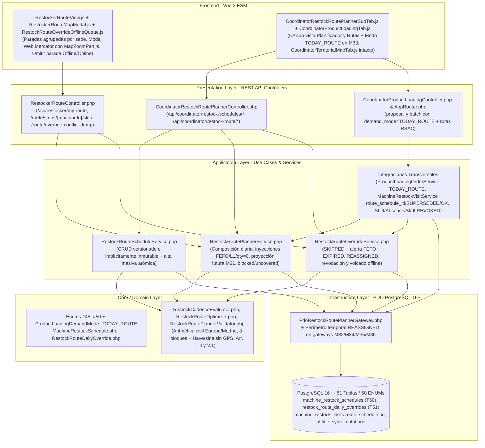

# Plan de Implementación Técnica: Planificador de Rutas Periódicas de Carga y Priorización Dinámica por Demanda (`37-restock-route-planner`)

**Módulo:** `37-restock-route-planner` (Feature 27 de `docs/features_pendientes.md`)  
**Versión:** 1.0 (Alineado con `spec.md` v1.1 y `restock_route_planner_contracts.md`, incorporando `D1`–`D7`, `C1`–`C3` y `QA-1`–`QA-6`)  
**Estado:** Plan Técnico Aprobado · Puerta SDD Fase 2 superada · Listo para Ejecución SDD (Fases 3–4)  
**Marco Normativo:** [`constitution.md`](../../constitution.md) · [`AGENTS.md`](../../AGENTS.md) · [`docs/design.md`](../../docs/design.md)  
**Especificación Funcional:** [`specs/37-restock-route-planner/spec.md`](./spec.md) (v1.1) · [`specs/functional/restock_route_planner_spec.md`](../functional/restock_route_planner_spec.md)  
**Contratos Técnicos:** [`specs/technical/restock_route_planner_contracts.md`](../technical/restock_route_planner_contracts.md)

---

## 1. Arquitectura de Módulos y Estructura de Ficheros

La solución se construye bajo **Clean Architecture** en PHP 8.2+ POO puro (`declare(strict_types=1);`), persistencia única en **PostgreSQL 16+ (`pdo_pgsql`)** y **Vue 3 (ES Modules nativos)** sin *bundlers* ni dependencias externas, preservando intactos el DDL de `locations` y el mapa territorial SAT (`CoordinatorTerritorialMapTab.js`).

### 1.1. Base de Datos y Esquema Relacional (`database/` y `specs/technical/`)

| Fichero | Acción | Responsabilidad |
| :--- | :--- | :--- |
| `database/supabase_migrations/033_restock_route_planner.sql` | **Crear** | Migración DDL idempotente: creación de los 6 tipos `ENUM` nativos `#45`–`#50` (`restock_cadence_type`, `restock_time_window`, `restock_override_type`, `restock_override_status`, `restock_skip_reason_code`, `restock_reassignment_reason_code`); ampliación de `product_loading_demand_mode` (`'TODAY_ROUTE'`), `audit_entity_type` (`'MACHINE_RESTOCK_SCHEDULE'`, `'RESTOCK_ROUTE_DAILY_OVERRIDE'`) y `notification_template` (`'RESTOCK_FEFO_STOP_SKIPPED_ALERT'`); creación de la Tabla 50 `machine_restock_schedules` (versionada con `uq_machine_restock_schedule_active`) y Tabla 51 `restock_route_daily_overrides` (ciclo `ACTIVE`/`SUPERSEDED`/`REVOKED` con `uq_restock_override_active_machine_day`); FK `fk_machine_restock_visits_route_schedule` en Tabla 47; ampliación de `chk_offline_sync_operation_type` en Tabla 34 (`'SKIP_RESTOCK_STOP'`); y disparadores `prevent_hard_delete()` y `touch_updated_at()` manteniendo intacto el DDL de `locations`. |
| `database/supabase_init.sql` | **Modificar** | Converger 1:1 los tipos `#45`–`#50`, las ampliaciones de `ENUM`, las Tablas 50 y 51 con sus restricciones e índices, la FK sobre `machine_restock_visits.route_schedule_id` y la restricción `chk_offline_sync_operation_type`. |
| `database/supabase_seeds.sql` y `src/Infrastructure/Database/SeedRunner.php` | **Modificar** | Sembrar de forma idempotente agendas periódicas representativas (`DAILY`, `MON_WED_FRI`, `WEEKLY`, `BIWEEKLY`) para las máquinas semilla del parque y una excepción de demostración compatible con la batería hermética. |
| `specs/technical/database_schema.md`, `specs/technical/schema_correspondence_contract.md` y `tests/Support/PostgresFixtureBuilder.php` | **Modificar** | Actualizar el inventario oficial de **49 a 51 tablas**, de **44 a 50 tipos `ENUM` nativos** y de **50 a 56 columnas `ENUM`**, e incorporar factorías de agenda/excepción en `PostgresFixtureBuilder`. |

### 1.2. Capa de Dominio (`src/Core/`)

| Fichero | Acción | Responsabilidad |
| :--- | :--- | :--- |
| `src/Core/Domain/Enum/RestockCadenceType.php`, `RestockTimeWindow.php`, `RestockOverrideType.php`, `RestockOverrideStatus.php`, `RestockSkipReasonCode.php`, `RestockReassignmentReasonCode.php` | **Crear** | Backed enums puros correspondientes a los tipos `#45`–`#50` con etiquetas en español, pesos de ordenación (`windowOrder()`) y métodos de validación determinista. |
| `src/Core/Domain/Enum/ProductLoadingDemandMode.php` | **Modificar** | Añadir el caso `TODAY_ROUTE = 'TODAY_ROUTE'` (*«Ruta efectiva de hoy»*), conservando `ALERTS_ONLY` y `ALL_GAPS` intactos (`D5`, `QA-5`). |
| `src/Core/Domain/Model/MachineRestockSchedule.php` y `src/Core/Domain/Model/RestockRouteDailyOverride.php` | **Crear** | Entidades inmutables de dominio que replican en el borde los invariantes de Tabla 50 (`WEEKLY`/`BIWEEKLY`/`include_weekends`/desactivación) y Tabla 51 (`SKIPPED` vs `REASSIGNED`, `client_mutation_id` `8..64`, resolución `SUPERSEDED`/`REVOKED`). |
| `src/Core/Service/RestockCadenceEvaluator.php` | **Crear** | Calculador puro sin E/S ni BD en `Europe/Madrid`: evalúa `appliesOnDate()`, aritmética civil DST-safe para `BIWEEKLY`, vigencia de `machines.is_seasonal_pause` (`+ seasonal_pause_until`), `DAILY` adaptado a `SlaTier`/`include_weekends`, y `nextScheduledDate()` (incluyendo `anchor_date` futuro $> 15$ días). |
| `src/Core/Service/RestockRouteOptimizer.php` | **Crear** | Motor puro de agrupación por `location_id`, clasificación en 3 bloques (`FEFO_SANITARY` $\rightarrow$ `DEMAND_L1_STOCKOUT` $\rightarrow$ `SCHEDULED_CADENCE`), desempates deterministas (`L1_INCIDENT > EMPTY_SLOT > location_id ASC`), vecino más cercano Haversine vía `GeoDistanceService`, degradación elegante sin GPS (rango `[27.0..44.5] × [-18.5..5.0]` excluyendo `(0,0)`), cálculo de `total_distance_km` y `full_route_navigation_url` (`null` si $0$ sedes mapeables). |
| `src/Core/Service/RestockRoutePlannerValidator.php` y `src/Core/Domain/Exception/RestockRoutePlannerValidationException.php` | **Crear** | Validador puro de `SKIPPED` ($20$–$500$ chars reales, $\ge 3$ bloques alfanuméricos, restricción `service_date = today` para `RESTOCKER`), `REASSIGNED` (no auto-desvío `SELF_REASSIGNMENT_FORBIDDEN`, `service_date >= today`, `reassignment_reason_code`), cadencias y mapeo determinista a códigos HTTP (`403`/`404`/`409`/`422`). |

### 1.3. Capa de Aplicación e Infraestructura (`src/Application/` y `src/Infrastructure/`)

| Fichero | Acción | Responsabilidad |
| :--- | :--- | :--- |
| `src/Core/Domain/Repository/RestockRoutePlannerGatewayInterface.php` y `src/Infrastructure/Repository/PdoRestockRoutePlannerGateway.php` | **Crear** | Puerto e implementación PDO transaccional con `SELECT ... FOR UPDATE`: lectura acotada en lote del parque activo, agendas vigentes, planogramas FEFO/vacíos, incidencias L1/térmicas, visitas del día y excepciones; versionado atómico de agendas; inserción/revocación/superación de excepciones; actualización de `machines.sanitary_status = 'EXPIRED'`; encolado en `notification_outbox` (`CRITICAL_SANITARY`, canales internos de Coordinación); e idempotencia en `offline_sync_mutations`. |
| `src/Infrastructure/Repository/PdoMachinePlanogramRepository.php`, `PdoInSituRestockVisitGateway.php`, `PdoMachineCashCollectionGateway.php` y `PdoRestockerSatSynergyGateway.php` | **Modificar** | Unificar la comprobación de cobertura temporal de `RESTOCKER` hoy (`restocker_zone_assignments` activa **O** `restock_route_daily_overrides` `'REASSIGNED'` `'ACTIVE'` en `today`) en M32, M34, M35 y M36 (incluyendo `site_coincidence`) (`QA-3`). |
| `src/Application/Service/RestockRouteScheduleService.php`, `RestockRoutePlannerService.php` y `RestockRouteOverrideService.php` | **Crear** | Casos de uso principales: (1) listado, versionado y lote atómico de agendas; (2) composición de ruta diaria para `RESTOCKER` y tablero «Ruta del Día» en Coordinación (contadores instantáneos de `service_date`, proyección futura de ausencias M31, `blocked_stops`, `uncovered_stops`, `site_coincidence` y opacidad `Art. V.4`); y (3) ciclo completo de `SKIPPED`, `REASSIGNED`, `revoke` y `dumpOfflineConflict`. |
| `src/Application/Service/ProductLoadingOrderService.php`, `MachineRestockVisitService.php`, `ShiftLifecycleService.php`, `TechnicianAbsenceService.php` y gestión de baja de personal | **Modificar** | (1) `ProductLoadingOrderService`: soporte del modo `TODAY_ROUTE` (`ALL_GAPS` sobre las máquinas `PENDING` de la ruta del día) en propuesta y lote (`D5`, `QA-5`); (2) `MachineRestockVisitService`: enlace histórico automático/validado de `route_schedule_id` (admitiendo versión recién cerrada en visitas offline `QA-2`), transición de `SKIPPED` $\rightarrow$ `SUPERSEDED` en `COMPLETED` y `ABORTED_THERMAL_BREACH` (`C1`, `QA-6`), y restauración `EXPIRED` $\rightarrow$ `'OK'` al retirar los lotes vencidos (`QA-1`); (3) Cierre de turno/ausencia/baja: transición automática `REASSIGNED` pendiente $\rightarrow$ `'REVOKED'` (`QA-3`). |

### 1.4. Capa de Presentación y Frontend (`src/Presentation/` y `public/assets/js/`)

| Fichero | Acción | Responsabilidad |
| :--- | :--- | :--- |
| `src/Presentation/Controller/CoordinatorRestockRoutePlannerController.php`, `RestockerRouteController.php`, `CoordinatorProductLoadingController.php` y `src/Presentation/Routing/AppRouter.php` | **Crear / Modificar** | Exponer endpoints REST de planificación y excepciones en Coordinación; ampliar `/api/restocker/my-route` (con `route_plan` opaco ante costes y notas internas ajenas `Art. V.4`) y añadir `/api/restocker/route/stops/{machineId}/skip` y `/api/restocker/route/override-conflict-dump`; aceptar `service_date` en `proposal`/`batch` de M33; y registrar rutas RBAC en `AppRouter`. |
| `public/assets/js/components/CoordinatorRestockRoutePlannerSubTab.js`, `CoordinatorProductLoadingTab.js` y `public/assets/js/api.js` | **Crear / Modificar** | Montar la 5.ª sub-vista **«🗺️ Planificador y Rutas»** dentro del área de Reposición (`CoordinatorProductLoadingTab.js`): tablero instantáneo «Ruta del Día», bandeja «⚠️ Paradas sin cobertura hoy», modales de desvío/omisión/revocación y catálogo de agendas con configuración masiva atómica; más opción `TODAY_ROUTE` en el selector de carga M33. `CoordinatorTerritorialMapTab.js` permanece intacto (`D7`). |
| `public/assets/js/components/RestockerRouteView.js`, `RestockerRouteMapModal.js`, `RestockRouteOverrideOfflineQueue.js` y `public/sw.js` | **Crear / Modificar** | Reorganizar `RestockerRouteView.js` por paradas de sede ordenadas en 3 bloques (badges FEFO/L1/`qty=0`/Franja/Sin GPS, enlaces Google Maps, acordeones inferiores `Completadas`/`Omitidas`/`Bloqueadas`, modal «⏭️ Omitir parada hoy»); crear `RestockerRouteMapModal.js` reutilizando `Mercator.js` y `MapZoomPan.js`; añadir `RestockRouteOverrideOfflineQueue.js` (snapshot con caducidad de medianoche, drenaje ordenado tras visitas M34, volcado de conflictos `409` y limpieza por baja); y precachear los nuevos módulos en `public/sw.js` (`360 × 800 px` sin scroll horizontal). |
