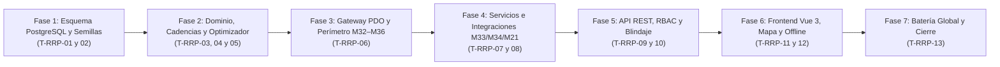

# Plan de Tareas de Implementación (`tasks.md`): Planificador de Rutas Periódicas de Carga y Priorización Dinámica por Demanda (`37-restock-route-planner`)

**Módulo:** `37-restock-route-planner` (Feature 27 de `docs/features_pendientes.md`)  
**Versión:** 1.0 (Alineado con `spec.md` v1.2, `restock_route_planner_contracts.md` y `plan.md` v1.0; `D1`–`D7`, `C1`–`C3` y `QA-1`–`QA-6`)\
**Estado:** Aprobado · Puerta SDD Fase 2 superada · Ejecución SDD completada (`13/13` tareas)
**Metodología:** SDD (Specification-Driven Development) · Clean Architecture · TDD / Guardas de Esquema y Diseño  
**Ley Suprema:** [`constitution.md`](../../constitution.md), [`AGENTS.md`](../../AGENTS.md) y [`docs/design.md`](../../docs/design.md)

---

## Resumen de Fases y Grafo de Dependencias

| Fase | Rango de Tareas | Descripción | Tiempo Estimado |
| :--- | :--- | :--- | :--- |
| **Fase 1** | `T-RRP-01` .. `T-RRP-02` | Migración `033_restock_route_planner.sql`, tipos `#45`–`#50`, Tablas 50 y 51, ampliaciones `ENUM`/FK/offline, `supabase_init.sql`/`supabase_seeds.sql`, contratos a **51 tablas / 50 tipos `ENUM` / 56 columnas `ENUM`** y suite de esquema PostgreSQL | ~50 min |
| **Fase 2** | `T-RRP-03` .. `T-RRP-05` | Backed enums `#45`–`#50`, `ProductLoadingDemandMode::TODAY_ROUTE`, entidades `MachineRestockSchedule`/`RestockRouteDailyOverride`, calculador puro `RestockCadenceEvaluator` (DST-safe en `Europe/Madrid`), validador `RestockRoutePlannerValidator` y motor puro `RestockRouteOptimizer` (3 bloques + Haversine + sin GPS) | ~65 min |
| **Fase 3** | `T-RRP-06` | `RestockRoutePlannerGatewayInterface` y `PdoRestockRoutePlannerGateway` + unificación del perímetro temporal `REASSIGNED` en gateways M32, M34, M35 y M36 + suite PDO | ~55 min |
| **Fase 4** | `T-RRP-07` .. `T-RRP-08` | Servicios `RestockRouteScheduleService`, `RestockRoutePlannerService` y `RestockRouteOverrideService`, más integraciones en M33 (`TODAY_ROUTE`), M34 (`route_schedule_id`, `SUPERSEDED`, `EXPIRED -> OK`) y M21/M31 (`REVOKED` automático) | ~70 min |
| **Fase 5** | `T-RRP-09` .. `T-RRP-10` | Controladores REST, rutas RBAC en `AppRouter`, suite API HTTP y suite de blindaje constitucional (`Art. II`, `Art. III.1/III.3`, `Art. V.1`, `Art. V.4`, `Art. VI`) | ~60 min |
| **Fase 6** | `T-RRP-11` .. `T-RRP-12` | Sub-vista Coordinación `CoordinatorRestockRoutePlannerSubTab.js` + `TODAY_ROUTE` en M33 (`T-RRP-11`), y móvil `RestockerRouteView.js` + `RestockerRouteMapModal.js` (`MapZoomPan.js`) + `RestockRouteOverrideOfflineQueue.js` + `sw.js` + prueba `360 × 800` (`T-RRP-12`) | ~75 min |
| **Fase 7** | `T-RRP-13` | Batería global (`php tests/run_all.php`), canal `new_engine`, sincronización `DocMetricsGuard`, `traceability-matrix.md` y actualización de `docs/features_pendientes.md` | ~30 min |

---

## Detalle de Tareas

- [x] **T-RRP-01 · Crear migración `033_restock_route_planner.sql`, converger `supabase_init.sql` y sembrar agendas/excepción de demostración en `supabase_seeds.sql` y `SeedRunner`**
  - **Requisitos:** `RF-01.1`, `RF-02.1`, `RF-04.1`, `RF-04.2`, `RF-05.1`, `RNF-01`, `D1`, `D5`, `D6`, `QA-2`, `QA-4`, `QA-6`, `Art. II`, `Art. III.1`, `Art. III.3`, `Art. IV`.
  - **Verificación:** `php tests/integration/SchemaConvergenceParityTest.php`
  - **Cierre (2026-11-21):** `SchemaConvergenceParityTest.php` · **42/42 aserciones · `exit=0`**. Inventario convergido de **49 a 51 tablas**, de **44 a 50 tipos `ENUM`** y de **50 a 56 columnas `ENUM`**; libro de migraciones de **32 a 33**. Upgrade real verificado sobre un esquema preexistente de 49 tablas (convergencia a 51 + libro `A-5`) y semillas idempotentes: **5 agendas** (las cinco cadencias) y **1 excepción `SKIPPED`**, con **0 altas** en la segunda pasada y **residuo 0** de esquemas temporales.

- [x] **T-RRP-02 · Actualizar contratos de esquema (`database_schema.md`, `schema_correspondence_contract.md` a 51 tablas, 50 enums y 56 columnas `ENUM`), ampliar `PostgresFixtureBuilder` y crear `PostgresRestockRoutePlannerSchemaTest.php`**
  - **Requisitos:** `RF-01.1`, `RF-02.1`, `RF-05.1`, `RNF-01`, `RNF-03`, `QA-2`, `QA-4`, `QA-6`, `Art. III.1`, `Art. III.3`.
  - **Verificación:** `php tests/integration/PostgresSchemaTest.php && php tests/integration/PostgresConstitutionalTest.php && php tests/integration/PostgresRestockRoutePlannerSchemaTest.php`
  - **Cierre (2026-11-21; actualizado 2026-11-22 tras AUD-37-09):** `PostgresSchemaTest` **159/159**, `PostgresConstitutionalTest` **88/88** y `PostgresRestockRoutePlannerSchemaTest` **45/45** (`+4` aserciones de convergencia 1:1 e idempotencia cruzada de semillas entre `database/supabase_seeds.sql` §23–§24 y `SeedRunner`), las tres con `exit=0`. Contratos de esquema a **51 tablas / 50 tipos `ENUM` / 56 columnas `ENUM`** (`database_schema.md` y `schema_correspondence_contract.md`, con las Tablas 50/51, los seis tipos nuevos y el bullet del Módulo 37); `PostgresFixtureBuilder` documenta 51 tablas y siembra las dos nuevas con `notes`/`skip_reason_code`+`reason_text`. La suite nueva destapó un hueco real: `chk_mrs_cadence_coherence` aceptaba `WEEKLY` con `day_of_week` nulo porque un `CHECK` que evalúa a `NULL` se satisface; corregido con la migración `034_restock_schedule_cadence_guard.sql` (libro a **34 migraciones**) y convergido en `supabase_init.sql` y en `restock_route_planner_contracts.md`. Regresiones directas: `SchemaConvergenceParityTest` **42/42**, `PostgresRestockerSatSynergySchemaTest` **30/30** y `NewEngineChannelDocumentationTest` **9/9**, todas `exit=0`; **residuo 0** de esquemas `t_*` y `contract_convergence_check*`.

- [x] **T-RRP-03 · Crear los 6 backed enums `#45`–`#50`, añadir `TODAY_ROUTE` a `ProductLoadingDemandMode`, e implementar `MachineRestockSchedule` y `RestockRouteDailyOverride` + suite unitaria**
  - **Requisitos:** `RF-01.1`, `RF-02.1`, `RF-04.1`, `D1`, `D5`, `D6`, `QA-2`, `QA-4`, `QA-5`.
  - **Verificación:** `php tests/unit/RestockRoutePlannerDomainModelsTest.php`
  - **Cierre (2026-11-21):** `RestockRoutePlannerDomainModelsTest.php` **67/67 aserciones · `exit=0`**. Creados los seis backed enums `#45`–`#50` (`RestockCadenceType`, `RestockTimeWindow`, `RestockOverrideType`, `RestockOverrideStatus`, `RestockSkipReasonCode`, `RestockReassignmentReasonCode`) con etiquetas en castellano, `windowOrder()` 1–4 y predicados estructurales, y las entidades inmutables `MachineRestockSchedule` (coherencia `WEEKLY`/`BIWEEKLY`/`include_weekends` con prueba de nulidad explícita, nota `1..500`, baja todo-o-nada y `deactivate()` sin mutar la versión vigente) y `RestockRouteDailyOverride` (ramas `SKIPPED` de `20..500` caracteres reales y `REASSIGNED` con destino y causa, `client_mutation_id` `8..64` con patrón, ciclo `ACTIVE`/`SUPERSEDED`/`REVOKED` con `revoke()`/`supersede()`, `fromDatabaseRow()` y `toArray()`). `ProductLoadingDemandMode` suma `TODAY_ROUTE` («Ruta efectiva de hoy») sin alterar el alcance de flota de `includesAllGaps()`, cuya restricción a la ruta efectiva llega con T-RRP-08. Regresiones directas del Módulo 33: `ProductLoadingDomainModelsTest` **97/97**, `ProductLoadingOrderServiceTest` **57/57** y `ProductLoadingValidatorTest` **57/57**, las tres `exit=0`.

- [x] **T-RRP-04 · Implementar `RestockCadenceEvaluator` (aritmética civil `Europe/Madrid` DST-safe, `DAILY × SlaTier`, `machines.is_seasonal_pause`, `nextScheduledDate`) y `RestockRoutePlannerValidator` + `RestockRoutePlannerValidationException`**
  - **Requisitos:** `RF-01.2`, `RF-02.2`, `RF-02.3`, `RNF-02`, `RNF-03`, `D4`, `D6`, `QA-4`, `QA-6`, `Art. V.1`.
  - **Verificación:** `php tests/unit/RestockCadenceAndValidatorTest.php`
  - **Cierre (2026-11-21):** `RestockCadenceAndValidatorTest.php` **60/60 aserciones · `exit=0`**. Creado `RestockCadenceEvaluator` (puro, sin E/S ni reloj) con `appliesOnDate()` para las cinco cadencias —`DAILY` adaptado a `SlaTier` (`CRITICAL_INFRASTRUCTURE_24_7` e `include_weekends` cubren fines de semana), `MON_WED_FRI` (1/3/5), `TUE_THU` (2/4), `WEEKLY` por día ISO exacto y `BIWEEKLY` por ancla y múltiplo exacto de 14—, aritmética civil anclada a medianoche UTC (DST-safe, certificada cruzando los cambios de hora de marzo y octubre), `isSeasonalPauseActive()` con `seasonal_pause_until` inclusive, `today()` en `Europe/Madrid` y `nextScheduledDate()` con ancla futura devuelta tal cual aunque diste más de 15 días y `null` con pausa vigente o agenda inactiva. Creados `RestockRoutePlannerValidator` (SKIPPED de `20..500` caracteres reales con ≥3 bloques alfanuméricos y `RESTOCKER` solo para hoy; REASSIGNED exclusivo de Coordinación con destino activo, prohibición de auto-desvío y causa del enum #50; `client_mutation_id` `8..64` con su patrón; coherencia de cadencia; helpers 403/409) y `RestockRoutePlannerValidationException` con los 13 códigos del contrato y su estado HTTP. Regresiones directas: `RestockRoutePlannerDomainModelsTest` **67/67** y `DomainEnumsTest` en verde, ambas `exit=0`.

- [x] **T-RRP-05 · Implementar `RestockRouteOptimizer` (agrupación por sede, estados mixtos, 3 bloques `FEFO_SANITARY` → `DEMAND_L1_STOCKOUT` → `SCHEDULED_CADENCE`, desempates `L1_INCIDENT > EMPTY_SLOT > location_id ASC`, Haversine vía `GeoDistanceService` y degradación sin GPS)**
  - **Requisitos:** `RF-03.2`, `RNF-02`, `D6`, `C2`, `QA-6`, `Art. II`, `Art. IV`.
  - **Verificación:** `php tests/unit/RestockRouteOptimizerTest.php`
  - **Cierre (2026-11-21):** `RestockRouteOptimizerTest.php` **30/30 aserciones · `exit=0`**. Creado `RestockRouteOptimizer` (puro, con `GeoDistanceService` inyectado) que agrupa por `location_id`, descarta las máquinas no `PENDING` —una sede con estado mixto conserva la parada mientras quede al menos una pendiente— y clasifica en tres bloques estrictos: `FEFO_SANITARY` (fecha de caducidad ascendente y, a igual fecha, vecino más cercano), `DEMAND_L1_STOCKOUT` (`SlaTier` y después `L1_INCIDENT` antes que `EMPTY_SLOT`) y `SCHEDULED_CADENCE` (franja más temprana `MORNING`→`MIDDAY`→`AFTERNOON`→`ANY`), con Haversine encadenado desde el origen y desempate `location_id ASC`. Degradación sin GPS: sedes sin coordenadas, en `(0,0)` o fuera de `[27.0..44.5]×[-18.5..5.0]` quedan al final de su subgrupo con `distance_km = null`; sin origen válido todas las distancias son nulas, `total_distance_km = 0.0` y el enlace completo `null`. Publica `stop_order`, `priority_block`, `distance_km`, `navigation_url`, `unmapped_stops_count`, `total_distance_km` y `full_route_navigation_url` con recorte a 9 waypoints y `waypoints_truncated`. Regresiones directas: `RestockCadenceAndValidatorTest` **60/60**, `RestockRoutePlannerDomainModelsTest` **67/67** y `GeoDistanceServiceTest` **14/14**, las tres `exit=0`.

- [x] **T-RRP-06 · Implementar `RestockRoutePlannerGatewayInterface` / `PdoRestockRoutePlannerGateway` y unificar el perímetro temporal `REASSIGNED` en los gateways M32 (`PdoMachinePlanogramRepository`), M34 (`PdoInSituRestockVisitGateway`), M35 (`PdoMachineCashCollectionGateway`) y M36 (`PdoRestockerSatSynergyGateway`)**
  - **Requisitos:** `RF-01.1`, `RF-01.3`, `RF-02.1`–`RF-02.3`, `RF-03.1`, `RF-05.1`, `QA-1`–`QA-3`, `QA-6`, `Art. II`, `Art. III.1`, `Art. III.3`.
  - **Verificación:** `php tests/integration/PdoRestockRoutePlannerGatewayTest.php`
  - **Cierre (2026-11-21; actualizado 2026-11-22 tras AUD-37-09):** `PdoRestockRoutePlannerGatewayTest.php` **36/36 aserciones · `exit=0`** (`31` iniciales + `3` de T-RRP-08 + `2` de contador SQL constante `O(1)` = 3 sentencias en `RNF-02` al triplicar de 4 a 12 máquinas en AUD-37-09). Creado el puerto `RestockRoutePlannerGatewayInterface` (14 métodos documentados: `lockMachine`, `findActiveSchedule`, `listActiveSchedules`, `saveScheduleVersion`, `deactivateSchedule`, `findActiveOverride`, `findOverrideByClientMutationId`, `insertOverride`, `revokeActiveOverrides`, `supersedeSkippedOverrides`, `markMachineSanitaryExpired`, `enqueueFefoSkipAlert`, `findOfflineMutation`, `recordOfflineMutation`) y su implementación `PdoRestockRoutePlannerGateway` con PDO nativo: `FOR UPDATE OF m` en la lectura, versionado atómico de agendas en transacción propia con `SAVEPOINT` si ya hay una abierta (cierre + nueva versión + índice único parcial `23505`), baja lógica con `deactivated_by`/`deactivated_at`, excepción viva única por máquina y día, revocación/superación con `resolved_by`/`resolved_at`, sello `EXPIRED` solo desde `'OK'` (la cuarentena no se degrada), alerta `RESTOCK_FEFO_STOP_SKIPPED_ALERT` con prioridad `CRITICAL_SANITARY` y rol `COORDINATOR`, y cola off-line idempotente (`ON CONFLICT DO NOTHING` + relectura del id). Cero `DELETE FROM` en todo el puerto; `prevent_hard_delete()` muerde en agendas y excepciones. Perímetro `REASSIGNED` unificado: M32 cambia el `INNER JOIN operational_zones` por `LEFT JOIN` y admite `(zona activa + asignación) OR desvío vigente`; M34 y M35 amplían `is_covered` con un `EXISTS` sobre `restock_route_daily_overrides` (`target_restocker_id`, `service_date` de hoy en `Europe/Madrid`, `override_type='REASSIGNED'`, `status='ACTIVE'`); M35 añade al bootstrap de recaudación las máquinas y reintegros desviados (sin duplicar expedientes); M36 `isCovered(?zona, restocker, máquina)` evalúa el desvío por máquina —nunca por zona— y `technicianCoincidences` incorpora al receptor con `LEFT JOIN` + `OR rrdo.id IS NOT NULL`, sin ampliar el perímetro al resto de la sede. La suite certifica con esquema aislado `t_rrp06_gateway` (limpieza en `finally`, **residuo 0**): bloqueo, versionado/histórico inmutable, excepción viva/revocada/superada, sello sanitario, alerta, cola off-line, ausencia de N+1 y cobertura antes/después/revocada en M32/M34/M35/M36. Regresiones directas: `PdoMachinePlanogramRepositoryTest` **46/46**, `InSituRestockVisitConstitutionalTest` **42/42**, `PdoMachineCashCollectionRepositoryTest` **48/48** y `PdoRestockerSatSynergyGatewayTest` **31/31**, todas `exit=0`; residuo 0 de esquemas `t_*` y `contract_convergence_check*` en ambos motores.

- [x] **T-RRP-07 · Implementar `RestockRouteScheduleService`, `RestockRoutePlannerService` y `RestockRouteOverrideService` (alta/versionado/bulk atómico, composición diaria con proyección futura M31, `FEFO_ALERT` solo `requires_cold_chain = TRUE`, `blocked_stops`/`uncovered_stops`, `SKIPPED` con alerta interna y sello `'EXPIRED'`, `REASSIGNED`/`revoke` y `dumpOfflineConflict`)**
  - **Requisitos:** `RF-01`–`RF-03`, `RF-05.1`–`RF-05.3`, `D1`–`D7`, `C1`–`C3`, `QA-1`–`QA-6`, `Art. II`, `Art. V.1`, `Art. V.4`, `Art. VI`.
  - **Verificación:** `php tests/unit/RestockRoutePlannerServicesTest.php`
  - **Cierre (2026-11-21; actualizado 2026-11-22 tras AUD-37-03, AUD-37-08 y AUD-37-09):** `RestockRoutePlannerServicesTest.php` **120/120 aserciones · `exit=0`**. Creados el puerto de lectura `RestockRouteReadModelInterface` y `PdoRestockRouteReadModel` (foto única por `service_date`: agenda viva, FEFO solo `requires_cold_chain = TRUE`, carriles vacíos, L1, térmica, visita, excepción y reponedores con zona/turno/ausencia; sin costes ni notas internas) y los tres servicios: `RestockRouteScheduleService` (catálogo paginado, alta/versionado con `saveScheduleVersion`, baja lógica, bulk atómico con `overwrite_existing` y auditoría `MACHINE_RESTOCK_SCHEDULE`), `RestockRoutePlannerService` (propiedad `REASSIGNED > L1 > zona`, proyección futura sin turno, tres bloques del optimizador, `blocked_stops`/`uncovered_stops`, contadores de un único día y opacidad para `RESTOCKER`) y `RestockRouteOverrideService` (`SKIPPED` de `20..500` caracteres con ≥3 bloques, perímetro del reponedor, idempotencia offline, alerta FEFO + sello `EXPIRED`, `REASSIGNED`, `revoke` y `dumpOfflineConflict`; una sola excepción viva con revocación de la anterior). Se añadieron las dos entidades del Módulo 37 a la whitelist de `AuditEvent`, `attachNotificationToOverride` al puerto y el gateway ahora participa con `SAVEPOINT` en transacciones externas. Regresiones directas: `RestockRouteOptimizerTest` **30/30**, `RestockCadenceAndValidatorTest` **60/60** y `RestockRoutePlannerDomainModelsTest` **67/67**, todas `exit=0`. Smoke real del modelo de lectura en PostgreSQL (`READ_MODEL_SMOKE_OK`, esquema aislado eliminado en `finally`); **residuo 0** de esquemas `t_*` y `contract_convergence_check*`. Siguiente tarea pendiente: **T-RRP-08**.

- [x] **T-RRP-08 · Integrar `TODAY_ROUTE` en `ProductLoadingOrderService` (M33), enlace/superación/restauración `'OK'` en `MachineRestockVisitService` (M34) y revocación automática de `REASSIGNED` en cierre de turno, ausencias y bajas de personal (M21/M31)**
  - **Requisitos:** `RF-02.2`, `RF-02.3`, `RF-04.1`, `RF-04.2`, `D1`, `D5`, `C1`, `QA-1`–`QA-3`, `QA-5`, `QA-6`.
  - **Verificación:** `php tests/unit/RestockRoutePlannerIntegrationsTest.php`
  - **Cierre (2026-11-21; actualizado 2026-11-22 tras AUD-37-08):** `RestockRoutePlannerIntegrationsTest.php` · **23/23 aserciones · `exit=0`**. `ProductLoadingOrderService` incorpora `TODAY_ROUTE` con el planificador inyectado: la foto de huecos se acota a las máquinas `PENDING` de la ruta efectiva (`fetchProposalInputs(..., $machineIds)`), reclama `gap_qty_all` estilo `ALL_GAPS`, conserva `ALERTS_ONLY`/`ALL_GAPS` intactos y el lote omite con `NO_DEMAND` cuando no queda ninguna parada. `MachineRestockVisitService` autovincula la agenda viva, acepta `route_schedule_id` de una versión cerrada de la misma máquina (`422 INVALID_ROUTE_SCHEDULE` en caso contrario), supera la omisión viva tras `COMPLETED`/`ABORTED_THERMAL_BREACH` y restituye `EXPIRED -> 'OK'` solo si el motor ya no encuentra lotes refrigerados caducados; la auditoría de la visita publica `route_schedule_id`, `superseded_overrides_count` y `sanitary_status_restored`. Nuevo `RestockRouteReassignmentRevoker` (`SHIFT_CLOSE`/`ABSENCE`/`DEACTIVATION`) cableado en `ShiftLifecycleService`, `TechnicianAbsenceService` y `AdminStaffService`, con `findActiveReassignmentsForRestocker` (`FOR UPDATE`) y `restoreMachineSanitaryOkIfClear` en el gateway. Regresiones directas: `ProductLoadingOrderServiceTest` **57/57**, `MachineRestockVisitServiceTest` **50/50**, `ShiftLifecycleServiceTest` **12/12**, `RestockRoutePlannerServicesTest` **103/103**, `AdminStaffRestockerServiceTest` **26/26**, `AdminUserServiceTest` **74/74** y `TechnicianAbsenceServiceTest` **19/19**, todas `exit=0`. PostgreSQL real: `PdoProductLoadingOrderRepositoryTest` **32/32** (filtro por `machine_ids`) y `PdoRestockRoutePlannerGatewayTest` **34/34** (revocación por receptor y restitución `'OK'`), ambas `exit=0`; **residuo 0** de esquemas `t_*` y `contract_convergence_check*`. Siguiente tarea pendiente: **T-RRP-09**.

- [x] **T-RRP-09 · Implementar `CoordinatorRestockRoutePlannerController`, extender `RestockerRouteController` y `CoordinatorProductLoadingController`, y registrar rutas RBAC en `AppRouter` + suite API HTTP**
  - **Requisitos:** `RF-01`–`RF-05`, `RNF-03`, `D1`–`D7`, `C1`–`C3`, `QA-1`–`QA-6`.
  - **Verificación:** `php tests/integration/RestockRoutePlannerApiTest.php`
  - **Cierre (2026-11-21; actualizado 2026-11-22 tras AUD-37-07 y AUD-37-08):** `RestockRoutePlannerApiTest.php` · **43/43 aserciones · `exit=0`**. Nuevo `CoordinatorRestockRoutePlannerController` con ocho rutas: catálogo paginado de agendas con `has_schedule` y filtros, alta/versionado individual, lote atómico, baja lógica, tablero «Ruta del Día», alta de `SKIPPED`/`REASSIGNED` y revocación. `AppRouter` las registra bajo `COORDINATOR` y añade `POST /api/restocker/route/stops/{machineId}/skip` y `POST /api/restocker/route/override-conflict-dump` bajo `RESTOCKER`, con las rutas estáticas antes de los segmentos dinámicos. `RestockerRouteController` publica `service_date` y `route_plan` (tres bloques, resumen, paradas completadas/omitidas/bloqueadas y origen `BASE_CENTRAL` desde `route_settings`), conserva la opacidad Art. V.4, registra omisiones idempotentes por `client_mutation_id`, archiva conflictos offline y cablea el gateway y el modelo de lectura del Módulo 37 en `MachineRestockVisitService`. `CoordinatorProductLoadingController` acepta `service_date` y cablea el planificador; `ProductLoadingOrderService` acota `TODAY_ROUTE` a la fecha solicitada y publica `route_machine_ids`/`excluded_blocked_machine_ids`. El catálogo de agendas incluye máquinas sin agenda (`has_schedule = false`) y excluye máquinas o sedes inactivas. Regresiones directas: `ProductLoadingOrderServiceTest` **57/57**, `RestockRoutePlannerServicesTest` **103/103**, `RestockRoutePlannerIntegrationsTest` **21/21**, `MachineRestockVisitServiceTest` **50/50**, `InSituRestockVisitApiTest` **22/22**, `CashCollectionVaultAuditApiTest` **50/50**, `RestockerRoleZonesShiftsApiTest` **21/21** y `ProductLoadingColdPickingApiTest` **34/34**, todas `exit=0`. **Residuo 0** de esquemas `t_*` y `contract_convergence_check*`. Siguiente tarea pendiente: **T-RRP-10**.

- [x] **T-RRP-10 · Certificar suite constitucional, de concurrencia `FOR UPDATE` y opacidad `RestockRoutePlannerConstitutionalTest.php` (Art. II, Art. III.1/III.3, Art. V.1, Art. V.4, Art. VI, RBAC, idempotencia `client_mutation_id` y no regresión en `Location`/`CoordinatorTerritorialMapTab`)**
  - **Requisitos:** `RF-01`–`RF-05`, `RNF-01`, `RNF-03`, `QA-1`–`QA-6`, `Art. II`–`Art. VI`.
  - **Verificación:** `php tests/integration/RestockRoutePlannerConstitutionalTest.php`
  - **Cierre (2026-11-21):** `RestockRoutePlannerConstitutionalTest.php` · **45/45 aserciones · `exit=0`**. Solo pruebas: no se modificó código de producción. Escenario PostgreSQL aislado `t_rrp10_constitutional` con router real, seis máquinas, dos zonas, agenda `DAILY` con fin de semana y una visita completada. Cubre: RBAC de las dos superficies y ausencia del planificador bajo `/api/site`, `/api/qr` y `/api/public`; Art. II con FEFO exclusivo de `requires_cold_chain = TRUE`, sello `EXPIRED` sin bloquear M34, cuarentena que no se degrada y alerta `CRITICAL_SANITARY` solo interna; Art. III.1/III.3 con versionado inmutable, auditoría de ambas entidades, cero borrados y `prevent_hard_delete()`; Art. V.1 con los tres bordes de `reason_text` (19, 2 bloques y 501 caracteres) y motivo válido; Art. V.4 con opacidad móvil, payload interno y superficies Sede/QR/Portal/A4 sin referencias; Art. VI con contadores exactos de hoy (`5` programadas, `1` completada, `1` omitida, `1` bloqueada), proyección futura sin herencia, `locations` intacto y hash normalizado de `CoordinatorTerritorialMapTab.js`; concurrencia real con dos conexiones (`55P03` por `lock_timeout`, bloqueo por fila y liberación) e idempotencia offline sin duplicar. Regresiones directas: `RestockRouteOptimizerTest` **30/30**, `RestockCadenceAndValidatorTest` **60/60**, `RestockRoutePlannerServicesTest` **103/103**, `RestockRoutePlannerIntegrationsTest` **21/21**, `RestockRoutePlannerApiTest` **29/29** y `PdoRestockRoutePlannerGatewayTest` **34/34**, todas `exit=0`. **Residuo 0** de esquemas `t_*` y `contract_convergence_check*`. Siguiente tarea pendiente: **T-RRP-11**.

- [x] **T-RRP-11 · Implementar superficie de Coordinación: `CoordinatorRestockRoutePlannerSubTab.js` (5.ª sub-vista en `CoordinatorProductLoadingTab.js` con tablero instantáneo «Ruta del Día», bandeja «⚠️ Paradas sin cobertura hoy», desvíos/omisiones/revocaciones y CRUD/alta masiva de agendas), modo `TODAY_ROUTE` en carga M33 y `public/assets/js/api.js` (manteniendo intacto `CoordinatorTerritorialMapTab.js`)**
  - **Requisitos:** `RF-01.3`, `RF-02.3`, `RF-03.3`, `RF-04.1`, `RF-05.3`, `RNF-04`, `D5`, `D7`, `QA-4`–`QA-6`, `Art. IV`, `Art. VI`.
  - **Verificación:** `node tests/frontend/coordinator_restock_route_planner.test.mjs`
  - **Cierre (2026-11-21):** `coordinator_restock_route_planner.test.mjs` · **38/38 aserciones · `exit=0`**. Nuevo `CoordinatorRestockRoutePlannerSubTab.js` como quinta sub-vista de `CoordinatorProductLoadingTab.js` (`activeSection === 'route-planner'`): tablero instantáneo «Ruta del Día» con los siete contadores de un único `service_date`, bandeja «⚠️ Paradas sin cobertura hoy», rutas por reponedor con bloques/triggers FEFO y acciones de omisión/desvío por máquina, excepciones vivas con revocación auditada, catálogo de agendas con filtros, alta/versionado individual, baja lógica y alta masiva atómica. `api.js` expone las ocho rutas de Coordinación (`GET/POST /restock-schedules`, `PUT /machine/{id}`, `POST /bulk`, `PATCH /{id}/deactivate`, `GET /restock-route/day`, `POST /restock-route/overrides`, `POST /overrides/{id}/revoke`). M33 incorpora `TODAY_ROUTE` en propuesta, lote y edición, enviando `service_date` solo en ese modo. Regresiones directas: `coordinator_product_loading_tab.test.mjs` **80/80** y `restocker_route_view.test.mjs` **245/245**, ambas `exit=0`. Sin cambios en PHP ni PostgreSQL: residuo de esquemas temporales no aplica. `CoordinatorTerritorialMapTab.js` intacto (diff vacío). Siguiente tarea pendiente: **T-RRP-12**.

- [x] **T-RRP-12 · Implementar superficie móvil del Reponedor: `RestockerRouteView.js` (paradas agrupadas por sede en 3 bloques, badges FEFO/L1/`qty=0`/Franja/Sin GPS, acordeones inferiores y modal «⏭️ Omitir parada hoy»), `RestockerRouteMapModal.js` (reutilizando `Mercator.js` y `MapZoomPan.js`), `RestockRouteOverrideOfflineQueue.js` (snapshot con invalidación a medianoche, drenaje tras visitas M34, volcado de conflictos `409` y limpieza por baja) y precache en `public/sw.js` + test navegador `360 × 800 px`**
  - **Requisitos:** `RF-03.2`, `RF-05.1`, `RF-05.2`, `RNF-04`, `D7`, `C2`, `C3`, `QA-6`, `Art. IV`, `Art. V.4`.
  - **Verificación:** `node tests/frontend/restocker_route_planner_view.test.mjs` · `php tests/integration/RestockRoutePlannerLayoutBrowserTest.php`
  - **Cierre (2026-11-21; actualizado 2026-11-22 tras AUD-37-04 y AUD-37-08):** `restocker_route_planner_view.test.mjs` · **48/48 aserciones · `exit=0`**. La medición real de navegador se completa con `RestockRoutePlannerLayoutBrowserTest` · **38/38 aserciones · `exit=0`** en Chromium real a `360 × 800`: hoja móvil con tres bloques, badges, acordeones y acciones; mapa con origen, pines, polilínea, sin GPS y estado vacío; modal de omisión con motivo largo; y consola de Coordinación con tablas anchas y scroll interno. No hubo desbordamiento real que corregir en producción. `RestockerRouteView.js` reorganiza la hoja móvil desde `route_plan` en los tres bloques fijos (`FEFO_SANITARY`, `DEMAND_L1_STOCKOUT`, `SCHEDULED_CADENCE`), con badges FEFO/L1/`qty=0`/Franja/Sin GPS/desvío, acciones «Visitar» y «⏭️ Omitir parada hoy», y acordeones nativos para completadas/omitidas/bloqueadas. Nuevo `RestockerRouteMapModal.js` reutiliza `Mercator.js` y `MapZoomPan.js` (tiles, zoom/pan, origen, marcadores y navegación completa/por parada, sin API ni GPS). Nuevo `RestockRouteOverrideOfflineQueue.js` con IndexedDB/memoria, aislamiento por reponedor, idempotencia por `client_mutation_id`, snapshot invalidado al cambiar el día civil, estados `PENDING`/`CONFLICT` y limpieza por baja. El modal de omisión exige motivo de 20..500 caracteres reales y ≥3 bloques; sin red encola y refleja la omisión de inmediato; el drenaje se ejecuta tras las visitas M34 y los `409/422` se vuelcan con `dumpRestockOverrideConflict`. `api.js` expone `skipRestockStop` y `dumpRestockOverrideConflict`; `public/sw.js` sube a `vendguard-app-shell-v27` y precachea ambos módulos. Regresiones directas: `restocker_route_view.test.mjs` **245/245**, `coordinator_product_loading_tab.test.mjs` **80/80**, `coordinator_restock_route_planner.test.mjs` **38/38** y `tests/unit/N8nChatScopeTest.mjs` **33/33**, todas `exit=0`. Sin cambios en código de producción PHP ni PostgreSQL: residuo de esquemas temporales no aplica. `CoordinatorTerritorialMapTab.js` y `locations` intactos (diff vacío). Siguiente tarea pendiente: **T-RRP-13**.

- [x] **T-RRP-13 · Ejecutar batería global (`php tests/run_all.php`) y canal `new_engine`, sincronizar `DocMetricsGuard`, generar `specs/37-restock-route-planner/traceability-matrix.md` y actualizar `docs/features_pendientes.md`**
  - **Requisitos:** `DoD 1`–`DoD 5`.
  - **Verificación:** `php tests/run_all.php`
  - **Cierre (2026-11-21; actualizado 2026-11-23 tras AUD-37-02, AUD-37-03, AUD-37-04, AUD-37-07, AUD-37-08 y AUD-37-09):** Batería global **448 suites · 17.428 aserciones · 0 fallos · `DocMetricsGuard` coherente · `exit=0`**; canal `new_engine` con `.env.docker-tls` **76/76 suites · 0 no ejecutables · 2.612 aserciones · 0 fallos · `exit=0`**; **residuo 0** de esquemas `t_*` y `contract_convergence_check*`. Creada `specs/37-restock-route-planner/traceability-matrix.md` con `RF-01`–`RF-05`, `RNF-01`–`RNF-04`, `D1`–`D7`, `C1`–`C3`, `QA-1`–`QA-6`, los artículos constitucionales y `DoD 1`–`DoD 5` enlazados a las 12 suites propias (**604 aserciones**: API 45/45, Coordinación 43/43 y móvil 52/52; incluyendo paridad/idempotencia 1:1 de semillas SQL/PHP y contador SQL constante sin N+1 en AUD-37-09). La suite de layout M37 `RestockRoutePlannerLayoutBrowserTest` (**38/38**) cierra AUD-37-04 y sustituye la atribución anterior a `RestockerSatLayoutBrowserTest` (M36). `docs/features_pendientes.md` marca la Feature 27 como implementada y sincroniza sus cifras. La corrida destapó y corrigió nueve deudas reales de certificación: el catálogo de auditoría no cubría las dos entidades del Módulo 37 ni la acción `RESTOCK_ROUTE_REASSIGNMENT_AUTO_REVOKED`; dos comentarios de `src/` contenían el literal que la guarda constitucional interpretaba como borrado físico; `ProductLoadingOrderService` resolvía `LogicException` contra el espacio de nombres propio; un botón móvil conservaba `margin-left` en línea; el App Shell no precacheaba `CoordinatorRestockRoutePlannerSubTab.js`; la documentación del canal declaraba 72 suites frente a 75 (hoy 76 tras AUD-37-04); el bloque `DO` de la FK histórica no toleraba `duplicate_object`; y el contrato de purga seguía en 38 tablas frente a 39 transitorias. `TieredSlaFrontendTest` quedó en verde al corregir la guarda de botones que invoca. `CoordinatorTerritorialMapTab.js` y el DDL de `locations` permanecen intactos.
