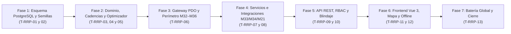

# Plan de Tareas de Implementación (`tasks.md`): Planificador de Rutas Periódicas de Carga y Priorización Dinámica por Demanda (`37-restock-route-planner`)

**Módulo:** `37-restock-route-planner` (Feature 27 de `docs/features_pendientes.md`)  
**Versión:** 1.0 (Alineado con `spec.md` v1.1, `restock_route_planner_contracts.md` y `plan.md` v1.0; `D1`–`D7`, `C1`–`C3` y `QA-1`–`QA-6`)  
**Estado:** Aprobado · Puerta SDD Fase 2 superada · Ejecución SDD en curso (`1/13` tareas)  
**Metodología:** SDD (Specification-Driven Development) · Clean Architecture · TDD / Guardas de Esquema y Diseño  
**Ley Suprema:** [`constitution.md`](../../constitution.md), [`AGENTS.md`](../../AGENTS.md) y [`docs/design.md`](../../docs/design.md)

---

## Resumen de Fases y Grafo de Dependencias

| Fase | Rango de Tareas | Descripción | Tiempo Estimado |
| :--- | :--- | :--- | :--- |
| **Fase 1** | `T-RRP-01` .. `T-RRP-02` | Migración `033_restock_route_planner.sql`, tipos `#45`–`#50`, Tablas 50 y 51, ampliaciones `ENUM`/FK/offline, `supabase_init.sql`/`supabase_seeds.sql`, contratos a **51 tablas / 50 tipos `ENUM` / 56 columnas `ENUM`** y suite de esquema PostgreSQL | ~50 min |
| **Fase 2** | `T-RRP-03` .. `T-RRP-05` | Backed enums `#45`–`#50`, `ProductLoadingDemandMode::TODAY_ROUTE`, entidades `MachineRestockSchedule`/`RestockRouteDailyOverride`, calculador puro `RestockCadenceEvaluator` (DST-safe en `Europe/Madrid`), validador `RestockRoutePlannerValidator` y motor puro `RestockRouteOptimizer` (3 bloques + Haversine + sin GPS) | ~65 min |
| **Fase 3** | `T-RRP-06` | `RestockRoutePlannerGatewayInterface` y `PdoRestockRoutePlannerGateway` + unificación del perímetro temporal `REASSIGNED` en gateways M32, M34, M35 y M36 + suite PDO | ~55 min |
| **Fase 4** | `T-RRP-07` .. `T-RRP-08` | Servicios `RestockRouteScheduleService`, `RestockRoutePlannerService` y `RestockRouteOverrideService`, más integraciones en M33 (`TODAY_ROUTE`), M34 (`route_schedule_id`, `SUPERSEDED`, `EXPIRED -> OK`) y M21/M31 (`REVOKED` automático) | ~70 min |
| **Fase 5** | `T-RRP-09` .. `T-RRP-10` | Controladores REST, rutas RBAC en `AppRouter`, suite API HTTP y suite de blindaje constitucional (`Art. II`, `Art. III.1/III.3`, `Art. V.1`, `Art. V.4`, `Art. VI`) | ~60 min |
| **Fase 6** | `T-RRP-11` .. `T-RRP-12` | Sub-vista Coordinación `CoordinatorRestockRoutePlannerSubTab.js` + `TODAY_ROUTE` en M33 (`T-RRP-11`), y móvil `RestockerRouteView.js` + `RestockerRouteMapModal.js` (`MapZoomPan.js`) + `RestockRouteOverrideOfflineQueue.js` + `sw.js` + prueba `360 × 800` (`T-RRP-12`) | ~75 min |
| **Fase 7** | `T-RRP-13` | Batería global (`php tests/run_all.php`), canal `new_engine`, sincronización `DocMetricsGuard`, `traceability-matrix.md` y actualización de `docs/features_pendientes.md` | ~30 min |

---

## Detalle de Tareas

- [x] **T-RRP-01 · Crear migración `033_restock_route_planner.sql`, converger `supabase_init.sql` y sembrar agendas/excepción de demostración en `supabase_seeds.sql` y `SeedRunner`**
  - **Requisitos:** `RF-01.1`, `RF-02.1`, `RF-04.1`, `RF-04.2`, `RF-05.1`, `RNF-01`, `D1`, `D5`, `D6`, `QA-2`, `QA-4`, `QA-6`, `Art. II`, `Art. III.1`, `Art. III.3`, `Art. IV`.
  - **Verificación:** `php tests/integration/SchemaConvergenceParityTest.php`
  - **Cierre (2026-11-21):** `SchemaConvergenceParityTest.php` · **42/42 aserciones · `exit=0`**. Inventario convergido de **49 a 51 tablas**, de **44 a 50 tipos `ENUM`** y de **50 a 56 columnas `ENUM`**; libro de migraciones de **32 a 33**. Upgrade real verificado sobre un esquema preexistente de 49 tablas (convergencia a 51 + libro `A-5`) y semillas idempotentes: **5 agendas** (las cinco cadencias) y **1 excepción `SKIPPED`**, con **0 altas** en la segunda pasada y **residuo 0** de esquemas temporales.

- [ ] **T-RRP-02 · Actualizar contratos de esquema (`database_schema.md`, `schema_correspondence_contract.md` a 51 tablas, 50 enums y 56 columnas `ENUM`), ampliar `PostgresFixtureBuilder` y crear `PostgresRestockRoutePlannerSchemaTest.php`**
  - **Requisitos:** `RF-01.1`, `RF-02.1`, `RF-05.1`, `RNF-01`, `RNF-03`, `QA-2`, `QA-4`, `QA-6`, `Art. III.1`, `Art. III.3`.
  - **Verificación:** `php tests/integration/PostgresSchemaTest.php && php tests/integration/PostgresConstitutionalTest.php && php tests/integration/PostgresRestockRoutePlannerSchemaTest.php`

- [ ] **T-RRP-03 · Crear los 6 backed enums `#45`–`#50`, añadir `TODAY_ROUTE` a `ProductLoadingDemandMode`, e implementar `MachineRestockSchedule` y `RestockRouteDailyOverride` + suite unitaria**
  - **Requisitos:** `RF-01.1`, `RF-02.1`, `RF-04.1`, `D1`, `D5`, `D6`, `QA-2`, `QA-4`, `QA-5`.
  - **Verificación:** `php tests/unit/RestockRoutePlannerDomainModelsTest.php`

- [ ] **T-RRP-04 · Implementar `RestockCadenceEvaluator` (aritmética civil `Europe/Madrid` DST-safe, `DAILY × SlaTier`, `machines.is_seasonal_pause`, `nextScheduledDate`) y `RestockRoutePlannerValidator` + `RestockRoutePlannerValidationException`**
  - **Requisitos:** `RF-01.2`, `RF-02.2`, `RF-02.3`, `RNF-02`, `RNF-03`, `D4`, `D6`, `QA-4`, `QA-6`, `Art. V.1`.
  - **Verificación:** `php tests/unit/RestockCadenceAndValidatorTest.php`

- [ ] **T-RRP-05 · Implementar `RestockRouteOptimizer` (agrupación por sede, estados mixtos, 3 bloques `FEFO_SANITARY` → `DEMAND_L1_STOCKOUT` → `SCHEDULED_CADENCE`, desempates `L1_INCIDENT > EMPTY_SLOT > location_id ASC`, Haversine vía `GeoDistanceService` y degradación sin GPS)**
  - **Requisitos:** `RF-03.2`, `RNF-02`, `D6`, `C2`, `QA-6`, `Art. II`, `Art. IV`.
  - **Verificación:** `php tests/unit/RestockRouteOptimizerTest.php`

- [ ] **T-RRP-06 · Implementar `RestockRoutePlannerGatewayInterface` / `PdoRestockRoutePlannerGateway` y unificar el perímetro temporal `REASSIGNED` en los gateways M32 (`PdoMachinePlanogramRepository`), M34 (`PdoInSituRestockVisitGateway`), M35 (`PdoMachineCashCollectionGateway`) y M36 (`PdoRestockerSatSynergyGateway`)**
  - **Requisitos:** `RF-01.1`, `RF-01.3`, `RF-02.1`–`RF-02.3`, `RF-03.1`, `RF-05.1`, `QA-1`–`QA-3`, `QA-6`, `Art. II`, `Art. III.1`, `Art. III.3`.
  - **Verificación:** `php tests/integration/PdoRestockRoutePlannerGatewayTest.php`

- [ ] **T-RRP-07 · Implementar `RestockRouteScheduleService`, `RestockRoutePlannerService` y `RestockRouteOverrideService` (alta/versionado/bulk atómico, composición diaria con proyección futura M31, `FEFO_ALERT` solo `requires_cold_chain = TRUE`, `blocked_stops`/`uncovered_stops`, `SKIPPED` con alerta interna y sello `'EXPIRED'`, `REASSIGNED`/`revoke` y `dumpOfflineConflict`)**
  - **Requisitos:** `RF-01`–`RF-03`, `RF-05.1`–`RF-05.3`, `D1`–`D7`, `C1`–`C3`, `QA-1`–`QA-6`, `Art. II`, `Art. V.1`, `Art. V.4`, `Art. VI`.
  - **Verificación:** `php tests/unit/RestockRoutePlannerServicesTest.php`

- [ ] **T-RRP-08 · Integrar `TODAY_ROUTE` en `ProductLoadingOrderService` (M33), enlace/superación/restauración `'OK'` en `MachineRestockVisitService` (M34) y revocación automática de `REASSIGNED` en cierre de turno, ausencias y bajas de personal (M21/M31)**
  - **Requisitos:** `RF-02.2`, `RF-02.3`, `RF-04.1`, `RF-04.2`, `D1`, `D5`, `C1`, `QA-1`–`QA-3`, `QA-5`, `QA-6`.
  - **Verificación:** `php tests/unit/RestockRoutePlannerIntegrationsTest.php`

- [ ] **T-RRP-09 · Implementar `CoordinatorRestockRoutePlannerController`, extender `RestockerRouteController` y `CoordinatorProductLoadingController`, y registrar rutas RBAC en `AppRouter` + suite API HTTP**
  - **Requisitos:** `RF-01`–`RF-05`, `RNF-03`, `D1`–`D7`, `C1`–`C3`, `QA-1`–`QA-6`.
  - **Verificación:** `php tests/integration/RestockRoutePlannerApiTest.php`

- [ ] **T-RRP-10 · Certificar suite constitucional, de concurrencia `FOR UPDATE` y opacidad `RestockRoutePlannerConstitutionalTest.php` (Art. II, Art. III.1/III.3, Art. V.1, Art. V.4, Art. VI, RBAC, idempotencia `client_mutation_id` y no regresión en `Location`/`CoordinatorTerritorialMapTab`)**
  - **Requisitos:** `RF-01`–`RF-05`, `RNF-01`, `RNF-03`, `QA-1`–`QA-6`, `Art. II`–`Art. VI`.
  - **Verificación:** `php tests/integration/RestockRoutePlannerConstitutionalTest.php`

- [ ] **T-RRP-11 · Implementar superficie de Coordinación: `CoordinatorRestockRoutePlannerSubTab.js` (5.ª sub-vista en `CoordinatorProductLoadingTab.js` con tablero instantáneo «Ruta del Día», bandeja «⚠️ Paradas sin cobertura hoy», desvíos/omisiones/revocaciones y CRUD/alta masiva de agendas), modo `TODAY_ROUTE` en carga M33 y `public/assets/js/api.js` (manteniendo intacto `CoordinatorTerritorialMapTab.js`)**
  - **Requisitos:** `RF-01.3`, `RF-02.3`, `RF-03.3`, `RF-04.1`, `RF-05.3`, `RNF-04`, `D5`, `D7`, `QA-4`–`QA-6`, `Art. IV`, `Art. VI`.
  - **Verificación:** `node tests/frontend/coordinator_restock_route_planner.test.mjs`

- [ ] **T-RRP-12 · Implementar superficie móvil del Reponedor: `RestockerRouteView.js` (paradas agrupadas por sede en 3 bloques, badges FEFO/L1/`qty=0`/Franja/Sin GPS, acordeones inferiores y modal «⏭️ Omitir parada hoy»), `RestockerRouteMapModal.js` (reutilizando `Mercator.js` y `MapZoomPan.js`), `RestockRouteOverrideOfflineQueue.js` (snapshot con invalidación a medianoche, drenaje tras visitas M34, volcado de conflictos `409` y limpieza por baja) y precache en `public/sw.js` + test navegador `360 × 800 px`**
  - **Requisitos:** `RF-03.2`, `RF-05.1`, `RF-05.2`, `RNF-04`, `D7`, `C2`, `C3`, `QA-6`, `Art. IV`, `Art. V.4`.
  - **Verificación:** `node tests/frontend/restocker_route_planner_view.test.mjs`

- [ ] **T-RRP-13 · Ejecutar batería global (`php tests/run_all.php`) y canal `new_engine`, sincronizar `DocMetricsGuard`, generar `specs/37-restock-route-planner/traceability-matrix.md` y actualizar `docs/features_pendientes.md`**
  - **Requisitos:** `DoD 1`–`DoD 5`.
  - **Verificación:** `php tests/run_all.php`
