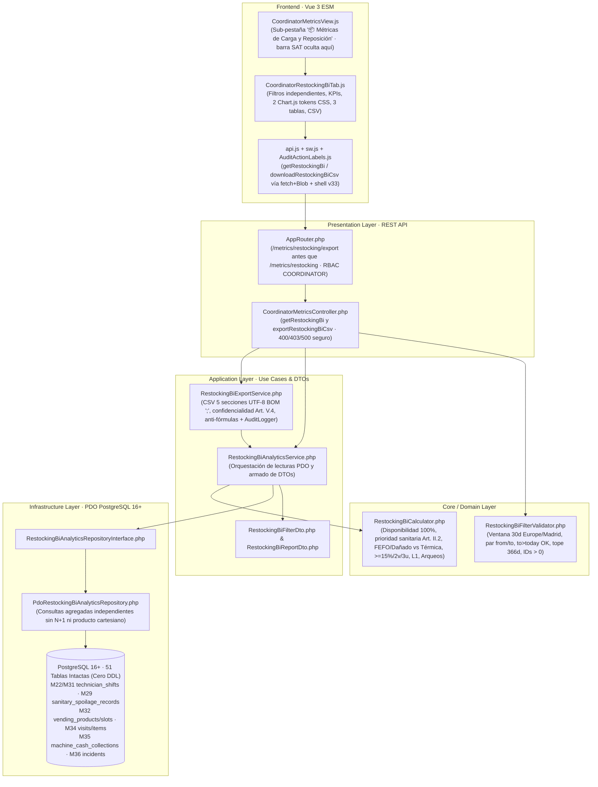

# Plan de Implementación Técnica: Cuadro de Mando de Reposición, Roturas de Stock y Mermas Comerciales (`38-restocking-bi-analytics`)

**Módulo:** `38-restocking-bi-analytics` (Feature 28 de `docs/features_pendientes.md`)  
**Versión:** 1.1 (Alineado con `spec.md` v1.1 y `restocking_bi_analytics_contracts.md` v1.1, incorporando `D1`–`D5`, `C1`–`C6` y `QA-1`–`QA-5`)  
**Estado:** Plan Técnico Aprobado el 2026-11-24 · Puerta SDD Fase 2 superada · Listo para Ejecución SDD (Fases 3–4)  
**Marco Normativo:** [`constitution.md`](../../constitution.md) · [`AGENTS.md`](../../AGENTS.md) · [`docs/design.md`](../../docs/design.md)  
**Especificación Funcional:** [`specs/38-restocking-bi-analytics/spec.md`](./spec.md) · [`specs/functional/restocking_bi_analytics_spec.md`](../functional/restocking_bi_analytics_spec.md)  
**Contratos Técnicos:** [`specs/technical/restocking_bi_analytics_contracts.md`](../technical/restocking_bi_analytics_contracts.md)

---

## 1. Arquitectura de Módulos y Estructura de Ficheros

La solución adopta **Clean Architecture** en PHP 8.2+ POO puro (`declare(strict_types=1);`), **PostgreSQL 16+ (`pdo_pgsql`) en modo exclusivo de lectura agregada sin migraciones DDL** y **Vue 3 (ES Modules nativos)** reutilizando `window.Chart` ya precacheado en el Service Worker, sin introducir dependencias externas ni modificar módulos operativos ya certificados.

---

### 1.1. Inventario de Ficheros a Crear y Modificar

#### Capa de Dominio (`src/Core/`)

| Fichero | Acción | Responsabilidad |
| :--- | :--- | :--- |
| `src/Core/Service/RestockingBiFilterValidator.php` | **Crear** | Validador puro sin E/S: normaliza filtros de consulta (`from`/`to` por defecto últimos 30 días en `Europe/Madrid`, ventana semiabierta `[from 00:00:00, to+1d 00:00:00)`), exige par `from`/`to` completo, formato estricto `YYYY-MM-DD`, fecha civil válida, `from <= to` (admitiendo `to > today`), máximo `366` días naturales e IDs opcionales enteros positivos; lanza `InvalidArgumentException` mapeada a `400 INVALID_FILTER_PARAMS`. |
| `src/Core/Service/RestockingBiCalculator.php` | **Crear** | Motor matemático puro: calcula disponibilidad dual (`visit_in_stock_rate_pct` incluyendo visitas `COMPLETED` con 0 líneas y excluyendo `ABORTED_THERMAL_BREACH`, con `visit_stockout_rate_pct = ROUND(100.00 - visit_in_stock_rate_pct, 2)`, más `slot_stockout_rate_pct` y `low_threshold_slots_count`); desglosa comercial FEFO vs. dañado; aplica bloqueo térmico no segmentable si `restocker_id != null`; determina `is_oversized_planogram` (`>= 15.00 %`, `>= 2` visitas, `>= 3` caducadas); aplica inclusión contable exacta (`QA-4`), prioridad sanitaria en `by_machine` (`QA-2`, Art. II.2) y `cash_reconciled_ok_count`/`cash_discrepancy_flagged_count` en `summary`; calcula `machines_per_shift` (`null` ante territorio o sin turnos), duración media real, L1/escalados M36 y exactitud de arqueos M35; ordena tablas y Top 10 gráficos. |

#### Capa de Aplicación (`src/Application/`)

| Fichero | Acción | Responsabilidad |
| :--- | :--- | :--- |
| `src/Application/DTO/RestockingBiFilterDto.php` | **Crear** | DTO inmutable con fechas `from`/`to`, instantes `DateTimeImmutable` en `Europe/Madrid` (`fromAt`, `toExclusiveAt`), e IDs opcionales `zoneId`, `locationId`, `restockerId`. |
| `src/Application/DTO/RestockingBiReportDto.php` | **Crear** | DTO tipado de respuesta JSON del informe completo (`filters`, `available_filters`, `summary`, `spoilage_comparison`, `charts`, `by_machine`, `by_product`, `by_restocker`). |
| `src/Application/Service/RestockingBiAnalyticsService.php` | **Crear** | Orquesta la carga de agregados desde `RestockingBiAnalyticsRepositoryInterface` y delega el ensamblado determinista a `RestockingBiCalculator`. |
| `src/Application/Service/RestockingBiExportService.php` | **Crear** | Genera el flujo CSV `UTF-8 BOM` (`\xEF\xBB\xBF`) con delimitador `;`, aviso de confidencialidad Art. V.4 en Sección 1 (`Arqueos_OK` y `Arqueos_Descuadre` incluidos), 5 secciones completas (incluso con `0` registros), regla estricta de neutralización anti-fórmulas (`=`, `+`, `-`, `@`, `\t`, `\r` prefijados con `'`) y registro de auditoría `EXPORT_RESTOCKING_BI_CSV` vía `AuditLogger` bajo `AuditEvent::ENTITY_MACHINE_RESTOCK_VISIT` (`entity_id = 0`, `QA-1`). |

#### Capa de Infraestructura (`src/Infrastructure/` y `src/Core/Domain/Repository/`)

| Fichero | Acción | Responsabilidad |
| :--- | :--- | :--- |
| `src/Core/Domain/Repository/RestockingBiAnalyticsRepositoryInterface.php` | **Crear** | Contrato de lectura desacoplado de PDO para consultas agregadas por fuente y metadatos de filtros/entidades (incluyendo bajas lógicas con actividad en `(from, to)` y la entidad del filtro activo). |
| `src/Infrastructure/Repository/PdoRestockingBiAnalyticsRepository.php` | **Crear** | Implementación PostgreSQL con consultas agregadas independientes: cabeceras M34 (con `EXISTS` para `qty_before = 0`), ítems M34/M32 (exigiendo `mps.product_id = mvi.product_id` en `low_threshold_slots_count`), todas las actas térmicas M29 (omitidas si `restocker_id != null`), turnos válidos M22/M31, arqueos M35 (incluyendo `restock_visit_id IS NULL`), incidencias L1/escalados M36 (`u.role = 'RESTOCKER'`) y catálogos (`is_active` considerando `deleted_at IS NULL` donde aplica y `zone_id`/`operator_code` anulables). |

#### Capa de Presentación (`src/Presentation/`)

| Fichero | Acción | Responsabilidad |
| :--- | :--- | :--- |
| `src/Presentation/Routing/AppRouter.php` | **Modificar** | Registrar `GET /api/coordinator/metrics/restocking/export` **antes** que `GET /api/coordinator/metrics/restocking`, ambos protegidos por `$coordinatorAuth` (`InternalAuthMiddleware(COORDINATOR)`). |
| `src/Presentation/Controller/CoordinatorMetricsController.php` | **Modificar** | Incorporar los métodos `getRestockingBi(Request $request)` y `exportRestockingBiCsv(Request $request)` con carga perezosa de dependencias, captura de `InvalidArgumentException` (`400 INVALID_FILTER_PARAMS`), cabeceras CSV seguras y manejo `500` sin fuga SQL. |

#### Capa Frontend (`public/`)

| Fichero | Acción | Responsabilidad |
| :--- | :--- | :--- |
| `public/assets/js/api.js` | **Modificar** | Añadir exclusivamente `getRestockingBi` y `downloadRestockingBiCsv` (vía `fetch` autenticado + `Blob`, sin método de URL abierta) dentro del módulo `api.metrics`. |
| `public/assets/js/components/CoordinatorRestockingBiTab.js` | **Crear** | Sub-vista Vue 3 ESM autónoma: barra de filtros independientes (`from`, `to`, cascada `zone_id` -> `location_id` limpiando `location_id` si queda fuera de zona, `restocker_id`), botón de descarga CSV vía `downloadRestockingBiCsv`, tarjetas KPI (disponibilidad dual, alerta de abortos térmicos Art. II, mermas, sobredimensionados y arqueos), 2 gráficos `window.Chart` con tokens `getComputedStyle` y degradación limpia si falta Chart.js, banner explícito de no segmentación térmica cuando filtra por reponedor, y las 3 tablas con insignias *«Baja»* y *«Planograma sobredimensionado»*, operable en `360 × 800 px`. |
| `public/assets/js/views/CoordinatorMetricsView.js` | **Modificar** | Añadir la pestaña **«📦 Métricas de Carga y Reposición»** (`activeSubTab === 'restocking-bi'`, `data-testid="tab-restocking-bi"`), ocultar la barra superior global de SAT cuando `activeSubTab === 'restocking-bi'` (`v-if="activeSubTab !== 'restocking-bi'"`) e integrar `<CoordinatorRestockingBiTab />`. |
| `public/assets/js/utils/AuditActionLabels.js` | **Modificar** | Etiquetar `EXPORT_RESTOCKING_BI_CSV` en español para el visor de auditoría. |
| `public/sw.js` | **Modificar** | Incorporar `/assets/js/components/CoordinatorRestockingBiTab.js` en `APP_SHELL_ASSETS` y subir `CACHE_NAME` a `vendguard-app-shell-v33`. |

#### Ficheros Explicitamente Intactos (`C2`, `C6`, Art. IV, Art. VI)
- **`database/*` (`supabase_migrations/`, `supabase_init.sql`, `supabase_seeds.sql`):** 0 cambios DDL; el esquema permanece en **51 tablas / 50 tipos `ENUM` / 56 columnas `ENUM` / 34 migraciones**.
- **`public/assets/js/components/ExecutiveReportModal.js`:** intacto (solo analítica SAT).
- **`public/assets/js/views/CoordinatorDashboardView.js`:** intacto.
- **`public/assets/js/components/CoordinatorPlanogramTab.js`:** intacto (sin navegación acoplada).
- **Consolas operativas de M33 (`CoordinatorProductLoadingTab.js`) y M37 (`CoordinatorRestockRoutePlannerSubTab.js`):** intactas.

---

## 2. Estrategia de Verificación y Batería de Pruebas

| Nivel | Suite / Fichero a Crear | Cobertura Principal |
| :--- | :--- | :--- |
| **Unit PHP** | `tests/unit/RestockingBiDomainTest.php` | Validación de filtros (`400` par incompleto, fechas inválidas, `from > to`, `> 366` días, IDs `<= 0`, admisión de `to > today`), ventana por defecto 30d `Europe/Madrid`, cálculo de disponibilidad dual con cierre exacto al `100,00 %` (0 líneas = *In-Stock*, `ABORTED_THERMAL_BREACH` excluido), desglose FEFO vs. dañado, bloqueo térmico con `restocker_id`, umbral `>= 15 %` / `>= 2` visitas / `>= 3` uds, ordenación con prioridad sanitaria Art. II.2 en `by_machine`, `machines_per_shift = null` por territorio/sin turnos, L1 efectivas vs. escalados y exactitud M35 (`cash_reconciled_ok_count`/`cash_discrepancy_flagged_count`). |
| **Integración PDO** | `tests/integration/PdoRestockingBiAnalyticsRepositoryTest.php` | Consultas reales sobre PostgreSQL hermético verificando límites `Europe/Madrid` (incluyendo cambio horario DST y corte a medianoche), ausencia de producto cartesiano con múltiples ítems/arqueos/turnos, guarda `mps.product_id = mvi.product_id` en `low_threshold_slots_count`, actas M29 vacías (`empty_machine_confirmed = TRUE`), recaudaciones independientes `restock_visit_id IS NULL`, inclusión de entidades con baja lógica (`is_active = FALSE` / `deleted_at IS NOT NULL`) y estabilidad de `available_filters`, exclusión de turnos anulados `closed_at = started_at` y exclusión de L1 reabiertas/escaladas o no `RESTOCKER`. |
| **Servicio & CSV** | `tests/unit/RestockingBiServiceTest.php` | Orquestación servicio + exportación CSV: BOM UTF-8, delimitador `;`, línea de confidencialidad Art. V.4, 5 secciones presentes incluso en periodo vacío, regla única de neutralización anti-fórmulas (`=+-@\t\r`), aviso térmico no segmentable y registro de `AuditEvent` `EXPORT_RESTOCKING_BI_CSV` bajo `ENTITY_MACHINE_RESTOCK_VISIT` (`entity_id = 0`). |
| **API HTTP** | `tests/integration/RestockingBiApiTest.php` | Enrutado `GET /api/coordinator/metrics/restocking/export` antes que `/restocking`, códigos `200`/`400`/`401`/`403`, payload completo JSON, descarga CSV con cabeceras HTTP y persistencia en `audit_log`. |
| **Blindaje Constitucional** | `tests/integration/RestockingBiConstitutionalTest.php` | Art. II (abortos térmicos segregados, prioridad sanitaria en `by_machine` y mermas M29 independientes), Art. III (bajas lógicas preservadas y 0 deletes), Art. IV (0 DDL / 51 tablas intactas y 0 deps externas), Art. V.4 (`403` para `RESTOCKER`/`TECHNICIAN`/`LOCATION_RESPONSIBLE`, descarga CSV solo por `fetch`+`Blob` y opacidad total en QR/Sede/Albaranes), Art. VI (*Non-Goals* sin modificar A4 ni planogramas). |
| **Frontend ESM y Guardas SW** | `tests/frontend/restocking_bi_tab.test.mjs` + guardas existentes (`CoordinatorLoginShellGuardTest.mjs`, `CoordinatorTriageLayoutGuardTest.mjs`, `MobileShellLayoutGuardTest.mjs`, `OfflinePwaAssetsAndUiGuardTest.mjs`) | Pruebas Node ESM sobre `CoordinatorRestockingBiTab.js` y `CoordinatorMetricsView.js`: presencia de pestaña, ocultación de barra superior global SAT (`QA-3`), cascada zona/sede con limpieza de `location_id`, aviso cuando `restocker_id` oculta térmica, insignias *«Baja»* y *«Planograma sobredimensionado»*, degradación elegante sin `window.Chart`, cero literales hexadecimales, descarga vía `downloadRestockingBiCsv`, más verificación de integridad del App Shell en `public/sw.js` (`v33`). |
| **Navegador `360 × 800`** | `tests/integration/RestockingBiLayoutBrowserTest.php` | Verificación en Chromium real (escritorio y móvil `360 × 800 px`) de la sub-pestaña **«📦 Métricas de Carga y Reposición»**, ausencia de barra global duplicada, renderizado real de ambos `<canvas>` Chart.js, tablas desplazables sin desbordamiento horizontal del documento (`scrollWidth <= clientWidth`) y filtros interactivos. |
