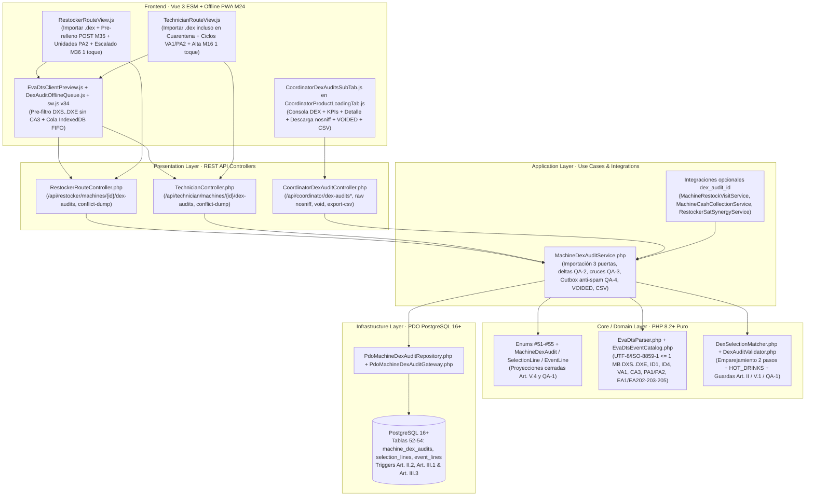

# Plan de Implementación Técnica: Auditoría Local mediante Importación de Ficheros Estándar EVA-DTS (`.dex`) en Ruta (`39-eva-dts-dex-audit`)

**Módulo:** `39-eva-dts-dex-audit` (Feature 33 de [`docs/features_pendientes.md`](../../docs/features_pendientes.md))  
**Versión:** 1.1 (Alineado con `spec.md` v1.1, Decisiones `D1`–`D6`, Casos Límite `C1`–`C6` y Resoluciones `QA-1`–`QA-5`)  
**Estado:** Plan Técnico v1.1 Listo para Revisión Final del Product Owner antes de iniciar `T-DEX-01`  
**Marco Normativo:** [`constitution.md`](../../constitution.md) · [`AGENTS.md`](../../AGENTS.md) · [`docs/design.md`](../../docs/design.md)  
**Especificación Funcional y Técnica:** [`specs/39-eva-dts-dex-audit/spec.md`](./spec.md) (`v1.1`) · [`specs/functional/eva_dts_dex_audit_spec.md`](../functional/eva_dts_dex_audit_spec.md)

---

## 1. Arquitectura de Módulos y Estructura de Ficheros

La solución se construye bajo **Clean Architecture** en PHP 8.2+ POO puro (`declare(strict_types=1);`), persistencia única en **PostgreSQL 16+ (`pdo_pgsql`)** y **Vue 3 (ES Modules nativos)** sin *bundlers* ni dependencias externas (**Art. IV**), preservando intacto el DDL de todas las tablas previas (`machines`, `machine_planogram_slots`, `machine_restock_visits`, `machine_cash_collections`, `incidents`, `offline_sync_mutations`).

### 1.1. Base de Datos, Contratos de Esquema y Semillas (`database/`, `specs/technical/`, `tests/Support/`)

> [!IMPORTANT]
> **Regla de cero alteración DDL en tablas previas:** Los vínculos opcionales hacia visitas M34, recaudaciones M35 e incidencias M16/M36 residen íntegramente como columnas FKs `NULL`-ables en `machine_dex_audits`. Las tablas `machines`, `machine_planogram_slots`, `machine_restock_visits`, `machine_cash_collections`, `incidents` y `offline_sync_mutations` no sufren modificación alguna.

| Fichero | Acción | Responsabilidad |
| :--- | :--- | :--- |
| `database/supabase_migrations/035_eva_dts_dex_audit.sql` | **Crear** | Migración DDL idempotente: crear los 5 tipos nativos `#51`–`#55`; ampliar `audit_entity_type` (`'MACHINE_DEX_AUDIT'`) y `notification_template` (`'DEX_THERMAL_EVENT_ALERT'`); crear Tablas 52 (`machine_dex_audits`, incluyendo `out_of_order_sync` `QA-2`), 53 (`machine_dex_selection_lines`) y 54 (`machine_dex_event_lines`, incluyendo `count_since_reset`, `count_since_init` e `is_active_flag` `QA-4`); crear índices únicos parciales (`uq_machine_dex_audits_machine_hash`, `uq_machine_dex_audits_actor_mutation`, `uq_machine_dex_audits_visit`, `uq_machine_dex_audits_cash_collection`); crear `CHECK` constitucionales (`file_size_bytes`, `id4_decimal_places`, contadores/importes $\ge 0$, `void_reason` $\ge 20$ chars y $\ge 3$ bloques alfanuméricos); y registrar `prevent_hard_delete()`, triggers de inmutabilidad en líneas y por etapas en cabecera, y `enforce_dex_audit_sanitary_guard()` bloqueando a `RESTOCKER` en `QUARANTINE` o con avería abierta `TEMPERATURE_COLD` (`QA-1`, **Art. II.2**, **Art. III.1**, **Art. III.3**, **Art. V.1**). |
| `database/supabase_init.sql` | **Modificar** | Converger 1:1 los tipos `#51`–`#55`, extensiones de enums, Tablas 52–54, índices, restricciones y funciones/disparadores. |
| `database/supabase_seeds.sql` y `src/Infrastructure/Database/SeedRunner.php` | **Modificar** | Sembrar volcados `.dex` representativos del ciclo completo (espiral/snack vinculado a M34/M35, `HOT_DRINKS_SELECTION`, volcado con evento térmico `PERISHABLE_FOOD` y volcado `VOIDED` con motivo real). |
| `specs/technical/database_schema.md` y `specs/technical/schema_correspondence_contract.md` | **Modificar** | Actualizar el inventario oficial de **51 a 54 tablas** y de **50 a 55 tipos `ENUM`** nativos documentando Tablas 52–54. |
| `tests/Support/PostgresFixtureBuilder.php` y `tests/Support/TestDataCleaner.php` | **Modificar** | Incorporar constructores de fixtures `.dex` y añadir `machine_dex_event_lines`, `machine_dex_selection_lines` y `machine_dex_audits` al orden de limpieza transitoria respetando claves foráneas. |

### 1.2. Capa de Dominio (`src/Core/`)

| Fichero | Acción | Responsabilidad |
| :--- | :--- | :--- |
| `src/Core/Domain/Enum/DexAuditStatus.php`, `DexImportSource.php`, `DexSelectionMatchStatus.php`, `DexEventCategory.php`, `DexEventSeverity.php` | **Crear** | Enumerados respaldados de dominio PHP 8.2 alineados 1:1 con los tipos PostgreSQL `#51`–`#55`, etiquetas en español y predicados de dominio. |
| `src/Core/Domain/Model/MachineDexAudit.php`, `MachineDexSelectionLine.php`, `MachineDexEventLine.php` | **Crear** | Entidades inmutables con invariantes de borde y proyecciones segregadas estrictas en `MachineDexAudit`: `toRestockerArray(bool $includeImmediatePrefill = false)` (expone `prefill_sales_counter_reading_eur` solo cuando `$includeImmediatePrefill = true` en respuesta directa de `POST`, nunca en `GET` histórico `QA-1`, sin `restock_expected_delta_units` `QA-3` ni `CA3`), `toTechnicianArray()`, `toCoordinatorArray()` y `jsonSerialize()` por defecto en mínimo privilegio (`QA-1`, **Art. V.4**). |
| `src/Core/Service/EvaDtsParser.php` | **Crear** | Parser EVA-DTS determinista puro en PHP 8.2+: valida ausencia de `\0` y controles peligrosos (`0x00..0x08`, `0x0B..0x0C`, `0x0E..0x1F`, `0x7F`), admite `UTF-8` (tildes/ñ/`€`) y convierte `ISO-8859-1`/`Windows-1252` a `UTF-8` (`QA-5`), tamaño $\le 1\,048\,576$ bytes, sobre `DXS*`..`DXE*`, `VA1*` obligatorio, rechazo de `VA1`/`CA3`/`ID4` duplicados (`422 DEX_DUPLICATE_HEADER_SEGMENT`) y `PA101` duplicados (`422 DEX_DUPLICATE_SELECTION_CODE`), cotas no negativas (`QA-4`, `QA-5`), `ID4` (`0..4`, default `2`), `ID1`, `CA3`, `PA1`/`PA2`, `EA1`/`EA2` (`EA202`/`EA203`/`EA205`), `ignored_unknown_lines_count` y hash `SHA-256` canónico (**Art. I.3**, **Art. IV**, **Art. V.5**). |
| `src/Core/Service/EvaDtsEventCatalog.php` | **Crear** | Catálogo fijo y determinista alineado a EVA-DTS 6.x (`EG*` + alias térmicos $\rightarrow$ `THERMAL_REFRIGERATION` `CRITICAL`; `EA*`/`EB*`/`EC*`/`EJ*` $\rightarrow$ `PAYMENT_MDB` `WARNING`; `EF*`/`EH*` $\rightarrow$ `MECHANICAL_VEND` `WARNING`; `ED*`/`EE*` $\rightarrow$ `POWER_CONTROLLER` `WARNING`; resto `OTHER` `INFO`, `QA-4`). |
| `src/Core/Service/DexSelectionMatcher.php` y `src/Core/Service/DexAuditValidator.php` | **Crear** | Emparejamiento `PA1` en 2 pasos (exacto en mayúsculas $\rightarrow$ recorte unívoco de ceros a la izquierda; `AMBIGUOUS`/`UNMAPPED`; `HOT_DRINKS_SELECTION` en café, **C4**), `identity_mismatch_warning` contra `machines.code`, deltas contra predecesor `captured_at <= new.captured_at` (`QA-2`, `C1`), guardas sanitarias (`QUARANTINE` + `TEMPERATURE_COLD` abierta para `RESTOCKER`, `QA-1`) y motivo de anulación lógica $\ge 20$ caracteres reales (**Art. V.1**). |
| `src/Core/Domain/Exception/DexAuditValidationException.php` y `DexAuditConflictException.php` | **Crear** | Excepciones tipadas con códigos de error canónicos HTTP (`422`, `409`, `404`). |

### 1.3. Capa de Aplicación e Infraestructura (`src/Application/` y `src/Infrastructure/`)

| Fichero | Acción | Responsabilidad |
| :--- | :--- | :--- |
| `src/Core/Domain/Repository/MachineDexAuditRepositoryInterface.php` y `MachineDexAuditGatewayInterface.php` | **Crear** | Contratos de repositorio de auditorías `.dex` y de lectura con bloqueo transaccional sobre máquinas, incidencias activas, planograma, visitas M34, recaudaciones M35 e incidencias M16/M36. |
| `src/Infrastructure/Repository/PdoMachineDexAuditRepository.php` y `PdoMachineDexAuditGateway.php` | **Crear** | Implementación PDO (`pdo_pgsql`): bloqueo `SELECT ... FROM machines WHERE id = :id FOR UPDATE`, alta atómica de cabecera + líneas `PA1`/`PA2` + líneas `EA1`/`EA2`, idempotencia `(imported_by, client_mutation_id)`, dedup `(machine_id, sha256_hash) WHERE status = 'ACTIVE'`, lectura de último volcado `ACTIVE` con `captured_at <= new.captured_at` (`QA-2`), detección de `out_of_order_sync`, consultas de detalle y descarga `raw_payload` aislada, KPIs y listado paginado sin `raw_payload` (**RNF-01**), enlace opcional posterior `NULL` $\rightarrow$ ID y transición `ACTIVE` $\rightarrow$ `VOIDED`. |
| `src/Application/Service/MachineDexAuditService.php` | **Crear** | Orquestación de importación en 3 puertas, deltas `QA-2` (y cálculo en lectura de `effective_delta_*` cuando `previous_audit_voided = TRUE`), cruces cerrados `QA-3` (`CA3_VS_VAULT` / `VA1_VS_EXPECTED` en mismo día civil `Europe/Madrid`, y `prev_item.qty_after - curr_item.qty_before` en M34), encolado transaccional anti-spam `DEX_THERMAL_EVENT_ALERT` en `notification_outbox` con `dedup_key = dex_thermal:{machineId}:{auditId}` solo ante novedad/incremento térmico (`QA-4`), sugerencia M36/M16, anulación lógica auditada (`C6`), volcado Offline (`C5`) y exportación CSV UTF-8 BOM neutralizada (**Art. V.4**). |
| `src/Application/Service/MachineRestockVisitService.php`, `MachineCashCollectionService.php` y `RestockerSatSynergyService.php` | **Modificar** | Aceptar opcionalmente `dex_audit_id` al registrar visita M34, recaudación M35 o escalado SAT M36 y validarlo en la misma transacción rechazando explícitamente con `404 DEX_AUDIT_NOT_FOUND`, `422 DEX_AUDIT_MACHINE_MISMATCH`, `409 DEX_AUDIT_VOIDED` o `409 DEX_AUDIT_ALREADY_LINKED` (`QA-5`), sin alterar DDL previo ni mutar existencias. |

### 1.4. Capa de Presentación y Frontend (`src/Presentation/` y `public/`)

| Fichero | Acción | Responsabilidad |
| :--- | :--- | :--- |
| `src/Presentation/Controller/CoordinatorDexAuditController.php` | **Crear** | Controlador REST exclusivo `COORDINATOR`: listado + KPIs, importación manual escritorio, detalle, descarga segura `.dex` crudo (`Content-Type: text/plain; charset=utf-8`, `X-Content-Type-Options: nosniff`, `Content-Disposition: attachment; filename="DEX-AAAA-NNNN.dex"` `QA-5`), anulación lógica (`void`) y exportación CSV (`export-csv`). |
| `src/Presentation/Controller/RestockerRouteController.php`, `TechnicianController.php` y `src/Presentation/Http/AppRouter.php` | **Modificar** | Exponer endpoints de importación (`toRestockerArray(true)`), listado (`toRestockerArray(false)` sin euros `QA-1`, y `toTechnicianArray()`) y `conflict-dump` para `RESTOCKER` y `TECHNICIAN` con orden estático antes que dinámico y guardas RBAC estrictas (**Art. V.4**). |
| `public/assets/js/utils/EvaDtsClientPreview.js` y `public/assets/js/utils/DexAuditOfflineQueue.js` | **Crear** | Pre-filtro unificado `DXS*`..`DXE*` $\le 1\,\text{MB}$ sin bytes nulos (`QA-5`) + micro-prelectura vanilla JS (solo `ID4`, `VA101`, `VA102` y códigos `EA1`/`EA2`, **jamás `CA3`**) y cola Offline `IndexedDB` FIFO por operador con idempotencia `client_mutation_id`, auto-resolución limpia de `409 DEX_DUPLICATE_HASH`, aislamiento de errores `422`/`409`/`403` sin frenar M34/M35/M36 posteriores (desacoplando `dex_audit_id` en M35 si el `.dex` falló) y volcado en 1 toque (`C5`). |
| `public/assets/js/utils/AuditActionLabels.js` y `public/sw.js` | **Modificar** | Etiquetas de auditoría para `MACHINE_DEX_AUDIT` y eventos `.dex`; precachear `EvaDtsClientPreview.js`, `DexAuditOfflineQueue.js` y `CoordinatorDexAuditsSubTab.js`, elevando `CACHE_NAME` a `vendguard-app-shell-v34`. |
| `public/assets/js/api.js`, `public/assets/js/components/RestockerRouteView.js` y `public/assets/js/views/TechnicianRouteView.js` | **Modificar** | Métodos API `.dex`; flujo en ruta del `RESTOCKER` (subida opcional en M34/M35 o acción rápida, pre-relleno inmediato desde el `POST`, vista de unidades `PA2` + `slot_current_estimated_qty` sin euros `QA-1`/`QA-3`, historial sin euros, banner térmico, escalado M36 en 1 toque y cola Offline); flujo en ruta del `TECHNICIAN` (subida incluso en cuarentena/frío, ciclos `VA1`/`PA2` sin euros, alertas `EA1`/`EA2`, botón a M16 y cola Offline). |
| `public/assets/js/components/CoordinatorDexAuditsSubTab.js` y `public/assets/js/components/CoordinatorProductLoadingTab.js` | **Crear / Modificar** | Crear la sub-vista **«📄 Auditorías EVA-DTS (.dex)»** (4 KPIs, filtros, carga manual escritorio, modal de detalle con deltas efectivos y cruces M34/M35, descarga segura `.dex`, anulación lógica $\ge 20$ chars y exportación CSV) y montarla en `CoordinatorProductLoadingTab.js` manteniendo `CoordinatorDashboardView.js` intacto. |

---

## 2. Decisiones Arquitectónicas Clave y Riesgos Mitigados

1. **Bloqueo pesimista único y orden temporal real (`QA-2`):** Toda importación `.dex` bloquea primero la fila de `machines` (`FOR UPDATE`) antes de buscar el predecesor `ACTIVE` con `captured_at <= new.captured_at`. Así un volcado offline diferido no genera falsos `counter_reset_detected`, y un `VOIDED` intermedio nunca rompe la inmutabilidad del Art. III.3 porque los deltas efectivos se resuelven en lectura.
2. **Aislamiento de `raw_payload` y descarga segura (`RNF-01`, `QA-5`):** Ninguna consulta de listado, ruta móvil o KPI lee `raw_payload`; solo `GET /api/coordinator/dex-audits/{id}/raw` lo sirve con `X-Content-Type-Options: nosniff` y nombre derivado de `audit_code`.
3. **Blindaje de Arqueo Ciego y anti-spam térmico (`QA-1`, `QA-4`):** El `GET` histórico del reponedor no expone ningún campo en euros; y `DEX_THERMAL_EVENT_ALERT` exige novedad o incremento de `EA1`/`EA203` con `dedup_key`, protegiendo tanto el Art. V.4 como la señal operativa de Coordinación.
4. **Resiliencia Offline M24 sin bloqueo en cascada (`C5`, `QA-5`):** La validación `DXS*`..`DXE*` en cliente detecta en el acto lecturas cortadas por cable suelto, y en replay un `.dex` fallido se aparta a conflictos desacoplando `dex_audit_id` de recaudaciones M35 posteriores.

---

## 3. Estrategia de Pruebas y Certificación

| Nivel | Suites Previstas | Cobertura Clave |
| :--- | :--- | :--- |
| **Esquema PostgreSQL** | `PostgresDexAuditSchemaTest.php`, `SchemaConvergenceParityTest.php`, `PostgresSchemaTest.php`, `PostgresConstitutionalTest.php` | 54 tablas, 55 tipos `ENUM`, índices únicos parciales (`ACTIVE` vs. `VOIDED`), `prevent_hard_delete()`, inmutabilidad de líneas y cabecera, `enforce_dex_audit_sanitary_guard()` (`QUARANTINE` + `TEMPERATURE_COLD` `QA-1`), `CHECK` de `void_reason` y no alteración de tablas previas. |
| **Dominio y Parser** | `DexAuditDomainModelsTest.php`, `EvaDtsParserAndCatalogTest.php`, `DexSelectionMatcherAndValidatorTest.php` | `UTF-8`/`ISO-8859-1`, cotas/overflow/duplicados `VA1`/`CA3`/`ID4`/`PA101`, `EA202`/`EA203`/`EA205` y prefijos `EG*`..`EJ*`, emparejamiento 2 pasos + `AMBIGUOUS` + `HOT_DRINKS_SELECTION`, deltas `captured_at <=` + `out_of_order_sync` + `counter_reset_detected`, proyecciones `POST` vs `GET` Art. V.4 (`QA-1`). |
| **Integración PDO y Servicios** | `PdoMachineDexAuditRepositoryTest.php`, `MachineDexAuditServiceTest.php`, `DexAuditServiceIntegrationsTest.php` | Deltas `QA-2` (y lectura efectiva tras `VOIDED`), cruces `QA-3` (`CA3_VS_VAULT`/`VA1_VS_EXPECTED` y M34 `prev.qty_after - curr.qty_before`), anti-spam `DEX_THERMAL_EVENT_ALERT` en Outbox (`QA-4`), enlaces M34/M35/M36 con errores `404`/`409`/`422` (`QA-5`) y CSV UTF-8 BOM. |
| **HTTP, Concurrencia y Constitucional** | `DexAuditApiTest.php`, `DexAuditConstitutionalTest.php`, `DexAuditConcurrencyTest.php` | RBAC completo (4 roles + QR), Arqueo Ciego (`RESTOCKER` sin euros en `GET` y sin `CA3`, `TECHNICIAN` sin euros), bloqueo `SANITARY_DEX_BLOCKED` (`QUARANTINE` + `TEMPERATURE_COLD`) solo para `RESTOCKER`, cabeceras `nosniff` + `DEX-AAAA-NNNN.dex` en `/raw`, carrera `SHA-256`/`client_mutation_id` e inmutabilidad tras `VOIDED`. |
| **Frontend, Offline y Navegador Real** | `eva_dts_offline_queue.test.mjs`, `restocker_route_view.test.mjs`, `technician_route_view.test.mjs`, `coordinator_dex_audits_tab.test.mjs`, `DexAuditLayoutBrowserTest.php` | Pre-filtro `DXS*`..`DXE*` y pre-lectura JS sin `CA3`, cola Offline con aislamiento de conflictos frente a M35, flujos móvil/escritorio, layout real en Chromium a `360 × 800 px` y escritorio. |
| **Cierre Global** | `php tests/run_all.php`, `php tests/run_new_engine.php`, `DocMetricsGuard` | 100 % en verde en ambos canales + `traceability-matrix.md`. |
