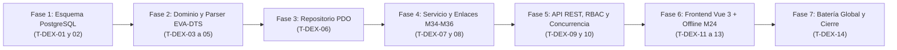

# Plan de Tareas de Implementación (`tasks.md`): Auditoría Local mediante Importación de Ficheros Estándar EVA-DTS (`.dex`) en Ruta (`39-eva-dts-dex-audit`)

**Módulo:** `39-eva-dts-dex-audit` (Feature 33 de [`docs/features_pendientes.md`](../../docs/features_pendientes.md))  
**Versión:** 1.1 (Alineado con `spec.md` v1.1 y `plan.md` v1.1; incorpora `QA-1`–`QA-5`)  
**Estado:** Listo para Revisión Final del Product Owner y arranque en `T-DEX-01` tras confirmación  
**Metodología:** SDD (Specification-Driven Development) · Clean Architecture · TDD / Guardas de Esquema y Diseño  
**Ley Suprema:** [`constitution.md`](../../constitution.md), [`AGENTS.md`](../../AGENTS.md) y [`docs/design.md`](../../docs/design.md)

---

## Resumen de Fases y Grafo de Dependencias

| Fase | Rango de Tareas | Descripción | Estimación |
| :--- | :--- | :--- | :--- |
| **Fase 1** | `T-DEX-01` .. `T-DEX-02` | Migración `035_eva_dts_dex_audit.sql` (tipos `#51`–`#55`, Tablas 52–54 con `out_of_order_sync` y columnas `EA202`/`EA203`/`EA205` sin alterar DDL previo), convergencia `supabase_init.sql`, semillas, contratos a 54 tablas / 55 enums, fixtures y suite de esquema PostgreSQL | ~55 min |
| **Fase 2** | `T-DEX-03` .. `T-DEX-05` | Enums `#51`–`#55`, modelos inmutables con proyecciones Art. V.4 (`POST` vs `GET` `QA-1`), parser determinista `EvaDtsParser` (`UTF-8`/`ISO-8859-1`, cotas, duplicados `QA-4`/`QA-5`), catálogo `EvaDtsEventCatalog`, `DexSelectionMatcher` (`C4`) y `DexAuditValidator` + suites unitarias | ~75 min |
| **Fase 3** | `T-DEX-06` | `PdoMachineDexAuditRepository` y `PdoMachineDexAuditGateway` (alta atómica, idempotencia, dedup `SHA-256`, predecesor `captured_at <=`, `out_of_order_sync`, lectura sin `raw_payload`, `VOIDED`, KPIs) + suite de integración PDO | ~55 min |
| **Fase 4** | `T-DEX-07` .. `T-DEX-08` | `MachineDexAuditService` (importación 3 puertas, deltas efectivos tras `VOIDED` `QA-2`, cruces `QA-3`, Outbox anti-spam `QA-4`, CSV BOM) + enlace opcional `dex_audit_id` con errores `404`/`409`/`422` en M34/M35/M36 (`QA-5`) + tests | ~70 min |
| **Fase 5** | `T-DEX-09` .. `T-DEX-10` | `CoordinatorDexAuditController` (con `/raw` `nosniff`), extensión `RestockerRouteController` / `TechnicianController` / `AppRouter` + suites `DexAuditApiTest`, `DexAuditConstitutionalTest` y `DexAuditConcurrencyTest` | ~65 min |
| **Fase 6** | `T-DEX-11` .. `T-DEX-13` | `EvaDtsClientPreview.js` (`DXS*`..`DXE*`) + `DexAuditOfflineQueue.js` + `sw.js` (`v34`), integración móvil en `RestockerRouteView.js` y `TechnicianRouteView.js`, consola `CoordinatorDexAuditsSubTab.js` + tests `.mjs` + `DexAuditLayoutBrowserTest.php` (360 px) | ~85 min |
| **Fase 7** | `T-DEX-14` | Batería global (`php tests/run_all.php`), canal `new_engine` (`php tests/run_new_engine.php`), `DocMetricsGuard`, `traceability-matrix.md` y actualización de `docs/features_pendientes.md` | ~30 min |

---

## Detalle de Tareas

### Fase 1 · Esquema PostgreSQL y Contratos de Datos

- [ ] **T-DEX-01 · Crear migración `035_eva_dts_dex_audit.sql`, converger `supabase_init.sql` y añadir semillas idempotentes en `supabase_seeds.sql` y `SeedRunner.php`**
  - **Requisitos:** `RF-01.1`, `RNF-01`, `RNF-02`, `D1`, `C2`, `C3`, `C6`, `QA-1`, `QA-2`, `QA-4`, `QA-5`, `Art. II.2`, `Art. III.1`, `Art. III.3`, `Art. V.1`.
  - **Ficheros:** `database/supabase_migrations/035_eva_dts_dex_audit.sql` (crear), `database/supabase_init.sql`, `database/supabase_seeds.sql`, `src/Infrastructure/Database/SeedRunner.php`.
  - **Notas técnicas:** Mantener intacto el DDL de `machines`, `machine_planogram_slots`, `machine_restock_visits`, `machine_cash_collections`, `incidents` y `offline_sync_mutations`. Incluir `out_of_order_sync` en Tabla 52, `count_since_reset`, `count_since_init` e `is_active_flag` en Tabla 54 y `CHECK` no negativos en contadores/importes. Definir triggers `prevent_hard_delete()`, inmutabilidad en líneas, transición única de enlaces `NULL` $\rightarrow$ ID y transición única `ACTIVE` $\rightarrow$ `VOIDED`, más `enforce_dex_audit_sanitary_guard()` bloqueando a `RESTOCKER` cuando `machines.sanitary_status = 'QUARANTINE'` o exista incidencia abierta `incidents.category = 'TEMPERATURE_COLD'` (`QA-1`).
  - **Verificación:** `php tests/integration/SchemaConvergenceParityTest.php && php tests/integration/SeedRunnerSingleEngineTest.php`

- [ ] **T-DEX-02 · Actualizar contratos de esquema (54 tablas, 55 tipos `ENUM`), `PostgresFixtureBuilder`, `TestDataCleaner`, `AuditActionLabels.js` y crear `PostgresDexAuditSchemaTest.php`**
  - **Requisitos:** `RF-01.1`, `RNF-02`, `QA-1`, `Art. II.2`, `Art. III.1`, `Art. III.3`, `Art. V.1`.
  - **Ficheros:** `specs/technical/database_schema.md`, `specs/technical/schema_correspondence_contract.md`, `tests/Support/PostgresFixtureBuilder.php`, `tests/Support/TestDataCleaner.php`, `public/assets/js/utils/AuditActionLabels.js`, `tests/integration/PostgresDexAuditSchemaTest.php` (crear).
  - **Verificación:** `php tests/integration/PostgresSchemaTest.php && php tests/integration/PostgresConstitutionalTest.php && php tests/integration/PostgresDexAuditSchemaTest.php`

---

### Fase 2 · Capa de Dominio, Parser EVA-DTS y Validadores

- [ ] **T-DEX-03 · Crear enums `#51`–`#55` (`DexAuditStatus`, `DexImportSource`, `DexSelectionMatchStatus`, `DexEventCategory`, `DexEventSeverity`) y entidades inmutables (`MachineDexAudit`, `MachineDexSelectionLine`, `MachineDexEventLine`) con proyecciones Art. V.4 y `QA-1`**
  - **Requisitos:** `RF-01.1`, `RF-03.2`, `RNF-02.4`, `D1`, `D2`, `QA-1`, `QA-3`, `QA-4`, `Art. III.3`, `Art. V.4`.
  - **Ficheros:** `src/Core/Domain/Enum/DexAuditStatus.php`, `DexImportSource.php`, `DexSelectionMatchStatus.php`, `DexEventCategory.php`, `DexEventSeverity.php`, `src/Core/Domain/Model/MachineDexAudit.php`, `MachineDexSelectionLine.php`, `MachineDexEventLine.php`, `tests/unit/DexAuditDomainModelsTest.php` (crear).
  - **Notas técnicas:** Implementar `toRestockerArray(bool $includeImmediatePrefill = false)` omitiendo `prefill_sales_counter_reading_eur` en el `GET` histórico (`false`) y omitiendo `restock_expected_delta_units` (`QA-1`, `QA-3`).
  - **Verificación:** `php tests/unit/DexAuditDomainModelsTest.php`

- [ ] **T-DEX-04 · Crear `EvaDtsParser`, `EvaDtsEventCatalog` y excepciones de dominio (`DexAuditValidationException`, `DexAuditConflictException`)**
  - **Requisitos:** `RF-02.1`, `RF-02.2`, `RF-05.1`, `D3`, `D4`, `C3`, `QA-4`, `QA-5`, `Art. I.3`, `Art. IV`, `Art. V.5`.
  - **Ficheros:** `src/Core/Service/EvaDtsParser.php`, `src/Core/Service/EvaDtsEventCatalog.php`, `src/Core/Domain/Exception/DexAuditValidationException.php`, `src/Core/Domain/Exception/DexAuditConflictException.php`, `tests/unit/EvaDtsParserAndCatalogTest.php` (crear).
  - **Notas técnicas:** Validar ausencia de `\0` y controles peligrosos (`0x00..0x08`, `0x0B..0x0C`, `0x0E..0x1F`, `0x7F`), soportar `UTF-8` (tildes/ñ/`€`) y convertir `ISO-8859-1`/`Windows-1252` a `UTF-8` (`QA-5`), $\le 1\,048\,576$ bytes, sobre `DXS*`..`DXE*`, `VA1*` obligatorio, rechazo `422` ante `VA1`/`CA3`/`ID4` duplicados y `PA101` duplicados, cotas no negativas, `ID4` (`0..4` o default `2`), `ID1`, `CA3`, `PA1`/`PA2`, `EA1` + `EA2` (`EA202`/`EA203`/`EA205`), catálogo `EG*`..`EJ*`, `ignored_unknown_lines_count` y hash `SHA-256` canónico.
  - **Verificación:** `php tests/unit/EvaDtsParserAndCatalogTest.php`

- [ ] **T-DEX-05 · Crear `DexSelectionMatcher` (`C4`) y `DexAuditValidator` (`D3`, `C1`, `C2`, `C6`, `QA-1`, `QA-2`, `Art. II.2`, `Art. V.1`)**
  - **Requisitos:** `RF-02.2`, `RF-03.1`, `RF-04.1`, `RF-04.2`, `RF-07.2`, `C1`, `C2`, `C4`, `C6`, `QA-1`, `QA-2`.
  - **Ficheros:** `src/Core/Service/DexSelectionMatcher.php`, `src/Core/Service/DexAuditValidator.php`, `tests/unit/DexSelectionMatcherAndValidatorTest.php` (crear).
  - **Verificación:** `php tests/unit/DexSelectionMatcherAndValidatorTest.php`

---

### Fase 3 · Capa de Infraestructura PDO

- [ ] **T-DEX-06 · Implementar `MachineDexAuditRepositoryInterface`, `MachineDexAuditGatewayInterface`, `PdoMachineDexAuditRepository` y `PdoMachineDexAuditGateway`**
  - **Requisitos:** `RF-01.1`, `RF-03.1`, `RF-04.1`, `RF-04.3`, `RF-07.1`, `RF-07.2`, `RNF-01`, `D1`, `C1`, `C3`, `C6`, `QA-1`, `QA-2`, `QA-3`.
  - **Ficheros:** `src/Core/Domain/Repository/MachineDexAuditRepositoryInterface.php`, `MachineDexAuditGatewayInterface.php`, `src/Infrastructure/Repository/PdoMachineDexAuditRepository.php`, `PdoMachineDexAuditGateway.php`, `tests/integration/PdoMachineDexAuditRepositoryTest.php` (crear).
  - **Notas técnicas:** Garantizar exclusión de `raw_payload` en todas las lecturas de listado/KPIs, bloqueo `FOR UPDATE` sobre `machines`, lectura del último volcado `ACTIVE` con `captured_at <= new.captured_at` (`QA-2`), detección de `out_of_order_sync`, comprobación de avería activa `TEMPERATURE_COLD` (`QA-1`), consultas de cruce M34/M35 en mismo día civil `Europe/Madrid` (`QA-3`), y descarga aislada de `raw_payload`.
  - **Verificación:** `php tests/integration/PdoMachineDexAuditRepositoryTest.php`

---

### Fase 4 · Capa de Aplicación e Integraciones M34 / M35 / M36

- [ ] **T-DEX-07 · Implementar `MachineDexAuditService` (importación en 3 puertas, deltas `QA-2`, cruces `QA-3`, alerta térmica Outbox anti-spam `QA-4`, sugerencia M36/M16, anulación `VOIDED`, volcado Offline y CSV UTF-8 BOM)**
  - **Requisitos:** `RF-02`–`RF-07`, `RNF-01`–`RNF-04`, `D1`–`D6`, `C1`–`C6`, `QA-1`–`QA-5`, `Art. II`, `Art. III.3`, `Art. V.1`, `Art. V.4`.
  - **Ficheros:** `src/Application/Service/MachineDexAuditService.php`, `tests/unit/MachineDexAuditServiceTest.php` (crear).
  - **Verificación:** `php tests/unit/MachineDexAuditServiceTest.php`

- [ ] **T-DEX-08 · Integrar enlace opcional `dex_audit_id` con validación estricta (`404`/`409`/`422`, `QA-5`) en `MachineRestockVisitService`, `MachineCashCollectionService` y `RestockerSatSynergyService` sin alterar DDL ni mutar existencias**
  - **Requisitos:** `RF-04.3`, `RF-05.2`, `D1`, `D4`, `D5`, `C5`, `QA-5`.
  - **Ficheros:** `src/Application/Service/MachineRestockVisitService.php`, `src/Application/Service/MachineCashCollectionService.php`, `src/Application/Service/RestockerSatSynergyService.php`, más `tests/unit/DexAuditServiceIntegrationsTest.php` (crear).
  - **Verificación:** `php tests/unit/DexAuditServiceIntegrationsTest.php`

---

### Fase 5 · Capa HTTP REST, Blindaje Constitucional y Concurrencia

- [ ] **T-DEX-09 · Crear `CoordinatorDexAuditController` y extender `RestockerRouteController`, `TechnicianController` y `AppRouter` con las 12 rutas REST, cabeceras seguras en `/raw` (`QA-5`) y guardas RBAC (`QA-1`)**
  - **Requisitos:** `RF-03`–`RF-07`, `RNF-01`–`RNF-04`, `QA-1`, `QA-5`, `Art. V.4`, `Art. V.5`.
  - **Ficheros:** `src/Presentation/Controller/CoordinatorDexAuditController.php` (crear), `src/Presentation/Controller/RestockerRouteController.php`, `src/Presentation/Controller/TechnicianController.php`, `src/Presentation/Http/AppRouter.php`, `tests/integration/DexAuditApiTest.php` (crear).
  - **Verificación:** `php tests/integration/DexAuditApiTest.php`

- [ ] **T-DEX-10 · Crear y certificar `DexAuditConstitutionalTest.php` y `DexAuditConcurrencyTest.php`**
  - **Requisitos:** `RF-01`–`RF-07`, `RNF-02`, `QA-1`–`QA-5`, `Art. I.3`, `Art. II.2`, `Art. III.1`, `Art. III.3`, `Art. V.1`, `Art. V.4`, `Art. V.5`.
  - **Ficheros:** `tests/integration/DexAuditConstitutionalTest.php`, `tests/integration/DexAuditConcurrencyTest.php`, `tests/Support/DexAuditConcurrencyActor.php` (crear).
  - **Notas técnicas:** Verificar opacidad total frente a Sede/QR/A4, Arqueo Ciego del Reponedor (`POST` vs `GET` histórico sin euros `QA-1` y sin `CA3`), Técnico sin importes EUR, bloqueo `SANITARY_DEX_BLOCKED` (`QUARANTINE` + `TEMPERATURE_COLD`) solo para Reponedor, cabeceras `nosniff` + `DEX-AAAA-NNNN.dex` en `/raw`, carrera simultánea de `SHA-256` y `client_mutation_id`, e inmutabilidad tras `VOIDED`.
  - **Verificación:** `php tests/integration/DexAuditConstitutionalTest.php && php tests/integration/DexAuditConcurrencyTest.php`

---

### Fase 6 · Frontend Vue 3 ESM, Modo Offline PWA M24 y Layout Browser 360 px

- [ ] **T-DEX-11 · Crear `EvaDtsClientPreview.js` y `DexAuditOfflineQueue.js`, actualizar `public/sw.js` a `vendguard-app-shell-v34` y probar aislamiento de conflictos M24**
  - **Requisitos:** `RF-06.1`, `RF-06.2`, `D6`, `C5`, `QA-5`, `Art. IV`, `Art. V.4`.
  - **Ficheros:** `public/assets/js/utils/EvaDtsClientPreview.js` (crear), `public/assets/js/utils/DexAuditOfflineQueue.js` (crear), `public/sw.js`, `tests/unit/eva_dts_offline_queue.test.mjs` (crear).
  - **Notas técnicas:** Validar tamaño $\le 1\,\text{MB}$, sin `\0`, inicio `DXS*` **y** cierre `DXE*` (`QA-5`); garantizar que `EvaDtsClientPreview.js` nunca extraiga ni exponga `CA3` y que en replay un `.dex` fallido vaya a conflictos sin frenar visitas M34, recaudaciones M35 (desvinculando `dex_audit_id`) ni escalados M36 posteriores.
  - **Verificación:** `node tests/unit/eva_dts_offline_queue.test.mjs && node tests/unit/OfflinePwaAssetsAndUiGuardTest.mjs`

- [ ] **T-DEX-12 · Integrar flujo `.dex` en `api.js`, `RestockerRouteView.js` y `TechnicianRouteView.js` (online + offline, pre-relleno `POST` M35, unidades `PA2` sin euros en historial, banner térmico y escalado M36/M16 en 1 toque)**
  - **Requisitos:** `RF-03.2`, `RF-04.3`, `RF-05.2`, `RF-06.1`, `RNF-03`, `D1`, `D2`, `D4`, `D5`, `D6`, `QA-1`, `QA-3`, `Art. II`, `Art. V.4`.
  - **Ficheros:** `public/assets/js/api.js`, `public/assets/js/components/RestockerRouteView.js`, `public/assets/js/views/TechnicianRouteView.js`, tests en `tests/frontend/restocker_route_view.test.mjs` y `tests/frontend/technician_route_view.test.mjs` (crear/ampliar).
  - **Verificación:** `node tests/frontend/restocker_route_view.test.mjs && node tests/frontend/technician_route_view.test.mjs`

- [ ] **T-DEX-13 · Crear `CoordinatorDexAuditsSubTab.js`, montarla en `CoordinatorProductLoadingTab.js` y certificar `DexAuditLayoutBrowserTest.php` en Chromium a `360 × 800 px` y escritorio**
  - **Requisitos:** `RF-07.1`, `RF-07.2`, `RNF-03`, `C6`, `QA-2`, `QA-3`, `QA-5`, `Art. III.2`, `Art. V.1`, `Art. V.4`.
  - **Ficheros:** `public/assets/js/components/CoordinatorDexAuditsSubTab.js` (crear), `public/assets/js/components/CoordinatorProductLoadingTab.js`, `tests/frontend/coordinator_dex_audits_tab.test.mjs` (crear), `tests/Support/DexAuditLayoutBrowserRunner.mjs` (crear), `tests/integration/DexAuditLayoutBrowserTest.php` (crear).
  - **Verificación:** `node tests/frontend/coordinator_dex_audits_tab.test.mjs && php tests/integration/DexAuditLayoutBrowserTest.php`

---

### Fase 7 · Batería Global, Sincronización Documental y Cierre

- [ ] **T-DEX-14 · Ejecutar batería global y canal `new_engine`, sincronizar `DocMetricsGuard`, redactar `traceability-matrix.md` y actualizar `docs/features_pendientes.md`**
  - **Requisitos:** `DoD 1`–`DoD 4`.
  - **Ficheros:** `specs/39-eva-dts-dex-audit/traceability-matrix.md` (crear), `docs/features_pendientes.md`, `README.md` (si aplica por `DocMetricsGuard`).
  - **Verificación:** `php tests/run_all.php && php tests/run_new_engine.php`
