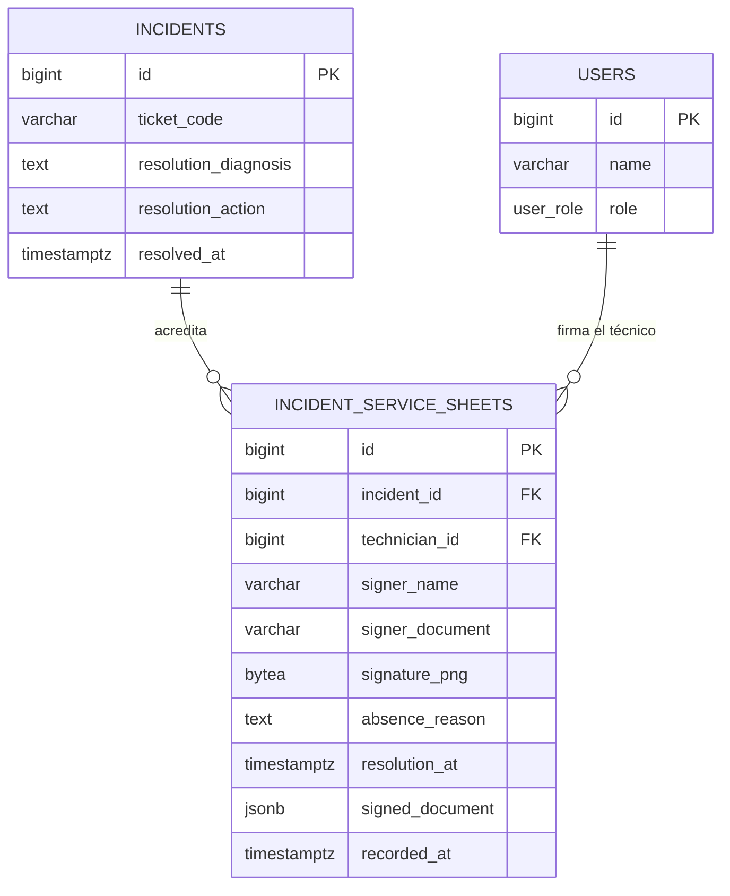

# ESPECIFICACIÓN TÉCNICA · CONTRATOS DE API Y MODELO DE DATOS
# FIRMA DIGITAL DEL RESPONSABLE DE SEDE Y ALBARÁN DE SERVICIO (MÓDULO 19)

**Referencia funcional:** [`specs/19-digital-signature/spec.md`](../19-digital-signature/spec.md) (versión 2, Q1–Q8)  
**Estado:** Borrador para aprobación del Product Owner  
**Fecha:** Octubre 2026

---

## 1. Principios Arquitectónicos del Módulo

### 1.1. Una sola unidad de escritura para todo el cierre (RF-03.1, Q3)

`SparePartTraceabilityService::resolveIncidentWithParts()` abre **una** transacción que cubre, en este orden: inserción de cada pieza sustituida, descuento de stock de la furgoneta, actualización de solicitudes de repuestos, transición a `RESOLVED`, encolado de la notificación y hoja de servicio. La validación (existencia, transición, textos, catálogo, cantidades) ocurre **antes** de abrir la transacción: nada se escribe hasta que todo es válido.

*Desviación declarada y enmendada:* hasta hoy el bucle de piezas se ejecutaba con autocommit y el `runInTransaction()` solo envolvía `resolve()`, y solo cuando había `notificationEnqueuer`. El Módulo 19 hace la transacción **incondicional** (el `TransactionManager` se crea perezosamente si no se inyectó) y **enmienda RD-02 del Módulo 18** con autorización del Product Owner (Q3).

*Consecuencia:* un fallo de infraestructura al descontar stock ahora revierte el cierre. No altera la regla de negocio del Módulo 18 («el inventario nunca frena un cierre»): `VanStockService::consume()` hace un `INSERT ... ON CONFLICT ... DO UPDATE` que admite saldos negativos y no consulta disponibilidad, así que solo falla por error de base de datos.

### 1.2. Inmutabilidad por base de datos, no por convención

Sin `updated_at`, sin ruta de `UPDATE` en el repositorio y con `BEFORE DELETE ... prevent_hard_delete()` (Art. III.1). El repositorio solo expone `insert()` y consultas.

### 1.3. La imagen no es un fichero, y el contenido se congela (RD-03, RD-10)

`signature_png BYTEA` en la tabla, no `public/uploads`. El Art. V.5 aplica **como cota superior** (5 MB, formatos gráficos seguros) y el módulo lo endurece: solo PNG y 300 KiB operativos. Junto a la imagen, `signed_document JSONB` congela el documento que el firmante vio, porque todo lo demás (nombres de sede, de máquina, de piezas, textos de resolución) sigue vivo en sus tablas y cambiaría el papel firmado.

### 1.4. Vigencia anclada a la resolución (RD-11)

`resolution_at` es una copia exacta del `incidents.resolved_at` del cierre que produjo la hoja. La hoja es **vigente** si `resolution_at = incidents.resolved_at` y la incidencia está en `RESOLVED` o `CLOSED`; si no, es **histórica**. No se compara texto JSON ni se reconstruye la resolución desde `incident_history`.

---

## 2. Modelo de Datos

### 2.1. Modelo Entidad-Relación (Mermaid ERD)



### 2.2. DDL de la tabla (forma canónica, `database/supabase_init.sql`)

```sql
CREATE TABLE IF NOT EXISTS incident_service_sheets (
    id              BIGINT GENERATED ALWAYS AS IDENTITY,
    incident_id     BIGINT NOT NULL,
    technician_id   BIGINT NOT NULL,
    signer_name     VARCHAR(120),
    signer_document VARCHAR(20),
    signature_png   BYTEA,
    absence_reason  TEXT,
    resolution_at   TIMESTAMPTZ NOT NULL,
    signed_document JSONB NOT NULL,
    recorded_at     TIMESTAMPTZ NOT NULL DEFAULT CURRENT_TIMESTAMP,
    CONSTRAINT pk_incident_service_sheets PRIMARY KEY (id),
    CONSTRAINT fk_service_sheet_incident FOREIGN KEY (incident_id)
        REFERENCES incidents (id) ON DELETE RESTRICT ON UPDATE CASCADE,
    CONSTRAINT fk_service_sheet_technician FOREIGN KEY (technician_id)
        REFERENCES users (id) ON DELETE RESTRICT ON UPDATE CASCADE,
    CONSTRAINT chk_service_sheet_branch CHECK (
        (
            signature_png IS NOT NULL
            AND signer_name IS NOT NULL
            AND signer_document IS NOT NULL
            AND absence_reason IS NULL
        )
        OR
        (
            signature_png IS NULL
            AND signer_name IS NULL
            AND signer_document IS NULL
            AND absence_reason IS NOT NULL
            AND char_length(btrim(absence_reason)) >= 10
        )
    ),
    CONSTRAINT chk_service_sheet_png_size CHECK (
        signature_png IS NULL OR octet_length(signature_png) BETWEEN 64 AND 307200
    ),
    CONSTRAINT chk_service_sheet_document CHECK (
        jsonb_typeof(signed_document) = 'object'
        AND signed_document ? 'version'
    )
);

CREATE INDEX IF NOT EXISTS idx_service_sheet_incident
    ON incident_service_sheets (incident_id, recorded_at DESC, id DESC);

DROP TRIGGER IF EXISTS trg_service_sheet_no_delete ON incident_service_sheets;
CREATE TRIGGER trg_service_sheet_no_delete
    BEFORE DELETE ON incident_service_sheets
    FOR EACH ROW EXECUTE FUNCTION prevent_hard_delete();
```

**Notas de diseño:**

* Sin `UNIQUE (incident_id)`: una reapertura genera otra hoja (RD-01). El índice descendente, con `id` como desempate, sirve la hoja más reciente sin ordenaciones en memoria.
* `resolution_at NOT NULL`: el ancla de vigencia no puede faltar. La inserción copia `incidents.resolved_at`, que en ese punto de la transacción ya está escrito.
* El `CHECK` de rama es la última línea de defensa: aunque un cliente futuro llame al repositorio sin pasar por el validador, la base rechaza una hoja con firma y motivo, o con ninguno.
* `recorded_at` es el instante de registro de la hoja (`DEFAULT CURRENT_TIMESTAMP`); `resolution_at` es el instante del cierre. Pueden diferir en milisegundos y **no** son intercambiables: el primero ordena, el segundo identifica la resolución.

### 2.3. Migración

`database/supabase_migrations/010_incident_service_sheets.sql` reproduce exactamente los objetos anteriores con guardas de idempotencia (`IF NOT EXISTS`, `DROP TRIGGER IF EXISTS`). No toca enums: la auditoría reutiliza `TICKET` y las acciones `RESOLVE_INCIDENT` y `VIEW_SERVICE_SHEET` (RD-09), de modo que la migración no necesita `ALTER TYPE` y es reversible por despliegue de código.

### 2.4. Fixture de pruebas

`tests/Support/PostgresFixtureBuilder.php` crea la tabla con la misma forma canónica. La suite `PostgresServiceSheetSchemaTest` (motor `new_engine`) verifica `CHECK` de rama, tope de tamaño, ancla no nula, índice y trigger.

---

## 3. Objetos de Dominio (PHP 8.2+)

### 3.1. Entidad `IncidentServiceSheet`

```php
final class IncidentServiceSheet
{
    public function __construct(
        private readonly ?int $id,
        private readonly int $incidentId,
        private readonly int $technicianId,
        private readonly ?string $signerName,
        private readonly ?string $signerDocument,
        private readonly ?string $signaturePng,    // bytes crudos, nunca base64
        private readonly ?string $absenceReason,
        private readonly ?string $resolutionAt = null,
        private readonly ?array $signedDocument = null,
        private readonly ?string $recordedAt = null,
    ) {}

    public function isSigned(): bool;              // signaturePng !== null
    public function toArray(): array;              // metadatos: signed, signer_name, recorded_at
}
```

Invariante del constructor: exactamente una de las dos ramas. Se valida en `ServiceSheetValidator` **antes** de construirlo. `resolutionAt` y `signedDocument` llegan hidratados al leer; en la escritura los calcula la base en la misma sentencia (RD-10).

### 3.2. Validador `ServiceSheetValidator`

```php
final class ServiceSheetValidator
{
    public const MAX_PNG_BYTES = 307200;          // 300 KiB
    public const MAX_PIXELS = 2000000;            // 2 Mpx
    public const MIN_SIGNER_NAME = 3;
    public const MIN_DOCUMENT = 5;
    public const MAX_DOCUMENT = 20;
    public const MIN_ABSENCE_REASON = 10;

    private const ALLOWED_KEYS = [
        'signer_name', 'signer_document', 'signature_png_base64', 'absence_reason',
    ];

    /**
     * @return array{signer_name:?string, signer_document:?string,
     *               signature_png:?string, absence_reason:?string}
     * @throws InvalidServiceSheetException
     */
    public static function normalize(mixed $payload): array;
}
```

Reglas, en orden:

1. `null` no es asunto del validador: el servicio decide que no hay hoja antes de llamarlo. Si llega `null`, `[]`, `{}` o cualquier cosa que no sea un array no vacío → `INVALID_SERVICE_SHEET` (campo `service_sheet`).
2. Claves desconocidas → `INVALID_SERVICE_SHEET`. El contrato es cerrado y un nombre de campo mal escrito no puede degradar en «cierre sin firma» silencioso.
3. Acepta `signature_png_base64` con o sin prefijo `data:image/png;base64,`.
4. Antes de decodificar, elimina **todos** los espacios y saltos de línea del base64 (algunos clientes lo parten en líneas).
5. `base64_decode($value, true)` estricto; si devuelve `false`, `INVALID_SERVICE_SHEET`.
6. Cabecera `\x89PNG\r\n\x1a\n` y `finfo(FILEINFO_MIME_TYPE) === 'image/png'`.
7. `strlen(bytes)` entre 64 y `MAX_PNG_BYTES` (307 200).
8. Dimensiones leídas del `IHDR` (bytes 16–23, big-endian): `width > 0`, `height > 0`, `width * height <= MAX_PIXELS`.
9. Nombre recortado, longitud `mb_strlen` ≥ 3.
10. Documento: recortar, `mb_strtoupper`, eliminar **todos** los espacios (también los internos); debe encajar en `^[A-Z0-9-]{5,20}$`.
11. Ramas mutuamente excluyentes (firma XOR motivo); motivo recortado ≥ 10. La firma exige nombre y documento; la ausencia exige que no vengan.
12. **No** se valida «tinta»: el servidor no decodifica píxeles (RD-12, sin GD en producción). Esa comprobación vive en el componente del técnico.

El validador no toca base de datos, reloj ni sistema de ficheros: es puro y se prueba con arrays.

### 3.3. Servicio de aplicación

Sin servicio nuevo. La escritura vive en `SparePartTraceabilityService::resolveIncidentWithParts()`, reordenada para que **toda** la escritura caiga dentro de la transacción (Q3):

```php
// 1–4. Validaciones sin escritura (incidencia, transición, textos, sanidad, piezas).
$sheet = array_key_exists('service_sheet', $data) && $data['service_sheet'] !== null
    ? ServiceSheetValidator::normalize($data['service_sheet'])
    : null;

// 4.b. Construcción de las entidades de pieza (consultas de catálogo), sin escribir.
$partEntities = $this->buildReplacedPartEntities($incident, $technicianId, $data);

// 5. Única unidad de escritura.
$resolvedIncident = $this->transactions()->runInTransaction(
    function () use ($incidentId, $technicianId, $diagnosis, $action, $partEntities, $replacedPartsDeclared, $sheet): Incident {
        $insertedParts = [];

        foreach ($partEntities as $part) {
            $inserted = $this->replacedPartRepo->insertReplacedPart($part);
            $insertedParts[] = $inserted;
            $this->deductVanStock($inserted);          // Módulo 18, ahora dentro
        }

        $replacedPartsDeclared
            ? $this->requestRepo->markAttendedByIncident($incidentId)
            : $this->requestRepo->markCancelledByIncident($incidentId);

        $resolved = $this->incidentRepo->resolve($incidentId, $technicianId, $diagnosis, $action);

        if ($this->notificationEnqueuer !== null) {
            $this->notificationEnqueuer->enqueueResolution($resolved);
        }

        if ($sheet !== null) {
            $this->serviceSheetRepo->insert(new IncidentServiceSheet(
                id: null,
                incidentId: $incidentId,
                technicianId: $technicianId,
                signerName: $sheet['signer_name'],
                signerDocument: $sheet['signer_document'],
                signaturePng: $sheet['signature_png'],
                absenceReason: $sheet['absence_reason'],
            ));
        }

        return $resolved;
    }
);

// 6. Auditoría (después del commit, como hoy) con el bloque service_sheet en new_state.
```

`$insertedParts` se captura por referencia (`use (&$insertedParts)`) para devolver el recuento y alimentar la auditoría sin sacar la escritura de la transacción.

*La lectura del documento* se resuelve en `PdoIncidentServiceSheetRepository::findDocumentByIncidentId()`, que devuelve el array listo para `Response::json()`.

### 3.4. `ServiceSheetDto`

Solo existe para la respuesta del cierre:

```php
final class ServiceSheetDto
{
    public function __construct(
        public readonly bool $signed,
        public readonly ?string $signerName,
        public readonly string $recordedAt,
    ) {}

    public function toArray(): array; // ['signed' => …, 'signer_name' => …, 'recorded_at' => …]
}
```

Nunca transporta el trazo ni el `signed_document`.

### 3.5. Inyección y compatibilidad de pruebas

`SparePartTraceabilityService::__construct` gana un argumento **obligatorio** `IncidentServiceSheetRepositoryInterface $serviceSheetRepo` (mismo criterio que `vanStockService` en el Módulo 18). Los puntos de construcción del servicio —controladores y factorías de pruebas— se actualizan en la misma unidad de trabajo; `StubTraceabilityService` no redefine el constructor, pero sus llamadas deben recibir el repositorio.

---

## 4. Endpoints de API (Contratos HTTP)

### 4.1. `POST /api/technician/incidents/{id}/resolve` — extensión del contrato (RF-01, RF-02)

El cuerpo existente no cambia. Se añade un bloque **opcional**:

```json
{
  "diagnosis": "Bobina del relé térmico quemada por pico de tensión en el cuadro.",
  "action_taken": "Sustituido relé térmico y verificado ciclo de frío estabilizado a 4 ºC.",
  "replaced_parts_declared": true,
  "replaced_parts": [
    { "spare_part_id": 12, "quantity": 1, "old_part_destination": "TALLER" }
  ],
  "service_sheet": {
    "signer_name": "María López Ferrer",
    "signer_document": "12345678Z",
    "signature_png_base64": "iVBORw0KGgoAAAANSUhEUg..."
  }
}
```

Rama de ausencia:

```json
{
  "service_sheet": {
    "absence_reason": "Sede sin conserjería; acceso con llave facilitada por la central."
  }
}
```

**Respuesta 200** (se añade una clave al `data` existente):

```json
{
  "success": true,
  "data": {
    "id": 123,
    "ticket_code": "INC-000123",
    "status": "RESOLVED",
    "resolved_at": "2026-10-22 17:42:11",
    "replaced_parts_count": 1,
    "service_sheet": {
      "signed": true,
      "signer_name": "María López Ferrer",
      "recorded_at": "2026-10-22 17:42:11"
    }
  }
}
```

`service_sheet` es `null` cuando el bloque no viajó.

**Errores:**

| Código | HTTP | Cuándo |
| :--- | :--- | :--- |
| `INVALID_SERVICE_SHEET` | 422 | Base64 inválido, no PNG, excede 300 KiB o 2 Mpx, nombre/documento fuera de rango tras normalizar, claves desconocidas, bloque vacío, firma y motivo a la vez, o ninguno de los dos. `details.errors` enumera los campos. |
| `INVALID_RESOLUTION` | 422 | Reglas preexistentes de diagnóstico/acción. |
| `SERVICE_SHEET_PERSISTENCE_FAILED` | 500 | El `INSERT` de la hoja falla; la transacción revierte y la avería **no** queda resuelta, ni las piezas ni el stock quedan escritos. |

### 4.2. `GET /api/technician/incidents/{id}/service-sheet` — albarán para el técnico (RF-04, RF-05)

Middleware: `$technicianAuth`. Autorizado si `incidents.assigned_technician_id = :tech` **o** existe una hoja de esa incidencia con `technician_id = :tech` (RD-17).

### 4.3. `GET /api/coordinator/incidents/{id}/service-sheet` — albarán para coordinación (RF-05)

Middleware: el de coordinación. Cualquier incidencia. Implementado en `CoordinatorController`, que es la clase real de las rutas `/api/coordinator/incidents/*` (`AppRouter` líneas 118–139).

### 4.4. Modelo de lectura común

Parámetro opcional `?sheet_id=` (entero positivo) para pedir una hoja concreta de la avería.

```json
{
  "success": true,
  "data": {
    "ticket_code": "INC-000123",
    "status": "RESOLVED",
    "current": true,
    "document": {
      "version": 1,
      "ticket_code": "INC-000123",
      "resolved_at": "2026-10-22T17:42:11+02:00",
      "location": { "name": "Hospital Sant Pau", "address": "C/ Sant Quintí 89" },
      "machine": { "code": "MAQ-014", "model": "VendMaster 600" },
      "technician": { "name": "Jordi Serra" },
      "diagnosis": "Bobina del relé térmico quemada por pico de tensión.",
      "action": "Sustituido relé térmico y verificado ciclo de frío a 4 ºC.",
      "parts": [
        { "name": "Relé térmico 16 A", "quantity": 1 },
        { "name": "Fusible cerámico 10 A", "quantity": 2 }
      ]
    },
    "sheet": {
      "id": 41,
      "recorded_at": "2026-10-22 17:42:11",
      "resolved_at": "2026-10-22 17:42:11",
      "current": true,
      "signed": true,
      "signer_name": "María López Ferrer",
      "signer_document": "12345678Z",
      "png_base64": "iVBORw0KGgoAAAANSUhEUg...",
      "absence_reason": null
    },
    "history": [
      { "id": 41, "recorded_at": "2026-10-22 17:42:11", "resolved_at": "2026-10-22 17:42:11", "signed": true,  "current": true  },
      { "id": 39, "recorded_at": "2026-10-19 09:12:04", "resolved_at": "2026-10-19 09:12:04", "signed": false, "current": false }
    ]
  }
}
```

**Reglas:**

* `document` es el `signed_document` de la hoja seleccionada cuando existe hoja; si no existe ninguna, se compone con los datos vivos de la incidencia (RF-04.4).
* `sheet` es `null` cuando la avería no tiene ninguna hoja; entonces `document` es la proyección viva y el cliente imprime «Sin firma del responsable».
* Sin `sheet_id`, la hoja servida es la **anclada a la resolución vigente** (`resolution_at = resolved_at`). Una avería reabierta sirve su última hoja como histórica (`current: false`) y, tras un nuevo cierre sin hoja, `sheet` vuelve a ser `null`: la firma anterior no se reutiliza nunca (S7, RD-11).
* `parts[].name` sale del snapshot (piezas de catálogo y fuera de catálogo ya congeladas) o, en la proyección viva, de `COALESCE(spare_parts.name, incident_replaced_parts.custom_part_name)`. **Nunca** `part_code` ni coste.
* Sin piezas, `parts` es `[]` y el cliente imprime «Sin sustitución de componentes» (RF-04.1).
* `current` es `true` cuando el documento corresponde a la resolución vigente: si hay hoja, la seleccionada debe ser la última y su `resolution_at` debe coincidir con `incidents.resolved_at` estando la incidencia en `RESOLVED` o `CLOSED`; si no hay hoja, basta con que la incidencia esté resuelta o cerrada (RD-11).
* `history` incluye **todas** las hojas de la incidencia, de la más reciente a la más antigua.
* `png_base64` es el trazo decodificado a base64 **sin** prefijo `data:`. El cliente lo compone siempre como `data:image/png;base64,` y nunca asigna el valor a un `src` sin ese prefijo.
* **Errores:** `400 INVALID_SHEET_ID` (el parámetro no es un entero positivo); `404 INCIDENT_NOT_FOUND`; `403 SERVICE_SHEET_FORBIDDEN` (técnico ni asignado ni firmante); `422 INCIDENT_NOT_RESOLVED` cuando no hay hoja y la avería nunca se resolvió; `404 SERVICE_SHEET_NOT_FOUND` cuando `sheet_id` no pertenece a esa avería.

---

## 5. Catálogo de Errores Técnicos

| Código | HTTP | Significado operativo |
| :--- | :--- | :--- |
| `INVALID_SERVICE_SHEET` | 422 | El bloque de firma no cumple el contrato; el técnico debe corregirlo o declarar la ausencia. |
| `INVALID_SHEET_ID` | 400 | El `?sheet_id=` de la lectura no es un entero positivo; no se ignora en silencio. |
| `SERVICE_SHEET_PERSISTENCE_FAILED` | 500 | No se pudo guardar la hoja; el cierre (y sus piezas y su stock) se revirtió y el técnico puede reintentar. |
| `INCIDENT_NOT_RESOLVED` | 422 | No hay documento que emitir: la avería no se ha cerrado nunca. |
| `SERVICE_SHEET_FORBIDDEN` | 403 | La avería no está asignada a este técnico y él no firmó ninguna de sus hojas. |
| `SERVICE_SHEET_NOT_FOUND` | 404 | El `sheet_id` pedido no pertenece a esa avería. |
| `INCIDENT_NOT_FOUND` | 404 | La avería no existe. |

---

## 6. Consultas SQL del Módulo

### 6.1. Inserción con el documento congelado (dentro de la transacción del cierre)

Una sola sentencia: lee las filas que la transacción acaba de escribir y guarda su fotografía.

```sql
INSERT INTO incident_service_sheets
    (incident_id, technician_id, signer_name, signer_document,
     signature_png, absence_reason, resolution_at, signed_document)
SELECT i.id,
       :technician_id,
       :signer_name,
       :signer_document,
       :signature_png,
       :absence_reason,
       i.resolved_at,
       jsonb_build_object(
           'version', 1,
           'ticket_code', i.ticket_code,
           'resolved_at', i.resolved_at,
           'location', jsonb_build_object('name', l.name, 'address', l.address),
           'machine',  jsonb_build_object('code', m.code, 'model', m.model),
           'technician', jsonb_build_object('name', u.name),
           'diagnosis', i.resolution_diagnosis,
           'action', i.resolution_action,
           'parts', COALESCE((
               SELECT jsonb_agg(
                          jsonb_build_object(
                              'name', COALESCE(sp.name, rp.custom_part_name),
                              'quantity', rp.quantity
                          )
                          ORDER BY rp.installed_at ASC, rp.id ASC
                      )
                 FROM incident_replaced_parts rp
                 LEFT JOIN spare_parts sp ON sp.id = rp.spare_part_id
                WHERE rp.incident_id = i.id
           ), '[]'::jsonb)
       )
  FROM incidents i
  JOIN locations l ON l.id = i.location_id
  JOIN machines  m ON m.id = i.machine_id
  JOIN users     u ON u.id = :technician_id
 WHERE i.id = :incident_id
   AND i.resolved_at IS NOT NULL
RETURNING id, recorded_at, resolution_at, signed_document;
```

`WHERE i.resolved_at IS NOT NULL` convierte un cierre que no llegó a escribirse en un fallo explícito: cero filas devueltas → `SERVICE_SHEET_PERSISTENCE_FAILED`, transacción revertida.

`signature_png` se enlaza con `PDO::PARAM_LOB`. `pdo_pgsql` acepta una cadena, pero si el driver exige un recurso se envuelve el binario en un stream en memoria (`fopen('php://memory', 'rb')`). La suite de integración debe usar un PNG real de **más de 8 KB** para descartar truncamientos silenciosos.

### 6.2. Lectura del documento (vigente o histórico)

Una consulta, dos formas: la foto congelada de la hoja y la proyección viva por si no hay hoja.

```sql
SELECT i.id,
       i.ticket_code,
       i.status::text AS status,
       i.resolved_at,
       jsonb_build_object(
           'version', 1,
           'ticket_code', i.ticket_code,
           'resolved_at', i.resolved_at,
           'location', jsonb_build_object('name', l.name, 'address', l.address),
           'machine',  jsonb_build_object('code', m.code, 'model', m.model),
           'technician', jsonb_build_object('name', u.name),
           'diagnosis', i.resolution_diagnosis,
           'action', i.resolution_action,
           'parts', COALESCE((
               SELECT jsonb_agg(
                          jsonb_build_object(
                              'name', COALESCE(sp.name, rp.custom_part_name),
                              'quantity', rp.quantity
                          )
                          ORDER BY rp.installed_at ASC, rp.id ASC
                      )
                 FROM incident_replaced_parts rp
                 LEFT JOIN spare_parts sp ON sp.id = rp.spare_part_id
                WHERE rp.incident_id = i.id
           ), '[]'::jsonb)
       ) AS live_document,
       s.id            AS sheet_id,
       s.recorded_at   AS sheet_recorded_at,
       s.resolution_at AS sheet_resolution_at,
       s.signer_name,
       s.signer_document,
       s.signature_png,
       s.absence_reason,
       s.signed_document,
       CASE
           WHEN s.id IS NULL THEN i.status::text IN ('RESOLVED', 'CLOSED')
           ELSE (s.resolution_at = i.resolved_at
                 AND i.status::text IN ('RESOLVED', 'CLOSED'))
       END AS is_current
  FROM incidents i
  JOIN locations l ON l.id = i.location_id
  JOIN machines  m ON m.id = i.machine_id
  LEFT JOIN users u ON u.id = i.assigned_technician_id
  LEFT JOIN LATERAL (
      SELECT sh.*
        FROM incident_service_sheets sh
       WHERE sh.incident_id = i.id
         AND (:sheet_id::bigint IS NULL OR sh.id = :sheet_id::bigint)
       ORDER BY sh.recorded_at DESC, sh.id DESC
       LIMIT 1
  ) s ON TRUE
 WHERE i.id = :incident_id;
```

*El técnico del documento congelado* sale del snapshot (lo congeló la inserción con `technician_id`); el `LEFT JOIN users` sobre `assigned_technician_id` solo alimenta la proyección viva, que únicamente se usa cuando no hay hoja.

### 6.3. Historial de hojas

```sql
SELECT sh.id,
       sh.recorded_at,
       sh.resolution_at,
       (sh.signature_png IS NOT NULL) AS signed,
       COALESCE(
           sh.resolution_at = i.resolved_at
           AND i.status::text IN ('RESOLVED', 'CLOSED'),
           false
       ) AS is_current
  FROM incident_service_sheets sh
  JOIN incidents i ON i.id = sh.incident_id
 WHERE sh.incident_id = :incident_id
 ORDER BY sh.recorded_at DESC, sh.id DESC;
```

### 6.4. Autorización del técnico (RD-17)

```sql
SELECT 1
  FROM incidents i
 WHERE i.id = :incident_id
   AND (
        i.assigned_technician_id = :technician_id
        OR EXISTS (
            SELECT 1 FROM incident_service_sheets sh
             WHERE sh.incident_id = i.id
               AND sh.technician_id = :technician_id
        )
   );
```

### 6.5. Privacidad de la carga útil

Ninguna de estas consultas selecciona `unit_cost_snapshot` ni `total_cost_snapshot`, y el snapshot no incluye importes ni notas internas. No es un descuido: es RD-04, y la suite de privacidad lo comprueba sobre la carga útil serializada.

---

## 7. Invariantes Verificables por las Suites

1. Ningún cierre con hoja a medias: hoja, piezas, stock y `RESOLVED` comparten transacción (§1.1).
2. Ningún `UPDATE` ni `DELETE` sobre `incident_service_sheets`; el trigger lo impide en base.
3. Ningún coste en la respuesta del albarán ni en el snapshot.
4. El trazo nunca viaja en la respuesta del cierre; solo en el documento.
5. El técnico solo ve lo suyo y lo que firmó; el resto es `403 SERVICE_SHEET_FORBIDDEN`.
6. La validación de tamaño, MIME y dimensiones es de servidor.
7. `document` de una hoja existente es **byte a byte** el `signed_document` guardado: renombrar sede, máquina o pieza no lo altera.
8. Una hoja es vigente si y solo si su `resolution_at` coincide con el `resolved_at` de una incidencia `RESOLVED` o `CLOSED`.
9. Sin dependencias nuevas y sin `composer`/`npm` en runtime.
