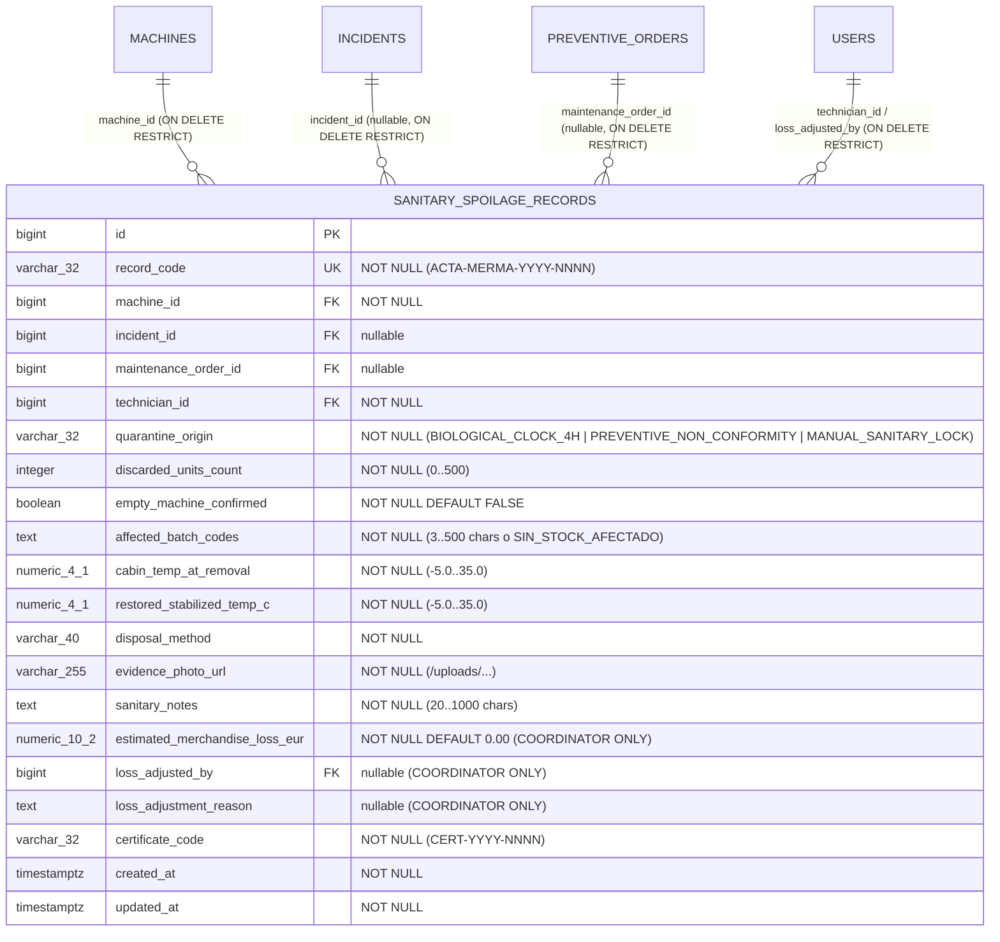

# ESPECIFICACIÓN TÉCNICA · CONTRATOS DE API Y ESQUEMA RELACIONAL
# ACTA DE MERMA Y DESTRUCCIÓN DE LOTES POR CUARENTENA SANITARIA (MÓDULO 29)

**Proyecto:** Gestor de Incidencias de Vending (*VendGuard*)  
**Módulo:** `29-haccp-spoilage-log`  
**Documento:** `specs/technical/haccp_spoilage_log_contracts.md`  
**Referencia Funcional:** [`specs/29-haccp-spoilage-log/spec.md`](../29-haccp-spoilage-log/spec.md) y [`specs/functional/haccp_spoilage_log_spec.md`](../functional/haccp_spoilage_log_spec.md) (`RF-01` a `RF-05`, Decisiones `D1`–`D3`)  
**Protocolo:** HTTP/1.1 · JSON (`application/json; charset=utf-8`) y `multipart/form-data` para subida de evidencia fotográfica  
**Metodología:** SDD (Specification-Driven Development) · Contratos API-First  
**Conformidad Constitucional:**
* **Art. I:** Supremacía de la especificación; contratos verificables de extremo a extremo sin mocks en producción.
* **Art. II:** Bloqueo estricto del levantamiento de cuarentena si `restored_stabilized_temp_c > 4.0` en máquinas `PERISHABLE_FOOD` / `COMBO` (o `> 8.0` en `COLD_DRINKS`).
* **Art. III.1 y III.3:** La Tabla 40 `sanitary_spoilage_records` porta los disparadores constitucionales `trg_no_delete_sanitary_spoilage_records` (`prevent_hard_delete()`) y `trg_immutable_sanitary_spoilage_records` (hechos físicos, térmicos, de lotes y foto inmutables tras el alta; solo se admite actualizar el ajuste financiero de Coordinación). Todo alta, ajuste o lectura del acta oficial se audita en `audit_log` bajo `audit_entity_type = 'SANITARY_SPOILAGE_RECORD'`.
* **Art. IV:** PHP 8.2+ POO puro (`declare(strict_types=1);`), PostgreSQL 16+ (`pdo_pgsql`) y Vue 3 Composition API (ES Modules) con impresión A4 nativa (`window.print()`).
* **Art. V.1:** Validación estricta de al menos 20 caracteres significativos y mínimo 3 palabras/bloques alfanuméricos reales en `sanitary_notes` y en `loss_adjustment_reason`.
* **Art. V.4:** Segregación estricta de privacidad: `estimated_merchandise_loss_eur`, `loss_adjusted_by` y `loss_adjustment_reason` se serializan exclusivamente para `COORDINATOR` y se omiten siempre ante `TECHNICIAN`, `LOCATION_RESPONSIBLE`, canal QR y en el Acta Oficial A4 imprimible.
* **Art. V.5:** Fotografía de evidencia (`evidence_photo_url`) obligatoria (`NOT NULL`) en todos los casos (incluso con `discarded_units_count = 0`), validada por `LocalFileUploader` ($\le 5\text{ MB}$ y cabecera binaria real `finfo` en `image/jpeg`, `image/png` o `image/webp`).

---

## 1. Modelo de Datos Relacional (PostgreSQL 16+ / Supabase)

### 1.1. Diagrama Entidad-Relación (Mermaid ERD)



### 1.2. Ampliación de `audit_entity_type`

Se añade el valor `'SANITARY_SPOILAGE_RECORD'` al enumerado `audit_entity_type`:
```sql
ALTER TYPE audit_entity_type ADD VALUE IF NOT EXISTS 'SANITARY_SPOILAGE_RECORD';
```

### 1.3. DDL Canónico de la Tabla 40 (`database/supabase_migrations/025_sanitary_spoilage_records.sql` y `database/supabase_init.sql`)

```sql
ALTER TYPE audit_entity_type ADD VALUE IF NOT EXISTS 'SANITARY_SPOILAGE_RECORD';

CREATE TABLE IF NOT EXISTS sanitary_spoilage_records (
    id                              BIGINT GENERATED ALWAYS AS IDENTITY,
    record_code                     VARCHAR(32) NOT NULL,
    machine_id                      BIGINT NOT NULL,
    incident_id                     BIGINT,
    maintenance_order_id            BIGINT,
    technician_id                   BIGINT NOT NULL,
    registered_by                   BIGINT NOT NULL,
    quarantine_origin               VARCHAR(32) NOT NULL,
    discarded_units_count           INTEGER NOT NULL,
    empty_machine_confirmed         BOOLEAN NOT NULL DEFAULT FALSE,
    affected_batch_codes            TEXT NOT NULL,
    cabin_temp_at_removal           NUMERIC(4,1) NOT NULL,
    restored_stabilized_temp_c      NUMERIC(4,1) NOT NULL,
    disposal_method                 VARCHAR(40) NOT NULL,
    evidence_photo_url              VARCHAR(255) NOT NULL,
    sanitary_notes                  TEXT NOT NULL,
    estimated_merchandise_loss_eur  NUMERIC(10,2) NOT NULL DEFAULT 0.00,
    loss_adjusted_by                BIGINT,
    loss_adjustment_reason          TEXT,
    certificate_code                VARCHAR(32) NOT NULL,
    created_at                      TIMESTAMPTZ NOT NULL DEFAULT CURRENT_TIMESTAMP,
    updated_at                      TIMESTAMPTZ NOT NULL DEFAULT CURRENT_TIMESTAMP,

    CONSTRAINT pk_sanitary_spoilage_records PRIMARY KEY (id),
    CONSTRAINT uq_sanitary_spoilage_records_code UNIQUE (record_code),
    CONSTRAINT fk_spoilage_records_machine FOREIGN KEY (machine_id)
        REFERENCES machines (id) ON DELETE RESTRICT ON UPDATE CASCADE,
    CONSTRAINT fk_spoilage_records_incident FOREIGN KEY (incident_id)
        REFERENCES incidents (id) ON DELETE RESTRICT ON UPDATE CASCADE,
    CONSTRAINT fk_spoilage_records_preventive_order FOREIGN KEY (maintenance_order_id)
        REFERENCES preventive_orders (id) ON DELETE RESTRICT ON UPDATE CASCADE,
    CONSTRAINT fk_spoilage_records_technician FOREIGN KEY (technician_id)
        REFERENCES users (id) ON DELETE RESTRICT ON UPDATE CASCADE,
    CONSTRAINT fk_spoilage_records_registered_by FOREIGN KEY (registered_by)
        REFERENCES users (id) ON DELETE RESTRICT ON UPDATE CASCADE,
    CONSTRAINT fk_spoilage_records_loss_adjusted_by FOREIGN KEY (loss_adjusted_by)
        REFERENCES users (id) ON DELETE RESTRICT ON UPDATE CASCADE,
    CONSTRAINT chk_spoilage_records_origin CHECK (
        quarantine_origin IN ('BIOLOGICAL_CLOCK_4H', 'PREVENTIVE_NON_CONFORMITY', 'MANUAL_SANITARY_LOCK')
    ),
    CONSTRAINT chk_spoilage_records_units_bounds CHECK (
        discarded_units_count BETWEEN 0 AND 500
    ),
    CONSTRAINT chk_spoilage_records_empty_coherence CHECK (
        (discarded_units_count = 0 AND empty_machine_confirmed = TRUE AND disposal_method = 'NOT_APPLICABLE_EMPTY')
        OR (discarded_units_count > 0 AND empty_machine_confirmed = FALSE AND disposal_method IN (
            'ON_SITE_ORGANIC_SEALED',
            'RETURN_TO_CENTRAL_BIOHAZARD',
            'AUTHORIZED_WASTE_MANAGER'
        ))
    ),
    CONSTRAINT chk_spoilage_records_batch_codes_len CHECK (
        char_length(btrim(affected_batch_codes)) BETWEEN 3 AND 500
    ),
    CONSTRAINT chk_spoilage_records_temps_bounds CHECK (
        cabin_temp_at_removal BETWEEN -5.0 AND 35.0
        AND restored_stabilized_temp_c BETWEEN -5.0 AND 35.0
    ),
    CONSTRAINT chk_spoilage_records_photo_not_empty CHECK (
        char_length(btrim(evidence_photo_url)) BETWEEN 5 AND 255
    ),
    CONSTRAINT chk_spoilage_records_notes_len CHECK (
        char_length(btrim(sanitary_notes)) BETWEEN 20 AND 1000
    ),
    CONSTRAINT chk_spoilage_records_loss_non_negative CHECK (
        (discarded_units_count = 0 AND estimated_merchandise_loss_eur = 0.00 AND loss_adjusted_by IS NULL AND loss_adjustment_reason IS NULL)
        OR (discarded_units_count > 0 AND estimated_merchandise_loss_eur > 0.00 AND estimated_merchandise_loss_eur <= 99999.99)
    ),
    CONSTRAINT chk_spoilage_records_adjustment_coherence CHECK (
        (loss_adjusted_by IS NULL AND loss_adjustment_reason IS NULL)
        OR (discarded_units_count > 0 AND loss_adjusted_by IS NOT NULL AND loss_adjustment_reason IS NOT NULL AND char_length(btrim(loss_adjustment_reason)) BETWEEN 20 AND 500)
    )
);

CREATE INDEX IF NOT EXISTS idx_spoilage_records_machine_created
    ON sanitary_spoilage_records (machine_id, created_at DESC);

CREATE INDEX IF NOT EXISTS idx_spoilage_records_incident
    ON sanitary_spoilage_records (incident_id)
    WHERE incident_id IS NOT NULL;

CREATE INDEX IF NOT EXISTS idx_spoilage_records_preventive_order
    ON sanitary_spoilage_records (maintenance_order_id)
    WHERE maintenance_order_id IS NOT NULL;

CREATE INDEX IF NOT EXISTS idx_spoilage_records_technician_created
    ON sanitary_spoilage_records (technician_id, created_at DESC);

CREATE OR REPLACE FUNCTION enforce_sanitary_spoilage_records_immutability()
RETURNS TRIGGER
LANGUAGE plpgsql
AS $fn$
BEGIN
    IF OLD.record_code IS DISTINCT FROM NEW.record_code
       OR OLD.machine_id IS DISTINCT FROM NEW.machine_id
       OR OLD.incident_id IS DISTINCT FROM NEW.incident_id
       OR OLD.maintenance_order_id IS DISTINCT FROM NEW.maintenance_order_id
       OR OLD.technician_id IS DISTINCT FROM NEW.technician_id
       OR OLD.registered_by IS DISTINCT FROM NEW.registered_by
       OR OLD.quarantine_origin IS DISTINCT FROM NEW.quarantine_origin
       OR OLD.discarded_units_count IS DISTINCT FROM NEW.discarded_units_count
       OR OLD.empty_machine_confirmed IS DISTINCT FROM NEW.empty_machine_confirmed
       OR OLD.affected_batch_codes IS DISTINCT FROM NEW.affected_batch_codes
       OR OLD.cabin_temp_at_removal IS DISTINCT FROM NEW.cabin_temp_at_removal
       OR OLD.restored_stabilized_temp_c IS DISTINCT FROM NEW.restored_stabilized_temp_c
       OR OLD.disposal_method IS DISTINCT FROM NEW.disposal_method
       OR OLD.evidence_photo_url IS DISTINCT FROM NEW.evidence_photo_url
       OR OLD.sanitary_notes IS DISTINCT FROM NEW.sanitary_notes
       OR OLD.certificate_code IS DISTINCT FROM NEW.certificate_code
       OR OLD.created_at IS DISTINCT FROM NEW.created_at THEN
        RAISE EXCEPTION 'INMUTABILIDAD_VIOLADA (Art. III.3): Los hechos sanitarios y físicos de un Acta de Merma APPCC son inmutables tras su emisión; solo se admite el ajuste financiero auditado por Coordinación.'
            USING ERRCODE = '45000';
    END IF;
    RETURN NEW;
END;
$fn$;

DROP TRIGGER IF EXISTS trg_no_delete_sanitary_spoilage_records ON sanitary_spoilage_records;
CREATE TRIGGER trg_no_delete_sanitary_spoilage_records
    BEFORE DELETE ON sanitary_spoilage_records
    FOR EACH ROW EXECUTE FUNCTION prevent_hard_delete();

DROP TRIGGER IF EXISTS trg_touch_sanitary_spoilage_records ON sanitary_spoilage_records;
CREATE TRIGGER trg_touch_sanitary_spoilage_records
    BEFORE UPDATE ON sanitary_spoilage_records
    FOR EACH ROW EXECUTE FUNCTION touch_updated_at();

DROP TRIGGER IF EXISTS trg_immutable_sanitary_spoilage_records ON sanitary_spoilage_records;
CREATE TRIGGER trg_immutable_sanitary_spoilage_records
    BEFORE UPDATE ON sanitary_spoilage_records
    FOR EACH ROW EXECUTE FUNCTION enforce_sanitary_spoilage_records_immutability();
```

---

## 2. Catálogo de Enumerados y Constantes de Dominio

### 2.1. Origen de la Cuarentena (`quarantine_origin`)
| Código | Etiqueta en Español | Descripción |
| :--- | :--- | :--- |
| `BIOLOGICAL_CLOCK_4H` | Reloj biológico > 4 h (Avería) | Cuarentena activada automáticamente al superar las 4 horas sin frío en una avería correctiva. |
| `PREVENTIVE_NON_CONFORMITY` | Inspección preventiva NO CONFORME | Cuarentena activada por fallo crítico higiénico o exceso térmico en mantenimiento preventivo. |
| `MANUAL_SANITARY_LOCK` | Bloqueo cautelar sanitario | Cuarentena activada cautelarmente sobre la máquina sin orden preventiva abierta. |

### 2.2. Método de Destrucción (`disposal_method`)
| Código | Etiqueta en Español | Condición |
| :--- | :--- | :--- |
| `ON_SITE_ORGANIC_SEALED` | Destrucción e inutilización en contenedor sellado in situ | Válido solo si `discarded_units_count > 0` |
| `RETURN_TO_CENTRAL_BIOHAZARD` | Retirada precintada a base central para baja sanitaria | Válido solo si `discarded_units_count > 0` |
| `AUTHORIZED_WASTE_MANAGER` | Entrega a gestor autorizado de residuos orgánicos | Válido solo si `discarded_units_count > 0` |
| `NOT_APPLICABLE_EMPTY` | No aplica (Máquina verificada sin stock afectado) | Obligatorio y exclusivo si `discarded_units_count === 0` |

### 2.3. Baremo Económico Estándar (`D2`)
* `SanitarySpoilageValidator::DEFAULT_UNIT_MERCHANDISE_COST_EUR = 2.50`
* Cálculo inicial automático: `estimated_merchandise_loss_eur = round($discardedUnitsCount * 2.50, 2)`

---

## 3. Contratos de Endpoints REST

### 3.1. `POST /api/sanitary-quarantines/machines/{machineId}/lift`
Registra el Acta de Merma APPCC, valida la fotografía de evidencia ($\le 5\text{ MB}$, `finfo`), comprueba que la temperatura estabilizada esté dentro del límite sanitario ($\le 4.0\text{ }^\circ\text{C}$ en perecederos), emite el nuevo certificado sanitario y restituye `sanitary_status = 'OK'`.
* **Roles permitidos:** `TECHNICIAN`, `COORDINATOR` (`403 FORBIDDEN` para otros roles).
* **Formatos admitidos:** `multipart/form-data` (con archivo `photo` en `$_FILES['photo']`) o `application/json` (cuando `evidence_photo_url` apunta a una evidencia recién subida por `LocalFileUploader` en `/uploads/`).
* **Campos de entrada:**
  ```json
  {
    "incident_id": 104,
    "maintenance_order_id": null,
    "discarded_units_count": 14,
    "empty_machine_confirmed": false,
    "affected_batch_codes": "LOTE-2026-11A (8 uds), LOTE-2026-11B (6 uds)",
    "cabin_temp_at_removal": 11.4,
    "restored_stabilized_temp_c": 3.2,
    "disposal_method": "ON_SITE_ORGANIC_SEALED",
    "sanitary_notes": "Retirada completa de 14 sándwiches y ensaladas expuestos a más de 4h sin frío, desinfección con amonio cuaternario y verificación de sonda a 3.2 °C."
  }
  ```
* **Respuesta `201 Created` (para `TECHNICIAN` — sin campos financieros según Art. V.4):**
  ```json
  {
    "status": "success",
    "message": "Acta de Merma registrada y cuarentena sanitaria levantada correctamente. Máquina restituida a servicio.",
    "data": {
      "spoilage_record": {
        "id": 1,
        "record_code": "ACTA-MERMA-2026-0001",
        "machine_id": 2,
        "machine_code": "VM-MAD-002",
        "machine_model": "Necta Samba Combo",
        "location_name": "Hospital Universitario Central - Urgencias",
        "incident_id": 104,
        "maintenance_order_id": null,
        "technician_id": 2,
        "technician_name": "Carlos Gómez",
        "quarantine_origin": "BIOLOGICAL_CLOCK_4H",
        "discarded_units_count": 14,
        "empty_machine_confirmed": false,
        "affected_batch_codes": "LOTE-2026-11A (8 uds), LOTE-2026-11B (6 uds)",
        "cabin_temp_at_removal": 11.4,
        "restored_stabilized_temp_c": 3.2,
        "disposal_method": "ON_SITE_ORGANIC_SEALED",
        "evidence_photo_url": "/uploads/a1b2c3d4e5f60718293a4b5c6d7e8f90.jpg",
        "sanitary_notes": "Retirada completa de 14 sándwiches y ensaladas expuestos a más de 4h sin frío, desinfección con amonio cuaternario y verificación de sonda a 3.2 °C.",
        "certificate_code": "CERT-2026-4821",
        "created_at": "2026-11-05 18:10:00"
      },
      "machine_sanitary_status": "OK",
      "qr_unblocked": true
    }
  }
  ```
  *(Nota: cuando el actor es `COORDINATOR`, `spoilage_record` incluye además `estimated_merchandise_loss_eur: 35.00`, `loss_adjusted_by: null`, `loss_adjustment_reason: null`).*
* **Códigos de error:**
  * `404 MACHINE_NOT_FOUND`: La máquina no existe.
  * `409 MACHINE_NOT_IN_QUARANTINE`: La máquina no se encuentra en estado `'QUARANTINE'`.
  * `409 ACTIVE_INCIDENT_BLOCKS_QUARANTINE_LIFT`: La máquina mantiene una avería correctiva abierta sin resolver (`C1`).
  * `422 RESTORED_TEMPERATURE_EXCEEDS_SAFE_LIMIT`: `restored_stabilized_temp_c > 4.0` en `PERISHABLE_FOOD` / `COMBO` (o `> 8.0` en `COLD_DRINKS`).
  * `422 EMPTY_MACHINE_CONFIRMATION_REQUIRED`: `discarded_units_count === 0` sin `empty_machine_confirmed = true`.
  * `422 INVALID_SPOILAGE_RECORD`: Fallo en cotas de unidades (`0..500`), lotes (`3..500`), temperaturas (`[-5.0, 35.0]`), método de destrucción, notas (`20..1000` chars y $\ge 3$ tokens reales) o foto ausente/inválida (`> 5 MB` o MIME no permitido).

### 3.2. `GET /api/sanitary-spoilage-records/{id}/official-act`
Devuelve el payload estructurado del **Acta Oficial de Destrucción de Género Perecedero (A4)** listo para su visualización e impresión (`window.print()`), registrando `VIEW_SANITARY_SPOILAGE_ACT` en `audit_log`.
* **Roles permitidos:** `TECHNICIAN`, `COORDINATOR` (`403 FORBIDDEN` para otros roles).
* **Blindaje Art. V.4:** Nunca incluye `estimated_merchandise_loss_eur`, `loss_adjusted_by` ni `loss_adjustment_reason`, ni siquiera cuando lo abre un Coordinador, ya que el documento está diseñado para entregarse a inspectores de Sanidad o a la sede.

### 3.3. `GET /api/sanitary-spoilage-records/by-machine/{machineId}`
Devuelve el historial de actas de merma de una máquina (y si la máquina está actualmente en `'QUARANTINE'`), omitiendo campos financieros si el rol es `TECHNICIAN`.
* **Roles permitidos:** `TECHNICIAN`, `COORDINATOR`.

### 3.4. `GET /api/coordinator/sanitary-spoilage-records`
Devuelve para el panel de Coordinación las 4 tarjetas KPI globales (inmunes a los filtros de la tabla), la lista de máquinas actualmente en `'QUARANTINE'` pendientes de levantamiento y la tabla paginada/filtrada de actas con sus importes financieros.
* **Roles permitidos:** Exclusivo `COORDINATOR` (`403 FORBIDDEN` para `TECHNICIAN` y `LOCATION_RESPONSIBLE`).
* **Parámetros query opcionales:** `machine_id`, `quarantine_origin`, `disposal_method`, `date_from`, `date_to`, `search`.

### 3.5. `PATCH /api/coordinator/sanitary-spoilage-records/{id}/loss-estimate`
Permite a Coordinación ajustar de forma justificada el coste estimado de la merma (`estimated_merchandise_loss_eur`).
* **Roles permitidos:** Exclusivo `COORDINATOR` (`403 FORBIDDEN` para otros roles).
* **Cuerpo de entrada:**
  ```json
  {
    "estimated_merchandise_loss_eur": 48.50,
    "loss_adjustment_reason": "Ajuste según albarán de carga del lote LOTE-2026-11A compuesto por 14 ensaladas gourmet de 3,46 EUR de coste unitario."
  }
  ```
* **Validaciones (`422`):** `estimated_merchandise_loss_eur` entre `0.00` y `99999.99`; `loss_adjustment_reason` entre `20` y `500` caracteres reales y al menos 3 tokens alfanuméricos reales (Art. V.1).

### 3.6. `GET /api/coordinator/sanitary-spoilage-records/export-csv`
Descarga el libro registro de Actas de Merma APPCC en formato CSV con UTF-8 BOM (`\xEF\xBB\xBF`) y separador `;` en dos secciones (1. Resumen de KPIs globales; 2. Detalle de actas filtradas).
* **Roles permitidos:** Exclusivo `COORDINATOR` (`403 FORBIDDEN` para otros roles).
