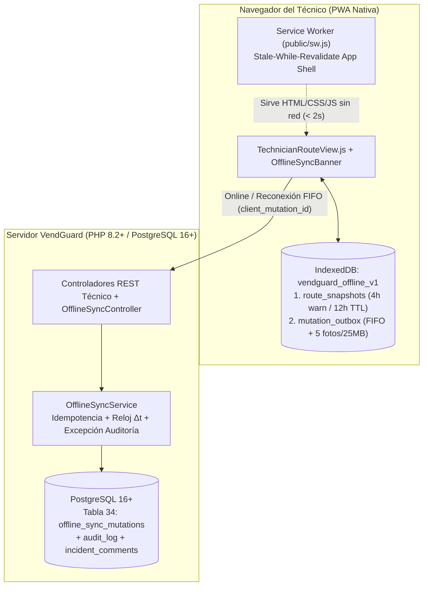
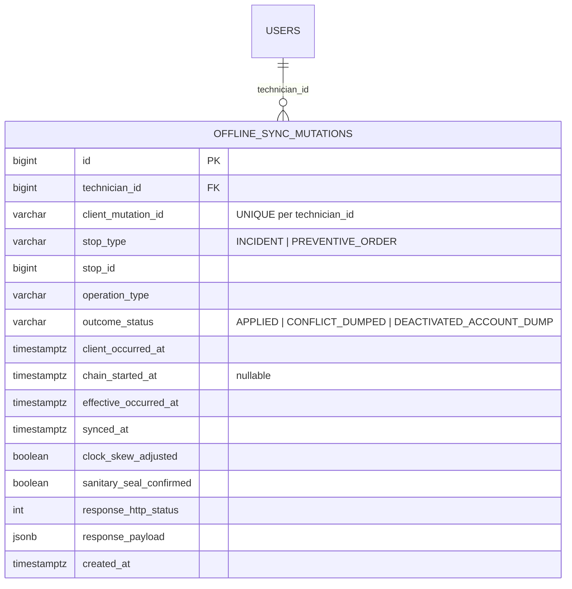

# ESPECIFICACIÓN TÉCNICA · CONTRATOS DE API, ALMACENAMIENTO LOCAL Y MODELO DE DATOS
# MODO SIN CONEXIÓN E INSTALABILIDAD MÓVIL PARA TÉCNICOS DE CAMPO (MÓDULO 24)

**Proyecto:** Gestor de Incidencias de Vending (*VendGuard*)  
**Módulo:** `24-offline-pwa`  
**Documento:** `specs/technical/offline_pwa_contracts.md`  
**Referencia Funcional:** [`specs/24-offline-pwa/spec.md`](../24-offline-pwa/spec.md) (`RF-01` a `RF-06` de la Spec v2.1, `RNF-01` a `RNF-04`, Decisiones `D1`–`D6` y Resoluciones `QA 1`–`QA 5`)  
**Protocolo:** HTTP/1.1 · JSON (`application/json; charset=utf-8`) y `multipart/form-data` · Web App Manifest · Service Worker Cache API · IndexedDB API  
**Metodología:** SDD (Specification-Driven Development) · Contratos API-First  
**Conformidad Constitucional:**
* **Artículo I:** La Especificación es la Única Fuente de Verdad. Ninguna implementación sin contrato previo; cero código simulado.
* **Artículo II:** Prioridad Sanitaria Absoluta.
  * El reloj biológico continuo de **4,0 horas naturales** en máquinas `FOOD_PERISHABLE` nunca se congela por desconexión del técnico (`D2`). Si la máquina entró en `SANITARY_QUARANTINE` antes de recibirse una resolución offline, el servidor cierra la avería técnica pero **mantiene `machines.status = 'SANITARY_QUARANTINE'`** (`EARS 05.4`).
  * Toda pausa de avería térmica/crítica o inspección preventiva desfavorable registrada sin conexión sobre una máquina `FOOD_PERISHABLE` exige `sanitary_seal_confirmed = true` (`EARS 03.4`, `QA 1`).
* **Artículo III:** Inviolabilidad de Datos e Histórico.
  * Art. III.1: Cero borrado físico (`DELETE FROM`). La nueva Tabla 34 `offline_sync_mutations` porta disparador `trg_no_delete_offline_sync_mutations` (`prevent_hard_delete()`).
  * Art. III.3: Queda prohibido el descarte silencioso de conflictos (`QA 1`). Todo conflicto se vuelca al servidor mediante `POST /api/technician/offline/conflicts/dump` dejando rastro en `incident_comments` (`is_internal = TRUE`), en `preventive_orders.notes` y en `audit_log` con doble sello temporal (`client_occurred_at` y `synced_at`).
* **Artículo IV:** Minimalismo Tecnológico y Cero Bloatware.
  * PHP 8.2+ POO puro (`declare(strict_types=1);`) con PDO (`pdo_pgsql`).
  * Frontend en Vue 3 ES Modules nativos, `navigator.serviceWorker`, `CacheStorage` e `IndexedDB` nativo sin librerías externas (sin Workbox, sin Dexie, sin localForage).
* **Artículo V:** Integridad Inviolable de Reglas de Negocio.
  * Art. V.1: Diagnóstico $\ge 20$ caracteres reales, acción $\ge 20$ caracteres reales y motivos de pausa $\ge 20$ caracteres reales validados tanto antes de encolar en cliente como al sincronizar en servidor.
  * Art. V.3: Unicidad de técnico asignado. Si la avería u orden preventiva cambió de titular o estado mientras el técnico estaba sin señal, el servidor rechaza la transición con `409 OFFLINE_MUTATION_CONFLICT` y preserva al titular vigente.
  * Art. V.4: Segregación estricta de datos. Los almacenes `IndexedDB` se particionan por `technician_id`. Los volcados de conflicto se registran siempre con `is_internal = TRUE` (invisibles para el `LOCATION_RESPONSIBLE` y el canal QR público).
  * Art. V.5: Fotografías adjuntas $\le 5\text{ MB}$ verificadas por *magic bytes* reales (`.jpg`, `.jpeg`, `.png`, `.webp`), con cuota acumulada en la bandeja local de **máximo 5 fotografías o 25 MB (26.214.400 bytes)**, estando el trazo PNG de la firma digital ($\le 300\text{ KiB}$) exento de dicho cupo (`QA 3`).

---

## 1. Arquitectura del Módulo (Cliente Web Progresivo + Backend Idempotente)



### 1.1. Frontera de Operaciones (`D1`, `QA 4`)

| Operación del Técnico | ¿Permitida en Modo Offline? | Comportamiento sin Red |
| :--- | :---: | :--- |
| Abrir la app y consultar ruta correctiva, preventiva asignada, catálogo y stock de furgoneta | ✅ **SÍ** | Lee `route_snapshots` en `IndexedDB` (vigencia 12h, aviso ámbar a las 4h). |
| Iniciar intervención correctiva (`PATCH /api/technician/incidents/{id}/start`) | ✅ **SÍ** | Encola `START_INCIDENT` y pasa la parada local a `IN_PROGRESS`. |
| Reanudar desde `PENDING_INFO` (`POST /api/technician/incidents/{id}/resume-pending-info`) | ✅ **SÍ** | Encola `RESUME_INCIDENT_PENDING_INFO` y pasa la parada local a `IN_PROGRESS`. |
| Pausar por repuesto (`PATCH /api/technician/incidents/{id}/pause`) | ✅ **SÍ** | Encola `PAUSE_INCIDENT_PARTS` (exige `sanitary_seal_confirmed` si es frío en `FOOD_PERISHABLE`, `QA 1`). |
| Pausar por falta de acceso (`POST /api/technician/incidents/{id}/pause-pending-info`) | ✅ **SÍ** | Encola `PAUSE_INCIDENT_PENDING_INFO` ($\ge 20$ chars; exige `sanitary_seal_confirmed` si es frío en `FOOD_PERISHABLE`). |
| Resolver avería correctiva (`POST /api/technician/incidents/{id}/resolve`) | ✅ **SÍ** | Encola `RESOLVE_INCIDENT` (diagnóstico $\ge 20$, acción $\ge 20$, piezas, reintegro y firma PNG o ausencia $\ge 10$) y descuenta stock provisional en furgoneta. |
| Iniciar, completar o reinspeccionar orden preventiva **ya asignada** | ✅ **SÍ** | Encola `START_PREVENTIVE` / `COMPLETE_PREVENTIVE` / `REINSPECT_PREVENTIVE` (exige `sanitary_seal_confirmed` si hay ítem crítico `NOK` en `FOOD_PERISHABLE`). |
| Publicar comentario o nota interna (`POST /api/technician/incidents/{id}/comments`) | ✅ **SÍ** | Encola `ADD_INCIDENT_COMMENT` (`is_state_transition = false`, foto opcional sujeta a cupo 5 fotos / 25 MB). |
| Iniciar sesión por primera vez (`POST /api/auth/login`) | ❌ **NO** | Bloqueado con aviso: requiere conexión en vivo. |
| Iniciar / pausar comida / cerrar turno o relevo de ruta (Módulos 21 y 22) | ❌ **NO** | Bloqueado sin red; con red exige vaciar primero la cola y conflictos (`QA 5`). |
| Confirmar recepción de orden de carga (`POST /api/technician/van-stock/restock-orders/{id}/confirm`) | ❌ **NO** | Bloqueado sin red: requiere conexión en vivo (`D1`). |
| Reclamar orden preventiva libre (`POST /api/technician/preventive/orders/{id}/claim`) | ❌ **NO** | Bloqueado sin red: requiere conexión en vivo (`QA 4`, Art. V.3). |
| Alta o asunción de avería oportunista fuera del snapshot de ruta (Módulo 16) | ❌ **NO** | Bloqueado sin red: requiere conexión en vivo (`D1`, Art. V.3). |
| Ver / Imprimir Albarán de Servicio A4 oficial (`GET /api/technician/incidents/{id}/service-sheet`) | ⏳ **DIFERIDO** | Muestra *«📄 Albarán oficial A4 disponible al sincronizar con el servidor»* hasta sincronizar (`QA 4`). |

---

## 2. Contratos de PWA: Manifiesto Web y Service Worker (`RF-01`, `RNF-01`, `RNF-02`)

### 2.1. Manifiesto de Aplicación Web (`public/manifest.webmanifest`)

Se enlaza en [`public/index.html`](../../public/index.html) mediante `<link rel="manifest" href="/manifest.webmanifest">` y `<meta name="theme-color" content="#2560ff">`:

```json
{
  "name": "VendGuard — Gestor de Incidencias de Vending",
  "short_name": "VendGuard",
  "description": "Operativa técnica de ruta, mantenimiento preventivo y gestión de averías de vending con soporte sin conexión.",
  "lang": "es-ES",
  "start_url": "/?source=pwa",
  "scope": "/",
  "display": "standalone",
  "orientation": "portrait-primary",
  "background_color": "#f9fafb",
  "theme_color": "#2560ff",
  "icons": [
    {
      "src": "/assets/icons/vendguard-icon-192.svg",
      "sizes": "192x192",
      "type": "image/svg+xml",
      "purpose": "any maskable"
    },
    {
      "src": "/assets/icons/vendguard-icon-512.svg",
      "sizes": "512x512",
      "type": "image/svg+xml",
      "purpose": "any maskable"
    }
  ]
}
```

### 2.2. Contrato del Service Worker (`public/sw.js`)

* **Nombre de caché versionado:** `CACHE_NAME = 'vendguard-app-shell-v2'`.
* **Activos precacheados en `install` (`APP_SHELL_ASSETS`):**
  * `/index.html`, `/manifest.webmanifest`
  * La raíz `/` **no** se precachea: su respuesta depende de la negociación de contenido y el health JSON puede contaminar la caché del App Shell. La navegación sin red se resuelve explícitamente contra `/index.html`.
  * `/assets/css/design-tokens.css`, `/assets/css/qr-print.css`, `/assets/css/metrics-print.css`, `/assets/css/service-sheet.css`
  * `/assets/js/app.js`, `/assets/js/api.js`, `/assets/js/store.js`, `/assets/js/vendor/vue.esm-browser.prod.js`
  * Todos los módulos de `/assets/js/views/*.js`, `/assets/js/components/*.js` y `/assets/js/utils/*.js`.
* **Reglas de interceptación (`fetch`):**
  1. **Rutas de API (`/api/*`) o métodos distintos de `GET`:** Estrategia **`Network-Only`** (jamás se cachean respuestas de `/api/*` en `CacheStorage` para impedir fugas de sesión o datos entre usuarios en dispositivos compartidos, **Art. V.4**).
  2. **Activos del mismo origen (`GET` de documentos, scripts, estilos, iconos):** Estrategia **`Stale-While-Revalidate`**:
     * Si existe en `CacheStorage`, se responde de inmediato (< 50 ms, cumpliendo holgadamente los `< 2,0 s` de `RNF-01`) y en segundo plano se actualiza la entrada si hay red.
     * Si es una navegación HTML (`request.mode === 'navigate'`) y no hay red, se devuelve `/index.html` desde la caché.

---

## 3. Contrato de Almacenamiento Local en `IndexedDB` (`RF-02`, `RF-03`, `RF-06`)

* **Base de datos `IndexedDB`:** `vendguard_offline_v1` (versión `2`, `M3`). El nombre se conserva a propósito: renombrar la base al migrar dejaría huérfana la bandeja de quien ya tenía trabajo sin sincronizar. La v2 no cambia índices; convierte `photo_attachment.base64` en `photo_attachment.blob` dentro de la misma transacción `versionchange` (si algo falla, la actualización se aborta y el navegador conserva la v1 intacta).
* **Constantes Normativas de Vigencia y Cuota (`D3`, `D6`, `QA 3`):**
  * `SNAPSHOT_WARNING_AGE_MS = 4 * 60 * 60 * 1000` (`14.400.000 ms` = **4,0 horas**).
  * `SNAPSHOT_MAX_VALID_AGE_MS = 12 * 60 * 60 * 1000` (`43.200.000 ms` = **12,0 horas**).
  * `OFFLINE_PHOTO_MAX_COUNT = 5` (máximo 5 fotografías de cámara/galería en acciones `PENDING`, `SYNCING` o `CONFLICT`).
  * `OFFLINE_PHOTO_MAX_SINGLE_BYTES = 5 * 1024 * 1024` (`5.242.880 bytes` = **5 MB**, Art. V.5).
  * `OFFLINE_PHOTO_MAX_TOTAL_BYTES = 25 * 1024 * 1024` (`26.214.400 bytes` = **25 MB**).
  * El trazo PNG de firma digital (`signature_png_base64`, $\le 307.200\text{ bytes}$) **no** computa en `OFFLINE_PHOTO_MAX_COUNT` ni en `OFFLINE_PHOTO_MAX_TOTAL_BYTES` (`QA 3`).

### 3.1. Object Store 1: `route_snapshots` (`keyPath: 'technician_id'`)

Almacena la copia local aislada por técnico (`Art. V.4`):

```json
{
  "technician_id": 2,
  "technician_email": "carlos.mendoza@vendguard.es",
  "technician_name": "Carlos Mendoza",
  "synced_at": "2026-10-27T08:00:00.000Z",
  "warn_after_at": "2026-10-27T12:00:00.000Z",
  "readonly_after_at": "2026-10-27T20:00:00.000Z",
  "offline_shift": {
    "status": "ON_SHIFT",
    "recorded_at": "2026-10-27T08:00:00.000Z"
  },
  "route_envelope": {
    "stops": [],
    "enabled_locations": [],
    "pending_critical_stops_other_locations": []
  },
  "preventive_orders": [],
  "preventive_checklists_by_order": {
    "45": { "order": {}, "items": [] }
  },
  "spare_parts_catalog_by_machine": {
    "12": { "compatible_parts": [] }
  },
  "van_stock": {
    "items": [],
    "active_dispatched_order": null,
    "last_confirmed_order": null
  },
  "provisional_stock_deductions": {
    "14": 1
  }
}
```

* **Escritura transaccional de la copia (`M2`):** toda modificación —refresco del paquete, turno local, proyección optimista y reversión de stock— pasa por una única transacción `readwrite` sobre `route_snapshots` que lee, transforma y escribe en el mismo turno. Dentro de una pestaña las operaciones se encadenan y entre pestañas se serializan con el cerrojo `vendguard-offline-sync`; un patrón leer-modificar-escribir suelto perdía la escritura de quien llegaba primero. El mutador debe ser **síncrono**: se rechaza con `SNAPSHOT_MUTATOR_ASYNC` cualquier promesa intermedia que dejaría cerrar la transacción antes de escribir.
* **Turno local para iniciar intervenciones sin red (`EARS 03.1`):** `offline_shift` es un campo **exclusivo del dispositivo**, no viaja en el paquete de bootstrap. Guarda el último estado de turno observado (`ON_SHIFT`, `MEAL_BREAK` u `OFF_SHIFT`) y el instante en que se observó. Al recargar sin red, `evaluateOfflineShift()` lo restaura solo si la copia sigue vigente (≤ 12 h) y el registro tiene menos de 12 h; en cualquier otro caso la vista conserva `OFF_SHIFT` (fallo seguro). Refrescar la copia desde el servidor conserva este campo, y cerrar sesión con la bandeja vacía lo elimina junto con `route_snapshots` (`EARS 06.5`). El servidor sigue siendo la autoridad: al recuperar cobertura, `loadShiftStatus()` contrasta y sobrescribe el valor local.
* **Minimización de la copia (`M3`, `Art. V.4`):** antes de persistir, `minimizeSnapshot()` recorre el paquete y descarta `contact_email` y `contact_name` de las sedes. Ninguna pantalla offline los pinta; el `contact_phone` se conserva porque la tarjeta ofrece la llamada en un toque y sin cobertura es la única forma de avisar a la sede. Un dispositivo de ruta se comparte entre turnos: lo que no se necesita no se guarda.
* **Purga por sesión (`M3`):** al iniciar sesión y al hidratar la vista se ejecutan `purgeForeignTechnicians()` y `purgeExpiredSessions()`. La copia de otro técnico se borra en cuanto no conserva trabajo pendiente; si conserva cola, se mantiene y el acceso sigue exigiendo al titular (`EARS 06.3`), porque el trabajo no se descarta nunca en silencio (`Art. III.1`). Una copia caducada (> 12 h) sin nada que enviar se purga: solo acumularía datos personales. El cierre de sesión con la bandeja vacía sigue borrando todo con `clearTechnician()` (`EARS 06.5`).
* **Cálculo de estado de vigencia de la copia local (`RF-02.2` a `RF-02.4`):**
  * `FRESH` ($\text{edad} \le 4\text{ h}$): Operativa completa sin avisos de antigüedad.
  * `STALE_WARNING` ($4\text{ h} < \text{edad} \le 12\text{ h}$): Operativa permitida mostrando banner ámbar preventivo (*«⚠️ Tu copia de ruta lleva más de 4 horas sin actualizarse. Recupera cobertura cuanto antes, especialmente si atiendes máquinas de alimentos perecederos.»*).
  * `EXPIRED_READONLY` ($\text{edad} > 12\text{ h}$): Bloquea el encolado de **nuevas** acciones sin conexión (*«🔒 Copia de ruta caducada (> 12 h sin conexión). Conéctate para actualizar tu ruta antes de registrar nuevas intervenciones.»*), manteniendo intactas y listas para sincronizar las mutaciones ya presentes en `mutation_outbox`.

### 3.2. Object Store 2: `mutation_outbox` (`keyPath: 'client_mutation_id'`)

Índices:
* `by_technician`: `technician_id`
* `by_tech_sequence`: `[technician_id, sequence_order]` (único)
* `by_tech_status`: `[technician_id, status]`

Estructura de cada registro en `mutation_outbox`:

```json
{
  "client_mutation_id": "mut_20261027_091523_a8f49c12b3e14d90",
  "technician_id": 2,
  "technician_email": "carlos.mendoza@vendguard.es",
  "sequence_order": 1,
  "status": "PENDING",
  "syncing_since": null,
  "stop_type": "INCIDENT",
  "stop_id": 105,
  "ticket_or_order_code": "INC-2026-0105",
  "machine_id": 12,
  "machine_code": "VM-HOSP-01",
  "is_perishable_machine": true,
  "operation_type": "RESOLVE_INCIDENT",
  "is_state_transition": true,
  "http_method": "POST",
  "endpoint": "/technician/incidents/105/resolve",
  "client_occurred_at": "2026-10-27T09:15:23.000Z",
  "chain_started_at": "2026-10-27T08:50:10.000Z",
  "sanitary_seal_confirmed": false,
  "payload": {
    "diagnosis": "Sonda NTC del evaporador descalibrada marcando lectura errónea.",
    "action_taken": "Sustitución de sonda NTC por repuesto nuevo y verificación de frío a 4°C.",
    "replaced_parts": [
      {
        "spare_part_id": 14,
        "quantity": 1,
        "old_part_destination": "WORKSHOP"
      }
    ],
    "service_sheet": {
      "conformity_type": "SIGNED",
      "signer_name": "Laura Gómez",
      "signer_document": "12345678Z",
      "signature_png_base64": "data:image/png;base64,iVBORw0KGgoAAAANSUhEUgAA..."
    }
  },
  "photo_attachment": {
    "name": "evidencia.jpg",
    "type": "image/jpeg",
    "size": 1834200,
    "blob": "(Blob binario)"
  },
  "provisional_parts_deducted": [
    { "spare_part_id": 14, "quantity": 1 }
  ],
  "conflict": null
}
```

* **Evidencia binaria (`M3`, DB v2):** `photo_attachment` viaja como `{ name, type, size, blob }`. `IndexedDB` persiste el `Blob` nativo, de modo que no se guarda la cadena base64 (un 33 % más de bytes) ni hay que recodificarla para reenviar: `buildMultipartBody()` adjunta ese mismo `Blob`. Una evidencia escrita por la v1 (`base64`) sigue siendo enviable y la actualización la convierte a `blob` sin perder bytes.
* **Alta transaccional (`H4`):** el `sequence_order` se calcula, la fila se inserta, el inicio previo de la cadena se cierra con `chain_ended_at` y la proyección optimista se aplica al snapshot en **una sola** transacción sobre `[mutation_outbox, route_snapshots]`. O queda todo, o no queda nada: nunca un cambio local visible sin su entrada en la cola. Si el índice único `by_tech_sequence` rechaza el turno porque otra pestaña se adelantó, la transacción se deshace entera y el alta se reintenta hasta tres veces releyendo el máximo; agotados los intentos responde `OFFLINE_SEQUENCE_EXHAUSTED`.
* **Catálogo cerrado de `operation_type` y bandera `is_state_transition` (`D1`, `QA 3`):**
  1. `START_INCIDENT` (`is_state_transition: true`, `PATCH /technician/incidents/{id}/start`)
  2. `RESUME_INCIDENT_PENDING_INFO` (`is_state_transition: true`, `POST /technician/incidents/{id}/resume-pending-info`)
  3. `PAUSE_INCIDENT_PARTS` (`is_state_transition: true`, `PATCH /technician/incidents/{id}/pause`)
  4. `PAUSE_INCIDENT_PENDING_INFO` (`is_state_transition: true`, `POST /technician/incidents/{id}/pause-pending-info`)
  5. `RESOLVE_INCIDENT` (`is_state_transition: true`, `POST /technician/incidents/{id}/resolve`)
  6. `START_PREVENTIVE` (`is_state_transition: true`, `POST /technician/preventive/orders/{id}/start`)
  7. `COMPLETE_PREVENTIVE` (`is_state_transition: true`, `POST /technician/preventive/orders/{id}/complete`)
  8. `REINSPECT_PREVENTIVE` (`is_state_transition: true`, `POST /technician/preventive/orders/{id}/reinspect`)
  9. `ADD_INCIDENT_COMMENT` (`is_state_transition: false`, `POST /technician/incidents/{id}/comments`)

### 3.3. Ciclo de vida del elemento de la bandeja (`RF-04.1`, `RF-05.1`, `EARS 06.1`)

El elemento nace en `PENDING`; al enviarse pasa a `SYNCING` con la marca `syncing_since`; se elimina del almacén cuando el servidor confirma, y pasa a `CONFLICT` cuando el servidor emite un veredicto definitivo. No existe un cuarto estado ni una vía de descarte silencioso (`Art. III.1`).

**Rescate de envíos interrumpidos.** El estado `SYNCING` solo es válido mientras hay una pestaña enviando. Si el cliente muere en ese punto —el sistema operativo mata la pestaña, el móvil se apaga, se cierra el navegador— el elemento quedaría fuera del FIFO para siempre y el cierre de sesión bloquearía al técnico sin nada que sincronizar (`EARS 06.1`). Por eso, al hidratar la copia y al abrir cada pasada de la cola, `OfflineStorage::recoverInterruptedMutations()` devuelve a `PENDING` todo `SYNCING` cuya marca `syncing_since` supere `SYNCING_STALE_AFTER_MS` (2 minutos) o falte. El reenvío es seguro por la idempotencia del servidor: si el primer envío llegó a aplicarse, la respuesta es la original y no se mueve estado, stock ni dinero (`RF-04.2`). El margen protege el envío legítimo de otra pestaña en curso (una foto de 5 MB puede tardar más que una petición normal).

**Coordinación entre pestañas (`H5`).** Dos pestañas del mismo técnico comparten la misma `mutation_outbox`: sin coordinación, ambas leen el mismo `PENDING`, ambas lo envían y la segunda pisa el estado de la primera. `OfflineSyncManager::withSyncLock()` encadena dos cerrojos: un mutex local que serializa las llamadas de esta pestaña —también en navegadores sin Web Locks— y `navigator.locks.request('vendguard-offline-sync', { mode: 'exclusive' })`, que impide que otra pestaña toque la cola a la vez. Cubre `enqueue`, `processOutboxQueue` y `dumpConflict`; las operaciones anidadas (el volcado por baja de cuenta dentro del envío) no vuelven a pedir el cerrojo y, si el navegador rechaza el cerrojo, el mutex local sigue serializando. Además, `BroadcastChannel('vendguard-offline-sync-channel')` avisa a las demás pestañas de `enqueued`, `queue_recovered`, `queue_processed`, `conflict`, `conflict_dumped` y `account_dump_completed`; la receptora relee su estado (`queue_changed` con `remote: true`) sin reemitirlo, así que no hay eco y una pestaña que solo escucha jamás escribe la cola.

**Clasificación de fallos de envío.** El motor distingue el veredicto del hipo:

| Desenlace | Códigos | Efecto en la bandeja |
| :--- | :--- | :--- |
| Rechazo definitivo | Cualquier `4xx` salvo `408`, `425` y `429` | `CONFLICT` aislado por parada; el FIFO **continúa** con el resto |
| Transitorio | `408`, `425`, `429`, `5xx` y fallo de transporte | Vuelve a `PENDING` y la pasada se interrumpe hasta el siguiente disparo |
| Reautenticación | `401` | `PENDING` + aviso de reautenticación; la pasada se interrumpe |
| Cuenta dada de baja | `403 ACCOUNT_DEACTIVATED` | Volcado automático de la cola (`QA 5`) |

Un `4xx` no reintentable tratado como caída de red quedaría en cabeza del FIFO y bloquearía todas las operaciones posteriores, además del cierre de sesión; por eso el veredicto se aísla y se vuelca (`RF-05.1`, `QA 3`). En el caso concreto de `413` (evidencia rechazada por tamaño), el elemento conserva el trabajo y retira únicamente `photo_attachment`; el motivo se escribe en `conflict.message`, viaja como `conflict_reason` y deja constancia en la Nota Interna de que la evidencia no se pudo archivar.

---

## 4. Modelo de Datos Relacional en Servidor (PostgreSQL 16+ / Supabase)

### 4.1. Diagrama Entidad-Relación (Mermaid ERD)



### 4.2. DDL Canónico (`database/supabase_migrations/020_offline_pwa_sync.sql` y `database/supabase_init.sql`)

```sql
-- ============================================================================
-- Módulo 24 · Modo Sin Conexión e Instalabilidad Móvil para Técnicos de Campo
-- ----------------------------------------------------------------------------
-- Declara:
--   1. Tabla 34 `offline_sync_mutations` para garantizar idempotencia estricta
--      por `(technician_id, client_mutation_id)` (RF-04.2), trazabilidad del
--      doble sello temporal (`client_occurred_at`, `effective_occurred_at`,
--      `synced_at`, RF-04.3 / QA 4) y registro de volcados de conflicto o
--      de baja sobrevenida de cuenta (RF-05.3, RF-06.4, QA 1, QA 2, QA 5).
--   2. Disparador constitucional `trg_no_delete_offline_sync_mutations`
--      (`prevent_hard_delete()`, Art. III.1).
-- ============================================================================

CREATE TABLE IF NOT EXISTS offline_sync_mutations (
    id                      BIGINT GENERATED ALWAYS AS IDENTITY,
    technician_id           BIGINT NOT NULL,
    client_mutation_id      VARCHAR(64) NOT NULL,
    stop_type               VARCHAR(20) NOT NULL,
    stop_id                 BIGINT NOT NULL,
    operation_type          VARCHAR(40) NOT NULL,
    outcome_status          VARCHAR(30) NOT NULL DEFAULT 'APPLIED',
    client_occurred_at      TIMESTAMPTZ NOT NULL,
    chain_started_at        TIMESTAMPTZ,
    effective_occurred_at   TIMESTAMPTZ NOT NULL,
    synced_at               TIMESTAMPTZ NOT NULL DEFAULT CURRENT_TIMESTAMP,
    clock_skew_adjusted     BOOLEAN NOT NULL DEFAULT FALSE,
    sanitary_seal_confirmed BOOLEAN NOT NULL DEFAULT FALSE,
    response_http_status    INT NOT NULL DEFAULT 200,
    response_payload        JSONB NOT NULL DEFAULT '{}'::jsonb,
    created_at              TIMESTAMPTZ NOT NULL DEFAULT CURRENT_TIMESTAMP,

    CONSTRAINT pk_offline_sync_mutations PRIMARY KEY (id),
    CONSTRAINT fk_offline_sync_mutations_technician FOREIGN KEY (technician_id)
        REFERENCES users (id) ON DELETE RESTRICT ON UPDATE CASCADE,
    CONSTRAINT uq_offline_sync_tech_mutation UNIQUE (technician_id, client_mutation_id),
    CONSTRAINT chk_offline_sync_mutation_id_format CHECK (
        char_length(btrim(client_mutation_id)) BETWEEN 8 AND 64
        AND client_mutation_id ~ '^[A-Za-z0-9_.:-]+$'
    ),
    CONSTRAINT chk_offline_sync_stop_type CHECK (
        stop_type IN ('INCIDENT', 'PREVENTIVE_ORDER')
    ),
    CONSTRAINT chk_offline_sync_operation_type CHECK (
        operation_type IN (
            'START_INCIDENT',
            'RESUME_INCIDENT_PENDING_INFO',
            'PAUSE_INCIDENT_PARTS',
            'PAUSE_INCIDENT_PENDING_INFO',
            'RESOLVE_INCIDENT',
            'START_PREVENTIVE',
            'COMPLETE_PREVENTIVE',
            'REINSPECT_PREVENTIVE',
            'ADD_INCIDENT_COMMENT'
        )
    ),
    CONSTRAINT chk_offline_sync_outcome_status CHECK (
        outcome_status IN ('APPLIED', 'CONFLICT_DUMPED', 'DEACTIVATED_ACCOUNT_DUMP')
    )
);

CREATE INDEX IF NOT EXISTS idx_offline_sync_mutations_stop
    ON offline_sync_mutations (stop_type, stop_id, synced_at DESC);

CREATE INDEX IF NOT EXISTS idx_offline_sync_mutations_tech_synced
    ON offline_sync_mutations (technician_id, synced_at DESC);

DROP TRIGGER IF EXISTS trg_no_delete_offline_sync_mutations ON offline_sync_mutations;
CREATE TRIGGER trg_no_delete_offline_sync_mutations
    BEFORE DELETE ON offline_sync_mutations
    FOR EACH ROW EXECUTE FUNCTION prevent_hard_delete();
```

---

## 5. Reglas de Dominio del Servidor para Sincronización (`OfflineSyncService`)

### 5.1. Algoritmo de Validación del Sello Temporal y Preservación de $\Delta t$ (`RF-04.3`, `QA 4`)

Cuando el servidor recibe una operación con `client_occurred_at` (y opcionalmente `chain_started_at` cuando es un paso encadenado tras un inicio sin conexión en la misma parada), siendo $T_{\text{prev}}$ el hito temporal previo del expediente (p. ej. `assigned_at` al iniciar, o `started_at` ya registrado al resolver) y $T_{\text{sync}} = \text{CURRENT\_TIMESTAMP}$:

1. **Tolerancia de reloj hacia el futuro:** $T_{\text{max}} = T_{\text{sync}} + \text{INTERVAL '5 minutes'}$.
2. **Caso A — Reloj dentro de rango lógico ($T_{\text{prev}} \le \text{client\_occurred\_at} \le T_{\text{max}}$):**
   * $\text{effective\_occurred\_at} = \text{client\_occurred\_at}$.
   * `clock_skew_adjusted = false`.
3. **Caso B — Reloj fuera de rango lógico ($\text{client\_occurred\_at} < T_{\text{prev}}$ o $\text{client\_occurred\_at} > T_{\text{max}}$):**
   * `clock_skew_adjusted = true`.
   * **Si es un paso aislado o es el paso `START_INCIDENT` / `START_PREVENTIVE` acompañado en la cola por un cierre posterior con intervalo coherente ($\Delta t = t_{\text{fin}} - t_{\text{inicio}} > 0$ y $\Delta t \le 12\text{ horas}$):**
     * Para el paso inicial: $\text{effective\_occurred\_at} = \max\big(T_{\text{prev}},\; T_{\text{sync}} - \Delta t\big)$.
     * Para el paso final (*Pausar* / *Resolver* / *Completar*): $\text{effective\_occurred\_at} = \min\big(T_{\text{sync}},\; \text{inicio\_efectivo} + \Delta t\big)$.
     * `inicio_efectivo` es el `effective_occurred_at` de la última mutación `APPLIED` con operación `START_INCIDENT`, `RESUME_INCIDENT_PENDING_INFO` o `START_PREVENTIVE` de la misma parada. Si el inicio fue online y no hay mutación, se usa `started_at`. En una cadena con reanudación, el ancla es la reanudación, no el inicio original.
     * El cierre efectivo puede ser anterior a `T_{\text{sync}}` por la latencia entre las dos peticiones; esa diferencia no altera $\Delta t$ ni se contabiliza como trabajo in situ. `synced_at` se registra aparte como instante de recepción.
     * De este modo, si el técnico trabajó 25 minutos en el sótano con el reloj del teléfono desconfigurado, la diferencia $\text{resolved\_at} - \text{started\_at}$ conserva exactamente los **25 minutos reales** (o el máximo disponible desde `assigned_at`), nunca colapsando a `0 segundos` (`QA 4`).

---

## 6. Contratos de Endpoints REST (`/api/technician/offline/*` y Extensiones)

* **Plazo de transporte (`M1`, `EARS-04.1`):** toda petición ordinaria conserva el techo de **5,0 s** en cliente y en el `ATTR_TIMEOUT` del driver PDO. La única excepción es el cuerpo `multipart/form-data` con evidencia: usa `UPLOAD_TIMEOUT_MS = 30000` porque el temporizador mide la transferencia completa y 5 MB sobre cobertura móvil débil no caben en 5,0 s. El techo del servidor no cambia: el tiempo de conexión de PDO mide la ejecución de la consulta, no la recepción del archivo. Una subida que agota su plazo informa de «30,0 segundos», no de «5,0 segundos», para no mentir sobre lo que ha pasado.

### 6.1. `GET /api/technician/offline/bootstrap`

Devuelve en una sola llamada el paquete consolidado de la ruta del técnico autenticado para poblar o refrescar `route_snapshots` en `IndexedDB` (`RF-02.1`).

* **Autenticación:** `Bearer <token>` (Rol `TECHNICIAN` activo).
* **Respuesta Exitosa (`200 OK`):**
```json
{
  "success": true,
  "data": {
    "technician_id": 2,
    "technician_name": "Carlos Mendoza",
    "technician_email": "carlos.mendoza@vendguard.es",
    "synced_at": "2026-10-27T08:00:00+00:00",
    "warn_after_seconds": 14400,
    "readonly_after_seconds": 43200,
    "route": {
      "stops": [],
      "enabled_locations": [],
      "pending_critical_stops_other_locations": []
    },
    "preventive_orders": [],
    "preventive_checklists_by_order": {},
    "spare_parts_catalog_by_machine": {},
    "van_stock": {
      "items": [],
      "active_dispatched_order": null,
      "last_confirmed_order": null
    }
  }
}
```

---

### 6.2. Metadatos de Sincronización en los Endpoints Operativos del Técnico (`RF-04.2`, `RF-04.3`, `QA 1`–`QA 4`)

Los endpoints de parada del técnico (`start`, `resume-pending-info`, `pause`, `pause-pending-info`, `resolve`, `comments`, y preventivas `start`, `complete`, `reinspect`) aceptan los siguientes campos opcionales en el cuerpo JSON/`FormData` (o en cabeceras HTTP equivalentes):

| Campo / Cabecera | Tipo | Descripción |
| :--- | :--- | :--- |
| `client_mutation_id` / `X-Client-Mutation-Id` | `string` (8–64 chars) | Clave única de operación generada por el cliente al encolar (`RF-04.2`). Si ya existe en `offline_sync_mutations` con `outcome_status = 'APPLIED'` para ese `technician_id`, el servidor devuelve `200 OK` con el `response_payload` original más `"idempotent_replay": true`. |
| `client_occurred_at` / `X-Client-Occurred-At` | `string` (ISO-8601) | Instante declarado por el reloj del dispositivo en que se ejecutó la acción in situ (`RF-04.3`). |
| `chain_started_at` / `X-Chain-Started-At` | `string\|null` (ISO-8601) | En acciones de inicio encadenadas con un cierre posterior (o viceversa), permite preservar $\Delta t$ si el reloj del dispositivo estaba fuera de rango (`QA 4`). |
| `chain_ended_at` / `X-Chain-Ended-At` | `string\|null` (ISO-8601) | Marca del paso final de la cadena en la misma parada para que el paso `start` calcule $\Delta t = \text{chain\_ended\_at} - \text{client\_occurred\_at}$ cuando hay desfase de reloj (`QA 4`). |
| `sanitary_seal_confirmed` | `boolean` | Obligatorio (`true`) cuando una acción encolada sin conexión registra pausa en avería crítica/térmica o resultado desfavorable preventivo sobre una máquina `FOOD_PERISHABLE` (`EARS 03.4`, `QA 1`). Si se omite o es `false` en ese supuesto con `client_mutation_id`, devuelve `422 SANITARY_SEAL_CONFIRMATION_REQUIRED`. |

#### Respuesta enriquecida en `POST /api/technician/incidents/{id}/resolve` bajo sincronización offline:
1. **Colisión parcial en el sub-bloque de reintegro (`EARS 05.2`, `QA 2`):**
   * Si `client_mutation_id` está presente y la avería está asignada al técnico en un estado resoluble, pero el `refund_request` asociado ya no está en `PENDING_INSPECTION`, el servidor **cierra la avería con éxito (`200 OK`)**, no modifica `refund_requests`, inserta automáticamente una Nota Interna de Taller (`is_internal = TRUE`) en `incident_comments` con el hallazgo de monedero del técnico y añade en la respuesta:
     ```json
     "offline_sync": {
       "client_mutation_id": "mut_20261027_091523_a8f49c12b3e14d90",
       "effective_occurred_at": "2026-10-27T09:15:23+00:00",
       "synced_at": "2026-10-27T10:05:00+00:00",
       "clock_skew_adjusted": false,
       "partial_refund_collision_dumped": true,
       "sanitary_quarantine_retained": false
     }
     ```
2. **Blindaje de Cuarentena Sanitaria en máquinas perecederas (`EARS 05.4`, Art. II):**
   * Si la máquina `FOOD_PERISHABLE` ya se encontraba en `SANITARY_QUARANTINE` al recibirse la resolución offline, la avería pasa a `RESOLVED`, pero `machines.status` **permanece en `SANITARY_QUARANTINE`**, devolviendo `"sanitary_quarantine_retained": true` y un mensaje de alerta sanitaria destacada.

---

### 6.3. `POST /api/technician/offline/conflicts/dump` (`RF-05.3`, `QA 1`, `QA 2`)

Vuelca en 1 toque el trabajo realizado sin conexión sobre una parada cuya transición de estado fue rechazada por conflicto (`409` / `403`), garantizando cero pérdida de trazabilidad (Art. III.3) sin alterar la titularidad ni el estado actual de la parada en el servidor (Art. V.3).

* **Autenticación:** `Bearer <token>` (Rol `TECHNICIAN` activo).
* **Soporte de Cuerpo:** `application/json` o `multipart/form-data` (cuando incluye archivo `photo` $\le 5\text{ MB}$ validado por *magic bytes*, Art. V.5).
* **Payload de Entrada:**
```json
{
  "client_mutation_id": "mut_20261027_091523_a8f49c12b3e14d90",
  "stop_type": "INCIDENT",
  "stop_id": 105,
  "operation_type": "RESOLVE_INCIDENT",
  "client_occurred_at": "2026-10-27T09:15:23.000Z",
  "chain_started_at": "2026-10-27T08:50:10.000Z",
  "conflict_reason": "La avería había sido reasignada a otro técnico o cancelada mientras operabas sin conexión.",
  "work_summary": {
    "diagnosis": "Sonda NTC del evaporador descalibrada marcando lectura errónea.",
    "action_taken": "Sustitución de sonda NTC por repuesto nuevo y verificación de frío a 4°C.",
    "pause_reason": null,
    "replaced_parts": [
      { "spare_part_id": 14, "part_code": "COMP-TH-01", "part_name": "Sonda NTC", "quantity": 1 }
    ],
    "conformity_summary": "Firma manuscrita recogida in situ de Laura Gómez (12345678Z)."
  }
}
```
* **Reglas de Negocio Transaccionales (`QA 1`, `QA 2`):**
  1. **Idempotencia:** Si `(technician_id, client_mutation_id)` ya figura en `offline_sync_mutations`, devuelve el resultado previo (`200 OK`) sin duplicar la nota.
  2. **Relación previa con la parada (B1, Art. V.2 y Art. V.4):** el volcado solo se acepta si el técnico autenticado **tuvo** esa parada alguna vez: es el titular vigente, o existe rastro en `audit_log` de que fue el técnico anterior o el nuevo de un `INCIDENT_REASSIGNED`/`INCIDENT_ASSIGNED` (`metadata.previous_technician_id`, `metadata.new_technician_id` o `new_state.assigned_technician_id`). En órdenes preventivas vale la misma regla sobre `PREVENTIVE_ORDER` y `preventive_orders.assigned_technician_id`. Sin relación se responde **`404 INCIDENT_NOT_FOUND` / `404 PREVENTIVE_ORDER_NOT_FOUND`**, igual que si la parada no existiera: no se confirma la existencia de un expediente ajeno. La excepción de auditoría permite escribir cuando la titularidad se **perdió** (reasignación, cancelación, cierre tardío), nunca cuando nunca se tuvo.
  3. **Si `stop_type === 'INCIDENT'` (Excepción de Auditoría Art. III.3):**
     * Verifica que el expediente `incidents.id = :stop_id` exista y que se cumpla la regla 2 (`404 INCIDENT_NOT_FOUND` si no existe o no hubo relación).
     * Inserta una **Nota Interna de Taller confidencial (`is_internal = TRUE`)** en `incident_comments` con el texto estructurado `[VOLCADO OFFLINE EN CONFLICTO · Ejecutado in situ: ...]`, adjuntando la foto si se envió, **con independencia de quién sea el técnico asignado actual y aunque la avería esté en `CANCELLED`, `CLOSED` o hayan transcurrido más de 48 horas desde su resolución** (`QA 2`).
     * Registra la fila en `offline_sync_mutations` con `outcome_status = 'CONFLICT_DUMPED'` y el evento `OFFLINE_CONFLICT_DUMPED` en `audit_log` (`entity_type = 'TICKET'`).
  4. **Si `stop_type === 'PREVENTIVE_ORDER'`:**
     * Verifica que la orden `preventive_orders.id = :stop_id` exista y que se cumpla la regla 2 (`404 PREVENTIVE_ORDER_NOT_FOUND` si no existe o no hubo relación).
     * Anexa el bloque `[VOLCADO OFFLINE EN CONFLICTO · ...]` en `preventive_orders.notes` sin cambiar el `status` ni el `assigned_technician_id` de la orden.
     * Registra la fila en `offline_sync_mutations` con `outcome_status = 'CONFLICT_DUMPED'` y el evento `OFFLINE_CONFLICT_DUMPED` en `audit_log` (`entity_type = 'PREVENTIVE_ORDER'`).
* **Respuesta Exitosa (`200 OK`):**
```json
{
  "success": true,
  "data": {
    "client_mutation_id": "mut_20261027_091523_a8f49c12b3e14d90",
    "outcome_status": "CONFLICT_DUMPED",
    "stop_type": "INCIDENT",
    "stop_id": 105,
    "internal_comment_id": 842,
    "synced_at": "2026-10-27T10:12:00+00:00",
    "message": "El trabajo realizado sin conexión se ha guardado como Nota Interna de Taller en el expediente."
  }
}
```

---

### 6.4. `POST /api/technician/offline/deactivated-account-dump` (`RF-06.4`, `QA 5`)

Permite liberar un dispositivo que contiene acciones pendientes o en conflicto cuando la cuenta del técnico propietario ha sido **desactivada** (`is_active = false`) por Coordinación mientras trabajaba sin conexión.

* **Autenticación especial de cierre por baja:** Acepta el `Bearer <token>` emitido para ese técnico (aunque `users.is_active` sea ahora `false`, verificando la firma criptográfica del JWT y que `role === 'TECHNICIAN'`). Si la cuenta sigue activa (`is_active === true`), rechaza con `409 ACCOUNT_STILL_ACTIVE_USE_STANDARD_SYNC` para obligar a usar la sincronización normal.
* **Payload de Entrada:**
```json
{
  "items": [
    {
      "client_mutation_id": "mut_20261027_091523_a8f49c12b3e14d90",
      "stop_type": "INCIDENT",
      "stop_id": 105,
      "operation_type": "RESOLVE_INCIDENT",
      "client_occurred_at": "2026-10-27T09:15:23.000Z",
      "work_summary": {
        "diagnosis": "Sonda NTC sustituida.",
        "action_taken": "Cambio de sonda y prueba.",
        "replaced_parts": []
      }
    }
  ]
}
```
* **Comportamiento Transaccional:**
  1. Para cada elemento de `items` (idempotente por `client_mutation_id`), vuelca el resumen como Nota Interna de Taller (`is_internal = TRUE`) en `incident_comments` (o en `preventive_orders.notes` si es preventiva) con el encabezado `[VOLCADO AUTOMÁTICO POR BAJA DE CUENTA · ...]` y registra la fila en `offline_sync_mutations` (`outcome_status = 'DEACTIVATED_ACCOUNT_DUMP'`) y en `audit_log` (`OFFLINE_DEACTIVATED_ACCOUNT_DUMP`).
  2. Devuelve `200 OK` con `"clear_local_storage": true` para que el cliente vacíe `IndexedDB` y cierre la sesión local.

---

## 7. Catálogo de Códigos de Error del Módulo

| HTTP | Código de Error (`error.code`) | Causa y Comportamiento del Cliente |
| :---: | :--- | :--- |
| `401` | `UNAUTHORIZED` / `TOKEN_EXPIRED` | La sesión del técnico caducó. El cliente conserva intacta la cola en `IndexedDB` y abre el modal de re-autenticación exigiendo que el `user.id` coincida con el `technician_id` propietario de la cola (`EARS 06.3`). |
| `403` | `ACCOUNT_DEACTIVATED` | La cuenta del técnico fue desactivada mientras tenía cola pendiente. El cliente invoca automáticamente `POST /api/technician/offline/deactivated-account-dump` (`EARS 06.4`, `QA 5`). |
| `409` | `OFFLINE_MUTATION_CONFLICT` / `INVALID_INCIDENT_TRANSITION` / `INCIDENT_OWNERSHIP_MISMATCH` | La parada cambió de estado o de técnico titular mientras el dispositivo estaba sin señal. El cliente marca la transición (y las transiciones posteriores de esa parada) como `CONFLICT`, revierte el descuento provisional local de repuestos y habilita el botón de 1 toque *«Volcar trabajo al expediente y cerrar conflicto»* (`EARS 05.1`, `EARS 05.3`). |
| `409` | `ACCOUNT_STILL_ACTIVE_USE_STANDARD_SYNC` | Se invocó el endpoint de baja de cuenta para un técnico cuya cuenta sigue activa. |
| `422` | `SANITARY_SEAL_CONFIRMATION_REQUIRED` | Se intentó sincronizar una pausa térmica o inspección preventiva desfavorable en máquina `FOOD_PERISHABLE` sin `sanitary_seal_confirmed = true` (`EARS 03.4`, `QA 1`). |
| `422` | `INVALID_OFFLINE_DUMP_PAYLOAD` | Faltan campos obligatorios (`client_mutation_id`, `stop_type`, `stop_id`, `operation_type`) al volcar un conflicto. |

---

## 8. Contratos de Eventos en `audit_log` (Art. III.3)

| Acción (`action`) | `entity_type` | Actor | Contenido obligatorio en `new_values` (JSONB) |
| :--- | :--- | :--- | :--- |
| Mutaciones sincronizadas (`START_INCIDENT`, `RESOLVE_INCIDENT`, etc.) | `TICKET` / `PREVENTIVE_ORDER` | `TECHNICIAN` | Incluye siempre `"offline_sync": {"client_mutation_id": "...", "client_occurred_at": "...", "effective_occurred_at": "...", "synced_at": "...", "clock_skew_adjusted": true\|false, "sanitary_seal_confirmed": true\|false}`. |
| `OFFLINE_CONFLICT_DUMPED` | `TICKET` / `PREVENTIVE_ORDER` | `TECHNICIAN` | `{"client_mutation_id": "...", "operation_type": "...", "client_occurred_at": "...", "synced_at": "...", "conflict_reason": "...", "work_summary": {...}, "internal_comment_id": 842}`. |
| `OFFLINE_DEACTIVATED_ACCOUNT_DUMP` | `TICKET` / `PREVENTIVE_ORDER` | `TECHNICIAN` | `{"client_mutation_id": "...", "operation_type": "...", "client_occurred_at": "...", "synced_at": "...", "work_summary": {...}}`. |
