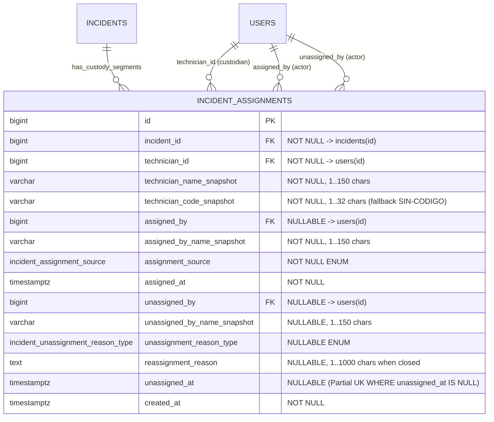

# ESPECIFICACIÓN TÉCNICA · CONTRATOS DE API, ESQUEMA RELACIONAL E INMUTABILIDAD
# HISTORIAL COMPLETO DE REASIGNACIONES Y CADENA DE CUSTODIA (MÓDULO 26)

**Proyecto:** Gestor de Incidencias de Vending (*VendGuard*)  
**Módulo:** `26-reassignment-history-custody-chain`  
**Documento:** `specs/technical/reassignment_history_custody_chain_contracts.md`  
**Referencia Funcional:** [`specs/26-reassignment-history-custody-chain/spec.md`](../26-reassignment-history-custody-chain/spec.md) y [`specs/functional/reassignment_history_custody_chain_spec.md`](../functional/reassignment_history_custody_chain_spec.md) (`RF-01` a `RF-05` de la Spec v2.1, `RNF-01` a `RNF-04`, Decisiones `D1`–`D4`, Resoluciones `R1`–`R6` y Resoluciones `QA 1`–`QA 5`)  
**Protocolo:** HTTP/1.1 · JSON (`application/json; charset=utf-8`)  
**Metodología:** SDD (Specification-Driven Development) · Contratos API-First  
**Estado:** Aprobado (Gate SDD Superado)  
**Conformidad Constitucional:**
* **Artículo I:** La Especificación es la Única Fuente de Verdad. Cero código simulado en rutas de producción.
* **Artículo II:** Prioridad Sanitaria Absoluta. Los traspasos automáticos a guardia 24/7 (Nivel 1) y las liberaciones a bandeja sin guardia (Nivel 2) al cerrar turno quedan tipificados e individualizados en `incident_assignments`. El umbral de 10 caracteres reales del motivo de reasignación ordinario **jamás** relaja ni sustituye el requisito de **20 caracteres reales** (`COLD_CHAIN_OVERRIDE_JUSTIFICATION_REQUIRED`) cuando el Coordinador descarta al técnico sugerido de guardia sanitaria o zona (`QA 1`, `EARS 03.2`).
* **Artículo III:** Inviolabilidad de Datos e Histórico.
  * Art. III.1: Prohibición absoluta de borrado físico (`DELETE FROM`). La nueva Tabla 37 (`incident_assignments`) incorpora el disparador `trg_no_delete_incident_assignments` vinculado a `prevent_hard_delete()`.
  * Art. III.3: Sellado único e inmutabilidad post-cierre (`trg_immutable_incident_assignments`). Una vez creada una fila en `incident_assignments`, sus columnas de apertura y sus *snapshots* (`technician_name_snapshot`, `technician_code_snapshot`, `assigned_by_name_snapshot`) no admiten modificación; y una vez sellado `unassigned_at`, la fila completa queda bloqueada contra cualquier `UPDATE` posterior (`EARS 01.3`). Toda transición de custodia deja rastro con `previous_state` y `new_state` en `audit_log` (`QA 1`, `EARS 01.4`).
* **Artículo IV:** Minimalismo Tecnológico (Dogma Vanilla).
  * Backend en PHP 8.2+ POO puro (`declare(strict_types=1);`) con PDO (`pdo_pgsql`).
  * Frontend en Vue 3 Composition API (ES Modules nativos) sin dependencias externas adicionales.
* **Artículo V:** Integridad Inviolable de Reglas de Negocio.
  * Art. V.1: El motivo de reasignación manual exige al menos **10 caracteres reales con contenido alfanumérico** tras recortar espacios extremos y colapsar espacios internos múltiples (`QA 1`, `EARS 03.1`), rechazando rellenos de símbolos o guiones repetidos.
  * Art. V.3: Unicidad de técnico responsable activo garantizada en el motor relacional mediante el índice único parcial `uq_incident_assignments_active_custody ON incident_assignments (incident_id) WHERE unassigned_at IS NULL` (`EARS 01.1`).
  * Art. V.4: Segregación estricta por rol (`D3`, `QA 5`, `EARS 05.4`). El bloque `custody_chain` se proyecta **exclusivamente** en `GET /api/coordinator/incidents/{id}/detail` (protegido para `COORDINATOR`). Nunca se adjunta a los endpoints móviles de `TECHNICIAN`, ni al Portal de Sede (`LOCATION_RESPONSIBLE`), seguimiento público QR o Albarán de Servicio A4 (`incident_service_sheets`).
  * Art. V.6: En reaperturas dentro de las 48 horas de garantía (`R2`, `QA 2`), la nueva asignación suma a `total_assignments_count` como nuevo episodio, pero no incrementa `reassignments_count` y el intervalo en que la máquina estuvo `RESOLVED` se excluye del cálculo de huecos de espera en bandeja (`UNASSIGNED_GAP`).

---

## 1. Principios Arquitectónicos del Módulo

### 1.1. Responsabilidades de Dominio, Aplicación e Infraestructura
1. **Entidades y Value Objects de Dominio (`src/Core/Domain/`):**
   * `IncidentAssignmentSource` (`enum` respaldado por `string`): modela los 9 canales canónicos de apertura de un tramo de custodia y sus etiquetas en español.
   * `IncidentUnassignmentReasonType` (`enum` respaldado por `string`): modela las 10 causas canónicas de cierre de un tramo de custodia, sus etiquetas en español y el método puro `isUnresolvedTransferOrRelease(): bool` que determina si el cierre suma al contador `reassignments_count` (`QA 2`).
   * `IncidentAssignment` (entidad de dominio inmutable): representa un tramo de custodia de la Tabla 37 (`incident_assignments`).
   * `ReassignmentReasonValidator` (validador puro de dominio): normaliza el texto (`btrim` + colapso de `\s+` a un único espacio `' '`), verifica `mb_strlen($normalized, 'UTF-8') >= 10` y comprueba la presencia de al menos un carácter alfanumérico (`preg_match('/[\p{L}\p{N}]/u', $normalized) === 1`, `QA 1`).
2. **Proyección y Síntesis en `CoordinatorIncidentDetailService` (`src/Application/Service/`):**
   * Recibe las filas crudas de `incident_assignments` leídas dentro de la misma transacción de `PdoIncidentRepository::findEnrichedDetailById()` (`RNF-01`).
   * **Respaldo determinista (`Fallback`, `EARS 05.3`, `QA 5`):** Si el expediente tiene `assigned_technician_id IS NOT NULL` o eventos de asignación/reasignación en `incident_history`, pero `raw['assignments']` está vacío (por tratarse de un fixture en memoria de tests unitarios previos o de un registro legado no migrado), reconstruye los tramos en memoria a partir de `incident`, `technician` e `incident_history` aplicando los valores de respaldo de `QA 5` (`"SIN-CODIGO"`, `"Coordinación / Sistema"`, `"Registro histórico previo"`).
   * Calcula para cada tramo `retention_seconds` y `retention_label` en tiempo natural continuo (`EARS 04.1`), detecta los huecos `UNASSIGNED_GAP` estrictamente mayores a `60 segundos` excluyendo intervalos en estado `RESOLVED` (`EARS 04.2`, `QA 2`), y construye el bloque `custody_chain` que se inyecta en `CoordinatorIncidentDetailDto`.
3. **Escritura Transaccional en `PdoIncidentRepository` y `ShiftHandoverService`:**
   * Toda apertura o cierre de tramo en `incident_assignments` ocurre dentro de la **misma transacción PDO** que actualiza `incidents` e inserta en `incident_history` / `audit_log`.
   * Antes de abrir un nuevo tramo para una incidencia, cualquier tramo abierto previo (`WHERE incident_id = :incident_id AND unassigned_at IS NULL`) se cierra en el mismo instante, garantizando que `uq_incident_assignments_active_custody` jamás se viole.

---

## 2. Modelo de Datos Relacional (PostgreSQL 16+ / Supabase)

### 2.1. Diagrama Entidad-Relación (Mermaid ERD)



### 2.2. Nuevos Tipos Enumerados Nativos (`ENUM`)

#### 2.2.1. `incident_assignment_source` (Canal de Entrada al Tramo)
| Valor Canónico | Etiqueta de Interfaz (`assignment_source_label`) | Vía Operativa que lo Dispara |
| :--- | :--- | :--- |
| `'COORDINATOR_ASSIGN'` | `"Asignación de Coordinación"` | Asignación inicial desde Coordinación a un aviso en `REGISTERED` o `REOPENED` (`EARS 02.1`). |
| `'COORDINATOR_REASSIGN'` | `"Reasignación de Coordinación"` | Reasignación manual desde Coordinación a un aviso que ya tenía custodio activo (`EARS 02.2`). |
| `'ABSENCE_COVERAGE_REASSIGN'` | `"Cobertura de Ausencia"` | Asignación o reasignación asistida desde el alta de una ausencia de técnico (Módulo 21, `EARS 02.1` / `02.2`). |
| `'OPPORTUNISTIC_NEW'` | `"Alta Oportunista In Situ"` | Creación en sede de un aviso nuevo por el técnico en ruta (`NEW`, Módulo 16, `EARS 02.3.1`). |
| `'OPPORTUNISTIC_ASSUMED'` | `"Asunción Oportunista In Situ"` | Asunción en sede de un aviso que estaba en `REGISTERED` o `REOPENED` sin técnico (`ASSUMED`, Módulo 16, `EARS 02.3.1`). |
| `'OPPORTUNISTIC_TAKEOVER'` | `"Traspaso Oportunista In Situ"` | Asunción en sede de un aviso que estaba asignado a otro técnico (`TAKEOVER`, Módulo 16, `EARS 02.3.2`). |
| `'OPPORTUNISTIC_WARRANTY_REOPEN'` | `"Reapertura en Garantía In Situ"` | Reapertura y asunción inmediata en sede de un aviso `RESOLVED` en garantía (`EARS 02.3.3`). |
| `'SHIFT_HANDOVER'` | `"Relevo de Fin de Turno"` | Recepción de un aviso traspasado manualmente al cerrar turno (Módulo 21, `EARS 02.4.1`). |
| `'SANITARY_FAILSAFE_GUARD'` | `"Guardia Sanitaria 24/7 (Art. II)"` | Recepción automática por el técnico de guardia 24/7 en protocolo sanitario Nivel 1 (Módulo 21, `EARS 02.4.2`). |

#### 2.2.2. `incident_unassignment_reason_type` (Causa de Salida del Tramo)
| Valor Canónico | Etiqueta de Interfaz (`unassignment_reason_label`) | ¿Suma a `reassignments_count`? (`QA 2`) | Condición de Cierre |
| :--- | :--- | :---: | :--- |
| `'REASSIGNED_BY_COORDINATOR'` | `"Reasignada por Coordinación"` | **SÍ (`true`)** | El Coordinador transfiere el aviso a otro técnico (`EARS 02.2`). |
| `'ABSENCE_COVERAGE_REASSIGN'` | `"Reasignada por Cobertura de Ausencia"` | **SÍ (`true`)** | El Coordinador transfiere el aviso por ausencia del titular (`EARS 02.2`). |
| `'TAKEN_OVER_IN_SITU'` | `"Traspaso Oportunista In Situ"` | **SÍ (`true`)** | Otro técnico presente en la sede asume el aviso (`EARS 02.3.2`). |
| `'SHIFT_HANDOVER'` | `"Relevo de Fin de Turno"` | **SÍ (`true`)** | El técnico traspasa el aviso a un compañero al cerrar su jornada (`EARS 02.4.1`). |
| `'SANITARY_FAILSAFE_GUARD'` | `"Relevo Automático a Guardia Sanitaria (Art. II)"` | **SÍ (`true`)** | Fin de turno con máquina perecedera transferida a guardia 24/7 Nivel 1 (`EARS 02.4.2`). |
| `'SANITARY_FAILSAFE_UNASSIGNED'` | `"Liberación a Bandeja sin Guardia (Art. II)"` | **SÍ (`true`)** | Fin de turno con máquina perecedera liberada a `REGISTERED` en Nivel 2 (`EARS 02.4.3`). |
| `'RESOLVED'` | `"Resuelta"` | **NO (`false`)** | El técnico o el coordinador resuelve la avería (`EARS 02.6.1`). |
| `'CHRONIC_REPLACEMENT_CLOSED'` | `"Cerrada por Retirada Crónica"` | **NO (`false`)** | Sellado defensivo al retirar equipo en 3.ª reincidencia (`EARS 02.6.3`, `QA 4`). |
| `'WARRANTY_REOPENED'` | `"Reabierta en Garantía"` | **NO (`false`)** | Sellado defensivo si un expediente legado tenía tramo abierto al reabrirse (`EARS 02.6.3`). |
| `'CANCELLED'` | `"Incidencia Cancelada / Descartada"` | **NO (`false`)** | El Coordinador descarta el aviso o lo cancela por 72 h de inactividad (`EARS 02.6.2`, `QA 3`). |

---

### 2.3. DDL Canónico (`database/supabase_migrations/022_incident_assignments_custody_chain.sql` y `database/supabase_init.sql`)

```sql
-- ============================================================================
-- Módulo 26 · Historial Completo de Reasignaciones y Cadena de Custodia
-- ----------------------------------------------------------------------------
-- Declara:
--   1. Tipos ENUM `incident_assignment_source` e `incident_unassignment_reason_type`.
--   2. Tabla 37 `incident_assignments` con snapshots inmutables de actores,
--      coherencia de cierre (`chk_incident_assignments_closure_coherence`),
--      suelo temporal (`unassigned_at >= assigned_at`) e índice único parcial
--      de custodia activa (`uq_incident_assignments_active_custody`, Art. V.3).
--   3. Disparador constitucional `trg_no_delete_incident_assignments` (Art. III.1)
--      y disparador de inmutabilidad `trg_immutable_incident_assignments` (Art. III.3).
--   4. Backfill idempotente para poblar tramos de incidencias existentes.
-- ============================================================================

DO $do$
BEGIN
    CREATE TYPE incident_assignment_source AS ENUM (
        'COORDINATOR_ASSIGN',
        'COORDINATOR_REASSIGN',
        'ABSENCE_COVERAGE_REASSIGN',
        'OPPORTUNISTIC_NEW',
        'OPPORTUNISTIC_ASSUMED',
        'OPPORTUNISTIC_TAKEOVER',
        'OPPORTUNISTIC_WARRANTY_REOPEN',
        'SHIFT_HANDOVER',
        'SANITARY_FAILSAFE_GUARD'
    );
EXCEPTION WHEN duplicate_object THEN NULL;
END $do$;

DO $do$
BEGIN
    CREATE TYPE incident_unassignment_reason_type AS ENUM (
        'REASSIGNED_BY_COORDINATOR',
        'ABSENCE_COVERAGE_REASSIGN',
        'TAKEN_OVER_IN_SITU',
        'SHIFT_HANDOVER',
        'SANITARY_FAILSAFE_GUARD',
        'SANITARY_FAILSAFE_UNASSIGNED',
        'RESOLVED',
        'CHRONIC_REPLACEMENT_CLOSED',
        'WARRANTY_REOPENED',
        'CANCELLED'
    );
EXCEPTION WHEN duplicate_object THEN NULL;
END $do$;

CREATE TABLE IF NOT EXISTS incident_assignments (
    id                          BIGINT GENERATED ALWAYS AS IDENTITY,
    incident_id                 BIGINT NOT NULL,
    technician_id               BIGINT NOT NULL,
    technician_name_snapshot    VARCHAR(150) NOT NULL,
    technician_code_snapshot    VARCHAR(32) NOT NULL DEFAULT 'SIN-CODIGO',
    assigned_by                 BIGINT,
    assigned_by_name_snapshot   VARCHAR(150) NOT NULL DEFAULT 'Coordinación / Sistema',
    assignment_source           incident_assignment_source NOT NULL,
    assigned_at                 TIMESTAMPTZ NOT NULL DEFAULT CURRENT_TIMESTAMP,
    unassigned_by               BIGINT,
    unassigned_by_name_snapshot VARCHAR(150),
    unassignment_reason_type    incident_unassignment_reason_type,
    reassignment_reason         TEXT,
    unassigned_at               TIMESTAMPTZ,
    created_at                  TIMESTAMPTZ NOT NULL DEFAULT CURRENT_TIMESTAMP,
    CONSTRAINT pk_incident_assignments PRIMARY KEY (id),
    CONSTRAINT fk_incident_assignments_incident FOREIGN KEY (incident_id)
        REFERENCES incidents (id) ON DELETE RESTRICT ON UPDATE CASCADE,
    CONSTRAINT fk_incident_assignments_technician FOREIGN KEY (technician_id)
        REFERENCES users (id) ON DELETE RESTRICT ON UPDATE CASCADE,
    CONSTRAINT fk_incident_assignments_assigned_by FOREIGN KEY (assigned_by)
        REFERENCES users (id) ON DELETE RESTRICT ON UPDATE CASCADE,
    CONSTRAINT fk_incident_assignments_unassigned_by FOREIGN KEY (unassigned_by)
        REFERENCES users (id) ON DELETE RESTRICT ON UPDATE CASCADE,
    CONSTRAINT chk_incident_assignments_snapshots_not_empty CHECK (
        char_length(btrim(technician_name_snapshot)) BETWEEN 1 AND 150
        AND char_length(btrim(technician_code_snapshot)) BETWEEN 1 AND 32
        AND char_length(btrim(assigned_by_name_snapshot)) BETWEEN 1 AND 150
        AND (
            unassigned_by_name_snapshot IS NULL
            OR char_length(btrim(unassigned_by_name_snapshot)) BETWEEN 1 AND 150
        )
    ),
    -- Coherencia entre tramo abierto y tramo cerrado (EARS 01.2, R5, QA 4):
    CONSTRAINT chk_incident_assignments_closure_coherence CHECK (
        (
            unassigned_at IS NULL
            AND unassignment_reason_type IS NULL
            AND unassigned_by IS NULL
            AND unassigned_by_name_snapshot IS NULL
            AND reassignment_reason IS NULL
        )
        OR (
            unassigned_at IS NOT NULL
            AND unassignment_reason_type IS NOT NULL
            AND unassigned_by_name_snapshot IS NOT NULL
            AND reassignment_reason IS NOT NULL
            AND char_length(btrim(reassignment_reason)) BETWEEN 1 AND 1000
            AND unassigned_at >= assigned_at
        )
    )
);

-- Art. V.3 y EARS 01.1: a lo sumo un único tramo de custodia abierto por incidencia.
CREATE UNIQUE INDEX IF NOT EXISTS uq_incident_assignments_active_custody
    ON incident_assignments (incident_id)
    WHERE unassigned_at IS NULL;

-- RNF-01: índice para la lectura ordenada de la línea de tiempo en < 300 ms.
CREATE INDEX IF NOT EXISTS idx_incident_assignments_incident_timeline
    ON incident_assignments (incident_id, assigned_at ASC, id ASC);

CREATE INDEX IF NOT EXISTS idx_incident_assignments_technician
    ON incident_assignments (technician_id, assigned_at DESC);

-- Art. III.1: prohibición absoluta de borrado físico.
CREATE OR REPLACE TRIGGER trg_no_delete_incident_assignments
    BEFORE DELETE ON incident_assignments
    FOR EACH ROW EXECUTE FUNCTION prevent_hard_delete();

-- Art. III.3 y EARS 01.3: inmutabilidad de los campos de apertura y sellado de un solo uso al cerrar.
CREATE OR REPLACE FUNCTION enforce_incident_assignments_immutability()
RETURNS TRIGGER AS $fn$
BEGIN
    IF OLD.unassigned_at IS NOT NULL THEN
        RAISE EXCEPTION 'ART_III_3_VIOLATION: Un tramo de custodia ya cerrado en incident_assignments es inmutable y no admite modificaciones (EARS 01.3).'
            USING ERRCODE = '45000';
    END IF;

    IF NEW.id IS DISTINCT FROM OLD.id
        OR NEW.incident_id IS DISTINCT FROM OLD.incident_id
        OR NEW.technician_id IS DISTINCT FROM OLD.technician_id
        OR NEW.technician_name_snapshot IS DISTINCT FROM OLD.technician_name_snapshot
        OR NEW.technician_code_snapshot IS DISTINCT FROM OLD.technician_code_snapshot
        OR NEW.assigned_by IS DISTINCT FROM OLD.assigned_by
        OR NEW.assigned_by_name_snapshot IS DISTINCT FROM OLD.assigned_by_name_snapshot
        OR NEW.assignment_source IS DISTINCT FROM OLD.assignment_source
        OR NEW.assigned_at IS DISTINCT FROM OLD.assigned_at
        OR NEW.created_at IS DISTINCT FROM OLD.created_at
    THEN
        RAISE EXCEPTION 'ART_III_3_VIOLATION: Los datos de apertura y snapshots de un tramo en incident_assignments son inmutables tras su creación (EARS 01.3).'
            USING ERRCODE = '45000';
    END IF;

    RETURN NEW;
END;
$fn$ LANGUAGE plpgsql;

CREATE OR REPLACE TRIGGER trg_immutable_incident_assignments
    BEFORE UPDATE ON incident_assignments
    FOR EACH ROW EXECUTE FUNCTION enforce_incident_assignments_immutability();
```

---

## 3. Matriz de Transiciones Transaccionales en las 4 Vías Operativas (`RF-02`, `QA 1`–`QA 4`)

Toda mutación sobre la custodia de una incidencia ejecuta en la **misma transacción PDO** el cierre del tramo saliente (si existe) y/o la apertura del tramo entrante:

| Operación de Dominio / Punto de Entrada | Estado Origen $\rightarrow$ Destino | Acción sobre Tramo Saliente (`WHERE incident_id = :id AND unassigned_at IS NULL`) | Acción sobre Tramo Entrante (`INSERT INTO incident_assignments`) | Auditoría en `audit_log` (`Art. III.3`, `QA 1`) |
| :--- | :--- | :--- | :--- | :--- |
| **1. Asignación inicial de Coordinación** (`PdoIncidentRepository::assign`) | `REGISTERED` / `REOPENED` $\rightarrow$ `ASSIGNED` | *(Sellado defensivo si existiera alguno)* | `assignment_source = 'COORDINATOR_ASSIGN'` (o `'ABSENCE_COVERAGE_REASSIGN'`), `assigned_by = coordinatorId`, `assigned_at = NOW()`. | `INCIDENT_ASSIGNED` (`previous_state.assigned_technician_id = null`, `new_state.assigned_technician_id = techId`). |
| **2. Reasignación de Coordinación** (`PdoIncidentRepository::assign`) | `ASSIGNED` / `IN_PROGRESS` / `PENDING_PARTS` / `PENDING_INFO` $\rightarrow$ *(mismo estado)* | Cierra con `unassignment_reason_type = 'REASSIGNED_BY_COORDINATOR'` (o `'ABSENCE_COVERAGE_REASSIGN'`), `unassigned_by = coordinatorId`, `reassignment_reason = motivo validado >= 10 chars`, `unassigned_at = $now`. | `assignment_source = 'COORDINATOR_REASSIGN'` (o `'ABSENCE_COVERAGE_REASSIGN'`), `assigned_by = coordinatorId`, `assigned_at = $now`. | `INCIDENT_REASSIGNED` (`previous_state.assigned_technician_id = oldTechId`, `new_state.assigned_technician_id = newTechId`). |
| **3. Alta Oportunista In Situ (`NEW`)** (`createOpportunisticIncident`) | *(Nuevo)* $\rightarrow$ `IN_PROGRESS` | *(No aplica)* | `assignment_source = 'OPPORTUNISTIC_NEW'`, `assigned_by = technicianId`, `assigned_at = started_at`. | `CREATE_OPPORTUNISTIC_INCIDENT` (`new_state.assigned_technician_id = techId`). |
| **4. Asunción Oportunista de Ticket Libre (`ASSUMED`)** (`claimOpportunisticIncident`) | `REGISTERED` / `REOPENED` $\rightarrow$ `IN_PROGRESS` | *(Sellado defensivo si existiera)* | `assignment_source = 'OPPORTUNISTIC_ASSUMED'`, `assigned_by = technicianId`, `assigned_at = $instant`. | `CLAIM_OPPORTUNISTIC_INCIDENT` (`previous_state.assigned_technician_id = null`, `new_state.assigned_technician_id = techId`). |
| **5. Traspaso Oportunista In Situ (`TAKEOVER`)** (`takeOverOpportunisticIncident`) | `ASSIGNED` / `PENDING_PARTS` / `PENDING_INFO` $\rightarrow$ `IN_PROGRESS` | Cierra con `unassignment_reason_type = 'TAKEN_OVER_IN_SITU'`, `unassigned_by = newTechId`, `reassignment_reason = nota interna` (o *"Asunción oportunista por presencia física del técnico en la sede"* si fue omitida, `R5`), `unassigned_at = $instant`. | `assignment_source = 'OPPORTUNISTIC_TAKEOVER'`, `assigned_by = newTechId`, `assigned_at = $instant`. | `TAKEOVER_OPPORTUNISTIC_INCIDENT` (`previous_state.assigned_technician_id = prevTechId`, `new_state.assigned_technician_id = newTechId`). |
| **6. Reapertura Oportunista In Situ** (`reopenOpportunisticIncident`) | `RESOLVED` $\rightarrow$ `IN_PROGRESS` | *(El tramo previo ya cerró en `RESOLVED`; sellado defensivo si fuera legado)* | `assignment_source = 'OPPORTUNISTIC_WARRANTY_REOPEN'`, `assigned_by = technicianId`, `assigned_at = $instant`. | `REOPEN_OPPORTUNISTIC_INCIDENT` (`new_state.assigned_technician_id = techId`). |
| **7. Sustitución en 3.ª Reincidencia Crónica** (`replaceChronicOpportunisticIncident`) | Predecesor: `RESOLVED` $\rightarrow$ `CLOSED`; Sucesor: *(Nuevo)* $\rightarrow$ `IN_PROGRESS` | En predecesor: si por legado hubiera tramo abierto, cierra con `'CHRONIC_REPLACEMENT_CLOSED'` (`QA 4`). | En sucesor: abre tramo inicial con `assignment_source = 'OPPORTUNISTIC_NEW'`, `assigned_by = technicianId`, `assigned_at = $instant`. | `REPLACE_CHRONIC_INCIDENT`. |
| **8. Relevo Manual de Fin de Turno** (`ShiftHandoverService::executeClose`) | `ASSIGNED` / `PENDING_PARTS` / `PENDING_INFO` $\rightarrow$ *(mismo estado)* | Cierra con `unassignment_reason_type = 'SHIFT_HANDOVER'`, `unassigned_by = closedBy`, `reassignment_reason = handoverNotes`, `unassigned_at = $executionTime`. | `assignment_source = 'SHIFT_HANDOVER'`, `assigned_by = closedBy`, `assigned_at = $executionTime`. | `SHIFT_HANDOVER_REASSIGNMENT` (`previous_state.assigned_technician_id = techId`, `new_state.assigned_technician_id = targetTechId`). |
| **9. Protocolo Sanitario Nivel 1 (Guardia 24/7)** (`ShiftHandoverService::executeClose`) | `ASSIGNED` / `PENDING_PARTS` / `PENDING_INFO` $\rightarrow$ *(mismo estado)* | Cierra con `unassignment_reason_type = 'SANITARY_FAILSAFE_GUARD'`, `unassigned_by = closedBy` (Técnico en cierre manual; Coordinador en cierre forzado, `QA 3`), `reassignment_reason` con leyenda sanitaria (y motivo de cierre forzado si aplica), `unassigned_at = $executionTime`. | `assignment_source = 'SANITARY_FAILSAFE_GUARD'`, `assigned_by = closedBy`, `assigned_at = $executionTime`. | `SANITARY_SHIFT_CLOSE_FAILSAFE` (`level = 1`, `previous_state` y `new_state`). |
| **10. Protocolo Sanitario Nivel 2 (Liberación a Bandeja)** (`ShiftHandoverService::executeClose`) | `ASSIGNED` / `PENDING_PARTS` / `PENDING_INFO` $\rightarrow$ `REGISTERED` | Cierra con `unassignment_reason_type = 'SANITARY_FAILSAFE_UNASSIGNED'`, `unassigned_by = closedBy`, `reassignment_reason = "Liberación automática a bandeja por fin de turno sin técnico de guardia disponible (Protocolo Sanitario Art. II)"` (+ motivo de cierre forzado si aplica, `QA 3`), `unassigned_at = $executionTime`. | *(No abre tramo: el aviso queda en bandeja sin técnico)* | `SANITARY_SHIFT_CLOSE_FAILSAFE` (`level = 2`, `previous_state.assigned_technician_id = techId`, `new_state.assigned_technician_id = null`). |
| **11. Resolución Técnica (Online u Offline PWA)** (`resolve` / `SparePartTraceabilityService` / `OfflineSyncService`) | `IN_PROGRESS` (o activa) $\rightarrow$ `RESOLVED` | Cierra con `unassignment_reason_type = 'RESOLVED'`, `unassigned_by = actorId`, `reassignment_reason = resolution_diagnosis` (`QA 3`), `unassigned_at = GREATEST(assigned_at, resolved_at)` (`QA 4`). | *(No abre tramo)* | `RESOLVE_INCIDENT` / evento de resolución correspondiente. |
| **12. Descarte / Cancelación (Ordinaria o por 72 h de Inactividad)** (`cancel` / `IncidentPauseService::cancelByInactivity`) | Activa $\rightarrow$ `CANCELLED` | Si tenía tramo abierto, cierra con `unassignment_reason_type = 'CANCELLED'`, `unassigned_by = coordinatorId`, `reassignment_reason = cancellationReason`, `unassigned_at = GREATEST(assigned_at, cancelled_at)` (`QA 3`). | *(No abre tramo)* | `INCIDENT_CANCELLED` / `CANCEL_INCIDENT_BY_INACTIVITY`. |
| **13. Reapertura desde Sede (< 48 h) y Auto-cierre a 48 h** (`reopen` / `autoCloseResolvedIncidents`) | `RESOLVED` $\rightarrow$ `REOPENED` / `CLOSED` | Si por datos legados existiera tramo abierto, cierra defensivamente con `'WARRANTY_REOPENED'` o `'RESOLVED'` (`QA 4`). | *(No abre tramo)* | Evento de historial y auditoría correspondiente. |

---

## 4. Contrato de API REST: Ficha de Detalle Integral de Coordinación (`RF-04`, `RF-05`)

### 4.1. `GET /api/coordinator/incidents/{id}/detail`
* **Autenticación:** `InternalAuthMiddleware(UserRole::COORDINATOR)` + defensa en profundidad `authorizeCoordinator($request)`. Cualquier invocación por `TECHNICIAN` o `LOCATION_RESPONSIBLE` recibe `403 FORBIDDEN` (`EARS 05.4`, `QA 5`).
* **Ampliación en `CoordinatorIncidentDetailDto::toArray()`:**
  * Se mantienen **intactos** los 10 bloques existentes (`incident`, `location`, `machine`, `technician`, `timeline`, `sla`, `technical_intervention`, `comments`, `refund`, `permissions`) para compatibilidad al 100 % con las suites del Módulo 09 (`EARS 04.2`).
  * Se añade el nuevo bloque de primer nivel **`custody_chain`**.

### 4.2. Esquema y Reglas del Bloque `custody_chain`

```json
{
  "custody_chain": {
    "summary": {
      "total_assignments_count": 3,
      "reassignments_count": 2,
      "distinct_technicians_count": 2,
      "has_active_custodian": true,
      "has_multiple_custodians": true,
      "is_empty": false,
      "empty_message": null,
      "total_custody_seconds": 8100,
      "total_custody_label": "2 h 15 min",
      "total_unassigned_seconds": 1200,
      "total_unassigned_label": "20 min"
    },
    "segments": [
      {
        "segment_number": 1,
        "id": 101,
        "technician_id": 2,
        "technician_name": "Carlos Mendoza",
        "technician_code": "TEC-01",
        "assigned_by_id": 1,
        "assigned_by_name": "Laura Gómez",
        "assignment_source": "COORDINATOR_ASSIGN",
        "assignment_source_label": "Asignación de Coordinación",
        "assigned_at": "2026-11-02T09:15:00+01:00",
        "is_active": false,
        "unassigned_at": "2026-11-02T10:30:00+01:00",
        "unassigned_by_id": 2,
        "unassigned_by_name": "Carlos Mendoza",
        "unassignment_reason_type": "SANITARY_FAILSAFE_UNASSIGNED",
        "unassignment_reason_label": "Liberación a Bandeja sin Guardia (Art. II)",
        "reassignment_reason": "Liberación automática a bandeja por fin de turno sin técnico de guardia disponible (Protocolo Sanitario Art. II)",
        "is_unresolved_transfer": true,
        "retention_seconds": 4500,
        "retention_label": "1 h 15 min"
      },
      {
        "segment_number": 2,
        "id": 102,
        "technician_id": 3,
        "technician_name": "Elena Rostova",
        "technician_code": "TEC-02",
        "assigned_by_id": 1,
        "assigned_by_name": "Laura Gómez",
        "assignment_source": "COORDINATOR_ASSIGN",
        "assignment_source_label": "Asignación de Coordinación",
        "assigned_at": "2026-11-02T10:35:00+01:00",
        "is_active": false,
        "unassigned_at": "2026-11-02T11:15:00+01:00",
        "unassigned_by_id": 2,
        "unassigned_by_name": "Carlos Mendoza",
        "unassignment_reason_type": "TAKEN_OVER_IN_SITU",
        "unassignment_reason_label": "Traspaso Oportunista In Situ",
        "reassignment_reason": "Asunción oportunista por presencia física del técnico en la sede",
        "is_unresolved_transfer": true,
        "retention_seconds": 2400,
        "retention_label": "40 min"
      },
      {
        "segment_number": 3,
        "id": 103,
        "technician_id": 2,
        "technician_name": "Carlos Mendoza",
        "technician_code": "TEC-01",
        "assigned_by_id": 2,
        "assigned_by_name": "Carlos Mendoza",
        "assignment_source": "OPPORTUNISTIC_TAKEOVER",
        "assignment_source_label": "Traspaso Oportunista In Situ",
        "assigned_at": "2026-11-02T11:15:00+01:00",
        "is_active": true,
        "unassigned_at": null,
        "unassigned_by_id": null,
        "unassigned_by_name": null,
        "unassignment_reason_type": null,
        "unassignment_reason_label": null,
        "reassignment_reason": null,
        "is_unresolved_transfer": false,
        "retention_seconds": 1200,
        "retention_label": "20 min"
      }
    ],
    "unassigned_gaps": [
      {
        "gap_type": "INITIAL_TRIAGE_WAIT",
        "gap_reason_label": "En bandeja pendiente de primera asignación",
        "started_at": "2026-11-02T09:00:00+01:00",
        "ended_at": "2026-11-02T09:15:00+01:00",
        "is_active_gap": false,
        "gap_seconds": 900,
        "gap_label": "15 min",
        "preceding_segment_number": null,
        "following_segment_number": 1
      },
      {
        "gap_type": "SANITARY_UNASSIGNED_WAIT",
        "gap_reason_label": "En bandeja tras liberación sanitaria sin guardia (Art. II)",
        "started_at": "2026-11-02T10:30:00+01:00",
        "ended_at": "2026-11-02T10:35:00+01:00",
        "is_active_gap": false,
        "gap_seconds": 300,
        "gap_label": "5 min",
        "preceding_segment_number": 1,
        "following_segment_number": 2
      }
    ],
    "timeline_items": [
      { "item_type": "UNASSIGNED_GAP", "gap": { "...": "..." } },
      { "item_type": "CUSTODY_SEGMENT", "segment": { "...": "..." } },
      { "item_type": "UNASSIGNED_GAP", "gap": { "...": "..." } },
      { "item_type": "CUSTODY_SEGMENT", "segment": { "...": "..." } },
      { "item_type": "CUSTODY_SEGMENT", "segment": { "...": "..." } }
    ]
  }
}
```

### 4.3. Ejemplo de Respuesta cuando existen `0` Asignaciones (`R6`, `Caso Límite 1`)
Cuando una incidencia está recién creada en `REGISTERED` (o fue descartada en `CANCELLED` sin haber tenido nunca técnico asignado):
```json
{
  "custody_chain": {
    "summary": {
      "total_assignments_count": 0,
      "reassignments_count": 0,
      "distinct_technicians_count": 0,
      "has_active_custodian": false,
      "has_multiple_custodians": false,
      "is_empty": true,
      "empty_message": "Sin asignación técnica registrada",
      "total_custody_seconds": 0,
      "total_custody_label": "0 s",
      "total_unassigned_seconds": 1800,
      "total_unassigned_label": "30 min"
    },
    "segments": [],
    "unassigned_gaps": [
      {
        "gap_type": "INITIAL_TRIAGE_WAIT",
        "gap_reason_label": "En bandeja pendiente de primera asignación",
        "started_at": "2026-11-02T09:00:00+01:00",
        "ended_at": "2026-11-02T09:30:00+01:00",
        "is_active_gap": true,
        "gap_seconds": 1800,
        "gap_label": "30 min",
        "preceding_segment_number": null,
        "following_segment_number": null
      }
    ],
    "timeline_items": [
      { "item_type": "UNASSIGNED_GAP", "gap": { "...": "..." } }
    ]
  }
}
```

### 4.4. Reglas Exactas de Cálculo en `CoordinatorIncidentDetailService`
1. **Formato de Duración Legible (`formatDurationSeconds(int $seconds)`):**
   * Si `$seconds <= 0`: `"< 1 s"` en un tramo cerrado que duró `0 s` (`Caso Límite 11`), o `"0 s"` en totales acumulados en cero.
   * Si `$seconds < 60`: `"{$seconds} s"` (ej. `"42 s"`).
   * Si `$seconds < 3600`: `$mins = intdiv($seconds, 60)`, `$remSec = $seconds % 60`; `"{$mins} min"` (o `"{$mins} min {$remSec} s"` si se desea precisión sub-minuto, estandarizado en `"X h Y min"` / `"Y min"` / `"Z s"` consistente con `formatHoursMinutes`).
2. **Umbral y Tipos de `UNASSIGNED_GAP` (`EARS 04.2`, `QA 2`):**
   * Solo se emite un `UNASSIGNED_GAP` cuando `$gapSeconds = $end->getTimestamp() - $start->getTimestamp() > 60`.
   * **Hueco inicial (`INITIAL_TRIAGE_WAIT`):**
     * `$start = created_at`.
     * Si existe Tramo #1: `$end = segment[0].assigned_at`, `is_active_gap = false`.
     * Si no existen tramos y el estado es `CANCELLED`: `$end = cancelled_at ?? updated_at ?? $now`, `is_active_gap = false` (`QA 2`).
     * Si no existen tramos y el aviso sigue activo: `$end = $now`, `is_active_gap = true` (`QA 2`).
   * **Hueco entre Tramo $N$ y Tramo $N+1$:**
     * Si el Tramo $N$ cerró con `unassignment_reason_type IN ('RESOLVED', 'CHRONIC_REPLACEMENT_CLOSED')`: el tiempo durante el cual la máquina estuvo reparada (`RESOLVED`) **NO es espera en bandeja** (`EARS 04.2`, `Caso Límite 4`). Si hubo reapertura en garantía posterior, el inicio del hueco es el timestamp del evento `REOPENED` en `incident_history` (o `incidents.reopened_at`) que cae entre `segment[N].unassigned_at` y `segment[N+1].assigned_at`, con `gap_type = 'WARRANTY_REOPEN_WAIT'` y etiqueta `"En bandeja tras reapertura en garantía"`.
     * Si el Tramo $N$ cerró con `'SANITARY_FAILSAFE_UNASSIGNED'`: `$start = segment[N].unassigned_at`, `$end = segment[N+1].assigned_at`, `gap_type = 'SANITARY_UNASSIGNED_WAIT'` y etiqueta `"En bandeja tras liberación sanitaria sin guardia (Art. II)"`.
   * **Hueco abierto tras el último tramo cerrado (`segment[last]`):**
     * Si el estado actual de la incidencia es `REGISTERED` o `REOPENED` (o fue `CANCELLED` después de quedar sin técnico):
       * Si el último tramo cerró por `RESOLVED`, `$start = reopened_at` (del episodio actual).
       * Si el último tramo cerró por `SANITARY_FAILSAFE_UNASSIGNED`, `$start = segment[last].unassigned_at`.
       * `$end = ($status === CANCELLED) ? cancelled_at : $now`, `is_active_gap = ($status !== CANCELLED)`.
3. **Cálculo de `reassignments_count` (`EARS 04.3.2`, `QA 2`):**
   * Es el número de elementos en `segments` donde `is_active === false` y `IncidentUnassignmentReasonType::from($segment['unassignment_reason_type'])->isUnresolvedTransferOrRelease() === true`.

---

## 5. Contrato de Validación y Errores en `PATCH /api/coordinator/incidents/{id}/assign` (`RF-03`, `QA 1`)

### 5.1. Cuerpo de Entrada (`application/json`)
```json
{
  "technician_id": 3,
  "reassignment_reason": "Ruta saturada en Distrito Norte; pasa al suplente de zona.",
  "urgency_override": "CRITICAL",
  "urgency_override_reason": "El responsable de sede reporta subida térmica en cámara.",
  "override_justification": "El titular de guardia está atendiendo otra urgencia hospitalaria a 15 km."
}
```
*(Se mantiene aceptado el alias `reason` para `reassignment_reason` por retrocompatibilidad con el Módulo 09).*

### 5.2. Reglas de Validación de `reassignment_reason` (`EARS 03.1`, `QA 1`)
Cuando la incidencia se encuentra en un estado con custodio activo (`ASSIGNED`, `IN_PROGRESS`, `PENDING_PARTS`, `PENDING_INFO`):
1. **Normalización:**
   ```php
   $normalized = preg_replace('/\s+/u', ' ', trim($rawReason)) ?? '';
   ```
2. **Comprobación de presencia:** Si `$normalized === ''`, devuelve **`422 MISSING_REASSIGNMENT_REASON`**.
3. **Longitud mínima y contenido alfanumérico (`QA 1`):**
   Si `mb_strlen($normalized, 'UTF-8') < 10` o `preg_match('/[\p{L}\p{N}]/u', $normalized) !== 1`:
   devuelve **`422 REASSIGNMENT_REASON_TOO_SHORT`** con el mensaje:
   `"El motivo de la reasignación debe contener al menos 10 caracteres reales con contenido descriptivo alfanumérico."`
4. **Bloqueo de auto-reasignación al mismo técnico (`EARS 03.3`, `R4`):**
   Si `$incident->getAssignedTechnicianId() === $technicianId`, devuelve **`422 TECHNICIAN_ALREADY_ASSIGNED`**.
5. **Independencia de la Salvaguarda Sanitaria Art. II (`EARS 03.2`, `QA 1`):**
   La validación de `override_justification` (`ColdChainOverridePolicy::MIN_JUSTIFICATION_LENGTH = 20`) se ejecuta de forma completamente independiente cuando se descarta al técnico sugerido de guardia en una avería con riesgo de frío, devolviendo **`422 COLD_CHAIN_OVERRIDE_JUSTIFICATION_REQUIRED`** si no alcanza los 20 caracteres reales.

### 5.3. Comportamiento Frontend en `CoordinatorIncidentDetailModal.js` ante Errores (`EARS 03.4`, `R4`)
* Si `PATCH /api/coordinator/incidents/{id}/assign` devuelve cualquier error `4xx`/`5xx`:
  1. El modal **no se cierra** y **conserva intacto** el borrador de `reassignment_reason` (y de `override_justification` / `urgency_override_reason`) escrito por el coordinador.
  2. Si el código de error es `INVALID_STATUS_FOR_ASSIGNMENT`, `TECHNICIAN_ALREADY_ASSIGNED` o `409 CONFLICT` (indicando que la avería cambió de estado o de titular en paralelo), el componente invoca automáticamente la recarga de `GET /api/coordinator/incidents/{id}/detail` para refrescar en pantalla el estado y la `custody_chain` vigentes sin borrar el borrador del formulario.

---

## 6. Matriz de Segregación de Privacidad por Rol (`Art. V.4`, `D3`, `QA 5`, `EARS 05.4`)

| Endpoint / Superficie | Rol Consumidor | ¿Incluye `custody_chain` o filas de `incident_assignments`? | Mecanismo de Garantía |
| :--- | :--- | :---: | :--- |
| `GET /api/coordinator/incidents/{id}/detail` | `COORDINATOR` | **SÍ** | Protegido por `InternalAuthMiddleware(UserRole::COORDINATOR)` + `authorizeCoordinator()` (`403 FORBIDDEN` a otros roles). |
| `GET /api/technician/route`, `GET /api/technician/incidents`, `GET /api/technician/machines/{id}/history`, `GET /api/technician/offline/bootstrap` | `TECHNICIAN` | **NO (Prohibido, `QA 5`)** | Sus DTOs y serializadores no leen ni exponen `custody_chain`. |
| `GET /api/location/incidents`, `GET /api/location/incidents/{id}` | `LOCATION_RESPONSIBLE` | **NO (Prohibido, `Art. V.4`)** | El serializador de sede filtra estrictamente datos internos. |
| `GET /api/public/machines/{qr_token}`, `POST /api/public/incidents` | Público / Ciudadano QR | **NO (Prohibido, `Art. V.4`)** | Cero exposición de identidades técnicas o custodia. |
| `GET /api/incidents/{id}/service-sheet` | Impresión A4 Albarán | **NO (Prohibido, `Art. V.4`)** | `IncidentServiceSheet` congela solo el técnico que resolvió; jamás incluye `custody_chain` ni motivos de reasignación. |

---

## 7. Catálogo de Códigos de Error HTTP del Módulo 26

| Código HTTP | `error_code` Canónico | Causa y Condición de Disparo |
| :---: | :--- | :--- |
| `400` | `INVALID_INCIDENT_ID` / `INVALID_INCIDENT_IDENTIFIER` | El identificador de incidencia en la ruta no es válido. |
| `403` | `FORBIDDEN` | Un usuario con rol `TECHNICIAN` o `LOCATION_RESPONSIBLE` intenta acceder a `GET /api/coordinator/incidents/{id}/detail` (`EARS 05.4`, `QA 5`). |
| `404` | `INCIDENT_NOT_FOUND` | La incidencia solicitada no existe o fue dada de baja lógicamente. |
| `422` | `MISSING_TECHNICIAN_ID` / `TECHNICIAN_NOT_FOUND` | No se indicó `technician_id` o el usuario no es un técnico activo. |
| `422` | `MISSING_REASSIGNMENT_REASON` | Se intentó reasignar una incidencia con custodio activo enviando `reassignment_reason` vacío (`EARS 03.1`). |
| `422` | `REASSIGNMENT_REASON_TOO_SHORT` | Tras recortar espacios y colapsar blancos múltiples, `reassignment_reason` tiene `< 10` caracteres o carece de caracteres alfanuméricos reales (`EARS 03.1`, `QA 1`). |
| `422` | `TECHNICIAN_ALREADY_ASSIGNED` | El `technician_id` solicitado ya es el custodio activo de la incidencia (`EARS 03.3`, `R4`). |
| `422` | `INVALID_STATUS_FOR_ASSIGNMENT` | La incidencia cambió en paralelo a un estado final (`RESOLVED`, `CLOSED`, `CANCELLED`) y ya no admite asignación/reasignación (`EARS 03.4`, `R4`). |
| `422` | `COLD_CHAIN_OVERRIDE_JUSTIFICATION_REQUIRED` | Se descarta al técnico sugerido de guardia en una avería con riesgo sanitario de frío (Art. II) sin aportar `override_justification` de al menos 20 caracteres reales (`EARS 03.2`, `QA 1`). |
