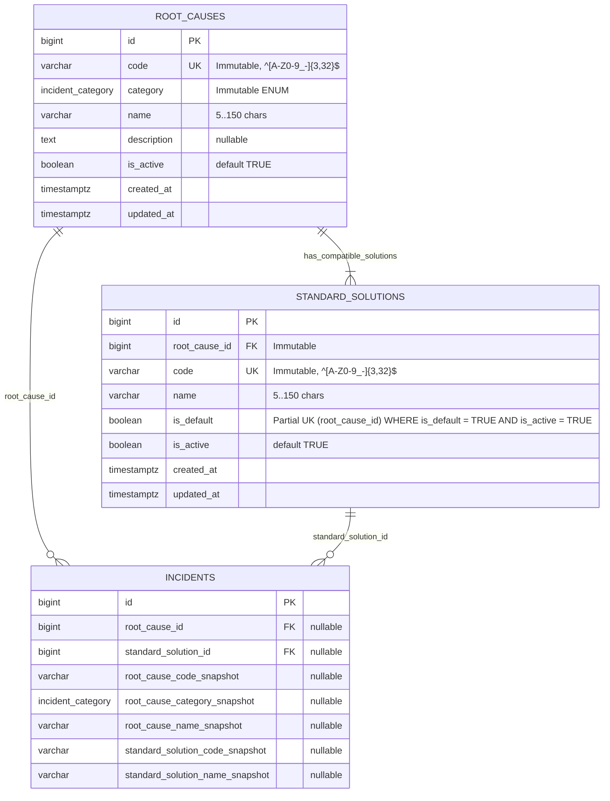

# ESPECIFICACIÓN TÉCNICA · CONTRATOS DE API, ESQUEMA RELACIONAL Y ANALÍTICA DE PARETO
# TAXONOMÍA DE CAUSAS RAÍZ Y SOLUCIONES ESTANDARIZADAS (MÓDULO 25)

**Proyecto:** Gestor de Incidencias de Vending (*VendGuard*)  
**Módulo:** `25-root-cause-taxonomy`  
**Documento:** `specs/technical/root_cause_taxonomy_contracts.md`  
**Referencia Funcional:** [`specs/25-root-cause-taxonomy/spec.md`](../25-root-cause-taxonomy/spec.md) y [`specs/functional/root_cause_taxonomy_spec.md`](../functional/root_cause_taxonomy_spec.md) (`RF-01` a `RF-05` de la Spec v2.1, `RNF-01` a `RNF-03`, Decisiones `D1`–`D6`, Casos Límite `C1`–`C6` y Resoluciones `QA 1`–`QA 5`)  
**Protocolo:** HTTP/1.1 · JSON (`application/json; charset=utf-8`) y `text/csv; charset=UTF-8`  
**Metodología:** SDD (Specification-Driven Development) · Contratos API-First  
**Conformidad Constitucional:**
* **Artículo I:** La Especificación es la Única Fuente de Verdad. Ninguna implementación sin contrato previo; cero código simulado.
* **Artículo II:** Prioridad Sanitaria Absoluta. La clasificación de causas térmicas o de cadena de frío no altera ni relaja la puerta sanitaria de resolución ni las alertas de cuarentena.
* **Artículo III:** Inviolabilidad de Datos e Histórico.
  * Art. III.1 y III.2: Cero borrado físico (`DELETE FROM`). Las dos tablas maestras nuevas (`root_causes` y `standard_solutions`) portan disparador `trg_no_delete_*` (`prevent_hard_delete()`) y gestionan su ciclo por baja lógica (`is_active BOOLEAN`). Los códigos (`code`), la categoría técnica (`category`) y la causa padre (`root_cause_id`) son inmutables tras su creación (`C4`, `QA 1`).
  * Art. III.3: Al resolver una avería se congela una copia instantánea inmutable (`root_cause_code_snapshot`, `root_cause_category_snapshot`, `root_cause_name_snapshot`, `standard_solution_code_snapshot`, `standard_solution_name_snapshot`) en `incidents` y en el evento de `incident_history` / `audit_log`. Toda mutación del catálogo registra `previous_state` y `new_state` completos bajo `audit_entity_type = 'ROOT_CAUSE_TAXONOMY'` (`QA 1`).
* **Artículo IV:** Minimalismo Tecnológico y Autorización Expresa (Art. IV.3).
  * Backend en PHP 8.2+ POO puro (`declare(strict_types=1);`) con PDO (`pdo_pgsql`).
  * Frontend en Vue 3 Composition API (ES Modules) + **Chart.js 4.x** alojado localmente en `/public/assets/js/vendor/chart.umd.min.js` y precacheado en `public/sw.js` (`D6`, autorizado expresamente por el Product Owner bajo Art. IV.3 sin `npm`, `node_modules` ni CDNs externos).
* **Artículo V:** Integridad Inviolable de Reglas de Negocio.
  * Art. V.1: La selección de `root_cause_id` y `standard_solution_id` en el cierre técnico es obligatoria en resoluciones con conexión (`D2`, `QA 3`), pero **jamás** autocompleta ni suma caracteres a `resolution_diagnosis` ni `resolution_action`, que siguen validándose independientemente con `ResolutionValidator::MIN_LENGTH = 20`.
  * Art. V.4: Segregación estricta por rol (`D4`, `QA 5`). El `LOCATION_RESPONSIBLE`, el canal público QR y el Albarán A4 (`incident_service_sheets`) **nunca** reciben campos `root_cause_*` ni `standard_solution_*`. El rol `TECHNICIAN` solo puede leer el catálogo activo y ver las etiquetas en sus expedientes/historial de máquina; los endpoints de Pareto, exportación CSV y CRUD del catálogo exigen exclusivamente `COORDINATOR` (devolviendo `403 FORBIDDEN` ante `TECHNICIAN`).
  * Art. V.6: En reaperturas dentro de las 48 horas de garantía (`C1`, `QA 2`), la nueva resolución actualiza la causa y solución vigentes en `incidents` (aportando 1 único voto al Pareto por su causa definitiva) y preserva la clasificación previa en `incident_history` y `audit_log`.

---

## 1. Principios Arquitectónicos del Módulo

### 1.1. Responsabilidades de Dominio y Aplicación
1. **Catálogo Maestro Vinculado (`RootCauseTaxonomyService`):**
   * Gestiona `root_causes` (Tabla 35) y `standard_solutions` (Tabla 36).
   * Garantiza el **alta atómica** de una nueva Causa Raíz junto con su primera Solución Estandarizada activa y predeterminada (`is_default = TRUE`, `EARS 01.1`, `QA 1`).
   * Ejecuta en transacción la **conmutación atómica de la solución predeterminada** (`EARS 01.2`) y aplica las **guardas de desactivación y reactivación** (`EARS 01.3`, `C2`, `QA 1`):
     * Rechaza desactivar la única solución activa de una causa raíz activa (`LAST_ACTIVE_SOLUTION_CANNOT_BE_DEACTIVATED`).
     * Rechaza desactivar la solución predeterminada vigente sin haber designado antes otra solución activa como predeterminada (`DEFAULT_SOLUTION_CANNOT_BE_DEACTIVATED`).
     * Al desactivar una solución que dejó de ser predeterminada, persiste `is_active = FALSE, is_default = FALSE`; si se reactiva en el futuro, reingresa con `is_default = FALSE` salvo que se solicite explícitamente como nueva predeterminada.
     * Rechaza reactivar una causa raíz inactiva cuyas soluciones estén todas inactivas o sin predeterminada (`CANNOT_REACTIVATE_ORPHAN_ROOT_CAUSE`), salvo que en la misma petición se indique `default_solution_id` para activar y marcar como predeterminada una de sus soluciones.
2. **Captura y Congelación en Resolución (`ResolutionTaxonomyValidator` + `SparePartTraceabilityService`):**
   * En resoluciones online (`POST /api/technician/incidents/{id}/resolve`, `POST /api/technician/{id}/resolve` y resolución desde Coordinación `POST /api/coordinator/incidents/{id}/resolve`), cuando el payload envía `root_cause_id` o cuando se exige por contrato, verifica que `root_cause_id` y `standard_solution_id` existan, estén activos (`is_active = TRUE`) y sean compatibles (`standard_solutions.root_cause_id = root_causes.id`).
   * **Compatibilidad retroactiva con las 367 suites previas y Modo Sin Conexión (`D2`, `EARS 03.3`):**
     * En la base de datos, las columnas en `incidents` son `NULLABLE` para soportar los expedientes históricos y los fixtures previos al Módulo 25.
     * En el endpoint HTTP de resolución:
       * Si el cliente envía `root_cause_id` o `standard_solution_id` (o si el formulario web/móvil de resolución del Módulo 25 actúa), exige ambos campos completos y coherentes (`422 MISSING_ROOT_CAUSE_TAXONOMY` / `422 INCOMPATIBLE_STANDARD_SOLUTION` / `422 INACTIVE_ROOT_CAUSE_TAXONOMY`).
       * En sincronización diferida Offline PWA (`X-Client-Mutation-Id` o `client_mutation_id` presente, Módulo 24): si la causa o solución fue desactivada mientras el técnico estaba sin cobertura (`is_active = FALSE`), **se admite igualmente** siempre que ambos registros existan y `standard_solutions.root_cause_id = root_causes.id` (`EARS 03.3`).
       * El cierre automático por **sustitución física de máquina en 3.ª reincidencia crónica** (`OpportunisticIncidentService`, Módulo 16) pasa el ticket predecesor directamente a `CLOSED` y está exento de taxonomía (`QA 3`).
3. **Motor Analítico de Pareto 80/20 (`RootCauseParetoService` + `ManufacturerNormalizer`):**
   * Filtra las averías en estado `RESOLVED` o `CLOSED` (`deleted_at IS NULL`) cuya fecha de resolución vigente (`resolved_at`) caiga dentro de la ventana temporal seleccionada (`QA 2`).
   * Normaliza de forma determinista el **Fabricante / Marca** a partir de `machines.model` (`QA 4`): `btrim(model)` $\rightarrow$ primer token antes del primer espacio (o cadena completa si no hay espacios) $\rightarrow$ `mb_convert_case(..., MB_CASE_TITLE, 'UTF-8')`.
   * Calcula frecuencias, porcentajes individuales y acumulados a **2 decimales**, cerrando el último peldaño exactamente en **`100.00`** (`QA 2`) y marcando `is_vital_few = true` desde la primera causa hasta la que alcanza o cruza por primera vez `cumulative_percentage >= 80.00` inclusive (`C3`, `EARS 05.2`).

---

## 2. Modelo de Datos Relacional (PostgreSQL 16+ / Supabase)

### 2.1. Diagrama Entidad-Relación (Mermaid ERD)



### 2.2. Extensión del Enum de Auditoría (`audit_entity_type`)

Se añade el valor `'ROOT_CAUSE_TAXONOMY'` al tipo `audit_entity_type` existente (manteniendo intactos los 24 conjuntos de tipos `ENUM` del contrato de correspondencia):

```sql
ALTER TYPE audit_entity_type ADD VALUE IF NOT EXISTS 'ROOT_CAUSE_TAXONOMY';
```

### 2.3. DDL Canónico (`database/supabase_migrations/021_root_cause_taxonomy.sql` y `database/supabase_init.sql`)

```sql
-- ============================================================================
-- Módulo 25 · Taxonomía de Causas Raíz y Soluciones Estandarizadas (Pareto)
-- ----------------------------------------------------------------------------
-- Declara:
--   1. Valor 'ROOT_CAUSE_TAXONOMY' en `audit_entity_type`.
--   2. Tabla 35 `root_causes` con código y categoría inmutables (`trg_immutable_root_causes`).
--   3. Tabla 36 `standard_solutions` con código y `root_cause_id` inmutables
--      (`trg_immutable_standard_solutions`), restricción `chk_standard_solutions_default_active`
--      e índice único parcial `uq_standard_solutions_default_per_cause`.
--   4. Ampliación de Tabla 4 `incidents` con FK y snapshots congelados de causa y solución,
--      restricción de coherencia `chk_incidents_taxonomy_coherence` e índice analítico
--      `idx_incidents_pareto_resolved`.
--   5. Disparadores constitucionales `trg_no_delete_*` (`prevent_hard_delete()`)
--      y `trg_touch_*` (`touch_updated_at()`).
-- ============================================================================

ALTER TYPE audit_entity_type ADD VALUE IF NOT EXISTS 'ROOT_CAUSE_TAXONOMY';

-- ----------------------------------------------------------------------------
-- 1. Tabla 35 · root_causes — Catálogo maestro de causas raíz (RF-01)
-- ----------------------------------------------------------------------------
CREATE TABLE IF NOT EXISTS root_causes (
    id          BIGINT GENERATED ALWAYS AS IDENTITY,
    code        VARCHAR(32) NOT NULL,
    category    incident_category NOT NULL,
    name        VARCHAR(150) NOT NULL,
    description TEXT,
    is_active   BOOLEAN NOT NULL DEFAULT TRUE,
    created_at  TIMESTAMPTZ NOT NULL DEFAULT CURRENT_TIMESTAMP,
    updated_at  TIMESTAMPTZ NOT NULL DEFAULT CURRENT_TIMESTAMP,
    CONSTRAINT pk_root_causes PRIMARY KEY (id),
    CONSTRAINT uq_root_causes_code UNIQUE (code),
    CONSTRAINT chk_root_causes_code_format CHECK (
        btrim(code) ~ '^[A-Z0-9_-]{3,32}$' AND code = btrim(code)
    ),
    CONSTRAINT chk_root_causes_name_len CHECK (
        char_length(btrim(name)) BETWEEN 5 AND 150
    ),
    CONSTRAINT chk_root_causes_description_len CHECK (
        description IS NULL OR char_length(btrim(description)) BETWEEN 1 AND 500
    )
);

CREATE INDEX IF NOT EXISTS idx_root_causes_category_active
    ON root_causes (category, is_active, code);

CREATE OR REPLACE TRIGGER trg_no_delete_root_causes
    BEFORE DELETE ON root_causes
    FOR EACH ROW EXECUTE FUNCTION prevent_hard_delete();

CREATE OR REPLACE TRIGGER trg_touch_root_causes
    BEFORE UPDATE ON root_causes
    FOR EACH ROW EXECUTE FUNCTION touch_updated_at();

-- Inmutabilidad de `code` y `category` tras la creación (C4, QA 1):
CREATE OR REPLACE FUNCTION enforce_root_causes_immutability()
RETURNS TRIGGER AS $fn$
BEGIN
    IF NEW.code IS DISTINCT FROM OLD.code THEN
        RAISE EXCEPTION 'ROOT_CAUSE_CODE_IMMUTABLE: El código de una causa raíz no puede modificarse una vez creado (C4).'
            USING ERRCODE = '45000';
    END IF;
    IF NEW.category IS DISTINCT FROM OLD.category THEN
        RAISE EXCEPTION 'ROOT_CAUSE_CATEGORY_IMMUTABLE: La categoría técnica de una causa raíz no puede modificarse una vez creada (QA 1).'
            USING ERRCODE = '45000';
    END IF;
    RETURN NEW;
END;
$fn$ LANGUAGE plpgsql;

CREATE OR REPLACE TRIGGER trg_immutable_root_causes
    BEFORE UPDATE ON root_causes
    FOR EACH ROW EXECUTE FUNCTION enforce_root_causes_immutability();

-- ----------------------------------------------------------------------------
-- 2. Tabla 36 · standard_solutions — Soluciones estandarizadas vinculadas (RF-01)
-- ----------------------------------------------------------------------------
CREATE TABLE IF NOT EXISTS standard_solutions (
    id              BIGINT GENERATED ALWAYS AS IDENTITY,
    root_cause_id   BIGINT NOT NULL,
    code            VARCHAR(32) NOT NULL,
    name            VARCHAR(150) NOT NULL,
    is_default      BOOLEAN NOT NULL DEFAULT FALSE,
    is_active       BOOLEAN NOT NULL DEFAULT TRUE,
    created_at      TIMESTAMPTZ NOT NULL DEFAULT CURRENT_TIMESTAMP,
    updated_at      TIMESTAMPTZ NOT NULL DEFAULT CURRENT_TIMESTAMP,
    CONSTRAINT pk_standard_solutions PRIMARY KEY (id),
    CONSTRAINT uq_standard_solutions_code UNIQUE (code),
    CONSTRAINT fk_standard_solutions_root_cause FOREIGN KEY (root_cause_id)
        REFERENCES root_causes (id) ON DELETE RESTRICT ON UPDATE CASCADE,
    CONSTRAINT chk_standard_solutions_code_format CHECK (
        btrim(code) ~ '^[A-Z0-9_-]{3,32}$' AND code = btrim(code)
    ),
    CONSTRAINT chk_standard_solutions_name_len CHECK (
        char_length(btrim(name)) BETWEEN 5 AND 150
    ),
    -- Una solución inactiva jamás puede retener la marca de predeterminada (QA 1):
    CONSTRAINT chk_standard_solutions_default_active CHECK (
        is_default = FALSE OR is_active = TRUE
    )
);

-- A lo sumo una solución predeterminada activa por causa raíz (EARS 01.1, EARS 01.2):
CREATE UNIQUE INDEX IF NOT EXISTS uq_standard_solutions_default_per_cause
    ON standard_solutions (root_cause_id)
    WHERE is_default = TRUE AND is_active = TRUE;

CREATE INDEX IF NOT EXISTS idx_standard_solutions_cause_active
    ON standard_solutions (root_cause_id, is_active, is_default DESC, code ASC);

CREATE OR REPLACE TRIGGER trg_no_delete_standard_solutions
    BEFORE DELETE ON standard_solutions
    FOR EACH ROW EXECUTE FUNCTION prevent_hard_delete();

CREATE OR REPLACE TRIGGER trg_touch_standard_solutions
    BEFORE UPDATE ON standard_solutions
    FOR EACH ROW EXECUTE FUNCTION touch_updated_at();

-- Inmutabilidad de `code` y `root_cause_id` tras la creación (C4, QA 1):
CREATE OR REPLACE FUNCTION enforce_standard_solutions_immutability()
RETURNS TRIGGER AS $fn$
BEGIN
    IF NEW.code IS DISTINCT FROM OLD.code THEN
        RAISE EXCEPTION 'STANDARD_SOLUTION_CODE_IMMUTABLE: El código de una solución estandarizada no puede modificarse una vez creado (C4).'
            USING ERRCODE = '45000';
    END IF;
    IF NEW.root_cause_id IS DISTINCT FROM OLD.root_cause_id THEN
        RAISE EXCEPTION 'STANDARD_SOLUTION_CAUSE_IMMUTABLE: La causa raíz padre de una solución estandarizada no puede modificarse una vez creada (QA 1).'
            USING ERRCODE = '45000';
    END IF;
    RETURN NEW;
END;
$fn$ LANGUAGE plpgsql;

CREATE OR REPLACE TRIGGER trg_immutable_standard_solutions
    BEFORE UPDATE ON standard_solutions
    FOR EACH ROW EXECUTE FUNCTION enforce_standard_solutions_immutability();

-- ----------------------------------------------------------------------------
-- 3. Ampliación de Tabla 4 · incidents — Referencias y Snapshots congelados (RF-02.5)
-- ----------------------------------------------------------------------------
ALTER TABLE incidents
    ADD COLUMN IF NOT EXISTS root_cause_id BIGINT,
    ADD COLUMN IF NOT EXISTS standard_solution_id BIGINT,
    ADD COLUMN IF NOT EXISTS root_cause_code_snapshot VARCHAR(32),
    ADD COLUMN IF NOT EXISTS root_cause_category_snapshot incident_category,
    ADD COLUMN IF NOT EXISTS root_cause_name_snapshot VARCHAR(150),
    ADD COLUMN IF NOT EXISTS standard_solution_code_snapshot VARCHAR(32),
    ADD COLUMN IF NOT EXISTS standard_solution_name_snapshot VARCHAR(150);

DO $do$
BEGIN
    ALTER TABLE incidents
        ADD CONSTRAINT fk_incidents_root_cause FOREIGN KEY (root_cause_id)
            REFERENCES root_causes (id) ON DELETE RESTRICT ON UPDATE CASCADE;
EXCEPTION WHEN duplicate_object THEN NULL;
END $do$;

DO $do$
BEGIN
    ALTER TABLE incidents
        ADD CONSTRAINT fk_incidents_standard_solution FOREIGN KEY (standard_solution_id)
            REFERENCES standard_solutions (id) ON DELETE RESTRICT ON UPDATE CASCADE;
EXCEPTION WHEN duplicate_object THEN NULL;
END $do$;

-- Todo-o-nada en los 7 campos de taxonomía de la avería (EARS 02.5):
-- o la avería no tiene taxonomía clasificada (los 7 son NULL) o tiene los 7 rellenos.
DO $do$
BEGIN
    ALTER TABLE incidents
        ADD CONSTRAINT chk_incidents_taxonomy_coherence CHECK (
            (
                root_cause_id IS NULL
                AND standard_solution_id IS NULL
                AND root_cause_code_snapshot IS NULL
                AND root_cause_category_snapshot IS NULL
                AND root_cause_name_snapshot IS NULL
                AND standard_solution_code_snapshot IS NULL
                AND standard_solution_name_snapshot IS NULL
            )
            OR (
                root_cause_id IS NOT NULL
                AND standard_solution_id IS NOT NULL
                AND root_cause_code_snapshot IS NOT NULL
                AND root_cause_category_snapshot IS NOT NULL
                AND root_cause_name_snapshot IS NOT NULL
                AND standard_solution_code_snapshot IS NOT NULL
                AND standard_solution_name_snapshot IS NOT NULL
            )
        );
EXCEPTION WHEN duplicate_object THEN NULL;
END $do$;

DO $do$
BEGIN
    CREATE INDEX IF NOT EXISTS idx_incidents_pareto_resolved
        ON incidents (resolved_at, root_cause_id)
        WHERE status IN ('RESOLVED', 'CLOSED') AND deleted_at IS NULL;
EXCEPTION WHEN duplicate_object OR undefined_column THEN NULL;
END $do$;
```

---

## 3. Semilla Inicial del Catálogo Maestro (`EARS 01.1`, `database/supabase_seeds.sql`)

La semilla dota al sistema de **16 Causas Raíz** y **34 Soluciones Estandarizadas** repartidas en las 5 categorías de `incident_category`, todas con `ON CONFLICT (code) DO UPDATE`:

| Categoría (`incident_category`) | Código Causa | Nombre de Causa Raíz | Solución Predeterminada (`is_default = TRUE`) | Otras Soluciones Vinculadas (`is_default = FALSE`) |
| :--- | :--- | :--- | :--- | :--- |
| `TEMPERATURE_COLD` | `RC-COLD-01` | Sonda térmica NTC descalibrada o derivada | `SOL-COLD-01A`: Recalibración y ajuste de sonda NTC en cámara | `SOL-COLD-01B`: Sustitución de sonda térmica NTC roscada |
| `TEMPERATURE_COLD` | `RC-COLD-02` | Obstrucción o suciedad en condensador / ventilador evaporador | `SOL-COLD-02A`: Limpieza de batería condensadora y desbloqueo de turbina | `SOL-COLD-02B`: Sustitución de motor ventilador de evaporador |
| `TEMPERATURE_COLD` | `RC-COLD-03` | Fuga de gas refrigerante o fallo de compresor hermético | `SOL-COLD-03A`: Sellado de circuito y recarga de refrigerante | `SOL-COLD-03B`: Sustitución de grupo frigorífico / compresor |
| `TEMPERATURE_COLD` | `RC-COLD-04` | Disparo de termostato de seguridad en caldera / grupo térmico | `SOL-COLD-04A`: Rearme manual de termostato y purga térmica | `SOL-COLD-04B`: Sustitución de termostato de seguridad 135°C |
| `PAYMENT_SYSTEM` | `RC-PAY-01` | Moneda doblada o cuerpo extraño en selector multimoneda | `SOL-PAY-01A`: Apertura de canal, retirada de objeto y limpieza óptica | `SOL-PAY-01B`: Sustitución de monedero selector MDB |
| `PAYMENT_SYSTEM` | `RC-PAY-02` | Tubos de cambio agotados o atasco en casete de devolución | `SOL-PAY-02A`: Desatasco de casete, nivelación y prueba de expulsión | `SOL-PAY-02B`: Sustitución de casete / módulo de cambio |
| `PAYMENT_SYSTEM` | `RC-PAY-03` | Pérdida de enlace o bloqueo en terminal Contactless / Nayax | `SOL-PAY-03A`: Reinicio de bus MDB y reconexión de antena 4G | `SOL-PAY-03B`: Sustitución de terminal lector Contactless MDB |
| `PRODUCT_JAM` | `RC-JAM-01` | Atasco de producto en espiral o bandeja de extracción | `SOL-JAM-01A`: Liberación de canal, realineado de espiral y test de giro | `SOL-JAM-01B`: Reconfiguración de paso de espiral según envase |
| `PRODUCT_JAM` | `RC-JAM-02` | Fallo de motor extractor de espiral o microinterruptor de leva | `SOL-JAM-02A`: Ajuste de leva y reconexión de terminal de motor | `SOL-JAM-02B`: Sustitución de motor extractor de espiral 24V |
| `PRODUCT_JAM` | `RC-JAM-03` | Suciedad o desalineación en fotocélula de detección de caída | `SOL-JAM-03A`: Limpieza de lentes infrarrojas y calibración de barrera | `SOL-JAM-03B`: Sustitución de sensor fotocélula de caída |
| `PRODUCT_JAM` | `RC-JAM-04` | Bloqueo mecánico o pérdida de estanqueidad en grupo infusor de café | `SOL-JAM-04A`: Desmontaje, higienización, engrase alimentario y cambio de juntas | `SOL-JAM-04B`: Sustitución de grupo infusor de café espresso |
| `ELECTRICAL_OFF` | `RC-ELEC-01` | Disparo de protección magneto-térmica o diferencial del edificio | `SOL-ELEC-01A`: Verificación de toma de corriente, rearme y arranque supervisado | `SOL-ELEC-01B`: Sustitución de fusible interno o filtro antiparasitario |
| `ELECTRICAL_OFF` | `RC-ELEC-02` | Fallo en fuente de alimentación conmutada o placa de potencia | `SOL-ELEC-02A`: Reseteo de etapa de potencia y apriete de bornes | `SOL-ELEC-02B`: Sustitución de fuente / placa electrónica de control |
| `ELECTRICAL_OFF` | `RC-ELEC-03` | Avería o apagado de pantalla Display LCD frontal | `SOL-ELEC-03A`: Reconexión de faja plana de datos y ajuste de contraste | `SOL-ELEC-03B`: Sustitución de módulo Display LCD gráfico |
| `OTHER` | `RC-OTH-01` | Obstrucción calcárea o fallo de electroválvula / bomba hidráulica | `SOL-OTH-01A`: Descalcificación de circuito y limpieza de asiento de válvula | `SOL-OTH-01B`: Sustitución de electroválvula o bomba vibratoria; `SOL-OTH-01C`: Sustitución de cartucho filtrante antical |
| `OTHER` | `RC-OTH-02` | Vandalismo, golpe externo en puerta/botonera o falsa alarma sin fallo | `SOL-OTH-02A`: Ajuste mecánico de cerradura/puerta y test funcional completo | `SOL-OTH-02B`: Verificación integral sin anomalía técnica reproducible (falsa alarma); `SOL-OTH-02C`: Reparación de botonera o cristal frontal |

---

## 4. Contratos de API REST

### 4.1. Consulta del Catálogo de Taxonomía para Técnicos (`GET /api/technician/root-causes`)
* **Autenticación:** `InternalAuthMiddleware(UserRole::TECHNICIAN)`.
* **Propósito:** Proveer el catálogo activo de Causas Raíz y sus Soluciones Estandarizadas activas para poblar el modal de resolución móvil (`RF-02.3`, `RF-02.4`).
* **Query Params opcionales:**
  * `preferred_category`: `TEMPERATURE_COLD | PAYMENT_SYSTEM | PRODUCT_JAM | ELECTRICAL_OFF | OTHER`. Cuando se envía, el listado devuelve primero las causas de esa categoría seguidas de `OTHER` y luego el resto, e incluye el flag calculado `is_suggested_for_category: true` en las causas que pertenecen a `preferred_category` o a `OTHER`.
* **Respuesta `200 OK`:**
  ```json
  {
    "preferred_category": "PAYMENT_SYSTEM",
    "items": [
      {
        "id": 5,
        "code": "RC-PAY-01",
        "category": "PAYMENT_SYSTEM",
        "category_label": "Sistema de Pago / Monedero",
        "name": "Moneda doblada o cuerpo extraño en selector multimoneda",
        "description": "Atasco físico en el canal de admisión o sensores ópticos del validador MDB.",
        "is_active": true,
        "is_suggested_for_category": true,
        "default_solution_id": 9,
        "solutions": [
          {
            "id": 9,
            "root_cause_id": 5,
            "code": "SOL-PAY-01A",
            "name": "Apertura de canal, retirada de objeto y limpieza óptica",
            "is_default": true,
            "is_active": true
          },
          {
            "id": 10,
            "root_cause_id": 5,
            "code": "SOL-PAY-01B",
            "name": "Sustitución de monedero selector MDB",
            "is_default": false,
            "is_active": true
          }
        ]
      }
    ]
  }
  ```

### 4.2. Ampliación del Paquete Offline PWA (`GET /api/technician/offline/bootstrap`)
* **Propósito (`RF-03.2`, `RNF-01`):** `OfflineBootstrapSnapshotDto` incorpora la clave de nivel superior `root_cause_taxonomy` con el listado de todas las causas raíz activas y sus soluciones activas (sin importes ni datos financieros, Art. V.4), para que el técnico pueda elegir causa y solución al resolver averías en sótanos sin cobertura.
* **Estructura añadida en `OfflineBootstrapSnapshotDto::toArray()`:**
  ```json
  {
    "technician_id": 2,
    "root_cause_taxonomy": [
      {
        "id": 5,
        "code": "RC-PAY-01",
        "category": "PAYMENT_SYSTEM",
        "category_label": "Sistema de Pago / Monedero",
        "name": "Moneda doblada o cuerpo extraño en selector multimoneda",
        "default_solution_id": 9,
        "solutions": [
          {
            "id": 9,
            "root_cause_id": 5,
            "code": "SOL-PAY-01A",
            "name": "Apertura de canal, retirada de objeto y limpieza óptica",
            "is_default": true
          }
        ]
      }
    ]
  }
  ```

### 4.3. Resolución de Avería con Taxonomía (`POST /api/technician/incidents/{id}/resolve`, `POST /api/technician/{id}/resolve` y `POST /api/coordinator/incidents/{id}/resolve`)
* **Autenticación:**
  * Rutas `/api/technician/...`: `InternalAuthMiddleware(UserRole::TECHNICIAN)`.
  * Ruta `/api/coordinator/incidents/{id}/resolve`: `InternalAuthMiddleware(UserRole::COORDINATOR)` (`QA 3`).
* **Campos del cuerpo (`application/json`):**
  * `resolution_diagnosis` (o alias `diagnosis`): `string`, $\ge 20$ caracteres reales tras `trim()` (`Art. V.1`).
  * `resolution_action` (o alias `action_taken`): `string`, $\ge 20$ caracteres reales tras `trim()` (`Art. V.1`).
  * `root_cause_id`: `int` (ID de la causa raíz seleccionada).
  * `standard_solution_id`: `int` (ID de la solución estandarizada seleccionada).
  * `replaced_parts_declared`: `bool` + `replaced_parts`: `array` (Módulo 06 / 18).
  * `service_sheet`: `object|null` (Módulo 19).
  * `sanitary_declarations`: `object|null` (Módulo 11, Art. II).
* **Reglas de validación de la Taxonomía (`RF-02`, `RF-03.3`, `QA 3`):**
  1. **Modo estricto cuando se suministra taxonomía o en resolución desde la UI:**
     * Si se envía `root_cause_id` sin `standard_solution_id` o viceversa, o si `require_taxonomy = true`, o en `POST /api/coordinator/incidents/{id}/resolve`, se rechaza con `422 MISSING_ROOT_CAUSE_TAXONOMY`.
     * *(Nota de compatibilidad de arnés)*: Si una prueba unitaria/integración histórica de los Módulos 01–24 invoca `resolveIncident` sin enviar ninguna de las claves `root_cause_id`, `standard_solution_id` ni `require_taxonomy`, el backend permite que ambas permanezcan en `NULL` para no romper las 367 suites certificadas previas; en cambio, la interfaz de usuario del Módulo 25 y las llamadas que incluyen cualquiera de esas claves aplican la validación obligatoria completa.
  2. Si `root_cause_id` no existe en `root_causes` $\rightarrow$ `404 ROOT_CAUSE_NOT_FOUND`.
  3. Si `standard_solution_id` no existe en `standard_solutions` $\rightarrow$ `404 STANDARD_SOLUTION_NOT_FOUND`.
  4. Si `standard_solution.root_cause_id !== root_cause.id` $\rightarrow$ `422 INCOMPATIBLE_STANDARD_SOLUTION`.
  5. **Vigencia (`is_active`) según canal (`EARS 02.1` vs. `EARS 03.3`):**
     * **Petición online (`$metadata === null`):** Si `!root_cause.is_active` o `!standard_solution.is_active` $\rightarrow$ `422 INACTIVE_ROOT_CAUSE_TAXONOMY`.
     * **Petición de sincronización diferida Offline PWA (`$metadata !== null`):** Se admite aunque `is_active` haya pasado a `FALSE` mientras el técnico estaba sin señal (`EARS 03.3`), congelando igualmente los snapshots en `incidents`.
  6. **Independencia del Art. V.1 (`EARS 02.2`):** `ResolutionValidator::validate($diagnosis, $action)` se ejecuta exclusivamente sobre las cadenas enviadas en `diagnosis` y `action`, sin concatenar jamás el nombre de la causa ni de la solución.
  7. **Rastro histórico en `incident_history` y `audit_log` (`EARS 02.5`, `EARS 03.1`):**
     * En `incidents` se actualizan `root_cause_id`, `standard_solution_id` y las 5 columnas `*_snapshot`.
     * En `incident_history.action_note` del paso a `RESOLVED` se registra el prefijo estructurado `[Causa Raíz: {code} - {name} | Solución: {sol_code} - {sol_name}] ` seguido del diagnóstico y acción, de modo que si la avería se reabre en garantía (< 48 h, `C1`) y vuelve a resolverse con otra causa, el cierre anterior queda perpetuado de forma inmutable en la línea de tiempo del expediente.
* **Respuesta `200 OK` (campos añadidos al payload de resolución):**
  ```json
  {
    "id": 42,
    "ticket_code": "INC-2026-0042",
    "status": "RESOLVED",
    "resolved_at": "2026-10-30 14:15:00",
    "root_cause": {
      "id": 5,
      "code": "RC-PAY-01",
      "category": "PAYMENT_SYSTEM",
      "category_label": "Sistema de Pago / Monedero",
      "name": "Moneda doblada o cuerpo extraño en selector multimoneda"
    },
    "standard_solution": {
      "id": 9,
      "code": "SOL-PAY-01A",
      "name": "Apertura de canal, retirada de objeto y limpieza óptica"
    }
  }
  ```

### 4.4. Preservación en Volcado de Conflictos Offline (`POST /api/technician/offline/conflicts/dump`)
* **Propósito (`EARS 03.4`, `C5`):** Cuando `work_summary` en un volcado de conflicto (o volcado por baja de cuenta) de `RESOLVE_INCIDENT` contiene `root_cause_id` / `root_cause_code` / `root_cause_name` y `standard_solution_id` / `standard_solution_code` / `standard_solution_name`, `OfflineSyncService` incluye en el cuerpo de la **Nota Interna de Taller** (`is_internal = TRUE`) y en `audit_log` la línea:
  * `"• Causa raíz declarada in situ: {code} — {name} | Solución estándar: {sol_code} — {sol_name}"`.

### 4.5. Visibilidad en Expediente de Coordinación, Ruta y Máquina vs. Opacidad en Sede (`RF-04`, Art. V.4)
1. **Modal de Detalle de Coordinación (`GET /api/coordinator/incidents/{id}/detail`):**
   * Dentro de `technical_intervention.resolution` se añaden los bloques `root_cause` y `standard_solution` (usando los snapshots congelados en `incidents`, o `null` en averías históricas sin clasificar):
     ```json
     "resolution": {
       "is_resolved": true,
       "diagnosis": "Moneda de 50 céntimos doblada bloqueando el canal óptico del validador.",
       "corrective_action": "Se desmonta casete superior, se retira moneda deformada y se calibra sensor.",
       "root_cause": {
         "id": 5,
         "code": "RC-PAY-01",
         "category": "PAYMENT_SYSTEM",
         "category_label": "Sistema de Pago / Monedero",
         "name": "Moneda doblada o cuerpo extraño en selector multimoneda"
       },
       "standard_solution": {
         "id": 9,
         "code": "SOL-PAY-01A",
         "name": "Apertura de canal, retirada de objeto y limpieza óptica"
       },
       "replaced_parts_declared": false,
       "replaced_parts": [],
       "total_parts_cost": 0.0
     }
     ```
2. **Historial Técnico de Máquina (`GET /api/technician/machines/{id}/history`) y Mi Ruta (`GET /api/technician/my-route`):**
   * Cada ítem de avería incluye `root_cause` y `standard_solution` con su código, categoría y nombre congelado (`null` si no fue clasificada).
3. **Prohibición Estricta de Fuga de Datos (`EARS 04.3`, Art. V.4):**
   * En `GET /api/locations/{site_code}/machines`, `GET /api/qr/{code}`, `POST /api/qr/{code}/report`, `GET /api/location/...` y en el documento `signed_document` de `GET /api/*/incidents/{id}/service-sheet` **jamás** se serializan `root_cause`, `standard_solution`, `root_cause_id`, `root_cause_code_snapshot`, etc.

---

## 5. Contratos de Administración del Catálogo Maestro (`RF-01`, `RF-05`, `QA 1`, `QA 5`)

Todas las rutas administrativas viven bajo `/api/coordinator/root-causes` protegidas por `InternalAuthMiddleware(UserRole::COORDINATOR)`. Si un `TECHNICIAN` o `LOCATION_RESPONSIBLE` intenta invocarlas, el middleware/controlador responde **`403 FORBIDDEN`** (`EARS 04.2`).

### 5.1. `GET /api/coordinator/root-causes`
* **Propósito:** Listar el catálogo completo de causas raíz y todas sus soluciones estandarizadas (tanto activas como inactivas, o filtradas por `?only_active=1` y `?category=...`).
* **Respuesta `200 OK`:**
  ```json
  {
    "items": [
      {
        "id": 5,
        "code": "RC-PAY-01",
        "category": "PAYMENT_SYSTEM",
        "category_label": "Sistema de Pago / Monedero",
        "name": "Moneda doblada o cuerpo extraño en selector multimoneda",
        "description": "Atasco físico en el canal de admisión o sensores ópticos del validador MDB.",
        "is_active": true,
        "default_solution_id": 9,
        "active_solutions_count": 2,
        "total_solutions_count": 2,
        "created_at": "2026-10-30 12:00:00",
        "updated_at": "2026-10-30 12:00:00",
        "solutions": [
          {
            "id": 9,
            "root_cause_id": 5,
            "code": "SOL-PAY-01A",
            "name": "Apertura de canal, retirada de objeto y limpieza óptica",
            "is_default": true,
            "is_active": true,
            "created_at": "2026-10-30 12:00:00",
            "updated_at": "2026-10-30 12:00:00"
          }
        ]
      }
    ]
  }
  ```

### 5.2. `POST /api/coordinator/root-causes` (Alta Atómica con Solución Predeterminada Inicial — `EARS 01.1`, `QA 1`)
* **Cuerpo de entrada (`application/json`):**
  ```json
  {
    "code": "RC-PAY-09",
    "category": "PAYMENT_SYSTEM",
    "name": "Atasco de billete en apilador de billetero",
    "description": "Billete húmedo o rasgado atrapado en las correas de arrastre.",
    "initial_solution": {
      "code": "SOL-PAY-09A",
      "name": "Apertura de apilador, extracción de billete y limpieza de correas"
    }
  }
  ```
* **Validaciones (`422 Unprocessable Entity` / `409 Conflict`):**
  * `code` y `initial_solution.code`: formato `^[A-Z0-9_-]{3,32}$` tras `trim` y `strtoupper` (`422 INVALID_TAXONOMY_CODE`).
  * `category`: valor válido de `IncidentCategory` (`422 INVALID_ROOT_CAUSE_CATEGORY`).
  * `name` y `initial_solution.name`: longitud entre `5` y `150` caracteres reales (`422 INVALID_TAXONOMY_NAME_LENGTH`).
  * Ausencia de `initial_solution` (`422 INITIAL_DEFAULT_SOLUTION_REQUIRED`).
  * Duplicidad de `code` en `root_causes` o `standard_solutions` (`409 DUPLICATE_TAXONOMY_CODE`).
* **Efecto y Auditoría (`Art. III.3`, `QA 1`):**
  * Inserta en una misma transacción la fila en `root_causes` (`is_active = TRUE`) y su solución inicial en `standard_solutions` (`is_active = TRUE, is_default = TRUE`).
  * Registra evento en `audit_log` con `entity_type = 'ROOT_CAUSE_TAXONOMY'`, `action = 'CREATE_ROOT_CAUSE'`, `previous_state = null`, `new_state = { root_cause, initial_solution }`.
* **Respuesta:** `201 Created` con el objeto de la causa raíz creada y su array `solutions`.

### 5.3. `PUT /api/coordinator/root-causes/{id}` (Edición de Causa Raíz y Estado de Vigencia — `EARS 01.3`, `EARS 01.4`, `QA 1`)
* **Cuerpo de entrada (`application/json`):**
  ```json
  {
    "name": "Moneda doblada, ficha o cuerpo extraño en selector multimoneda",
    "description": "Texto descriptivo actualizado",
    "is_active": true,
    "default_solution_id": 9
  }
  ```
* **Reglas de Inmutabilidad y Reactivación:**
  1. **Prohibición de mutar `code` o `category` (`EARS 01.4`, `QA 1`):** Si el cuerpo incluye un `code` distinto al existente o un `category` distinto al existente, rechaza con **`422 IMMUTABLE_TAXONOMY_FIELD`**.
  2. **Reactivación segura (`EARS 01.3.3`, `QA 1`):** Si la causa raíz estaba inactiva (`OLD.is_active = false`) y pasa a activa (`is_active = true`):
     * Si la causa ya tiene una solución activa con `is_default = true`, se reactiva directamente.
     * Si todas sus soluciones estaban inactivas o ninguna tenía `is_default = true`, el usuario puede enviar `default_solution_id` (perteneciente a esa causa) en la misma petición para que el servicio active esa solución y la marque como `is_default = true` atómicamente. Si no envía `default_solution_id` y la causa carece de solución predeterminada activa, rechaza con **`422 CANNOT_REACTIVATE_ORPHAN_ROOT_CAUSE`**.
  3. **Auditoría Antes/Después (`QA 1`, Art. III.3):** Registra `UPDATE_ROOT_CAUSE` (o `DEACTIVATE_ROOT_CAUSE` / `REACTIVATE_ROOT_CAUSE`) en `audit_log` con `previous_state` y `new_state` íntegros.

### 5.4. `POST /api/coordinator/root-causes/{id}/solutions` (Añadir Nueva Solución Estandarizada a una Causa Raíz)
* **Cuerpo de entrada (`application/json`):**
  ```json
  {
    "code": "SOL-PAY-01C",
    "name": "Actualización de firmware de discriminación en selector MDB",
    "is_default": false
  }
  ```
* **Efecto (`EARS 01.2`):**
  * Crea la solución activa vinculada a `root_cause_id = {id}`.
  * Si `is_default = true`, en la misma transacción desmarca `is_default = false` en la anterior solución predeterminada de esa causa y marca `is_default = true` en la nueva.
  * Audita `CREATE_STANDARD_SOLUTION` con `previous_state = null` y `new_state`.
* **Respuesta:** `201 Created`.

### 5.5. `PUT /api/coordinator/root-causes/{cause_id}/solutions/{solution_id}` (Editar / Conmutar Predeterminada / Activar o Desactivar Solución — `C2`, `QA 1`)
* **Cuerpo de entrada (`application/json`):**
  ```json
  {
    "name": "Apertura de canal, retirada de objeto y calibración óptica",
    "is_default": true,
    "is_active": true
  }
  ```
* **Reglas de Integridad (`EARS 01.2`, `EARS 01.3`, `EARS 01.4`, `C2`, `QA 1`):**
  1. **Inmutabilidad de `code` y `root_cause_id`:** Si el cuerpo intenta cambiar `code` o `root_cause_id`, rechaza con **`422 IMMUTABLE_TAXONOMY_FIELD`**.
  2. **Bloqueo al desactivar la solución predeterminada (`C2`):** Si la solución es actualmente `is_default = true` y se solicita `is_active = false` (o `is_default = false` sin nombrar otra), rechaza con **`422 DEFAULT_SOLUTION_CANNOT_BE_DEACTIVATED`** (*"No se puede desactivar ni desmarcar la solución predeterminada vigente. Marque primero otra solución activa de esta causa como predeterminada"*).
  3. **Bloqueo al desactivar la única solución activa de una causa activa (`C2`):** Si la causa raíz padre está activa (`root_cause.is_active = true`) y esta es su única solución activa, rechaza `is_active = false` con **`422 LAST_ACTIVE_SOLUTION_CANNOT_BE_DEACTIVATED`**.
  4. **Reactivación de solución que antiguamente fue predeterminada (`QA 1`):** Al desactivar cualquier solución no predeterminada, queda con `is_active = false, is_default = false`. Cuando más tarde se reactiva (`is_active = true`) con `is_default = false` (por defecto), vuelve como solución activa no predeterminada sin alterar la predeterminada vigente. Si al reactivarla se envía expresamente `is_default = true`, conmuta atómicamente convirtiéndose en la nueva predeterminada.
  5. **Auditoría Antes/Después (`QA 1`):** Registra `UPDATE_STANDARD_SOLUTION` en `audit_log` con `previous_state` y `new_state`.

---

## 6. Contratos del Análisis de Pareto 80/20 y Exportación CSV (`RF-05`, `D5`, `D6`, `C1`–`C6`, `QA 2`, `QA 4`, `QA 5`)

### 6.1. `GET /api/coordinator/metrics/root-causes-pareto`
* **Autenticación:** `InternalAuthMiddleware(UserRole::COORDINATOR)` (`403 FORBIDDEN` para `TECHNICIAN` y `LOCATION_RESPONSIBLE`, `QA 5`).
* **Query Params admitidos (`EARS 05.4`):**
  * `period_days`: `30 | 90 | 180 | 365 | all` (o `period` / `from` / `to` compatibles con `MetricFilter`, por defecto `90` días sobre `incidents.resolved_at`).
  * `manufacturer`: `string` opcional (ej. `Necta`, `Jofemar`, `Fasel`, `Saeco`, `Bianchi`, `Azkoyen`, `Sanden`; comparación insensible a mayúsculas/minúsculas sobre el primer token de `btrim(machines.model)` normalizado en Formato Título, `QA 4`).
  * `machine_model`: `string` opcional (ej. `Necta Samba Combo`, `Fas Fast 900`).
  * `category`: `TEMPERATURE_COLD | PAYMENT_SYSTEM | PRODUCT_JAM | ELECTRICAL_OFF | OTHER` opcional.
* **Reglas Matemáticas del Cálculo (`EARS 05.1` a `EARS 05.5`, `QA 2`):**
  1. **Universo temporal:** Averías con `incidents.status IN ('RESOLVED', 'CLOSED')`, `incidents.deleted_at IS NULL` y `incidents.resolved_at BETWEEN :from AND :to`.
  2. **Separación de clasificadas vs. sin clasificar (`C3`):**
     * `classified_incidents_count`: total de averías del filtro con `root_cause_id IS NOT NULL`.
     * `unclassified_historical_count`: total de averías del filtro con `root_cause_id IS NULL`.
  3. **Ordenación y agregación por Causa Raíz (`EARS 05.2`, `EARS 05.3`, `QA 2`):**
     * Se agrupan las averías clasificadas por `rc.id`, ordenadas por `incident_count DESC, rc.code ASC`.
     * `percentage = round((incident_count / classified_incidents_count) * 100, 2)`.
     * `cumulative_percentage`: suma acumulada redondeada a 2 decimales; en el **último elemento** de la lista (cuando `classified_incidents_count > 0`) se fuerza exactamente `cumulative_percentage = 100.00` (`QA 2`).
     * `is_vital_few`: `true` para todas las filas desde el índice `0` hasta la primera fila inclusive donde `cumulative_percentage >= 80.00` (`C3`, `EARS 05.2`). Las filas posteriores llevan `is_vital_few = false`.
     * `avg_mttr_hours`: media en horas (`round(avg( GREATEST(0, EXTRACT(EPOCH FROM (i.resolved_at - i.cycle_started_at)) - COALESCE(i.total_pending_info_seconds, 0)) / 3600.0 ), 2)`) de los expedientes de esa causa.
     * `replaced_parts_units` y `replaced_parts_cost_eur`: suma íntegra de `quantity` y `round(quantity * unit_cost_snapshot, 2)` en `incident_replaced_parts` (`intervention_type = 'INCIDENT'`) de los expedientes cuya causa vigente es `rc.id` (`QA 2`).
     * `top_solution`: la solución estandarizada más veces aplicada entre los expedientes de esa causa en el filtro, desempatando por `ss.is_default DESC, ss.code ASC` (`C6`).
* **Respuesta `200 OK`:**
  ```json
  {
    "filters": {
      "period_days": 90,
      "from": "2026-08-02",
      "to": "2026-10-30",
      "manufacturer": "Necta",
      "machine_model": null,
      "category": null
    },
    "available_filters": {
      "manufacturers": ["Azkoyen", "Bianchi", "Fas", "Necta", "Sanden"],
      "models_by_manufacturer": {
        "Necta": ["Necta Samba Combo"]
      },
      "models": ["Azkoyen Palma+", "Bianchi Gaia Espresso", "Fas Fast 900", "Fas Perla", "Necta Samba Combo", "Sanden Vendo G-Drink"]
    },
    "summary": {
      "classified_incidents_count": 20,
      "unclassified_historical_count": 4,
      "total_incidents_in_period": 24,
      "vital_few_causes_count": 2,
      "total_causes_with_incidents": 4,
      "total_replaced_parts_units": 12,
      "total_replaced_parts_cost_eur": 425.50
    },
    "items": [
      {
        "rank": 1,
        "root_cause_id": 5,
        "root_cause_code": "RC-PAY-01",
        "category": "PAYMENT_SYSTEM",
        "category_label": "Sistema de Pago / Monedero",
        "root_cause_name": "Moneda doblada o cuerpo extraño en selector multimoneda",
        "incident_count": 11,
        "percentage": 55.00,
        "cumulative_percentage": 55.00,
        "is_vital_few": true,
        "avg_mttr_hours": 1.45,
        "replaced_parts_units": 3,
        "replaced_parts_cost_eur": 185.00,
        "top_solution": {
          "id": 9,
          "code": "SOL-PAY-01A",
          "name": "Apertura de canal, retirada de objeto y limpieza óptica",
          "applications_count": 9
        }
      },
      {
        "rank": 2,
        "root_cause_id": 1,
        "root_cause_code": "RC-COLD-01",
        "category": "TEMPERATURE_COLD",
        "category_label": "Fallo de Frío / Temperatura",
        "root_cause_name": "Sonda térmica NTC descalibrada o derivada",
        "incident_count": 6,
        "percentage": 30.00,
        "cumulative_percentage": 85.00,
        "is_vital_few": true,
        "avg_mttr_hours": 2.10,
        "replaced_parts_units": 6,
        "replaced_parts_cost_eur": 91.20,
        "top_solution": {
          "id": 2,
          "code": "SOL-COLD-01B",
          "name": "Sustitución de sonda térmica NTC roscada",
          "applications_count": 4
        }
      }
    ]
  }
  ```

### 6.2. `GET /api/coordinator/metrics/root-causes-pareto/export` (Exportación CSV UTF-8 BOM en Dos Secciones — `EARS 05.6`, `QA 2`)
* **Autenticación:** `InternalAuthMiddleware(UserRole::COORDINATOR)` (registrada en `AppRouter` **antes** de `/api/coordinator/metrics/root-causes-pareto` para precedencia estática).
* **Cabeceras HTTP:**
  * `Content-Type: text/csv; charset=UTF-8`
  * `Content-Disposition: attachment; filename="vendguard_pareto_garantias_YYYY-MM-DD.csv"`
* **Formato del Contenido (`\xEF\xBB\xBF` + separador `;`):**
  1. **Bloque Metadatos y Sección 1 (Resumen de Pareto):**
     ```csv
     INFORME DE PARETO DE CAUSAS RAÍZ Y RECLAMACIÓN DE GARANTÍAS (VENDGUARD)
     Periodo Desde;2026-08-02;Periodo Hasta;2026-10-30;Fabricante;Todos;Modelo;Todos;Categoría;Todas
     Averías Clasificadas (Base 100% Pareto);20;Averías Históricas Sin Clasificar (Excluidas);4

     SECCIÓN 1: TABLA AGREGADA DE PARETO (REGLA 80/20)
     Orden;Código Causa;Categoría;Causa Raíz (Nombre Vigente);Averías;% Individual;% Acumulado;Zona Vital 80/20;MTTR Medio (h);Unidades Repuestos;Coste Repuestos (EUR);Código Solución Más Frecuente;Solución Más Frecuente
     1;RC-PAY-01;PAYMENT_SYSTEM;Moneda doblada o cuerpo extraño en selector multimoneda;11;55,00;55,00;SÍ (VITAL 80%);1,45;3;185,00;SOL-PAY-01A;Apertura de canal, retirada de objeto y limpieza óptica
     ```
  2. **Sección 2 (Detalle Nominal de Expedientes con Doble Columna de Nombre Vigente y Congelado — `QA 2`):**
     ```csv
     SECCIÓN 2: DETALLE NOMINAL DE EXPEDIENTES PARA RECLAMACIÓN A FABRICANTE
     Código Ticket;Fecha Resolución;Sede;Código Máquina;Fabricante;Modelo Máquina;Código Causa Raíz;Causa Raíz (Nombre Vigente);Causa Raíz (Nombre Congelado al Cierre);Código Solución;Solución (Nombre Vigente);Solución (Nombre Congelado al Cierre);MTTR (h);Unidades Repuestos;Coste Repuestos (EUR)
     INC-2026-0042;2026-10-30 14:15:00;Hospital Universitario Central;VM-hosp-01;Necta;Necta Samba Combo;RC-PAY-01;Moneda doblada o cuerpo extraño en selector multimoneda;Moneda doblada o cuerpo extraño en selector multimoneda;SOL-PAY-01A;Apertura de canal, retirada de objeto y limpieza óptica;Apertura de canal, retirada de objeto y limpieza óptica;1,20;0;0,00
     ```
* **Auditoría (`Art. III.3`, `EARS 05.6`):** Registra en `audit_log` el evento `EXPORT_ROOT_CAUSE_PARETO_CSV` sobre `entity_type = 'ROOT_CAUSE_TAXONOMY'` con los filtros aplicados y el total de filas exportadas.

---

## 7. Contrato de Integración Frontend (Vue 3 ESM + Chart.js Local + Service Worker)

1. **Vendorizado Autónomo (`D6`, `RNF-01`, Art. IV.3):**
   * El fichero `/public/assets/js/vendor/chart.umd.min.js` se aloja en el repositorio local y se carga en `public/index.html` (o se importa en el componente de Pareto), exponiendo `window.Chart` sin realizar ninguna petición a dominios externos.
2. **Actualización del Service Worker (`public/sw.js`):**
   * Se incrementa `CACHE_NAME` a `'vendguard-app-shell-v3'` y se añaden a `APP_SHELL_ASSETS`:
     * `'/assets/js/vendor/chart.umd.min.js'`
     * Los nuevos componentes Vue 3 del Módulo 25 (p. ej., `'/assets/js/components/CoordinatorRootCauseParetoTab.js'` y `'/assets/js/components/CoordinatorRootCauseCatalogModal.js'`).
3. **Configuración Visual del Gráfico Combinado en Chart.js (`RNF-02`):**
   * Tipo base: `'bar'` con dos datasets:
     * Dataset 1 (`type: 'bar'`, `yAxisID: 'yCount'`): `incident_count`, color `#2560ff` para barras con `is_vital_few === true` y `#94a3b8` para `is_vital_few === false`, `borderRadius: 4`.
     * Dataset 2 (`type: 'line'`, `yAxisID: 'yCumulative'`): `cumulative_percentage` (`0` a `100`), color `#0f172a` / `#dc2626`, `tension: 0.25`, puntos destacados y línea umbral del `80 %` renderizada en el eje derecho.

---

## 8. Catálogo de Códigos de Error HTTP del Módulo 25

| Código HTTP | `error_code` Canónico | Causa y Condición de Disparo |
| :---: | :--- | :--- |
| `400` | `INVALID_ROOT_CAUSE_ID` / `INVALID_SOLUTION_ID` | El identificador de ruta no es un entero positivo válido. |
| `400` | `INVALID_PARETO_FILTER` | Parámetro de filtro temporal o categoría con formato inválido en el Pareto. |
| `403` | `FORBIDDEN` | Acceso denegado por rol (p. ej., un `TECHNICIAN` o `LOCATION_RESPONSIBLE` intentando consultar Pareto, exportar CSV o mutar el catálogo, `QA 5`). |
| `404` | `ROOT_CAUSE_NOT_FOUND` | El `root_cause_id` indicado no existe en `root_causes`. |
| `404` | `STANDARD_SOLUTION_NOT_FOUND` | El `standard_solution_id` indicado no existe en `standard_solutions`. |
| `409` | `DUPLICATE_TAXONOMY_CODE` | Ya existe una causa raíz o solución estandarizada con el mismo `code` canónico. |
| `422` | `MISSING_ROOT_CAUSE_TAXONOMY` | Falta `root_cause_id` o `standard_solution_id` al resolver la avería (`EARS 02.1`). |
| `422` | `INCOMPATIBLE_STANDARD_SOLUTION` | La solución seleccionada no pertenece a la causa raíz indicada (`standard_solutions.root_cause_id !== root_causes.id`). |
| `422` | `INACTIVE_ROOT_CAUSE_TAXONOMY` | En una resolución online, la causa raíz o la solución estandarizada se encuentra inactiva (`is_active = false`, `EARS 02.1`). |
| `422` | `INITIAL_DEFAULT_SOLUTION_REQUIRED` | Intento de crear una causa raíz sin su `initial_solution` predeterminada (`QA 1`). |
| `422` | `IMMUTABLE_TAXONOMY_FIELD` | Intento de modificar `code`, `category` o `root_cause_id` de un registro ya creado (`C4`, `QA 1`). |
| `422` | `DEFAULT_SOLUTION_CANNOT_BE_DEACTIVATED` | Intento de desactivar o desmarcar la solución predeterminada vigente sin designar antes otra predeterminada (`C2`). |
| `422` | `LAST_ACTIVE_SOLUTION_CANNOT_BE_DEACTIVATED` | Intento de desactivar la única solución activa de una causa raíz activa (`C2`). |
| `422` | `CANNOT_REACTIVATE_ORPHAN_ROOT_CAUSE` | Intento de reactivar una causa raíz que no posee ninguna solución activa predeterminada ni indica `default_solution_id` (`QA 1`). |
| `422` | `INVALID_TAXONOMY_CODE` / `INVALID_TAXONOMY_NAME_LENGTH` / `INVALID_ROOT_CAUSE_CATEGORY` | Formato de código fuera de `^[A-Z0-9_-]{3,32}$`, longitud de nombre fuera de `5..150` chars o categoría inválida. |
