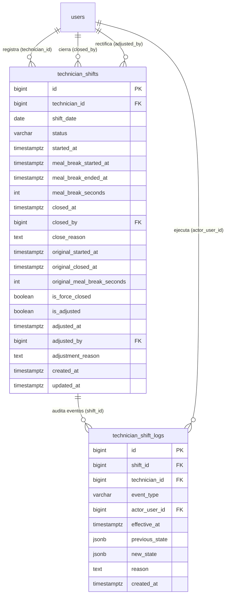

# CONTRATOS TÉCNICOS: REGISTRO DE JORNADA Y CÓMPUTO DE HORAS EFECTIVAS

**Proyecto:** Gestor de Incidencias de Vending (*VendGuard*)  
**Módulo:** 22 · Registro de Jornada y Cómputo de Horas Efectivas  
**Documento Canónico:** `specs/technical/technician_time_tracking_contracts.md`  
**Referencia Funcional:** [`../22-technician-time-tracking/spec.md`](../22-technician-time-tracking/spec.md) (v2.0, 2026-10-25)  
**Fecha:** Octubre 2026  
**Alineación Constitucional:** Art. I.1 (SDD estricto), Art. II (prioridad sanitaria e inmutabilidad de relojes de frío), Art. III.1 y III.3 (prohibición de borrado físico, bitácora append-only y preservación de marcas originales), Art. IV.1–IV.3 (Dogma Vanilla: PHP 8.2+ OOP nativo, Vue 3 sin bundlers, cero librerías externas), Art. V.1 (justificación obligatoria $\ge 20$ caracteres reales), Art. V.4 (segregación estricta de datos laborales frente a sedes y entre técnicos), Art. VI.1 (alcance autorizado).

---

## 1. Esquema de Persistencia Relacional (PostgreSQL 16+ / Supabase)

El Módulo 22 extiende de forma aditiva la **Tabla 30 (`technician_shifts`)** e introduce la **Tabla 31 (`technician_shift_logs`)** en el catálogo relacional de VendGuard mediante la migración incremental `database/supabase_migrations/015_technician_time_tracking.sql` y su convergencia exacta en `database/supabase_init.sql`.



### 1.1. Extensión de Tabla 30 · `technician_shifts` (`RF-01`, `RF-02`, `RF-03`)

```sql
ALTER TABLE technician_shifts
    ADD COLUMN IF NOT EXISTS meal_break_seconds INT NOT NULL DEFAULT 0,
    ADD COLUMN IF NOT EXISTS original_started_at TIMESTAMPTZ,
    ADD COLUMN IF NOT EXISTS original_closed_at TIMESTAMPTZ,
    ADD COLUMN IF NOT EXISTS original_meal_break_seconds INT,
    ADD COLUMN IF NOT EXISTS is_force_closed BOOLEAN NOT NULL DEFAULT FALSE,
    ADD COLUMN IF NOT EXISTS is_adjusted BOOLEAN NOT NULL DEFAULT FALSE,
    ADD COLUMN IF NOT EXISTS adjusted_at TIMESTAMPTZ,
    ADD COLUMN IF NOT EXISTS adjusted_by BIGINT,
    ADD COLUMN IF NOT EXISTS adjustment_reason TEXT;

-- Inicialización idempotente de original_started_at / original_closed_at / original_meal_break_seconds
-- para filas preexistentes del Módulo 21:
UPDATE technician_shifts
   SET original_started_at = started_at
 WHERE original_started_at IS NULL;

UPDATE technician_shifts
   SET original_closed_at = closed_at,
       original_meal_break_seconds = COALESCE(original_meal_break_seconds, meal_break_seconds)
 WHERE closed_at IS NOT NULL
   AND original_closed_at IS NULL;

ALTER TABLE technician_shifts
    ALTER COLUMN original_started_at SET NOT NULL,
    ALTER COLUMN original_started_at SET DEFAULT CURRENT_TIMESTAMP;

DO $do$
BEGIN
    IF NOT EXISTS (
        SELECT 1 FROM pg_constraint
         WHERE conname = 'fk_tech_shifts_adjuster'
           AND conrelid = 'technician_shifts'::regclass
    ) THEN
        ALTER TABLE technician_shifts
            ADD CONSTRAINT fk_tech_shifts_adjuster FOREIGN KEY (adjusted_by)
                REFERENCES users (id) ON DELETE RESTRICT ON UPDATE CASCADE;
    END IF;
END $do$;

DO $do$
BEGIN
    IF NOT EXISTS (
        SELECT 1 FROM pg_constraint
         WHERE conname = 'chk_tech_shifts_meal_seconds'
           AND conrelid = 'technician_shifts'::regclass
    ) THEN
        ALTER TABLE technician_shifts
            ADD CONSTRAINT chk_tech_shifts_meal_seconds CHECK (
                meal_break_seconds >= 0
                AND (
                    closed_at IS NULL
                    OR meal_break_seconds <= EXTRACT(EPOCH FROM (closed_at - started_at))::INT
                )
            );
    END IF;
END $do$;

DO $do$
BEGIN
    IF NOT EXISTS (
        SELECT 1 FROM pg_constraint
         WHERE conname = 'chk_tech_shifts_adjustment_consistency'
           AND conrelid = 'technician_shifts'::regclass
    ) THEN
        ALTER TABLE technician_shifts
            ADD CONSTRAINT chk_tech_shifts_adjustment_consistency CHECK (
                (is_adjusted = FALSE AND adjusted_at IS NULL AND adjusted_by IS NULL AND adjustment_reason IS NULL)
                OR (
                    is_adjusted = TRUE
                    AND adjusted_at IS NOT NULL
                    AND adjusted_by IS NOT NULL
                    AND char_length(btrim(adjustment_reason)) >= 20
                )
            );
    END IF;
END $do$;
```

### 1.2. Tabla 31 · `technician_shift_logs` (Bitácora inmutable de eventos de jornada, `RF-01.1`, Art. III.1 y III.3)

```sql
CREATE TABLE IF NOT EXISTS technician_shift_logs (
    id              BIGINT GENERATED ALWAYS AS IDENTITY,
    shift_id        BIGINT NOT NULL,
    technician_id   BIGINT NOT NULL,
    event_type      VARCHAR(30) NOT NULL,
    actor_user_id   BIGINT NOT NULL,
    effective_at    TIMESTAMPTZ NOT NULL DEFAULT CURRENT_TIMESTAMP,
    previous_state  JSONB,
    new_state       JSONB NOT NULL,
    reason          TEXT,
    created_at      TIMESTAMPTZ NOT NULL DEFAULT CURRENT_TIMESTAMP,

    CONSTRAINT pk_technician_shift_logs PRIMARY KEY (id),
    CONSTRAINT fk_shift_logs_shift FOREIGN KEY (shift_id)
        REFERENCES technician_shifts (id) ON DELETE RESTRICT ON UPDATE CASCADE,
    CONSTRAINT fk_shift_logs_technician FOREIGN KEY (technician_id)
        REFERENCES users (id) ON DELETE RESTRICT ON UPDATE CASCADE,
    CONSTRAINT fk_shift_logs_actor FOREIGN KEY (actor_user_id)
        REFERENCES users (id) ON DELETE RESTRICT ON UPDATE CASCADE,
    CONSTRAINT chk_shift_logs_event_type CHECK (
        event_type IN (
            'START_SHIFT',
            'PAUSE_MEAL',
            'RESUME_SHIFT',
            'CLOSE_SHIFT',
            'FORCE_CLOSE_SHIFT',
            'ADJUST_SHIFT'
        )
    ),
    CONSTRAINT chk_shift_logs_adjust_reason CHECK (
        event_type <> 'ADJUST_SHIFT'
        OR (reason IS NOT NULL AND char_length(btrim(reason)) >= 20)
    )
);

CREATE INDEX IF NOT EXISTS idx_tech_shift_logs_shift
    ON technician_shift_logs (shift_id, created_at);

CREATE INDEX IF NOT EXISTS idx_tech_shift_logs_tech
    ON technician_shift_logs (technician_id, created_at);

DROP TRIGGER IF EXISTS trg_no_delete_technician_shift_logs ON technician_shift_logs;
CREATE TRIGGER trg_no_delete_technician_shift_logs
    BEFORE DELETE ON technician_shift_logs
    FOR EACH ROW EXECUTE FUNCTION prevent_hard_delete();

DROP TRIGGER IF EXISTS trg_no_update_technician_shift_logs ON technician_shift_logs;
CREATE TRIGGER trg_no_update_technician_shift_logs
    BEFORE UPDATE ON technician_shift_logs
    FOR EACH ROW EXECUTE FUNCTION prevent_service_sheet_update();
```

### 1.3. Convención Temporal e Imputación de Sesiones (`RF-01.4`, `RF-03.4`, `RF-06.1`)
1. **Zona horaria operativa:** Toda conversión a fecha natural (`shift_date`) y toda representación textual en la exportación CSV o etiquetas locales utiliza la zona horaria operativa **`Europe/Madrid`**.
2. **Imputación indivisible al día de apertura (`RF-01.4`):** Cada sesión pertenece íntegramente a su `shift_date` (calculada como la fecha `YYYY-MM-DD` en `Europe/Madrid` de `started_at`). Si un turno empieza el `2026-10-31 22:30` y termina el `2026-11-01 01:30`, toda su duración se imputa al `2026-10-31`.
3. **Sincronización automática en rectificación (`RF-03.4` · Resolución QA 3):** Cuando Coordinación rectifica `started_at`, la columna `shift_date` se actualiza automáticamente a `(new DateTimeImmutable($newStartedAt))->setTimezone(new DateTimeZone('Europe/Madrid'))->format('Y-m-d')`.

---

## 2. Contratos de Dominio (Domain Model, Enums y Excepciones)

### 2.1. Enum `ShiftEventType` (`src/Core/Domain/ValueObject/ShiftEventType.php`)

```php
namespace VendGuard\Core\Domain\ValueObject;

enum ShiftEventType: string
{
    case START_SHIFT = 'START_SHIFT';
    case PAUSE_MEAL = 'PAUSE_MEAL';
    case RESUME_SHIFT = 'RESUME_SHIFT';
    case CLOSE_SHIFT = 'CLOSE_SHIFT';
    case FORCE_CLOSE_SHIFT = 'FORCE_CLOSE_SHIFT';
    case ADJUST_SHIFT = 'ADJUST_SHIFT';

    public function label(): string
    {
        return match ($this) {
            self::START_SHIFT => 'Inicio de turno',
            self::PAUSE_MEAL => 'Inicio de pausa de comida',
            self::RESUME_SHIFT => 'Reanudación de turno',
            self::CLOSE_SHIFT => 'Cierre de turno por técnico',
            self::FORCE_CLOSE_SHIFT => 'Cierre forzado por Coordinación',
            self::ADJUST_SHIFT => 'Rectificación horaria por Coordinación',
        };
    }
}
```

### 2.2. Extensión de `TechnicianShift` (`src/Core/Domain/Model/TechnicianShift.php`)

Constantes normativas de dominio:
* `ANOMALOUS_DURATION_THRESHOLD_SECONDS = 43200` (**12 horas brutas**, `RF-02.4`, Resolución QA 4).
* `MAX_SHIFT_DURATION_SECONDS = 86400` (**24 horas brutas máximas** permitidas en una sesión rectificada, `RF-03.3` regla 3).

Métodos de negocio y cálculo al segundo (`RNF-01`):
* `resume(?DateTimeImmutable $resumedAt = null): self`:
  * Calcula `$delta = max(0, $now->getTimestamp() - $this->mealBreakStartedAt->getTimestamp())`.
  * Suma `$delta` a `$this->mealBreakSeconds` sin perder pausas anteriores (`RF-01.2`).
* `close(int $closedBy, ?string $closeReason = null, ?DateTimeImmutable $closedAt = null, bool $isForceClosed = false, ?DateTimeImmutable $executionTime = null): self`:
  * Si el turno estaba en `MEAL_BREAK` (`$this->status === ShiftStatus::MEAL_BREAK` y `$this->mealBreakStartedAt !== null`), calcula `$finalBreakDelta = max(0, $effectiveClosedAt->getTimestamp() - $this->mealBreakStartedAt->getTimestamp())` y lo suma a `$this->mealBreakSeconds` (`RF-01.3`).
  * Fija `originalClosedAt = $executionTime ?? $effectiveClosedAt` y `originalMealBreakSeconds = $newMealBreakSeconds` en el primer cierre (`RF-03.4`, Resolución QA 3).
  * Si `$isForceClosed === true` y se suministró un `$closedAt` distinto de `$executionTime`, activa `isForceClosed = true`, `isAdjusted = true`, `adjustedAt = $executionTime`, `adjustedBy = $closedBy` y `adjustmentReason = $closeReason` (`RF-02.1`, Resolución QA 2 y QA 4).
* `adjust(DateTimeImmutable $newStartedAt, DateTimeImmutable $newClosedAt, int $newMealBreakSeconds, int $coordinatorId, string $reason, ?DateTimeImmutable $adjustedAt = null): self`:
  * Ejecuta la validación cuádruple (`RF-03.3`) y el mínimo de 20 caracteres reales (`RF-03.2`).
  * Preserva intactos `originalStartedAt`, `originalClosedAt` y `originalMealBreakSeconds` (`RF-03.4`, Resolución QA 3).
  * Recalcula `shiftDate` en `Europe/Madrid` a partir de `$newStartedAt`.
  * Marca `isAdjusted = true`, `adjustedBy = $coordinatorId`, `adjustedAt = $now`, `adjustmentReason = trim($reason)`.
* `grossDurationSeconds(?DateTimeImmutable $referenceNow = null): int`:
  * Devuelve `max(0, ($this->closedAt ?? $referenceNow ?? new DateTimeImmutable('now'))->getTimestamp() - $this->startedAt->getTimestamp())`.
* `totalMealBreakSeconds(?DateTimeImmutable $referenceNow = null): int`:
  * Si `$this->status === ShiftStatus::MEAL_BREAK && $this->closedAt === null && $this->mealBreakStartedAt !== null`, devuelve `$this->mealBreakSeconds + max(0, ($referenceNow ?? new DateTimeImmutable('now'))->getTimestamp() - $this->mealBreakStartedAt->getTimestamp())`.
  * En caso contrario, devuelve `$this->mealBreakSeconds`.
* `effectiveWorkSeconds(?DateTimeImmutable $referenceNow = null): int`:
  * Devuelve `max(0, $this->grossDurationSeconds($referenceNow) - $this->totalMealBreakSeconds($referenceNow))`.
* `isAnomalousDuration(?DateTimeImmutable $referenceNow = null): bool`:
  * Devuelve `$this->grossDurationSeconds($referenceNow) > self::ANOMALOUS_DURATION_THRESHOLD_SECONDS` (`> 43.200 s`, `RF-02.4`).

### 2.3. Excepción `ShiftAdjustmentValidationException` (`src/Core/Domain/Exception/ShiftAdjustmentValidationException.php`)

Extiende `TechnicianShiftValidationException` y publica códigos de error deterministas:
* `shiftStillOpen(): self` -> `422 SHIFT_STILL_OPEN` (`RF-03.1`)
* `futureTimestampNotAllowed(): self` -> `422 SHIFT_FUTURE_TIMESTAMP` (`RF-02.2`, `RF-03.3`)
* `invalidCloseOrder(): self` -> `422 SHIFT_INVALID_TIME_ORDER` (`closed_at <= started_at`, `RF-02.2`, `RF-03.3`)
* `effectiveCloseBeforeLastActivity(): self` -> `422 EFFECTIVE_CLOSE_BEFORE_LAST_ACTIVITY` (`effective_closed_at` anterior al inicio o fin de la última pausa o que deja duración bruta $<$ pausa acumulada, `RF-02.2`, Resolución QA 2)
* `invalidMealBreakDuration(): self` -> `422 INVALID_MEAL_BREAK_DURATION` (`meal_break_seconds < 0` o `meal_break_seconds > gross_duration`, `RF-03.3`)
* `exceedsMaxShiftDuration(): self` -> `422 SHIFT_EXCEEDS_MAX_DURATION` (`gross_duration > 86400`, `RF-03.3`)
* `overlappingShift(int $conflictingShiftId): self` -> `409 SHIFT_OVERLAP_CONFLICT` (`RF-03.3` regla 4)

---

## 3. Puertos de Repositorio (Interfaces)

### 3.1. Extensión de `TechnicianShiftRepositoryInterface`

```php
namespace VendGuard\Core\Domain\Repository;

use DateTimeImmutable;
use VendGuard\Core\Domain\Model\TechnicianShift;

interface TechnicianShiftRepositoryInterface
{
    public function findActiveShiftByTechnician(int $technicianId): ?TechnicianShift;

    public function findById(int $shiftId): ?TechnicianShift;

    public function startShift(int $technicianId, ?DateTimeImmutable $startedAt = null): TechnicianShift;

    public function pauseMeal(int $shiftId, ?DateTimeImmutable $pausedAt = null): TechnicianShift;

    public function resumeShift(int $shiftId, ?DateTimeImmutable $resumedAt = null): TechnicianShift;

    public function closeShift(
        int $shiftId,
        int $closedBy,
        ?string $closeReason = null,
        ?DateTimeImmutable $closedAt = null,
        bool $isForceClosed = false,
        ?DateTimeImmutable $executionTime = null
    ): TechnicianShift;

    public function saveAdjustment(TechnicianShift $adjustedShift): TechnicianShift;

    /**
     * Comprueba si el rango [startedAt, closedAt) se solapa con otro turno del mismo técnico.
     */
    public function findOverlappingShiftId(
        int $technicianId,
        DateTimeImmutable $startedAt,
        DateTimeImmutable $closedAt,
        ?int $excludeShiftId = null
    ): ?int;

    /**
     * Devuelve los turnos imputados en [fromDate, toDate] (inclusive, por shift_date).
     *
     * @return list<TechnicianShift>
     */
    public function findShiftsByDateRange(
        string $fromDate,
        string $toDate,
        ?int $technicianId = null
    ): array;

    /**
     * Devuelve los turnos abiertos (closed_at IS NULL) cuya shift_date sea estrictamente
     * anterior a $beforeDate (turnos abiertos huérfanos, RF-04.2 / Resolución QA 4).
     *
     * @return list<TechnicianShift>
     */
    public function findOrphanOpenShiftsBefore(
        string $beforeDate,
        ?int $technicianId = null
    ): array;

    /**
     * @return array<int, string> technicianId => shift_status ('ON_SHIFT'|'MEAL_BREAK'|'OFF_SHIFT')
     */
    public function getActiveShiftsMap(): array;
}
```

### 3.2. `TechnicianShiftLogRepositoryInterface` (`src/Core/Domain/Repository/TechnicianShiftLogRepositoryInterface.php`)

```php
namespace VendGuard\Core\Domain\Repository;

use DateTimeImmutable;
use VendGuard\Core\Domain\Model\TechnicianShiftLog;
use VendGuard\Core\Domain\ValueObject\ShiftEventType;

interface TechnicianShiftLogRepositoryInterface
{
    /**
     * @param array<string, mixed>|null $previousState
     * @param array<string, mixed>      $newState
     */
    public function record(
        int $shiftId,
        int $technicianId,
        ShiftEventType $eventType,
        int $actorUserId,
        DateTimeImmutable $effectiveAt,
        ?array $previousState,
        array $newState,
        ?string $reason = null
    ): TechnicianShiftLog;

    /**
     * @return list<TechnicianShiftLog>
     */
    public function findByShiftId(int $shiftId): array;
}
```

---

## 4. Servicios de Aplicación y Algoritmos de Negocio

### 4.1. `TechnicianWorkHoursService` (`src/Application/Service/TechnicianWorkHoursService.php`)

Orquesta el cálculo del informe horario para Coordinación (`RF-04`, `RF-05`, `RF-06`), la rectificación administrativa (`RF-03`) y el resumen propio del técnico (`RF-07`):

1. **Cálculo de Presencia por Técnico (`RF-04.1`, `RF-04.2`):**
   * Obtiene las sesiones en `[fromDate, toDate]` mediante `findShiftsByDateRange($fromDate, $toDate, $technicianId)`.
   * Para cada sesión calcula en segundos enteros respecto a `$now`:
     * `gross_seconds = grossDurationSeconds($now)`
     * `meal_break_seconds = totalMealBreakSeconds($now)`
     * `effective_seconds = effectiveWorkSeconds($now)`
     * `is_anomalous = gross_seconds > 43200` (`> 12h`, `RF-02.4`)
2. **Cruce con Tiempo en Intervención In Situ y Tiempo en Ruta (`RF-04.3`, `RF-04.4`, Resolución QA 1):**
   * Consulta en una única agregación SQL por técnico resolutor dentro del intervalo `[fromTimestamp, toTimestamp]`:
     * **Averías correctivas resueltas** (`incidents.status IN ('RESOLVED', 'CLOSED')`, `incidents.deleted_at IS NULL`, `incidents.resolved_at BETWEEN :from AND :to`, `incidents.started_at IS NOT NULL`):
       $$\text{NetIncidentSeconds} = \max\left(0, \text{EXTRACT(EPOCH FROM (resolved\_at - started\_at))} - \text{PausedSeconds}\right)$$
     * **Órdenes preventivas completadas sin avería vinculada** (`preventive_orders.status = 'COMPLETED'`, `preventive_orders.deleted_at IS NULL`, `preventive_orders.completed_at BETWEEN :from AND :to`):
       * Conteo de órdenes preventivas completadas se suma a `resolved_interventions_count`.
       * Si `started_at IS NOT NULL` **y** `linked_incident_id IS NULL` (Resolución QA 1, evitando duplicar minutos con la avería derivada), se suma `max(0, EXTRACT(EPOCH FROM (completed_at - started_at)))` a `intervention_seconds`.
   * Calcula el **Tiempo en Ruta / Tránsito** con suelo cero (`RF-04.3`):
     $$\text{RouteSeconds} = \max(0, \text{EffectiveSeconds} - \text{InterventionSeconds})$$
   * Evalúa el indicador de **Intervención registrada fuera de turno** (`RF-04.4`):
     $$\text{HasOutOfShiftInterventions} = (\text{InterventionSeconds} > \text{EffectiveSeconds}) \lor (\text{ResolvedInterventionsCount} > 0 \land \text{SessionsCount} = 0)$$
3. **Cobertura de Plantilla en la Tabla Resumen (`RF-05.2`, Decisión C5):**
   * Incluye a todos los usuarios con rol `TECHNICIAN` que estén activos (`is_active = TRUE` y `deleted_at IS NULL`), aunque tengan `0` sesiones y `0` intervenciones en el rango.
   * Incluye además a los técnicos inactivos (`is_active = FALSE` o `deleted_at IS NOT NULL`) que tengan `sessions_count > 0` o `resolved_interventions_count > 0` en el periodo consultado.
4. **Rectificación Transaccional de Turnos Cerrados (`adjustShift`, `RF-03`):**
   * Abre transacción PDO y bloquea al técnico con `SELECT id FROM users WHERE id = :techId FOR UPDATE` para serializar comprobaciones de solapamiento.
   * Verifica que el turno exista (`404 SHIFT_NOT_FOUND`) y esté en `OFF_SHIFT` (`422 SHIFT_STILL_OPEN`, `RF-03.1`).
   * Verifica que `mb_strlen(trim($reason)) >= 20` (`422 INVALID_ADJUSTMENT_REASON`, `RF-03.2`, Art. V.1).
   * Ejecuta `TechnicianShift::adjust(...)` validando orden temporal sin fechas futuras, `0 <= meal_break_seconds <= gross_seconds` y `gross_seconds <= 86400` (`RF-03.3`).
   * Comprueba `findOverlappingShiftId($techId, $newStartedAt, $newClosedAt, $shiftId)`: si existe colisión, lanza `ShiftAdjustmentValidationException::overlappingShift($conflictId)` (`409 SHIFT_OVERLAP_CONFLICT`, `RF-03.3` regla 4).
   * Persiste el turno ajustado (con `shift_date` recalculada e inmutabilidad de `original_*`), inserta el evento `ADJUST_SHIFT` en `technician_shift_logs` y registra `ADJUST_TECHNICIAN_SHIFT` en `audit_log` (Art. III.3).

---

## 5. Contratos de Interfaz HTTP REST

### 5.1. `GET /api/coordinator/metrics/work-hours`
Consulta el informe de registro de jornada y horas efectivas para Coordinación (`RF-04`, `RF-05`).

* **Autenticación:** `InternalAuthMiddleware(['COORDINATOR', 'ADMIN'])` (`401` / `403`).
* **Query Params:**
  * `period` (opcional): `last_7_days` | `last_30_days` (defecto) | `current_month` | `last_month` | `custom`
  * `from` / `to` (requeridos si `period=custom`, formato `YYYY-MM-DD`)
  * `technician_id` (opcional, entero positivo)
* **Respuesta `200 OK`:**
```json
{
  "status": "success",
  "data": {
    "filter": {
      "period": "current_month",
      "from_date": "2026-10-01",
      "to_date": "2026-10-25",
      "technician_id": null,
      "timezone": "Europe/Madrid"
    },
    "summary": {
      "total_sessions": 18,
      "open_sessions_count": 1,
      "orphan_open_sessions_count": 0,
      "anomalous_sessions_count": 1,
      "adjusted_sessions_count": 2,
      "gross_seconds": 518400,
      "gross_formatted": "144h 00m",
      "meal_break_seconds": 54000,
      "meal_break_formatted": "15h 00m",
      "effective_seconds": 464400,
      "effective_formatted": "129h 00m",
      "intervention_seconds": 313200,
      "intervention_formatted": "87h 00m",
      "route_seconds": 151200,
      "route_formatted": "42h 00m",
      "resolved_interventions_count": 64
    },
    "orphan_open_shifts": [],
    "by_technician": [
      {
        "technician_id": 2,
        "technician_name": "Carlos Mendoza (Técnico)",
        "operator_code": "TEC-001",
        "is_active": true,
        "sessions_count": 10,
        "open_sessions_count": 1,
        "anomalous_sessions_count": 0,
        "adjusted_sessions_count": 1,
        "gross_seconds": 288000,
        "gross_formatted": "80h 00m",
        "meal_break_seconds": 36000,
        "meal_break_formatted": "10h 00m",
        "effective_seconds": 252000,
        "effective_formatted": "70h 00m",
        "intervention_seconds": 180000,
        "intervention_formatted": "50h 00m",
        "route_seconds": 72000,
        "route_formatted": "20h 00m",
        "resolved_interventions_count": 38,
        "has_out_of_shift_interventions": false
      }
    ],
    "sessions": [
      {
        "id": 14,
        "technician_id": 2,
        "technician_name": "Carlos Mendoza (Técnico)",
        "shift_date": "2026-10-25",
        "status": "ON_SHIFT",
        "status_label": "En curso",
        "is_open": true,
        "started_at": "2026-10-25T08:00:00+01:00",
        "closed_at": null,
        "gross_seconds": 14400,
        "gross_formatted": "04h 00m",
        "meal_break_seconds": 1800,
        "meal_break_formatted": "00h 30m",
        "effective_seconds": 12600,
        "effective_formatted": "03h 30m",
        "is_anomalous": false,
        "is_force_closed": false,
        "is_adjusted": false,
        "original_started_at": "2026-10-25T08:00:00+01:00",
        "original_closed_at": null,
        "original_meal_break_seconds": null,
        "close_reason": null,
        "adjusted_at": null,
        "adjusted_by": null,
        "adjustment_reason": null
      }
    ]
  }
}
```

### 5.2. `GET /api/coordinator/metrics/work-hours/export`
Descarga el archivo CSV oficial del registro de jornada (`RF-06`, Resolución QA 5).

* **Autenticación:** `InternalAuthMiddleware(['COORDINATOR', 'ADMIN'])` (`401` / `403`).
* **Query Params:** Idénticos a `GET /api/coordinator/metrics/work-hours`.
* **Cabeceras HTTP de Respuesta (`200 OK`):**
  * `Content-Type: text/csv; charset=UTF-8`
  * `Content-Disposition: attachment; filename="vendguard_registro_jornada_YYYYMMDD_YYYYMMDD.csv"`
* **Formato del Cuerpo:**
  * Prefijo obligatorio `\xEF\xBB\xBF` (UTF-8 BOM).
  * Separador de columnas: `;` (punto y coma).
  * **Sección 1:** Cabecera `Técnico;Estado en Plantilla;Sesiones;Horas Brutas;Tiempo Comida;Horas Efectivas Netas;Tiempo en Intervención;Tiempo en Ruta;Intervenciones Resueltas;Turnos Anómalos (>12h);Intervención Fuera de Turno` + filas por técnico.
  * Fila en blanco separadora.
  * **Sección 2:** Cabecera `ID Sesión;Fecha Imputación;Técnico;Entrada Vigente;Salida Vigente;Duración Bruta;Pausa Comida;Horas Efectivas Netas;Estado;Cierre Forzado;Ajustado por Coordinación;Entrada Original Fichada;Salida Original Fichada;Motivo Cierre o Ajuste` + filas cronológicas en hora local `Europe/Madrid`.

### 5.3. `PATCH /api/coordinator/shifts/{id}/adjust`
Rectifica las marcas horarias de una sesión de turno cerrada (`RF-03`, Resolución QA 3).

* **Autenticación:** `InternalAuthMiddleware(['COORDINATOR', 'ADMIN'])` (`401` / `403`).
* **Body JSON de Entrada:**
```json
{
  "started_at": "2026-10-24T08:00:00+02:00",
  "closed_at": "2026-10-24T17:00:00+02:00",
  "meal_break_seconds": 3600,
  "reason": "El técnico olvidó cerrar su turno al terminar la ruta a las 17:00 y lo notificó a primera hora."
}
```
* **Precedencia de Errores (Fail-Fast):**
  1. `401 UNAUTHORIZED` / `403 FORBIDDEN`.
  2. `{id}` no numérico (`400 INVALID_SHIFT_IDENTIFIER`).
  3. Turno `{id}` inexistente (`404 SHIFT_NOT_FOUND`).
  4. Turno aún abierto (`422 SHIFT_STILL_OPEN`, `RF-03.1`).
  5. `reason` con menos de 20 caracteres reales tras `trim()` (`422 INVALID_ADJUSTMENT_REASON`, `RF-03.2`, Art. V.1).
  6. Formato de fecha inválido en `started_at` o `closed_at` (`422 INVALID_SHIFT_TIMESTAMPS`).
  7. `started_at` o `closed_at` en el futuro respecto a `NOW()` (`422 SHIFT_FUTURE_TIMESTAMP`, `RF-03.3`).
  8. `closed_at <= started_at` (`422 SHIFT_INVALID_TIME_ORDER`, `RF-03.3`).
  9. `closed_at - started_at > 86400` segundos (más de 24h brutas, `422 SHIFT_EXCEEDS_MAX_DURATION`, `RF-03.3`).
  10. `meal_break_seconds < 0` o `meal_break_seconds > (closed_at - started_at)` (`422 INVALID_MEAL_BREAK_DURATION`, `RF-03.3`, Resolución QA 3).
  11. Solapamiento del intervalo `[started_at, closed_at)` con otra sesión del mismo técnico (`409 SHIFT_OVERLAP_CONFLICT`, `RF-03.3`).
  12. Éxito: `200 OK` con el objeto `shift` actualizado (incluyendo `original_started_at`, `original_closed_at`, `original_meal_break_seconds`, `is_adjusted: true` y métricas recalculadas).

### 5.4. `GET /api/coordinator/shifts/{id}/logs`
Obtiene la bitácora inmutable de eventos y ajustes de una sesión de turno (`RF-01.1`, `RF-05.3`).

* **Autenticación:** `InternalAuthMiddleware(['COORDINATOR', 'ADMIN'])` (`401` / `403`).
* **Respuesta `200 OK`:** Lista cronológica de eventos (`START_SHIFT`, `PAUSE_MEAL`, `RESUME_SHIFT`, `CLOSE_SHIFT`, `FORCE_CLOSE_SHIFT`, `ADJUST_SHIFT`) con autor, marca temporal, estado previo, estado nuevo y motivo.

### 5.5. Extensión de `POST /api/coordinator/technicians/{id}/shifts/force-close`
Extiende el endpoint del Módulo 21 para aceptar opcionalmente `effective_closed_at` (`RF-02.1` a `RF-02.3`, Resolución QA 2).

* **Body JSON de Entrada:**
```json
{
  "reason": "Olvido de cierre de turno al finalizar su ruta de tarde a las 17:30 confirmado con el técnico.",
  "effective_closed_at": "2026-10-24T17:30:00+02:00"
}
```
* **Reglas adicionales cuando `effective_closed_at` está presente:**
  1. Si `effective_closed_at` es nulo o vacío: exige `mb_strlen(trim($reason)) >= 10` (`422 MISSING_FORCE_CLOSE_REASON`) y cierra con `NOW()`, marcando `is_force_closed = true` e `is_adjusted = false`.
  2. Si `effective_closed_at` se informa:
     * Exige `mb_strlen(trim($reason)) >= 20` (`422 MISSING_FORCE_CLOSE_REASON`, Resolución QA 2 / Art. V.1).
     * Valida que `effective_closed_at` no esté en el futuro (`422 SHIFT_FUTURE_TIMESTAMP`), sea estrictamente posterior a `started_at` (`422 SHIFT_INVALID_TIME_ORDER`), no sea anterior a `meal_break_started_at` ni a `meal_break_ended_at`, y que `(effective_closed_at - started_at) >= meal_break_seconds` (`422 EFFECTIVE_CLOSE_BEFORE_LAST_ACTIVITY`, Resolución QA 2).
     * Valida que `(effective_closed_at - started_at) <= 86400` (`422 SHIFT_EXCEEDS_MAX_DURATION`) y no solape con otro turno del técnico (`409 SHIFT_OVERLAP_CONFLICT`).
     * Aplica el protocolo sanitario del Artículo II (traspaso a guardia 24/7 o alarma crítica de perecederos) utilizando **siempre** el instante actual real `NOW()` (`RF-02.3`, Resolución QA 2).
     * Fija `closed_at = effective_closed_at`, `original_closed_at = NOW()`, `is_force_closed = true`, `is_adjusted = true`, `adjusted_at = NOW()`, `adjusted_by = coordinatorId` y `adjustment_reason = reason`.

### 5.6. Extensión de `GET /api/technician/shift/status` y Nuevo Endpoint `GET /api/technician/shift/my-hours`
Visibilidad de horas propias del técnico autenticado (`RF-07`, `RF-08.1`).

* **`GET /api/technician/shift/status`:**
  * Añade de forma retrocompatible el bloque `today_summary`:
    ```json
    "today_summary": {
      "date": "2026-10-25",
      "sessions_count": 1,
      "gross_seconds": 14400,
      "gross_formatted": "04h 00m",
      "meal_break_seconds": 1800,
      "meal_break_formatted": "00h 30m",
      "effective_seconds": 12600,
      "effective_formatted": "03h 30m"
    }
    ```
* **`GET /api/technician/shift/my-hours`:**
  * **Autenticación:** `InternalAuthMiddleware(['TECHNICIAN'])` (`401` / `403`).
  * **Seguridad Art. V.4 (`RF-08.1`):** Ignora cualquier parámetro de `technician_id` externo y filtra estrictamente por el `user_id` del token autenticado.
  * **Respuesta `200 OK`:** Resumen del mes actual (`current_month` en `Europe/Madrid`) y listado cronológico de las sesiones propias del técnico con `is_force_closed`, `is_adjusted`, `original_started_at`, `original_closed_at`, `original_meal_break_seconds`, `close_reason` y `adjustment_reason`.

---

## 6. Eventos de Auditoría (`audit_log`)

Además de la bitácora específica `technician_shift_logs`, se registran en `audit_log` (Art. III.3):

| Acción en `audit_log` | `entity_type` | Disparador y Contenido |
| :--- | :--- | :--- |
| `START_TECHNICIAN_SHIFT` | `USER` | Inicio de sesión de jornada del técnico. |
| `PAUSE_TECHNICIAN_SHIFT_MEAL` | `USER` | Inicio de pausa de comida. |
| `RESUME_TECHNICIAN_SHIFT` | `USER` | Reanudación de turno con acumulado `meal_break_seconds`. |
| `CLOSE_TECHNICIAN_SHIFT` | `USER` | Cierre regular de turno con métricas de duración bruta, pausa y efectiva. |
| `FORCE_CLOSE_TECHNICIAN_SHIFT` | `USER` | Cierre forzado por Coordinación (incluye `effective_closed_at` y `original_closed_at` si aplica). |
| `ADJUST_TECHNICIAN_SHIFT` | `USER` | Rectificación horaria de turno cerrado por Coordinación con `previous_state` (`started_at`, `closed_at`, `meal_break_seconds`), `new_state` y `reason` ($\ge 20$ caracteres reales). |
