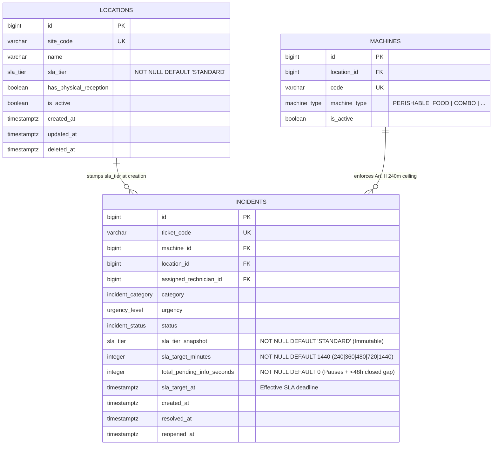

# ESPECIFICACIÓN TÉCNICA Y CONTRATOS DE INTERFAZ: PERFILES DE SLA DIFERENCIADOS POR TIPO DE SEDE (MÓDULO 30)

**Proyecto:** Gestor de Incidencias de Vending (*VendGuard*)  
**Módulo:** 30 · Perfiles de SLA Diferenciados por Tipo de Sede (*Tiered SLA Contracts*)  
**Fase SDD:** Fase 2 · Diseño Técnico, Esquema Relacional, Fórmulas de Dominio y Contratos de API  
**Versión:** 1.0  
**Fecha:** Noviembre 2026  
**Basado en:** [`specs/30-tiered-sla-contracts/spec.md`](file:///C:/Users/Friki/.gemini/antigravity/scratch/gestor-incidencias-vending/specs/30-tiered-sla-contracts/spec.md) (v2.0 Aprobada) · [`specs/functional/tiered_sla_contracts_spec.md`](file:///C:/Users/Friki/.gemini/antigravity/scratch/gestor-incidencias-vending/specs/functional/tiered_sla_contracts_spec.md) · [`constitution.md`](file:///C:/Users/Friki/.gemini/antigravity/scratch/gestor-incidencias-vending/constitution.md)  

---

## 1. Modelo de Datos Relacional (PostgreSQL 16+ / Supabase)

El módulo extiende las tablas maestras `locations` (Tabla 1) e `incidents` (Tabla 4) mediante la migración incremental `database/supabase_migrations/026_tiered_sla_contracts.sql` y su reflejo íntegro en `database/supabase_init.sql` (Contrato de Correspondencia de Esquema):
* **`locations.sla_tier`**: Nivel contractual vigente asignado a la ubicación (`STANDARD` por defecto).
* **`incidents.sla_tier_snapshot`**: Instantánea histórica inmutable del nivel de servicio vigente en la sede en el instante de apertura del aviso (`Art. III.3`, `D2`, `C1`).
* **`incidents.sla_target_minutes`**: Plazo objetivo de resolución en minutos naturales continuos (`240`, `360`, `480`, `720` o `1440`) sellado al nacer el aviso y recalculable únicamente hacia un valor más estricto ante un cambio de prioridad en triaje o una absorción QR que eleve la criticidad o revele fallo térmico (`C4`, `QA 1`).
* **`incidents.sla_target_at`**: Marca temporal anclada (`TIMESTAMPTZ`) del vencimiento efectivo del SLA (`created_at + sla_target_minutes + total_pending_info_seconds`), que avanza únicamente al descontar pausas imputables a la sede (`PENDING_INFO`) y el intervalo en que el aviso permaneció cerrado antes de una reapertura en garantía (`< 48 h`) sin reiniciar el reloj (`C2`, `QA 3`, `Art. V.6`).

### 1.1. Diagrama Entidad-Relación del Subsistema (Mermaid)



### 1.2. Nuevo Tipo Enumerado Nativo PostgreSQL (`sla_tier`)

Se incorpora el tipo nativo número 25 del esquema en `database/supabase_init.sql` y en `database/supabase_migrations/026_tiered_sla_contracts.sql`:

```sql
DO $$
BEGIN
    IF NOT EXISTS (SELECT 1 FROM pg_type WHERE typname = 'sla_tier') THEN
        CREATE TYPE sla_tier AS ENUM (
            'STANDARD',
            'PRIORITY_CORPORATE',
            'CRITICAL_INFRASTRUCTURE_24_7'
        );
    END IF;
END
$$;
```

### 1.3. Especificación DDL de Alteraciones, Restricciones, Disparadores y Migración Histórica (`026_tiered_sla_contracts.sql`)

```sql
-- ============================================================================
-- MIGRACIÓN 026: PERFILES DE SLA DIFERENCIADOS POR TIPO DE SEDE (MÓDULO 30)
-- ============================================================================

-- 1. Tipo enumerado nativo para el perfil contractual de SLA
DO $$
BEGIN
    IF NOT EXISTS (SELECT 1 FROM pg_type WHERE typname = 'sla_tier') THEN
        CREATE TYPE sla_tier AS ENUM (
            'STANDARD',
            'PRIORITY_CORPORATE',
            'CRITICAL_INFRASTRUCTURE_24_7'
        );
    END IF;
END
$$;

-- 2. Columna contractual vigente en locations (RF-02, EARS 02.1, C5)
ALTER TABLE locations
    ADD COLUMN IF NOT EXISTS sla_tier sla_tier NOT NULL DEFAULT 'STANDARD';

CREATE INDEX IF NOT EXISTS idx_locations_sla_tier
    ON locations (sla_tier)
    WHERE deleted_at IS NULL;

-- 3. Columnas de instantánea contractual en incidents (RF-03, EARS 03.1, C1, C5)
ALTER TABLE incidents
    ADD COLUMN IF NOT EXISTS sla_tier_snapshot sla_tier NOT NULL DEFAULT 'STANDARD',
    ADD COLUMN IF NOT EXISTS sla_target_minutes INTEGER NOT NULL DEFAULT 1440;

ALTER TABLE incidents
    DROP CONSTRAINT IF EXISTS chk_incidents_sla_target_minutes;

ALTER TABLE incidents
    ADD CONSTRAINT chk_incidents_sla_target_minutes
    CHECK (sla_target_minutes IN (240, 360, 480, 720, 1440));

CREATE INDEX IF NOT EXISTS idx_incidents_sla_target_lookup
    ON incidents (status, sla_target_at, sla_target_minutes)
    WHERE deleted_at IS NULL;

-- 4. Backfill determinista de expedientes preexistentes (C5, EARS 03.2, Art. III.3)
-- 4.a Expedientes cerrados/resueltos/cancelados: sellan su umbral histórico original
--     (240 min en riesgo alimentario perecedero/combo frío o crítico; 1440 min en el resto)
--     para que ningún informe histórico de MTTR o brechas cambie retroactivamente.
UPDATE incidents i
SET
    sla_tier_snapshot = 'STANDARD',
    sla_target_minutes = CASE
        WHEN m.machine_type = 'PERISHABLE_FOOD' THEN 240
        WHEN m.machine_type = 'COMBO'
             AND (i.category = 'TEMPERATURE_COLD' OR i.urgency = 'CRITICAL') THEN 240
        ELSE 1440
    END,
    sla_target_at = COALESCE(
        i.sla_target_at,
        i.created_at
            + make_interval(mins => CASE
                WHEN m.machine_type = 'PERISHABLE_FOOD' THEN 240
                WHEN m.machine_type = 'COMBO'
                     AND (i.category = 'TEMPERATURE_COLD' OR i.urgency = 'CRITICAL') THEN 240
                ELSE 1440
              END)
            + make_interval(secs => COALESCE(i.total_pending_info_seconds, 0))
    )
FROM machines m
WHERE i.machine_id = m.id
  AND i.status IN ('RESOLVED', 'CLOSED', 'CANCELLED');

-- 4.b Expedientes abiertos/activos en el momento de la migración: sellan la matriz RF-01
--     bajo el perfil vigente de su sede ('STANDARD' por defecto tras la migración).
UPDATE incidents i
SET
    sla_tier_snapshot = COALESCE(l.sla_tier, 'STANDARD'),
    sla_target_minutes = CASE
        WHEN m.machine_type = 'PERISHABLE_FOOD' THEN 240
        WHEN m.machine_type = 'COMBO'
             AND (i.category = 'TEMPERATURE_COLD' OR i.urgency = 'CRITICAL') THEN 240
        WHEN COALESCE(l.sla_tier, 'STANDARD') = 'CRITICAL_INFRASTRUCTURE_24_7' THEN
            CASE WHEN i.urgency IN ('CRITICAL', 'HIGH') THEN 240 ELSE 480 END
        WHEN COALESCE(l.sla_tier, 'STANDARD') = 'PRIORITY_CORPORATE' THEN
            CASE
                WHEN i.urgency = 'CRITICAL' THEN 360
                WHEN i.urgency = 'HIGH' THEN 480
                ELSE 720
            END
        ELSE
            CASE
                WHEN i.urgency = 'CRITICAL' THEN 480
                WHEN i.urgency = 'HIGH' THEN 720
                ELSE 1440
            END
    END,
    sla_target_at = i.created_at
        + make_interval(mins => CASE
            WHEN m.machine_type = 'PERISHABLE_FOOD' THEN 240
            WHEN m.machine_type = 'COMBO'
                 AND (i.category = 'TEMPERATURE_COLD' OR i.urgency = 'CRITICAL') THEN 240
            WHEN COALESCE(l.sla_tier, 'STANDARD') = 'CRITICAL_INFRASTRUCTURE_24_7' THEN
                CASE WHEN i.urgency IN ('CRITICAL', 'HIGH') THEN 240 ELSE 480 END
            WHEN COALESCE(l.sla_tier, 'STANDARD') = 'PRIORITY_CORPORATE' THEN
                CASE
                    WHEN i.urgency = 'CRITICAL' THEN 360
                    WHEN i.urgency = 'HIGH' THEN 480
                    ELSE 720
                END
            ELSE
                CASE
                    WHEN i.urgency = 'CRITICAL' THEN 480
                    WHEN i.urgency = 'HIGH' THEN 720
                    ELSE 1440
                END
          END)
        + make_interval(secs => COALESCE(i.total_pending_info_seconds, 0))
FROM machines m
LEFT JOIN locations l ON i.location_id = l.id
WHERE i.machine_id = m.id
  AND i.status NOT IN ('RESOLVED', 'CLOSED', 'CANCELLED');

-- 5. Blindaje de inmutabilidad de sla_tier_snapshot tras el alta (Art. III.3, D2, C1)
CREATE OR REPLACE FUNCTION trg_fn_incidents_protect_sla_tier_snapshot()
RETURNS TRIGGER
LANGUAGE plpgsql
AS $$
BEGIN
    IF OLD.sla_tier_snapshot IS DISTINCT FROM NEW.sla_tier_snapshot THEN
        RAISE EXCEPTION 'IMMUTABLE_SLA_TIER_SNAPSHOT: incidents.sla_tier_snapshot cannot be modified after incident creation (Art. III.3).'
            USING ERRCODE = '23514';
    END IF;
    RETURN NEW;
END;
$$;

DROP TRIGGER IF EXISTS trg_incidents_protect_sla_tier_snapshot ON incidents;
CREATE TRIGGER trg_incidents_protect_sla_tier_snapshot
    BEFORE UPDATE ON incidents
    FOR EACH ROW
    EXECUTE FUNCTION trg_fn_incidents_protect_sla_tier_snapshot();
```

---

## 2. Catálogo de Enumerados, Matriz de Dominio y Fórmulas Deterministas

### 2.1. Value Object `SlaTier` (`src/Core/Domain/ValueObject/SlaTier.php`)

```php
<?php

declare(strict_types=1);

namespace VendGuard\Core\Domain\ValueObject;

use InvalidArgumentException;

enum SlaTier: string
{
    case STANDARD = 'STANDARD';
    case PRIORITY_CORPORATE = 'PRIORITY_CORPORATE';
    case CRITICAL_INFRASTRUCTURE_24_7 = 'CRITICAL_INFRASTRUCTURE_24_7';

    public function label(): string
    {
        return match ($this) {
            self::STANDARD => 'Estándar',
            self::PRIORITY_CORPORATE => 'Prioritario Corporativo',
            self::CRITICAL_INFRASTRUCTURE_24_7 => 'Infraestructura Crítica 24x7',
        };
    }

    /**
     * Nominal reference SLA target hours for the location breakdown table (RF-06 / EARS 06.3).
     */
    public function nominalReferenceHours(): float
    {
        return match ($this) {
            self::STANDARD => 24.0,
            self::PRIORITY_CORPORATE => 12.0,
            self::CRITICAL_INFRASTRUCTURE_24_7 => 8.0,
        };
    }

    /**
     * Resolves contractual target minutes for a non-cold-chain incident (RF-01 / EARS 01.1).
     */
    public function contractualTargetMinutes(UrgencyLevel $urgency): int
    {
        return match ($this) {
            self::STANDARD => match ($urgency) {
                UrgencyLevel::CRITICAL => 480,
                UrgencyLevel::HIGH => 720,
                UrgencyLevel::MEDIUM, UrgencyLevel::LOW => 1440,
            },
            self::PRIORITY_CORPORATE => match ($urgency) {
                UrgencyLevel::CRITICAL => 360,
                UrgencyLevel::HIGH => 480,
                UrgencyLevel::MEDIUM, UrgencyLevel::LOW => 720,
            },
            self::CRITICAL_INFRASTRUCTURE_24_7 => match ($urgency) {
                UrgencyLevel::CRITICAL, UrgencyLevel::HIGH => 240,
                UrgencyLevel::MEDIUM, UrgencyLevel::LOW => 480,
            },
        };
    }

    public static function isValid(string $value): bool
    {
        return self::tryFrom(strtoupper(trim($value))) !== null;
    }

    public static function fromString(string $value): self
    {
        $normalized = strtoupper(trim($value));
        $tier = self::tryFrom($normalized);
        if ($tier === null) {
            throw new InvalidArgumentException("Nivel de SLA no válido: '{$value}'.");
        }

        return $tier;
    }
}
```

### 2.2. Servicio de Dominio `SlaTargetCalculator` (`src/Core/Service/SlaTargetCalculator.php`)

Centraliza la resolución determinista del objetivo de SLA y la identificación de riesgo alimentario de cadena de frío (`RF-01`, `D1`, `QA 1`, `Art. II`):

| Condición de Máquina / Avería | ¿Riesgo Alimentario Cadena de Frío (`isColdChainRisk`)? | `STANDARD` (`Estándar`) | `PRIORITY_CORPORATE` (`Prioritario Corporativo`) | `CRITICAL_INFRASTRUCTURE_24_7` (`Infraestructura Crítica 24x7`) |
| :--- | :---: | :---: | :---: | :---: |
| **`PERISHABLE_FOOD`** (cualquier categoría o prioridad) | `true` | **`240` min (`4,0 h`)** | **`240` min (`4,0 h`)** | **`240` min (`4,0 h`)** |
| **`COMBO`** con `category = TEMPERATURE_COLD` o `urgency = CRITICAL` | `true` | **`240` min (`4,0 h`)** | **`240` min (`4,0 h`)** | **`240` min (`4,0 h`)** |
| Resto de máquinas (`COLD_DRINK`, `HOT_DRINK`, `SNACK`, `WATER`, o `COMBO` sin fallo térmico ni prioridad crítica) · Prioridad **`CRITICAL`** | `false` | **`480` min (`8,0 h`)** | **`360` min (`6,0 h`)** | **`240` min (`4,0 h`)** |
| Resto de máquinas sin riesgo de frío · Prioridad **`HIGH`** | `false` | **`720` min (`12,0 h`)** | **`480` min (`8,0 h`)** | **`240` min (`4,0 h`)** |
| Resto de máquinas sin riesgo de frío · Prioridad **`MEDIUM`** | `false` | **`1440` min (`24,0 h`)** | **`720` min (`12,0 h`)** | **`480` min (`8,0 h`)** |
| Resto de máquinas sin riesgo de frío · Prioridad **`LOW`** | `false` | **`1440` min (`24,0 h`)** | **`720` min (`12,0 h`)** | **`480` min (`8,0 h`)** |

#### Contrato de firma de `SlaTargetCalculator`:

```php
<?php

declare(strict_types=1);

namespace VendGuard\Core\Service;

use DateTimeImmutable;
use VendGuard\Core\Domain\ValueObject\IncidentCategory;
use VendGuard\Core\Domain\ValueObject\MachineType;
use VendGuard\Core\Domain\ValueObject\SlaTier;
use VendGuard\Core\Domain\ValueObject\UrgencyLevel;

final class SlaTargetCalculator
{
    public const COLD_CHAIN_CEILING_MINUTES = 240;

    /**
     * Determines whether an incident is governed by the unnegotiable Art. II cold-chain ceiling.
     */
    public static function isColdChainRisk(
        MachineType $machineType,
        IncidentCategory $category,
        UrgencyLevel $urgency
    ): bool {
        if ($machineType === MachineType::PERISHABLE_FOOD) {
            return true;
        }

        if ($machineType === MachineType::COMBO
            && ($category === IncidentCategory::TEMPERATURE_COLD || $urgency === UrgencyLevel::CRITICAL)
        ) {
            return true;
        }

        return false;
    }

    /**
     * Calculates the target resolution minutes (RF-01 / EARS 01.1, 01.2, 01.3).
     */
    public static function calculateTargetMinutes(
        SlaTier $slaTier,
        MachineType $machineType,
        IncidentCategory $category,
        UrgencyLevel $urgency
    ): int {
        if (self::isColdChainRisk($machineType, $category, $urgency)) {
            return self::COLD_CHAIN_CEILING_MINUTES;
        }

        return $slaTier->contractualTargetMinutes($urgency);
    }

    /**
     * Computes the anchored effective SLA deadline from creation timestamp,
     * target minutes, and accumulated discountable seconds (C2, C4, QA 3).
     */
    public static function computeEffectiveTargetAt(
        DateTimeImmutable $createdAt,
        int $slaTargetMinutes,
        int $totalDiscountableSeconds = 0
    ): DateTimeImmutable {
        $totalSeconds = ($slaTargetMinutes * 60) + max(0, $totalDiscountableSeconds);

        return $createdAt->modify("+{$totalSeconds} seconds");
    }
}
```

### 2.3. Fórmulas de Vencimiento Efectivo, Pausa Imputable a Sede y Reapertura en Garantía (`C2`, `C4`, `QA 1`, `QA 3`, `Art. V.6`)

1. **Inicialización al abrir el expediente (`QrReportService`, `CoordinatorController::createIncident`, `LocationPortalController::reportIncident`, `OpportunisticInterventionService`):**
   * `sla_tier_snapshot = $location->getSlaTier()`
   * `sla_target_minutes = SlaTargetCalculator::calculateTargetMinutes($slaTierSnapshot, $machine->getMachineType(), $category, $urgency)`
   * `sla_target_at = SlaTargetCalculator::computeEffectiveTargetAt($createdAt, $slaTargetMinutes, 0)`
2. **Desplazamiento al reanudar pausa imputable a la sede (`PENDING_INFO` → `IncidentPauseService::resumeIncident`):**
   * Al cerrar la pausa, `total_pending_info_seconds` incrementa en `pauseDurationSeconds = max(0, resumed_at - paused_at)`.
   * Para expedientes **sin riesgo alimentario de cadena de frío**, `sla_target_at` se recalcula como:
     $$\text{sla\_target\_at} = \text{created\_at} + (\text{sla\_target\_minutes} \times 60) + \text{total\_pending\_info\_seconds}$$
   * Para expedientes **con riesgo alimentario de cadena de frío** (`Art. II`), el reloj biológico de seguridad alimentaria es continuo (240 min desde `created_at` para vigilancia sanitaria), mientras que el desplazamiento comercial de pausa sólo aplica según las reglas de `IncidentPauseService`.
3. **Descuento del intervalo cerrado ante Reapertura en Garantía `< 48 h` (`PdoIncidentRepository::reopenWithLifecycleNotifications`, `QA 3`, `Art. V.6`):**
   * Cuando un expediente en estado `RESOLVED` se reabre dentro de la ventana de 48 horas, **NO se reinicia el reloj de SLA a cero**.
   * El intervalo en que permaneció cerrado esperando verificación de la sede se calcula como:
     $$\Delta t_{\text{closed}} = \max(0, \text{reopened\_at} - \text{resolved\_at})$$
   * Dicho intervalo $\Delta t_{\text{closed}}$ se suma a `total_pending_info_seconds` y desplaza `sla_target_at` en $+\Delta t_{\text{closed}}$ segundos. De este modo, tanto el vencimiento vivo en ruta (`sla_target_at`) como el cálculo neto de MTTR y brechas en `PdoMetricsRepository` (`GREATEST(0, (resolved_at - created_at) - total_pending_info_seconds)`) descuentan automáticamente el tiempo que el aviso estuvo cerrado sin intervención pendiente.
4. **Recálculo por Cambio de Prioridad en Triaje (`PdoIncidentRepository::assign`) o Absorción QR (`QrReportService::mergeIntoExistingIncident`, `C4`, `QA 1`):**
   * **En Triaje (`assign` con `urgencyOverride`):** Si el Coordinador modifica la prioridad (`urgencyChanged === true`), se recalcula `newTargetMinutes = SlaTargetCalculator::calculateTargetMinutes($incident->getSlaTierSnapshot(), $machineType, $incident->getCategory(), $newUrgency)` manteniendo inalterado `sla_tier_snapshot` y recalculando `sla_target_at = created_at + (newTargetMinutes * 60) + total_pending_info_seconds`, anotando en `incident_history` y `audit_log` tanto el cambio de prioridad como el ajuste de minutos objetivo.
   * **En Absorción QR (`mergeIntoExistingIncident`):** Cuando se absorbe un reporte QR sobre un aviso activo, se evalúa la categoría y urgencia entrantes (`incomingCategory`, `incomingUrgency = UrgencyCalculator::calculate($machine->getMachineType(), $incomingCategory)`). Si el reporte absorbido implica un objetivo más estricto (`incomingTargetMinutes < $incident->getSlaTargetMinutes()`) o una urgencia superior (por ejemplo, una máquina `COMBO` con un aviso abierto por `PAYMENT_FAILURE` que recibe un segundo reporte QR por `TEMPERATURE_COLD`), el expediente activo actualiza inmediatamente su `urgency` a la más crítica, reduce `sla_target_minutes` a `incomingTargetMinutes` (`240` min en fallo de frío) y recalcula `sla_target_at` respecto a su `created_at` original, registrando el evento en `incident_history`.

---

## 3. Contratos de Dominio y Servicios Internos (Ruta, Recomendador y Métricas)

### 3.1. Motor de Priorización de Hoja de Ruta (`RouteOptimizationService` & `TechnicianRouteMapController`)

Cumple con `RF-04` (`EARS 04.1`–`04.4`), `D3`, `C2`, `C3`, `QA 1` y `Art. II.2`:

1. **Vencimiento Efectivo de cada Aviso (`sla_due_at`):**
   * Todo aviso correctivo devuelve su `sla_due_at` a partir de `incident->getSlaTargetAt()` (o `created_at + (sla_target_minutes * 60) + total_pending_info_seconds` como respaldo determinista si no estuviera hidratado).
   * Si el aviso se encuentra actualmente en pausa (`status === 'PENDING_INFO'`), el tiempo restante hacia el vencimiento se evalúa congelado en el instante `paused_at` (`remaining_seconds = sla_due_at - paused_at`). En cualquier otro estado pendiente (`ASSIGNED`, `IN_PROGRESS`, `PENDING_PARTS`, `REOPENED`), se evalúa frente al instante de referencia actual (`remaining_seconds = sla_due_at - now`).
2. **Promoción a `StopPriority::CRITICAL` por Ventana de Vencimiento `<= 4,0 h` (`<= 240 minutos` / `<= 14400 segundos`):**
   * Una parada pendiente recibe `StopPriority::CRITICAL` si al menos una tarea correctiva pendiente en esa sede cumple **cualquiera** de estas dos condiciones:
     * **Riesgo alimentario de cadena de frío (`is_cold_chain_critical = true`):** `SlaTargetCalculator::isColdChainRisk($machineType, $category, $urgency)` es `true` (o `urgency === CRITICAL` en máquina refrigerada).
     * **Urgencia contractual por ventana `<= 4,0 h` (`is_contractual_critical = true`):** `remaining_seconds <= 14400` (`240 * 60`, límite **inclusivo**, por lo que un aviso con objetivo de `240` min nace en $t = 0$ con `remaining_seconds = 14400` y entra inmediatamente en `StopPriority::CRITICAL`).
3. **Prelación Sanitaria dentro de `StopPriority::CRITICAL` (`QA 1`, `Art. II.2`):**
   * Dentro del bloque `StopPriority::CRITICAL`, las paradas se ordenan mediante la tupla determinista:
     1. `cold_chain_rank`: `0` si la parada contiene al menos un aviso con riesgo alimentario de cadena de frío (`is_cold_chain_critical = true`); `1` si su promoción a `CRITICAL` es puramente contractual (`is_contractual_critical = true` sin riesgo alimentario).
     2. `earliest_sla_due_at ASC` (el vencimiento efectivo más próximo de sus tareas correctivas críticas).
     3. `oldest_created_at ASC` (el aviso más antiguo en caso de empate en el segundo exacto de vencimiento).
     4. `location_id ASC` (desempate determinista final).
4. **Sedes Multi-Tarea (`C3`, `EARS 04.4`):**
   * Cuando una sede agrupa varios avisos correctivos y/u órdenes preventivas en la misma parada (`RouteStop`), la prioridad, el sub-rango sanitario y el `sla_due_at` de la parada vienen gobernados exclusivamente por la **tarea correctiva pendiente con menor tiempo restante de SLA** (con prelación sanitaria si alguna tiene riesgo alimentario). Las órdenes de mantenimiento preventivo nunca degradan ni retrasan el SLA correctivo.

### 3.2. Recomendador de Asignación y Puntuador de Carga (`TechnicianAssignmentSuggester` & `TechnicianWorkloadScorer`)

Cumple con `RF-05` (`EARS 05.1`–`05.4`), `D4`, `QA 2` y `Art. II`:

1. **Jerarquía de Escalados a Guardia 24/7 (`is_on_call = true`):**
   * **Nivel 1 — Escalado Sanitario de Cadena de Frío (`Art. II`, existente):**
     * Aplica cuando el aviso tiene riesgo de cadena de frío (`PERISHABLE_FOOD` o `COMBO` con fallo térmico/crítico) y no hay técnico titular o suplente activo en turno con `< 2` paradas críticas de frío.
     * Otorga **`+100 puntos`** (`on_call_cold_bonus = 100`) y etiqueta `"Guardia 24/7 por cadena de frío"`.
   * **Nivel 2 — Escalado Contractual 24/7 (`RF-05`, `D4`, `QA 2`, nuevo):**
     * Aplica únicamente cuando **NO** está activo el escalado sanitario de Nivel 1 y la sede del aviso tiene perfil `CRITICAL_INFRASTRUCTURE_24_7` (según `incident->getSlaTierSnapshot()`) y se cumple **alguna** de las dos condiciones siguientes:
       * **Condición A (Sin cobertura de zona en turno):** Ningún técnico activo (`PRIMARY` o `BACKUP`) asignado a la zona de la sede se encuentra con turno iniciado (`ON_SHIFT`) y sin ausencia activa (para cualquier prioridad del aviso: `CRITICAL`, `HIGH`, `MEDIUM` o `LOW`).
       * **Condición B (Objetivo `<= 240 min` sin efectivo libre en zona):** El aviso tiene `sla_target_minutes <= 240` (prioridades `CRITICAL` o `HIGH` en sede `CRITICAL_INFRASTRUCTURE_24_7`) y ningún técnico activo (`PRIMARY` o `BACKUP`) de la zona en estado `ON_SHIFT` tiene **`0` paradas vivas** (`active_incidents + preventive_orders_today === 0`). *(Nota `QA 2`: Si un técnico `BACKUP` de la zona está `ON_SHIFT` con `0` paradas vivas, asume el aviso sin despertar al técnico de guardia fuera de turno).*
     * Cuando el Escalado Contractual 24/7 se activa:
       * Habilita como candidatos elegibles a los técnicos activos y no ausentes con `is_on_call = true` aunque su `shift_status` sea `OFF_SHIFT`.
       * Otorga un bono de **`+60 puntos`** en la clave `contractual_24_7_on_call_bonus` del desglose `score_breakdown`.
       * Posiciona al técnico de guardia 24/7 en primer lugar del ranking con `selection_reason = "Escalado contractual 24/7"` y activa la bandera de lote `contractual_24_7_escalation_active = true`.
   * **Respaldo sin Guardia 24/7 disponible (`QA 2`, `EARS 05.3`):**
     * Si las condiciones del Escalado Contractual 24/7 se cumplen pero no existe ningún técnico con `is_on_call = true` activo y sin ausencia registrada, el recomendador devuelve `contractual_24_7_escalation_active = true`, `on_call_available = false` y ordena a los técnicos activos disponibles por **menor carga viva total** (`active_incidents + preventive_orders_today ASC`) y, en caso de empate, por **menor distancia geográfica Haversine** (`distance_km ASC`) a la sede.
2. **Umbral de Saturación para Objetivos Exigentes (`sla_target_minutes <= 480`, `EARS 05.4`):**
   * Cuando no aplica escalado a guardia 24/7, el aviso tiene `sla_target_minutes <= 480` (hasta 8,0 h) y todos los técnicos `PRIMARY`/`BACKUP` de la zona en turno (`ON_SHIFT`) acumulan **`>= 3` paradas vivas** (`active_incidents + preventive_orders_today >= 3`), o empatan en puntuación base, el recomendador ordena a los candidatos `ON_SHIFT` priorizando estrictamente la **menor carga viva** (`live_stops ASC`) y desempatando por **menor distancia geográfica Haversine** (`distance_km ASC`).

### 3.3. Analítica, Cumplimiento Real Ticket a Ticket y Exportación CSV (`MetricsCalculationService`, `PdoMetricsRepository` & `MetricsExportService`)

Cumple con `RF-06` (`EARS 06.1`–`06.4`), `D2`, `D6`, `C5`, `QA 3`:

1. **Evaluación de Brechas de SLA (`countCriticalSlaBreaches` y conteo por sede):**
   * Un expediente resuelto (`status IN ('RESOLVED', 'CLOSED')` con `resolved_at IS NOT NULL`) constituye una **brecha de SLA** si y solo si:
     $$\max\bigl(0,\; (\text{resolved\_at} - \text{created\_at}) - \text{total\_pending\_info\_seconds}\bigr) > \text{effective\_sla\_target\_seconds}$$
   * Donde `effective_sla_target_seconds` es:
     * `240 * 60` (`14400` s) si `m.machine_type = 'PERISHABLE_FOOD'` o (`m.machine_type = 'COMBO'` y (`i.category = 'TEMPERATURE_COLD'` o `i.urgency = 'CRITICAL'`)) — blindaje innegociable Art. II.
     * `i.sla_target_minutes * 60` en el resto de expedientes (leído de la columna sellada en la propia fila de `incidents`, nunca recalculado con el `locations.sla_tier` actual).
2. **Estructura de `by_location` en `GET /api/coordinator/metrics/breakdown`:**
   * Cada elemento de `data.by_location` incluye:
     * `location_id` (`int`)
     * `site_code` (`string`)
     * `location_name` (`string`)
     * `sla_tier` (`string`: `'STANDARD' | 'PRIORITY_CORPORATE' | 'CRITICAL_INFRASTRUCTURE_24_7'`) — perfil vigente de la sede.
     * `sla_tier_label` (`string`: `'Estándar' | 'Prioritario Corporativo' | 'Infraestructura Crítica 24x7'`)
     * `sla_target_hours` (`float`: `24.0 | 12.0 | 8.0`) — horas nominales de referencia del perfil vigente de la sede.
     * `total_incidents` (`int`)
     * `tickets_resolved` (`int`)
     * `mttr_hours` (`float|null`)
     * `sla_breaches` (`int`) — número de expedientes resueltos en el período que superaron su `sla_target_minutes` individual sellado.
     * `sla_status` (`string`: `'COMPLIANT' | 'BREACHED' | 'NO_DATA'`):
       * `'NO_DATA'` cuando `tickets_resolved === 0`.
       * `'BREACHED'` cuando `tickets_resolved > 0` y (`sla_breaches >= 1` o `mttr_hours > sla_target_hours`).
       * `'COMPLIANT'` cuando `tickets_resolved > 0`, `sla_breaches === 0` y `mttr_hours <= sla_target_hours`.
3. **Exportación CSV (`MetricsExportService` — `GET /api/coordinator/metrics/export?type=by_location`):**
   * Cabeceras exactas en español para la sección/descarga por sede:
     `Código Sede;Nombre Sede;Nivel SLA; Incidentes Totales;Tickets Resueltos;MTTR (Horas);Objetivo SLA (Horas);Brechas SLA;Estado SLA` (manteniendo compatibilidad con el delimitador CSV del servicio).

---

## 4. Contratos de Endpoints REST y Segregación de Privacidad (Art. V.4)

### 4.1. Administración de Sedes (`CoordinatorAdminController` / `AdminLocationService`)

#### `GET /api/coordinator/locations`
Devuelve el listado de sedes incluyendo `sla_tier` y `sla_tier_label`:
```json
{
  "status": "success",
  "data": [
    {
      "id": 1,
      "site_code": "HOS-CENTRAL-01",
      "name": "Hospital Universitario Central",
      "address": "Av. de la Salud 12, Madrid",
      "contact_name": "Elena Gómez",
      "contact_phone": "+34 910 000 111",
      "contact_email": "mantenimiento@hoscentral.es",
      "has_physical_reception": true,
      "sla_tier": "CRITICAL_INFRASTRUCTURE_24_7",
      "sla_tier_label": "Infraestructura Crítica 24x7",
      "latitude": 40.4168,
      "longitude": -3.7038,
      "is_active": true,
      "machines_count": 6
    }
  ]
}
```

#### `POST /api/coordinator/locations` y `PUT|PATCH /api/coordinator/locations/{id}`
* **Payload de entrada (campos relevantes):**
  ```json
  {
    "site_code": "CORP-TORRE-02",
    "name": "Torre Financiera Norte",
    "address": "Paseo de la Castellana 200",
    "has_physical_reception": true,
    "sla_tier": "PRIORITY_CORPORATE"
  }
  ```
* **Reglas de validación y auditoría (`RF-02`, `EARS 02.1`–`02.5`, `C1`, `QA 4`):**
  1. En `POST /api/coordinator/locations`, si `sla_tier` se omite o es `null`/`""`, se asigna `'STANDARD'` por defecto.
  2. Si `sla_tier` contiene un valor distinto de `'STANDARD'`, `'PRIORITY_CORPORATE'` o `'CRITICAL_INFRASTRUCTURE_24_7'`, responde **HTTP `422 Unprocessable Entity`** con `error: "INVALID_SLA_TIER"`.
  3. En `PUT|PATCH /api/coordinator/locations/{id}`, si `sla_tier` no se envía en el payload, se conserva el `sla_tier` actual de la sede.
  4. **Idempotencia de auditoría (`QA 4`):** Solo cuando `newLocation->getSlaTier() !== oldLocation->getSlaTier()` se incluye el cambio contractual en el detalle de auditoría (`LOCATION_UPDATED` con `previous_state.sla_tier` y `new_state.sla_tier`). Si el coordinador guarda el formulario manteniendo el mismo `sla_tier`, no se emite ningún evento ni marca de cambio de SLA. Un cambio en `locations.sla_tier` jamás modifica `sla_tier_snapshot` ni `sla_target_minutes` de las incidencias ya existentes (`C1`).

### 4.2. Bandeja de Triaje, Detalle de Incidencia y Asignación (`CoordinatorController`)

#### `POST /api/coordinator/incidents`
Alta de un aviso desde Coordinación, reservada al rol `COORDINATOR`. A diferencia del Portal, exige `machine_id` y deriva la urgencia de la matriz máquina/categoría; no acepta una urgencia ni un perfil de sede impuestos por el cliente.
```json
{
  "machine_id": 42,
  "category": "PAYMENT_SYSTEM",
  "description": "El datáfono de la máquina no acepta tarjetas.",
  "reporter_name": "Coordinación"
}
```
* **Sellado (EARS 02.1.1):** en una sola transacción persiste `sla_tier_snapshot` con el perfil vigente de la sede, `sla_target_minutes` con el objetivo de la matriz RF-01 y `sla_target_at = created_at + (sla_target_minutes * 60)`; la urgencia se calcula con `UrgencyCalculator` y no puede rebajar el techo de 240 min si hay riesgo de cadena de frío.
* **Respuesta `201 Created`:** devuelve el expediente con `id`, `ticket_code`, `machine_id`, `location_id`, `category`, `urgency`, `status`, `sla_tier_snapshot`, `sla_target_minutes` y `sla_target_at`, más `machine_code`, `machine_model`, `machine_type`, `location_site_code` y `location_name`.
* **Errores:** `400` por `machine_id`, `category` o `description` inválidos; `404 MACHINE_NOT_FOUND`; `422 MACHINE_INACTIVE` / `LOCATION_INACTIVE`; `409 MACHINE_HAS_ACTIVE_INCIDENT` con `ticket_code` y `ticket_status`; `401`/`403` los aplica el middleware de Coordinación.

#### `GET /api/coordinator/incidents` y `GET /api/coordinator/incidents/{id}`
Cada objeto de incidencia para el rol `COORDINATOR` expone el contrato sellado en el expediente:
```json
{
  "id": 142,
  "ticket_code": "TICK-2026-00142",
  "urgency": "HIGH",
  "urgency_label": "Alta",
  "sla_tier_snapshot": "CRITICAL_INFRASTRUCTURE_24_7",
  "sla_tier_label": "Infraestructura Crítica 24x7",
  "sla_target_minutes": 240,
  "sla_target_hours": 4.0,
  "sla_target_at": "2026-11-09T15:30:00+01:00",
  "is_cold_chain_risk": false
}
```

#### `PATCH /api/coordinator/incidents/{id}/assign`
* Si el coordinador incluye `urgency_override` cambiando la prioridad del aviso, el sistema recalcula `sla_target_minutes` cruzando `incident.sla_tier_snapshot` con la nueva prioridad (respetando el techo de `240` min si existe riesgo de cadena de frío) y actualiza `sla_target_at = created_at + (sla_target_minutes * 60) + total_pending_info_seconds`.

#### `GET /api/coordinator/incidents/{id}/suggested-technicians`
```json
{
  "status": "success",
  "data": {
    "incident_id": 142,
    "sla_tier_snapshot": "CRITICAL_INFRASTRUCTURE_24_7",
    "sla_tier_label": "Infraestructura Crítica 24x7",
    "sla_target_minutes": 240,
    "cold_chain_escalation_active": false,
    "contractual_24_7_escalation_active": true,
    "on_call_available": true,
    "candidates": [
      {
        "technician_id": 9,
        "name": "Marcos Guardia",
        "is_on_call": true,
        "shift_status": "OFF_SHIFT",
        "score": 95,
        "selection_reason": "Escalado contractual 24/7",
        "score_breakdown": {
          "zone_coverage": 0,
          "shift_availability": 0,
          "on_call_cold_bonus": 0,
          "contractual_24_7_on_call_bonus": 60,
          "workload_score": 35,
          "proximity_bonus": 0
        }
      }
    ]
  }
}
```

### 4.3. Ruta Móvil del Técnico y Paquete Offline (`TechnicianRouteMapController` & `TechnicianOfflineSyncController`)

#### `GET /api/technician/route/map`, `GET /api/technician/incidents` y `GET /api/technician/offline/bootstrap`
Cada parada (`stops[]`) y cada tarea correctiva (`tasks[]` / `incidents[]`) expone:
```json
{
  "stop_order": 1,
  "priority": "CRITICAL",
  "priority_label": "Crítica (Urgente <= 4h)",
  "critical_reason": "CONTRACTUAL_SLA",
  "is_cold_chain_critical": false,
  "is_contractual_critical": true,
  "sla_tier": "CRITICAL_INFRASTRUCTURE_24_7",
  "sla_tier_label": "Infraestructura Crítica 24x7",
  "sla_due_at": "2026-11-09T15:30:00+01:00",
  "tasks": [
    {
      "type": "INCIDENT",
      "incident_id": 142,
      "ticket_code": "TICK-2026-00142",
      "sla_tier_snapshot": "CRITICAL_INFRASTRUCTURE_24_7",
      "sla_tier_label": "Infraestructura Crítica 24x7",
      "sla_target_minutes": 240,
      "sla_target_at": "2026-11-09T15:30:00+01:00",
      "is_cold_chain_risk": false
    }
  ]
}
```
* **Distinción visual obligatoria en UI (`RF-07`, `EARS 07.2`):**
  * `critical_reason === "COLD_CHAIN"` (`is_cold_chain_critical === true`): Insignia de riesgo sanitario de cadena de frío.
  * `critical_reason === "CONTRACTUAL_SLA"` (`is_cold_chain_critical === false && is_contractual_critical === true`): Insignia de urgencia contractual (`SLA <= 4h`).

### 4.4. Portal del Responsable de Ubicación (`LocationPortalController`)

#### `GET /api/locations/{site_code}/machines` y Detalle de Incidencia de su Sede
* El Responsable de Sede autenticado visualiza **únicamente para su propia ubicación** (`RF-07`, `EARS 07.3`, `Art. V.4`):
  * En el objeto `location`: `sla_tier` y `sla_tier_label`.
  * En cada incidencia activa o histórica de su sede: `sla_tier_snapshot`, `sla_tier_label`, `sla_target_minutes` y `sla_target_at`.
* Nunca tiene acceso al listado de otras sedes ni a la configuración administrativa de contratos.

### 4.5. Blindaje de Opacidad Pública y Documental (`Art. V.4`, `D5`, `QA 4`)

Queda **estrictamente prohibida** la inclusión de `sla_tier`, `sla_tier_label`, `sla_tier_snapshot`, `sla_target_minutes`, `sla_target_hours` o `sla_target_at` en:
1. **`GET /api/qr/scan/{code}`** y **`POST /api/qr/report`** (Canal público anónimo de consumidores por código QR).
2. **Albarán de Servicio A4 imprimible** (Módulo 19 — `ServiceReceiptModal.vue` / payload de albarán).
3. **Acta Oficial de Merma Alimentaria A4** (Módulo 29 — `SpoilageOfficialActPrintModal.vue` / `GET /api/coordinator/incidents/{id}/spoilage-record` sección de acta oficial).

---

## 5. Catálogo de Códigos de Error HTTP y Eventos de Auditoría

### 5.1. Códigos de Error HTTP

| Endpoint | Código HTTP | `error` Code | Condición de Disparo | Mensaje de Usuario (`message`) |
| :--- | :---: | :--- | :--- | :--- |
| `POST /api/coordinator/locations`<br>`PUT\|PATCH /api/coordinator/locations/{id}` | `422 Unprocessable Entity` | `INVALID_SLA_TIER` | El campo `sla_tier` no pertenece a `{'STANDARD', 'PRIORITY_CORPORATE', 'CRITICAL_INFRASTRUCTURE_24_7'}`. | `"El nivel de SLA indicado no es válido. Valores permitidos: Estándar (STANDARD), Prioritario Corporativo (PRIORITY_CORPORATE) o Infraestructura Crítica 24x7 (CRITICAL_INFRASTRUCTURE_24_7)."` |
| Capa de Persistencia (`incidents`) | `409 Conflict` / Excepción SQL `23514` | `IMMUTABLE_SLA_TIER_SNAPSHOT` | Intento de modificar `incidents.sla_tier_snapshot` tras la creación del expediente. | `"El nivel de SLA histórico sellado en el expediente es inmutable (Art. III.3)."` |

### 5.2. Eventos en `audit_log` e `incident_history` (Art. III)

1. **Alta de Sede (`LOCATION_CREATED` en `audit_log`):**
   * `new_state` incluye `"sla_tier": "STANDARD"` (o el nivel explícitamente seleccionado).
2. **Modificación de Sede (`LOCATION_UPDATED` en `audit_log`):**
   * Si `old.sla_tier !== new.sla_tier`, `previous_state.sla_tier` y `new_state.sla_tier` registran la transición contractual. Si `old.sla_tier === new.sla_tier`, no se genera evento espurio de cambio de contrato (`QA 4`).
3. **Recálculo de Objetivo de SLA por Cambio de Prioridad en Triaje o Absorción QR (`incident_history`):**
   * La nota de historial inmutable (`action_note`) deja constancia explícita del ajuste:
     `"Objetivo de SLA actualizado de {old_minutes} min a {new_minutes} min (Contrato sellado: {sla_tier_label}) tras cambio de prioridad a {new_urgency_label}."`
4. **Descuento de Intervalo Cerrado en Reapertura en Garantía `< 48 h` (`incident_history`):**
   * Al reabrir en garantía, la nota de historial o el rastro técnico conserva el intervalo cerrado descontado ($\Delta t_{\text{closed}}$ segundos acumulados en `total_pending_info_seconds`) sin reiniciar `created_at`.
