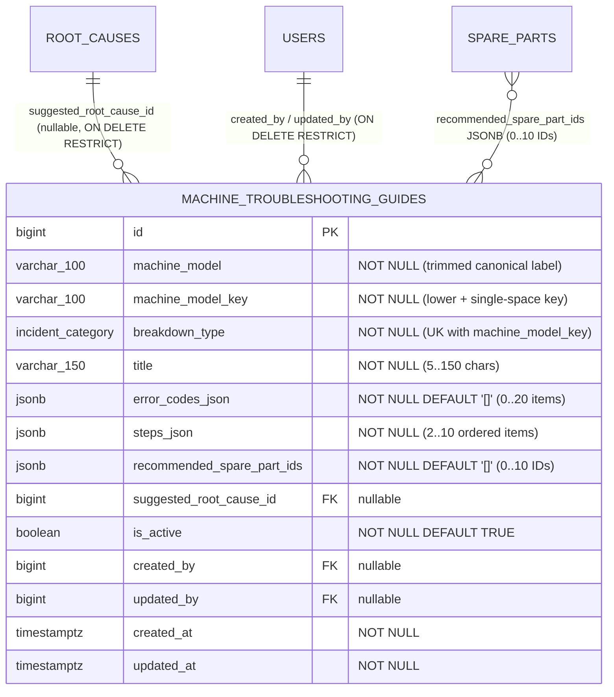

# ESPECIFICACIÓN TÉCNICA · CONTRATOS DE API, ESQUEMA RELACIONAL Y MODO OFFLINE
# GUÍAS RÁPIDAS DE DIAGNÓSTICO POR MODELO (MÓDULO 28)

**Proyecto:** Gestor de Incidencias de Vending (*VendGuard*)  
**Módulo:** `28-troubleshooting-guides`  
**Documento:** `specs/technical/troubleshooting_guides_contracts.md`  
**Referencia Funcional:** [`specs/28-troubleshooting-guides/spec.md`](../28-troubleshooting-guides/spec.md) y [`specs/functional/troubleshooting_guides_spec.md`](../functional/troubleshooting_guides_spec.md) (`RF-01` a `RF-05`, Decisiones `D1`–`D4`, Casos Límite `C1`–`C6`, Resoluciones `QA 1`–`QA 4`)  
**Protocolo:** HTTP/1.1 · JSON (`application/json; charset=utf-8`)  
**Metodología:** SDD (Specification-Driven Development) · Contratos API-First  
**Conformidad Constitucional:**
* **Art. I:** Supremacía de la especificación; semillas técnicas reales para los modelos del parque sin mocks en producción.
* **Art. II:** Ordenación canónica que sitúa `TEMPERATURE_COLD` en primer lugar en el conmutador de modelo (`QA 3`) e inyección automática de alerta sanitaria prioritaria (`sanitary_cold_warning = true`) cuando `breakdown_type === 'TEMPERATURE_COLD'` o la máquina es `PERISHABLE_FOOD` (`RF-01.3`).
* **Art. III.1, III.2 y III.3:** La Tabla 39 `machine_troubleshooting_guides` porta el disparador constitucional `trg_no_delete_machine_troubleshooting_guides` (`prevent_hard_delete()`) y el disparador de inmutabilidad de clave `trg_immutable_machine_troubleshooting_guides`. El ciclo de vida opera por baja lógica (`is_active`) y toda alta, edición o cambio de estado se audita en `audit_log` con `previous_state` y `new_state` bajo `audit_entity_type = 'MACHINE_TROUBLESHOOTING_GUIDE'`.
* **Art. IV:** PHP 8.2+ POO puro (`declare(strict_types=1);`), PostgreSQL 16+ (`pdo_pgsql`) y Vue 3 Composition API (ES Modules) con bloques estructurados interpolados de forma segura (cero `v-html` o librerías de Markdown).
* **Art. V.1:** Validación estricta de que la instrucción de cada paso (`steps[].instruction`) posea entre 20 y 500 caracteres significativos y al menos 3 bloques alfanuméricos reales, y prohibición absoluta de autorrellenar `diagnosis` o `action_taken` al pulsar *«Aplicar causa sugerida por la guía»*.
* **Art. V.4:** Segregación estricta de privacidad: las guías y el cruce de existencias en furgoneta omiten cualquier coste o precio ante el `TECHNICIAN`, el CRUD y los indicadores de cobertura son exclusivos de `COORDINATOR` (`403 FORBIDDEN` para otros roles), y el Portal de Sede / QR / Albarán A4 tienen opacidad absoluta.

---

## 1. Modelo de Datos Relacional (PostgreSQL 16+ / Supabase)

### 1.1. Diagrama Entidad-Relación (Mermaid ERD)



### 1.2. Ampliación de `audit_entity_type`

Se añade el valor `'MACHINE_TROUBLESHOOTING_GUIDE'` al enumerado `audit_entity_type`:
```sql
ALTER TYPE audit_entity_type ADD VALUE IF NOT EXISTS 'MACHINE_TROUBLESHOOTING_GUIDE';
```

### 1.3. DDL Canónico de la Tabla 39 (`database/supabase_migrations/024_machine_troubleshooting_guides.sql` y `database/supabase_init.sql`)

```sql
ALTER TYPE audit_entity_type ADD VALUE IF NOT EXISTS 'MACHINE_TROUBLESHOOTING_GUIDE';

CREATE TABLE IF NOT EXISTS machine_troubleshooting_guides (
    id                          BIGINT GENERATED ALWAYS AS IDENTITY,
    machine_model               VARCHAR(100) NOT NULL,
    machine_model_key           VARCHAR(100) NOT NULL,
    breakdown_type              incident_category NOT NULL,
    title                       VARCHAR(150) NOT NULL,
    error_codes_json            JSONB NOT NULL DEFAULT '[]'::jsonb,
    steps_json                  JSONB NOT NULL,
    recommended_spare_part_ids  JSONB NOT NULL DEFAULT '[]'::jsonb,
    suggested_root_cause_id     BIGINT,
    is_active                   BOOLEAN NOT NULL DEFAULT TRUE,
    created_by                  BIGINT,
    updated_by                  BIGINT,
    created_at                  TIMESTAMPTZ NOT NULL DEFAULT CURRENT_TIMESTAMP,
    updated_at                  TIMESTAMPTZ NOT NULL DEFAULT CURRENT_TIMESTAMP,

    CONSTRAINT pk_machine_troubleshooting_guides PRIMARY KEY (id),
    CONSTRAINT uq_troubleshooting_guides_model_category UNIQUE (machine_model_key, breakdown_type),
    CONSTRAINT fk_troubleshooting_guides_root_cause FOREIGN KEY (suggested_root_cause_id)
        REFERENCES root_causes (id) ON DELETE RESTRICT ON UPDATE CASCADE,
    CONSTRAINT fk_troubleshooting_guides_created_by FOREIGN KEY (created_by)
        REFERENCES users (id) ON DELETE RESTRICT ON UPDATE CASCADE,
    CONSTRAINT fk_troubleshooting_guides_updated_by FOREIGN KEY (updated_by)
        REFERENCES users (id) ON DELETE RESTRICT ON UPDATE CASCADE,
    CONSTRAINT chk_troubleshooting_guides_model_not_empty CHECK (
        char_length(btrim(machine_model)) BETWEEN 2 AND 100
        AND char_length(btrim(machine_model_key)) BETWEEN 2 AND 100
        AND machine_model_key = lower(btrim(machine_model_key))
    ),
    CONSTRAINT chk_troubleshooting_guides_title_len CHECK (
        char_length(btrim(title)) BETWEEN 5 AND 150
    ),
    CONSTRAINT chk_troubleshooting_guides_error_codes_bounds CHECK (
        jsonb_typeof(error_codes_json) = 'array'
        AND jsonb_array_length(error_codes_json) BETWEEN 0 AND 20
    ),
    CONSTRAINT chk_troubleshooting_guides_steps_bounds CHECK (
        jsonb_typeof(steps_json) = 'array'
        AND jsonb_array_length(steps_json) BETWEEN 2 AND 10
    ),
    CONSTRAINT chk_troubleshooting_guides_spare_parts_bounds CHECK (
        jsonb_typeof(recommended_spare_part_ids) = 'array'
        AND jsonb_array_length(recommended_spare_part_ids) BETWEEN 0 AND 10
    )
);

CREATE INDEX IF NOT EXISTS idx_troubleshooting_guides_model_active
    ON machine_troubleshooting_guides (machine_model_key, is_active, breakdown_type);

CREATE INDEX IF NOT EXISTS idx_troubleshooting_guides_category_active
    ON machine_troubleshooting_guides (breakdown_type, is_active);

CREATE INDEX IF NOT EXISTS idx_troubleshooting_guides_root_cause
    ON machine_troubleshooting_guides (suggested_root_cause_id)
    WHERE suggested_root_cause_id IS NOT NULL;

CREATE OR REPLACE FUNCTION enforce_troubleshooting_guides_immutability()
RETURNS TRIGGER
LANGUAGE plpgsql
AS $fn$
BEGIN
    IF OLD.machine_model_key IS DISTINCT FROM NEW.machine_model_key
       OR OLD.machine_model IS DISTINCT FROM NEW.machine_model
       OR OLD.breakdown_type IS DISTINCT FROM NEW.breakdown_type THEN
        RAISE EXCEPTION 'INMUTABILIDAD_VIOLADA (C1): El modelo de máquina y la categoría de avería de una guía de diagnóstico son inmutables tras su creación.'
            USING ERRCODE = '45000';
    END IF;
    RETURN NEW;
END;
$fn$;

DROP TRIGGER IF EXISTS trg_no_delete_machine_troubleshooting_guides ON machine_troubleshooting_guides;
CREATE TRIGGER trg_no_delete_machine_troubleshooting_guides
    BEFORE DELETE ON machine_troubleshooting_guides
    FOR EACH ROW EXECUTE FUNCTION prevent_hard_delete();

DROP TRIGGER IF EXISTS trg_touch_machine_troubleshooting_guides ON machine_troubleshooting_guides;
CREATE TRIGGER trg_touch_machine_troubleshooting_guides
    BEFORE UPDATE ON machine_troubleshooting_guides
    FOR EACH ROW EXECUTE FUNCTION touch_updated_at();

DROP TRIGGER IF EXISTS trg_immutable_machine_troubleshooting_guides ON machine_troubleshooting_guides;
CREATE TRIGGER trg_immutable_machine_troubleshooting_guides
    BEFORE UPDATE ON machine_troubleshooting_guides
    FOR EACH ROW EXECUTE FUNCTION enforce_troubleshooting_guides_immutability();
```

---

## 2. Estructura de los Bloques JSONB (`error_codes_json`, `steps_json`, `recommended_spare_part_ids`)

1. **`error_codes_json`** (`0..20` elementos, códigos únicos insensibles a mayúsculas dentro de la guía):
   ```json
   [
     {
       "code": "E04",
       "meaning": "Sonda térmica NTC de evaporador en circuito abierto o descalibrada"
     },
     {
       "code": "AL-TEMP",
       "meaning": "Temperatura de cabina por encima del umbral de seguridad (+8 °C)"
     }
   ]
   ```
   * `code`: string normalizado (`trim`), longitud `1..20`.
   * `meaning`: string normalizado (`trim` + colapso de espacios), longitud `5..200`.

2. **`steps_json`** (`2..10` elementos, renumerados correlativamente `step_order = 1..N`):
   ```json
   [
     {
       "step_order": 1,
       "title": "Verificar ventilador de evaporador y escarcha",
       "instruction": "Abrir puerta interior y comprobar que la turbina gira libremente al accionar el pulsador de puerta y que la batería no presenta bloqueo por hielo."
     },
     {
       "step_order": 2,
       "title": "Medir resistencia óhmica de sonda NTC 10K",
       "instruction": "Desconectar el conector J4 de la placa de control y medir con polímetro que la sonda entregue entre 10 kOhm y 18 kOhm según temperatura ambiente."
     }
   ]
   ```
   * `step_order`: entero `1..N`.
   * `title`: string normalizado (`trim` + colapso de espacios), longitud `3..120`.
   * `instruction`: string normalizado (`trim` + colapso de espacios), longitud `20..500` y al menos **3 bloques alfanuméricos reales** (`/\p{L}|\p{N}/u`, Art. V.1, `C3`).

3. **`recommended_spare_part_ids`** (`0..10` enteros únicos positivos `[103, 111]`, preservando el orden definido por Coordinación, `QA 3`).

---

## 3. Contratos de Endpoints REST

### 3.1. Consulta de Guías para una Máquina / Incidencia (Técnico y Coordinador)
* **Ruta:** `GET /api/troubleshooting-guides/by-model`
* **Roles autorizados:** `TECHNICIAN`, `COORDINATOR` (`401` sin sesión, `403` si `LOCATION_RESPONSIBLE`)
* **Query Params:**
  * `machine_model` (obligatorio, string): Modelo de la máquina (ej. `Sanden Vendo G-Drink`).
  * `breakdown_type` (opcional, string): Categoría reportada en la incidencia (`TEMPERATURE_COLD`, `PAYMENT_SYSTEM`, `PRODUCT_JAM`, `ELECTRICAL_OFF`, `OTHER`).
  * `machine_id` (opcional, integer): Identificador de la máquina de la incidencia. Es la fuente autoritativa de la tipología sanitaria; si pertenece al modelo solicitado, el servidor resuelve `PERISHABLE_FOOD` desde `machines`.
  * `machine_type` (opcional, string): Tipo de máquina para compatibilidad con clientes antiguos. El servidor resuelve primero la tipología contra `machines` (por `machine_id` o por el modelo normalizado) y este parámetro sólo actúa como respaldo cuando el modelo no existe en el parque; nunca puede apagar la salvaguarda del Art. II (`RF-01.3`).
* **Respuesta `200 OK`:**
  ```json
  {
    "status": "success",
    "message": "Guías de diagnóstico recuperadas correctamente.",
    "data": {
      "machine_model": "Sanden Vendo G-Drink",
      "machine_model_key": "sanden vendo g-drink",
      "requested_breakdown_type": "PAYMENT_SYSTEM",
      "has_exact_category_match": true,
      "selected_guide_id": 1,
      "sanitary_cold_warning_for_machine": true,
      "guides": [
        {
          "id": 1,
          "machine_model": "Sanden Vendo G-Drink",
          "machine_model_key": "sanden vendo g-drink",
          "breakdown_type": "PAYMENT_SYSTEM",
          "breakdown_type_label": "Fallo en sistema de pago (Monedero / Tarjeta)",
          "title": "Diagnóstico de pasarela MDB, selector NRI G13 y terminal VPOS Touch",
          "sanitary_cold_warning": true,
          "error_codes": [
            { "code": "MDB-01", "meaning": "Sin respuesta del periférico validador de monedas en bus MDB" }
          ],
          "steps": [
            {
              "step_order": 1,
              "title": "Inspeccionar canal de caída y trampilla de rechazo",
              "instruction": "Accionar la palanca de devolución del selector NRI G13 y verificar que no existan monedas dobladas ni objetos obstruyendo los sensores ópticos."
            },
            {
              "step_order": 2,
              "title": "Comprobar tensión de 24V/34V DC en arnés MDB y enlace VPOS",
              "instruction": "Verificar que el conector Molex de 6 pines del bus MDB esté firme y que el lector Nayax VPOS Touch muestre estado en línea con antena conectada."
            }
          ],
          "recommended_spare_parts": [
            {
              "spare_part_id": 6,
              "part_code": "MON-CASH-01",
              "name": "Monedero Selector de Monedas NRI G13",
              "category": "PAYMENT_SYSTEM",
              "is_active": true,
              "van_stock_quantity": 0,
              "has_van_stock": false
            },
            {
              "spare_part_id": 9,
              "part_code": "TELEC-NAYAX-01",
              "name": "Lector Contactless & Telemetría VPOS Touch",
              "category": "PAYMENT_SYSTEM",
              "is_active": true,
              "van_stock_quantity": -1,
              "has_van_stock": false
            }
          ],
          "suggested_root_cause": {
            "id": 5,
            "code": "RC-PAY-01",
            "category": "PAYMENT_SYSTEM",
            "name": "Moneda doblada o cuerpo extraño en selector multimoneda",
            "is_active": true,
            "default_solution": {
              "id": 9,
              "code": "SOL-PAY-01A",
              "name": "Apertura de canal, retirada de objeto y limpieza óptica"
            }
          }
        }
      ]
    }
  }
  ```
* **Reglas de Privacidad y Ordenación (`Art. II`, `Art. V.4`, `QA 3`):**
  * El array `guides` solo contiene guías con `is_active = TRUE`.
  * Se ordena situando en posición `0` la guía cuyo `breakdown_type` coincide con `requested_breakdown_type` (si existe), y el resto según el orden canónico: `TEMPERATURE_COLD` $\rightarrow$ `PAYMENT_SYSTEM` $\rightarrow$ `PRODUCT_JAM` $\rightarrow$ `ELECTRICAL_OFF` $\rightarrow$ `OTHER`.
  * En `recommended_spare_parts` **jamás se expone `reference_cost` ni ningún importe monetario** (`Art. V.4`). Si el usuario autenticado es `TECHNICIAN`, `van_stock_quantity` se cruza con su `technician_van_stocks` y `has_van_stock = (van_stock_quantity > 0)`.

### 3.2. Inclusión en el Paquete Offline del Técnico (`GET /api/technician/offline/bootstrap`)
* El payload de `GET /api/technician/offline/bootstrap` incorpora la clave de primer nivel `troubleshooting_guides`: lista completa de las guías activas del catálogo con la misma estructura enriquecida (cruzada con el `van_stock` del técnico autenticado y sin precios), permitiendo que `OfflineStorageService.js` las persista en `IndexedDB` (`route_snapshots.troubleshooting_guides`) y que el técnico las consulte o conmute de categoría en sótanos sin cobertura (`D3`, `RF-03.1`).

### 3.3. Listado Administrativo e Indicadores de Cobertura del Parque (Solo Coordinación)
* **Ruta:** `GET /api/coordinator/troubleshooting-guides`
* **Rol autorizado:** `COORDINATOR` (`403 FORBIDDEN` para `TECHNICIAN` o `LOCATION_RESPONSIBLE`)
* **Query Params opcionales:** `machine_model`, `breakdown_type`, `status` (`ACTIVE` | `INACTIVE` | `ALL`, por defecto `ALL`), `search`.
* **Respuesta `200 OK`:**
  ```json
  {
    "status": "success",
    "message": "Catálogo de guías y cobertura del parque recuperados.",
    "data": {
      "coverage_summary": {
        "total_active_guides": 12,
        "total_guides": 12,
        "covered_fleet_models_count": 5,
        "total_active_fleet_models_count": 6,
        "orphan_fleet_models_count": 1,
        "orphan_fleet_models": [
          {
            "machine_model": "Fas Perla",
            "machine_model_key": "fas perla",
            "active_machines_count": 1
          }
        ],
        "fleet_models": [
          {
            "machine_model": "Azkoyen Palma+",
            "machine_model_key": "azkoyen palma+",
            "active_machines_count": 2,
            "active_guides_count": 2,
            "is_covered": true
          }
        ]
      },
      "guides": [ ... ]
    }
  }
  ```
* **Invariante `QA 1`:** `coverage_summary` se calcula siempre sobre el universo global de máquinas activas (`is_active = TRUE AND deleted_at IS NULL`) y guías activas, sin apagarse ni caer a cero cuando se aplican los filtros `machine_model`, `breakdown_type`, `status` o `search` sobre `guides`.

### 3.4. Creación de Guía de Diagnóstico (Solo Coordinación)
* **Ruta:** `POST /api/coordinator/troubleshooting-guides`
* **Rol autorizado:** `COORDINATOR`
* **Body JSON:**
  ```json
  {
    "machine_model": "Fas Perla",
    "breakdown_type": "OTHER",
    "title": "Diagnóstico de circuito hidráulico y electroválvula de caldera en Fas Perla",
    "error_codes": [
      { "code": "ERR-H2O", "meaning": "Tiempo de llenado de caldera superado o falta de caudal de entrada" }
    ],
    "steps": [
      {
        "title": "Comprobar llave de paso de red y cartucho filtrante Brita",
        "instruction": "Verificar que la toma de agua de la sede tenga presión suficiente y que el cartucho antical no se encuentre saturado ni bloqueado."
      },
      {
        "title": "Verificar bobina de electroválvula Ulka 24V y bomba vibratoria EX5",
        "instruction": "Activar un lavado desde el menú técnico de puerta y comprobar si la bomba EX5 vibra y si la electroválvula abre el paso hacia el grupo."
      }
    ],
    "recommended_spare_part_ids": [1, 2, 13],
    "suggested_root_cause_id": 15
  }
  ```
* **Respuestas:**
  * `201 Created`: Devuelve `{ guide }` y audita `CREATE_TROUBLESHOOTING_GUIDE` en `audit_log` con `previous_state = null` y `new_state` completo (`Art. III.3`).
  * `409 Conflict` (`DUPLICATE_TROUBLESHOOTING_GUIDE`): Ya existe una guía (activa o inactiva) para `(machine_model_key, breakdown_type)` (`C1`).
  * `422 Unprocessable Entity`:
    * `INVALID_GUIDE_MODEL`: modelo vacío o fuera de `[2, 100]` caracteres.
    * `INVALID_GUIDE_CATEGORY`: `breakdown_type` no pertenece a `incident_category`.
    * `INVALID_GUIDE_TITLE`: título fuera de `[5, 150]` caracteres reales.
    * `INVALID_GUIDE_STEPS`: menos de 2 o más de 10 pasos, título de paso fuera de `[3, 120]` o instrucción fuera de `[20, 500]` caracteres reales o con menos de 3 bloques alfanuméricos (`Art. V.1`, `C3`).
    * `INVALID_GUIDE_ERROR_CODES`: más de 20 códigos, código fuera de `[1, 20]`, significado fuera de `[5, 200]` o códigos duplicados en la misma guía (`C3`).
    * `INVALID_GUIDE_SPARE_PARTS`: más de 10 referencias, IDs duplicados o referencia inexistente/inactiva en `spare_parts` (`C2`, `C3`).
    * `INVALID_GUIDE_ROOT_CAUSE`: causa raíz inexistente, inactiva o perteneciente a una categoría distinta de `breakdown_type` y distinta de `OTHER` (`C2`, `QA 2`).

### 3.5. Edición de Guía de Diagnóstico (Solo Coordinación)
* **Ruta:** `PUT /api/coordinator/troubleshooting-guides/{id}`
* **Rol autorizado:** `COORDINATOR`
* **Body JSON:** `{ title, error_codes, steps, recommended_spare_part_ids, suggested_root_cause_id }` (si se envían `machine_model` o `breakdown_type` distintos de los originales de la guía, se rechaza con `422 IMMUTABLE_GUIDE_IDENTITY` conforme a `C1` y `RF-04.1`).
* **Respuestas:**
  * `200 OK`: Devuelve `{ guide }` y audita `UPDATE_TROUBLESHOOTING_GUIDE` con `previous_state` y `new_state` completos (`Art. III.3`).
  * `404 Not Found` (`TROUBLESHOOTING_GUIDE_NOT_FOUND`).
  * `422 Unprocessable Entity` (mismas guardas de `C1`, `C2`, `C3`, `QA 2`).

### 3.6. Activación / Desactivación Lógica de Guía (Solo Coordinación)
* **Ruta:** `PATCH /api/coordinator/troubleshooting-guides/{id}/status`
* **Rol autorizado:** `COORDINATOR`
* **Body JSON:** `{ "is_active": false }` (o `true`)
* **Respuestas:**
  * `200 OK`: Devuelve `{ guide }` y audita `DEACTIVATE_TROUBLESHOOTING_GUIDE` o `ACTIVATE_TROUBLESHOOTING_GUIDE` con `previous_state` y `new_state` completos (`Art. III.1–III.3`).
  * `404 Not Found` (`TROUBLESHOOTING_GUIDE_NOT_FOUND`).
