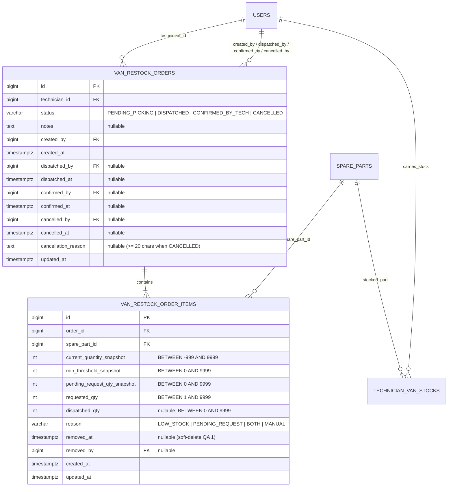

# ESPECIFICACIÓN TÉCNICA · CONTRATOS DE API Y MODELO DE DATOS
# ÓRDENES DE CARGA DE FURGONETA Y CRUCE DE STOCK EN TRIAJE (MÓDULO 23)

**Proyecto:** Gestor de Incidencias de Vending (*VendGuard*)  
**Módulo:** `23-van-restock-stock-aware-triage`  
**Documento:** `specs/technical/van_restock_stock_aware_triage_contracts.md`  
**Referencia Funcional:** [`specs/23-van-restock-stock-aware-triage/spec.md`](../23-van-restock-stock-aware-triage/spec.md) y [`specs/functional/van_restock_stock_aware_triage_spec.md`](../functional/van_restock_stock_aware_triage_spec.md) (`RF-01` a `RF-06`, `RNF-01` a `RNF-04`, `QA 1` a `QA 5`)  
**Protocolo:** HTTP/1.1 · JSON (`application/json; charset=utf-8`)  
**Metodología:** SDD (Specification-Driven Development) · Contratos API-First  
**Conformidad Constitucional:**
* **Artículo I:** La Especificación es la Única Fuente de Verdad. Ninguna implementación sin contrato previo; cero código simulado.
* **Artículo II:** Prioridad Sanitaria Absoluta. El cruce de stock en triaje (`RF-06`) es **estrictamente informativo** (`D2`): jamás altera la puntuación `total_score` ni el desglose `score_breakdown` de `TechnicianWorkloadScorer`, ni interfiere con el escalado a guardia en averías críticas de máquinas perecederas.
* **Artículo III:** Inviolabilidad de Datos e Histórico.
  * Art. III.1: Cero borrado físico (`DELETE FROM`). Las dos tablas nuevas (`van_restock_orders` y `van_restock_order_items`) portan disparador `trg_no_delete_*` (`prevent_hard_delete()`). La retirada de líneas durante la edición en `PENDING_PICKING` se ejecuta mediante **baja lógica** (`removed_at TIMESTAMPTZ` y `removed_by BIGINT`, `QA 1`).
  * Art. III.3: La confirmación de recepción (`CONFIRMED_BY_TECH`) no reescribe `incident_replaced_parts` ni transiciona automáticamente el estado de averías ni de `spare_part_requests` (`C4`, `QA 3`).
* **Artículo IV:** Minimalismo Tecnológico y Cero Bloatware. PHP 8.2+ POO puro (`declare(strict_types=1);`) con PDO (`pdo_pgsql`); Vue 3 Composition API. El albarán de Picking A4 se renderiza con HTML/CSS `@media print` y `window.print()`, sin librerías PDF externas.
* **Artículo V:** Integridad Inviolable de Reglas de Negocio.
  * Art. V.1: La cancelación de una orden exige justificación obligatoria de al menos **20 caracteres reales tras `btrim()`** tanto en el validador de dominio como en el `CHECK` de PostgreSQL.
  * Art. V.4: Segregación estricta de datos. El `LOCATION_RESPONSIBLE` carece de acceso a estas rutas (`403 FORBIDDEN`). El `TECHNICIAN` solo consulta y confirma órdenes de su propia furgoneta. Ninguna respuesta del módulo ni el documento imprimible de Picking A4 exponen `reference_cost` ni valoraciones monetarias.
* **Artículo VI.1:** Alcance acotado a la Fase 2 del Módulo 18 + Módulo 17 (Feature 9 de `docs/features_pendientes.md`). Sin stock central de almacén, sin transferencias entre furgonetas y sin firmas manuscritas en almacén.

---

## 1. Principios Arquitectónicos del Módulo

### 1.1. Separación entre Pre-cálculo, Ciclo de Albarán y Saldo de Furgoneta
El módulo introduce dos responsabilidades cohesivas sobre la base del Módulo 18 (`VanStockService`) y del Módulo 17 (`SuggestedTechniciansService` / `TechnicianAssignmentSuggester`):
1. **`VanRestockOrderService`:** Calcula las propuestas de reposición por déficit de umbral y solicitudes pendientes de averías activas (`RF-01`), gestiona el ciclo de vida de la orden (`PENDING_PICKING` $\rightarrow$ `DISPATCHED` $\rightarrow$ `CONFIRMED_BY_TECH` / `CANCELLED`, `RF-02` a `RF-04`) y ejecuta el incremento atómico de `technician_van_stocks.quantity_available` bajo bloqueo pesimista `SELECT ... FOR UPDATE` al confirmar la recepción móvil (`RF-05`).
2. **Enriquecimiento informativo de Triaje y Tarjetas de Avería (`RF-06` y `QA 3`):**
   * `TechnicianAssignmentSuggester` incorpora el evaluador puro de cobertura en 2 niveles (`van_stock_match` e insignias `STOCK_COMPATIBLE`, `STOCK_PARCIAL`, `SIN_STOCK_COMPATIBLE`) sin modificar una sola constante ni regla de `TechnicianWorkloadScorer`.
   * Los listados operativos de averías activas (`GET /api/coordinator/incidents` y `GET /api/technician/my-route`) incorporan el descriptor calculado `van_stock_readiness` (`READY_IN_VAN`, `SHARED_IN_VAN`, `NOT_READY`, `HAS_OUT_OF_CATALOG`, `NOT_APPLICABLE`) para visibilizar inmediatamente cuándo una avería con repuestos solicitados ya cuenta con stock físico en la furgoneta del técnico asignado (`QA 3`).

### 1.2. Concurrencia, Tope Doble `9999` y Baja Lógica de Líneas (`D3`, `QA 1`)
* **Máximo una orden abierta por técnico (`D3`):** El índice único parcial `uq_van_restock_open_per_tech ON van_restock_orders (technician_id) WHERE status IN ('PENDING_PICKING', 'DISPATCHED')` garantiza en el motor relacional que ningún técnico tenga dos órdenes abiertas simultáneas.
* **Tope doble `9999` (`QA 1`):** Ninguna cantidad solicitada ni despachada puede superar `9999` ni provocar que `quantity_available + qty > 9999` en el momento de creación, edición, expedición o confirmación.
* **Baja lógica de líneas en `PENDING_PICKING` (`QA 1`, Art. III.1):** Cuando Coordinación retira una línea al editar una orden en `PENDING_PICKING`, el repositorio ejecuta `UPDATE van_restock_order_items SET removed_at = CURRENT_TIMESTAMP, removed_by = :actor_id WHERE ...`. Si la misma pieza vuelve a añadirse a la misma orden, se reactiva la fila existente (`removed_at = NULL, removed_by = NULL`) actualizando `requested_qty`, `reason` y `updated_at`.

---

## 2. Modelo de Datos Relacional (PostgreSQL 16+ / Supabase)

### 2.1. Diagrama Entidad-Relación (Mermaid ERD)



### 2.2. Extensión del Enum de Auditoría (`audit_entity_type`)

Siguiendo el patrón de los Módulos 17 y 18 (`database/supabase_init.sql` §1 y migración `016_van_restock_orders.sql`), se añade el valor `'VAN_RESTOCK_ORDER'` al tipo `audit_entity_type` existente (manteniendo intacto el total de 24 tipos `ENUM` del contrato de esquema):

```sql
ALTER TYPE audit_entity_type ADD VALUE IF NOT EXISTS 'VAN_RESTOCK_ORDER';
```

### 2.3. DDL Canónico (`database/supabase_migrations/016_van_restock_orders.sql` y `database/supabase_init.sql`)

```sql
-- ============================================================================
-- Módulo 23 · Órdenes de Carga de Furgoneta y Cruce de Stock en Triaje
-- ----------------------------------------------------------------------------
-- Declara:
--   1. Valor 'VAN_RESTOCK_ORDER' en `audit_entity_type`.
--   2. Tabla 32 `van_restock_orders` con índice único parcial
--      `uq_van_restock_open_per_tech` (máximo 1 orden abierta por técnico, D3)
--      y restricción de justificación >= 20 caracteres reales al cancelar (Art. V.1).
--   3. Tabla 33 `van_restock_order_items` con soporte de baja lógica
--      (`removed_at` / `removed_by`, QA 1 / Art. III.1) y doble cantidad
--      (`requested_qty` y `dispatched_qty`, D1).
--   4. Disparadores constitucionales `trg_no_delete_*` (`prevent_hard_delete()`)
--      y `trg_touch_*` (`touch_updated_at()`) en ambas tablas.
-- ============================================================================

ALTER TYPE audit_entity_type ADD VALUE IF NOT EXISTS 'VAN_RESTOCK_ORDER';

-- ----------------------------------------------------------------------------
-- 1. Tabla 32 · van_restock_orders — cabecera del albarán de carga (RF-02 a RF-05)
-- ----------------------------------------------------------------------------
CREATE TABLE IF NOT EXISTS van_restock_orders (
    id                  BIGINT GENERATED ALWAYS AS IDENTITY,
    technician_id       BIGINT NOT NULL,
    status              VARCHAR(30) NOT NULL DEFAULT 'PENDING_PICKING',
    notes               TEXT,
    created_by          BIGINT NOT NULL,
    created_at          TIMESTAMPTZ NOT NULL DEFAULT CURRENT_TIMESTAMP,
    dispatched_by       BIGINT,
    dispatched_at       TIMESTAMPTZ,
    confirmed_by        BIGINT,
    confirmed_at        TIMESTAMPTZ,
    cancelled_by        BIGINT,
    cancelled_at        TIMESTAMPTZ,
    cancellation_reason TEXT,
    updated_at          TIMESTAMPTZ NOT NULL DEFAULT CURRENT_TIMESTAMP,

    CONSTRAINT pk_van_restock_orders PRIMARY KEY (id),
    CONSTRAINT fk_van_restock_orders_technician FOREIGN KEY (technician_id)
        REFERENCES users (id) ON DELETE RESTRICT ON UPDATE CASCADE,
    CONSTRAINT fk_van_restock_orders_creator FOREIGN KEY (created_by)
        REFERENCES users (id) ON DELETE RESTRICT ON UPDATE CASCADE,
    CONSTRAINT fk_van_restock_orders_dispatcher FOREIGN KEY (dispatched_by)
        REFERENCES users (id) ON DELETE RESTRICT ON UPDATE CASCADE,
    CONSTRAINT fk_van_restock_orders_confirmer FOREIGN KEY (confirmed_by)
        REFERENCES users (id) ON DELETE RESTRICT ON UPDATE CASCADE,
    CONSTRAINT fk_van_restock_orders_canceller FOREIGN KEY (cancelled_by)
        REFERENCES users (id) ON DELETE RESTRICT ON UPDATE CASCADE,
    CONSTRAINT chk_van_restock_orders_status CHECK (
        status IN ('PENDING_PICKING', 'DISPATCHED', 'CONFIRMED_BY_TECH', 'CANCELLED')
    ),
    CONSTRAINT chk_van_restock_orders_dispatch_consistency CHECK (
        (status = 'PENDING_PICKING' AND dispatched_at IS NULL AND dispatched_by IS NULL)
        OR (status IN ('DISPATCHED', 'CONFIRMED_BY_TECH') AND dispatched_at IS NOT NULL AND dispatched_by IS NOT NULL)
        OR (status = 'CANCELLED')
    ),
    CONSTRAINT chk_van_restock_orders_confirm_consistency CHECK (
        (status = 'CONFIRMED_BY_TECH' AND confirmed_at IS NOT NULL AND confirmed_by IS NOT NULL)
        OR (status <> 'CONFIRMED_BY_TECH' AND confirmed_at IS NULL AND confirmed_by IS NULL)
    ),
    CONSTRAINT chk_van_restock_orders_cancel_consistency CHECK (
        (status <> 'CANCELLED' AND cancelled_at IS NULL AND cancelled_by IS NULL AND cancellation_reason IS NULL)
        OR (
            status = 'CANCELLED'
            AND cancelled_at IS NOT NULL
            AND cancelled_by IS NOT NULL
            AND cancellation_reason IS NOT NULL
            AND char_length(btrim(cancellation_reason)) >= 20
        )
    )
);

-- Máximo una orden abierta simultánea por técnico (D3, RF-02.3, RNF-02)
CREATE UNIQUE INDEX IF NOT EXISTS uq_van_restock_open_per_tech
    ON van_restock_orders (technician_id)
    WHERE status IN ('PENDING_PICKING', 'DISPATCHED');

CREATE INDEX IF NOT EXISTS idx_van_restock_orders_tech_status
    ON van_restock_orders (technician_id, status, created_at DESC);

CREATE INDEX IF NOT EXISTS idx_van_restock_orders_status_created
    ON van_restock_orders (status, created_at DESC);

DROP TRIGGER IF EXISTS trg_no_delete_van_restock_orders ON van_restock_orders;
CREATE TRIGGER trg_no_delete_van_restock_orders
    BEFORE DELETE ON van_restock_orders
    FOR EACH ROW EXECUTE FUNCTION prevent_hard_delete();

DROP TRIGGER IF EXISTS trg_touch_van_restock_orders ON van_restock_orders;
CREATE TRIGGER trg_touch_van_restock_orders
    BEFORE UPDATE ON van_restock_orders
    FOR EACH ROW EXECUTE FUNCTION touch_updated_at();

-- ----------------------------------------------------------------------------
-- 2. Tabla 33 · van_restock_order_items — líneas del albarán de carga (RF-02, QA 1)
-- ----------------------------------------------------------------------------
CREATE TABLE IF NOT EXISTS van_restock_order_items (
    id                           BIGINT GENERATED ALWAYS AS IDENTITY,
    order_id                     BIGINT NOT NULL,
    spare_part_id                BIGINT NOT NULL,
    current_quantity_snapshot    INTEGER NOT NULL DEFAULT 0,
    min_threshold_snapshot       INTEGER NOT NULL DEFAULT 0,
    pending_request_qty_snapshot INTEGER NOT NULL DEFAULT 0,
    requested_qty                INTEGER NOT NULL DEFAULT 1,
    dispatched_qty               INTEGER,
    reason                       VARCHAR(30) NOT NULL DEFAULT 'MANUAL',
    removed_at                   TIMESTAMPTZ,
    removed_by                   BIGINT,
    created_at                   TIMESTAMPTZ NOT NULL DEFAULT CURRENT_TIMESTAMP,
    updated_at                   TIMESTAMPTZ NOT NULL DEFAULT CURRENT_TIMESTAMP,

    CONSTRAINT pk_van_restock_order_items PRIMARY KEY (id),
    CONSTRAINT uq_van_restock_order_item_part UNIQUE (order_id, spare_part_id),
    CONSTRAINT fk_van_restock_items_order FOREIGN KEY (order_id)
        REFERENCES van_restock_orders (id) ON DELETE RESTRICT ON UPDATE CASCADE,
    CONSTRAINT fk_van_restock_items_part FOREIGN KEY (spare_part_id)
        REFERENCES spare_parts (id) ON DELETE RESTRICT ON UPDATE CASCADE,
    CONSTRAINT fk_van_restock_items_remover FOREIGN KEY (removed_by)
        REFERENCES users (id) ON DELETE RESTRICT ON UPDATE CASCADE,
    CONSTRAINT chk_van_restock_items_current_snapshot CHECK (
        current_quantity_snapshot BETWEEN -999 AND 9999
    ),
    CONSTRAINT chk_van_restock_items_threshold_snapshot CHECK (
        min_threshold_snapshot BETWEEN 0 AND 9999
    ),
    CONSTRAINT chk_van_restock_items_pending_snapshot CHECK (
        pending_request_qty_snapshot BETWEEN 0 AND 9999
    ),
    CONSTRAINT chk_van_restock_items_requested_qty CHECK (
        requested_qty BETWEEN 1 AND 9999
    ),
    CONSTRAINT chk_van_restock_items_dispatched_qty CHECK (
        dispatched_qty IS NULL OR (dispatched_qty BETWEEN 0 AND 9999)
    ),
    CONSTRAINT chk_van_restock_items_reason CHECK (
        reason IN ('LOW_STOCK', 'PENDING_REQUEST', 'BOTH', 'MANUAL')
    ),
    CONSTRAINT chk_van_restock_items_removed_consistency CHECK (
        (removed_at IS NULL AND removed_by IS NULL)
        OR (removed_at IS NOT NULL AND removed_by IS NOT NULL)
    )
);

CREATE INDEX IF NOT EXISTS idx_van_restock_items_order
    ON van_restock_order_items (order_id)
    WHERE removed_at IS NULL;

CREATE INDEX IF NOT EXISTS idx_van_restock_items_part
    ON van_restock_order_items (spare_part_id);

DROP TRIGGER IF EXISTS trg_no_delete_van_restock_order_items ON van_restock_order_items;
CREATE TRIGGER trg_no_delete_van_restock_order_items
    BEFORE DELETE ON van_restock_order_items
    FOR EACH ROW EXECUTE FUNCTION prevent_hard_delete();

DROP TRIGGER IF EXISTS trg_touch_van_restock_order_items ON van_restock_order_items;
CREATE TRIGGER trg_touch_van_restock_order_items
    BEFORE UPDATE ON van_restock_order_items
    FOR EACH ROW EXECUTE FUNCTION touch_updated_at();
```

> [!NOTE]
> **Impacto en las suites de paridad del motor nuevo (`PostgresSchemaTest` y `PostgresFixtureBuilder`):**
> `CONTRACT_TABLES` pasa de 31 a **33 tablas** añadiendo `'van_restock_orders'` y `'van_restock_order_items'`. En `PostgresFixtureBuilder::CRUD_EXCLUDED_COLUMNS` se registran las columnas sujetas a `CHECK` de estado/rama (`status`, `dispatched_at`, `dispatched_by`, `confirmed_at`, `confirmed_by`, `cancelled_at`, `cancelled_by`, `cancellation_reason` en `van_restock_orders`; y `reason`, `dispatched_qty`, `removed_at`, `removed_by` en `van_restock_order_items`), de modo que la prueba genérica de `UPDATE` actualice `notes` en la cabecera y `requested_qty` en la línea sin colisionar con los invariantes de estado.

---

## 3. Fórmulas de Dominio, Cruce de Stock y Algoritmos

### 3.1. Fórmula de Pre-cálculo de Propuesta de Carga (`RF-01`, `D4`, `QA 1`, `QA 5`)

Para un técnico elegible (`role = 'TECHNICIAN' AND is_active = TRUE`):
1. **Saldo actual y umbral (`technician_van_stocks`):** Para cada repuesto activo (`spare_parts.is_active = TRUE`), se toma `current_quantity = COALESCE(tvs.quantity_available, 0)` y `min_threshold = COALESCE(tvs.min_threshold, 0)`.
2. **Demanda pendiente de averías activas (`pending_request_qty`):** Suma de `spr.quantity_requested` en `spare_part_requests` donde:
   * `spr.spare_part_id = sp.id` (solo solicitudes vinculadas a catálogo),
   * `spr.status = 'PENDING'`,
   * la avería `i` asociada tiene `i.assigned_technician_id = :technician_id` y `i.status IN ('ASSIGNED', 'IN_PROGRESS', 'PENDING_PARTS', 'PENDING_INFO', 'REOPENED')`.
3. **Clasificación de motivo (`reason`) y cantidad bruta (`raw_qty`):**
   * **Caso `'LOW_STOCK'`:** `pending_request_qty == 0` y existe fila en `technician_van_stocks` con `current_quantity <= min_threshold`:
     $$\text{raw\_qty} = (\text{min\_threshold} - \text{current\_quantity}) + 1$$
   * **Caso `'PENDING_REQUEST'`:** `min_threshold == 0` y `current_quantity > 0` (o sin fila en `technician_van_stocks`, `current_quantity == 0` sin umbral declarado) y `pending_request_qty > current_quantity`:
     $$\text{raw\_qty} = \text{pending\_request\_qty} - \max(0, \text{current\_quantity})$$
     *(Nota: si existe fila en `technician_van_stocks` con `min_threshold > 0`, `current_quantity > min_threshold` y `current_quantity - pending_request_qty > min_threshold`, entonces el saldo actual ya cubre la solicitud sin caer en umbral y no requiere reposición; si `current_quantity > min_threshold` pero `pending_request_qty > current_quantity` con `min_threshold == 0`, aplica `'PENDING_REQUEST'`).*
   * **Caso `'BOTH'`:** `pending_request_qty > 0` y además se cumple cualquiera de:
     * existe fila en `technician_van_stocks` con `current_quantity <= min_threshold`, **o**
     * `min_threshold > 0` y `(current_quantity - pending_request_qty) <= min_threshold`:
     $$\text{raw\_qty} = (\text{min\_threshold} + 1 + \text{pending\_request\_qty}) - \text{current\_quantity}$$
4. **Aplicación del Tope Doble `9999` (`QA 1`):**
   $$\text{max\_addable} = 9999 - \text{current\_quantity}$$
   $$\text{suggested\_qty} = \min(9999,\ \text{max\_addable},\ \text{raw\_qty})$$
   Si $\text{suggested\_qty} \le 0$ (porque la furgoneta ya está en `9999`), la pieza se omite de la propuesta automática.
5. **Ordenación determinista de líneas (`QA 5`):**
   1. Prioridad de motivo: `'BOTH'` (1) $\rightarrow$ `'PENDING_REQUEST'` (2) $\rightarrow$ `'LOW_STOCK'` (3) $\rightarrow$ `'MANUAL'` (4).
   2. Menor `current_quantity` ascendente (saldos negativos primero).
   3. `part_code` ascendente (`A–Z`).

### 3.2. Algoritmo de Cruce Informativo en 2 Niveles en Triaje (`RF-06`, `D2`, `C1`, `QA 2`)

Invocado dentro de `TechnicianAssignmentSuggester::getSuggestionsForIncident()` para cada técnico candidato, **sin tocar `TechnicianWorkloadScorer`**:

* **Nivel 1 — Solicitudes explícitas pendientes (`evaluation_level = 'EXPLICIT_REQUESTS'`):**
  Se activa cuando la avería tiene al menos una fila en `spare_part_requests` con `status = 'PENDING'` (sea de catálogo o fuera de catálogo):
  * Sea $N_{\text{cat}}$ el número de referencias distintas de catálogo (`spare_part_id IS NOT NULL`) solicitadas en `PENDING` en esa avería, con cantidad total requerida $Q_p = \sum \text{quantity\_requested}$ por cada `spare_part_id` $p$.
  * Sea $\text{has\_out\_of\_catalog} = \text{true}$ si existe al menos una solicitud `PENDING` con `spare_part_id IS NULL`.
  * Para cada referencia catalogada $p$, el técnico la cubre si y solo si su `quantity_available >= Q_p`. Sea $M_{\text{cat}}$ el número de referencias catalogadas cubiertas ($0 \le M_{\text{cat}} \le N_{\text{cat}}$).
  * **Determinación de `status`, `badge` y `label`:**
    * Si $N_{\text{cat}} > 0$ y $M_{\text{cat}} == N_{\text{cat}}$ y $\neg \text{has\_out\_of\_catalog}$:
      * `status = 'FULL_MATCH'`
      * `badge = 'STOCK_COMPATIBLE'`
      * `label = "Repuesto solicitado en furgoneta ({$M_cat}/{$N_cat} ref.)"`
    * Si $N_{\text{cat}} > 0$ y $M_{\text{cat}} == N_{\text{cat}}$ y $\text{has\_out\_of\_catalog}$ (`QA 2`):
      * `status = 'PARTIAL_MATCH'` (degradado porque la pieza fuera de catálogo no es verificable en furgoneta)
      * `badge = 'STOCK_PARCIAL'`
      * `label = "Repuesto solicitado parcial ({$M_cat}/{$N_cat} ref. + pieza fuera de catálogo)"`
    * Si $N_{\text{cat}} > 0$ y $1 \le M_{\text{cat}} < N_{\text{cat}}$:
      * `status = 'PARTIAL_MATCH'`
      * `badge = 'STOCK_PARCIAL'`
      * `label = $hasOutOfCatalog ? "Repuesto solicitado parcial ({$M_cat}/{$N_cat} ref. + pieza fuera de catálogo)" : "Repuesto solicitado parcial ({$M_cat}/{$N_cat} ref.)"`
    * Si $N_{\text{cat}} > 0$ y $M_{\text{cat}} == 0$:
      * `status = 'NO_STOCK'`
      * `badge = 'SIN_STOCK_COMPATIBLE'`
      * `label = $hasOutOfCatalog ? "Sin repuesto solicitado en furgoneta (0/{$N_cat} ref. + pieza fuera de catálogo)" : "Sin repuesto solicitado en furgoneta (0/{$N_cat} ref.)"`
    * Si $N_{\text{cat}} == 0$ y $\text{has\_out\_of\_catalog}$ (solo hay solicitudes fuera de catálogo, `QA 2`):
      * `status = 'NOT_APPLICABLE'`
      * `badge = null`
      * `label = "Solicitud fuera de catálogo (no verificable en furgoneta)"`

* **Nivel 2 — Compatibilidad por modelo de máquina y categoría de avería (`evaluation_level = 'CATEGORY_COMPATIBILITY'`):**
  Se activa cuando la avería **no** tiene ninguna fila en `spare_part_requests` con `status = 'PENDING'`:
  * Mapeo de `incident.category` a `spare_parts.category`:
    * `'TEMPERATURE_COLD'` $\rightarrow$ `'THERMAL'`
    * `'PAYMENT_SYSTEM'` $\rightarrow$ `'PAYMENT_SYSTEM'`
    * `'PRODUCT_JAM'` $\rightarrow$ `'MECHANICAL'`
    * `'ELECTRICAL_OFF'` $\rightarrow$ `'ELECTRONIC'`
    * `'OTHER'` $\rightarrow$ *cualquier categoría* (`spare_parts.category` sin filtro)
  * Universo compatible $U$: repuestos activos (`spare_parts.is_active = TRUE`) vinculados a `TRIM(LOWER(spare_part_compatibilities.machine_model)) = TRIM(LOWER(machine.model))` que pertenezcan a la categoría mapeada. Sea $N = |U|$.
  * Sea $M$ el número de repuestos de $U$ para los cuales el técnico tiene `quantity_available >= 1`.
  * **Determinación de `status`, `badge` y `label` (`C1`):**
    * Si $N == 0$:
      * `status = 'NOT_APPLICABLE'`, `badge = null`, `label = null`
    * Si $N \ge 1$ y $M == N$:
      * `status = 'FULL_MATCH'`, `badge = 'STOCK_COMPATIBLE'`, `label = "Stock compatible ({$M}/{$N} ref.)"`
    * Si $N \ge 1$ y $1 \le M < N$:
      * `status = 'PARTIAL_MATCH'`, `badge = 'STOCK_PARCIAL'`, `label = "Stock compatible parcial ({$M}/{$N} ref.)"`
    * Si $N \ge 1$ y $M == 0$:
      * `status = 'NO_STOCK'`, `badge = 'SIN_STOCK_COMPATIBLE'`, `label = "Sin stock compatible (0/{$N} ref.)"`

### 3.3. Indicador `van_stock_readiness` en Tarjetas de Averías Activas (`RF-05.4`, `QA 3`)

Para cada avería en estado activo (`ASSIGNED`, `IN_PROGRESS`, `PENDING_PARTS`, `PENDING_INFO`, `REOPENED`) con `assigned_technician_id IS NOT NULL` que posea al menos una solicitud en `spare_part_requests` con `status = 'PENDING'`:
1. Si tiene solicitudes fuera de catálogo (`spare_part_id IS NULL`) pendientes y cero de catálogo, o si tiene solicitudes fuera de catálogo pendientes junto con las de catálogo:
   * `status = 'HAS_OUT_OF_CATALOG'`, `badge_label = null`.
2. Si todas sus solicitudes `PENDING` son de catálogo ($N_{\text{cat}} \ge 1$ y $\text{has\_out\_of\_catalog} == \text{false}$):
   * Se verifica si para cada pieza solicitada $p$ en esta avería (con cantidad requerida $Q_{i,p}$), el técnico asignado tiene $\text{quantity\_available}_p \ge Q_{i,p}$.
   * Si alguna pieza no alcanza $Q_{i,p}$:
     * `status = 'NOT_READY'`, `badge_label = null`.
   * Si **todas** las piezas de esta avería cumplen $\text{quantity\_available}_p \ge Q_{i,p}$, se comprueba además la demanda agregada $\sum_{k \in \text{activas del técnico}} Q_{k,p}$:
     * Si para toda pieza $p$ de la avería se cumple $\text{quantity\_available}_p \ge \sum_{k} Q_{k,p}$:
       * `status = 'READY_IN_VAN'`
       * `badge_label = '📦 Repuesto ya en furgoneta'`
     * Si para alguna pieza $p$ de la avería se cumple $Q_{i,p} \le \text{quantity\_available}_p < \sum_{k} Q_{k,p}$ (`QA 3`, stock compartido entre varias averías del mismo técnico):
       * `status = 'SHARED_IN_VAN'`
       * `badge_label = '📦 Repuesto en furgoneta (stock compartido)'`

---

## 4. Objetos de Dominio, Excepciones y Puertos (PHP 8.2+)

### 4.1. Modelos y DTOs (`src/Core/Domain/Model/` y `src/Application/DTO/`)

```php
<?php

declare(strict_types=1);

namespace VendGuard\Core\Domain\Model;

final class VanRestockOrder
{
    public const STATUS_PENDING_PICKING = 'PENDING_PICKING';
    public const STATUS_DISPATCHED = 'DISPATCHED';
    public const STATUS_CONFIRMED_BY_TECH = 'CONFIRMED_BY_TECH';
    public const STATUS_CANCELLED = 'CANCELLED';

    public const REASON_LOW_STOCK = 'LOW_STOCK';
    public const REASON_PENDING_REQUEST = 'PENDING_REQUEST';
    public const REASON_BOTH = 'BOTH';
    public const REASON_MANUAL = 'MANUAL';

    public const QUANTITY_MAX = 9999;
    public const MIN_CANCELLATION_REASON_LENGTH = 20;

    /**
     * @param list<VanRestockOrderItem> $items
     */
    public function __construct(
        public readonly int $id,
        public readonly int $technicianId,
        public readonly string $technicianName,
        public readonly bool $technicianIsActive,
        public readonly bool $recipientCurrentlyAbsent,
        public readonly string $status,
        public readonly ?string $notes,
        public readonly int $createdBy,
        public readonly string $createdByName,
        public readonly string $createdAt,
        public readonly ?int $dispatchedBy,
        public readonly ?string $dispatchedByName,
        public readonly ?string $dispatchedAt,
        public readonly ?int $confirmedBy,
        public readonly ?string $confirmedByName,
        public readonly ?string $confirmedAt,
        public readonly ?int $cancelledBy,
        public readonly ?string $cancelledByName,
        public readonly ?string $cancelledAt,
        public readonly ?string $cancellationReason,
        public readonly string $updatedAt,
        public readonly array $items = []
    ) {
    }
}
```

```php
<?php

declare(strict_types=1);

namespace VendGuard\Core\Domain\Model;

final class VanRestockOrderItem
{
    public function __construct(
        public readonly int $id,
        public readonly int $orderId,
        public readonly int $sparePartId,
        public readonly string $partCode,
        public readonly string $partName,
        public readonly string $category,
        public readonly int $currentQuantitySnapshot,
        public readonly int $minThresholdSnapshot,
        public readonly int $pendingRequestQtySnapshot,
        public readonly int $requestedQty,
        public readonly ?int $dispatchedQty,
        public readonly string $reason,
        public readonly ?string $removedAt = null,
        public readonly ?int $removedBy = null
    ) {
    }
}
```

### 4.2. Excepción de Dominio (`VanRestockOrderValidationException`)

Ubicación: `src/Core/Domain/Exception/VanRestockOrderValidationException.php`

| Constante de Código (`error.code`) | HTTP Status | Cuándo se dispara |
| :--- | :---: | :--- |
| `INVALID_RESTOCK_ORDER_PAYLOAD` | `422` | Payload incompleto, líneas vacías, `requested_qty < 1`, `dispatched_qty < 0`, suma de `dispatched_qty == 0` en todas las líneas al expedir, justificación de cancelación `< 20` caracteres reales, o desbordamiento del tope `9999` (`quantity_available + qty > 9999`). |
| `TECHNICIAN_NOT_ELIGIBLE` | `422` | El `technician_id` no existe, no tiene rol `TECHNICIAN`, o su cuenta está inactiva (`is_active = false`, `QA 4`). |
| `SPARE_PART_NOT_ELIGIBLE` | `422` | El `spare_part_id` no existe o está inactivo (`is_active = false`) al crear o editar una orden. |
| `RESTOCK_ORDER_NOT_FOUND` | `404` | El `id` de orden no existe. |
| `OPEN_RESTOCK_ORDER_ALREADY_EXISTS` | `409` | El técnico ya posee una orden en `PENDING_PICKING` o `DISPATCHED` (`uq_van_restock_open_per_tech`, `D3`). |
| `INVALID_RESTOCK_ORDER_TRANSITION` | `409` | Intento de editar una orden fuera de `PENDING_PICKING`, expedir fuera de `PENDING_PICKING`, confirmar fuera de `DISPATCHED`, o cancelar en `CONFIRMED_BY_TECH` / `CANCELLED`. |
| `RESTOCK_ORDER_OWNERSHIP_MISMATCH` | `403` | Un `TECHNICIAN` intenta confirmar o consultar una orden cuyo `technician_id` no coincide con su `user_id` autenticado (`Art. V.4`). |

---

## 5. Especificación de Endpoints REST

### 5.1. Tabla Resumen de Endpoints del Módulo 23

| # | Método y Ruta | Roles Autorizados | Propósito (`RF`) |
| :---: | :--- | :--- | :--- |
| **1** | `GET /api/coordinator/van-restock-orders/proposals` | `COORDINATOR` | Pre-cálculo de sugerencias de reposición (por técnico o global para la flota activa, `RF-01`). |
| **2** | `GET /api/coordinator/van-restock-orders` | `COORDINATOR` | Listado de órdenes de carga con filtro opcional por `technician_id` y `status` (`RF-02` a `RF-04`). |
| **3** | `GET /api/coordinator/van-restock-orders/{id}` | `COORDINATOR` | Detalle de una orden de carga y datos para el Albarán de Picking A4 sin costes (`RF-03`). |
| **4** | `POST /api/coordinator/van-restock-orders` | `COORDINATOR` | Creación individual de orden en `PENDING_PICKING` (`RF-02.1`, `RF-02.3`). |
| **5** | `POST /api/coordinator/van-restock-orders/generate-batch` | `COORDINATOR` | Generación por lotes para técnicos elegibles con déficit y sin ausencia activa (`RF-02.2`, `QA 4`). |
| **6** | `PUT /api/coordinator/van-restock-orders/{id}` | `COORDINATOR` | Edición de líneas y notas en `PENDING_PICKING` con baja lógica de líneas retiradas (`RF-02.4`, `QA 1`). |
| **7** | `POST /api/coordinator/van-restock-orders/{id}/dispatch` | `COORDINATOR` | Expedición de almacén (`PENDING_PICKING` $\rightarrow$ `DISPATCHED`) con `dispatched_qty` por línea (`RF-04.1`). |
| **8** | `POST /api/coordinator/van-restock-orders/{id}/cancel` | `COORDINATOR` | Cancelación auditada (`PENDING_PICKING` \| `DISPATCHED` $\rightarrow$ `CANCELLED`) con motivo $\ge 20$ caracteres (`RF-04.2`). |
| **9** | `GET /api/technician/van-stock` *(enriquecido)* | `TECHNICIAN` | Inventario propio + `active_dispatched_order` + `last_confirmed_order` (`RF-05.1`, `QA 5`). |
| **10** | `POST /api/technician/van-stock/restock-orders/{id}/confirm` | `TECHNICIAN` | Confirmación móvil en 1 toque (`DISPATCHED` $\rightarrow$ `CONFIRMED_BY_TECH`) + suma atómica al stock (`RF-05.2`). |
| **11** | `GET /api/coordinator/incidents/{id}/suggested-technicians` *(enriquecido)* | `COORDINATOR` | Ranking de triaje con bloque informativo `van_stock_match` en 2 niveles (`RF-06`, `D2`). |
| **12** | `GET /api/coordinator/incidents` y `GET /api/technician/my-route` *(enriquecidos)* | `COORDINATOR` / `TECHNICIAN` | Tarjetas de averías activas enriquecidas con `van_stock_readiness` (`RF-05.4`, `QA 3`). |

---

### 5.2. `GET /api/coordinator/van-restock-orders/proposals`

Calcula en tiempo real la propuesta de carga para un técnico concreto (`?technician_id={id}`) o para todos los técnicos activos con rol `TECHNICIAN`.

* **Query Parameters:**
  * `technician_id` (`int`, opcional): filtra la propuesta para un único técnico.
* **Respuesta Exitosa (`200 OK`):**
```json
{
  "proposals": [
    {
      "technician_id": 2,
      "technician_name": "Carlos Mendoza (Ruta Norte)",
      "technician_is_active": true,
      "recipient_currently_absent": false,
      "open_order_id": null,
      "open_order_status": null,
      "items": [
        {
          "spare_part_id": 14,
          "part_code": "COMP-TH-01",
          "part_name": "Termostato Digital Necta",
          "category": "THERMAL",
          "current_quantity": -1,
          "min_threshold": 2,
          "pending_request_qty": 1,
          "suggested_qty": 5,
          "max_allowed_qty": 9999,
          "reason": "BOTH"
        },
        {
          "spare_part_id": 8,
          "part_code": "VALV-HY-02",
          "part_name": "Electroválvula 24V",
          "category": "HYDRAULIC",
          "current_quantity": 0,
          "min_threshold": 2,
          "pending_request_qty": 0,
          "suggested_qty": 3,
          "max_allowed_qty": 9999,
          "reason": "LOW_STOCK"
        }
      ]
    }
  ]
}
```

---

### 5.3. `GET /api/coordinator/van-restock-orders`

Devuelve el listado de órdenes de carga. Ordenación canónica (`RF-04.4`): primero las órdenes abiertas (`PENDING_PICKING`, `DISPATCHED`) ordenadas por `created_at DESC, id DESC`, seguidas del histórico cerrado (`CONFIRMED_BY_TECH`, `CANCELLED`) ordenado por `created_at DESC, id DESC`.

* **Query Parameters:**
  * `technician_id` (`int`, opcional)
  * `status` (`string`, opcional: `PENDING_PICKING`, `DISPATCHED`, `CONFIRMED_BY_TECH`, `CANCELLED`, o `OPEN` para ambas abiertas)
* **Respuesta Exitosa (`200 OK`):**
```json
{
  "items": [
    {
      "id": 42,
      "order_code": "RO-000042",
      "technician_id": 2,
      "technician_name": "Carlos Mendoza (Ruta Norte)",
      "technician_is_active": true,
      "recipient_currently_absent": false,
      "status": "PENDING_PICKING",
      "notes": "Preparar en jaula 3 antes de las 08:30.",
      "active_items_count": 2,
      "total_requested_units": 8,
      "total_dispatched_units": null,
      "created_by": 1,
      "created_by_name": "Ana Coordinadora",
      "created_at": "2026-10-26T08:15:00+00:00",
      "dispatched_by": null,
      "dispatched_by_name": null,
      "dispatched_at": null,
      "confirmed_by": null,
      "confirmed_by_name": null,
      "confirmed_at": null,
      "cancelled_by": null,
      "cancelled_by_name": null,
      "cancelled_at": null,
      "cancellation_reason": null,
      "items": [
        {
          "id": 101,
          "spare_part_id": 14,
          "part_code": "COMP-TH-01",
          "part_name": "Termostato Digital Necta",
          "category": "THERMAL",
          "current_quantity_snapshot": -1,
          "min_threshold_snapshot": 2,
          "pending_request_qty_snapshot": 1,
          "requested_qty": 5,
          "dispatched_qty": null,
          "reason": "BOTH"
        }
      ]
    }
  ]
}
```
> **Nota:** Las líneas con `removed_at IS NOT NULL` (baja lógica en edición, `QA 1`) se conservan en base de datos para auditoría pero se excluyen de `items` en las vistas operativas y en el Picking A4.

---

### 5.4. `GET /api/coordinator/van-restock-orders/{id}`

Devuelve el detalle íntegro de la orden (incluyendo la estructura lista para imprimir el Albarán de Picking A4, **sin ningún campo de coste ni precio**, Art. V.4).

* **Respuesta Exitosa (`200 OK`):** Objeto de orden idéntico al elemento de `items` en §5.3.
* **Errores:** `404 RESTOCK_ORDER_NOT_FOUND`.

---

### 5.5. `POST /api/coordinator/van-restock-orders`

Crea una orden de carga individual en estado `PENDING_PICKING` (`RF-02.1`, `RF-02.3`).

* **Request Body:**
```json
{
  "technician_id": 2,
  "notes": "Preparar en jaula 3 antes de las 08:30.",
  "items": [
    {
      "spare_part_id": 14,
      "requested_qty": 5,
      "reason": "BOTH"
    },
    {
      "spare_part_id": 21,
      "requested_qty": 2,
      "reason": "MANUAL"
    }
  ]
}
```
* **Validaciones (`422` / `409`):**
  1. `technician_id` debe pertenecer a un usuario con `role = 'TECHNICIAN'` e `is_active = true` (`422 TECHNICIAN_NOT_ELIGIBLE`). *(Si el técnico está activo pero tiene ausencia vigente en `technician_absences`, se permite la creación individual y la respuesta devuelve `recipient_currently_absent: true`, `QA 4`).*
  2. El técnico no debe tener ninguna orden en `PENDING_PICKING` o `DISPATCHED` (`409 OPEN_RESTOCK_ORDER_ALREADY_EXISTS`).
  3. `items` debe contener al menos 1 línea, sin `spare_part_id` duplicados en el payload, y todos los `spare_part_id` deben existir y tener `is_active = true` (`422 SPARE_PART_NOT_ELIGIBLE`).
  4. En cada línea, `requested_qty` debe ser entero en `[1, 9999]` y cumplir `current_quantity + requested_qty <= 9999` (`QA 1`, `422 INVALID_RESTOCK_ORDER_PAYLOAD`).
* **Respuesta Exitosa (`201 Created`):**
```json
{
  "order": { "...objeto completo de la orden creada..." },
  "message": "Orden de carga creada en estado Pendiente de Picking."
}
```

---

### 5.6. `POST /api/coordinator/van-restock-orders/generate-batch`

Genera órdenes `PENDING_PICKING` en lote para todos los técnicos activos con rol `TECHNICIAN` que tengan al menos una pieza sugerida en el pre-cálculo (`RF-02.2`, `QA 4`).

* **Request Body:** `{}` (cuerpo vacío o `{"notes": "Lote matinal de almacén"}`).
* **Reglas de exclusión en el lote (`RF-02.2`, `QA 4`):**
  * Si el técnico tiene una ausencia vigente en el instante actual (`starts_at <= NOW() AND ends_at >= NOW() AND cancelled_at IS NULL`), se omite con motivo `SKIPPED_ACTIVE_ABSENCE`.
  * Si el técnico ya posee una orden abierta (`PENDING_PICKING` o `DISPATCHED`), se omite con motivo `SKIPPED_OPEN_ORDER_EXISTS`.
  * Si el pre-cálculo del técnico arroja 0 líneas sugeridas, se omite con motivo `SKIPPED_NO_DEFICIT`.
* **Respuesta Exitosa (`200 OK`):**
```json
{
  "created_count": 2,
  "skipped_count": 3,
  "created_orders": [
    {
      "id": 43,
      "order_code": "RO-000043",
      "technician_id": 2,
      "technician_name": "Carlos Mendoza (Ruta Norte)",
      "active_items_count": 2,
      "total_requested_units": 8
    }
  ],
  "skipped_technicians": [
    {
      "technician_id": 3,
      "technician_name": "Laura Gómez",
      "skip_reason": "SKIPPED_OPEN_ORDER_EXISTS",
      "open_order_id": 41
    },
    {
      "technician_id": 5,
      "technician_name": "Pedro Ruiz",
      "skip_reason": "SKIPPED_ACTIVE_ABSENCE",
      "open_order_id": null
    },
    {
      "technician_id": 6,
      "technician_name": "Sofía Martín",
      "skip_reason": "SKIPPED_NO_DEFICIT",
      "open_order_id": null
    }
  ],
  "message": "Generación por lotes completada: 2 órdenes creadas, 3 técnicos omitidos."
}
```

---

### 5.7. `PUT /api/coordinator/van-restock-orders/{id}`

Actualiza las líneas y/o notas de una orden exclusivamente mientras permanece en `PENDING_PICKING` (`RF-02.4`, `QA 1`).

* **Request Body:**
```json
{
  "notes": "Nota actualizada para almacén.",
  "items": [
    {
      "spare_part_id": 14,
      "requested_qty": 6,
      "reason": "BOTH"
    }
  ]
}
```
* **Comportamiento de Persistencia (`QA 1`, Art. III.1):**
  * Solo ejecutable si `order.status === 'PENDING_PICKING'` (en otro estado devuelve `409 INVALID_RESTOCK_ORDER_TRANSITION`).
  * `items` debe conservar al menos 1 línea activa (`422 INVALID_RESTOCK_ORDER_PAYLOAD`).
  * Las filas de `van_restock_order_items` que estaban activas en la orden y **no** figuran en el nuevo array `items` reciben **baja lógica** (`removed_at = CURRENT_TIMESTAMP`, `removed_by = :actor_id`). Jamás se ejecuta `DELETE FROM`.
  * Si un `spare_part_id` del payload ya existía en `van_restock_order_items` para ese `order_id` (incluso si tenía `removed_at IS NOT NULL`), se reactiva (`removed_at = NULL, removed_by = NULL`) y se actualiza `requested_qty`.
* **Respuesta Exitosa (`200 OK`):**
```json
{
  "order": { "...objeto actualizado..." },
  "message": "Orden de carga actualizada correctamente."
}
```

---

### 5.8. `POST /api/coordinator/van-restock-orders/{id}/dispatch`

Registra la expedición física desde el almacén central y transiciona la orden de `PENDING_PICKING` a `DISPATCHED` (`RF-04.1`, `D1`, `QA 1`).

* **Request Body:**
```json
{
  "notes": "Entregado en mostrador de almacén.",
  "items": [
    {
      "spare_part_id": 14,
      "dispatched_qty": 4
    },
    {
      "spare_part_id": 21,
      "dispatched_qty": 0
    }
  ]
}
```
* **Validaciones (`422` / `409`):**
  1. La orden debe estar en estado `PENDING_PICKING` (`409 INVALID_RESTOCK_ORDER_TRANSITION`).
  2. Deben declararse los `dispatched_qty` de todas las líneas activas (`removed_at IS NULL`) de la orden.
  3. Cada `dispatched_qty` debe ser entero en `[0, 9999]` y cumplir con el saldo actual vivo de la furgoneta: `current_quantity_available + dispatched_qty <= 9999` (`QA 1`, `422 INVALID_RESTOCK_ORDER_PAYLOAD`).
  4. La suma total $\sum \text{dispatched\_qty}$ de las líneas activas debe ser **$\ge 1$** (`RF-04.1`: si no hay ninguna unidad disponible en almacén, procede cancelar la orden, no expedir 0 unidades).
  5. *(Nota `QA 4`):* Aunque un repuesto haya sido desactivado en el catálogo tras crearse la orden, si ya forma parte de las líneas activas de la orden se permite su expedición y posterior confirmación para reflejar el movimiento físico real.
* **Respuesta Exitosa (`200 OK`):**
```json
{
  "order": { "...objeto en estado DISPATCHED..." },
  "message": "Orden marcada como Expedida. Pendiente de confirmación por el técnico."
}
```

---

### 5.9. `POST /api/coordinator/van-restock-orders/{id}/cancel`

Cancela una orden en estado `PENDING_PICKING` o `DISPATCHED` con justificación obligatoria (`RF-04.2`, Art. V.1).

* **Request Body:**
```json
{
  "cancellation_reason": "Error en la asignación de ruta; el material se preparará para el turno de tarde."
}
```
* **Validaciones:**
  * Estado previo debe ser `PENDING_PICKING` o `DISPATCHED` (`409 INVALID_RESTOCK_ORDER_TRANSITION`).
  * `mb_strlen(trim($cancellationReason)) >= 20` (`422 INVALID_RESTOCK_ORDER_PAYLOAD`).
  * No altera `technician_van_stocks` y libera inmediatamente el índice único parcial `uq_van_restock_open_per_tech`.
* **Respuesta Exitosa (`200 OK`):**
```json
{
  "order": { "...objeto en estado CANCELLED..." },
  "message": "La orden de carga ha sido cancelada."
}
```

---

### 5.10. `GET /api/technician/van-stock` *(Enriquecimiento Retrocompatible, `RF-05.1`, `QA 5`)*

Extiende la respuesta actual del Módulo 18 añadiendo las claves `active_dispatched_order` (la orden en estado `DISPATCHED` pendiente de recepción por el técnico autenticado, o `null`) y `last_confirmed_order` (resumen de la última orden confirmada por el técnico, o `null`, `QA 5`).

* **Respuesta Exitosa (`200 OK`):**
```json
{
  "technician_id": 2,
  "items": [
    {
      "spare_part_id": 14,
      "part_code": "COMP-TH-01",
      "part_name": "Termostato Digital Necta",
      "category": "THERMAL",
      "quantity_available": -1,
      "min_threshold": 2,
      "is_below_threshold": true,
      "updated_at": "2026-10-25 17:40:00"
    }
  ],
  "active_dispatched_order": {
    "id": 42,
    "order_code": "RO-000042",
    "status": "DISPATCHED",
    "notes": "Entregado en mostrador de almacén.",
    "dispatched_at": "2026-10-26T08:30:00+00:00",
    "dispatched_by_name": "Ana Coordinadora",
    "total_dispatched_units": 4,
    "items": [
      {
        "spare_part_id": 14,
        "part_code": "COMP-TH-01",
        "part_name": "Termostato Digital Necta",
        "category": "THERMAL",
        "requested_qty": 5,
        "dispatched_qty": 4,
        "reason": "BOTH"
      }
    ]
  },
  "last_confirmed_order": {
    "id": 38,
    "order_code": "RO-000038",
    "confirmed_at": "2026-10-24T09:10:00+00:00",
    "total_received_units": 6,
    "items": [
      {
        "spare_part_id": 8,
        "part_code": "VALV-HY-02",
        "part_name": "Electroválvula 24V",
        "dispatched_qty": 6
      }
    ]
  }
}
```

---

### 5.11. `POST /api/technician/van-stock/restock-orders/{id}/confirm`

Confirma en 1 toque la recepción de una orden en estado `DISPATCHED` por parte del técnico destinatario (`RF-05.2`, `D3`, `QA 1`, `QA 4`).

* **Independencia del estado de turno (`QA 4`):** Este endpoint **no** bloquea al técnico si su jornada en `technician_shifts` está en `OFF_SHIFT` o `MEAL_BREAK`, permitiendo recoger material en almacén antes de fichar el inicio de ruta.
* **Protocolo Transaccional (`RNF-02`):**
  1. `BEGIN`
  2. `SELECT * FROM van_restock_orders WHERE id = :id FOR UPDATE`:
     * Si no existe $\rightarrow$ `ROLLBACK` + `404 RESTOCK_ORDER_NOT_FOUND`.
     * Si `technician_id !== $authenticatedUserId` $\rightarrow$ `ROLLBACK` + `403 RESTOCK_ORDER_OWNERSHIP_MISMATCH`.
     * Si `status !== 'DISPATCHED'` $\rightarrow$ `ROLLBACK` + `409 INVALID_RESTOCK_ORDER_TRANSITION` (protege contra doble toque concurrente).
  3. Se leen las líneas activas (`removed_at IS NULL`) de `van_restock_order_items` ordenadas por `spare_part_id ASC`.
  4. Para cada línea activa con `dispatched_qty > 0`:
     * Se bloquea la fila en `technician_van_stocks` (`SELECT id, quantity_available, min_threshold FROM technician_van_stocks WHERE technician_id = :tech_id AND spare_part_id = :part_id FOR UPDATE`).
     * Se verifica el tope superior `9999` (`QA 1`): si `COALESCE(quantity_available, 0) + dispatched_qty > 9999`, se hace `ROLLBACK` y se devuelve `422 INVALID_RESTOCK_ORDER_PAYLOAD` indicando qué referencia excedería el límite de `9999` unidades.
     * Se ejecuta `INSERT INTO technician_van_stocks (technician_id, spare_part_id, quantity_available, min_threshold) VALUES (:tech_id, :part_id, :dispatched_qty, 0) ON CONFLICT (technician_id, spare_part_id) DO UPDATE SET quantity_available = technician_van_stocks.quantity_available + EXCLUDED.quantity_available, updated_at = CURRENT_TIMESTAMP`.
  5. Se actualiza `van_restock_orders SET status = 'CONFIRMED_BY_TECH', confirmed_by = :tech_id, confirmed_at = CURRENT_TIMESTAMP`.
  6. Se inserta el evento inmutable en `audit_log` con el detalle de saldos anteriores y posteriores por línea.
  7. `COMMIT`.
* **Respuesta Exitosa (`200 OK`):**
```json
{
  "order": {
    "id": 42,
    "order_code": "RO-000042",
    "status": "CONFIRMED_BY_TECH",
    "confirmed_at": "2026-10-26T08:45:00+00:00",
    "total_received_units": 4
  },
  "updated_van_stock": [
    {
      "spare_part_id": 14,
      "part_code": "COMP-TH-01",
      "part_name": "Termostato Digital Necta",
      "previous_quantity_available": -1,
      "dispatched_qty": 4,
      "new_quantity_available": 3,
      "min_threshold": 2,
      "is_below_threshold": false
    }
  ],
  "message": "Carga confirmada. Se han sumado 4 unidades al stock de tu furgoneta."
}
```

---

### 5.12. Enriquecimiento de `GET /api/coordinator/incidents/{id}/suggested-technicians` (`RF-06`, `D2`, `C1`, `QA 2`)

Cada elemento dentro de `suggestions` en la respuesta del endpoint del Módulo 17 mantiene intactos todos sus campos actuales (`technician_id`, `name`, `total_score`, `score_breakdown`, `badges`, etc.) y añade el objeto `van_stock_match` además de incluir la insignia informativa correspondiente (`STOCK_COMPATIBLE`, `STOCK_PARCIAL` o `SIN_STOCK_COMPATIBLE`) en el array `badges` cuando `van_stock_match.badge !== null`:

```json
{
  "incident_id": 105,
  "operational_zone": { "id": 1, "code": "ZONA-NORTE", "name": "Madrid Norte" },
  "sanitary_escalation_Required": false,
  "suggestions": [
    {
      "rank": 1,
      "technician_id": 2,
      "name": "Carlos Mendoza",
      "total_score": 115,
      "score_breakdown": {
        "zone_affinity": 100,
        "on_call_bonus": 25,
        "active_incidents_penalty": -10,
        "critical_incidents_penalty": 0,
        "preventive_orders_penalty": 0,
        "expired_sla_penalty": 0
      },
      "badges": ["TITULAR_ZONA", "GUARDIA_ACTIVA", "STOCK_COMPATIBLE"],
      "van_stock_match": {
        "status": "FULL_MATCH",
        "evaluation_level": "EXPLICIT_REQUESTS",
        "badge": "STOCK_COMPATIBLE",
        "matched_references": 2,
        "total_references": 2,
        "has_out_of_catalog_requests": false,
        "label": "Repuesto solicitado en furgoneta (2/2 ref.)"
      }
    }
  ]
}
```

---

### 5.13. Enriquecimiento de Tarjetas de Avería Activa (`GET /api/coordinator/incidents` y `GET /api/technician/my-route`, `RF-05.4`, `QA 3`)

Cada avería serializada en los listados operativos de Coordinación y de Mi Ruta incluye el campo `van_stock_readiness`:

```json
{
  "id": 105,
  "status": "PENDING_PARTS",
  "assigned_technician_id": 2,
  "van_stock_readiness": {
    "status": "READY_IN_VAN",
    "badge_label": "📦 Repuesto ya en furgoneta",
    "covered_references": 1,
    "total_catalog_references": 1,
    "has_out_of_catalog_requests": false
  }
}
```
Valores posibles de `van_stock_readiness.status`:
* `'NOT_APPLICABLE'` (`badge_label: null`): la avería no está activa, no tiene técnico asignado o no tiene solicitudes de repuesto en `PENDING`.
* `'READY_IN_VAN'` (`badge_label: '📦 Repuesto ya en furgoneta'`): el técnico asignado cubre en su furgoneta todas las piezas catalogadas pendientes de esta avería y de todas sus averías activas acumuladas, sin solicitudes fuera de catálogo pendientes.
* `'SHARED_IN_VAN'` (`badge_label: '📦 Repuesto en furgoneta (stock compartido)'`): el técnico asignado cubre las piezas de esta avería individualmente, pero el saldo total de la furgoneta no alcanza para cubrir simultáneamente todas las solicitudes pendientes de la misma pieza en otras averías activas del mismo técnico (`QA 3`).
* `'NOT_READY'` (`badge_label: null`): el saldo de la furgoneta es inferior al requerido por esta avería.
* `'HAS_OUT_OF_CATALOG'` (`badge_label: null`): existe al menos una solicitud pendiente fuera de catálogo (`spare_part_id IS NULL`), por lo que no se afirma disponibilidad completa en furgoneta (`QA 2`).

---

## 6. Contratos de Eventos en `audit_log` (Art. III)

Todas las mutaciones de órdenes de carga registran un evento en la tabla `audit_log` dentro de la misma transacción PDO con `entity_type = 'VAN_RESTOCK_ORDER'` y `entity_id = $orderId`:

| Acción (`action`) | Actor | `old_values` (JSONB) | `new_values` (JSONB) |
| :--- | :--- | :--- | :--- |
| `CREATE_VAN_RESTOCK_ORDER` | `COORDINATOR` | `null` | `{"status": "PENDING_PICKING", "technician_id": 2, "source": "INDIVIDUAL" \| "BATCH", "items": [...]}` |
| `UPDATE_VAN_RESTOCK_ORDER` | `COORDINATOR` | `{"status": "PENDING_PICKING", "notes": "...", "active_items": [...]}` | `{"status": "PENDING_PICKING", "notes": "...", "active_items": [...], "soft_removed_part_ids": [...]}` |
| `DISPATCH_VAN_RESTOCK_ORDER` | `COORDINATOR` | `{"status": "PENDING_PICKING"}` | `{"status": "DISPATCHED", "dispatched_at": "...", "items": [{"spare_part_id": 14, "requested_qty": 5, "dispatched_qty": 4}]}` |
| `CONFIRM_VAN_RESTOCK_ORDER` | `TECHNICIAN` | `{"status": "DISPATCHED", "stock_before": [{"spare_part_id": 14, "quantity_available": -1}]}` | `{"status": "CONFIRMED_BY_TECH", "confirmed_at": "...", "stock_after": [{"spare_part_id": 14, "dispatched_qty": 4, "quantity_available": 3}]}` |
| `CANCEL_VAN_RESTOCK_ORDER` | `COORDINATOR` | `{"status": "PENDING_PICKING" \| "DISPATCHED"}` | `{"status": "CANCELLED", "cancelled_at": "...", "cancellation_reason": "..."}` |
